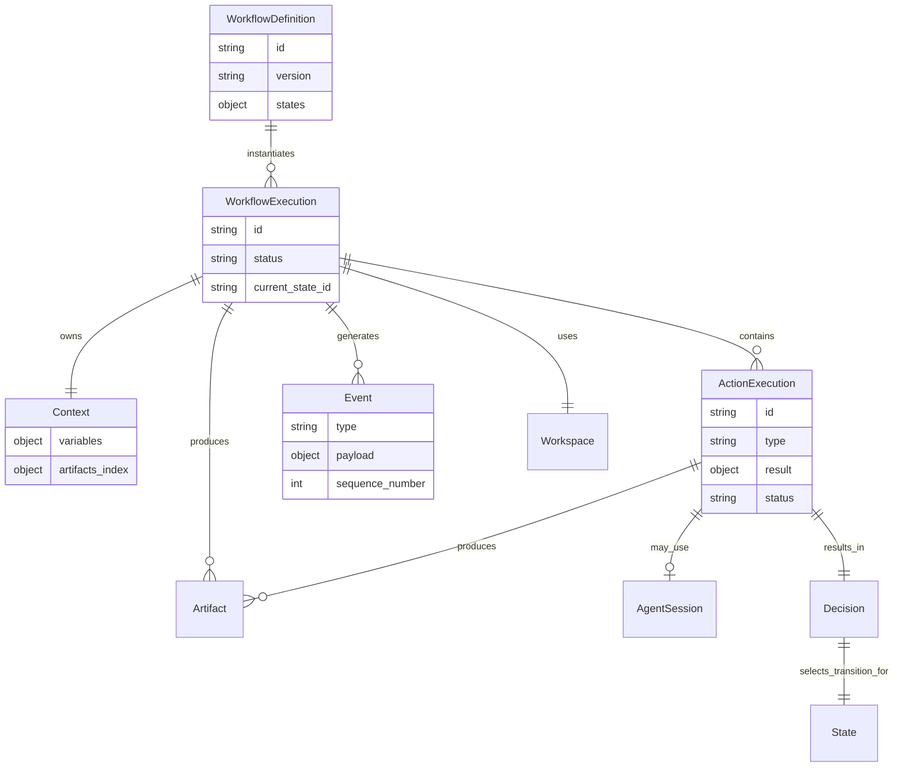

# Domain Model

Niniejszy dokument opisuje model domenowy systemu **AI Workflow Narsor**. Model został zaprojektowany zgodnie z zasadą **deterministycznego rdzenia**, gdzie AI jest jedynie wykonawcą akcji, a nie właścicielem procesu decyzyjnego.

## 1. Przegląd encji

Poniżej przedstawiono główne encje systemu i ich odpowiedzialności:

| Encja | Odpowiedzialność | Trwałość |
|-------|------------------|----------|
| `WorkflowDefinition` | Deklaracja grafu stanów, akcji i przejść | Plik YAML w `/workflows/` |
| `WorkflowExecution` | Instancja wykonania konkretnego workflow | Folder w `/executions/` + `state.json` |
| `State` | Pojedynczy węzeł wgrafie workflow | Część definicji + stan w `state.json` |
| `Action` | Operacja do wykonania w danym stanie | Część definicji |
| `ActionExecution` | Historia wykonania konkretnej akcji | Wpis w `events/` + `state.json` |
| `Context` | Dane współdzielone między krokami workflow | `context.json` w folderze wykonania |
| `Artifact` | Fizyczne pliki wynikowe działania | Pliki w `/artifacts/` + metadata w `context.json` |
| `Workspace` | Środowisko izolowane dla wykonania (filesystem) | Folder `/code/` w tasku |
| `Event` | Niezmienny zapis zdarzenia w systemie | Plik w `/events/` (append-only) |
| `Decision` | Wynik wyboru przejścia na podstawie wyniku akcji | Wpis w `events/` |
| `AgentSession` | Sesja komunikacji z zewnętrznym harnessem AI | Metadata w `state.json` + logi |

---

## 2. Szczegółowy opis encji

### 2.1 WorkflowDefinition

Reprezentuje szablon procesu biznesowego. Jest niezmienny po utworzeniu (wersjonowany).

**Atrybuty:**
- `id`: Unikalny identyfikator (np. slug lub UUID).
- `version`: Wersja semantyczna definicji.
- `name`: Nazwa czytelna dla człowieka.
- `description`: Opis celu workflow.
- `inputs`: Schema oczekiwanych danych wejściowych.
- `states`: Mapa stanów (klucz -> definicja stanu).
- `created_at`: Timestamp utworzenia.

**Struktura stanu (w definicji):**
- `id`: Identyfikator stanu.
- `action`: Definicja akcji do wykonania (typ, konfiguracja).
- `outputs`: Lista możliwych etykiet wyjścia (np. `SUCCESS`, `FAILURE`).
- `transitions`: Mapa etykieta -> ID następnego stanu.
- `decision_provider`: Typ dostarczyciela decyzji (`rule`, `human`, `agent`).
- `allow_manual_override`: Czy użytkownik może wymusić przejście ręczne.

### 2.2 WorkflowExecution

Konkretna instancja uruchomionego workflow. Posiada własny stan, kontekst i historię.

**Atrybuty:**
- `id`: Unikalny identyfikator wykonania (UUID).
- `workflow_definition_id`: Referencja do definicji.
- `workflow_version`: Wersja definicji, na której bazuje wykonanie.
- `status`: `RUNNING`, `PAUSED`, `COMPLETED`, `FAILED`, `CANCELLED`.
- `current_state_id`: ID aktualnie wykonywanego stanu (lub ostatniego).
- `started_at`: Timestamp startu.
- `finished_at`: Timestamp zakończenia (jeśli dotyczy).
- `input_data`: Dane wejściowe przekazane przy starcie.

**Cykl życia:**
1. Tworzenie na podstawie `WorkflowDefinition` i inputów.
2. Przejście do stanu `RUNNING`.
3. Iteracyjne wykonywanie stanów aż do stanu terminalnego.
4. Zmiana statusu na `COMPLETED`/`FAILED`.

### 2.3 State (Instancja)

Reprezentuje aktualną pozycję wykonania w grafie. Nie jest przechowywana jako osobny obiekt, lecz jako pole `current_state_id` w `WorkflowExecution` oraz wpis w historii eventów.

**Dane runtime:**
- `entered_at`: Czas wejścia w stan.
- `action_execution_id`: ID trwającego/wykonanego ActionExecution.
- `retry_count`: Liczba prób ponowienia w tym stanie.

### 2.4 Action

Abstrakcja operacji do wykonania. W modelu domenowym Action jest częścią definicji stanu.

**Typy akcji (MVP):**
- `AgentAction`: Uruchomienie harnessa AI (Claude Code/OpenCode).
- `ScriptAction`: Wykonanie polecenia shell/skryptu.
- `HumanAction`: Oczekiwanie na interwencję człowieka.
- `WaitAction`: Oczekiwanie na zdarzenie zewnętrzne.

**Konfiguracja Action:**
- `type`: Typ akcji.
- `config`: Specyficzne parametry (np. prompt, command, timeout).
- `workspace_scope`: Określenie, które repozytoria są RW, a które RO.
- `outputs`: Deklaracja możliwych wyników (etykiety).

### 2.5 ActionExecution

Reprezentuje pojedyncze wykonanie akcji w ramach stanu.

**Atrybuty:**
- `id`: Unikalny ID wykonania.
- `workflow_execution_id`: FK do wykonania.
- `state_id`: ID stanu, w którym wystąpiło.
- `action_type`: Typ wykonanej akcji.
- `status`: `PENDING`, `RUNNING`, `COMPLETED`, `FAILED`, `UNKNOWN`.
- `started_at`, `finished_at`: Timestampy.
- `result`: Ustrukturyzowany wynik JSON (zgodny z kontraktem D6).
  - `output_label`: Etykieta przejścia (np. `SUCCESS`).
  - `variables`: Zmienne do aktualizacji kontekstu.
  - `artifacts`: Lista wygenerowanych artefaktów.
- `error`: Komunikat błędu (jeśli wystąpił).
- `agent_session_id`: Referencja do sesji agenta (jeśli dotyczy).

### 2.6 Context

Magazyn danych współdzielonych przez wszystkie kroki workflow. Przechowywany jako `context.json`.

**Struktura:**
- `variables`: Płaska mapa kluczy i wartości prostych typów (string, int, bool, list).
  - Przykład: `{ "branch_name": "feature/login", "pr_number": 123 }`.
- `artifacts_index`: Mapa nazw artefaktów do ich lokalizacji/metadanych.
- `workspace_info`: Informacje o aktywnym workspace (ścieżki do repo).

**Zasady:**
- Aktualizowany wyłącznie przez Workflow Engine na podstawie pola `variables` z wyniku Action.
- Nie przechowuje dużych blobów danych (tylko referencje do Artifact).
- Nie przechowuje historii rozmów agentów.

### 2.7 Artifact

Reprezentuje fizyczny plik lub zbiór plików wygenerowany podczas wykonania.

**Atrybuty (metadata):**
- `id`: Unikalny ID.
- `name`: Nazwa logiczna (np. `analysis_report`).
- `type`: Typ MIME lub kategoria (np. `text/markdown`, `application/patch`).
- `path`: Ścieżka względna w folderze `/artifacts/`.
- `size`: Rozmiar w bajtach.
- `created_by`: ID ActionExecution, która wygenerowała artefakt.
- `created_at`: Timestamp.

**Storage:**
- Pliki fizycznie zapisywane w `/executions/{exec_id}/artifacts/{artifact_id}/{filename}`.

### 2.8 Workspace

Reprezentuje środowisko filesystemowe, w którym działają akcje.

**Model MVP:**
- Jeden workspace na `WorkflowExecution` (lub na Task w modelu wielozadaniowym).
- Struktura:
  ```text
  /tasks/{task_id}/code/
    ├── repo_a/  (RW lub RO zależnie od kroku)
    └── repo_b/
  ```
- Izolacja realizowana przez uprawnienia filesystemu i montowanie RO/RW.
- Workspace jest tworzony przy starcie execution i czyszczony po zakończeniu (zgodnie z polityką).

**Checkpoint i materializacja:**
Workspace jest samodzielnie odtwarzalny za sprawą checkpointu — git bundle'a zawierającego deltę zmian względem pinned base commit (zarejestrowanego w `base_commit` na WorkflowExecution). Checkpoint przechowuje tylko różnicę między stanem początkowym a stanem workspace'u po wykonaniu, nie całą historię. Materializacja (przywrócenie workspace'u w innym miejscu lub na innej maszynie) zawsze odbywa się wyłącznie z checkpointu, ignorując ocalałe katalogi na ścieżce — zapewnia to powtarzalność i bezpieczeństwo.

### 2.9 Event

Niezmienny rekord faktu, który wydarzył się w systemie. Podstawa obserwowalności i recovery.

**Typy eventów (MVP):**
- `WorkflowStarted`
- `StateEntered`
- `ActionStarted`
- `ActionAttemptFailed` (U1, `docs/plans/2026-09-26-002-*.md`): nieudana próba, po której
  nastąpi retry — `action_execution_id`, `state_id`, `error`, `retry_in_ms`. Emitowane zaraz po
  próbie, przed uśpieniem backoffu; ostatnia, wyczerpująca próba wciąż emituje tylko
  `ActionFailed`, bez tego zdarzenia. Neutralne dla `reconcile` (D23): akcja pozostaje
  niedomknięta do `ActionFailed` albo `ActionCompleted`.
- `ActionCompleted` (z payloadem result)
- `ActionFailed`
- `DecisionMade` (z wybraną transition)
- `TransitionTaken`
- `EntryLimitReached` (`state_id`, `entries`, `max_entries`): przejście doszło do kroku,
  który osiągnął `max_entries`; krok nie startuje. Kolejność opisuje sekcja 6.
- `EntryLimitCounterReset` (`state_id`, `previous_entries`): operator wyzerował licznik.
- `EntryLimitDecision` (`state_id`, `decision`: `continue` albo `reset_counter`): decyzja
  operatora na limicie.
- `WorkflowPaused` / `WorkflowResumed`
- `WorkflowCompleted` / `WorkflowFailed`
- `HumanInputRequested` / `HumanInputProvided`
- `ExternalEventReceived`

U1 dodał też opcjonalne pola `#[serde(default)]` do zdarzeń istniejących, bez zmiany ich
znaczenia: `action_execution_id` na `AgentSessionStarted`/`AgentSessionCompleted`/
`AgentSessionFailed`/`AgentMessage` (jawne powiązanie próby z jej zdarzeniami agenta, zamiast
wywodzenia go pozycyjnie z logu), `state_id` na `ActionRetrying`, `harness_session_id` na
`AgentSessionCompleted`/`AgentSessionFailed`, i `resumed_session` na `AgentSessionStarted`. Stary
log bez tych pól wczytuje się nadal — deserializują się jako `None`.

**Struktura:**
- `id`: Unikalny ID (UUID lub ULID).
- `timestamp`: Czas wystąpienia.
- `type`: Typ eventu.
- `aggregate_id`: ID WorkflowExecution.
- `payload`: Dane specyficzne dla typu (JSON).
- `sequence_number`: Numer sekwencyjny w ramach execution (do porządkowania).

**Storage:**
- Append-only log w `/executions/{exec_id}/events/{sequence_number}.json`.

### 2.10 Decision

Reprezentuje akt wyboru ścieżki przejścia. Może być podjęty przez reguły, agenta lub człowieka.

**Atrybuty:**
- `id`: Unikalny ID.
- `provider_type`: `rule`, `agent`, `human`.
- `input_result`: Wynik akcji, na podstawie którego podjęto decyzję.
- `selected_transition`: Wybrana etykieta przejścia.
- `reason`: Uzasadnienie (opcjonalne, np. komentarz człowieka lub output agenta).
- `timestamp`: Czas podjęcia decyzji.

### 2.11 AgentSession

Reprezentuje połączenie z zewnętrznym harnessem AI.

**Atrybuty:**
- `id`: Unikalny ID sesji.
- `harness_type`: `claude-code`, `opencode`.
- `status`: `ACTIVE`, `COMPLETED`, `TERMINATED`, `FAILED`.
- `working_directory`: Ścieżka, w której działa agent.
- ~~`log_path`: Ścieżka do logu surowej sesji.~~ — zastąpione **zapisem rozmowy per
  `action_execution_id`** (U2/U3 z `docs/plans/2026-09-26-002-*.md`, D51): każda próba akcji
  agenta ma własny, przyrostowo dopisywany plik JSONL w
  `{state}/executions/{id}/conversations/{action_execution_id}.jsonl`, kompresowany do
  `.jsonl.zst` po zamknięciu próby. `AgentSession` nie ma jednego logu na sesję, bo sesja
  harnessu (`--resume`) i próba akcji nie są tym samym pojęciem — próba dostaje zawsze nowy
  zapis, sesja harnessu bywa kontynuowana (`resumed_session` w `AgentSessionStarted`). Klucz
  zapisu jest ten sam, co klucz idempotencji próby (D24), więc nie ma osobnego identyfikatora do
  zarządzania.
- `resume_token`: Token umożliwiający wznowienie (jeśli harness obsługuje) — odpowiada polu
  `harness_session_id`/`resumed_session` na zdarzeniach `AgentSession*` (U1).

**Relacja:**
- Jedno `ActionExecution` typu `AgentAction` może mieć jedną aktywną `AgentSession`.
- Po restarcie systemu stara sesja może być nieważna; tworzona jest nowa sesja z kontekstem poprzedniej.
- Każda próba (`retry`) tej samej `ActionExecution` dostaje własny zapis rozmowy, tak jak dostaje
  własny `action_execution_id` — dwie próby tego samego stanu nigdy nie dzielą jednego pliku.

---

## 3. Relacje między encjami



### Kluczowe zasady relacji:

1. **Jeden do wielu**: Jedna definicja workflow może mieć wiele wykonań.
2. **Własność kontekstu**: `WorkflowExecution` jest jedynym właścicielem `Context`. Akcje mogą tylko sugerować zmiany (`variables` w wyniku), ale to Engine zatwierdza aktualizację.
3. **Niezależność sesji**: `AgentSession` jest podporządkowana `ActionExecution`. Jeśli akcja zostanie powtórzona (retry), tworzona jest nowa sesja.
4. **Artefakty jako skutek uboczny**: Artefakty są produktem `ActionExecution`, ale żyją dłużej niż sama akcja – są dostępne przez cały czas trwania execution.
5. **Eventy jako źródło prawdy**: Stan `WorkflowExecution` jest projekcją serii eventów. Każda zmiana stanu musi być poprzedzona eventem.

---

## 4. Cykl życia danych

### 4.1 Start Execution
1. Utworzenie folderu `/executions/{id}/`.
2. Zapisanie `state.json` (status: `RUNNING`, current_state: pierwszy).
3. Zapisanie `context.json` (z inputów).
4. Emit eventu `WorkflowStarted`.

### 4.2 Wykonanie kroku
1. Emit `StateEntered`.
2. Utworzenie `ActionExecution` (status: `RUNNING`).
3. Emit `ActionStarted`.
4. Wykonanie akcji (np. start agenta).
5. Odebranie wyniku JSON.
6. Zapisanie wyniku w `ActionExecution`.
7. Emit `ActionCompleted` (z payloadem result).

### 4.3 Decyzja i przejście
1. Evaluation DecisionProvider (reguły/human/agent).
2. Utworzenie obiektu `Decision`.
3. Emit `DecisionMade`.
4. Aktualizacja `context.json` (zmienne z wyniku).
5. Emit `TransitionTaken`.
6. Aktualizacja `state.json` (next_state).

### 4.4 Zakończenie
1. Wejście w stan terminalny.
2. Emit `WorkflowCompleted`.
3. Zmiana statusu na `COMPLETED`.
4. (Opcjonalnie) Czyszczenie workspace zgodnie z polityką.

---

## 5. Walidacja spójności

System musi zapewniać następujące inwarianty:

- **Spójność wersji**: `WorkflowExecution` zawsze odnosi się do istniejącej wersji `WorkflowDefinition`.
- **Istnienie przejść**: Transition wybrany w `Decision` musi istnieć w definicji stanu.
- **Unikalność ID**: Wszystkie ID (execution, action, event, artifact) muszą być unikalne globalnie lub w zakresie execution.
- **Atomowość kontekstu**: Aktualizacja `context.json` musi być atomowa (zapis do pliku tymczasowego + rename), aby uniknąć uszkodzeń przy crashu.
- **Monotoniczność eventów**: `sequence_number` eventów musi być rosnący bez luk (w granicach jednego execution).

---

## 6. Rozszerzalność modelu

### Odpowiedzi kroków i limity wejść

`metadata.engine.step_replies` przechowuje mapę `state_id → action_execution_id`.
Treść odpowiedzi znajduje się w `step-replies/{action_execution_id}.txt` i jest
zapisywana atomowo przed zatwierdzeniem wskaźnika w `state.json`. Nieudane
wejście nie zastępuje ostatniej odpowiedzi. `metadata.engine.state_entries`
przechowuje liczbę wejść do kroków; licznik jest aktualizowany razem z
przejściem i przetrwa restart procesu.

Oczekiwanie na limicie pozostaje w statusie `InputNeeded` i używa trwałego
`pending_input.json`. Historia zdarzeń opisuje zatrzymanie, decyzję operatora
i ewentualne wyzerowanie licznika. Wybór etykiety na limicie rozstrzyga wynik
kroku przez ścieżkę `ResolveOutput`, z walidacją wymaganych zmiennych.

Kolejność zdarzeń na limicie:

1. `TransitionTaken` do kroku na limicie.
2. `HumanInputRequested`, potem `EntryLimitReached`. Brak `StateEntered` i
   `ActionStarted`: krok nie startuje.
3. Po decyzji operatora: `HumanInputReceived`, potem `EntryLimitCounterReset`
   (tylko dla `reset_counter`), potem `EntryLimitDecision`.
4. Krok startuje: `StateEntered`, `ActionStarted`. `continue` zwiększa licznik
   o 1, `reset_counter` ustawia go na 1.

Wybór etykiety na limicie nie emituje `EntryLimitDecision`: krok kończy się
wybranym wynikiem i nie startuje.

Cofnięcie wyboru wyjścia przez dyrygenta (KTD13) przywraca `context` i
`metadata.engine.state_entries` sprzed decyzji. Problem otwarty ponownie
zawiera odpowiedź kroku (`reply`), więc nowe rozstrzygnięcie zapisuje ją
znowu we wskaźniku `metadata.engine.step_replies`.

Model został zaprojektowany z myślą o przyszłych rozszerzeniach:

- **Parallel States**: Dodanie pola `parallel_group_id` do stanu pozwoliłoby na grupowanie stanów wykonywanych równolegle.
- **Sub-workflows**: Możliwość zagnieżdżania `WorkflowExecution` wewnątrz `ActionExecution` (typ `WorkflowAction`).
- **Policy Engine**: Oddzielenie logiki decyzyjnej do zewnętrznych modułów poprzez uogólnienie `DecisionProvider`.
- **Multi-tenancy**: Dodanie `tenant_id` do wszystkich encji głównych pozwoli na obsługę wielu użytkowników.
