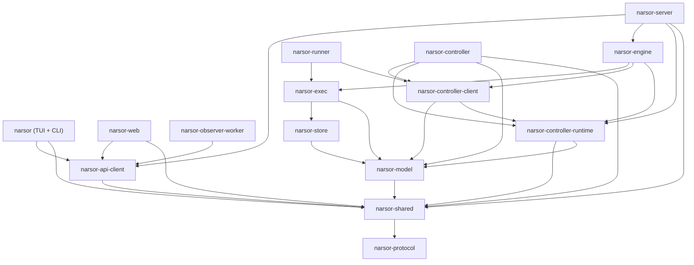
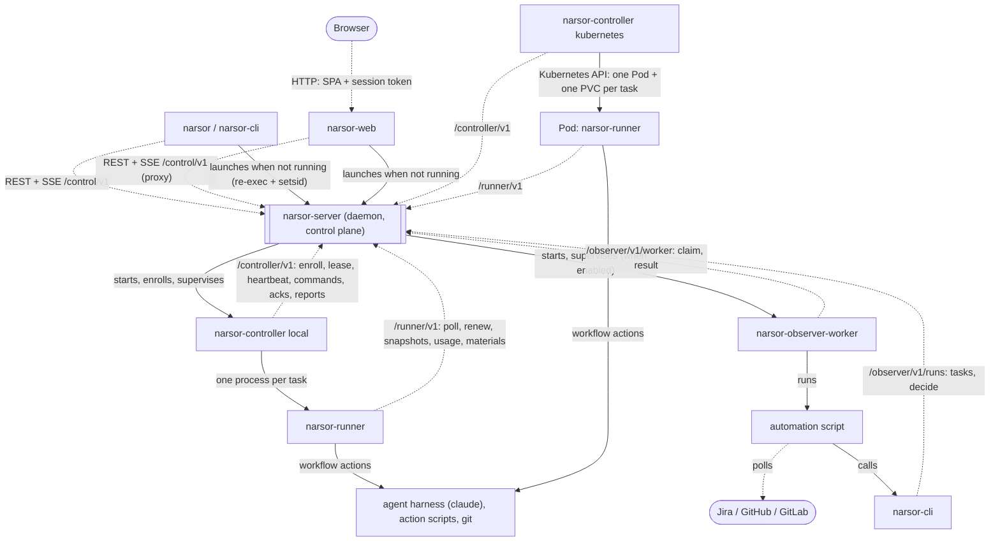

# Components and dependencies

This document maps the crates of the workspace, the dependencies between
them at build time, and the processes they become at runtime. For the
decisions behind this structure, see `architecture.md`.

## Crates

| Crate | Responsibility |
|---|---|
| `narsor` (root, `src/`) | The `narsor` (TUI) and `narsor-cli` binaries and the client library they share. |
| `narsor-protocol` | Wire types shared by clients and services: REST API, events, controller protocol, panel forms. |
| `narsor-shared` | Small contracts shared by the processes: API errors, configuration. |
| `narsor-api-client` | HTTP/SSE client transport; discovers a running `narsor-server` or launches one. |
| `narsor-controller-runtime` | Lifecycle helpers shared by the local controller and the `narsor-controller` process. |
| `narsor-controller-client` | The client side of the controller protocol: `ControllerClient`, `RunnerClient`, the wire types, proof-of-possession signing, and the adapter to `narsor-controller-runtime`. |
| `narsor-model` | The model layer: domain types, workflow definitions (schema, loading, templates, validation) and shared configuration. No I/O beyond reading workflow files. |
| `narsor-store` | File-backed storage primitives: state paths, atomic writes, file locks, the execution store, event logs and conversation records. |
| `narsor-exec` | The execution layer: the Engine that runs a workflow, the conductor, task workspaces, the repository registry, task definitions and their sources, and the API projections of an execution. |
| `narsor-engine` | The control plane: orchestration, controller protocol service, auth, observers, materials, environment configuration and launch resolution. Re-exports `narsor-exec`, `narsor-model`, `narsor-store` (as `persistence`) and `narsor-controller-client` under its old module paths. |
| `narsor-server` | The daemon (control plane): the API server, its lifecycle and the child processes it supervises. |
| `narsor-runner` | The isolated task runner: the Engine run against one portable task storage. |
| `narsor-controller` | The environment controller process: `narsor-controller local` and `narsor-controller kubernetes`. |
| `narsor-observer-worker` | The observer worker: claims the due runs of the catalogue's automations (`in`, `check`, `out`) and executes their scripts. |
| `narsor-web` | The browser interface: serves the single-page application and proxies `/control/v1` to a `narsor-server`. |

## Build-time dependencies

Taken from the `[dependencies]` sections of the `Cargo.toml` files. An arrow
means "depends on". Every crate except `narsor-protocol` also depends on
`narsor-protocol` directly; those edges are left out for readability.

| Crate | Depends on |
|---|---|
| `narsor` (root) | api-client, protocol, shared |
| `narsor-web` | api-client, protocol, shared |
| `narsor-observer-worker` | api-client, protocol |
| `narsor-server` | api-client, engine, controller-runtime, protocol, shared |
| `narsor-runner` | exec, controller-client, protocol |
| `narsor-controller` | model, controller-client, controller-runtime, protocol, shared |
| `narsor-engine` | exec, model, store, controller-client, controller-runtime, protocol, shared |
| `narsor-exec` | model, store, protocol, shared |
| `narsor-controller-client` | model, controller-runtime, protocol, shared |
| `narsor-store` | model, protocol |
| `narsor-model` | protocol, shared |
| `narsor-api-client` | protocol, shared |
| `narsor-controller-runtime` | model, protocol, shared |
| `narsor-shared` | protocol |
| `narsor-protocol` | — |

Rules this graph keeps:

- Clients (`narsor`, `narsor-web`, `narsor-observer-worker`) do not depend on
  `narsor-engine`. They reach the engine only through `narsor-api-client`.
- Only `narsor-server` links `narsor-engine` (the control plane).
  `narsor-runner` links only the execution layer (`narsor-exec`) and the
  protocol client (`narsor-controller-client`). `narsor-controller` links
  neither: it needs only the domain types (`narsor-model`), configuration
  and Git rules (`narsor-shared`) and the controller crates.
- `narsor-protocol` has no workspace dependencies.

The root package lists every crate under `[dev-dependencies]`. Only the
integration tests in `tests/` use them, so the graph does not show them.

## Runtime processes

Which process starts which, and how the processes talk to each other.
Solid arrows are process starts; dashed arrows are HTTP calls.

| From | To | Kind | Channel |
|---|---|---|---|
| `narsor`, `narsor-cli`, `narsor-web` | `narsor-server` | Discover the daemon; launch it when it is not running | process (`api-client/src/api/launch.rs`) |
| `narsor`, `narsor-cli`, `narsor-web` | `narsor-server` | Owner operations and the event stream | REST + SSE, `/control/v1` |
| Browser | `narsor-web` | Application files and the API proxy | HTTP, loopback only |
| `narsor-server` | `narsor-controller local` | Start as a child with the server's configuration file (or `--no-config`) and only its `NARSOR_GLOBAL__*` / `NARSOR_CONTROLLER__*` variables; enroll, supervise | process (`server/src/local_controller.rs`, `shared/src/config/local_controller.rs`) |
| `narsor-cli` | `narsor-server`, `narsor-web`, `narsor`, `narsor-runner`, `narsor-controller` | `config show`: run each sibling binary with `--check-config` and merge the JSON reports | process (`src/cli/commands/config.rs`) |
| `narsor-server` | `narsor-observer-worker` | Start and supervise when `server.observer.enabled` is `true` | process (`server/src/observer_worker.rs`) |
| `narsor-controller` (local, kubernetes) | `narsor-server` | Enroll, lease, heartbeat, commands, acks, reports | HTTP, `/controller/v1` |
| `narsor-controller local` | `narsor-runner` | One runner per task: a host process, or a container in the Docker work mode | process (`narsor-controller/src/local/process.rs`), `docker` CLI (`narsor-controller/src/local/container/`) |
| `narsor-controller kubernetes` | Kubernetes | One Pod (command `narsor-runner`) and one PVC per task | Kubernetes API (`controller/src/kubernetes/manifest.rs`) |
| `narsor-runner` | `narsor-server` | Poll, renew, snapshots, usage, materials | HTTP, `/runner/v1` |
| `narsor-runner` | agent harness, scripts, git | Execute workflow actions | process (`engine/src/engine/actions/`) |
| `narsor-observer-worker` | `narsor-server` | Claim due runs (the server holds the claim up to 25 s), report results | HTTP, `/observer/v1/worker` |
| Automation script (`check` only) | `narsor-cli` → `narsor-server` | Create tasks (`task create --data`); answer the decision gate of its queue entry (`task decide`, `POST /observer/v1/runs/{run}/decide`) | process, then HTTP `/observer/v1/runs` |

Properties of the runtime:

- `narsor-server` is the only hub. Every other process talks to it over
  HTTP. The server does not call controllers or runners; they pull work
  from it (poll, commands).
- The `local` backend works like the `kubernetes` backend: its controller is
  a separate process that enrolls through the same `/controller/v1`
  protocol.
- Each binary reads only `global` and its own sections of the configuration
  file (`narsor-shared`, `config/scope.rs`): `narsor-server` the `server`
  section, `narsor-controller local` the `controller` section,
  `narsor-runner` the `runner` section, `narsor` the `tui` section,
  `narsor-web` the `web` section, and the clients also `server.state` for
  daemon discovery. An error in one section stops only the programs that
  read it. See `docs/user/configuration.md`.
- Automations and queues are catalogue files (`{catalog}/automations/`,
  `{catalog}/queues/`), read by `narsor-engine` (`automations/`) at every
  load, with no cache. Their scheduling lives in the control plane only
  (`observers/` and `controller_protocol/service/observers/`), per (queue,
  automation) pair, with the runtime state in
  `{state}/observer-queues/automations/{queue}/{automation}/`. A runner
  reports the rendered `watch` of a waiting `decision` gate in its snapshot
  (`gate_watch`). The control plane keeps one queue entry per wait episode
  in `{state}/observer-queues/entries/`, runs the `in` scripts when the
  episode begins, holds every exit on the task record until the `out`
  scripts ended, and then removes the entry. A runner gets an automation's
  answer as a queued input, as a person's answer; a held exit reaches it at
  its next poll. The runner protocol has no event delivery (D77, D78).
- Only `narsor-runner` executes workflows. The daemon drives no execution:
  its `/executions` routes read what runners keep and hand answers to the
  task of the execution.
