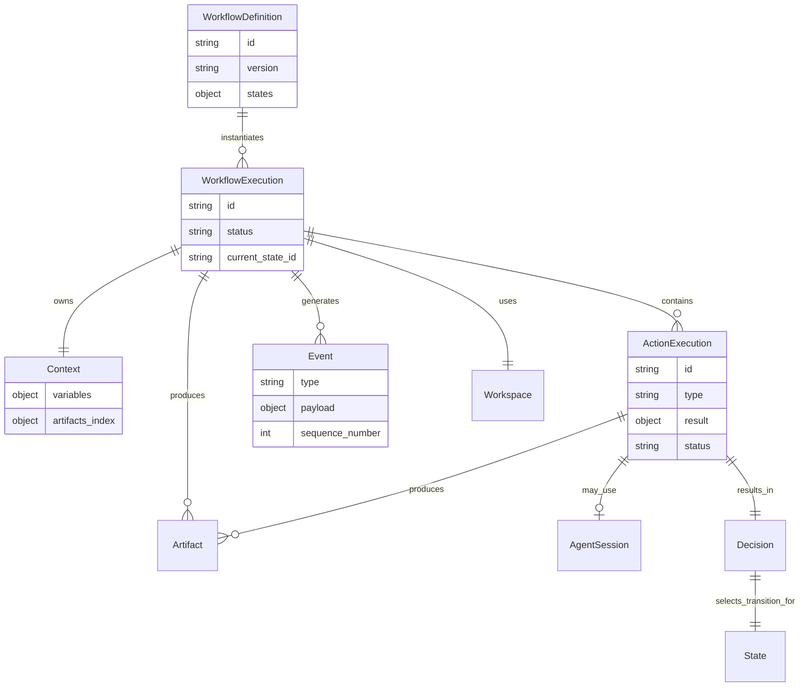

# Domain Model

This document describes the domain model of the **AI Workflow Narsor** system. The model was designed according to the principle of a **deterministic core**, where the AI is only an executor of actions and not the owner of the decision-making process.

## 1. Entity overview

The main entities of the system and their responsibilities are presented below:

| Entity | Responsibility | Persistence |
|-------|------------------|----------|
| `WorkflowDefinition` | Declaration of the graph of states, actions and transitions | YAML file in `/workflows/` |
| `WorkflowExecution` | An instance of executing a specific workflow | Folder in `/executions/` + `state.json` |
| `State` | A single node in the workflow graph | Part of the definition + state in `state.json` |
| `Action` | An operation to perform in a given state | Part of the definition |
| `ActionExecution` | History of the execution of a specific action | Entry in `events/` + `state.json` |
| `Context` | Data shared between workflow steps | `context.json` in the execution folder |
| `Artifact` | Physical output files of an action | Files in `/artifacts/` + metadata in `context.json` |
| `Workspace` | An isolated environment for the execution (filesystem) | `/code/` folder in the task |
| `Event` | An immutable record of an event in the system | File in `/events/` (append-only) |
| `Decision` | The result of choosing a transition based on an action result | Entry in `events/` |
| `AgentSession` | A communication session with an external AI harness | Metadata in `state.json` + logs |

---

## 2. Detailed description of entities

### 2.1 WorkflowDefinition

Represents a business process template. It is immutable after creation (versioned).

**Attributes:**
- `id`: Unique identifier (e.g. a slug or UUID).
- `version`: Semantic version of the definition.
- `name`: Human-readable name.
- `description`: Description of the workflow's purpose.
- `inputs`: Schema of expected input data.
- `states`: Map of states (key -> state definition).
- `created_at`: Creation timestamp.

**State structure (in the definition):**
- `id`: State identifier.
- `action`: Definition of the action to execute (type, configuration).
- `variables`: Step variables (`name`, `description`). A name with the `local.` prefix denotes a step-local variable. Only `agent` and `script` steps; `local.*` only for `agent`.
- `artifacts`: Named step artifacts (`name`, `description`). Only `agent` and `script` steps.
- `choices`: List of possible choices. Each has a `label`, an optional `description`, a `requires_variables` list and a `requires_artifacts` list (names from the step definition), and the optional `requires_human_approval` and `resume_comment_field`.
- `transitions`: Map of label -> ID of the next state.
- `decision_provider`: Type of decision provider (`rule`, `human`, `agent`).
- `allow_manual_override`: Whether the user can force a manual transition.

### 2.2 WorkflowExecution

A concrete instance of a running workflow. It has its own state, context and history.

**Attributes:**
- `id`: Unique execution identifier (UUID).
- `workflow_definition_id`: Reference to the definition.
- `workflow_version`: Version of the definition the execution is based on.
- `status`: `RUNNING`, `PAUSED`, `COMPLETED`, `FAILED`, `CANCELLED`.
- `current_state_id`: ID of the currently executing state (or the last one).
- `started_at`: Start timestamp.
- `finished_at`: Completion timestamp (if applicable).
- `input_data`: Input data passed at start.

**Lifecycle:**
1. Creation based on a `WorkflowDefinition` and inputs.
2. Transition to the `RUNNING` state.
3. Iterative execution of states until a terminal state.
4. Status change to `COMPLETED`/`FAILED`.

### 2.3 State (Instance)

Represents the current position of the execution in the graph. It is not stored as a separate object, but as the `current_state_id` field in `WorkflowExecution` and an entry in the event history.

**Runtime data:**
- `entered_at`: Time of entering the state.
- `action_execution_id`: ID of the ongoing/executed ActionExecution.
- `retry_count`: Number of retry attempts in this state.

### 2.4 Action

An abstraction of an operation to execute. In the domain model, an Action is part of a state definition.

**Action types (MVP):**
- `AgentAction`: Launching an AI harness (Claude Code/OpenCode).
- `ScriptAction`: Executing a shell command/script.
- `HumanAction`: Waiting for human intervention.
- `WaitAction`: Waiting for an external event.

**Action configuration:**
- `type`: Action type.
- `config`: Specific parameters (e.g. prompt, command, timeout).
- `workspace_scope`: Specifies which repositories are RW and which are RO.
- `history` (`AgentAction` only): Whether the engine adds the re-entry history to the prompt (default `true`).

The possible results of an action are declared by the state in `choices`, not by the action.

### 2.5 ActionExecution

Represents a single execution of an action within a state.

**Attributes:**
- `id`: Unique execution ID.
- `workflow_execution_id`: FK to the execution.
- `state_id`: ID of the state in which it occurred.
- `action_type`: Type of the executed action.
- `status`: `PENDING`, `RUNNING`, `COMPLETED`, `FAILED`, `UNKNOWN`.
- `started_at`, `finished_at`: Timestamps.
- `result`: Structured result (`ActionResult`, the D64 contract).
  - `output_label`: Transition label. The agent and script provide it in the `choice` field of the response.
  - `reason`: A single line of rationale for the choice. Empty text when the action did not provide it. A `timeout` result gets `reason` from the engine.
  - `variables`: Variables defined on the step (global and `local.*`). The engine removes from them variables outside the step definition before saving the result (exception: `agent_session_id`).
  - `artifacts`: Named step artifacts, a name → path map.
  - `additional_data`: Any object outside the step definition. The engine does not interpret it. Variables outside the step definition also end up here.
  - `additional_artifacts`: A list of file paths outside the step definition.
  - `data`: Engine writes only (`agent_session`, `timeout_secs`). The agent and script do not write to this field.
  - `exit_code`, `stdout`, `stderr`, `reply`: Data observed by the executor.
- `error`: Error message (if one occurred).
- `agent_session_id`: Reference to the agent session (if applicable).

### 2.6 Context

A data store shared by all workflow steps. Stored as `context.json`.

**Structure:**
- `variables`: A flat map of keys and values of simple types (string, int, bool, list).
  - Example: `{ "branch_name": "feature/login", "pr_number": 123 }`.
  - Does not contain `local.*` variables (see below).
- `artifacts_index`: A map of artifact names to their locations/metadata. A named step artifact is available in a template as `{{ artifacts.NAME }}` (the path of the last write).
- `workspace_info`: Information about the active workspace (paths to repos).

**Rules:**
- Updated exclusively by the Workflow Engine based on the `variables` field of the Action result. The engine writes only the global variables defined on the step and the values of `human` gate fields.
- `local.*` variables do not go into the context. The engine keeps them in the execution's `metadata.engine.step_locals` (`state.json`), separately for each step (`state_id → { "local.NAME": value }`). The value lives within a single execution. A new value replaces the old one entirely. When an attempt does not provide a value, the previous one stays. The template `{{ local.NAME }}` reads it only in the same step.
- Does not store large data blobs (only references to Artifact).
- Does not store agent conversation history.

### 2.7 Artifact

Represents a physical file or a set of files generated during the execution.

**Attributes (metadata):**
- `id`: Unique ID.
- `name`: Logical name (e.g. `analysis_report`).
- `type`: MIME type or category (e.g. `text/markdown`, `application/patch`).
- `path`: Relative path in the `/artifacts/` folder.
- `size`: Size in bytes.
- `created_by`: ID of the ActionExecution that generated the artifact.
- `created_at`: Timestamp.

**Storage:**
- Files physically stored in `/executions/{exec_id}/artifacts/{artifact_id}/{filename}`.

### 2.8 Workspace

Represents the filesystem environment in which actions run.

**MVP model:**
- One workspace per `WorkflowExecution` (or per Task in the multi-task model).
- Structure:
  ```text
  /tasks/{task_id}/code/
    ├── repo_a/  (RW or RO depending on the step)
    └── repo_b/
  ```
- Isolation implemented through filesystem permissions and RO/RW mounting.
- The workspace is created at the start of the execution and cleaned up after it finishes (according to policy).

**Checkpoint and materialization:**
The workspace is self-reproducible thanks to a checkpoint — a git bundle containing the delta of changes relative to the pinned base commit (recorded in `base_commit` on WorkflowExecution). The checkpoint stores only the difference between the initial state and the state of the workspace after execution, not the whole history. Materialization (restoring the workspace in another place or on another machine) always happens solely from the checkpoint, ignoring surviving directories on the path — this ensures repeatability and safety.

### 2.9 Event

An immutable record of a fact that happened in the system. The basis of observability and recovery.

**Event types (MVP):**
- `WorkflowStarted`
- `StateEntered`
- `ActionStarted`
- `ActionAttemptFailed` (U1, `docs/plans/2026-09-26-002-*.md`): a failed attempt after which a
  retry will follow — `action_execution_id`, `state_id`, `error`, `retry_in_ms`. Emitted right after the
  attempt, before the backoff sleep; the last, exhausting attempt still emits only
  `ActionFailed`, without this event. Neutral for `reconcile` (D23): the action remains
  unclosed until `ActionFailed` or `ActionCompleted`.
- `ActionCompleted` (`action_execution_id`, `output_label`, `reason`, `additional_data`,
  `warnings`): `warnings` contains, among other things, a warning about a variable outside the step definition.
- `ActionFailed` (`action_execution_id`, `error`, `error_type`)
- `DecisionMade` (with the chosen transition; `reasoning` is the step's `reason` or the human's comment)
- `TransitionTaken`
- `EntryLimitReached` (`state_id`, `entries`, `max_entries`): a transition reached a step
  that has hit `max_entries`; the step does not start. The order is described in section 6.
- `EntryLimitCounterReset` (`state_id`, `previous_entries`): the operator reset the counter.
- `EntryLimitDecision` (`state_id`, `decision`: `continue` or `reset_counter`): the operator's
  decision at the limit.
- `WorkflowPaused` / `WorkflowResumed`
- `WorkflowCompleted` / `WorkflowFailed`
- `HumanInputRequested` (`instruction`, `reason`, `required_values`, `answer_tail`, `episode`):
  a gate after an `agent` or `script` step shows the step's `reason` and the values its
  choice required. There is no `question` field.
- `HumanInputReceived` (`input`, `output_label`, `artifacts`, `variables`, `comment` and others):
  `artifacts` are the named step artifacts provided by the operator when resolving a problem
  (formerly the `data` field).
- `ExternalEventReceived`

U1 also added optional `#[serde(default)]` fields to existing events, without changing their
meaning: `action_execution_id` on `AgentSessionStarted`/`AgentSessionCompleted`/
`AgentSessionFailed`/`AgentMessage` (an explicit link between an attempt and its agent events, instead of
deriving it positionally from the log), `state_id` on `ActionRetrying`, `harness_session_id` on
`AgentSessionCompleted`/`AgentSessionFailed`, and `resumed_session` on `AgentSessionStarted`. An old
log without these fields still loads — they deserialize as `None`.

**Structure:**
- `id`: Unique ID (UUID or ULID).
- `timestamp`: Time of occurrence.
- `type`: Event type.
- `aggregate_id`: ID of the WorkflowExecution.
- `payload`: Type-specific data (JSON).
- `sequence_number`: Sequence number within the execution (for ordering).

**Storage:**
- Append-only log in `/executions/{exec_id}/events/{sequence_number}.json`.

### 2.10 Decision

Represents the act of choosing a transition path. It can be made by rules, an agent or a human.

**Attributes:**
- `id`: Unique ID.
- `provider_type`: `rule`, `agent`, `human`.
- `input_result`: The action result on the basis of which the decision was made.
- `selected_transition`: The chosen transition label.
- `reason`: Rationale (optional). For a rule decision after an `agent` or `script` step, this is the `reason` from the step's response (the `DecisionMade.reasoning` field). For a human decision, it is their comment.
- `timestamp`: Time the decision was made.

### 2.11 AgentSession

Represents a connection to an external AI harness.

**Attributes:**
- `id`: Unique session ID.
- `harness_type`: `claude-code`, `opencode`.
- `status`: `ACTIVE`, `COMPLETED`, `TERMINATED`, `FAILED`.
- `working_directory`: The path in which the agent runs.
- ~~`log_path`: Path to the raw session log.~~ — replaced by a **conversation record per
  `action_execution_id`** (U2/U3 from `docs/plans/2026-09-26-002-*.md`, D51): every attempt of an
  agent action has its own, incrementally appended JSONL file in
  `{state}/executions/{id}/conversations/{action_execution_id}.jsonl`, compressed to
  `.jsonl.zst` after the attempt closes. `AgentSession` has no single log per session, because a
  harness session (`--resume`) and an action attempt are not the same concept — an attempt always gets a new
  record, while a harness session may be continued (`resumed_session` in `AgentSessionStarted`). The record
  key is the same as the attempt's idempotency key (D24), so there is no separate identifier to
  manage.
- `resume_token`: A token enabling resumption (if the harness supports it) — corresponds to the
  `harness_session_id`/`resumed_session` field on the `AgentSession*` events (U1).

**Relationship:**
- A single `ActionExecution` of type `AgentAction` may have one active `AgentSession`.
- After a system restart the old session may be invalid; a new session is created with the context of the previous one.
- Every attempt (`retry`) of the same `ActionExecution` gets its own conversation record, just as it gets
  its own `action_execution_id` — two attempts of the same state never share one file.

---

## 3. Relationships between entities



### Key relationship rules:

1. **One to many**: One workflow definition can have many executions.
2. **Context ownership**: `WorkflowExecution` is the sole owner of `Context`. Actions can only suggest changes (`variables` in the result), but the Engine approves the update.
3. **Session independence**: `AgentSession` is subordinate to `ActionExecution`. If an action is repeated (retry), a new session is created.
4. **Artifacts as a side effect**: Artifacts are a product of `ActionExecution`, but they live longer than the action itself – they are available for the whole duration of the execution.
5. **Events as the source of truth**: The state of `WorkflowExecution` is a projection of a series of events. Every state change must be preceded by an event.

---

## 4. Data lifecycle

### 4.1 Start Execution
1. Create the `/executions/{id}/` folder.
2. Write `state.json` (status: `RUNNING`, current_state: the first one).
3. Write `context.json` (from the inputs).
4. Emit the `WorkflowStarted` event.

### 4.2 Step execution
1. Emit `StateEntered`.
2. Create an `ActionExecution` (status: `RUNNING`).
3. Emit `ActionStarted`.
4. Execute the action (e.g. start the agent).
5. Receive the JSON result.
6. Save the result in `ActionExecution`.
7. Emit `ActionCompleted` (with the result payload).

### 4.3 Decision and transition
1. Evaluation of the DecisionProvider (rules/human/agent).
2. Create a `Decision` object.
3. Emit `DecisionMade`.
4. Update `context.json` (variables from the result).
5. Emit `TransitionTaken`.
6. Update `state.json` (next_state).

### 4.4 Completion
1. Enter a terminal state.
2. Emit `WorkflowCompleted`.
3. Change the status to `COMPLETED`.
4. (Optionally) Clean up the workspace according to policy.

---

## 5. Consistency validation

The system must ensure the following invariants:

- **Version consistency**: `WorkflowExecution` always refers to an existing version of `WorkflowDefinition`.
- **Existence of transitions**: A transition chosen in a `Decision` must exist in the state definition.
- **ID uniqueness**: All IDs (execution, action, event, artifact) must be unique globally or within the scope of an execution.
- **Context atomicity**: Updating `context.json` must be atomic (write to a temporary file + rename) to avoid corruption on a crash.
- **Event monotonicity**: The `sequence_number` of events must be increasing without gaps (within a single execution).

---

## 6. Model extensibility

### Step responses and entry limits

`metadata.engine.step_replies` stores a `state_id → action_execution_id` map.
The response content is in `step-replies/{action_execution_id}.txt` and is
written atomically before the pointer in `state.json` is committed. A failed
entry does not replace the last response. `metadata.engine.state_entries`
stores the number of entries into steps; the counter is updated together with
the transition and survives a process restart.

A wait at the limit remains in the `InputNeeded` status and uses a durable
`pending_input.json`. The event history describes the stop, the operator's
decision and any counter reset. Choosing a label at the limit settles the step
result through the `ResolveOutput` path, with validation of the required variables and
artifacts.

The order of events at the limit:

1. `TransitionTaken` to the step at the limit.
2. `HumanInputRequested`, then `EntryLimitReached`. No `StateEntered` or
   `ActionStarted`: the step does not start.
3. After the operator's decision: `HumanInputReceived`, then `EntryLimitCounterReset`
   (only for `reset_counter`), then `EntryLimitDecision`.
4. The step starts: `StateEntered`, `ActionStarted`. `continue` increments the counter
   by 1, `reset_counter` sets it to 1.

Choosing a label at the limit does not emit `EntryLimitDecision`: the step ends with
the chosen result and does not start.

Undoing an output choice by the conductor (KTD13) restores `context`,
`metadata.engine.state_entries`, `metadata.engine.step_attempts` and
`metadata.engine.step_locals` from before the decision. A problem reopened
contains the step's response (`reply`), so the new resolution writes it
again into the `metadata.engine.step_replies` pointer.

### Entries, attempts and step memory

`metadata.engine.step_attempts` stores for each step the number of entries
(`entries`) and a list of attempts (`attempts`), from the oldest:

```json
{"plan": {"entries": 3, "attempts": [
  {"ended": "choice", "choice": "needs_requirements_revision", "reason": "…"},
  {"ended": "failure", "error_type": "timeout"}
]}}
```

An entry is a transition into a step (`TransitionTaken`), the initial state, a manual
operator transition or an undo of a decision by the conductor. Not a new entry:
resumption after an agent question, return from an approval, a reprompt, a retry from
`retry_policy` or recovery after a crash. An attempt is the outcome of an entry: a choice with
`reason` (`ended: choice`) or an error ending the step with an error kind
(`ended: failure`). The engine records entries and attempts for every step, but renders the history
block only in the prompt of an `agent` step (`workflow-schema.md` §3.3).

`metadata.engine.step_locals` stores the `local.*` values of each step
(§2.6).

Both records are made in the same `state.json` write as the context (or as
marking the execution as failed), so after a crash they do not differ from the
context. The `state_entries` counter and `max_entries` are separate. Resetting the
`state_entries` counter does not change the history numbering.

The model was designed with future extensions in mind:

- **Parallel States**: Adding a `parallel_group_id` field to a state would allow grouping states executed in parallel.
- **Sub-workflows**: The ability to nest `WorkflowExecution` inside `ActionExecution` (a `WorkflowAction` type).
- **Policy Engine**: Separating decision logic into external modules by generalizing `DecisionProvider`.
- **Multi-tenancy**: Adding `tenant_id` to all main entities will allow supporting multiple users.


## Ticket and task title

`TaskLaunchSpec` has two optional fields: `ticket` (up to 64 characters) and `title` (up to 200 characters). The operator enters them in the new task form. The server trims and validates them: one line, no control characters. An empty value means "none". After the task is created the fields cannot be changed.

When the operator does not provide a title, the conductor assigns one once from the task description (up to 50 characters). The runner stores it in the conductor store and reports it in the snapshot (`generated_title`). The server shows in `TaskSummary.title` the operator's title, and when it is missing — the title from the conductor. The operator's title always takes precedence. Templates read both fields as `{{ task.ticket }}` and `{{ task.title }}`.
