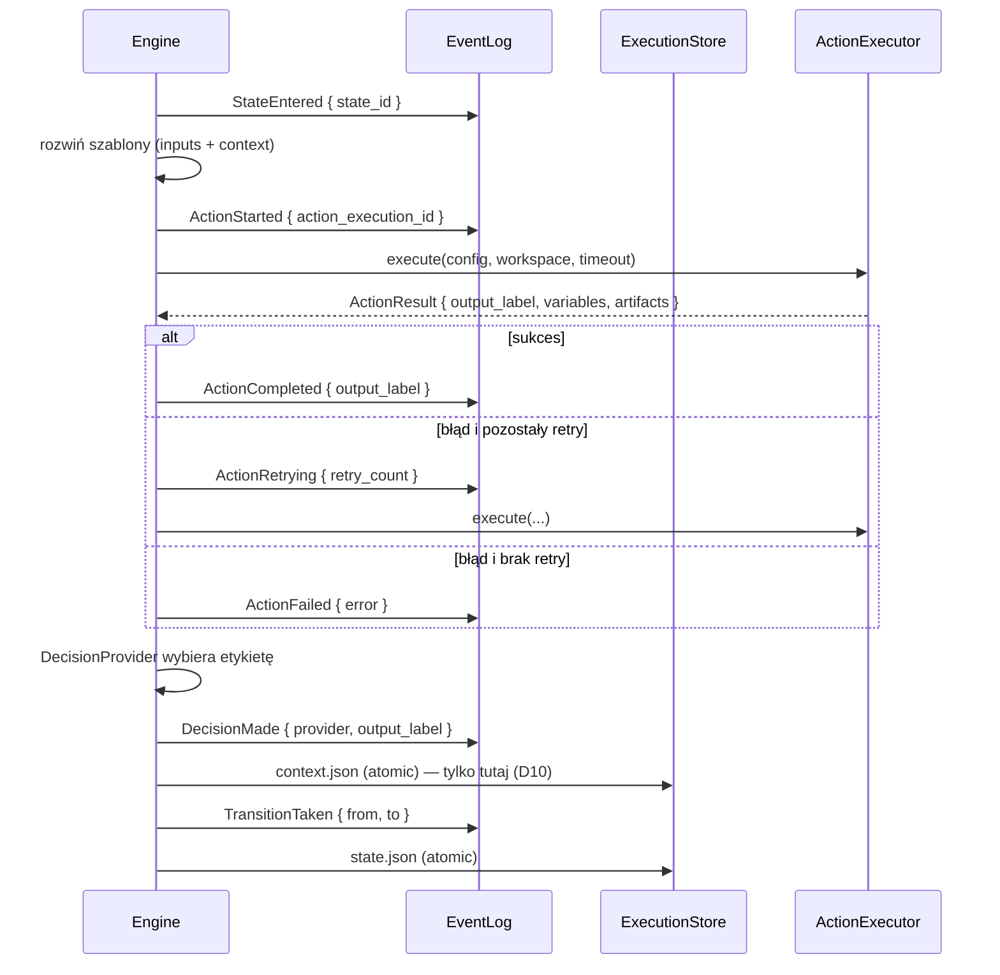

# feat: Silnik workflow MVP — kontrakt YAML, persystencja plikowa, egzekucja, CLI + TUI

## Summary

Plan doprowadza repozytorium od samego modelu domenowego (`src/domain/`, 1181 linii typów bez żadnej logiki wykonawczej) do działającego end-to-end orchestratora: parser i walidator YAML zgodny z `WORKFLOW_SCHEMA.md`, plikowa warstwa persystencji (`state.json` + `context.json` + append-only `events/`), deterministyczna pętla silnika ze `ScriptAction` i `HumanAction`, minimalna substytucja szablonów, CLI oraz pełnookienkowe TUI. `AgentAction`, REST/SSE API, Docker i polling zdarzeń zewnętrznych są celowo poza tym planem — pozostają jako Faza 3 opisana w Scope Boundaries.

---

## Problem Frame

Trzy dokumenty projektowe (`ARCHITECTURE_DECISIONS.md`, `DOMAIN_MODEL.md`, `WORKFLOW_SCHEMA.md`) są zatwierdzone i wzajemnie spójne na poziomie koncepcji, ale kod zatrzymał się na fazie 1 — istnieją tylko struktury danych. `src/main.rs` to bootstrap loggera z czterema komentarzami TODO (persistence, engine, API, event loop). Nie da się dziś uruchomić żadnego workflow, a więc nie da się też zweryfikować, czy zatwierdzone decyzje (D6 static output mapping, D10 engine zatwierdza context, D4 hybryda state+events) faktycznie się bronią w praktyce.

Dodatkowo kontrakt rozjechał się z kodem: `WORKFLOW_SCHEMA.md` deklaruje `globals`, `terminal_states`, `exit_codes`, `read_only_paths`, typowane `inputs` i szablony `{{ }}`, których `src/domain/workflow_definition.rs` w ogóle nie zna. Każdy dzień bez rozstrzygnięcia tej rozbieżności pogłębia dług.

---

## Requirements

- R1. Plik YAML zgodny z `WORKFLOW_SCHEMA.md` (łącznie z przykładem `implement-feature` z sekcji 4) daje się wczytać i zwalidować bez modyfikowania specyfikacji.
- R2. Walidacja jest statyczna i blokująca: niespójny graf, nieznany typ akcji, brakujące pole wymagane lub odwołanie do nieistniejącej zmiennej uniemożliwiają start execution (WORKFLOW_SCHEMA.md §5).
- R3. Stan wykonania jest trwały na filesystemie w układzie `state.json` + `context.json` + `events/{sequence}.json` + `artifacts/` (D3, D4, DOMAIN_MODEL §4).
- R4. Zapisy `state.json` i `context.json` są atomowe (temp + rename), a `sequence_number` eventów rośnie monotonicznie bez luk (DOMAIN_MODEL §5).
- R5. Silnik wykonuje graf sekwencyjnie: `StateEntered` → akcja → `Decision` → `TransitionTaken`, aż do stanu terminalnego (D7, D32).
- R6. Kontekst aktualizuje wyłącznie silnik, na podstawie pola `variables` z wyniku akcji — akcja nigdy nie pisze do `context.json` bezpośrednio (D10).
- R7. `ScriptAction` działa: uruchomienie polecenia z argumentami i env, mapowanie `exit_codes` na etykiety, opcjonalny JSON na stdout, timeout.
- R8. `HumanAction` wstrzymuje wykonanie, zapisuje żądanie wejścia, a po dostarczeniu wejścia wznawia workflow (D34 pause semantics).
- R9. Szablony `{{ inputs.* }}` i `{{ context.variables.* }}` są podstawiane w promptach, argumentach, env i filtrach — bez silnika wyrażeń (D6).
- R10. Retry jest hierarchiczny: polityka per-action nadpisuje globalną, liczba prób jest widoczna w evencie `ActionRetrying` (D21).
- R11. Po crashu wykonanie da się odtworzyć z logu eventów; wykonania z niedokończoną akcją są oznaczane `UNKNOWN` i wymagają rekoncyliacji (D23).
- R12. Workspace powstaje per execution (git checkout lub folder lokalny), repozytoria poboczne są montowane RO, a sprzątanie respektuje flagę `preserve` (D13, D15, D39).
- R13. CLI pozwala zwalidować definicję, uruchomić workflow, wylistować i obejrzeć wykonania, dostarczyć wejście człowieka i wznowić wykonanie.
- R14. TUI daje pełnookienkowy podgląd: lista wykonań, strumień eventów, panel wejścia człowieka oraz ręczne przejście z listy i tryb override (D30, D36).

---

## Scope Boundaries

- Brak równoległości w obrębie workflow — graf wykonywany sekwencyjnie (D32).
- Brak dynamicznej modyfikacji definicji w trakcie wykonania (D9, D31, D44).
- Brak silnika wyrażeń warunkowych — wyłącznie statyczne mapowanie etykiet (D6).
- Brak auth/authz i wielu użytkowników (D35).
- Brak asystenta-orchestratora (D28).
- Brak Web UI (D36).
- Brak metryk i distributed tracing — tylko logi strukturalne i historia eventów (D46).

### Deferred to Follow-Up Work

Poniższe to Faza 3 — świadomie wyłączona z tego planu, żeby najpierw mieć działający pionowy plaster. Każda pozycja zasługuje na własny plan.

- **`AgentAction` i adaptery harnessów** (D17, D18, D19, D20): wymaga uprzedniej analizy realnego CLI Claude Code i OpenCode (tryb batch, format streamu, `--resume`), której nie da się odpowiedzialnie zaplanować z dokumentów. To jest najbliższy kolejny krok po tym planie.
- **`WaitAction` i polling service** (D26): zależy od integracji GitHub (D27), której zakres jest oznaczony jako CAN DEFER.
- **`AgentDecision`** (WORKFLOW_SCHEMA §3.4.B): zależy od adapterów harnessów.
- **REST API + SSE** (D37, D38): `axum` i `axum-extra` są już w `Cargo.toml`, ale w tym planie nie są używane. TUI rozmawia z silnikiem in-process.
- **Konteneryzacja** (D14, D16): `Dockerfile`, montowanie `.env`, uruchomienie całości w kontenerze.
- **Eksport JSON Schema** dla podpowiedzi w edytorach (patrz Key Technical Decisions).

---

## Context & Research

### Relevant Code and Patterns

- `src/domain/workflow_definition.rs` — `WorkflowDefinition`, `State`, `ActionConfig` (tagged enum `type`), `DecisionConfig`, `RetryPolicy`, `ValidationError` (thiserror). Istniejąca metoda `WorkflowDefinition::validate()` pokrywa dziś tylko trzy reguły; U2 ją rozszerza.
- `src/domain/workflow_execution.rs` — `WorkflowExecution`, `ExecutionStatus` (ma już `Unknown` i `WaitingForEvent`), `ActionExecution`, `ActionResult` (`output_label`, `data`, `variables`, `exit_code`, `stdout`, `stderr`), `AgentSession`.
- `src/domain/event.rs` — `Event` z `sequence: u64` i `EventData` jako tagged enum z pełnym zestawem wariantów z DOMAIN_MODEL §2.9. Nie wymaga rozszerzeń w tym planie poza `HumanInputRequested`, który już istnieje.
- `src/domain/context.rs` — `Context::update_variables()` przyjmuje `serde_json::Map`; to jest dokładnie ścieżka z D10, silnik ma być jedynym wywołującym.
- `src/domain/workspace.rs` — konstruktory `local_folder()`, `git_checkout()`, `git_worktree()`, pole `read_only`. Typ `WorkspaceType` już rozróżnia potrzebne warianty.
- `src/main.rs` — wzorzec inicjalizacji `tracing_subscriber` z `EnvFilter`; do zachowania.
- `Cargo.toml` — `git2 0.18`, `serde_yaml 0.9`, `uuid v4+serde`, `chrono serde`, `thiserror`/`anyhow`, `tokio full`. `axum`, `axum-extra`, `tower-http`, `validator`, `path-absolutize` są zadeklarowane, ale nieużywane.

### Institutional Learnings

Brak katalogu `docs/solutions/` — repozytorium nie ma jeszcze zapisanych learningów. Po zakończeniu U7 i U10 warto uruchomić `/ce-compound` dla decyzji, które okażą się nieoczywiste (szczególnie rekoncyliacja po crashu).

### External References

- `WORKFLOW_SCHEMA.md` §4 — przykład `implement-feature` traktowany jako fixture akceptacyjny w U1/U2.
- `DOMAIN_MODEL.md` §4 — kolejność emisji eventów w cyklu życia; U7 musi ją odtworzyć dokładnie.
- `ARCHITECTURE_DECISIONS.md` D1–D46 — tabela decyzji; każda jednostka poniżej cytuje te, które realizuje.

---

## Key Technical Decisions

- **YAML jest kontraktem, model domenowy się dostosowuje.** `WORKFLOW_SCHEMA.md` to zatwierdzona specyfikacja i jednocześnie umowa z autorem workflow. Rozjazd naprawiamy po stronie Rusta (U1), a nie przez obcinanie schematu. Konsekwencja: `workflow_definition.rs` zyskuje `globals`, `terminal_states`, `exit_codes`, `read_only_paths` i typowane `inputs`.
- **Osobna warstwa `schema` między YAML a domeną.** Struktury deserializacyjne (`src/workflow/schema.rs`) odzwierciedlają YAML 1:1, po czym są kompilowane do modelu domenowego. Dzięki temu wersjonowanie schematu (pole `version`) nie zanieczyszcza typów runtime, a komunikaty walidacji mogą wskazywać nazwy pól YAML, a nie nazwy pól Rusta.
- **Walidacja strukturalna przez serde, semantyczna przez kod.** `#[serde(deny_unknown_fields)]` łapie literówki w kluczach, a reguły grafu z §5 są zaimplementowane jawnie, bo dają lepsze komunikaty niż generyczny walidator JSON Schema. D5 mówi „YAML + walidacja JSON Schema" — realizujemy intencję (twarda walidacja przed startem), a wygenerowanie pliku `.schema.json` dla podpowiedzi w edytorach odkładamy do follow-up.
- **`terminal_states` jako lista na poziomie dokumentu, `terminal: bool` w modelu.** Schemat podaje listę, model trzyma flagę na stanie. Kompilator schematu ustawia flagę; walidator sprawdza, że każdy wpis listy odpowiada istniejącemu stanowi bez akcji.
- **Podstawianie szablonów jest leniwe, tuż przed wykonaniem akcji.** Szablon nie jest rozwijany przy ładowaniu definicji, bo `{{ context.variables.x }}` ma przyjąć wartość aktualną w momencie wejścia w stan. Definicja pozostaje niezmienna (D31).
- **Nieznana zmienna w szablonie to błąd, nie pusty string.** Podczas walidacji statycznej (§5.4) sprawdzamy odwołania do `inputs.*`; odwołania do `context.variables.*` można zweryfikować dopiero w runtime, więc tam brak zmiennej kończy akcję błędem z jawnym komunikatem. Ciche podstawienie pustego stringa jest najgorszą z opcji przy promptach do agenta.
- **Silnik jest `async`, ale sekwencyjny.** `tokio` jest już zależnością i jest potrzebny dla timeoutów procesów oraz przyszłego API. Sekwencyjność wynika z D32, nie z braku runtime'u.
- **TUI rozmawia z silnikiem przez kanał, nie przez HTTP.** Ponieważ REST/SSE są odroczone, TUI subskrybuje strumień eventów bezpośrednio (`tokio::sync::broadcast`). Granica jest celowo ta sama, którą później obsłuży SSE — kiedy dojdzie API, zmienia się transport, nie kontrakt.
- **`serde_yaml 0.9` zostaje mimo braku maintenance.** Znany koszt; podmiana na fork (`serde_yaml_ng`) jest mechaniczna i izolowana do `src/workflow/schema.rs`, więc nie warto jej robić przed pierwszym działającym workflow.

---

## Open Questions

### Resolved During Planning

- Czy schemat dostosować do kodu, czy kod do schematu? → Kod do schematu; YAML jest kontraktem (patrz Key Technical Decisions).
- Czy wprowadzać pełny silnik szablonów? → Nie. Minimalna substytucja bez filtrów. Konsekwencja: konstrukcja `{{ context.clarification_text | default(inputs.feature_description) }}` z przykładu w `WORKFLOW_SCHEMA.md` §4 nie zadziała — przykład wymaga korekty w ramach U1 (patrz Documentation Plan).
- Czy `AgentAction` wchodzi do tego planu? → Nie. Blokuje ją D17 (analiza realnego CLI harnessów przed projektowaniem interfejsu).
- Czy TUI potrzebuje API? → Nie w MVP. In-process broadcast eventów.

### Deferred to Implementation

- Dokładny kształt struktury `ExecutionStore` (trait vs konkretny typ) — zależy od tego, ile wariantów zapisów faktycznie się pojawi w U7.
- Czy `sequence_number` wyprowadzać z liczby plików w `events/`, czy trzymać licznik w `state.json` — rozstrzygnąć przy implementacji U3, po zmierzeniu kosztu listowania katalogu przy długich wykonaniach.
- Format pliku żądania wejścia człowieka (osobny `pending_input.json` vs pole w `state.json`) — zależy od tego, jak wygodnie czyta się to z TUI w U10.
- Czy `git2` wystarczy do checkoutu z prywatnych repo, czy potrzebny jest fallback na CLI `git` — wyjdzie przy pierwszym realnym repo w U8.

---

## Output Structure

    src/
    ├── main.rs                  (modyfikacja: wire-up CLI)
    ├── cli/
    │   ├── mod.rs
    │   └── commands.rs
    ├── domain/                  (istnieje; U1 modyfikuje workflow_definition.rs)
    ├── workflow/
    │   ├── mod.rs
    │   ├── schema.rs            (struktury deserializacyjne YAML)
    │   ├── loader.rs            (YAML -> WorkflowDefinition)
    │   ├── validator.rs         (reguły z WORKFLOW_SCHEMA.md §5)
    │   └── template.rs          (substytucja {{ }})
    ├── persistence/
    │   ├── mod.rs
    │   ├── paths.rs             (układ katalogów wykonania)
    │   ├── atomic.rs            (zapis temp + rename)
    │   ├── execution_store.rs   (state.json, context.json)
    │   ├── event_log.rs         (append-only events/)
    │   └── recovery.rs          (rekoncyliacja po crashu)
    ├── engine/
    │   ├── mod.rs
    │   ├── runner.rs            (pętla wykonania)
    │   ├── decision.rs          (RulesDecision, HumanDecision)
    │   ├── retry.rs             (hierarchia polityk)
    │   └── actions/
    │       ├── mod.rs           (trait ActionExecutor)
    │       ├── script.rs
    │       └── human.rs
    ├── workspace/
    │   ├── mod.rs
    │   └── provisioner.rs       (tworzenie, RO/RW, sprzątanie)
    └── tui/
        ├── mod.rs
        ├── app.rs               (stan aplikacji, obsługa klawiszy)
        └── views.rs             (renderowanie paneli)

    tests/
    ├── fixtures/
    │   ├── implement_feature.yaml
    │   └── invalid/*.yaml
    ├── schema_loading.rs
    ├── validation.rs
    ├── persistence.rs
    ├── engine_execution.rs
    └── cli_smoke.rs

---

## High-Level Technical Design

> *To ilustruje zamierzony kształt rozwiązania i jest wskazówką kierunkową do przeglądu, nie specyfikacją implementacji. Agent implementujący powinien traktować to jako kontekst, a nie kod do odtworzenia.*

Przepływ jednego kroku silnika — kolejność emisji eventów jest wiążąca, bo z niej odtwarzamy stan po crashu (DOMAIN_MODEL §4.2–4.3):



Reguła recovery wynikająca z powyższego (D23): jeśli ostatnim eventem jest `ActionStarted` bez pary `ActionCompleted`/`ActionFailed`, wykonanie po restarcie dostaje status `UNKNOWN` — silnik nie wie, czy proces zewnętrzny zdążył wywołać skutek uboczny, więc nie wolno mu po prostu powtórzyć kroku.

Kompilacja schematu do domeny — kierunkowo:

```text
schema::WorkflowFile          ->   domain::WorkflowDefinition
  name, version, description  ->     name, version, description
  inputs[]                    ->     inputs[]  (+ typ i default)
  globals.timeout             ->     rozpropagowany jako domyślny timeout_secs stanu
  globals.retry_policy        ->     rozpropagowany jako domyślny retry_policy stanu
  globals.workspace           ->     WorkspaceSpec (osobne pole definicji)
  states{}                    ->     states{}  (klucz mapy staje się State.id)
  terminal_states[]           ->     State.terminal = true dla wymienionych
  (pierwszy stan | initial:true) ->   initial_state
```

---

## Implementation Units

### U1. Dostosowanie kontraktu YAML ↔ model domenowy

**Goal:** Plik YAML zgodny z `WORKFLOW_SCHEMA.md` daje się wczytać do `WorkflowDefinition` bez utraty informacji.

**Requirements:** R1

**Dependencies:** brak

**Files:**
- Create: `src/workflow/mod.rs`, `src/workflow/schema.rs`, `src/workflow/loader.rs`
- Modify: `src/domain/workflow_definition.rs`, `src/main.rs`
- Test: `tests/schema_loading.rs`, `tests/fixtures/implement_feature.yaml`

**Approach:**
- `schema.rs` odwzorowuje YAML 1:1: `WorkflowFile` z polami `name`, `version`, `description`, `inputs`, `globals`, `states`, `terminal_states`. Wszystkie struktury z `deny_unknown_fields`.
- Braki do uzupełnienia w domenie: `InputParameter.param_type` (`string|integer|boolean|repository`), `ScriptActionConfig.args` i `exit_codes` (mapa kod→etykieta), `AgentActionConfig.read_only_paths`, `HumanActionConfig.inputs` (pola formularza z `type: select|text` i `options`), `WaitActionConfig` już ma `event`/`filter`/`timeout_secs`, `GlobalsConfig` jako nowe pole definicji.
- Uwaga na rozjazd nazw: schemat używa `event_type` i `message`, domena `event` i `instruction`. Przyjąć nazwy ze schematu jako zewnętrzne (`#[serde(rename)]`), zostawiając nazwy domenowe bez zmian tam, gdzie już są używane.
- Czasy trwania (`"1h"`, `"30m"`, `"10s"`) parsować do sekund w warstwie schematu; domena pozostaje przy `u64` sekund.
- `loader.rs` czyta plik, deserializuje i kompiluje do domeny: rozpropagowuje `globals.timeout`/`globals.retry_policy` jako wartości domyślne stanów (per-state nadpisuje), ustawia `terminal` na podstawie `terminal_states`, wyprowadza `initial_state` (pierwszy stan w kolejności pliku lub oznaczony `initial: true`).
- Kolejność stanów w YAML jest znacząca dla `initial_state`, a `HashMap` ją gubi — w warstwie schematu użyć struktury zachowującej kolejność.

**Execution note:** Zacząć od testu ładującego `tests/fixtures/implement_feature.yaml` (przykład z `WORKFLOW_SCHEMA.md` §4) — ten test definiuje zakres pracy.

**Patterns to follow:**
- Tagged enum z `#[serde(tag = "type", rename_all = "snake_case")]` jak istniejące `ActionConfig` i `DecisionConfig`.
- `thiserror` do błędów, wzorem `ValidationError`.

**Test scenarios:**
- Happy path: fixture `implement_feature.yaml` ładuje się i daje 8 stanów, `initial_state == "analyze"`, `completed` i `failed` mają `terminal == true`.
- Happy path: `globals.retry_policy { max_attempts: 2, backoff: 10s }` trafia do stanu, który nie ma własnej polityki; stan z własną `retry_policy { max_attempts: 3 }` zachowuje swoją.
- Happy path: `globals.timeout: 2h` kompiluje się do 7200 sekund.
- Happy path: `exit_codes { 0: success, 1: failure, 2: partial_failure }` jest dostępne w `ScriptActionConfig`.
- Happy path: `HumanActionConfig` z polem `approval_status` typu `select` i opcjami `[approved, changes_requested, rejected]` deserializuje się z zachowaniem opcji.
- Edge case: workflow bez sekcji `globals` i bez `inputs` ładuje się z wartościami domyślnymi.
- Edge case: stan bez `action` (terminalny `completed` z samym `description`) ładuje się poprawnie.
- Error path: nieznany klucz w stanie (np. `descriptoin`) kończy się błędem wskazującym nazwę pola i pozycję w pliku.
- Error path: `type: docker` w akcji daje błąd wymieniający obsługiwane typy.
- Error path: `timeout: "2 tygodnie"` daje błąd parsowania czasu, nie panic.

**Verification:**
- Wszystkie przykłady YAML z `WORKFLOW_SCHEMA.md` (§3.1, §3.3 A–D, §3.4 A–C, §4) ładują się bez modyfikowania dokumentu — z jednym udokumentowanym wyjątkiem filtra `| default(...)` w §4, który adresuje U4.

---

### U2. Walidator definicji workflow

**Goal:** Niepoprawna definicja jest odrzucana przed utworzeniem jakiegokolwiek wykonania, z komunikatem wskazującym konkretny stan i pole.

**Requirements:** R2

**Dependencies:** U1

**Files:**
- Create: `src/workflow/validator.rs`, `tests/fixtures/invalid/` (po pliku na regułę)
- Modify: `src/domain/workflow_definition.rs` (rozszerzenie `ValidationError`)
- Test: `tests/validation.rs`

**Approach:**
- Zaimplementować cztery grupy reguł z `WORKFLOW_SCHEMA.md` §5: spójność grafu, poprawność akcji, poprawność decyzji, poprawność odwołań do zmiennych.
- Osiągalność terminali: BFS od `initial_state` — każdy stan musi być osiągalny, a z każdego stanu musi istnieć ścieżka do jakiegoś stanu terminalnego. To wykrywa deadlocki i nieskończone pętle bez wyjścia.
- Uwaga na fałszywy alarm: pętla `fix_code → test → fix_code` z przykładu §4 jest poprawna, bo `test` ma też krawędź do `create_pr`. Reguła musi być „istnieje ścieżka do terminala", a nie „brak cykli".
- Walidacja szablonów: wyciągnąć wszystkie `{{ ... }}` z definicji; odwołania `inputs.X` muszą wskazywać zadeklarowany input. Odwołania `context.*` przepuszczać (weryfikowane w runtime — patrz U4).
- Zbierać wszystkie błędy, a nie przerywać na pierwszym — autor workflow powinien zobaczyć całą listę naraz.
- `ValidationError` rozszerzyć o warianty: nieosiągalny stan, brak ścieżki do terminala, etykieta w `outputs` bez przejścia, przejście dla etykiety spoza `outputs`, pusta lista `outputs` dla akcji script/agent, brakujące pole wymagane akcji, `AgentDecision` bez `harness`/`prompt`, nieznany input w szablonie, `terminal_states` wskazujące nieistniejący stan.

**Execution note:** Po jednym fixture na regułę w `tests/fixtures/invalid/` — czytelniej niż budowanie struktur w kodzie testu.

**Patterns to follow:**
- Rozszerzać istniejącą `WorkflowDefinition::validate()`, a nie tworzyć równoległą ścieżkę.

**Test scenarios:**
- Happy path: `implement_feature.yaml` przechodzi walidację bez ostrzeżeń.
- Error path: przejście `success: nonexistent_state` → błąd nazywający stan źródłowy, etykietę i nieznany cel.
- Error path: etykieta `partial_failure` w `outputs` bez wpisu w `transitions` → błąd.
- Error path: wpis w `transitions` dla etykiety nieobecnej w `outputs` → błąd.
- Error path: stan nieterminalny nieosiągalny z `initial_state` → błąd.
- Error path: stan, z którego nie da się dojść do żadnego terminala (np. `a → b → a`) → błąd deadlocku.
- Error path: `ScriptAction` bez `command` → błąd wskazujący brakujące pole.
- Error path: `AgentAction` z pustą listą `outputs` → błąd.
- Error path: `decision: { type: agent }` bez `prompt` → błąd.
- Error path: `{{ inputs.nieistniejacy }}` w prompcie → błąd nazywający stan i nazwę zmiennej.
- Error path: `terminal_states: [cancelled]`, gdy stanu `cancelled` nie ma → błąd.
- Edge case: stan terminalny z niepustymi `transitions` → błąd (reguła już istnieje w kodzie, utrzymać).
- Edge case: workflow z jednym stanem, który jest jednocześnie początkowy i terminalny → przechodzi.
- Edge case: definicja z pięcioma naruszeniami zwraca pięć błędów, nie jeden.

**Verification:**
- Każda reguła z `WORKFLOW_SCHEMA.md` §5 ma odpowiadający fixture w `tests/fixtures/invalid/` i test, który sprawdza konkretny wariant błędu (nie samo „jest błąd").

---

### U3. Plikowa warstwa persystencji

**Goal:** Stan wykonania, kontekst i historia eventów są trwałe, atomowe i odporne na przerwanie zapisu.

**Requirements:** R3, R4

**Dependencies:** brak (równoległa do U1/U2)

**Files:**
- Create: `src/persistence/mod.rs`, `src/persistence/paths.rs`, `src/persistence/atomic.rs`, `src/persistence/execution_store.rs`, `src/persistence/event_log.rs`
- Test: `tests/persistence.rs`

**Approach:**
- Układ katalogów wg D3 i DOMAIN_MODEL §2.7: `{root}/executions/{execution_id}/` z `state.json`, `context.json`, `events/`, `artifacts/{artifact_id}/`. Katalog roota konfigurowany (domyślnie `./.orchestrator`), żeby testy mogły użyć katalogu tymczasowego.
- `atomic.rs`: zapis do `.tmp` w tym samym katalogu, `fsync`, `rename`. Rename w obrębie katalogu jest atomowy na POSIX — to jest cała treść R4.
- `event_log.rs`: numeracja `{sequence:08}.json`, zapis również atomowy. Odczyt całego logu posortowany po numerze. Dopisanie eventu o numerze, który już istnieje, musi być błędem, a nie cichym nadpisaniem — to jedyna obrona przed rozjazdem licznika.
- Przy odczycie logu wykrywać luki w numeracji i sygnalizować je jako uszkodzenie (R4 mówi „bez luk").
- Osierocone pliki `.tmp` przy starcie usuwać — to ślad po crashu w trakcie zapisu, nigdy dane do odzyskania.

**Execution note:** Testy na katalogach tymczasowych, bez mockowania filesystemu — cała wartość tej jednostki leży w realnych operacjach plikowych.

**Test scenarios:**
- Happy path: zapis i odczyt `WorkflowExecution` zachowuje wszystkie pola łącznie z `context` i `workspace`.
- Happy path: dopisanie trzech eventów i odczyt zwraca je w kolejności 1, 2, 3.
- Happy path: struktura katalogów powstaje przy pierwszym zapisie, bez wcześniejszego `mkdir` przez wywołującego.
- Edge case: odczyt pustego katalogu `events/` zwraca pustą listę, nie błąd.
- Edge case: `context.json` z pustym obiektem `variables` deserializuje się do pustej mapy.
- Error path: dopisanie eventu o numerze 2, gdy plik `00000002.json` już istnieje → błąd, plik nie jest nadpisany.
- Error path: log z plikami 1, 2, 4 → odczyt sygnalizuje lukę.
- Error path: uszkodzony (obcięty) `state.json` → czytelny błąd deserializacji z nazwą pliku, nie panic.
- Integration: osierocony `state.json.tmp` obok poprawnego `state.json` — po starcie `.tmp` znika, a `state.json` jest nienaruszony.
- Integration: dwa kolejne zapisy `context.json` — po drugim nie ma pliku `.tmp` w katalogu.

**Verification:**
- Test przerywający zapis (zapis do `.tmp` bez `rename`) zostawia poprzednią wersję pliku czytelną i kompletną.

---

### U4. Substytucja szablonów

**Goal:** `{{ inputs.* }}` i `{{ context.variables.* }}` są podstawiane w promptach, komendach, argumentach, env i filtrach zdarzeń tuż przed wykonaniem akcji.

**Requirements:** R9

**Dependencies:** U1

**Files:**
- Create: `src/workflow/template.rs`
- Test: `tests/template.rs`

**Approach:**
- Zakres celowo minimalny (D6): rozpoznajemy `{{ inputs.NAZWA }}` i `{{ context.variables.NAZWA }}` (oraz skrót `{{ context.NAZWA }}` jako alias na `variables`, bo tak wygląda w `WORKFLOW_SCHEMA.md` §3.3.D). Żadnych filtrów, wyrażeń, warunków ani pętli.
- Białe znaki wewnątrz `{{ }}` ignorowane.
- Wartości nie-stringowe (liczba, bool) renderowane jako JSON scalar bez cudzysłowów; lista i obiekt jako kompaktowy JSON.
- Nieznana zmienna → błąd z nazwą zmiennej i miejscem użycia. Ciche podstawienie pustego stringa byłoby tu najgorszym wyborem: prompt do agenta z urwanym zdaniem jest trudniejszy do zdiagnozowania niż jawny błąd.
- Podstawianie jednoprzebiegowe — wynik podstawienia nie jest ponownie skanowany (ochrona przed rekurencją, gdy zmienna zawiera `{{`).
- Konsekwencja dla dokumentacji: `{{ context.clarification_text | default(inputs.feature_description) }}` z `WORKFLOW_SCHEMA.md` §4 nie jest obsługiwane. Przykład wymaga korekty (patrz Documentation Plan).

**Test scenarios:**
- Happy path: `"Zadanie: {{ inputs.feature_description }}"` z inputem `"login"` → `"Zadanie: login"`.
- Happy path: `{{ context.variables.pr_number }}` dla wartości `123` → `"123"` bez cudzysłowów.
- Happy path: `{{ context.pr_number }}` (skrót) działa identycznie jak pełna ścieżka.
- Happy path: dwa różne wystąpienia w jednym stringu podstawiane niezależnie.
- Edge case: `{{   inputs.x   }}` z nadmiarowymi spacjami działa.
- Edge case: string bez żadnego `{{ }}` zwracany bez zmian.
- Edge case: wartość zmiennej zawierająca `{{ inputs.y }}` nie jest rozwijana ponownie.
- Edge case: wartość będąca listą `["a","b"]` renderuje się jako `["a","b"]`.
- Error path: `{{ inputs.brak }}` → błąd nazywający `inputs.brak`.
- Error path: `{{ context.variables.brak }}` → błąd nazywający zmienną kontekstową.
- Error path: `{{ context.x | default("y") }}` → błąd wskazujący, że filtry nie są obsługiwane, z sugestią użycia zwykłej zmiennej.
- Error path: niedomknięte `{{ inputs.x` → błąd składni, nie panic.

**Verification:**
- Prompt stanu `implement` z fixture (po korekcie filtra) rozwija się do tekstu bez pozostałości `{{`.

---

### U5. Wykonawca ScriptAction

**Goal:** `ScriptAction` uruchamia polecenie i zwraca `ActionResult` z etykietą wyjścia wyprowadzoną z kodu wyjścia lub JSON-a na stdout.

**Requirements:** R7, R10

**Dependencies:** U1, U4

**Files:**
- Create: `src/engine/mod.rs`, `src/engine/actions/mod.rs`, `src/engine/actions/script.rs`
- Test: `tests/actions_script.rs`, `tests/fixtures/scripts/` (skrypty pomocnicze)

**Approach:**
- `ActionExecutor` jako trait async: przyjmuje rozwinięty config, workspace i limit czasu, zwraca `ActionResult` albo `ActionError`. Ten sam trait obsłuży później `AgentAction`, więc warto go zaprojektować pod cztery typy, nawet implementując dwa.
- Uruchomienie przez `tokio::process::Command` z `cwd` ustawionym na workspace, env z konfiguracji, przechwyconym stdout i stderr.
- Ustalenie etykiety — kolejność wg `WORKFLOW_SCHEMA.md` §3.3.B: jeśli stdout jest poprawnym JSON-em z kluczem `output`, ta etykieta wygrywa i zabiera ze sobą `variables`/`artifacts`/`data`; w przeciwnym razie etykieta pochodzi z mapy `exit_codes`; domyślnie `0 → success`, reszta → `failure`.
- Etykieta spoza `outputs` stanu to błąd akcji, nie ciche przejście — waliduje to silnik w U7, ale wykonawca musi zwrócić surową etykietę, żeby komunikat był precyzyjny.
- Timeout: po przekroczeniu zabić proces i zwrócić etykietę `timeout`, jeśli jest zadeklarowana w `outputs`; w przeciwnym razie błąd akcji. Kod 124 z mapy `exit_codes` obsługiwany normalnie.
- stdout/stderr trafiają do `ActionResult` (pola już istnieją) z ograniczeniem rozmiaru — pełne logi należą do artefaktów, nie do `state.json`.

**Execution note:** Skrypty testowe trzymać jako pliki w `tests/fixtures/scripts/` z ustawionym bitem wykonywalności, a nie generować w locie.

**Patterns to follow:**
- `ActionResult` i `ActionError` z `src/domain/workflow_execution.rs` — nie wprowadzać równoległych typów wyniku.

**Test scenarios:**
- Happy path: skrypt kończący się kodem 0 bez stdout → `output_label == "success"`, `exit_code == Some(0)`.
- Happy path: skrypt z `exit_codes { 2: partial_failure }` kończący się kodem 2 → etykieta `partial_failure`.
- Happy path: skrypt wypisujący `{"output":"success","variables":{"pr_number":123}}` → etykieta z JSON-a, `variables` zawiera `pr_number`.
- Happy path: JSON na stdout wygrywa z mapowaniem `exit_codes` przy niezerowym kodzie wyjścia.
- Happy path: zmienne env z konfiguracji są widoczne w procesie potomnym.
- Happy path: argumenty z `args` są przekazywane osobno, bez sklejania w jeden string.
- Edge case: stdout niebędący JSON-em (zwykły log) → fallback na `exit_codes`, bez błędu parsowania.
- Edge case: stdout będący poprawnym JSON-em bez klucza `output` → fallback na `exit_codes`.
- Edge case: bardzo długi stdout jest przycinany, a wykonanie kończy się normalnie.
- Error path: nieistniejące polecenie → `ActionError` z komunikatem systemowym, nie panic.
- Error path: przekroczenie timeoutu → proces zabity, etykieta `timeout` lub błąd, gdy `timeout` nie jest w `outputs`.
- Error path: skrypt kończący się sygnałem (bez kodu wyjścia) → `ActionError`, nie ciche `failure`.
- Integration: `cwd` procesu odpowiada ścieżce workspace, nie katalogowi roboczemu orchestratora.
- Integration: prompt/komenda przeszły przez substytucję z U4 przed uruchomieniem.

**Verification:**
- Skrypt zapisujący plik w workspace faktycznie tworzy go w katalogu wykonania, a nie w repo orchestratora.

---

### U6. Wykonawca HumanAction i mechanizm wstrzymania

**Goal:** Wejście w stan typu `human` zatrzymuje wykonanie, utrwala żądanie wejścia, a dostarczenie odpowiedzi je wznawia.

**Requirements:** R8

**Dependencies:** U3

**Files:**
- Create: `src/engine/actions/human.rs`
- Modify: `src/persistence/execution_store.rs` (utrwalenie oczekującego żądania)
- Test: `tests/actions_human.rs`

**Approach:**
- `HumanAction` nie jest blokującym wywołaniem — wykonanie przechodzi w `ExecutionStatus::Paused`, emitowany jest `HumanInputRequested` (wariant już istnieje w `EventData`), a pętla silnika kończy bieżący przebieg i zwraca sterowanie.
- Wznowienie to osobne wejście do silnika: dostarczone wejście jest walidowane względem `inputs` z konfiguracji (pola wymagane obecne, wartość `select` należy do `options`), emitowany jest `HumanInputReceived`, po czym powstaje `ActionResult` z etykietą równą wybranej opcji.
- Rozstrzygnięcie etykiety wg `WORKFLOW_SCHEMA.md` §3.3.C: etykieta odpowiada wartości wybranej przez użytkownika. Gdy `HumanAction` nie deklaruje pól (jak `human_review_tests` w §4), etykietą jest bezpośrednio wybrana pozycja z `outputs` stanu.
- Wznowienie wykonania, które nie jest `Paused`, musi być odrzucone — to chroni przed podwójnym dostarczeniem wejścia po restarcie.

**Test scenarios:**
- Happy path: wejście w stan `human_clarification` → status `Paused`, event `HumanInputRequested` w logu, oczekujące żądanie utrwalone.
- Happy path: dostarczenie `{ approval_status: "approved" }` → etykieta `approved`, event `HumanInputReceived`, status wraca do `Running`.
- Happy path: `HumanAction` bez pól — wybór etykiety `ignore` z `outputs` działa bezpośrednio.
- Happy path: pole opcjonalne `comments` może być pominięte.
- Edge case: wartości wejścia trafiają do `context.variables` (np. `clarification_text` używane później w prompcie).
- Error path: brak pola wymaganego → odrzucenie z nazwą pola, wykonanie pozostaje `Paused`.
- Error path: wartość `select` spoza `options` → odrzucenie z listą dozwolonych wartości.
- Error path: wznowienie wykonania w statusie `Running` → odrzucenie.
- Error path: wznowienie wykonania zakończonego (`Completed`) → odrzucenie.
- Integration: po restarcie procesu oczekujące żądanie jest odczytane z dysku i nadal możliwe do zaspokojenia.

**Verification:**
- Sekwencja: start → `Paused` → zabicie procesu → nowy proces → dostarczenie wejścia → wykonanie dochodzi do stanu terminalnego.

---

### U7. Pętla silnika, decyzje, retry i rekoncyliacja

**Goal:** Silnik przechodzi graf od stanu początkowego do terminalnego, emitując eventy w kolejności z `DOMAIN_MODEL.md` §4 i utrwalając stan po każdym kroku.

**Requirements:** R5, R6, R10, R11

**Dependencies:** U2, U3, U4, U5, U6

**Files:**
- Create: `src/engine/runner.rs`, `src/engine/decision.rs`, `src/engine/retry.rs`, `src/persistence/recovery.rs`
- Test: `tests/engine_execution.rs`, `tests/engine_recovery.rs`

**Approach:**
- Pętla kroku dokładnie wg diagramu w High-Level Technical Design. Kolejność emisji jest kontraktem, bo z niej wyprowadzamy recovery.
- `DecisionProvider` w MVP w dwóch wariantach: `Rules` (etykieta z `ActionResult` mapowana przez `transitions`) i `Human` (wstrzymanie i ręczny wybór). `Agent` zwraca jawny błąd „niedostępne w tej wersji" — lepszy niż ciche potraktowanie jak `Rules`.
- Aktualizacja kontekstu wyłącznie tutaj (D10), przez `Context::update_variables()`, po `DecisionMade` a przed `TransitionTaken`. Akcja nie ma dostępu do zapisu.
- Retry hierarchiczny (D21): polityka stanu nadpisuje globalną; `backoff_multiplier` mnoży opóźnienie między próbami; każda próba emituje `ActionRetrying`. Wyczerpanie prób → `ActionFailed`.
- Etykieta zwrócona przez akcję spoza `outputs` stanu → `ActionFailed` z komunikatem wymieniającym dozwolone etykiety (to jest miejsce, w którym D20 będzie się później zaczepiać dla agentów).
- Rekoncyliacja (D23): przy ładowaniu wykonania odtworzyć stan z `state.json` i skonfrontować z ogonem logu eventów. `ActionStarted` bez pary → status `UNKNOWN`, event `Error` z opisem, brak automatycznego powtórzenia. Decyzja o powtórzeniu należy do człowieka.
- Pause vs interrupt (D34): `pause` oznacza „nie zaczynaj kolejnej akcji" — sprawdzane na granicy kroku. Przerwanie trwającej akcji jest best-effort (D33) i w tym planie ogranicza się do sygnału zakończenia procesu skryptu.
- Idempotencja (D24): `ActionExecution.id` jest kluczem idempotencji przekazywanym do wykonawcy w env (np. `ORCHESTRATOR_ACTION_ID`), żeby skrypty mogły się zabezpieczyć przed duplikatem po recovery.

**Execution note:** Zacząć od testu integracyjnego przechodzącego fixture `implement_feature.yaml` ze zamockowanymi skryptami — ten test jest definicją ukończenia jednostki.

**Patterns to follow:**
- `EventData` z `src/domain/event.rs` — używać istniejących wariantów, nie dodawać nowych bez potrzeby.
- `ExecutionStatus` — `Unknown` i `Paused` już istnieją i mają tu dokładnie to znaczenie.

**Test scenarios:**
- Happy path: liniowy workflow trzystanowy dochodzi do terminala, status `Completed`, `current_state` wskazuje stan terminalny.
- Happy path: kolejność eventów w logu to `WorkflowStarted`, `StateEntered`, `ActionStarted`, `ActionCompleted`, `DecisionMade`, `TransitionTaken`, … , `WorkflowCompleted`.
- Happy path: `variables` z `ActionResult` pojawiają się w `context.json` po kroku, a nie w trakcie.
- Happy path: pętla `test → fix_code → test` wykonuje się dwukrotnie i wychodzi przez `success`.
- Happy path: wejście w stan terminalny `failed` daje status `Failed`, nie `Completed`.
- Happy path: retry z `max_attempts: 3` przy skrypcie padającym dwa razy i przechodzącym za trzecim → dwa eventy `ActionRetrying`, finalnie `ActionCompleted`.
- Edge case: workflow z jednym stanem terminalnym kończy się natychmiast po starcie.
- Edge case: `backoff_multiplier` rośnie między próbami (sprawdzalne na znacznikach czasu eventów).
- Error path: wyczerpanie prób retry → `ActionFailed`, status `Failed`, brak `TransitionTaken`.
- Error path: akcja zwraca etykietę `weird` spoza `outputs` → `ActionFailed` z listą dozwolonych etykiet.
- Error path: `decision: { type: agent }` → jawny błąd o niedostępności w tej wersji.
- Error path: brak zmiennej kontekstowej w szablonie w momencie wejścia w stan → `ActionFailed`, wykonanie nie przechodzi dalej.
- Integration: symulowany crash po `ActionStarted` — po ponownym załadowaniu status to `UNKNOWN`, silnik nie powtarza akcji samoczynnie.
- Integration: symulowany crash po `ActionCompleted` a przed `TransitionTaken` — po załadowaniu wykonanie kontynuuje od decyzji, bez ponownego uruchamiania akcji.
- Integration: `pause` w trakcie trwania akcji — bieżąca akcja kończy się normalnie, kolejna nie startuje.
- Integration: `ORCHESTRATOR_ACTION_ID` jest widoczny w środowisku skryptu i jest stabilny w obrębie jednej próby, a różny między retry.

**Verification:**
- Fixture `implement_feature.yaml` przechodzi end-to-end na zaślepkowych skryptach, a log eventów odtwarza sekwencję z `DOMAIN_MODEL.md` §4 bez luk w numeracji.

---

### U8. Cykl życia workspace

**Goal:** Każde wykonanie dostaje izolowany workspace — git checkout lub folder lokalny — z repozytoriami pobocznymi w trybie tylko do odczytu, sprzątany po zakończeniu z opcją zachowania.

**Requirements:** R12

**Dependencies:** U3

**Files:**
- Create: `src/workspace/mod.rs`, `src/workspace/provisioner.rs`
- Modify: `src/domain/workspace.rs` (jeśli potrzebne pole polityki sprzątania)
- Test: `tests/workspace.rs`

**Approach:**
- Układ katalogów wg `DOMAIN_MODEL.md` §2.8: `{root}/tasks/{execution_id}/code/{repo_name}/`. Repo główne RW, pozostałe RO.
- `type: git` → klon/checkout przez `git2` na wskazany `ref`. `type: local` → dowiązanie lub kopia wskazanego `path` (D39).
- RO realizowane przez uprawnienia filesystemu (D15) — bez silnika reguł. Warto od razu przyjąć, że to zabezpieczenie przed pomyłką, nie przed złośliwym agentem; twarda izolacja to Docker z D14, odroczony.
- Sprzątanie po zakończeniu (D13) z jawną flagą `preserve`. Weryfikacja przed usunięciem: niezacommitowane zmiany lub niewypchnięte commity w repo RW blokują sprzątanie i zostawiają ostrzeżenie — utrata pracy agenta jest kosztowniejsza niż zajęte miejsce na dysku.
- Sprzątanie musi być odporne na brak katalogu (wykonanie, które padło przed utworzeniem workspace).

**Test scenarios:**
- Happy path: workspace typu `local` powstaje z zawartością wskazanego folderu i jest zapisany w `WorkflowExecution.workspace`.
- Happy path: workspace typu `git` jest sklonowany na wskazany `ref` (test na lokalnym repo w katalogu tymczasowym).
- Happy path: repozytorium poboczne jest dostępne do odczytu i niedostępne do zapisu.
- Happy path: sprzątanie usuwa katalog po zakończeniu wykonania.
- Happy path: `preserve: true` zostawia katalog nienaruszony.
- Edge case: dwa równoległe wykonania tego samego workflow dostają rozłączne katalogi.
- Edge case: sprzątanie wykonania bez utworzonego workspace kończy się bez błędu.
- Error path: nieistniejący `ref` w repo → czytelny błąd przed startem pierwszej akcji.
- Error path: niedostępna ścieżka dla `type: local` → błąd przy tworzeniu wykonania, nie w trakcie akcji.
- Integration: niezacommitowane zmiany w repo RW blokują sprzątanie i zostawiają ostrzeżenie w logu.

**Verification:**
- Skrypt uruchomiony w workspace nie jest w stanie zapisać pliku w repozytorium oznaczonym RO.

---

### U9. CLI

**Goal:** Operator może z terminala zwalidować definicję, uruchomić workflow, obejrzeć wykonania i dostarczyć wejście człowieka.

**Requirements:** R13

**Dependencies:** U2, U7, U8

**Files:**
- Create: `src/cli/mod.rs`, `src/cli/commands.rs`
- Modify: `src/main.rs`, `Cargo.toml` (dodanie `clap`)
- Test: `tests/cli_smoke.rs`

**Approach:**
- Podkomendy: `validate <plik>`, `run <plik> [--input k=v]…`, `list`, `show <execution_id>`, `events <execution_id> [--follow]`, `input <execution_id> [--field k=v]…`, `resume <execution_id>`, `tui`.
- Wejścia z `--input` parsowane wg zadeklarowanego typu (`integer`, `boolean`, `repository`) — nie wszystko jako string. Braki wymaganych inputów zgłaszane przed utworzeniem wykonania.
- Kody wyjścia: 0 sukces, 1 błąd walidacji lub wykonania, 2 błędne użycie. To jest kontrakt dla ewentualnego CI, więc warto go ustalić od razu.
- Błędy walidacji wypisywane jako lista, wzorem U2, a nie pojedynczo.

**Patterns to follow:**
- Zachować inicjalizację `tracing_subscriber` z obecnego `src/main.rs`; CLI dokłada tylko parsowanie argumentów.

**Test scenarios:**
- Happy path: `validate` na poprawnym pliku → kod 0 i komunikat potwierdzający.
- Happy path: `run` z kompletem inputów tworzy wykonanie i wypisuje jego ID.
- Happy path: `list` pokazuje utworzone wykonanie z jego statusem.
- Happy path: `show` wypisuje bieżący stan, status i zmienne kontekstu.
- Happy path: `input` dostarcza wejście do wstrzymanego wykonania i wznawia je.
- Edge case: `list` przy braku jakichkolwiek wykonań wypisuje pustą listę, nie błąd.
- Edge case: `--input is_experimental=true` trafia do kontekstu jako wartość logiczna, nie string.
- Error path: `validate` na pliku z błędami → kod 1 i wypisana lista wszystkich naruszeń.
- Error path: `run` bez wymaganego inputu → kod 2 i nazwa brakującego parametru.
- Error path: `show` dla nieistniejącego ID → kod 1 i czytelny komunikat.
- Error path: `input` dla wykonania, które nie czeka na wejście → kod 1 z wyjaśnieniem statusu.

**Verification:**
- Pełna ścieżka `validate` → `run` → `input` → `show` na fixture `implement_feature.yaml` przechodzi bez ręcznej ingerencji w pliki.

---

### U10. TUI

**Goal:** Pełnookienkowy interfejs terminalowy daje podgląd wykonań, strumień eventów na żywo, obsługę wejścia człowieka i ręczne przejścia.

**Requirements:** R14

**Dependencies:** U7, U9

**Files:**
- Create: `src/tui/mod.rs`, `src/tui/app.rs`, `src/tui/views.rs`
- Modify: `src/cli/commands.rs` (podkomenda `tui`), `Cargo.toml` (dodanie `ratatui`, `crossterm`)
- Test: `tests/tui_state.rs`

**Approach:**
- Układ: lewy panel — lista wykonań ze statusami; prawy górny — szczegóły bieżącego stanu i zmienne kontekstu; prawy dolny — strumień eventów; dolny pasek — kontekstowe skróty klawiszowe.
- Eventy na żywo przez `tokio::sync::broadcast` z silnika. To jest ta sama granica, którą później obsłuży SSE (D38) — zmieni się transport, nie kontrakt.
- Panel wejścia człowieka: formularz generowany z `HumanActionConfig.inputs` (pola `select` jako lista wyboru, `text` jako pole tekstowe), walidacja przed wysłaniem wg tych samych reguł co U6.
- Ręczne przejście (D30) w dwóch trybach: wybór z listy dozwolonych etykiet stanu (domyślny) oraz override na dowolny stan, dostępny tylko gdy stan ma `allow_manual_override` i potwierdzony osobnym potwierdzeniem. Override emituje `HumanTransitionSelected` (wariant już istnieje w `EventData`) z adnotacją, że był wymuszony — audyt takiego przejścia jest ważniejszy niż wygoda.
- Logika stanu aplikacji (jaki widok, jakie akcje dostępne przy jakim statusie wykonania) oddzielona od renderowania, żeby dała się testować bez terminala.
- Terminal musi zostać przywrócony także przy panice — inaczej pierwszy crash zostawia operatora ze zepsutą konsolą.

**Execution note:** Testować warstwę stanu (`app.rs`), nie renderowanie. Testy snapshotów ramek są kruche i mało wartościowe na tym etapie.

**Test scenarios:**
- Happy path: lista wykonań odzwierciedla zawartość katalogu wykonań z poprawnymi statusami.
- Happy path: nowy event z kanału dopisuje się do strumienia i podnosi widok na najnowszą pozycję.
- Happy path: wybór wykonania w statusie `Paused` udostępnia panel wejścia z polami z definicji.
- Happy path: zatwierdzenie formularza z poprawnymi danymi wznawia wykonanie.
- Happy path: lista dozwolonych przejść dla bieżącego stanu zawiera dokładnie etykiety z `outputs`.
- Edge case: wykonanie bez eventów pokazuje pusty strumień, nie błąd.
- Edge case: stan bez `allow_manual_override` nie udostępnia trybu override.
- Edge case: zmiana rozmiaru terminala zachowuje układ paneli.
- Error path: próba zatwierdzenia formularza bez pola wymaganego pokazuje błąd i nie wysyła wejścia.
- Error path: utrata połączenia z kanałem eventów pokazuje wskaźnik rozłączenia zamiast cichego zamrożenia widoku.
- Integration: override na dowolny stan emituje `HumanTransitionSelected` z oznaczeniem wymuszenia i wymaga potwierdzenia.
- Integration: terminal jest przywrócony do stanu pierwotnego po wyjściu oraz po panice.

**Verification:**
- Operator jest w stanie przeprowadzić fixture `implement_feature.yaml` od startu do stanu terminalnego wyłącznie z TUI, łącznie z odpowiedzią na `human_clarification`.

---

## System-Wide Impact

- **Interaction graph:** `src/domain/` jest dziś liściem bez zależności przychodzących; po tym planie zależą od niego wszystkie nowe moduły. Zmiany w `workflow_definition.rs` z U1 przechodzą przez `engine`, `persistence`, `cli` i `tui` — dlatego U1 jest pierwsze i nie warto go rozciągać na późniejsze fazy.
- **Error propagation:** Trzy poziomy. Błąd walidacji (przed startem) → kod wyjścia CLI, żadnego wykonania na dysku. Błąd akcji (w trakcie) → `ActionFailed`, retry, ewentualnie status `Failed` wykonania. Błąd persystencji → przerwanie kroku bez zmiany stanu; silnik nie może kontynuować, jeśli nie potrafi utrwalić tego, co już zrobił.
- **State lifecycle risks:** Częściowy zapis `state.json` (adresowany atomowym rename w U3), rozjazd między `state.json` a ogonem logu eventów (adresowany rekoncyliacją w U7), osierocone workspace po crashu (adresowane sprzątaniem przy starcie w U8), duplikat skutku ubocznego po recovery (adresowany kluczem idempotencji i statusem `UNKNOWN`, D24).
- **API surface parity:** Każda operacja dostępna w TUI musi być dostępna w CLI — TUI nie może być jedyną drogą do niczego. Ta parzystość jest też przygotowaniem pod REST API z Fazy 3, które powinno wystawić dokładnie ten sam zbiór operacji.
- **Integration coverage:** Testy jednostkowe nie udowodnią: atomowości zapisu przy przerwaniu procesu, rzeczywistej egzekucji procesu potomnego z env i cwd, poprawności recovery po realnym zabiciu procesu, blokady zapisu na repo RO. Te scenariusze wymagają testów integracyjnych na prawdziwym filesystemie — są jawnie wymienione w odpowiednich jednostkach.
- **Unchanged invariants:** `src/domain/event.rs` i `src/domain/context.rs` nie zmieniają kształtu — warianty eventów z `DOMAIN_MODEL.md` §2.9 są kompletne, a `Context::update_variables()` pozostaje jedynym wejściem do zapisu kontekstu. `AgentSession` i `AgentAction` zostają w kodzie nieużywane; to celowe, bo Faza 3 buduje na nich, a usuwanie i przywracanie byłoby stratą.

---

## Risks & Dependencies

| Ryzyko | Prawdop. | Wpływ | Mitygacja |
|---|---|---|---|
| Rozszerzenie `workflow_definition.rs` w U1 okaże się szersze niż zakładano i zablokuje resztę | Śred. | Wys. | U3 nie zależy od U1 — persystencja może iść równolegle. Fixture z §4 jest twardym kryterium ukończenia, co ogranicza rozlewanie się zakresu. |
| Rekoncyliacja po crashu okaże się niejednoznaczna dla części sekwencji eventów | Śred. | Wys. | Kolejność emisji jest ustalona i wiążąca (diagram w HLTD). Przy niejednoznaczności domyślnie `UNKNOWN` i decyzja człowieka — nigdy automatyczne powtórzenie. |
| Brak `AgentAction` sprawia, że MVP nie demonstruje wartości „AI orchestratora" | Wys. | Śred. | Świadoma decyzja: D17 wymaga analizy realnego CLI harnessów. Trait `ActionExecutor` z U5 jest projektowany pod cztery typy, więc dołożenie agenta nie wymaga przebudowy silnika. |
| `serde_yaml 0.9` bez maintenance | Śred. | Nis. | Izolowane do `src/workflow/schema.rs`; podmiana na fork jest mechaniczna. |
| Uprawnienia FS jako izolacja RO są słabsze, niż sugeruje D15 | Wys. | Śred. | Jawnie traktowane jako ochrona przed pomyłką, nie przed złośliwym agentem. Twarda izolacja to D14 (Docker), odroczona do Fazy 3. Nie uruchamiać niezaufanych workflow przed jej wdrożeniem. |
| Przykład z `WORKFLOW_SCHEMA.md` §4 używa filtra `\| default(...)`, którego nie implementujemy | Pewne | Nis. | Korekta przykładu w ramach U4 i wpis w Documentation Plan. |
| TUI bez API zaciera granicę, którą później ma przejąć SSE | Śred. | Śred. | TUI konsumuje broadcast eventów, nie sięga do plików bezpośrednio — ta sama granica, którą obsłuży SSE. |

---

## Documentation Plan

- `WORKFLOW_SCHEMA.md` §4 — poprawić prompt stanu `implement`, usuwając filtr `| default(...)`, i dopisać w §3.3 notkę o zakresie obsługiwanych szablonów (tylko `inputs.*` i `context.variables.*`, bez filtrów).
- `WORKFLOW_SCHEMA.md` §3.3.C — nazwy pól `message`/`event_type` vs domenowe `instruction`/`event`: po U1 doprecyzować, że nazwy w YAML są kontraktem.
- `ARCHITECTURE_DECISIONS.md` — po U1 zaktualizować „Następne kroki": faza 1 (Domain Model) jest domknięta, brak pliku `IMPLEMENTATION_PLAN.md` (dokument się do niego odwołuje); zastąpić odwołaniem do tego planu.
- `README.md` — nie istnieje; utworzyć po U9 z instrukcją uruchomienia i opisem podkomend CLI.
- Po U7 i U10 rozważyć `/ce-compound` dla decyzji o rekoncyliacji i dla granicy TUI↔silnik.

---

## Sources & References

- Decyzje architektoniczne: `ARCHITECTURE_DECISIONS.md` (D1–D46)
- Model domenowy: `DOMAIN_MODEL.md`
- Kontrakt YAML: `WORKFLOW_SCHEMA.md`
- Istniejący kod: `src/domain/` (`workflow_definition.rs`, `workflow_execution.rs`, `event.rs`, `context.rs`, `workspace.rs`, `artifact.rs`, `decision.rs`)
- Zależności: `Cargo.toml`
