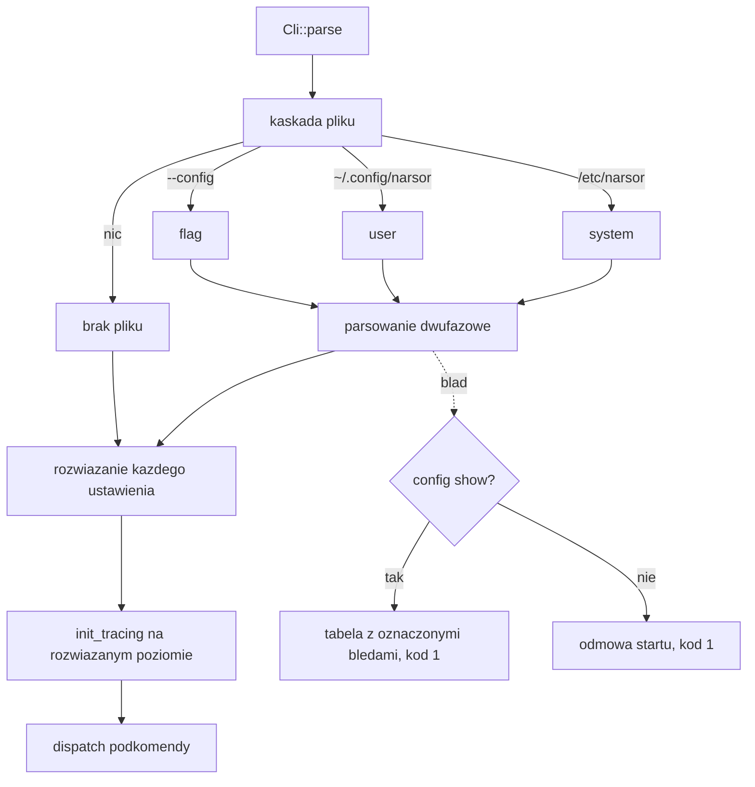

# feat: Konfiguracja aplikacji — kaskada pliku, warstwy rozwiązywania, podgląd ze źródłem

## Summary

Plan wprowadza moduł `src/config/` z kaskadowym wyszukiwaniem pliku konfiguracyjnego, rozwiązywaniem każdego ustawienia osobno (flaga → zmienna środowiskowa → plik → wartość wbudowana) i komendą `config show`, która wypisuje efektywną wartość razem z konkretnym źródłem — w postaci tabeli i w postaci JSON. Poza samym czytaniem pliku plan obejmuje trzy przebudowy istniejącego kodu, bez których wymagania są nieimplementowalne: `--root` traci clapowy `default_value`, `tracing` startuje po rozwiązaniu konfiguracji zamiast przed, a pakiet, binarka i katalogi aplikacji zmieniają nazwę z `orchestrator` na `narsor`.

---

## Problem Frame

Orchestrator nie ma dziś żadnej warstwy ustawień użytkownika: jedynymi pokrętłami są flaga `--root` i zmienna `RUST_LOG`, a wybór harnessu i limity czasu siedzą w definicjach workflow — czyli w plikach opisujących proces, a nie środowisko (patrz origin: `docs/brainstorms/2026-09-24-konfiguracja-aplikacji-requirements.md`).

Kierunkiem wiążącym dla kształtu rozwiązania jest kontener w Kubernetesie: konfiguracja wstrzykiwana z zewnątrz, system plików bywa tylko do odczytu, katalog domowy może nie istnieć. Pytanie operatora nie brzmi wtedy „jak to zmienić", tylko „skąd wzięła się ta wartość" — i dziś nie da się na nie odpowiedzieć inaczej niż czytaniem kodu.

---

## Requirements

Przeniesione z dokumentu wymagań. R3 został **zmieniony w trakcie planowania** (patrz Key Technical Decisions, D-A).

- R1. Każde ustawienie ma wartość wbudowaną — orchestrator działa bez jakiejkolwiek konfiguracji zewnętrznej.
- R2. Ustawienia rozwiązywane w jawnej kolejności: flaga, zmienna środowiskowa, plik, wartość wbudowana. Pierwsze trafienie wygrywa, **per ustawienie**, nie per plik.
- R3. *(zmienione)* Plik szukany kaskadą, pierwszy trafiony wygrywa i nie jest scalany z pozostałymi: ścieżka z `--config`, katalog konfiguracyjny użytkownika, katalog systemowy `/etc/narsor/`. Katalog danych **nie jest** krokiem kaskady.
- R4. Brak pliku w każdym z tych miejsc jest stanem poprawnym i cichym.
- R5. Plik istniejący, lecz niepoprawny — nieczytelny, źle sformułowany, z nieznanym kluczem albo wartością spoza zakresu — powoduje odmowę startu z komunikatem wskazującym plik i miejsce błędu.
- R6. Każde ustawienie dostępne w pliku jest dostępne też jako zmienna środowiskowa.
- R7. Komenda wypisująca wszystkie ustawienia: nazwę, wartość efektywną i źródło. Komplet, także wartości wbudowane.
- R8. Źródło konkretne, nie kategoryczne: ścieżka faktycznie wczytanego pliku, nazwa zmiennej, nazwa flagi.
- R9. Podgląd działa bez zapisywalnego katalogu domowego i bez zapisywalnego systemu plików.
- R10. Podgląd ma postać do wklejenia w zgłoszenie oraz postać do przetworzenia maszynowo.
- R11. Wartości wrażliwe maskowane, ich źródło pokazywane normalnie.
- R12. Konfigurowalne: katalog danych, domyślny harness agenta, limit czasu wykonania agenta, poziom logowania.
- R13. Ustawienie z pliku jest wartością domyślną, nie przymusem: definicja workflow wygrywa.
- R14. Sekrety nie są przechowywane w tym pliku ani przez niego obsługiwane.

**Origin acceptance examples:** AE1 (R2, R7, R8), AE2 (R4, R7, R9), AE3 (R5), AE4 (R13), AE5 (R3, R8 — kroki kaskady zaktualizowane do nowego R3).

---

## Scope Boundaries

- Edycja konfiguracji z poziomu narzędzia — ani w CLI, ani w TUI *(origin)*.
- Rejestr repozytoriów, definicje workflow i kontekst egzekucji — osobne konfiguracje z własnymi trybami podglądu *(origin)*.
- Szerszy raport środowiska: rozwiązane workflowy, rejestr, obecność `git` i harnessów na `PATH` *(origin — rozważone i odłożone)*.
- Scalanie kilku plików konfiguracyjnych w jeden wynik *(origin)*.
- Konfiguracja per projekt czy per wykonanie *(origin)*.
- Widok konfiguracji w TUI. Pokazywanie nie jest edycją, więc granica z origin tego nie zabrania, ale `config show` w CLI dowozi całą wartość; TUI to osobna praca.
- Migracja danych ze starego katalogu `./.orchestrator` i starej ścieżki `~/.config/orchestrator/`. Czyste cięcie — jedynym użytkownikiem jest dziś autor (patrz origin: Dependencies / Assumptions).

### Deferred to Follow-Up Work

- Zapisywanie w `state.json` konfiguracji, pod którą execution wystartował: wykonanie wznowione po dniu dostaje aktualne wartości domyślne dla pozostałych stanów, choć stany już wykonane szły na poprzednich. Dziś niediagnozowalne. Osobna zmiana w `src/persistence/execution_store.rs`.
- Przemianowanie `ORCHESTRATOR_ACTION_ID` na `NARSOR_ACTION_ID`. Świadomie zostawione: to kontrakt wobec skryptów workflow (D24, klucz idempotencji), a nie ustawienie.

---

## Context & Research

### Relevant Code and Patterns

- `src/workflows/mod.rs` — **wzorzec kaskady do naśladowania wprost**. `WorkflowOrigin` jako pierwszorzędny typ z `label()`, `path()` i `Display`; środowisko czytane **raz, przy konstrukcji** (`WorkflowResolver::new`), z jawnym szwem `with_user_dir(root, Option<PathBuf>)` dla testów; `ResolveError::NotFound` wypisujący każde sprawdzone miejsce.
- `src/cli/mod.rs:42-48` — kontrakt kodów wyjścia (0 sukces, 1 porażka, 2 użycie) i reguła strumieni: wynik na stdout, diagnostyka na stderr.
- `src/cli/commands.rs:628` — `workflow_show` jako precedens podziału strumieni: ładunek sam na stdout, „skąd to jest" na stderr.
- `src/cli/commands.rs:595` — `workflow_list` jako precedens formatowania tabeli o stałej szerokości kolumn.
- `src/workflow/schema.rs` — `#[serde(deny_unknown_fields)]` jako zasada domowa (15 wystąpień) oraz `parse_duration` (wolna funkcja przyjmująca `&str`, rozumie `30m`, `2h`, `1h30m`, gołe sekundy).
- `src/workflow/validator.rs` — zasada „zgłaszaj wszystkie naruszenia naraz, w deterministycznej kolejności".
- `src/engine/runner.rs:681-684` — łańcuch timeoutu `state.timeout_secs.or(globals.timeout_secs)`, przekazywany **każdemu** rodzajowi akcji przez `ActionRequest::with_timeout`.
- `src/engine/actions/mod.rs:194-227` — `TimedOutAction::resolve`: timeout na stanie bez zadeklarowanego wyjścia `timeout` staje się błędem akcji klasyfikowanym jako ponawialny.
- `src/engine/actions/harness/mod.rs:139` — `HarnessRegistry::get`, dziś zgłaszający nieznany harness dopiero w czasie wykonania; `supported()` daje zamknięty zbiór do walidacji konfiguracji.
- `tests/cli_smoke.rs:36-90` — konwencja testowa: własny `TempRoot` z `Drop` (brak zależności `tempfile`), uruchamianie prawdziwej binarki przez `CARGO_BIN_EXE_*`, `HOME` i `XDG_CONFIG_HOME` przekierowane na katalog tymczasowy procesu potomnego.

### Institutional Learnings

`docs/solutions/` w tym repozytorium nie istnieje. Wiedza instytucjonalna mieszka w `ARCHITECTURE_DECISIONS.md` (D1–D46) i w obszernych komentarzach modułowych, które pełnią rolę ADR-ów.

- **D16** — sekrety przez zmienne środowiskowe i montowany `.env`, nigdy przez plik konfiguracyjny. R14 jest z tym zgodne, czyli granica „bez sekretów" jest już zatwierdzona, a nie nowa.
- **D22** — timeouty definiowane per akcja; „globalny timeout" jawnie odrzucony jako mechanizm główny. Ustawienie z konfiguracji jest wartością domyślną, więc jest z D22 zgodne — plan mówi to wprost.
- **D14, D15** — uruchomienie w kontenerze i montowanie RO/RW jako decyzja zatwierdzona; uzasadnia R6 i R9.
- **D46** — obserwowalność to logi strukturalne i historia zdarzeń; nie ma endpointu metryk, więc `config show` **jest** powierzchnią diagnostyczną.
- Z pamięci projektu: `git` przez CLI, nigdy libgit2 — spójne z `src/workspace/provisioner.rs`.

### External References

Pominięte świadomie: repozytorium ma silny, bezpośrednio stosowalny wzorzec lokalny (resolver workflowów), a praca nie dotyka obszaru podwyższonego ryzyka.

---

## Key Technical Decisions

- **D-A. Kaskada bez katalogu danych** *(zmiana względem origin R3)*. Plik szukany jest w `--config` → `~/.config/narsor/` → `/etc/narsor/`. Origin umieszczał w kaskadzie katalog danych `{root}`, co tworzyło cykl: plik leżałby w katalogu, który sam konfiguruje. Usunięcie tego kroku likwiduje cykl u źródła — miejsce pliku nie zależy od żadnego ustawienia, a katalog danych staje się zwykłym ustawieniem bez statusu specjalnego. Krok `/etc/narsor/` jest dodatkowo naturalnym celem montowania ConfigMapy.
- **D-B. Przemianowanie na `narsor`**. Pakiet, binarka, crate biblioteczny, katalog konfiguracyjny użytkownika, katalog systemowy, domyślny katalog danych (`./.narsor`) i plik logu TUI (`narsor.log`). Bez tego aplikacja miałaby dwie nazwy w ścieżkach, które ta funkcja dopiero publikuje jako kontrakt. `ORCHESTRATOR_ACTION_ID` zostaje — to kontrakt wobec skryptów, nie ustawienie.
- **D-C. Domyślny timeout dotyczy wyłącznie akcji `agent`**. Silnik ma dziś jeden timeout wspólny dla wszystkich rodzajów akcji, a `None` znaczy „bez limitu". Wpisanie wspólnej wartości domyślnej sprawiłoby, że każdy istniejący stan skryptowy bez własnego limitu zacząłby wpadać w `TimedOutAction::resolve` → błąd ponawialny → wyczerpanie budżetu retry → porażka akcji. Timeout z konfiguracji jest więc osobnym polem podawanym egzekutorowi agenta, z jawną wartością „bez limitu" pozwalającą go wyłączyć.
- **D-D. `config show` jest jedynym wyjątkiem od odmowy startu**. Przy niepoprawnym pliku wypisuje tabelę z oznaczonymi błędnymi kluczami i kończy się kodem 1. Bez tego wyjątku jedyne narzędzie diagnostyczne przestaje działać dokładnie w sytuacji, do której powstało (patrz origin: Success Criteria).

  Wyjątek obejmuje **obie** klasy awarii: błędy parsowania z U4 **i** błędy kaskady z D-G (katalog pod ścieżką pliku, zerwany symlink, brak uprawnień) — to właśnie awarie produkowane przez ConfigMapę, czyli główny scenariusz diagnostyczny. Przy błędzie kaskady komenda wypisuje pełną tabelę wartości rozwiązanych bez pliku plus wiersz poboczny z nazwaną ścieżką i powodem, i kończy się kodem 1. Jedynym wyjątkiem od wyjątku jest nieistniejąca ścieżka podana w `--config`: to błąd użycia z kodem 2 także dla `config show`, bo operator nazwał plik, którego nie ma.

  Konsekwencja dla kształtu API: rozwiązywanie konfiguracji **nie** zwraca `Result`, tylko strukturę niosącą jednocześnie wartości ze źródłami i listę błędów. Decyzję „odmówić startu czy oddać wynik komendzie" podejmuje dispatch na podstawie tego, czy podkomendą jest `config show`.
- **D-E. Parsowanie dwufazowe, bez `deny_unknown_fields`**. Faza pierwsza wczytuje plik do `serde_yaml::Mapping` — **bez** `deny_unknown_fields`. Faza druga porównuje zbiór kluczy mapy z rejestrem ustawień (U2) i waliduje każdą wartość osobno, zbierając **wszystkie** błędy w jednej, deterministycznie posortowanej liście. `deny_unknown_fields` byłoby tu pułapką: przerywa deserializację na pierwszym nieznanym kluczu, więc faza druga nigdy nie dostałaby mapy i nie zebrałaby niczego — a nieznany klucz to dokładnie przypadek sztandarowy AE3 i D-D. Zasada domowa `deny_unknown_fields` zostaje regułą schematu workflowów (`src/workflow/schema.rs`), nie konfiguracji; ten sam efekt osiąga się tu porównaniem z rejestrem. Zgodne z zasadą „zgłaszaj wszystkie naruszenia naraz" z `src/workflow/validator.rs`.
- **D-F. `harness` w workflow staje się opcjonalny**, z wartością wbudowaną `claude-code`. Skoro każde ustawienie ma wartość wbudowaną (R1), „brak harnessu gdziekolwiek" nie może zaistnieć — więc `validate` nie ma czego zgłaszać i pozostaje statyczny, a wyeksportowany workflow zostaje przenośny. Kontrola braku tego pola znika z walidatora.

  **Wartość domyślna wstrzykiwana jest w egzekutorze, nie w loaderze.** `harness` pozostaje opcjonalny aż do `AgentActionConfig` w `src/domain/workflow_definition.rs` (`Option<String>`), a `AgentExecutor` — który i tak trzyma `HarnessRegistry` — stosuje wartość z konfiguracji, gdy akcja swojej nie podała. Dzięki temu `load_from_str` i `validate_source` zostają czystymi funkcjami tekstu źródłowego, czego wprost wymaga to, że walidacja ma pozostać statyczna; wariant z loaderem musiałby przekazać konfigurację do `src/tasks/mod.rs`, `src/workflows/mod.rs` i `src/cli/commands.rs`, uzależniając kompilację definicji od środowiska. Dodatkowo zdarzenie `AgentSessionStarted` zapisuje wtedy harness faktycznie użyty, a nie „niepodany". W `validator.rs` gałąź szablonowania `action.harness` przyjmuje kształt, który gałąź `decision.harness` ma już dziś (`if let Some(...)`, `src/workflow/validator.rs:384`).

  Odwrotna strona bilansu: workflow bez `harness:` jest przenośny, ale jego zachowanie zależy od środowiska — ten sam plik może uruchomić innego agenta na laptopie i innego w kontenerze, a `validate` tego nie zauważy. Operator odczytuje faktyczną wartość przez `config show` przed uruchomieniem; workflow przeznaczony do powtarzalnego wykonania powinien `harness:` deklarować jawnie (U8).
- **D-G. Kandydat kaskady, który istnieje, ale nie jest czytelnym plikiem, zatrzymuje start**. Katalog, zerwany symlink i brak uprawnień dostają własne komunikaty nazywające ścieżkę. Odwrotnie niż robi resolver workflowów — świadomie, bo to są dokładnie awarie produkowane przez ConfigMapę (montaż pod ścieżką pliku, okno atomowej podmiany, złe `defaultMode`). Cicha konfiguracja jest tym, co origin nazywa najgorszym możliwym wynikiem.
- **D-H. Pusty plik jest poprawny** i oznacza komplet wartości wbudowanych. `config show` pokazuje wtedy ten plik jako zwycięzcę kaskady, a `built-in` jako źródło każdej wartości — wygląda to sprzecznie, więc README musi to nazwać.
- **D-I. Format YAML, akceptowane `.yaml` i `.yml`**. Zero nowych zależności i ponowne użycie `parse_duration`. Obie końcówki, bo literówka skutkująca cichym zignorowaniem pliku to ta sama awaria, której ta funkcja ma zapobiegać.
- **D-J. Prefiks `NARSOR_`, pusta wartość znaczy „nieustawione"**. Mapowanie totalne i mechaniczne: `NARSOR_<KLUCZ_WIELKIMI>`. Pusta wartość traktowana jak brak, bo tak Kubernetes renderuje nieustawiony klucz ConfigMapy — i tak samo zachowuje się już `XDG_CONFIG_HOME` w `src/workflows/mod.rs:435`.
- **D-K. `RUST_LOG` wygrywa nad `NARSOR_LOG_LEVEL`**. `RUST_LOG` przyjmuje pełne dyrektywy `EnvFilter` (np. `narsor::engine=debug`), `NARSOR_LOG_LEVEL` tylko gołe poziomy — więc `RUST_LOG` jest narzędziem bardziej precyzyjnym i nie ma sensu, by przegrywał. `config show` nazywa tę zmienną, która faktycznie zadziałała.
- **D-L. Limit rozmiaru pliku 1 MiB**. `serde_yaml` obsługuje kotwice i aliasy, więc plik z montowanego woluminu może rozwinąć się w pamięci przy starcie *każdej* komendy. R5 pozwala odmówić, więc odmawiamy z nazwanym błędem.
- **D-M. Wrażliwość jest atrybutem wpisu w rejestrze ustawień**, a nie regułą po nazwie klucza. W v1 żaden klucz nie jest wrażliwy (patrz origin: Assumptions), więc renderowanie testujemy jednostkowo na skonstruowanym wpisie, zamiast wprowadzać sztuczny klucz.
- **D-N. Wbudowany poziom logowania to `off`, nie `info`**. Dziś przy nieustawionym `RUST_LOG` `EnvFilter::from_default_env()` nie włącza niczego i żadna komenda nie pisze ani jednej linii logu — mówi to wprost komentarz modułowy w `src/main.rs`. Wartość wbudowana `info` zmieniłaby to domyślne zachowanie dla wszystkich podkomend naraz, a w `tui` sprawiłaby, że katalog danych i plik logu powstają przy każdym uruchomieniu, nie tylko przy jawnie włączonym logowaniu. Żadne wymaganie tego nie żąda, a cisza jest tu zachowaniem, na którym ktoś mógł polegać. W związku z tym bramka na utworzenie pliku logu TUI opiera się na tym, czy **rozwiązany** poziom cokolwiek włącza — nie na samej obecności `RUST_LOG`.
- **D-O. Kształt wyjścia JSON niesie numer wersji**. `config show --format json` publikuje kontrakt, wokół którego powstaną skrypty diagnostyczne i wywołania `jq`, a plan celuje we wdrożenie kontenerowe, w którym łamanie go przestaje być tanie. Pole wersji pozwala późniejszej zmianie kształtu być rozpoznawalną zmianą, a nie awarią. Prefiks `NARSOR_`, ścieżki kaskady i sama komenda są traktowane jako kontrakt od pierwszego wydania; README nazywa ten status wprost (U8).

---

## Open Questions

### Resolved During Planning

- **Czy limit czasu agenta to jedno ustawienie, czy rozdziela się na fazy?** Jedno. `src/engine/runner.rs:681` liczy jedną wartość zegarową na próbę akcji i przekazuje ją przez `tokio::time::timeout` wokół całego oczekiwania na proces potomny. Nie ma faz do rozdzielenia. Właściwym pytaniem okazał się zasięg — patrz D-C.
- **Czy odmowa startu przy błędnym pliku obowiązuje każdą komendę?** Nie — `config show` jest jedynym wyjątkiem (D-D).
- **Format postaci maszynowej i relacja do podziału stdout/stderr?** JSON sam na stdout, diagnostyka na stderr, zgodnie z precedensem `workflow show`. Kształt to obiekt kluczowany nazwą ustawienia, ze **strukturalnym** źródłem (`{ kind, detail }`), a nie sklejonym napisem — żeby maszyna nie musiała parsować `"file (/etc/…)"`.

### Deferred to Implementation

- Dokładne brzmienie komunikatów błędu dla katalogu, zerwanego symlinku i braku uprawnień — rozstrzygalne dopiero przy oglądzie `io::ErrorKind`, który system faktycznie zwraca w każdym z tych przypadków.
- Czy `serde_yaml` przy pustym wejściu zwraca `Value::Null` czy błąd, i w związku z tym, w którym miejscu wpiąć obsługę D-H.
- Czy `config show` powinien absolutyzować ścieżki względne przed wypisaniem. Względne `XDG_CONFIG_HOME` jest niezgodne z XDG, ale przyjmowane przez istniejący kod; wypisanie ścieżki względnej częściowo psuje R8.

---

## High-Level Technical Design

> *Ilustruje zamierzone podejście i jest wskazówką kierunkową do przeglądu, a nie specyfikacją implementacji. Implementujący ma traktować to jako kontekst, nie jako kod do odtworzenia.*

Dwie niezależne osie, dziś w kodzie zlepione: **gdzie leży plik** i **skąd pochodzi pojedyncza wartość**.



Kluczowa zmiana kolejności: dziś `init_tracing` biegnie **przed** `cli::run`, czytając wyłącznie `RUST_LOG`. Po zmianie konfiguracja rozwiązuje się przed instalacją subskrybenta, a błędy samego rozwiązywania trafiają na stderr zwykłym `eprintln!` — tak jak już robi `cli::run` przy `CliError`.

Rozwiązywanie pojedynczego ustawienia, w skrócie:

```text
dla kazdego ustawienia w rejestrze:
    flaga CLI (jesli ustawienie ma flage i zostala podana)  -> Source::Flag(nazwa)
    zmienna NARSOR_<KLUCZ> (niepusta)                       -> Source::Env(nazwa)
    klucz w rozwiazanym pliku                               -> Source::File(sciezka)
    wartosc wbudowana                                       -> Source::BuiltIn
```

Typ źródła jest lustrem `WorkflowOrigin` z `src/workflows/mod.rs`: wariant niosący konkret (ścieżkę, nazwę zmiennej, nazwę flagi), `label()` na słowo do tabeli i `Display` na „słowo (konkret)".

---

## Implementation Units

### U1. Przemianowanie pakietu, binarki i katalogów na `narsor`

**Goal:** Aplikacja ma jedną nazwę, zanim ta nazwa zostanie zapisana w publicznych ścieżkach konfiguracji.

**Requirements:** przygotowanie pod R3, R6

**Dependencies:** brak

**Files:**
- Modify: `Cargo.toml` (`name`), `src/main.rs` (`use narsor::…`, stała pliku logu), `src/cli/mod.rs` (`#[command(name = …)]`), `src/workflows/mod.rs` (`USER_CONFIG_DIR`), `src/persistence/paths.rs` (`DEFAULT_ROOT`)
- Modify: wszystkie pliki w `tests/` używające `use orchestrator::…` oraz `CARGO_BIN_EXE_orchestrator`
- Modify: `README.md`, `ARCHITECTURE_DECISIONS.md`, `DOMAIN_MODEL.md`, `WORKFLOW_SCHEMA.md` — wystąpienia nazwy binarki i ścieżek

**Approach:**
- Zmiana czysto nazewnicza, bez zmiany zachowania poza ścieżkami: `~/.config/orchestrator/` → `~/.config/narsor/` (razem z podkatalogiem `workflows/`), `./.orchestrator` → `./.narsor`, `orchestrator.log` → `narsor.log`.
- Bez czytania starych ścieżek jako zapasowych — czyste cięcie (patrz Scope Boundaries).
- `ORCHESTRATOR_ACTION_ID` zostaje nietknięty.

**Patterns to follow:**
- `src/workflows/mod.rs:50` — `USER_CONFIG_DIR` jest już jedynym miejscem, z którego bierze się nazwa katalogu aplikacji; nie wprowadzać drugiego.

**Test scenarios:**
- Happy path: cały istniejący pakiet testów przechodzi po przemianowaniu, bez zmian w asercjach innych niż nazwa binarki i ścieżki.
- Happy path: `workflow eject <nazwa>` bez `--to` zapisuje do `~/.config/narsor/workflows/`, a `workflow list` pokazuje ten plik jako źródło `user`.
- Edge case: `--root` nie podany — dane lądują w `./.narsor` względem katalogu roboczego.
- Edge case: `tui` z ustawionym `RUST_LOG` tworzy `{root}/narsor.log`, nie `orchestrator.log`.

**Verification:**
- `cargo build` i `cargo test` przechodzą; `grep -ri orchestrator src/ tests/` zwraca wyłącznie `ORCHESTRATOR_ACTION_ID` i ewentualne cytaty historyczne w dokumentacji.

---

### U2. Rejestr ustawień, typ źródła i wartości wbudowane

**Goal:** Czysty model tego, jakie ustawienia istnieją, jakie mają typy, wartości wbudowane, zmienne środowiskowe i czy są wrażliwe — bez żadnego wejścia-wyjścia.

**Requirements:** R1, R6, R8, R11, R12

**Dependencies:** U1

**Files:**
- Create: `src/config/mod.rs`, `src/config/settings.rs`
- Modify: `src/lib.rs` (rejestracja modułu)
- Test: testy jednostkowe `#[cfg(test)]` w `src/config/settings.rs`

**Approach:**
- Typ źródła jako lustro `WorkflowOrigin`: warianty `Flag(&'static str)`, `Env(String)`, `File(PathBuf)`, `BuiltIn`, z `label()`, opcjonalnym konkretem i `Display` w formie „słowo (konkret)".
- Rejestr czterech ustawień (katalog danych, domyślny harness, timeout agenta, poziom logowania) jako jedno miejsce prawdy: nazwa klucza, nazwa zmiennej środowiskowej wyprowadzona mechanicznie z klucza, opcjonalna nazwa flagi, wartość wbudowana, znacznik wrażliwości.
- Maskowanie jest funkcją renderującą, sterowaną znacznikiem z rejestru — nigdy regułą po nazwie klucza (D-M).
- Wartości wbudowane: katalog danych `./.narsor`, harness `claude-code`, timeout agenta „bez limitu", poziom logowania `off`.
- Poziom `off` jako wartość wbudowana, a nie `info`, bo dziś przy nieustawionym `RUST_LOG` nie instaluje się żaden subskrybent i komendy milczą (`src/main.rs`). Wartość wbudowana `info` włączyłaby logi każdej komendzie i sprawiła, że `tui` zawsze zakłada katalog danych i plik logu — zmiana zachowania niewynikająca z żadnego wymagania (D-N).

**Patterns to follow:**
- `src/workflows/mod.rs:104-147` — `WorkflowOrigin` z `label()`, `path()` i `Display`.

**Test scenarios:**
- Happy path: rejestr zwraca komplet czterech ustawień; dla każdego nazwa zmiennej środowiskowej ma prefiks `NARSOR_` i jest wielkimi literami.
- Happy path *(D-N)*: wbudowanym poziomem logowania jest `off`, czyli filtr, który nie włącza niczego.
- Happy path: `Display` źródła renderuje `plik (/etc/narsor/config.yaml)` dla pliku i samo `wbudowane` dla wartości wbudowanej.
- Edge case: wpis oznaczony jako wrażliwy renderuje wartość zamaskowaną, a jego źródło pozostaje nietknięte (R11).
- Edge case: wpis niewrażliwy nigdy nie jest maskowany, także gdy jego wartość przypomina sekret.

**Verification:**
- Każde ustawienie z R12 ma wpis w rejestrze, a zbiór nazw zmiennych środowiskowych jest różnowartościowy.

---

### U3. Kaskada pliku konfiguracyjnego

**Goal:** Znaleźć plik, który wygrywa, powiedzieć skąd jest, i zatrzymać się, gdy kandydat jest zepsuty.

**Requirements:** R3, R4, R9, R10 (częściowo), AE2, AE5

**Dependencies:** U2

**Files:**
- Create: `src/config/cascade.rs`
- Test: `tests/config_cascade.rs`

**Approach:**
- Trzy kroki, pierwszy trafiony wygrywa, bez scalania: ścieżka z `--config`, katalog użytkownika, `/etc/narsor/`. Katalog użytkownika to `$XDG_CONFIG_HOME/narsor/` albo `$HOME/.config/narsor/`; brak obu daje `None` i krok jest po prostu pomijany (R9).
- Środowisko czytane **raz, przy konstrukcji**, z jawnymi szwami na katalog użytkownika i systemowy — to samo, co pozwala testom nie dotykać prawdziwego `~/.config` ani `/etc`.
- W każdym katalogu próbowane `config.yaml`, potem `config.yml` (D-I).
- Kandydat, który istnieje, ale nie jest czytelnym plikiem, kończy rozwiązywanie błędem nazywającym ścieżkę i powód (D-G) — to jest odwrotność zachowania resolvera workflowów i wymaga komentarza w kodzie mówiącego dlaczego.
- Ścieżka podana w `--config`, która nie istnieje, to błąd użycia — operator nazwał ten plik.
- Zwracany wynik niesie też kandydatów przesłoniętych, do wypisania przez `config show` (AE5, wzorem `WorkflowEntry::shadows`).

**Technical design:** *(kierunkowo)*

```text
rozwiaz() -> Result<Rozwiazanie, BladKaskady>
    dla kazdego kandydata w [flag?, user?, system]:
        brak wpisu w systemie plikow        -> nastepny kandydat
        katalog | zerwany symlink | EACCES  -> Err(nazwij sciezke i powod)
        zwykly plik                          -> zwycięzca; reszta trafia do "przesloniete"
    zaden                                    -> Rozwiazanie::Brak
```

**Patterns to follow:**
- `src/workflows/mod.rs:244-354` — budowa resolvera, szew `with_user_dir`, `ResolveError::NotFound` wypisujący każde sprawdzone miejsce.
- `src/workflows/mod.rs:434-440` — puste `XDG_CONFIG_HOME` traktowane jak nieustawione.

**Test scenarios:**
- Happy path: plik tylko w katalogu użytkownika — wygrywa on, a źródło niesie jego pełną ścieżkę.
- Happy path *(AE5)*: plik i w katalogu użytkownika, i w systemowym — wczytany zostaje wyłącznie pierwszy, a zawartość drugiego nie jest dołączana; drugi pojawia się na liście przesłoniętych.
- Happy path: `--config` wskazujący istniejący plik wygrywa nad oboma katalogami.
- Edge case *(AE2)*: brak `HOME` i brak `XDG_CONFIG_HOME`, brak `/etc/narsor/` — rozwiązywanie kończy się stanem „brak pliku", bez błędu i bez ostrzeżenia (R4).
- Edge case: `config.yml` zamiast `config.yaml` w katalogu użytkownika — plik zostaje znaleziony.
- Edge case: pusty plik zero-bajtowy — traktowany jako poprawny zwycięzca kaskady (D-H).
- Error path: pod `/etc/narsor/config.yaml` leży katalog — błąd nazywający tę ścieżkę i mówiący, że to katalog.
- Error path: kandydat jest zerwanym symlinkiem — błąd nazywający ścieżkę.
- Error path: kandydat istnieje, ale prawa odmawiają odczytu — błąd mówiący o uprawnieniach, nie o braku pliku.
- Error path: `--config` wskazuje ścieżkę, której nie ma — błąd użycia, bez cichego przejścia do kolejnego kroku kaskady.
- Edge case: rozwiązywanie nie tworzy żadnego katalogu ani pliku, także gdy katalog użytkownika nie istnieje (R9).

**Verification:**
- Testy przechodzą na katalogu tymczasowym bez dotykania prawdziwego `~/.config` ani `/etc`; żaden test nie mutuje środowiska procesu testowego.

---

### U4. Parsowanie dwufazowe i walidacja per klucz

**Goal:** Z pliku zrobić albo komplet wartości, albo komplet błędów — nigdy pierwszy napotkany błąd.

**Requirements:** R5, R12, AE3

**Dependencies:** U2

**Files:**
- Create: `src/config/file.rs`
- Test: `tests/config_file.rs`

**Approach:**
- Faza pierwsza: wczytanie do `serde_yaml::Mapping` **bez** `deny_unknown_fields`. Faza druga: porównanie zbioru kluczy z rejestrem ustawień (U2) oraz walidacja każdej wartości osobno, ze zbieraniem **wszystkich** błędów — nieznanych kluczy i złych wartości — w jednej, deterministycznie posortowanej liście (D-E). Użycie `deny_unknown_fields` przerwałoby deserializację na pierwszym nieznanym kluczu i uniemożliwiło zebranie czegokolwiek więcej.
- Lokalizacja błędu bierze się z `Display` błędu `serde_yaml`, który sam dopisuje wiersz i kolumnę — warunkiem jest zachowanie `{source}` w formacie błędu i nieskładanie go wcześniej do napisu.
- Czas trwania przez istniejące `parse_duration`; harness walidowany wobec `HarnessRegistry::defaults().supported()`, czyli zamkniętego zbioru; poziom logowania wobec zbioru gołych poziomów.
- Wymuszony limit rozmiaru 1 MiB przed parsowaniem (D-L). Wiodący znacznik BOM usuwany, z osobnym komunikatem dla wejścia spoza UTF-8 — inaczej komunikat systemowy brzmi jak problem z uprawnieniami.

**Execution note:** Zacząć od testu na pliku z dwoma niezależnymi błędami — to on wymusza kształt dwufazowy i najłatwiej go zgubić, implementując najpierw wariant jednofazowy.

**Patterns to follow:**
- `src/workflow/loader.rs:35-57` — wariant błędu niosący `PathBuf` i `#[source]`, z lokalizacją wchodzącą do komunikatu przez `{source}`.
- `src/workflow/validator.rs` — zbieranie wszystkich naruszeń naraz.
- `src/workflow/schema.rs` — `parse_duration` do czasu trwania. `deny_unknown_fields` z tego pliku jest **kontrprzykładem**, nie wzorcem: tutaj nieznane klucze wykrywa porównanie z rejestrem (D-E).

**Test scenarios:**
- Happy path: plik ustawiający wszystkie cztery klucze daje komplet wartości bez błędów.
- Happy path: plik ustawiający jeden klucz daje jedną wartość, a pozostałe pozostają nieustawione (nie: wbudowane — to warstwa wyżej).
- Happy path: timeout zapisany jako `30m`, `2h` i gołe `90` — wszystkie parsują się do sekund.
- Edge case: pusty plik daje komplet nieustawionych wartości bez błędu (D-H).
- Edge case: plik z wiodącym BOM parsuje się poprawnie.
- Error path *(AE3)*: nieznany klucz daje błąd nazywający plik i ten klucz.
- Error path *(D-E)*: **dwa** nieznane klucze dają dwa błędy, nie tylko pierwszy — to scenariusz, który wyklucza implementację opartą o `deny_unknown_fields`.
- Error path: dwa niezależne błędy — nieznany harness i nieparsowalny czas trwania — dają **oba** w jednym wyniku, nie tylko pierwszy.
- Error path: nieznany klucz i zła wartość innego klucza trafiają do tej samej listy, posortowanej deterministycznie.
- Error path: harness spoza zbioru obsługiwanych daje błąd wymieniający obsługiwane nazwy.
- Error path: poziom logowania spoza zbioru daje błąd wymieniający dozwolone poziomy.
- Error path: plik przekraczający 1 MiB odrzucany z nazwanym błędem, bez parsowania.
- Error path: bajty spoza UTF-8 dają komunikat o kodowaniu, nie o dostępie.

**Verification:**
- Każdy komunikat błędu zawiera ścieżkę pliku; błędy składniowe zawierają wiersz i kolumnę.

---

### U5. Warstwowe rozwiązywanie ustawień i kolejność startu

**Goal:** Każde ustawienie dostaje wartość i konkretne źródło, a `tracing` startuje już na rozwiązanym poziomie.

**Requirements:** R1, R2, R6, R8, AE1

**Dependencies:** U3, U4

**Files:**
- Create: `src/config/resolve.rs`
- Modify: `src/cli/mod.rs` (`--root` jako `Option<PathBuf>`, nowa globalna `--config`, przekazywanie rozwiązanych ustawień do podkomend), `src/main.rs` (kolejność startu, `init_tracing` na rozwiązanym poziomie i rozwiązanym katalogu)
- Test: `tests/config_resolve.rs`

**Approach:**
- `--root` traci `default_value` i staje się `Option<PathBuf>`; wartość wbudowana przenosi się do rozwiązywania. Bez tego nie da się odróżnić „operator podał flagę" od „clap wstawił domyślną", czyli AE1 jest nieimplementowalne. Zmiana dotyka wszystkich miejsc w `cli::run` przekazujących `&cli.root`.
- Nowa flaga `--config` z `global = true`, tak samo jak dzisiejsze `--root` (`src/cli/mod.rs:62`), żeby działała również po podkomendzie.
- Kolejność startu: `Cli::parse` → rozwiązanie konfiguracji → `init_tracing` → dispatch. Błędy rozwiązywania trafiają na stderr zwykłym `eprintln!`, bo żaden subskrybent jeszcze nie istnieje.
- **Środowisko jest jawnym parametrem konstrukcji**, nie odczytem z `std::env` w głębi rozwiązywania: mapa `nazwa → wartość` zdejmowana raz w `main.rs` i wstrzykiwana, wzorem `WorkflowResolver::with_user_dir` (`src/workflows/mod.rs:263`). Bez tego szwu scenariusze poniżej dałoby się napisać tylko przez `std::env::set_var`, co przy równoległym harnessie testowym Rusta jest wyścigiem między testami tego samego binarium i produkuje niestabilne porażki — a `config show` (U6), które czyni źródła obserwowalnymi z zewnątrz, powstaje dopiero po tej jednostce.
- Rozwiązywanie zwraca strukturę z wartościami **i** listą błędów, nigdy `Result` (D-D); dispatch decyduje, czy odmówić startu, czy oddać wynik komendzie.
- `init_tracing` otwiera plik logu TUI pod **rozwiązanym** katalogiem danych — dziś używa surowego `cli.root`, co po wprowadzeniu konfigurowalnego katalogu byłoby zwykłym błędem. Bramką pozostaje to, czy rozwiązany poziom cokolwiek włącza (D-N), a nie sama obecność `RUST_LOG`.
- Pusta zmienna środowiskowa liczy się jako nieustawiona (D-J). `RUST_LOG` ma pierwszeństwo przed `NARSOR_LOG_LEVEL` (D-K).

**Execution note:** Wydzielić zmianę `--root` na `Option<PathBuf>` jako pierwszy, osobny commit — dotyka wszystkich podkomend i łatwiej ją przejrzeć bez reszty.

**Patterns to follow:**
- `src/cli/mod.rs:250-298` — kształt dispatchu, do którego wchodzi rozwiązana konfiguracja.
- `src/main.rs:44-72` — istniejący `init_tracing` z wyjątkiem dla TUI.

**Test scenarios:**
- Happy path *(AE1)*: plik ustawia katalog danych, a wywołanie podaje `--root` gdzie indziej — wygrywa flaga, a źródłem jest flaga, nie plik.
- Happy path: zmienna środowiskowa wygrywa nad plikiem, a przegrywa z flagą; źródłem jest nazwa zmiennej.
- Happy path *(AE2)*: brak pliku i brak katalogu domowego — komplet ustawień ma źródło „wbudowane", a komenda kończy się sukcesem.
- Edge case: `NARSOR_DATA_DIR=""` traktowane jak nieustawione — wygrywa plik albo wartość wbudowana.
- Edge case: `RUST_LOG` i `NARSOR_LOG_LEVEL` ustawione jednocześnie — obowiązuje `RUST_LOG`, a źródłem jest ta właśnie zmienna.
- Edge case: katalog danych wskazany w pliku obowiązuje wykonania, workspace'y i rejestr — a kaskada i tak szukała pliku niezależnie od niego (D-A).
- Error path *(AE3)*: niepoprawny plik powoduje, że `run`, `list`, `validate` i `tui` kończą się kodem 1 z komunikatem wskazującym plik.
- Edge case *(D-N)*: bez `RUST_LOG` i bez ustawionego poziomu logowania żadna komenda nie wypisuje na stderr ani jednej linii logu — dokładnie jak przed zmianą.
- Edge case *(D-N)*: `tui` bez `RUST_LOG` i bez ustawionego poziomu nie tworzy katalogu danych ani pliku `narsor.log`.
- Integration: logi TUI trafiają do `narsor.log` w katalogu danych rozwiązanym z konfiguracji, nie w tym z surowej flagi.
- Integration: poziom logowania z pliku faktycznie zmienia to, co pojawia się na stderr, przy nieustawionym `RUST_LOG`.
- Integration: testy tej jednostki konstruują wstrzykiwaną mapę środowiska wprost i nie wołają `std::env::set_var` ani razu.

**Verification:**
- Żadna podkomenda nie czyta już `cli.root` bezpośrednio; wszystkie dostają wartość rozwiązaną.

---

### U6. Komenda `config show`

**Goal:** Jedno wywołanie, którego wynik odpowiada na pytanie „skąd wzięła się ta wartość" — i które działa też wtedy, gdy plik jest zepsuty.

**Requirements:** R7, R8, R9, R10, R11, AE1, AE2, AE5

**Dependencies:** U5

**Files:**
- Modify: `src/cli/mod.rs` (wariant `Config` z podkomendą `Show`), `src/cli/commands.rs` (implementacja)
- Test: `tests/config_show.rs`

**Approach:**
- Grupa podkomend wzorem `Command::Workflow` i `Command::Repo`, z jednym czasownikiem `show` — zostawia miejsce na późniejsze `config path`.
- Domyślnie tabela o stałych szerokościach kolumn (nazwa, wartość, źródło) wzorem `workflow_list`, z wierszem dla **każdego** ustawienia, także pozostawionego na wartości wbudowanej.
- `--format json` wypisuje sam JSON na stdout: numer wersji kształtu (D-O), obiekt kluczowany nazwą ustawienia ze źródłem **strukturalnym** (`kind` plus `detail`), rozwiązana ścieżka pliku i lista kandydatów przesłoniętych.
- Przy niepoprawnym pliku komenda nadal działa: wypisuje tabelę, przy zepsutych kluczach zamiast wartości komunikat i lokalizację, i kończy się kodem 1 (D-D). **Oba formaty zachowują się tak samo** — wariant JSON niesie błędy strukturalnie, przy zepsutych kluczach zamiast wartości, i tak samo kończy się kodem 1.
- To samo dotyczy błędu kaskady z D-G: komenda wypisuje pełną tabelę (wartości rozwiązane bez pliku) plus wiersz z nazwaną ścieżką i powodem, i kończy się kodem 1. Wyjątkiem pozostaje nieistniejąca ścieżka z `--config` — błąd użycia z kodem 2 także tutaj.
- Wartości wrażliwe maskowane, źródło pokazywane normalnie (R11).
- Komenda nie tworzy niczego na dysku i nie wymaga istnienia katalogu danych (R9).

**Patterns to follow:**
- `src/cli/commands.rs:595-620` — formatowanie tabeli i wiersze poboczne (`path:`, `overrides:`).
- `src/cli/commands.rs:628` — podział strumieni w `workflow_show`.

**Test scenarios:**
- Happy path *(R7)*: bez żadnej konfiguracji tabela zawiera wszystkie cztery ustawienia, każde ze źródłem „wbudowane".
- Happy path *(AE1)*: przy pliku ustawiającym katalog danych i podanym `--root`, wiersz katalogu danych pokazuje wartość z flagi i flagę jako źródło.
- Happy path *(R8)*: wartość z pliku pokazuje **ścieżkę** faktycznie wczytanego pliku; wartość ze zmiennej pokazuje **nazwę** zmiennej.
- Happy path *(AE5)*: przy pliku w katalogu użytkownika i w systemowym, wypis podaje ścieżkę zwycięzcy i wymienia przesłoniętego kandydata.
- Happy path *(R10)*: `--format json` daje wyjście parsowalne przez `serde_json`, ze źródłem jako obiektem, nie napisem.
- Edge case *(R9)*: bez `HOME`, bez `XDG_CONFIG_HOME` i przy katalogu danych, którego nie ma, komenda kończy się sukcesem i niczego nie tworzy.
- Edge case *(D-H)*: pusty plik konfiguracyjny — wypis podaje ten plik jako rozwiązany, a źródłem każdej wartości jest „wbudowane".
- Edge case *(R11)*: wpis oznaczony jako wrażliwy ma zamaskowaną wartość i normalnie widoczne źródło, w obu formatach.
- Happy path *(D-O)*: wyjście `--format json` zawiera numer wersji kształtu.
- Error path *(D-D)*: przy pliku z nieznanym kluczem komenda wypisuje tabelę z oznaczonym błędem i kończy się kodem 1, podczas gdy `list` w tym samym katalogu kończy się kodem 1 bez żadnej tabeli.
- Error path: przy pliku z dwoma błędnymi kluczami oba są oznaczone, nie tylko pierwszy.
- Error path *(D-D)*: przy pliku z nieznanym kluczem i `--format json` wyjście jest nadal poprawnym dokumentem JSON, niesie błąd przy zepsutym kluczu, a komenda kończy się kodem 1.
- Error path *(D-G)*: gdy pod ścieżką kandydata leży katalog, komenda nadal wypisuje tabelę wartości wbudowanych, nazywa tę ścieżkę i powód, i kończy się kodem 1.
- Error path: `--config` wskazujący nieistniejącą ścieżkę kończy `config show` kodem 2, bez tabeli — w odróżnieniu od pozostałych awarii konfiguracji.
- Integration: JSON na stdout nie jest zanieczyszczony niczym innym przy ustawionym `RUST_LOG=debug` — przekierowanie stdout do pliku daje poprawny dokument.

**Verification:**
- `narsor config show --format json | jq .` działa przy ustawionym `RUST_LOG=debug`.

---

### U7. Wpięcie ustawień w silnik

**Goal:** Domyślny harness i domyślny timeout agenta faktycznie działają — i przegrywają z definicją workflow.

**Requirements:** R12, R13, AE4

**Dependencies:** U5

**Files:**
- Modify: `src/workflow/schema.rs` (`harness` jako `Option<String>`), `src/domain/workflow_definition.rs` (`AgentActionConfig.harness` jako `Option<String>` — typ serializowany do `state.json`), `src/workflow/loader.rs` (przepisanie pola bez zmiany znaczenia), `src/workflow/validator.rs` (usunięcie kontroli braku `harness`; gałąź szablonowania `action.harness` przyjmuje kształt gałęzi `decision.harness` z linii 384), `src/engine/runner.rs` (timeout agenta, konstrukcja egzekutora), `src/engine/actions/agent.rs` (zastosowanie domyślnego harnessu i timeoutu)
- Test: `tests/actions_agent.rs`, `tests/validation.rs`, `tests/engine_execution.rs`

**Approach:**
- `harness` w schemacie staje się opcjonalny; brak wartości oznacza „użyj domyślnej z konfiguracji, a w jej braku wbudowanej" (D-F). Kontrola braku tego pola znika z walidatora, bo brak nie jest już błędem.
- Opcjonalność ciągnie się aż do `AgentActionConfig`; wartość domyślną stosuje `AgentExecutor`, nie loader (D-F). Dzięki temu `load_from_str` i `validate_source` pozostają czystymi funkcjami tekstu źródłowego, a `AgentSessionStarted` zapisuje harness faktycznie użyty.
- Timeout agenta **nie** wchodzi do wspólnego łańcucha w `runner.rs:681`. Zamiast tego akcje typu `agent` dostają osobne rozstrzygnięcie: `state.timeout` → `globals.timeout` → konfiguracja → „bez limitu" (D-C). Akcje skryptowe i ludzkie zachowują dokładny dzisiejszy łańcuch.
- Wartość „bez limitu" musi dać się zapisać w pliku, żeby dało się odwołać ustawienie odziedziczone z `/etc/`.

**Execution note:** Charakteryzacja przed zmianą: dopisać test potwierdzający dzisiejsze zachowanie timeoutu dla akcji skryptowej, zanim rozdzieli się łańcuchy — to jedyna rzecz w tym planie, która może po cichu zmienić zachowanie istniejących workflowów.

**Patterns to follow:**
- `src/workflow/loader.rs:88-115` — miejsce, w którym `globals.timeout` i `globals.retry_policy` są rozpisywane na wartości domyślne per stan przy kompilacji.
- `src/engine/actions/harness/mod.rs:139` — komunikat o nieznanym harnessie wymieniający obsługiwane nazwy.

**Test scenarios:**
- Happy path: workflow bez `harness:` i konfiguracja wskazująca `opencode` — wykonanie używa `opencode`.
- Happy path: workflow bez `harness:` i bez konfiguracji — wykonanie używa wbudowanego `claude-code`.
- Happy path *(AE4)*: konfiguracja wskazuje jeden harness, a stan agenta jawnie drugi — wykonanie używa tego z workflow (R13).
- Happy path: konfiguracja ustawia timeout agenta, workflow nie ustawia żadnego — akcja agenta dostaje ten limit.
- Edge case *(R13)*: workflow ustawia `globals.timeout`, konfiguracja ustawia inny — obowiązuje wartość z workflow.
- Edge case: konfiguracja ustawia „bez limitu" przy `globals.timeout` nieustawionym — akcja agenta biegnie bez limitu, jak dziś.
- Edge case: workflow bez `harness:` przechodzi `validate` niezależnie od tego, czy konfiguracja jest obecna (D-F).
- Integration *(D-C)*: konfiguracja ustawia timeout agenta, a workflow zawiera stan skryptowy bez własnego limitu — stan skryptowy **nie** dostaje limitu i kończy się tak jak przed zmianą.
- Integration: stan agenta, który przekroczy limit z konfiguracji, a nie deklaruje wyjścia `timeout`, kończy się błędem akcji dokładnie tak jak przy limicie z workflow — konfiguracja nie tworzy nowej ścieżki błędu.

**Verification:**
- Zachowanie akcji skryptowych i ludzkich jest bitowo takie samo jak przed zmianą, co potwierdza test charakteryzacyjny.

---

### U8. Dokumentacja

**Goal:** Kaskada, zmienne środowiskowe i nowa komenda są opisane tam, gdzie operator ich szuka.

**Requirements:** R2, R3, R6, R7

**Dependencies:** U6, U7

**Files:**
- Modify: `README.md` (sekcja o konfiguracji, aktualizacja „Global options" o `--config`, wzmianka przy `AgentAction` o opcjonalnym `harness`)
- Modify: `ARCHITECTURE_DECISIONS.md` (nowy wiersz dla warstwy konfiguracji)
- Modify: `WORKFLOW_SCHEMA.md` (`harness` jako pole opcjonalne)

**Approach:**
- Tabela kaskady w dokładnie tym samym układzie, co istniejąca tabela precedencji workflowów (`README.md`, „Workflows: built in, by name, overridable") — ta sama forma dla tej samej idei.
- Osobna tabela mapowania klucz → zmienna środowiskowa, kompletna, bo R6 wymaga totalności. Przy niej zdanie o tym, że `ORCHESTRATOR_ACTION_ID` istnieje obok prefiksu `NARSOR_` i **nie** jest ustawieniem — inaczej `config show` sprawia wrażenie kompletnego spisu zmiennych aplikacji, a `env | grep NARSOR` tej jednej nie pokaże.
- Jawnie opisane: pusty plik jest poprawny, zepsuty kandydat zatrzymuje start, `config show` jest jedynym wyjątkiem.
- Zdanie o statusie stabilności (D-O): prefiks zmiennych, ścieżki kaskady i kształt JSON-a są kontraktem od pierwszego wydania, a numer wersji w JSON-ie jest sposobem na rozpoznanie późniejszej zmiany.
- Zdanie o powtarzalności: workflow bez `harness:` jest przenośny, ale zależny od środowiska; przeznaczony do powtarzalnego wykonania powinien deklarować harness jawnie (D-F).
- Nowy wiersz decyzji w `ARCHITECTURE_DECISIONS.md` domyka lukę — dokument nie ma dziś żadnej decyzji o konfiguracji aplikacji.

**Test scenarios:**
- Test expectation: none — zmiany wyłącznie dokumentacyjne. Weryfikacja przez przegląd i przez zgodność przykładów z faktycznym zachowaniem komend.

**Verification:**
- Każda ścieżka i nazwa zmiennej w README zgadza się ze stałymi w kodzie; żaden przykład nie odwołuje się do nazwy `orchestrator`.

---

## System-Wide Impact

- **Interaction graph:** `main.rs` (kolejność startu i subskrybent logów), każda podkomenda w `cli/commands.rs` (rozwiązany katalog danych zamiast surowej flagi), `loader.rs` i `runner.rs` (domyślny harness i timeout agenta), TUI (ten sam rozwiązany katalog, plik logu).
- **Error propagation:** błędy konfiguracji powstają przed instalacją subskrybenta, więc idą na stderr przez `eprintln!` i mapują się na kod 1 — z jednym wyjątkiem ścieżki z `--config`, której brak jest błędem użycia (kod 2). Kontrakt kodów wyjścia z `src/cli/mod.rs:18-31` nie zyskuje czwartej wartości.
- **State lifecycle risks:** wykonanie wznowione przez `resume` albo `input` rozwiązuje konfigurację na nowo, więc może dostać inne wartości domyślne niż przy starcie. Świadomie odłożone (patrz Deferred to Follow-Up Work).
- **API surface parity:** TUI korzysta z tego samego rozwiązywania co CLI, ale nie dostaje własnego widoku konfiguracji (patrz Scope Boundaries).
- **Integration coverage:** rozdzielenie łańcuchów timeoutu i kolejność startu logowania to dwie rzeczy, których testy jednostkowe nie udowodnią — obie mają scenariusze integracyjne w U5 i U7.
- **Unchanged invariants:** kontrakt kodów wyjścia, podział stdout/stderr, atomowość zapisów persystencji, `ORCHESTRATOR_ACTION_ID` w środowisku procesów potomnych, zachowanie akcji skryptowych i ludzkich oraz **dzisiejsza cisza logów przy nieustawionym `RUST_LOG`** (D-N) pozostają nietknięte. Jedyne zmiany kształtu danych to `AgentActionConfig.harness` jako `Option<String>` w `state.json` (D-F).

---

## Risks & Dependencies

| Risk | Mitigation |
|------|------------|
| Przemianowanie katalogu danych na `./.narsor` osierocą istniejące lokalne dane w `./.orchestrator`. | Jedynym użytkownikiem jest dziś autor; przeniesienie ręczne, odnotowane w README. Alternatywa (czytanie starej ścieżki jako zapasowej) została odrzucona jako dług od pierwszego dnia. |
| Rozdzielenie łańcuchów timeoutu może po cichu zmienić zachowanie akcji skryptowych. | Test charakteryzacyjny przed zmianą (U7, Execution note) plus scenariusz integracyjny potwierdzający brak limitu na stanie skryptowym. |
| `harness` jako pole opcjonalne osłabia walidację: literówka w nazwie pola przestaje być błędem deserializacji. | `deny_unknown_fields` w schemacie workflowów nadal łapie nieznane pole `harnes:`; zmienia się tylko status pola brakującego. |
| `AgentActionConfig.harness` jako `Option<String>` zmienia kształt `state.json` — wykonania zapisane przed zmianą niosą to pole jako wymagane. | `Option` z `serde(default)` czyta stary zapis bez migracji; pole nigdy nie było puste, więc odczyt starych wykonań pozostaje poprawny. |
| Zmiana `--root` na `Option<PathBuf>` dotyka wszystkich podkomend naraz. | Wydzielona jako pierwszy, osobny commit (U5, Execution note). |
| Kolejność startu logowania: rekordy powstające w trakcie rozwiązywania konfiguracji nie podlegają skonfigurowanemu poziomowi. | Rozwiązywanie konfiguracji nie loguje przez `tracing`; jego błędy idą wprost na stderr. |
| `serde_yaml 0.9` jest niekonserwowany, a plan pogłębia zależność od niego. | Świadomie: format już jest w projekcie dla workflowów, a dołożenie drugiego parsera kosztowałoby więcej niż zyskało. Do przeglądu przy ewentualnej migracji całego repozytorium. |

---

## Documentation / Operational Notes

- Przemianowanie jest zmianą łamiącą dla każdego, kto ma dziś `~/.config/orchestrator/workflows/` albo lokalny `./.orchestrator`. Wymaga jednorazowego `mv` po obu stronach.
- `/etc/narsor/config.yaml` jest przewidzianym punktem montowania ConfigMapy; README powinno pokazać ten scenariusz obok wariantu laptopowego.
- `config show` jest jedyną powierzchnią diagnostyczną tej warstwy (D46 — brak endpointu metryk), więc jej wynik ma nadawać się do wklejenia w zgłoszenie bez obróbki.

---

## Sources & References

- **Origin document:** [docs/brainstorms/2026-09-24-konfiguracja-aplikacji-requirements.md](../brainstorms/2026-09-24-konfiguracja-aplikacji-requirements.md)
- Wzorzec kaskady: `src/workflows/mod.rs`
- Kontrakt CLI: `src/cli/mod.rs`, `src/cli/commands.rs`
- Łańcuch timeoutu: `src/engine/runner.rs:681`, `src/engine/actions/mod.rs:194`
- Decyzje architektoniczne: `ARCHITECTURE_DECISIONS.md` (D14, D15, D16, D22, D46)
- Poprzedni plan: `docs/plans/2026-09-23-001-feat-workflow-engine-mvp-plan.md`
