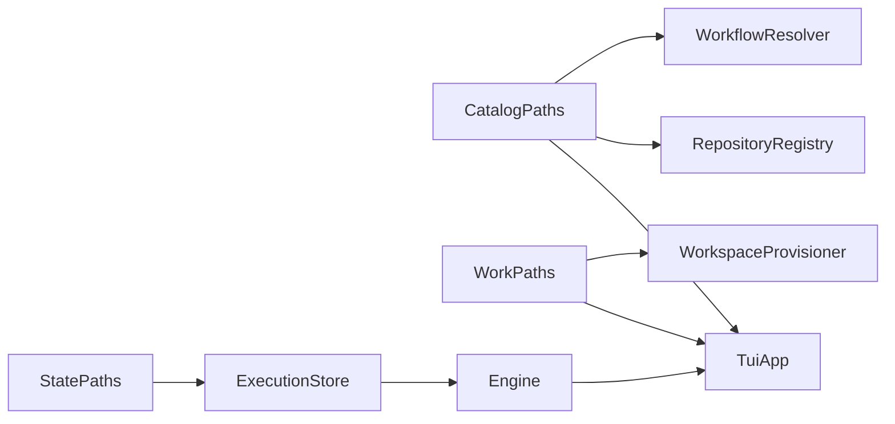
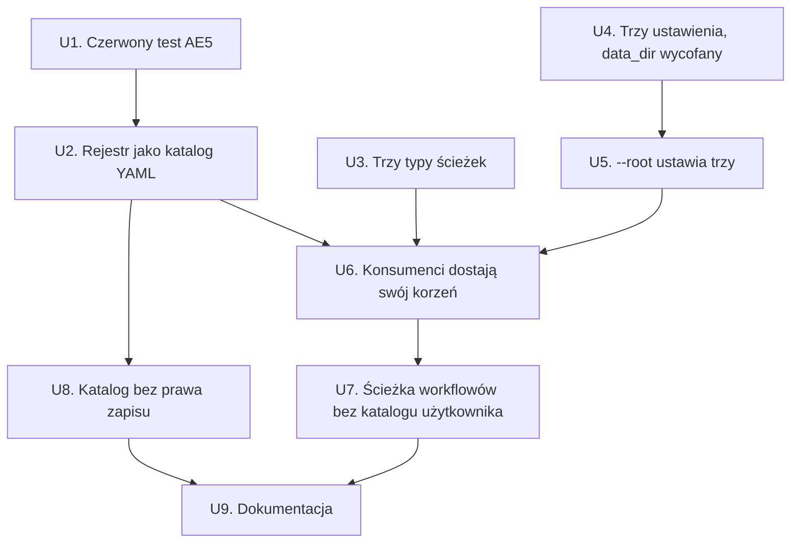

# refactor: Rozbicie katalogu danych — katalog deklaratywny, stan i katalog pracy

## Summary

Plan zamienia jedno ustawienie `data_dir` na trzy niezależne — `catalog_dir`, `state_dir`,
`work_dir` — i egzekwuje podział typami: każdy konsument warstwy persystencji dostaje
w konstruktorze wyłącznie ten korzeń, którego używa. Przy okazji rejestr repozytoriów
przestaje być jednym dokumentem JSON i staje się katalogiem plików YAML, po jednym na
repozytorium, co naprawia utratę aktualizacji przy dwóch równoległych pisarzach
(`src/registry/store.rs:338,358`).

Poza tym plan obejmuje trzy przebudowy, bez których wymagania są nieimplementowalne:
`data_dir` dostaje mechanizm **klucza wycofanego**, którego dziś nie ma (nieznany klucz to dziś
jeden komunikat dla wszystkich, a nieznana zmienna `NARSOR_*` jest ignorowana w ciszy);
`WorkflowResolver` traci krok katalogu użytkownika razem z hakiem testowym `with_user_dir`;
a TUI przestaje składać rejestr i resolver ze `store().root()` (`src/tui/app.rs:945,2165`) —
bo to jest dokładnie ta konstrukcja, którą R5 ma uczynić technicznie niemożliwą.

---

## Problem Frame

`data_dir` trzyma pod jednym korzeniem cztery rzeczy o różnej semantyce współdzielenia
i różnej żywotności: rejestr i workflowy (wszystkie pody, zapis z deploymentu), wykonania
(proces, który je prowadzi) i checkouty gita (nikt — lokalne dla poda). Jeden korzeń zmusza je
do jednego woluminu, przez co checkout gita ląduje na `ReadWriteMany`, a katalogu repozytoriów
nie da się dostarczyć razem z deploymentem (patrz origin:
`docs/brainstorms/2026-09-25-rozbicie-katalogu-danych-requirements.md`).

Drugi, niezależny problem ujawnia się dopiero przy wielu pisarzach: `add`, `update` i `remove`
wykonują cykl *wczytaj cały dokument → zmień → zapisz cały dokument*. Każdy zapis z osobna jest
atomowy, ale dwa procesy dodające **różne** repozytoria tracą jeden z wpisów, bez żadnego
sygnału. To jedyna rzecz w tej zmianie, która jest naprawą błędu, a nie przestawieniem ścieżek.

---

## Requirements

Przeniesione z dokumentu wymagań bez zmian. Dwa pytania odłożone do planowania zostały
rozstrzygnięte: nazwy kluczy to `catalog_dir` / `state_dir` / `work_dir` (D-N), a plik wpisu
rejestru **nie** powtarza pola `id` w treści (D-O).

**Podział korzenia**

- R1. Trzy niezależne ustawienia, żadne nie wyprowadzane z pozostałych.
- R2. Każde z wartością wbudowaną `./.narsor`; nazwy podkatalogów bez zmian.
- R3. `--root` ustawia wszystkie trzy naraz.
- R4. Każde dostępne jako zmienna środowiskowa i klucz w pliku.
- R5. Każdy konsument dostaje w konstruktorze wyłącznie swój korzeń. Podział egzekwowany typami.

**Wycofanie `data_dir`**

- R6. `data_dir` znika jako ustawienie, ale zostaje jako wpis wycofany; użyty — zatrzymuje start
  komunikatem nazywającym trzy następców.

**Rejestr repozytoriów**

- R7. Rejestr jest katalogiem plików YAML, jeden na repozytorium; identyfikatorem jest nazwa pliku.
- R8. Dodanie tworzy plik w trybie wyłącznym.
- R9. Żadna operacja nie czyta ani nie zapisuje cudzych wpisów.
- R10. Identyfikator musi być bezpieczną nazwą pliku; sprawdzane przy zapisie i przy odczycie.
- R11. Uszkodzony wpis nie wywraca rejestru: wypis pokazuje wczytane, nazywa niewczytane i kończy
  się błędem. Odczyt konkretnego identyfikatora zawodzi twardo.
- R12. Stary `repositories.json` nie jest czytany, konwertowany ani zgłaszany.

**Katalog tylko do odczytu**

- R13. Zapis do katalogu bez prawa zapisu kończy się komunikatem nazywającym **ustawienie**.

**Ścieżka szukania workflowów**

- R14. Kolejność: jawny plik, katalog deklaratywny, definicja wbudowana. Katalog użytkownika wypada.
- R15. `workflow eject` bez celu zapisuje do katalogu deklaratywnego.

**Origin acceptance examples:** AE1 (R1, R5), AE2 (R2), AE3 (R3), AE4 (R6), AE5 (R9), AE6 (R8),
AE7 (R11), AE8 (R13), AE9 (R14). Każdy jest przypisany do jednostki i do konkretnego scenariusza
testowego przez prefiks `Pokrywa AE<N>.`

---

## Scope Boundaries

- **Własność wykonania, dzierżawa, heartbeat, fencing** *(origin)*. Rozbicie katalogów **nie**
  czyni katalogu stanu bezpiecznym do współdzielenia: licznik sekwencji logu zdarzeń jest
  cache'owany w procesie (`src/persistence/event_log.rs:179`), a pauzy siedzą w `Mutex`
  w runnerze (`src/engine/runner.rs:1284`). Ograniczenie zostaje zapisane wprost w README (U9).
- **Migracja starego `repositories.json`** *(origin, R12)*.
- **Widok konfiguracji w TUI** *(origin — odłożony już w poprzednim brainstormie)*.
- **Zmiana wartości wbudowanej na `~/.narsor`** *(origin — rozważona i wycofana)*.
- **Kaskada szukania pliku konfiguracyjnego** — bez zmian *(origin)*. `src/config/cascade.rs`
  zmienia wyłącznie miejsce importu `user_config_dir` (D-G), nie zachowanie.
- **Zmiana formatu wykonań na YAML.** D-E dotyczy wyłącznie rejestru. `state.json`,
  `context.json` i zdarzenia zostają w JSON — to stan maszynowy, nie deklaracja do ręcznej edycji.

### Deferred to Follow-Up Work

- **Unikalna nazwa pliku tymczasowego w `write_atomic_exclusive`** dla pozostałych konsumentów.
  U2 naprawia to dla rejestru (D-K), ale `EventLog` używa tej samej funkcji
  (`src/persistence/event_log.rs`) i ma ten sam teoretyczny wyścig na pliku `.tmp`. Dziś
  nieosiągalny, bo jeden proces prowadzi jedno wykonanie — czyli dokładnie to założenie, które
  origin wymienia w Scope Boundaries. Osobna zmiana, razem z pracą nad własnością wykonania.
- **Sprzątanie osieroconych `.tmp` w katalogu deklaratywnym.**
  `ExecutionStore::cleanup_orphaned_temp_files` robi to dla katalogu stanu; katalog deklaratywny
  nie ma odpowiednika, a po D-K nazwy tymczasowe są losowe, więc przerwany zapis zostawia śmieć.
  Nieszkodliwy (odczyt rejestru bierze wyłącznie `*.yaml`), ale wart osobnego sprzątacza.

---

## High-Level Technical Design

Trzy typy ścieżek zamiast jednego, w jednym module, żeby układ katalogów nadal był opisany
dokładnie raz. Poniższy szkic pokazuje **zamierzony kierunek** i jest materiałem do przeglądu,
nie specyfikacją implementacji — agent implementujący ma traktować go jako kontekst, nie jako kod
do odtworzenia.

```text
src/persistence/paths.rs
  DEFAULT_ROOT = "./.narsor"          -- wspólna wartość wbudowana wszystkich trzech (D-C)

  CatalogPaths(root)                  -- katalog deklaratywny
      workflows_dir()                 -> {root}/workflows
      repositories_dir()              -> {root}/repositories
      repository_file(id)             -> {root}/repositories/{id}.yaml
  StatePaths(root)                    -- dzisiejsze `Paths`, przemianowane
      executions_dir() … artifact_dir()
      log_file()                      -> {root}/narsor.log
  WorkPaths(root)                     -- katalog pracy
      tasks_dir() / task_dir(id) / code_dir(id) / checkout_dir(id, name)
```

Kto co dostaje — to jest cała treść R5 i jedyny powód, dla którego typy są trzy, a nie jeden
z trzema polami:



Dziś ta ostatnia krawędź nie istnieje: TUI odzyskuje katalog deklaratywny ze
`store().root()`. Po zmianie `ExecutionStore` nie zna żadnego korzenia poza swoim i nie
udostępnia surowego `root()` do składania cudzych ścieżek — więc krawędzi `CAT --> TUI` nie da
się zastąpić skrótem.

Rejestr po przebudowie, w postaci, w jakiej ma go widzieć człowiek i deployment:

```yaml
# {catalog_dir}/repositories/acme-api.yaml  -- identyfikatorem jest nazwa pliku (D-O)
name: Acme API
provider: github
remote: git@github.com:acme/api.git
default_branch: main
description: Publiczne API
```

---

## Output Structure

Układ na dysku po zmianie, przy trzech katalogach wskazanych osobno. To deklaracja zakresu,
nie ograniczenie — autorytatywne są listy `**Pliki:**` w jednostkach.

```text
{catalog_dir}/                        # montowalny read-only, współdzielony (R13)
├── repositories/
│   ├── acme-api.yaml                 # jeden plik = jedno repozytorium (R7)
│   └── open-mercato.yaml
└── workflows/
    └── compound-engineering.yaml

{state_dir}/                          # montowalny osobno
├── executions/{execution_id}/
│   ├── state.json
│   ├── context.json
│   ├── events/{sequence:08}.json
│   └── artifacts/{artifact_id}/
└── narsor.log                        # log TUI (D-P)

{work_dir}/                           # emptyDir poda, lokalny scratch
└── tasks/{execution_id}/code/
```

---

## Key Technical Decisions

Decyzje przeniesione z dokumentu wymagań (D-A…D-H) obowiązują bez zmian; poniżej tylko te,
które plan dodaje albo doprecyzowuje.

- **D-N. Nazwy kluczy: `catalog_dir`, `state_dir`, `work_dir`.** Zmienne wychodzą z nich
  mechanicznie (`SettingKey::env_var`): `NARSOR_CATALOG_DIR`, `NARSOR_STATE_DIR`,
  `NARSOR_WORK_DIR`. `config_dir` odrzucone, bo myliłoby się z plikiem konfiguracyjnym
  i jego kaskadą, które są czymś innym i celowo niezależnym (origin: Scope Boundaries).
  *(rozstrzygnięcie pytania odłożonego do planowania)*

- **D-O. Nazwa pliku jest jedynym identyfikatorem; `id` nie jest serializowane.** R7 mówi, że
  identyfikatorem jest nazwa pliku — powtórzenie go w treści tworzyłoby drugie źródło prawdy
  i rozjazd do wykrywania przy każdym odczycie. `RepositoryEntry` nadal nosi `id` w pamięci
  (wypełniany ze stemu pliku przy odczycie), ale pole dostaje `#[serde(skip)]`.
  *(rozstrzygnięcie pytania odłożonego do planowania)*

- **D-P. Log TUI ląduje pod katalogiem stanu.** To stan procesu, nie deklaracja; poza tym
  katalog deklaratywny bywa tylko do odczytu, a `open_log_file` (`src/main.rs:164`) robi
  `create_dir_all`. *(rozstrzygnięcie pytania odłożonego do planowania)*

- **D-I. Klucz wycofany to nowy, jawny mechanizm, nie specjalny przypadek nieznanego klucza.**
  R6 wymaga dwóch rzeczy, których dziś nie ma. W pliku: `FileError::UnknownKey` wypisuje jeden
  komunikat „known keys are: …" dla wszystkiego, a R6 chce komunikatu nazywającego trzy
  następców. W środowisku: rozwiązywanie pyta o zmienną **per znane ustawienie**
  (`src/config/resolve.rs:resolve_one`), więc `NARSOR_DATA_DIR` jest dziś ignorowana w absolutnej
  ciszy — czyli dokładnie to, czego AE4 zabrania. Dlatego `settings.rs` dostaje tabelę
  wycofanych kluczy, `file.rs` sprawdza ją **przed** `UnknownKey`, a `resolve.rs` skanuje mapę
  środowiska po niej osobno, poza pętlą po `SettingKey::ALL`.

- **D-J. Wycofany klucz nie jest błędem użycia (`is_usage`).** Zatrzymuje start każdej komendy
  (R6), ale `config show` musi go przeżyć i wypisać — to jest jedyne narzędzie do diagnozowania
  konfiguracji (D-D z poprzedniego planu, `src/cli/mod.rs:runs_on_broken_config`). Błędem użycia
  zostaje wyłącznie `--config` wskazujące nieistniejący plik.

- **D-K. Plik tymczasowy rejestru dostaje unikalną nazwę.** `write_atomic_exclusive`
  (`src/persistence/atomic.rs:56`) wyprowadza nazwę tymczasową z nazwy celu
  (`temp_path_for`), więc dwa procesy dodające **ten sam** identyfikator zapisują równolegle ten
  sam `{id}.yaml.tmp` i mogą wpiąć hard-linkiem mieszankę dwóch treści. Hard-link nadal daje
  `EEXIST` drugiemu, więc R8 jest spełnione, ale AE6 mówi też „pierwszy wpis pozostaje
  nietknięty" — a mieszanka to narusza. Rejestr dostaje więc wariant zapisu z nazwą tymczasową
  zawierającą losowy sufiks (`uuid` jest już zależnością).

- **D-L. Odczyt katalogu rejestru bierze wyłącznie `*.yaml` i `*.yml`.** Tak samo jak
  `definition_names_in` dla workflowów (`src/workflows/mod.rs`). Plik o innym rozszerzeniu jest
  ignorowany bez słowa — to pozwala trzymać obok `README` albo zostawić `.tmp` po przerwanym
  zapisie. Plik z właściwym rozszerzeniem, którego nie da się wczytać **albo** którego stem nie
  jest bezpieczną nazwą (R10), jest zgłoszoną porażką, nie cichym pominięciem.

- **D-M. Brak prawa zapisu rozpoznawany po `ErrorKind`, bez wcześniejszej próby.** Sonda
  „czy da się pisać", wykonana przed zapisem, to klasyczne TOCTOU i dodatkowy zapis do katalogu,
  który ma być tylko do odczytu. Zamiast tego rejestr mapuje `PersistenceError::Io`
  z `ErrorKind::PermissionDenied` oraz `ErrorKind::ReadOnlyFilesystem` na własny wariant
  nazywający ustawienie. Oba warianty są stabilne na toolchainie projektu (rustc 1.98; sprawdzone:
  `EROFS` mapuje się na `ReadOnlyFilesystem`), więc nie ma potrzeby schodzić do `raw_os_error()`.
  Mapowanie musi objąć też porażkę `ensure_dir`, bo na zamontowanym read-only woluminie bez
  katalogu `repositories/` to `create_dir_all` zawodzi pierwsze.

- **D-Q. `ExecutionStore` przestaje udostępniać `root()`.** Zostaje `paths() -> &StatePaths`.
  To nie kosmetyka: `root()` jest dziś jedynym powodem, dla którego TUI może zbudować rejestr
  z korzenia stanu (`src/tui/app.rs:2165`), a póki metoda istnieje, R5 jest konwencją, nie
  własnością typów. To samo dotyczy `WorkspaceProvisioner::root()`
  (`src/workspace/provisioner.rs:399`), z jedynym konsumentem w `sweep_orphaned_workspaces`
  (`src/persistence/recovery.rs:266`), który dostaje `provisioner.paths().tasks_dir()`.

---

## System-Wide Impact

| Powierzchnia | Wpływ | Kto to odczuje |
|---|---|---|
| Plik konfiguracyjny i zmienne `NARSOR_*` | `data_dir` → trzy klucze; stary klucz zatrzymuje start | operator, deployment |
| `config show` | cztery wiersze → sześć; `data_dir` znika z tabeli | operator, skrypty czytające JSON |
| `{root}/repositories.json` | → `{catalog_dir}/repositories/*.yaml`, bez migracji (R12) | każdy, kto ma dziś rejestr |
| `workflow eject` bez `--to` | cel zmienia się z `~/.config/narsor/workflows` na katalog deklaratywny | operator |
| `~/.config/narsor/workflows/` | przestaje być czytany (AE9 — utrata celowa) | operator z ejectowaną kopią |
| API biblioteki (`ExecutionStore::new` i spółka) | sygnatury konstruktorów przyjmują typy ścieżek | testy integracyjne, TUI |

Trzy pierwsze wiersze to zmiany opublikowanego kontraktu sprzed jednego dnia. Wersja nie jest
wydana, więc kontrakt zmienia się bez okresu przejściowego — poza jawnym komunikatem
o wycofaniu `data_dir` (R6, origin: Dependencies / Assumptions).

---

## Implementation Units

Kolejność wynika z origin („test dwóch równoległych dodań jako pierwszy i czerwony") oraz
z zależności: rejestr da się przebudować i pokryć testami bez dotykania konfiguracji, a dopiero
potem trzy korzenie rozchodzą się po konsumentach.



---

### U1. Czerwony test na równoległe dodanie dwóch różnych repozytoriów

**Cel:** Zapisać w teście, że dwa procesy dodające różne repozytoria nie gubią wpisu — i pokazać,
że dzisiejszy kod tego nie robi. Ten test jest dowodem, że przebudowa rejestru ma sens; bez niego
U2 jest przestawianiem plików bez uzasadnienia.

**Wymagania:** R9, AE5.

**Zależności:** brak.

**Pliki:**
- `tests/registry.rs` *(modyfikacja)*

**Podejście:** Test uruchamia N wątków (`std::thread::scope`, bez nowej zależności), każdy
dodający repozytorium o innym identyfikatorze do **jednego** katalogu deklaratywnego, po czym
sprawdza, że `list()` zwraca wszystkie N. Na dzisiejszym cyklu *wczytaj → zmień → zapisz* test
przepada; przy katalogu plików przechodzi z definicji.

Wyścig ma być realny, a nie zależny od szczęścia: wątki startują na wspólnej barierze
(`std::sync::Barrier`), a liczba powtórzeń jest na tyle duża, żeby okno między odczytem
a zapisem zostało trafione. Test **nie** może być flaky w drugą stronę — po U2 musi przechodzić
zawsze, więc asercja brzmi „wszystkie N wpisów są" i nigdy „któregoś brakuje".

**Nota wykonawcza:** Ten jeden test piszemy jako pierwszy i zostawiamy czerwonym aż do U2.
Warto go odpalić i zobaczyć, że pada z powodu, którego się spodziewamy (brakujący wpis), a nie
z powodu przypadkowego — inaczej U2 zaliczy go z niewłaściwego powodu.

**Wzorce do naśladowania:** Harness `TempRoot` z `tests/registry.rs:17` — własny, bo `tempfile`
nie jest zależnością tego crate'a.

**Scenariusze testowe:**
- *Pokrywa AE5.* Osiem wątków, osiem różnych identyfikatorów, jeden katalog, wspólna bariera →
  `list()` zwraca osiem wpisów, każdy z własnym `remote`. Powtórzone kilkadziesiąt razy.
- Ten sam scenariusz z jednym wątkiem → osiem wpisów. Kontrola, że test mierzy współbieżność,
  a nie zwykłe dodawanie.

**Weryfikacja:** Test istnieje, jest uruchamiany przez `cargo test` i **pada** na obecnym kodzie
z powodu brakującego wpisu. Do U2 włącznie nie jest wyciszany ani oznaczany `#[ignore]`.

---

### U2. Rejestr jako katalog plików YAML

**Cel:** Zamienić jeden dokument JSON na katalog plików YAML, po jednym na repozytorium, tak żeby
unikalność identyfikatora była własnością systemu plików, a zasięg uszkodzenia — jednym wpisem.

**Wymagania:** R7, R8, R9, R10, R11, R12; AE5, AE6, AE7. Decyzje D-D, D-E, D-H, D-K, D-L, D-O.

**Zależności:** U1.

**Pliki:**
- `src/registry/store.rs` *(przebudowa)*
- `src/registry/mod.rs` *(dokumentacja modułu i re-eksporty)*
- `src/persistence/atomic.rs` *(dodanie wariantów YAML i unikalnej nazwy tymczasowej)*
- `src/persistence/mod.rs` *(re-eksporty)*
- `tests/registry.rs` *(rozbudowa)*

**Podejście:** `RepositoryRegistry` trzyma katalog, nie plik. `add` serializuje wpis do YAML
i zapisuje wyłącznie w trybie wyłącznym — `Ok(false)` z zapisu staje się `DuplicateId`, bez
żadnego wcześniejszego odczytu katalogu (R8, R9). `get` czyta jeden plik; brak pliku to `None`,
niewczytanie to twardy błąd (D-H). `update` nadpisuje jeden plik atomowo, `remove` kasuje jeden
plik. Żadna z tych operacji nie robi `read_dir`.

`list` jest jedyną operacją czytającą katalog i jedyną, która nie zawodzi na pierwszym
uszkodzeniu: zwraca `RegistryListing { entries, failures }`, gdzie `failures` niesie ścieżkę
i przyczynę. Decyzję „co z tym zrobić" podejmuje wywołujący — CLI wypisuje i kończy błędem
(U6), TUI pokazuje, co się wczytało, i oznacza resztę.

Identyfikator jest sprawdzany `is_usable_directory_name` w obie strony (R10): przy zapisie —
jak dziś w `RepositoryEntry::validate` — i przy odczycie, gdzie stem pliku spoza zbioru
bezpiecznych nazw jest zgłoszoną porażką, nie cichym pominięciem. `id` znika z serializacji
(D-O) i jest wypełniany ze stemu.

`REPOSITORIES_FILE` znika bez śladu (R12): stary `repositories.json` nie jest czytany,
konwertowany ani wymieniany w żadnym komunikacie.

**Projekt techniczny** *(kierunek do przeglądu, nie specyfikacja)*:

```text
add(entry)     -> validate → write_yaml_exclusive({dir}/{id}.yaml) → false ? DuplicateId : Ok
get(id)        -> validate(id) → read_yaml → NotFound | Corrupt | Ok(entry)
update(entry)  -> validate → write_yaml_atomic (nadpisuje)
remove(id)     -> validate(id) → remove_file → NotFound gdy nie było
list()         -> read_dir, filtr *.yaml/*.yml, per plik: Ok → entries | Err → failures
                  RegistryListing { entries: Vec<RepositoryEntry>, failures: Vec<RegistryFailure> }
```

**Wzorce do naśladowania:**
- `write_atomic_exclusive` (`src/persistence/atomic.rs:56`) — hard-link daje `EEXIST` bez
  wyścigu check-then-write. Nowy `write_yaml_exclusive` idzie tą samą drogą, z nazwą tymczasową
  z losowym sufiksem (D-K).
- `ParsedFile { values, errors }` (`src/config/file.rs`) — dokładnie ten wzorzec „to, co się
  udało, obok tego, co się nie udało"; `RegistryListing` jest jego odpowiednikiem.
- `definition_names_in` (`src/workflows/mod.rs`) — filtrowanie katalogu po rozszerzeniu.
- Sortowanie po `id` przed zwróceniem jest częścią kontraktu (dziś `store.rs:load`): `repo list`
  i TUI muszą pokazywać tę samą kolejność niezależnie od kolejności `read_dir`.

**Scenariusze testowe:**
- *Pokrywa AE5.* Test z U1 przechodzi. Bez `#[ignore]`, bez ponawiania.
- *Pokrywa AE6.* Dwa `add` tego samego identyfikatora: drugie zwraca `DuplicateId`, a plik
  pierwszego ma **dokładnie** treść pierwszego wpisu — bajt w bajt, nie „daje się sparsować".
- *Pokrywa AE6.* Ten sam scenariusz równolegle, dwa wątki na barierze, wielokrotnie powtórzony:
  dokładnie jedno `Ok`, dokładnie jeden `DuplicateId`, plik zgodny ze zwycięzcą. To jest
  scenariusz, który wykrywa wyścig na pliku tymczasowym (D-K).
- *Pokrywa AE7.* Katalog z dwoma dobrymi plikami i jednym z YAML-em nie do sparsowania:
  `list()` zwraca dwa wpisy i jedną porażkę nazywającą ten plik.
- *Pokrywa AE7.* Katalog z plikiem, którego YAML się parsuje, ale brakuje w nim `remote`:
  też porażka, też nazwana. Rozróżnienie „plik jest zepsuty" od „plik jest niekompletny" nie
  jest potrzebne — obie kończą tak samo.
- `get` na uszkodzonym wpisie zwraca błąd, nie `None`. To jest cała różnica między D-H a cichą
  degradacją: workflow, który nie znajdzie repozytorium po id, sklonuje coś innego albo nic.
- `get` na identyfikatorze, którego nie ma → `Ok(None)`. Brak rejestru w ogóle (katalog nie
  istnieje) → `list()` zwraca pusto bez błędu, `get` → `Ok(None)`. Świeży korzeń to normalny stan.
- `add` z identyfikatorem `../evil`, `.`, `..`, pustym i z `\0` → `InvalidId`, na dysku nie
  powstaje nic, w szczególności nic poza katalogiem rejestru.
- Plik `../evil.yaml` podłożony w katalogu rejestru — a właściwie plik o stemie, którego
  `is_usable_directory_name` nie przyjmuje — jest w `list()` porażką, nie wpisem (R10 przy odczycie).
- Plik `notes.txt` i plik `acme.yaml.tmp` w katalogu rejestru są ignorowane bez słowa (D-L).
- Round-trip: wpis z `default_branch` i `description` oraz wpis bez nich zapisują się i czytają
  identycznie; zapisany YAML **nie** zawiera klucza `id` (D-O) ani kluczy o wartości `null`.
- Plik zapisany ręcznie, bez `default_branch` i `description`, czyta się poprawnie — format ma
  być pisany przez człowieka i przez deployment (D-E).
- `remove` nieistniejącego identyfikatora → `NotFound`; pozostałe pliki nietknięte.
- `update` istniejącego wpisu nie dotyka żadnego innego pliku w katalogu (R9) — sprawdzane przez
  czas modyfikacji albo treść sąsiadów.

**Weryfikacja:** `cargo test --test registry` przechodzi w całości, łącznie z testem z U1.
W katalogu rejestru po serii operacji nie zostaje żaden `.tmp`. Nigdzie w `src/` nie ma już
odwołania do `repositories.json`.

---

### U3. Trzy typy ścieżek w module persystencji

**Cel:** Rozdzielić układ katalogów na trzy typy, żeby konsument mógł dostać dokładnie jeden
i nie miał technicznej możliwości złożyć ścieżki z cudzego korzenia.

**Wymagania:** R2, R5. Decyzje D-C, D-P, D-Q.

**Zależności:** brak.

**Pliki:**
- `src/persistence/paths.rs` *(rozbicie `Paths` na `StatePaths`, dodanie `CatalogPaths`
  i `WorkPaths`)*
- `src/persistence/mod.rs` *(re-eksporty, dokumentacja układu)*
- `src/persistence/execution_store.rs` *(konstruktor bierze `StatePaths`, `root()` → `paths()`)*
- `src/workspace/provisioner.rs` *(konstruktor bierze `WorkPaths`; `TASKS_DIR`, `CODE_DIR`
  przenoszą się do `paths.rs`)*
- `src/workflows/mod.rs` *(`WORKFLOWS_DIR` przenosi się do `paths.rs`)*
- `src/persistence/recovery.rs` *(`provisioner.root().join(TASKS_DIR)` → `paths().tasks_dir()`)*
- `tests/persistence.rs`, `tests/workspace.rs`, `tests/engine_recovery.rs` *(sygnatury)*

**Podejście:** Trzy typy w jednym module, bo układ ma nadal być opisany dokładnie raz — to jest
teza, którą niesie dzisiejszy komentarz modułowy `paths.rs`, i zmiana jej nie podważa.
`DEFAULT_ROOT` zostaje jeden i wspólny (D-C): rozbicie korzenia nie przestawia ani jednego pliku.

Wszystkie trzy przyjmują `impl Into<PathBuf>`, tak jak dzisiejsze `Paths::new`, więc dalej można
je zbudować z jednego katalogu tymczasowego w teście. Rozdzielność jest własnością **konsumenta**
(co dostał w konstruktorze), nie ścieżki.

`root()` znika z `ExecutionStore` i `WorkspaceProvisioner` na rzecz `paths()` (D-Q). To jest ta
część jednostki, która najbardziej rozejdzie się po testach, i jednocześnie ta, bez której R5
zostaje konwencją.

**Nota wykonawcza:** Ta jednostka jest czystym przestawieniem typów bez zmiany zachowania.
Zielony `cargo test` przed i po — na tym samym zestawie testów, bez dopisywania nowych oczekiwań
— jest właściwym dowodem, że nic się nie przesunęło.

**Wzorce do naśladowania:** Dzisiejszy `Paths` — konstrukcja ścieżek jako metody bez I/O,
doc-comment z dosłowną ścieżką (`/// {root}/executions/{execution_id}`) nad każdą.

**Scenariusze testowe:**
- *Pokrywa AE2.* Każda z trzech instancji zbudowana na tej samej ścieżce daje dokładnie te
  ścieżki, które kod dawał przed zmianą: `{root}/executions/…`, `{root}/tasks/…`,
  `{root}/workflows`. To jest asercja na „nic się nie przesunęło".
- `StatePaths::log_file()` → `{root}/narsor.log`, czyli tam, gdzie `src/main.rs:169` pisze dziś
  (D-P).
- `CatalogPaths::repository_file(id)` → `{root}/repositories/{id}.yaml`.
- Wartość wbudowana wszystkich trzech to `./.narsor` (D-C).
- `WorkPaths::checkout_dir` zachowuje dzisiejsze `{root}/tasks/{id}/code/{name}`.

**Weryfikacja:** Cały `cargo test` zielony bez zmiany **oczekiwań** któregokolwiek istniejącego
testu — wolno poprawić wywołania konstruktorów, nie wolno poprawić asercji o ścieżkach. Każda
taka poprawka znaczyłaby, że coś jednak się przesunęło.

---

### U4. Trzy ustawienia w rejestrze konfiguracji, `data_dir` jako klucz wycofany

**Cel:** Dodać `catalog_dir`, `state_dir` i `work_dir` do rejestru ustawień i sprawić, żeby
`data_dir` — w pliku albo w zmiennej — zatrzymywał start komunikatem nazywającym trzech następców.

**Wymagania:** R1, R2, R4, R6; AE4. Decyzje D-B, D-I, D-J, D-N.

**Zależności:** brak.

**Pliki:**
- `src/config/settings.rs` *(trzy warianty `SettingKey`, usunięcie `DataDir`, tabela wycofanych)*
- `src/config/file.rs` *(sprawdzenie tabeli przed `UnknownKey`, nowy wariant `FileError`)*
- `src/config/resolve.rs` *(skan środowiska po wycofanych kluczach, nowy wariant `ConfigError`)*
- `src/config/mod.rs` *(re-eksporty)*
- `tests/config_file.rs`, `tests/config_resolve.rs`, `tests/config_startup.rs` *(rozbudowa)*

**Podejście:** `SettingKey::ALL` rośnie z czterech do sześciu pozycji, w kolejności wypisywania:
`catalog_dir`, `state_dir`, `work_dir`, `agent_harness`, `agent_timeout`, `log_level`. Trzy nowe
mają `built_in()` = `SettingValue::Path(DEFAULT_ROOT)` i nie są wrażliwe. Zmienne wychodzą
mechanicznie z klucza, więc nie trzeba ich nigdzie wpisywać (D-N). Enum jest zamknięty, więc
kompilator sam wskaże każde miejsce, które zapomniało o nowym wariancie — na tym właśnie ta
konstrukcja stoi.

`data_dir` nie zostaje wariantem `SettingKey` — nie jest ustawieniem, jest wspomnieniem po nim.
Mieszka w osobnej tabeli `RETIRED_KEYS: &[(&str, &str)]` (klucz → tekst o następcach), którą
konsultują dwa miejsca (D-I):

1. `file.rs`, w fazie drugiej, **przed** zgłoszeniem `UnknownKey` — inaczej operator dostaje
   listę znanych kluczy zamiast zdania o tym, co się stało z jego kluczem;
2. `resolve.rs`, jednym przejściem po mapie środowiska poza pętlą `SettingKey::ALL` — bo pętla
   pyta o zmienne per znane ustawienie i wycofanej zmiennej nigdy by nie zobaczyła.

Oba zgłoszenia są zwykłymi błędami konfiguracji: zatrzymują każdą komendę poza `config show`
(D-J), który je wypisuje i kończy kodem 1.

Komunikat, jedno zdanie, bez żargonu, nazywający trzech następców i mówiący, że to nie jest
literówka:

> `Setting 'data_dir' no longer exists; it was split into 'catalog_dir' (workflows and the repository registry), 'state_dir' (executions) and 'work_dir' (task workspaces). Set the ones you need, or pass --root to point all three at one directory.`

Dla zmiennej ten sam tekst z nazwą zmiennej zamiast klucza.

**Wzorce do naśladowania:**
- `FileError::UnknownKey` (`src/config/file.rs:141`) — każdy wariant nazywa plik i klucz;
  `key()` jest tym, co pozwala `config show` oznaczyć właściwy wiersz.
- `ConfigError::Env` (`src/config/resolve.rs:97`) — niesie `key`, `variable` i `message`.
- `the_registry_holds_every_setting_the_requirements_name` (`src/config/settings.rs`) — test
  przybijający listę kluczy. Aktualizujemy go do sześciu; to ten test pilnuje, żeby rejestr
  pozostał jednym miejscem prawdy.

**Scenariusze testowe:**
- *Pokrywa AE4.* Plik z `data_dir: /srv/narsor` → błąd, którego treść zawiera wszystkie trzy
  nazwy: `catalog_dir`, `state_dir`, `work_dir`. Asercja na nazwy, nie na całe zdanie — inaczej
  test pilnuje interpunkcji zamiast kontraktu.
- *Pokrywa AE4.* `NARSOR_DATA_DIR=/srv/narsor` w mapie środowiska → ten sam błąd, nazywający
  zmienną. To jest scenariusz, który dziś przechodzi w ciszy i jest głównym powodem D-I.
- *Pokrywa AE4.* Plik z `data_dir` **i** jednym dobrym kluczem: zgłoszony jest wycofany klucz,
  a dobry klucz nadal ma wartość z pliku — `config show` pokazuje rzędy dobre obok złych (D-D).
- Plik z `data_dir` i z kluczem naprawdę nieznanym (`data_dirr`) → dwa różne błędy, każdy swój:
  wycofany nie pochłania nieznanego i odwrotnie.
- Plik z `catalog_dir`, `state_dir` i `work_dir` wskazującymi trzy różne ścieżki → trzy wartości,
  każda ze źródłem `file (<ścieżka>)`.
- Każde z trzech osobno przez zmienną → wartość ze źródłem `env (NARSOR_…)`.
- Wartość wbudowana każdego z trzech to `./.narsor` (R2).
- Kolejność `SettingKey::ALL` to dokładnie ta, w jakiej `config show` ma wypisywać.
- Zmienne sześciu ustawień są parami różne i wszystkie mają prefiks `NARSOR_` — istniejące testy
  z `settings.rs` przechodzą bez zmiany treści.
- Komenda inna niż `config show` z `data_dir` w pliku kończy się kodem `EXIT_FAILURE`, nie
  `EXIT_USAGE` (D-J).
- `config show` z `data_dir` w pliku **wypisuje tabelę** i kończy kodem 1.

**Weryfikacja:** `cargo test --test config_file --test config_resolve --test config_startup`
przechodzi. Uruchomienie z `data_dir` w pliku zatrzymuje `narsor list` komunikatem nazywającym
trzy ustawienia, a `narsor config show` mimo tego drukuje tabelę.

---

### U5. `--root` ustawia trzy korzenie naraz

**Cel:** Zachować `--root` jako pojedyncze pokrętło do pracy lokalnej i do testów, tak żeby
podgląd konfiguracji pokazywał trzy wiersze o tej samej wartości i źródle `--root`.

**Wymagania:** R3; AE3. Decyzja D-B.

**Zależności:** U4.

**Pliki:**
- `src/config/resolve.rs` *(`Flags::value` mapuje `root` na trzy ustawienia; akcesory `catalog_dir`,
  `state_dir`, `work_dir` zamiast `data_dir`)*
- `src/cli/mod.rs` *(dokumentacja flagi `--root`)*
- `tests/config_resolve.rs`, `tests/config_show.rs` *(rozbudowa)*

**Podejście:** `Flags::value` (`src/config/resolve.rs:66`) dziś zwraca `--root` dla `DataDir`;
po zmianie zwraca go dla każdego z trzech. Reszta rozwiązywania nie wie o niczym — warstwy
zostają cztery, pierwsze trafienie wygrywa per ustawienie, a `Source::Flag("--root")` już
istnieje. Żadnego nowego wariantu `Source` nie ma i mieć nie może: to jest dokładnie ten koszt,
który D-B odrzucił przy wariancie z ustawieniem-bazą.

`Resolved::data_dir()` znika, a na jego miejsce wchodzą trzy akcesory zwracające `&Path`. To
one są punktem, w którym `src/cli/mod.rs:328` przestaje mieć jeden `root` do rozdania — czym
zajmuje się U6.

**Wzorce do naśladowania:** `Flags::value` — nazwa flagi i jej wartość wychodzą z jednego
`match`, żeby nie dało się ich rozjechać.

**Scenariusze testowe:**
- *Pokrywa AE3.* `--root /tmp/x` → wszystkie trzy mają `/tmp/x` i źródło `flag (--root)`.
- *Pokrywa AE3.* `config show --format table` z `--root` → trzy wiersze z tą samą wartością
  i `flag (--root)` w kolumnie źródła.
- *Pokrywa AE3.* To samo w `--format json`: trzy klucze, każdy z `value` i `source`. Skrypt
  czytający `.settings.data_dir` ma po tej zmianie dostać brak klucza, nie wartość.
- `--root` obok `NARSOR_STATE_DIR` → flaga wygrywa **wszystkie trzy**; zmienna nie przebija
  flagi, bo warstwy są ułożone per ustawienie, a nie per pochodzenie.
- `--root` obok `state_dir` w pliku → to samo, flaga wygrywa.
- Bez `--root` i bez pliku → trzy razy `./.narsor`, źródło `built-in`.
- `--root` nie wpływa na `agent_harness`, `agent_timeout` ani `log_level`.

**Weryfikacja:** `cargo test --test config_resolve --test config_show` przechodzi.
`narsor --root /tmp/x config show` drukuje trzy wiersze `/tmp/x` ze źródłem `flag (--root)`.

---

### U6. Każdy konsument dostaje w konstruktorze swój korzeń

**Cel:** Rozprowadzić trzy korzenie po miejscach, które je faktycznie używają, i odciąć drogę
okrężną — składanie cudzej ścieżki ze `store().root()`.

**Wymagania:** R1, R5; AE1, AE2, AE7. Decyzja D-Q.

**Zależności:** U2, U3, U5.

**Pliki:**
- `src/cli/mod.rs` *(`run` rozdaje trzy korzenie zamiast jednego)*
- `src/cli/commands.rs` *(sygnatury komend; `repo_list` obsługuje porażki z `RegistryListing`)*
- `src/tasks/mod.rs` *(`start_task_with`, `workspace_request`, `resolve_repository`,
  `resolve_definition` biorą to, czego używają)*
- `src/tui/app.rs` *(konstruktor bierze katalog deklaratywny i katalog pracy jawnie)*
- `src/main.rs` *(log TUI idzie do `StatePaths::log_file()`)*
- `tests/cli_smoke.rs`, `tests/tasks.rs`, `tests/tui_state.rs` *(sygnatury i nowe przypadki)*

**Podejście:** Punktem rozejścia jest `cli::run` (`src/cli/mod.rs:328`), gdzie dziś stoi jeden
`let root = config.data_dir()`. Po zmianie każda komenda dostaje to, czego używa — `repo *`
i `workflow *` katalog deklaratywny, `list`/`show`/`events` katalog stanu, `run` wszystkie trzy.
Komenda biorąca korzeń, którego nie używa, to sygnał, że granica została przecięta w złym miejscu.

`tasks::start_task_with` jest jedynym miejscem, które naprawdę potrzebuje wszystkich trzech:
rejestru (rozwiązanie repozytorium), katalogu pracy (checkout) i katalogu stanu (przez `Engine`).
Bierze je osobno, nie jako paczkę — paczka wróciłaby tylnymi drzwiami do jednego korzenia.

TUI jest najważniejszą częścią tej jednostki, bo to jedyne miejsce w kodzie, które dziś **łamie**
regułę: `TuiApp::new` buduje `WorkflowResolver` ze `store().root()` (`src/tui/app.rs:945`),
a `registry()` robi to samo (`src/tui/app.rs:2165`). Po zmianie konstruktor przyjmuje
`CatalogPaths` i `WorkPaths` obok `Engine`, a ponieważ `ExecutionStore::root()` już nie istnieje
(D-Q), skrót jest niedostępny, nie tylko niezalecany.

`repo_list` przestaje dostawać `Vec` i dostaje `RegistryListing`: wypisuje wczytane wpisy,
nazywa pliki, które się nie wczytały, i kończy błędem (R11). Widok rejestru w TUI dostaje tę samą
informację i **nie** wolno mu jej zgubić — ukryty uszkodzony wpis w interfejsie to dokładnie to,
przed czym R11 chroni w CLI.

**Nota wykonawcza:** Test z AE1 wart jest napisania przed przestawianiem sygnatur — jest
jedynym, który sprawdza całość na dysku, i jedynym, który złapie konsumenta, który dostał trzy
korzenie i dalej używa jednego.

**Wzorce do naśladowania:**
- `sweep_orphaned_workspaces(store, provisioner)` (`src/persistence/recovery.rs:261`) — już dziś
  bierze dwa niezależne korzenie osobno. To jest kształt docelowy dla reszty.
- `TuiApp::with_resolver` (`src/tui/app.rs:954`) — szew wstrzykiwania zależności już istnieje;
  zmiana polega na tym, że staje się jedyną drogą, a nie wariantem obok `new`.

**Scenariusze testowe:**
- *Pokrywa AE1.* Pełny przebieg workflow z trzema katalogami wskazanymi na trzy różne miejsca:
  w katalogu deklaratywnym nie powstaje **nic** (ani `executions/`, ani `tasks/`), w katalogu
  stanu nie powstaje `tasks/`, w katalogu pracy nie powstaje nic poza `tasks/`. Asercja przez
  wylistowanie zawartości każdego z trzech, nie przez sprawdzenie pojedynczej ścieżki — chodzi
  o to, czego **nie ma**.
- *Pokrywa AE1.* Ten sam przebieg z katalogiem deklaratywnym zamontowanym tylko do odczytu
  (uprawnienia) kończy się sukcesem: skoro nic tam nie powstaje, brak prawa zapisu nie może
  przeszkodzić. To najostrzejszy test tego wymagania i wprost cel wdrożeniowy z Success Criteria.
- *Pokrywa AE2.* Uruchomienie bez żadnej konfiguracji: `executions/`, `tasks/` i `workflows/`
  powstają pod `./.narsor` dokładnie tam, gdzie powstawały przed zmianą; jedyną różnicą jest
  `repositories/` zamiast `repositories.json`.
- *Pokrywa AE7.* `repo list` z jednym uszkodzonym plikiem: na stdout pozostałe repozytoria, na
  stderr nazwa uszkodzonego pliku, kod wyjścia niezerowy.
- *Pokrywa AE7.* Widok rejestru w TUI z jednym uszkodzonym plikiem: pozostałe pozycje widoczne,
  uszkodzony plik oznaczony, interfejs nie pada.
- `run` z repozytorium z rejestru: checkout ląduje pod katalogiem pracy, a wpis rejestru czytany
  jest z katalogu deklaratywnego — sprawdzane przy trzech różnych ścieżkach.
- `run` bez zadeklarowanego workspace'u: pusty `{work_dir}/tasks/{id}/code/workspace`, zgodnie
  z dzisiejszym `FALLBACK_WORKSPACE_NAME`.
- `resolve_definition` dla wykonania wznowionego z zapisanej nazwy szuka w katalogu
  deklaratywnym, nie w katalogu stanu.
- Log TUI ląduje w `{state_dir}/narsor.log` (D-P), także gdy trzy katalogi są różne.
- `sweep_orphaned_workspaces` czyta wykonania z katalogu stanu i kasuje katalogi z katalogu
  pracy, gdy oba są różne.

**Weryfikacja:** Cały `cargo test` zielony. Przebieg z trzema różnymi katalogami zostawia
w każdym z nich dokładnie to, co do niego należy, i nic więcej. W `src/` nie ma już wywołania
`ExecutionStore::root()` ani `WorkspaceProvisioner::root()`.

---

### U7. Ścieżka szukania workflowów bez katalogu użytkownika

**Cel:** Zredukować ścieżkę szukania do trzech kroków — jawny plik, katalog deklaratywny,
definicja wbudowana — i przenieść `user_config_dir()` tam, gdzie zostaje jego jedyny konsument.

**Wymagania:** R14, R15; AE9. Decyzje D-F, D-G.

**Zależności:** U6.

**Pliki:**
- `src/workflows/mod.rs` *(usunięcie `user_dir`, `with_user_dir`, `user_workflows_dir`,
  `WorkflowOrigin::User`; przeniesienie `user_config_dir`)*
- `src/config/cascade.rs` *(`user_config_dir` i `USER_CONFIG_DIR` mieszkają tu)*
- `src/cli/commands.rs` *(`workflow_eject` celuje w katalog deklaratywny)*
- `src/tui/app.rs` *(konstruktor resolvera bez haka testowego)*
- `tests/workflows.rs`, `tests/cli_smoke.rs` *(usunięcie przypadków o katalogu użytkownika,
  dopisanie AE9)*

**Podejście:** Po wprowadzeniu katalogu deklaratywnego dwa poziomy ścieżki robiłyby to samo,
więc krok użytkownika wypada razem ze wszystkim, co go obsługiwało: polem `user_dir`, wariantem
`WorkflowOrigin::User`, funkcją `user_workflows_dir` i hakiem testowym `with_user_dir`. Hak
istniał po to, żeby test nie dotknął prawdziwego `~/.config` — gdy resolver nie zna żadnej
globalnej lokalizacji, nie ma czego izolować i `WorkflowResolver::new` zostaje jedynym
konstruktorem.

`user_config_dir()` przenosi się do `src/config/cascade.rs` (D-G): dziś mieszka w module
workflowów, a po D-F jego jedynym konsumentem zostaje kaskada konfiguracji
(`src/config/cascade.rs:33`), która i tak już go importuje.

`workflow eject` bez `--to` celuje w `{catalog_dir}/workflows` (R15), czyli tam, skąd workflowy
są faktycznie czytane. Znika przy tym błąd „nie ma katalogu konfiguracyjnego użytkownika"
(`src/cli/commands.rs:665`) — katalog deklaratywny istnieje zawsze, bo ma wartość wbudowaną.
Komunikat po ejectcie, który mówi „ta kopia ma teraz pierwszeństwo", ma pozostać prawdziwy:
po zmianie jest prawdziwy zawsze, bo powyżej katalogu deklaratywnego jest już tylko jawny plik.

**Wzorce do naśladowania:** `WorkflowOrigin` jako zamknięty enum z `label()` i `path()` —
usunięcie wariantu jest sygnalizowane przez kompilator we wszystkich `match`, łącznie z tymi
w TUI i w `workflow list`.

**Scenariusze testowe:**
- *Pokrywa AE9.* Definicja w `$XDG_CONFIG_HOME/narsor/workflows/foo.yaml` i brak jej w katalogu
  deklaratywnym → `resolve("foo")` zwraca `NotFound`, a komunikat wymienia miejsca, w których
  szukał, i **nie** wymienia katalogu użytkownika. Utrata tego zachowania jest celowa i test to
  przybija.
- *Pokrywa AE9.* Ten sam układ dla nazwy, która istnieje jako wbudowana → wygrywa wbudowana,
  nie kopia użytkownika.
- *Pokrywa R14.* Kolejność: jawny plik bije katalog deklaratywny, katalog deklaratywny bije
  wbudowaną. Sprawdzane przez `resolve` i przez `list` (kolumna z przesłoniętymi kopiami).
- `resolve_name` nadal nie daje się przejąć przez plik w bieżącym katalogu roboczym — to jest
  cała różnica między `resolve` a `resolve_name` i wznawianie wykonań na niej stoi.
- *Pokrywa R15.* `workflow eject compound-engineering` bez `--to` zapisuje do
  `{catalog_dir}/workflows/compound-engineering.yaml` i komunikat potwierdza, że ta kopia ma
  teraz pierwszeństwo.
- `workflow eject` z `--to` w katalogu poza ścieżką szukania: plik powstaje, a komunikat mówi,
  że nazwa nadal rozwiązuje się do wbudowanej — ostrzeżenie zostaje prawdziwe.
- `workflow eject` bez `HOME` i bez `XDG_CONFIG_HOME` **działa** — dziś kończy się błędem
  użycia. Scenariusz kontenerowy, wprost wymieniony w D-F jako zysk.
- `workflow eject` do katalogu deklaratywnego bez prawa zapisu → błąd nazywający `catalog_dir`,
  spójny z U8.
- Kaskada konfiguracji zachowuje się identycznie po przeniesieniu `user_config_dir`: pusty
  `XDG_CONFIG_HOME` liczy się jako nieustawiony, brak `HOME` daje `None`. Istniejące testy
  w `tests/config_cascade.rs` przechodzą bez zmiany treści.

**Weryfikacja:** `cargo test --test workflows --test cli_smoke --test config_cascade` przechodzi.
W `src/` nie ma już `with_user_dir`, `user_workflows_dir` ani `WorkflowOrigin::User`, a
`user_config_dir` ma dokładnie jednego konsumenta.

---

### U8. Katalog deklaratywny bez prawa zapisu nazywa ustawienie

**Cel:** Zamienić surowy błąd systemu plików na komunikat nazywający ustawienie i brak prawa
zapisu jako przyczynę.

**Wymagania:** R13; AE8. Decyzja D-M.

**Zależności:** U2. *(Komunikat odwołuje się do nazwy `catalog_dir`, więc U4 powinien być zrobiony;
sama implementacja mapowania od niego nie zależy.)*

**Pliki:**
- `src/registry/store.rs` *(nowy wariant `RegistryError`, mapowanie z `PersistenceError::Io`)*
- `src/cli/commands.rs` *(komunikat `repo add`)*
- `tests/registry.rs`, `tests/cli_smoke.rs` *(nowe przypadki)*

**Podejście:** Bez sondy — `PersistenceError::Io` niesie ścieżkę i `io::Error`, więc wystarczy
odczytać `ErrorKind::PermissionDenied` oraz `ErrorKind::ReadOnlyFilesystem` i zamienić je na wariant
niosący **nazwę ustawienia** i ścieżkę (D-M). Mapowanie musi objąć też porażkę tworzenia
katalogu: na woluminie read-only bez istniejącego `repositories/` to `create_dir_all` zawodzi
pierwsze i zwraca ten sam `PersistenceError::Io`, tyle że o katalogu, nie o pliku.

Komunikat mówi trzy rzeczy — co się nie udało, czego brakuje i które ustawienie tu wskazuje:

> `Could not register repository 'acme-api': the catalog directory '/mnt/catalog' is not writable. It is set by 'catalog_dir' (NARSOR_CATALOG_DIR, or --root).`

Nazwanie ustawienia jest tu całą wartością: operator w kontenerze widzi ścieżkę, której nie
ustawiał ręcznie, i bez tego zdania nie wie, gdzie ją zmienić.

Sprawdzenie idzie po `ErrorKind`, nie po numerze błędu: na toolchainie projektu (rustc 1.98)
`ErrorKind::ReadOnlyFilesystem` jest stabilny i `EROFS` mapuje się na niego — zweryfikowane przy
planowaniu, bo jeszcze niedawno wariant był niestabilny i `raw_os_error()` byłby jedyną drogą.
Dopasowanie po `ErrorKind` jest tym samym wzorcem, którym `write_atomic_exclusive` sprawdza dziś
`ErrorKind::AlreadyExists` (`src/persistence/atomic.rs:67`), i jest przenośne.

**Wzorce do naśladowania:** `CascadeError` (`src/config/cascade.rs`) — każdy wariant nazywa
ścieżkę i przyczynę zamiast przepuszczać komunikat systemu; moduł tłumaczy wprost, że surowy
błąd systemu „reads like a permission problem" i dlatego dostaje własne zdanie.

**Scenariusze testowe:**
- *Pokrywa AE8.* Katalog deklaratywny z uprawnieniami `0555`, `repo add` → błąd, którego treść
  zawiera `catalog_dir` i słowo o braku prawa zapisu; **nie** zawiera surowego
  „Permission denied (os error 13)" jako całej odpowiedzi.
- *Pokrywa AE8.* To samo, gdy podkatalog `repositories/` jeszcze nie istnieje — czyli gdy pada
  tworzenie katalogu, nie zapis pliku. Ten wariant jest łatwy do przeoczenia i to on odpowiada
  świeżo zamontowanemu woluminowi.
- To samo dla `repo remove` i dla `update`.
- `repo list` na katalogu bez prawa **odczytu** → błąd nazywający katalog; to inna przyczyna
  i nie wolno jej pomylić z brakiem prawa zapisu.
- Katalog zapisywalny → żaden z tych błędów nie występuje; mapowanie nie łapie zbyt szeroko.
- Błąd niebędący problemem uprawnień (np. brak miejsca) nadal przechodzi jako `Storage`
  z oryginalną przyczyną. Zamiana wszystkiego w „brak prawa zapisu" byłaby gorsza niż brak
  mapowania.
- Test uprawnień jest pomijany, gdy proces działa jako root — `0555` nie zatrzymuje roota,
  a test, który przechodzi z niewłaściwego powodu, jest gorszy niż pominięty.

**Weryfikacja:** `cargo test --test registry --test cli_smoke` przechodzi. `repo add` na katalogu
`0555` drukuje zdanie nazywające `catalog_dir`, a nie `Permission denied (os error 13)`.

---

### U9. Dokumentacja układu, konfiguracji i rejestru

**Cel:** Doprowadzić dokumentację do stanu po zmianie i zapisać wprost ograniczenie, którego
nikt nie ma prawa odczytać jako gotowości na współdzielenie stanu.

**Wymagania:** Success Criteria (ostatni punkt). Scope Boundaries origin.

**Zależności:** U7, U8.

**Pliki:**
- `README.md` *(tabela flag, tabela ustawień, przykład `config show`, drzewo katalogów,
  sekcja o rejestrze, tabela precedencji workflowów)*
- `DOMAIN_MODEL.md` *(§2.7 — układ katalogów; §2.8 — katalog zadania)*
- `ARCHITECTURE_DECISIONS.md` *(D-D, D-F, D-M jako decyzje o trwałych konsekwencjach)*

**Podejście:** README ma dziś czternaście miejsc mówiących o jednym korzeniu
(`README.md:78,140,226,241,266,678,688,716,763,766,767,781,807`) i każde wymaga aktualizacji —
w tym przykład `jq '.settings.data_dir.source'`, który po zmianie zwróciłby `null` i uczył
nieistniejącego klucza. Drzewo katalogów pokazuje trzy korzenie i to, co do każdego należy.

Sekcja o rejestrze opisuje nowy format: katalog plików YAML, nazwa pliku jako identyfikator,
plik pisany ręcznie i przez deployment (D-E, D-O) — z przykładem, który da się skopiować.

Ostatnie zdanie Success Criteria dostaje własny akapit, nie przypis: **rozbicie katalogów nie
czyni katalogu stanu bezpiecznym do współdzielenia**. Katalog deklaratywny wolno montować
read-only i współdzielić; katalog stanu wolno montować osobno, ale należy on do jednego procesu;
katalog pracy jest lokalnym scratchem. Bez tego akapitu sam fakt, że stan ma własne ustawienie,
zostanie odczytany jako zaproszenie do montowania go na `ReadWriteMany`.

**Scenariusze testowe:** `Test expectation: none` — to jednostka czysto dokumentacyjna,
bez zmiany zachowania. Jedyne automatyczne zabezpieczenie już istnieje i działa dalej:
`tests/builtin_workflows.rs` pilnuje, żeby wbudowane definicje były bajt w bajt zgodne
z plikami w `workflows/`.

**Weryfikacja:** W żadnym z czterech dokumentów nie ma już `data_dir` ani `repositories.json`
inaczej niż w zdaniu o wycofaniu. Każda komenda i każdy fragment YAML-a przepisany z README
działa na zbudowanej binarce — w szczególności przykład `config show --format json` z `jq`.
Akapit o niewspółdzielności katalogu stanu jest w README i w `DOMAIN_MODEL.md`.

---

## Risk Analysis & Mitigation

| Ryzyko | Skutek | Mitygacja |
|---|---|---|
| Test AE5 przechodzi na dzisiejszym kodzie przez szczęście w harmonogramie | U2 zaliczony z niewłaściwego powodu, wyścig zostaje | Bariera plus wiele powtórzeń; U1 wymaga zobaczenia czerwonego z właściwą przyczyną przed napisaniem U2 |
| Wyścig na pliku tymczasowym przy dwóch dodaniach tego samego id | AE6 spełnione połowicznie: drugie zawodzi, ale pierwszy wpis to mieszanka | D-K — losowy sufiks nazwy tymczasowej; osobny scenariusz testowy właśnie na to |
| Konsument dostaje trzy korzenie i dalej używa jednego | R5 spełnione w sygnaturach, złamane w zachowaniu; wyjdzie dopiero na wdrożeniu | Test AE1 sprawdza, czego w każdym katalogu **nie ma**, a nie tylko co jest; wariant z read-only katalogiem deklaratywnym jest tego najostrzejszą formą |
| Wolumin read-only zgłasza się inaczej niż oczekiwano | Operator dostaje surowy błąd systemu zamiast zdania o ustawieniu | Dopasowanie po `ErrorKind` (`PermissionDenied` **i** `ReadOnlyFilesystem`), oba stabilne i sprawdzone na toolchainie projektu; nietrafiony przypadek degraduje do `Storage` z oryginalną przyczyną, nie do paniki |
| Operator z ejectowaną kopią w `~/.config` po cichu dostaje inny workflow | Uruchomienie innej definicji niż wczoraj, bez sygnału | AE9 przybija utratę jako celową; U9 wymienia to w README; `workflow list` nadal pokazuje, skąd pochodzi kopia, która wygrała |
| Usunięcie `data_dir` psuje skrypty czytające JSON z `config show` | Skrypt dostaje `null` zamiast ścieżki | R6 zatrzymuje start na kluczu i na zmiennej; U9 poprawia przykład z `jq` w README. Skryptu czytającego JSON nic nie ostrzeże — wersja nie jest wydana i origin przyjmuje ten koszt wprost |

---

## Deferred to Implementation

Pytania, których nie da się rozstrzygnąć bez dotknięcia kodu — zapisane, żeby nie udawać, że są
rozstrzygnięte:

- Czy `RegistryListing` powinno być typem w `store.rs`, czy wystarczy `(Vec<_>, Vec<_>)`.
  Zależy od tego, ilu konsumentów naprawdę potrzebuje porażek — CLI i TUI na pewno, reszta być
  może wcale.
- Dokładna liczba powtórzeń i wątków w teście AE5, tak żeby wyścig był trafiany niezawodnie,
  a test nadal był szybki. Do ustalenia przez zmierzenie na czerwonym kodzie.
- Czy `WorkPaths` i `StatePaths` wystarczą `TuiApp` w konstruktorze, czy prościej podać gotowe
  `RepositoryRegistry` i `WorkflowResolver`. Wyjdzie przy przepisywaniu `tests/tui_state.rs`.
- Czy `ensure_dir` w ścieżce zapisu rejestru warto wywołać raz przy starcie zamiast przy każdym
  zapisie. Kwestia tego, jak wygląda ścieżka błędu na read-only woluminie po D-M.
