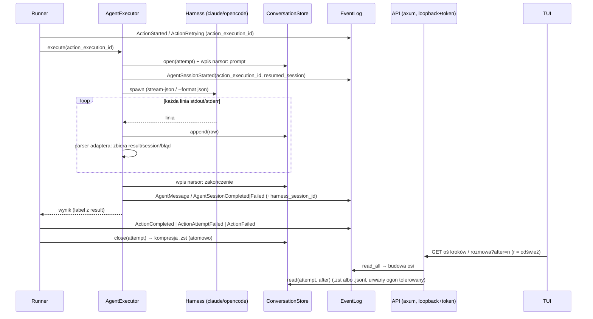
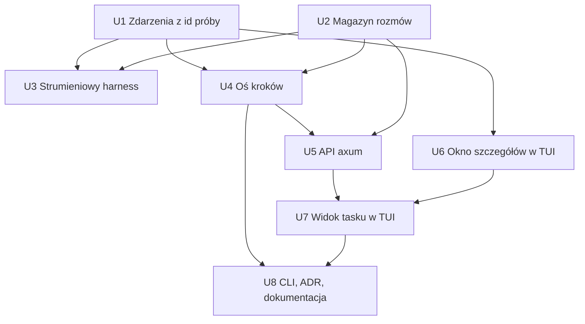
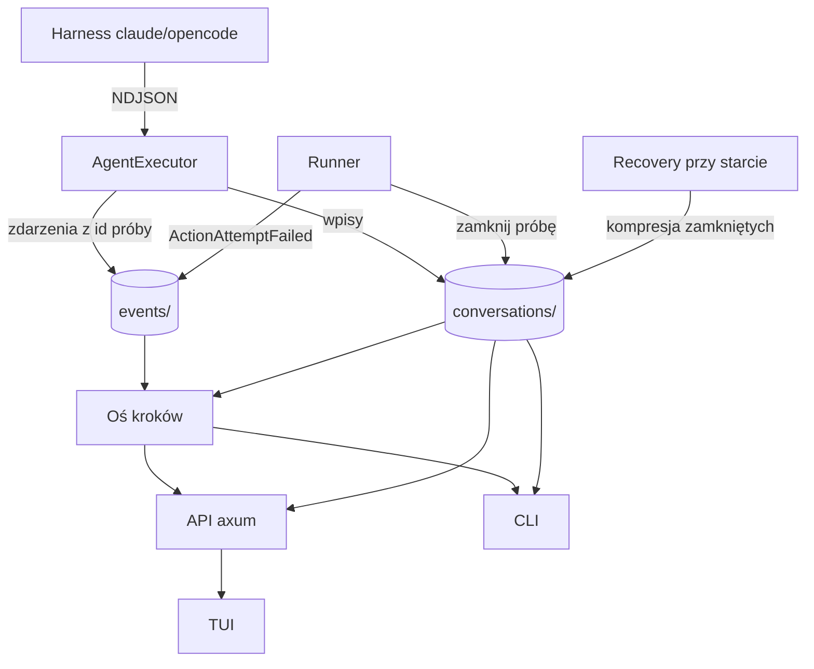

# feat: Pełna treść zdarzeń, zapis rozmowy agenta i widok tasku w TUI

## Summary

Harness agenta przechodzi na wyjście strumieniowe czytane linia po linii we wspólnym executorze, a każda
próba kroku agenta dostaje własny plik rozmowy w katalogu stanu wykonania (JSONL w trakcie, zstd po
zakończeniu). Zdarzenia niosą jawny identyfikator próby, a oś kroków jest liczona z logu zdarzeń.
Pierwsze endpointy axum (wbudowany serwer na loopbacku z tokenem) udostępniają zdarzenia, oś kroków
i rozmowę. TUI dostaje okno szczegółów zdarzenia i pełnoekranowy widok tasku, które czytają przez
to API, a CLI dostaje równoważne komendy `steps` i `conversation`.

---

## Problem Frame

Panel Events ucina każde zdarzenie do jednej linii, a zdarzenia agenta wypadają jako zrzut `Debug`.
Narsor nie rejestruje przebiegu rozmowy z agentem (`--output-format json` zostawia tylko końcową
odpowiedź), więc diagnoza wymaga `claude --resume` poza narsorem. Pełny opis problemu, aktorzy
i przepływy: zob. origin.

Badanie repozytorium dodało trzy fakty, które kształtują plan:
- Nie istnieje żadne API HTTP: `axum` jest w `Cargo.toml`, ale nieużywany; TUI czyta
  `ExecutionStore` z dysku w procesie i dostaje strumień z `Engine::subscribe()`.
- Nieudana próba, po której następuje retry, nie emituje żadnego zdarzenia: `run_action` przechodzi
  prosto do backoffu i `ActionRetrying` (emitowanego *po* uśpieniu). `ActionFailed` dostaje tylko
  ostatnia próba.
- Silnik nigdy nie emituje `StateExited` (robi to tylko ręczne przejście w TUI), a zdarzenia agenta
  nie niosą `action_execution_id`, choć executor go zna.

---

## Requirements

Śledzone z origin (R1–R15), bez zmiany treści:

- R1. Okno szczegółów każdego zdarzenia: wszystkie pola, pełna treść, zawijanie, przewijanie,
  czytelne formatowanie wartości strukturalnych.
- R2. Czytelna jednoliniowa reprezentacja każdego typu zdarzenia; żadnego `Debug`.
- R3. Wspólne zachowanie przewijania i skróty dla okna szczegółów i widoku rozmowy.
- R4. Zdarzenia kroku agenta niosą trwałe powiązanie z rozmową konkretnej próby.
- R5. Jeden klawisz z listy Events i z okna szczegółów prowadzi do rozmowy; dla zdarzeń bez
  powiązania klawisz jest nieaktywny z komunikatem.
- R6. `Enter` na wykonaniu → pełnoekranowy widok tasku (oś kroków + zawartość kroku); domyślne
  zaznaczenie; `Esc` wraca do miejsca wejścia z zachowanym zaznaczeniem; skróty w pasku i mapie.
- R7. Oś wierna przebiegowi: każda próba i każde ponowne wejście osobno; przerwane i nieudane
  widoczne; kontynuacja sesji pokazuje tylko swoje tury i wskazuje kontynuowaną sesję.
- R8. Ręczne odświeżenie w widoku tasku, także trwającego kroku; brak auto-odświeżania; TUI czyta
  przez API.
- R9. Rozmowa zawiera wszystko, co wyemitował harness, w kolejności, bez obcinania.
- R10. Wpisy rozróżnialne wizualnie po rodzaju; długie wpisy rozwijalne.
- R11. Kroki bez zapisu pokazują „brak zapisu rozmowy”.
- R12. Narsor sam zbiera rozmowę ze strumienia, przyrostowo; źródłem prawdy jest zapis narsora.
- R13. Tryb strumieniowy domyślny dla każdego harnessu.
- R14. Kontrakt `output`, id sesji harnessu i ścieżki błędów bez zmian; przetwarzanie linia po
  linii; żaden limit bufora nie obcina końcowego wyniku.
- R15. Zapis zakończonego kroku skompresowany; podgląd przezroczysty dla obu postaci.

**Origin actors:** A1 (operator), A2 (harness agenta), A3 (silnik narsora)
**Origin flows:** F1 (diagnoza nieudanego kroku), F2 (podgląd trwającego kroku), F3 (przegląd historii
tasku)
**Origin acceptance examples:** AE1 (R1, R2), AE2 (R4, R5), AE3 (R5), AE4 (R6, R8), AE5 (R7),
AE6 (R11), AE7 (R7)

---

## Scope Boundaries

Carried from origin:
- Automatyczne odświeżanie widoku rozmowy na żywo: odłożone (R8 wystarczają migawki na żądanie).
- Interaktywne otwieranie sesji harnessu z TUI (`claude --resume` w workspace): odłożone.
- Limity rozmiaru zapisu rozmowy, retencja i sprzątanie: odłożone; kompresja jest jedynym
  mechanizmem ograniczania rozmiaru.
- Pełny stdout/stderr kroków skryptowych: poza zakresem.
- Wyszukiwanie i filtrowanie w rozmowie i w Events: poza zakresem.
- Uzupełnianie zapisu dla starych wykonań z transkryptów harnessu: poza zakresem.

Plan-local:
- Nie włączamy podsumowań thinking w Claude Code (`showThinkingSummaries`). Domyślnie bloki thinking
  przychodzą z pustym tekstem; widok pokazuje to, co harness faktycznie wyemituje (R9: „jeśli
  harness je emituje”).
- Nie zapisujemy linii `stream_event` (`--include-partial-messages`): nie włączamy tej flagi.
- Kompresja w trakcie zapisu trwającej próby nie jest robiona (R15 „jeśli to wykonalne”, zob. Key
  Technical Decisions).
- Nie filtrujemy sekretów z wyników narzędzi. Zapis rozmowy ma tę samą klasę wrażliwości co
  workspace i leży w katalogu stanu, jak dzisiejsze zdarzenia.

### Deferred to Follow-Up Work

- Lista wykonań, operacje zapisujące (run, input, przejścia) i strumień zdarzeń na żywo w TUI
  przez API (REST + SSE, D37/D38): milestone M2 z
  `docs/brainstorms/2026-09-25-rozproszony-narsor-requirements.md`. Ten plan przenosi na API tylko
  odczyty potrzebne tej funkcji.
- Samodzielny proces serwera (`narsor serve`), Unix socket i tożsamość wywołującego (R29 z
  dokumentu rozproszonego): M2. Tu serwer jest wbudowany w proces TUI.
- Replikacja zapisu rozmowy trwającej próby do centrali (wyjątek od D-B): do uzgodnienia w
  dokumencie rozproszonym. Ten plan dopisuje tam tylko wpis w Outstanding Questions (U8).
- Transkrypt `opencode session export` jako uzupełnienie zapisu: niepotrzebny, bo strumień opencode
  2.0.15 jest kompletny dla R9 poza promptem, który narsor zapisuje sam.

---

## Context & Research

### Relevant Code and Patterns

- `src/engine/actions/harness/mod.rs`: `HarnessAdapter` (`invocation`, `parse(stdout, stderr,
  exit_code) -> HarnessRun`). Moduł zakłada, że adaptery robią tylko argv i parsowanie, a procesem,
  timeoutem i sesją zarządza `actions/agent`. Przechwytywanie strumienia idzie do executora.
- `src/engine/actions/harness/claude_code.rs`: argv i reguły kolejności (`--permission-mode`
  ostatnie przed promptem, `--resume` zawsze z wartością); doc modułu uzasadnia `json` zamiast
  `stream-json` i wymaga aktualizacji.
- `src/engine/actions/harness/opencode.rs`: `run ... --format json <message>`, parsowanie jako jeden
  obiekt.
- `src/engine/actions/agent.rs`: `AgentExecutor::run`, `spawn_and_wait` (join `read_capped` na
  stdout/stderr + `wait` pod `timeout`, `kill_on_drop`), `AgentEventSink`/`LoggingEventSink`
  („recording must never fail a run”), `extract_output`, `build_result`.
- `src/engine/actions/script.rs`: `read_capped` (8 MiB), `truncate` (64 KiB).
- `src/engine/runner.rs`: `run_action` / `attempt_action` / `fail_action` / `record_completion` /
  `apply_decision`, `emit`, `RunGuard`.
- `src/engine/retry.rs`: `retry_count`.
- `src/domain/event.rs`: `EventData` (`#[serde(tag = "type")]`, bez `deny_unknown_fields`),
  wyczerpujący `Event::description()` bez catch-all.
- `src/persistence/paths.rs` (`StatePaths`), `event_log.rs`, `atomic.rs` (`write_atomic`,
  `cleanup_orphaned_temp_files`), `execution_store.rs`, `recovery.rs` (`reconcile`,
  `unfinished_action`).
- `src/tasks/mod.rs::takeover`: nie dotyka `{state}/executions/{id}/`, więc katalog rozmów tam
  przeżywa przejęcie.
- `src/tui/app.rs`: `Modal`, `on_key` → `Request`, `shortcuts()`, `event_line()` (catch-all `Debug`),
  `spawn_background`, `on_engine_event`, `refresh` / `reload_selection`, helpery `step`/`wrap`.
- `src/tui/views.rs`: `render`, `modal_area`/`centered`, `render_events`, `render_help_modal`.
- `src/tui/mod.rs::run`: pętla `select!` nad klawiszami, strumieniem i tickiem.
- `src/cli/mod.rs`, `src/cli/commands.rs`: komendy `show`, `events` (wzorzec dla nowych komend).
- Testy: `tests/actions_agent.rs` (`FakeHarness`, `envelope`), `tests/fixtures/harness/fake_harness.sh`,
  `tests/tui_state.rs` (testy stanu, bez `TestBackend`), `tests/engine_execution.rs`,
  `tests/engine_recovery.rs`, `tests/takeover.rs`, `tests/engine_support/mod.rs`.

### Institutional Learnings

- `docs/solutions/` nie istnieje. Wnioski pochodzą z planów, ADR i pamięci:
- Log zdarzeń: jeden plik na zdarzenie, zapis temp+fsync+rename, wyłączność. Plik rozmowy dopisywany
  przyrostowo tego idiomu nie spełnia i potrzebuje własnej reguły dla urwanego ogona.
- D23: `ActionStarted` bez domknięcia → `Unknown` + `Error`, bez replay; `reconcile` jest jedyną
  ścieżką recovery. Nowe zdarzenia nie mogą zmienić tej semantyki.
- Plan `docs/plans/2026-09-26-001-fix-tui-background-engine-runs-plan.md`: wszystko, co napędza
  silnik, idzie przez `spawn_background`; każda bezpośrednia ścieżka zapisu musi sprawdzać
  `Engine::is_active`.
- Zasada parytetu z planu MVP: każda operacja TUI istnieje w CLI.
- Konwencja: dokumenty planistyczne po polsku; doc-komentarze, komentarze i komunikaty w kodzie po
  angielsku; brak crate'a `tempfile` w testach; `git` przez CLI.
- Flake ETXTBSY w `tests/actions_agent.rs` (instalacja fałszywego harnessu przez `fs::copy` podczas
  równoległych fork/exec). Istniał wcześniej; U3 i tak zmienia tę instalację.

### External References

- Claude Code 2.1.283, `claude -p --output-format stream-json --verbose` (sprawdzone na żywo):
  NDJSON; linie `system/*` (w tym `init` z `session_id`, poprzedzany opcjonalnie przez `hook_*`),
  `assistant` (jedna linia na blok treści: `text`, `thinking`, `tool_use`; grupowanie po
  `message.id`), `user` (`tool_result`, plus `tool_use_result`), `rate_limit_event`, na końcu
  `result` (`subtype`, `is_error`, `result` lub `errors[]`, `session_id`, `num_turns`, koszt).
  `is_error` bywa prawdą przy `subtype: success`. SIGTERM/SIGKILL lub awaria nie zapisują `result`.
  `--resume` nie odtwarza historii i zachowuje `session_id`. Linie bywają wielomegabajtowe.
  Źródła: https://code.claude.com/docs/en/headless, https://code.claude.com/docs/en/cli-reference,
  typy `SDKMessage` w `@anthropic-ai/claude-agent-sdk` (`sdk.d.ts`).
- opencode 2.0.15, `opencode run --format json`: NDJSON emitowany przyrostowo, koperta
  `{type, timestamp, sessionID, ...}`; typy `step_start`, `text` (raz, na końcu części),
  `reasoning` (tylko z `--thinking`), `tool_use` (po zakończeniu narzędzia, pole `state` z
  `input`/`output`/`error`), `step_finish`, `error`. Brak promptu i brak zdarzenia końcowego:
  koniec to wyjście procesu. Pozna rekonsyliacja może dosłać części poza kolejnością czasową.
  Źródło: emiter w binarce `opencode` i `openapi.json` serwera `--standalone`.
- Kompresja: konkatenowane ramki zstd tworzą poprawny strumień, a `zstd::stream::read::Decoder`
  domyślnie czyta kolejne ramki. Częściowa ramka daje dane do miejsca urwania i błąd EOF.
  Rekomendacja: zwykły JSONL w trakcie i kompresja na końcu.
  Źródła: https://docs.rs/zstd, https://docs.rs/flate2 (`MultiGzDecoder`).
- tokio: `lines()` / `read_line` nie mają limitu i wymagają UTF-8; `LinesCodec::new_with_max_length`
  po cichu gubi nadmiar. Właściwy wzorzec to pętla `fill_buf`/`consume` na bajtach z osobnym
  limitem parsowania. Źródła: https://docs.rs/tokio/latest/tokio/io/trait.AsyncBufReadExt.html,
  https://docs.rs/tokio-util/latest/tokio_util/codec/struct.LinesCodec.html

---

## Key Technical Decisions

- **Klucz rozmowy to `action_execution_id`.** Już dziś to świeży UUID na każdą próbę (D24), więc
  każda próba i każde ponowne wejście mają osobny klucz. Nie wprowadzamy nowego identyfikatora
  kroku (zob. origin: Outstanding Questions, R4 i R7).
- **Jawne powiązanie w zdarzeniach akcji i agenta, pozycyjne w pozostałych.** Opcjonalne pola
  `#[serde(default)]`: `action_execution_id` w `AgentSessionStarted/Completed/Failed` i
  `AgentMessage`; `state_id` w `ActionRetrying`; `harness_session_id` w `AgentSessionCompleted`
  i `AgentSessionFailed`; `resumed_session` w `AgentSessionStarted`. `StateEntered`,
  `DecisionMade`, `TransitionTaken`, `StateExited` i `ArtifactCreated` wiążą się z ostatnią próbą
  bieżącej wizyty w stanie. To powiązanie wynika deterministycznie z niezmiennego logu, więc
  przeżywa recovery i przejęcie bez zapisywania go w zdarzeniu. Recovery `Error` wiąże się przez
  `context.action_execution_id`.
- **Nowe zdarzenie `ActionAttemptFailed`** (`action_execution_id`, `state_id`, `error`,
  `retry_in_ms`) emitowane zaraz po nieudanej próbie, która będzie ponawiana, przed backoffem.
  Ostatnia próba nadal emituje tylko `ActionFailed`. Dzięki temu `plan #1` z AE7 ma status i powód,
  a przerwa na backoff jest widoczna jako „czeka na ponowienie”. `reconcile` traktuje
  `ActionAttemptFailed` jak zdarzenie neutralne: akcja pozostaje niedomknięta do `ActionFailed`
  albo `ActionCompleted`, więc semantyka D23 się nie zmienia.
- **Etykiety osi to `<stan> #n`, gdzie n liczy próby danego stanu w całym wykonaniu.** Etykieta nie
  zmienia się, gdy dochodzą nowe pozycje, więc nadaje się do zachowania zaznaczenia. Pozycje osi
  są grupowane wizualnie po wizycie (ponowne wejście zaczyna nową grupę).
- **Status próby to jedna reguła pierwszeństwa.** Kolejność sprawdzania:
  1. `ActionCompleted`: udana.
  2. `ActionFailed` / `ActionAttemptFailed`: nieudana.
  3. Recovery `Error` z `interrupted_action`, ręczne przejście albo kolejna wizyta przy otwartej
     próbie: przerwana.
  4. Otwarta próba w wykonaniu `Running`: trwa.
  5. Otwarta próba w wykonaniu `Paused` po `ActionCompleted` agenta: „czeka na decyzję”.

  Stan akcji wygrywa ze stanem sesji. Timeout zamieniony na label daje „udana” z oznaczeniem, że
  sesja harnessu została przerwana.
- **Rozmowa to osobny magazyn w katalogu stanu:** `{state}/executions/{id}/conversations/`.
  Ścieżki są zdefiniowane w `StatePaths`. Katalog przeżywa lokalne przejęcie i poleci do centrali
  razem ze stanem w M2, z tego samego powodu co `checkpoint.bundle`. Źródłem prawdy o przebiegu
  pozostaje log zdarzeń. Plik rozmowy przechowuje treść i nie jest drugim logiem zdarzeń.
- **Format pliku to JSONL z kopertą narsora.** Każdy wpis ma numer porządkowy, znacznik czasu,
  źródło (`narsor` | `stdout` | `stderr`) i surową linię harnessu, zachowaną bajt w bajt, także
  gdy nie jest poprawnym JSON-em. Pierwszy wpis `narsor` zawiera wysłany prompt, harness i
  kontynuowaną sesję. Ostatni wpis `narsor` zawiera zakończenie: kod wyjścia, sygnał, timeout albo
  „harness nie wystartował: …”. Klasyfikacja wpisów na rodzaje z R10 odbywa się przy odczycie, per
  harness. Surowa linia zostaje, więc zmiana formatu harnessu nie psuje zapisu.
- **Kompresja przy zamknięciu próby, nie w trakcie.** W trakcie zapis to zwykły `.jsonl` dopisywany
  całymi liniami. Po zamknięciu próby plik jest kompresowany do `.jsonl.zst.tmp`, dostaje fsync,
  jest przemianowany na `.jsonl.zst`, a na końcu plik zwykły jest usuwany. Czytelnik woli `.zst`, a
  gdy go brak, czyta plik zwykły. Gdy brakuje obu, ponawia raz, bo przemianowanie mogło zajść
  między sprawdzeniami. Przy starcie domykana jest kompresja tylko tych prób, które log zdarzeń
  pokazuje jako zamknięte. Otwartej próby w innym procesie nie ruszamy. Uzasadnienie: próby są
  ograniczone w czasie, a niezależne ramki zstd dodałyby złożoność częściowych ramek bez realnego
  zysku (R15 „jeśli to wykonalne”).
- **Kursor rozmowy to numer wpisu, nie offset bajtowy,** więc przeżywa zamianę pliku zwykłego na
  skompresowany między odświeżeniami. Urwana ostatnia linia jest pomijana, gdy próba trwa, i
  pokazywana jako „niekompletna”, gdy próba jest zamknięta (np. zabicie po timeoucie).
- **Czytanie strumienia w executorze, parsowanie w adapterze.** `spawn_and_wait` zastępuje
  `read_capped` dla stdout pętlą bajtową `fill_buf`/`consume`:
  - każdą pełną linię dopisuje do pliku rozmowy i przekazuje do stanowego parsera adaptera;
  - bufor pojedynczej linii do parsowania ma limit (rząd kilkudziesięciu MiB), a linia ponad limit
    i tak trafia w całości na dysk;
  - stderr czyta równolegle i też zapisuje do pliku rozmowy.

  Adapter zamiast `parse(stdout_całość)` dostaje stanowy parser strumienia, który zbiera tylko
  to, czego potrzeba do `HarnessRun`: tekst końcowy, id sesji i błąd. Dla Claude Code są to pola
  linii `result`. Dla opencode jest to ostatnia część `text`, `sessionID` i zdarzenia `error`.
  Całe wyjście nie jest buforowane (R14).
- **Brak linii `result` w Claude Code to błąd sesji** („harness zakończył się bez wyniku”, z kodem
  wyjścia i ogonem stderr). Dziś brak koperty daje surowy stdout jako tekst. W trybie
  strumieniowym surowy stdout to cała rozmowa, więc tamta ścieżka traci sens.
- **`AgentMessage` zostaje obcinane.** Log zdarzeń nie jest magazynem treści. Okno szczegółów
  oznacza obciętą treść i prowadzi do rozmowy, gdzie jest pełna. Tak spełniamy kryterium „nic
  niedostępne przez obcięcie” bez wpychania megabajtów do logu zdarzeń.
- **Pierwsze API to wbudowany serwer axum w procesie TUI.** Serwer słucha na `127.0.0.1:0`, a
  dostęp chroni losowy token bearer ważny tylko dla tego procesu. Zapis rozmowy może zawierać
  sekrety z wyników narzędzi, a loopback jest widoczny dla innych lokalnych użytkowników. Endpointy
  tylko do odczytu:
  - zdarzenia wykonania od podanego numeru sekwencji;
  - oś kroków wraz z mapą zdarzenie → pozycja osi;
  - rozmowa próby od numeru wpisu, z budżetem bajtów na odpowiedź; pojedynczy wpis zawsze wraca
    w całości.

  Klientem jest `reqwest` z `default-features = false` i funkcją `json`. Na loopbacku nie jest
  potrzebny TLS, a `hyper` jest już w drzewie zależności przez axum. Jeśli serwer nie da się
  uruchomić, TUI nie startuje i podaje przyczynę.
- **TUI czyta przez API widok tasku, rozmowę i historię Events.** Dogrywanie historii w
  `reload_selection` przełącza się na endpoint zdarzeń. Lista wykonań, operacje zapisujące i
  strumień `Engine::subscribe()` zostają w procesie do M2.
- **Klawisze** (rozstrzyga pytanie z origin):
  - w panelu Events `Enter` otwiera okno szczegółów;
  - `c` przechodzi do rozmowy, zarówno z listy Events, jak i z okna szczegółów;
  - `Enter` na liście wykonań otwiera widok tasku;
  - w widoku tasku `r` odświeża (spójnie z istniejącym `r`), `Tab` przełącza fokus między osią a
    zawartością, a `Enter`/spacja rozwija lub zwija wpis;
  - `Esc` wraca do miejsca wejścia;
  - przewijanie jest wspólne dla okna szczegółów i treści rozmowy (R3): `j`/`k` i strzałki,
    `PgUp`/`PgDn`, `g`/`G`, `Home`/`End`.
- **Sanityzacja terminala.** Znaki sterujące i sekwencje ANSI z treści zdarzeń i rozmowy są
  zamieniane na widoczne zastępniki przed renderowaniem. Wyjątkiem są `\n` i `\t`, przy czym tab
  jest rozwijany do spacji.
- **Zapis rozmowy nie może przerwać przebiegu.** Błąd I/O pisarza jest logowany. Linia nadal trafia
  do parsera, więc label i sesja działają dalej, a próba dostaje wpis „zapis rozmowy przerwany”,
  jeśli da się go dopisać. To ta sama zasada, co w `AgentEventSink`.

---

## Open Questions

### Resolved During Planning

- Czy opencode strumieniuje (R13)? Tak. Wersja 2.0.15 wypisuje NDJSON przyrostowo, więc obejście
  nie jest potrzebne. Prompt i zakończenie zapisuje narsor.
- Jak powiązanie przeżywa recovery i przejęcie (R4)? Klucz to `action_execution_id` w zdarzeniach,
  a plik rozmowy leży w katalogu stanu, którego przejęcie nie dotyka. Powiązania pozycyjne wynikają
  z niezmiennego logu.
- Który format kompresji czyta częściowy plik (R15)? Częściowego pliku skompresowanego nie ma:
  w trakcie próby zapis jest zwykły, a po zakończeniu zamieniany atomowo.
- Skąd oś kroków (R7)? Liczy ją czysta funkcja nad zdarzeniami, uzupełniona o obecność plików
  rozmowy. Wymaga jawnego id w zdarzeniach agenta i nowego `ActionAttemptFailed`.
- Jak API udostępnia trwającą próbę (R8)? Endpoint rozmowy czyta plik zwykły w trakcie zapisu.
  Zdalny worker: odłożone do M2 i uzgodnienia z D-B.
- Czy `claude --resume` odtwarza historię? Nie (sprawdzone), więc R7 „tylko swoje tury” jest
  spełnione bez filtrowania.
- Co pokazuje próba, której harness nie wystartował? Są dwa przypadki:
  - Błąd `invocation`, `resume_session` albo brak binarki: plik rozmowy powstaje z wpisem promptu i
    wpisem „harness nie wystartował: …”.
  - Błąd szablonu przed executorem: pliku nie ma, a oś pokazuje „rozmowa nie powstała” z błędem ze
    zdarzenia.

  R11 („brak zapisu rozmowy”) dotyczy tylko prób, których zdarzenia sesji nie mają nowego pola
  `action_execution_id`, czyli starych logów.
- Czy skrót przejścia do rozmowy działa dla kroku skryptu? Nie, zgodnie z R5. Taki krok nadal widać
  na osi z jego zdarzeniami.

### Deferred to Implementation

- Dokładny limit bufora parsowania pojedynczej linii i budżet bajtów odpowiedzi API: dobrać przy
  implementacji na podstawie realnych rozmiarów.
- Klasyfikacja rzadkich linii `system/*` Claude Code (`api_retry`, `compact_boundary`,
  `permission_denied`): czy mają osobny wygląd, czy ogólny wpis „system”. Surowa treść jest
  zawsze dostępna.
- Czy stanowy parser opencode musi deduplikować części dosłane przez rekonsyliację (po id części),
  czy wystarczy wziąć ostatnią część `text`: rozstrzygnąć na realnym wyjściu.
- Kształt wspólnego widżetu przewijania (własny stan przewinięcia i leniwe zawijanie tylko widocznych
  wierszy) oraz domyślna liczba linii zwiniętego wpisu.
- Nazwy modułów i typów, w tym czy oś kroków leży w `src/domain` czy w `src/engine`.

---

## High-Level Technical Design

> *To ilustracja zamierzonego podejścia i wskazówka kierunkowa do przeglądu, nie specyfikacja
> implementacji. Implementujący traktuje ją jako kontekst, nie kod do odtworzenia.*



Oś kroków jako czysta funkcja (szkic kierunkowy):

```
build_timeline(events, conversation_presence) -> { items, event_links }
  StateEntered            → nowa wizyta stanu
  ActionStarted/Retrying  → nowa pozycja (stan #n), otwarta
  Agent*/ActionAttemptFailed/ActionCompleted/ActionFailed → pozycja po action_execution_id
  Error{interrupted_action} / ręczne przejście / nowa wizyta przy otwartej pozycji → przerwana
  pozostałe zdarzenia     → ostatnia pozycja bieżącej wizyty (albo brak dla workflow_*/human input)
  rozmowa: zapisana | nie powstała(powód) | brak zapisu (stary log)
```

---

## Implementation Units



### U1. Zdarzenia z identyfikatorem próby i `ActionAttemptFailed`

**Goal:** Każde zdarzenie akcji i agenta da się jednoznacznie przypisać do próby, a nieudana próba
przed retry ma własne zdarzenie z błędem.

**Requirements:** R4, R7, R11

**Dependencies:** brak

**Files:**
- Modify: `src/domain/event.rs`
- Modify: `src/engine/runner.rs`
- Modify: `src/engine/actions/agent.rs`
- Modify: `src/persistence/recovery.rs`
- Modify: `src/tui/app.rs` (miejsca konstruujące `EventData`)
- Modify: `src/cli/commands.rs` (jeśli dopasowuje warianty)
- Test: `tests/engine_execution.rs`
- Test: `tests/engine_recovery.rs`
- Test: `tests/persistence.rs`
- Test: `tests/actions_agent.rs`

**Approach:**
- Dodać opcjonalne pola z `#[serde(default)]` (lista w Key Technical Decisions), żeby stare logi się
  wczytywały.
- Dodać wariant `ActionAttemptFailed` i jego arm w `Event::description()` (wyczerpujący match).
  Runner emituje go w `run_action` dla nieudanej próby z pozostałymi próbami, przed uśpieniem.
  `retry_in_ms` to wyliczony backoff.
- Executor agenta wstawia `request.action_execution_id` do wszystkich swoich zdarzeń. Id sesji
  harnessu trafia do `AgentSessionCompleted` i `AgentSessionFailed`, a `resume_session` do
  `AgentSessionStarted`.
- `ActionRetrying` dostaje `state_id`.
- `recovery::unfinished_action` ignoruje `ActionAttemptFailed`: nie domyka akcji.

**Patterns to follow:**
- Wyczerpujący `Event::description()` bez catch-all.
- Istniejące testy idempotencji klucza próby w `tests/engine_execution.rs`.

**Test scenarios:**
- Happy path: akcja z dwiema próbami (pierwsza nieudana) → kolejność zdarzeń `ActionStarted(a1)`,
  `ActionAttemptFailed(a1, błąd, retry_in_ms)`, `ActionRetrying(a2, state_id)`, `ActionCompleted(a2)`.
- Happy path: udany krok agenta → `AgentSessionStarted`, `AgentMessage` i `AgentSessionCompleted`
  niosą ten sam `action_execution_id` co `ActionStarted`, a `AgentSessionCompleted` niesie
  `harness_session_id`.
- Edge case: ostatnia próba nieudana → `ActionFailed` bez `ActionAttemptFailed` dla tej próby.
- Edge case: parametr `resume_session` → `AgentSessionStarted.resumed_session` równe tej wartości.
- Edge case: zdarzenie zapisane w starym formacie, bez nowych pól → deserializuje się z `None`.
- Error path: awaria procesu w trakcie backoffu (`ActionStarted`, `ActionAttemptFailed`, brak
  `ActionRetrying`) → `reconcile` daje `Unknown` z `Error{interrupted_action}` jak dziś.
- Integration: pełny przebieg z fałszywym harnessem → każde zdarzenie agenta w logu ma
  `action_execution_id` obecnej próby.

**Verification:**
- Wszystkie istniejące testy przechodzą, a nowe pola widać w zdarzeniach nowych wykonań.

---

### U2. Magazyn rozmów (zapis przyrostowy, kompresja, odczyt z kursorem)

**Goal:** Trwały, przyrostowy zapis rozmowy próby w katalogu stanu, przezroczysty odczyt
postaci zwykłej i skompresowanej od zadanego wpisu.

**Requirements:** R9, R12, R15, R11

**Dependencies:** brak

**Files:**
- Create: `src/persistence/conversation.rs`
- Modify: `src/persistence/paths.rs` (katalog `conversations`, ścieżki `.jsonl` i `.jsonl.zst`)
- Modify: `src/persistence/mod.rs`
- Modify: `src/persistence/execution_store.rs` (dostęp do magazynu rozmów, sprzątanie `.tmp`)
- Modify: `src/persistence/recovery.rs` (domknięcie kompresji zamkniętych prób przy starcie)
- Modify: `Cargo.toml` (`zstd`)
- Test: `tests/conversation_store.rs`

**Approach:**
- Pisarz otwiera `{action_execution_id}.jsonl` w trybie dopisywania. Każdy wpis to jedna linia
  z kopertą (numer, czas, źródło, surowa treść) zapisana jednym `write_all`. `sync_data` wywołuje
  przy zamknięciu, nie na każdej linii.
- Zamknięcie próby: kompresja do `.jsonl.zst.tmp`, fsync, przemianowanie, usunięcie pliku zwykłego
  (kolejność z Key Technical Decisions).
- Czytelnik zwraca wpisy od numeru `n`, z budżetem bajtów, oraz flagi: czy zapis jest zamknięty
  (skompresowany albo z wpisem zakończenia) i czy ostatnia linia jest urwana.
- Przy starcie po `reconcile`: dla każdego pliku `.jsonl`, którego próba jest zamknięta w logu, albo
  którego wykonanie nie jest `Running`, wykonać kompresję. Pozostałe pliki zostawić. Katalog
  rozmów dołączyć do sprzątania osieroconych `.tmp`.
- Nazwa pliku `.jsonl.zst.tmp` nie koliduje z sufiksem `.tmp` sprzątanym przez
  `cleanup_orphaned_temp_files`. To pożądane: osierocony plik tymczasowy kompresji ma zostać
  usunięty.

**Patterns to follow:**
- `src/persistence/atomic.rs` (temp + fsync + rename) dla kroku kompresji.
- `StatePaths` jako jedyne miejsce budowania ścieżek.
- Tymczasowe katalogi w testach budowane ręcznie z guardem `Drop` (brak `tempfile`).

**Test scenarios:**
- Happy path: zapis 3 wpisów i zamknięcie → istnieje tylko `.jsonl.zst`, odczyt od 0 zwraca 3 wpisy
  w kolejności z surową treścią bajt w bajt.
- Happy path: odczyt trwającej próby od `n=2` po dopisaniu kolejnych wpisów zwraca tylko nowe wpisy.
- Edge case: plik zwykły z urwaną ostatnią linią przy otwartej próbie → urwana linia pominięta.
  Po zamknięciu próby ta sama linia jest oznaczona jako niekompletna.
- Edge case: kompresja między dwoma odczytami → drugi odczyt z tym samym kursorem zwraca poprawną
  kontynuację.
- Edge case: istnieją oba pliki (awaria po przemianowaniu, przed usunięciem) → czytany jest `.zst`,
  a start usuwa plik zwykły.
- Edge case: surowa linia, która nie jest JSON-em albo zawiera niepoprawny UTF-8 → zachowana i
  zwrócona.
- Edge case: pojedynczy wpis 10 MiB → zapisany i odczytany w całości, nawet ponad budżet bajtów.
- Error path: brak obu plików → odczyt zwraca „brak zapisu”, bez błędu.
- Integration: start z plikiem `.jsonl` próby otwartej w wykonaniu `Running` → plik nietknięty.
  Próba zamknięta w logu → skompresowana.

**Verification:**
- Magazyn działa niezależnie od executora. Test przejęcia (`tests/takeover.rs`) potwierdza, że
  katalog rozmów przeżywa przejęcie.

---

### U3. Strumieniowe uruchamianie harnessu i przechwytywanie rozmowy

**Goal:** Claude Code i opencode działają strumieniowo, każda linia trafia do zapisu rozmowy, a
label, id sesji i ścieżki błędów działają jak dziś.

**Requirements:** R9, R12, R13, R14, R7

**Dependencies:** U1, U2

**Files:**
- Modify: `src/engine/actions/harness/mod.rs` (stanowy parser strumienia zamiast `parse`)
- Modify: `src/engine/actions/harness/claude_code.rs`
- Modify: `src/engine/actions/harness/opencode.rs`
- Modify: `src/engine/actions/agent.rs` (czytnik liniowy, zapis rozmowy, wpisy narsora)
- Modify: `src/engine/runner.rs` (przekazanie magazynu rozmów do executora agenta, zamknięcie
  próby)
- Modify: `tests/fixtures/harness/fake_harness.sh` (wypisz linie, potem śpij; wiele linii)
- Test: `tests/actions_agent.rs`
- Test: `tests/workflows.rs` (koperta `result`)

**Approach:**
- Claude Code: `--output-format stream-json --verbose` w miejscu `json`. Reguły kolejności argv
  bez zmian. Parser śledzi linie po `type` i z linii `result` bierze `result` albo `errors`,
  `is_error`, `subtype` i `session_id`. Id sesji może pochodzić wcześniej z `system/init`.
- opencode: argv bez zmian (już `--format json`). Parser bierze tekst z ostatniej części `text`,
  `sessionID` z dowolnej linii, a błąd z `error` i kodu wyjścia.
- Executor:
  1. Otwiera pisarza rozmowy przed `invocation`, pierwszy wpis to prompt.
  2. Czyta stdout pętlą bajtową z limitem parsowania pojedynczej linii.
  3. Czyta stderr równolegle, obie ścieżki trafiają do pisarza.
  4. `wait` dopiero po EOF stdout, wszystko pod dotychczasowym `timeout` i `kill_on_drop`.
  5. Wpisuje zakończenie: kod, sygnał, timeout albo nieudany start.
- Po zakończeniu executora (sukces, błąd, timeout) runner zamyka próbę w magazynie, co uruchamia
  kompresję. Zamknięcie jest odporne na błędy, jak zapis zdarzeń.
- Zaktualizować doc modułu `claude_code.rs`: odwrócenie decyzji o `stream-json` i zmierzona wersja.
- Przy okazji zmiany instalacji fałszywego harnessu usunąć flake ETXTBSY: zapis pod nazwą
  tymczasową i przemianowanie po zamknięciu albo globalna blokada instalacji.

**Execution note:** Najpierw zmienić fixture i testy `tests/actions_agent.rs` na strumień (mają
padać), potem executor. Istniejące testy kontraktu (`output`, id sesji, błędy) są charakterystyką,
której nie wolno zmienić.

**Patterns to follow:**
- `ClaudeCodeAdapter::with_program` / `OpenCodeAdapter::with_program` w testach.
- `LoggingEventSink`: błąd zapisu nie przerywa przebiegu.

**Test scenarios:**
- Happy path: fałszywy Claude wypisuje `system/init`, `assistant` z `tool_use`, `user` z
  `tool_result` i `result` z JSON-em `output` → label jak dziś, `harness_session_id` z `result`,
  a plik rozmowy ma prompt, wszystkie linie w kolejności i wpis zakończenia.
- Happy path: fałszywy opencode wypisuje `step_start`, `tool_use`, `text` i `step_finish`, kod 0 →
  label z tekstu, id sesji z `sessionID`, pełny zapis.
- Covers AE5. Error path: fałszywy harness wypisuje dwie linie, potem śpi dłużej niż timeout →
  `TimedOut`, `AgentSessionFailed` z `action_execution_id`, a zapis zawiera obie linie i wpis
  „timeout”.
- Error path: strumień bez linii `result` i kod 0 → błąd „harness zakończył się bez wyniku”.
- Error path: `result` z `is_error: true` przy `subtype: success` → błąd sesji jak dziś.
- Error path: `result` z `subtype: error_max_turns` i `errors[]` → komunikat z `errors`.
- Error path: brak binarki → plik rozmowy z promptem i wpisem „harness nie wystartował”.
- Edge case: linia `result` poprzedzona linią `tool_result` większą niż 8 MiB → label poprawny,
  zapis zawiera całą dużą linię (R14).
- Edge case: linia nie-JSON na stdout → zapisana surowo, nie przerywa parsowania.
- Edge case: stderr z treścią przy sukcesie → wpisy `stderr` w zapisie, wynik bez zmian.
- Edge case: `resume_session` ustawione → argv zawiera `--resume <id>`, a wpis promptu wskazuje
  kontynuowaną sesję.
- Integration: przebieg referencyjnego workflow na fałszywym harnessie z retry → dwa pliki rozmowy
  (po jednym na próbę), oba skompresowane po zakończeniu.

**Verification:**
- Test `#[ignore]` z prawdziwym `claude` przechodzi lokalnie w trybie strumieniowym. Pełny zestaw
  testów przechodzi wielokrotnie bez ETXTBSY.

---

### U4. Oś kroków liczona z logu zdarzeń

**Goal:** Deterministyczna oś kroków z pozycjami na próbę, statusem, czasem, stanem rozmowy i mapą
zdarzenie → pozycja.

**Requirements:** R4, R5, R6, R7, R11

**Dependencies:** U1, U2 (obecność zapisu)

**Files:**
- Create: `src/engine/timeline.rs` (albo `src/domain/timeline.rs`, zob. Deferred)
- Modify: `src/engine/mod.rs`
- Test: `tests/timeline.rs`

**Approach:**
- Czysta funkcja nad listą zdarzeń, statusem wykonania i zbiorem prób z zapisem rozmowy (reguły w
  High-Level Technical Design i Key Technical Decisions).
- Pozycja zawiera: etykietę `stan #n`, numer wizyty, typ akcji, status wg reguły pierwszeństwa,
  początek i koniec (albo „trwa od” liczone względem czasu serwera), błąd, kontynuowaną sesję
  harnessu i stan rozmowy (`zapisana` | `nie powstała(powód)` | `brak zapisu`).
- Mapa powiązań: zdarzenie (po `sequence`) → pozycja albo brak powiązania z powodem („nie należy do
  rozmowy agenta”).
- Domyślna pozycja do zaznaczenia (R6): trwająca, a jeśli żadna nie trwa, ostatnia.

**Patterns to follow:**
- `recovery.rs::unfinished_action` (przejście po logu w kolejności).

**Test scenarios:**
- Covers AE7. Happy path: `plan` z nieudaną pierwszą próbą i udaną drugą → pozycje `plan #1`
  (nieudana, z błędem z `ActionAttemptFailed`) i `plan #2` (udana), każda z własnym
  `action_execution_id`.
- Covers AE2. Happy path: `ActionFailed` drugiej próby w mapie powiązań → pozycja `plan #2`.
- Happy path: pętla (`plan` odwiedzony dwa razy, druga wizyta z retry) → `plan #1`, `plan #2`,
  `plan #3` w dwóch wizytach; dopisanie zdarzeń nie zmienia istniejących etykiet.
- Edge case: przerwa na backoff (`ActionAttemptFailed` bez kolejnego `ActionRetrying`) → pozycja
  nieudana plus stan kroku „czeka na ponowienie”.
- Edge case: `Error{interrupted_action}` z recovery → pozycja przerwana. Ręczne przejście przy
  otwartej próbie → przerwana, nie „trwa”.
- Edge case: timeout zamieniony na label → udana z oznaczeniem przerwanej sesji.
- Edge case: agent `ActionCompleted`, a potem pauza na decyzję człowieka → status „czeka na
  decyzję”.
- Covers AE6. Edge case: stary log (zdarzenia agenta bez `action_execution_id`) → pozycja z „brak
  zapisu rozmowy”, a zdarzenia pozycji nadal przypisane.
- Edge case: błąd szablonu przed executorem → „rozmowa nie powstała” z błędem.
- Covers AE3. Edge case: `HumanInputReceived`, `WorkflowStarted`, zdarzenia kroku skryptu → brak
  powiązania z rozmową, z powodem.
- Edge case: `StateEntered` stanu terminalnego → brak powiązania.
- Happy path: domyślne zaznaczenie → trwająca próba, a bez niej ostatnia pozycja.

**Verification:**
- Funkcja jest pokryta testami bez I/O, a wyniki dla logów z `tests/engine_execution.rs` są
  zgodne z przebiegiem.

---

### U5. Pierwsze endpointy API (axum) i klient

**Goal:** Wbudowany serwer tylko do odczytu, chroniony tokenem, który udostępnia zdarzenia, oś
kroków i rozmowę, oraz klient, którego używa TUI.

**Requirements:** R8, R12, R15 (odczyt przezroczysty)

**Dependencies:** U2, U4

**Files:**
- Create: `src/api/mod.rs` (start serwera: bind `127.0.0.1:0`, token, zwraca adres i token)
- Create: `src/api/routes.rs` (handlery)
- Create: `src/api/client.rs` (klient HTTP)
- Modify: `src/lib.rs`
- Modify: `Cargo.toml` (`reqwest` bez domyślnych funkcji + `json`)
- Test: `tests/api.rs`

**Approach:**
- Trzy endpointy GET dla wykonania: zdarzenia od sekwencji, oś kroków z mapą powiązań oraz rozmowa
  próby od numeru wpisu z budżetem bajtów. Odpowiedzi w JSON. Kontrakt zdarzeń jest ten sam, co w
  logu, bo transport się zmienia, a kontrakt nie.
- Middleware tokenu bearer: brak tokenu albo zły token daje odmowę. Nieznane wykonanie albo próba
  dają „nie znaleziono”. Próba bez zapisu daje poprawną odpowiedź ze stanem „brak zapisu”, nie błąd.
- Serwer korzysta z `ExecutionStore` i magazynu rozmów tylko do odczytu. Nie napędza silnika, więc
  nie wymaga `Engine::is_active`.
- Klient: typowane wywołania trzech endpointów z timeoutem i czytelnym błędem („API
  niedostępne”).

**Patterns to follow:**
- ADR D37 (REST dla operacji).
- Styl modułów narsora: długi doc „dlaczego” na górze modułu.

**Test scenarios:**
- Happy path: serwer nad tymczasowym magazynem z wykonaniem po retry → endpoint osi zwraca dwie
  pozycje, endpoint rozmowy zwraca wpisy każdej próby.
- Covers AE4. Happy path: odczyt rozmowy trwającej próby, dopisanie wpisów, odczyt z kursorem →
  zwrócone tylko nowe wpisy.
- Edge case: wpis większy niż budżet bajtów → zwrócony w całości jako jedyny wpis odpowiedzi,
  z kursorem na następny.
- Edge case: zdarzenia od sekwencji `n` → tylko zdarzenia o sekwencji > n.
- Error path: brak tokenu albo zły token → odmowa, bez treści.
- Error path: nieznane wykonanie → „nie znaleziono”. Próba ze starego logu → stan „brak zapisu”.
- Integration: klient przeciw uruchomionemu serwerowi na losowym porcie przechodzi pełną ścieżkę
  zdarzenia → oś → rozmowa.

**Verification:**
- Serwer startuje na losowym porcie w teście. Odpowiedzi są zgodne z wynikami U2 i U4 dla tego
  samego magazynu.

---

### U6. Czytelne zdarzenia i okno szczegółów w TUI

**Goal:** Każde zdarzenie ma czytelną linię, a pod `Enter` otwiera się przewijane okno z pełną
treścią. Wspólny widżet przewijania służy też widokowi rozmowy.

**Requirements:** R1, R2, R3, R5 (klawisz z okna), R10 (sanityzacja)

**Dependencies:** U1

**Files:**
- Modify: `src/tui/app.rs` (wyczerpujący `event_line`, `Modal::EventDetail`, stan przewijania,
  obsługa klawiszy, skróty)
- Modify: `src/tui/views.rs` (render okna, mapa klawiszy)
- Create: `src/tui/scroll.rs` (wspólny stan przewijania i zawijania, sanityzacja tekstu)
- Test: `tests/tui_state.rs`

**Approach:**
- Usunąć catch-all z `event_line`, żeby kompilator wymuszał obsługę każdego wariantu, w tym
  czterech zdarzeń agenta i `ActionAttemptFailed`. Linia zawiera typ i najważniejsze pole, np.
  etykietę próby, jeśli jest znana.
- Okno szczegółów pokazuje wszystkie pola zdarzenia. Wartości strukturalne (`inputs`, `payload`,
  `input`, `context`, `result`) są wypisane jako wcięty JSON. Obciętą treść `AgentMessage` okno
  oznacza i wskazuje klawisz `c`.
- Wspólny stan przewijania: przesunięcie, wysokość widoku, skoki i zawijanie liczone tylko dla
  widocznych wierszy.
- Sanityzacja: znaki sterujące i ANSI zamieniane na widoczne zastępniki.
- `c` na zdarzeniu bez powiązania pokazuje w pasku komunikatów powód (AE3). Z powiązaniem zwraca
  żądanie wejścia w widok tasku (realizacja w U7).

**Patterns to follow:**
- Istniejące warianty `Modal`, `modal_area`/`centered`, `render_*_modal`.
- Testy stanu w `tests/tui_state.rs` (`app_over`, `key`), bez `TestBackend`.

**Test scenarios:**
- Covers AE1. Happy path: `workflow_started` z kilkunastoma inputami → linia na liście jest
  jednoliniowa, a okno zawiera każdy input w osobnej linii wciętego JSON-a.
- Happy path: `Enter` w panelu Events otwiera okno zaznaczonego zdarzenia, a `Esc` zamyka je z
  zachowanym zaznaczeniem.
- Happy path: przewijanie `j`/`k`/`PgDn`/`G` w oknie z długą treścią zmienia przesunięcie w
  granicach treści.
- Edge case: `event_line` dla każdego wariantu `EventData` nie zawiera nazwy struktury w stylu
  `Debug`, np. `AgentMessage {`.
- Covers AE3. Error path: `c` na `human_input_received` → brak zmiany ekranu, komunikat „to
  zdarzenie nie należy do rozmowy agenta”.
- Edge case: treść z sekwencjami ANSI i znakami sterującymi → w stanie do renderu brak surowych
  bajtów sterujących.
- Edge case: `AgentMessage` z treścią obciętą przez executor → okno pokazuje oznaczenie obcięcia.

**Verification:**
- Kompilator odrzuca nowy wariant zdarzenia bez linii w `event_line`. Pasek skrótów i mapa klawiszy
  zawierają `Enter` (szczegóły) i `c` (rozmowa) w panelu Events.

---

### U7. Pełnoekranowy widok tasku w TUI

**Goal:** `Enter` na wykonaniu i `c` na zdarzeniu otwierają widok tasku z osią kroków i zawartością
kroku (zdarzenia albo rozmowa), czytane przez API, z ręcznym odświeżaniem i powrotem do miejsca
wejścia.

**Requirements:** R5, R6, R7, R8, R9, R10, R11

**Dependencies:** U5, U6

**Files:**
- Modify: `src/tui/mod.rs` (start wbudowanego serwera, klient w `App`, obsługa nowych żądań)
- Modify: `src/tui/app.rs` (ekran `TaskView`, pochodzenie wejścia, klawisze, `Request` dla
  odczytów, przejście historii Events na API)
- Modify: `src/tui/views.rs` (układ widoku tasku, renderowanie wpisów rozmowy po rodzaju)
- Create: `src/tui/conversation.rs` (klasyfikacja wpisów per harness: użytkownik, asystent,
  thinking, wywołanie narzędzia, wynik narzędzia, wynik końcowy, system, stderr, narsor)
- Test: `tests/tui_state.rs`
- Test: `tests/tui_conversation.rs` (klasyfikacja wpisów)

**Approach:**
- Nowy poziom ekranu obok modali, np. `Screen::{Main, Task(TaskView)}`. `TaskView` pamięta
  pochodzenie wejścia: lista wykonań, Events albo okno szczegółów, z identyfikatorem zdarzenia, nie
  indeksem. Dzięki temu `Esc` wraca z zachowanym zaznaczeniem, nawet gdy lista Events urosła.
- Wejście: `Enter` na wykonaniu zaznacza domyślną pozycję z U4. `c` zaznacza pozycję z mapy
  powiązań. Gdy mapa nie zna zdarzenia, widok zaznacza domyślną pozycję i pokazuje komunikat
  „nie znaleziono próby, pokazuję najnowszą”.
- Odczyty to nowe warianty `Request` obsługiwane w pętli `select!` jako `await` na kliencie. Na
  loopbacku są krótkie, jak dzisiejsze synchroniczne `refresh`. Błąd API trafia do paska
  komunikatów, a widok zostaje z ostatnią migawką.
- `r` w widoku tasku odświeża oś i dociąga rozmowę wybranej pozycji od kursora (R8). Nic nie
  odświeża się samo.
- Prawa część pokazuje dla kroku agenta rozmowę: wpisy po rodzaju, z odróżnieniem wizualnym. Długie
  wpisy są domyślnie zwinięte do N linii, a `Enter`/spacja je rozwija. Nagłówek pokazuje
  kontynuowaną sesję. Dla kroku bez rozmowy prawa część pokazuje zdarzenia kroku oraz komunikat
  „brak zapisu rozmowy” albo „rozmowa nie powstała: …”.
- Historia Events w `reload_selection` przechodzi na endpoint zdarzeń. Strumień na żywo zostaje
  bez zmian.
- Pasek skrótów i mapa klawiszy dostają sekcję widoku tasku.

**Patterns to follow:**
- `Request` i obsługa w `src/tui/mod.rs::run`.
- Wzorzec odświeżania `App::refresh`.
- Wspólny widżet przewijania z U6.

**Test scenarios:**
- Covers AE2 / F1. Integration: zaznaczone `action_failed` drugiej próby `plan`, klawisz `c` →
  ekran widoku tasku z zaznaczonym `plan #2` i zapisem tej próby.
- Covers AE4 / F2. Integration: krok agenta w toku (fałszywy harness wypisał część linii i śpi),
  `Enter` na wykonaniu → zaznaczona trwająca pozycja, widoczne wpisy do tej chwili. Po dopisaniu
  linii i `r` widoczne są nowe wpisy.
- Covers AE5. Integration: próba zabita po timeoucie → pozycja nieudana, widoczne wpisy sprzed
  awarii.
- Covers AE6. Happy path: wykonanie ze starym logiem → komunikat „brak zapisu rozmowy” i lista
  zdarzeń kroku.
- Covers AE7 / F3. Happy path: oś pokazuje `plan #1` i `plan #2` z osobnymi rozmowami, a przełączenie
  pozycji zmienia treść.
- Happy path: `Esc` z widoku tasku wraca na listę wykonań, do Events albo do okna szczegółów,
  zależnie od miejsca wejścia, z tym samym zaznaczeniem, także gdy w międzyczasie przyszły nowe
  zdarzenia i `follow` był włączony.
- Happy path: `Enter` na wpisie wyniku narzędzia rozwija go do pełnej treści, a ponowny zwija.
- Edge case: kontynuacja sesji → nagłówek wskazuje kontynuowaną sesję.
- Error path: API zwraca błąd przy `r` → komunikat w pasku, poprzednia migawka zostaje.
- Klasyfikacja (`tests/tui_conversation.rs`): linie Claude (`assistant` z `text`, `thinking`,
  `tool_use`; `user` z `tool_result`; `result`; `system/init`) i opencode (`text`, `reasoning`,
  `tool_use`, `step_finish`, `error`) → właściwy rodzaj. Nieznany typ albo nie-JSON → wpis
  „surowy” z pełną treścią.

**Verification:**
- Operator przechodzi F1, F2 i F3 w TUI bez `claude --resume`. TUI nie czyta plików rozmowy
  bezpośrednio: jedyną ścieżką odczytu rozmowy i osi w `src/tui` jest klient API.

---

### U8. Parytet CLI, ADR i dokumentacja

**Goal:** Nowe odczyty są dostępne z CLI, a decyzje są zapisane w ADR i dokumentach.

**Requirements:** zasada parytetu TUI↔CLI; wsparcie R7, R9

**Dependencies:** U4, U7 (U2 dla odczytu rozmowy)

**Files:**
- Modify: `src/cli/mod.rs` (komendy `steps <execution>` i `conversation <execution> <attempt>`)
- Modify: `src/cli/commands.rs`
- Modify: `ARCHITECTURE_DECISIONS.md` (D51: strumieniowy harness i zapis rozmowy per próba;
  D52: wbudowane API tylko do odczytu na loopbacku z tokenem jako pierwszy krok D36–D38)
- Modify: `DOMAIN_MODEL.md` (`AgentSession.log_path` → zapis rozmowy per `action_execution_id`,
  `ActionAttemptFailed`)
- Modify: `README.md` (widok tasku, klawisze, zapis rozmowy)
- Modify: `docs/brainstorms/2026-09-25-rozproszony-narsor-requirements.md` (Outstanding Questions:
  wyjątek od D-B dla zapisu rozmowy trwającej próby)
- Test: `tests/cli_smoke.rs`

**Approach:**
- CLI czyta przez te same funkcje co API (U2, U4), bezpośrednio z magazynu, tak jak dzisiejsze
  `events`. `steps` wypisuje oś kroków, a `conversation` wypisuje wpisy próby (surowe albo w
  czytelnej postaci).

**Test scenarios:**
- Happy path: `narsor steps <id>` dla wykonania z retry → dwie linie `plan #1` i `plan #2` ze
  statusem.
- Happy path: `narsor conversation <id> <attempt>` → pełna treść wpisów w kolejności.
- Error path: nieznana próba → czytelny błąd i niezerowy kod wyjścia.

**Verification:**
- ADR D51 i D52 zapisane z uzasadnieniem i zmierzonymi wersjami harnessów (Claude Code 2.1.283,
  opencode 2.0.15).

---

## System-Wide Impact



- **Interaction graph:** executor agenta (proces harnessu, czytnik, zapis), runner (nowe zdarzenie,
  zamknięcie próby), recovery (kompresja przy starcie), TUI (nowy ekran, klient API, wbudowany
  serwer), CLI (dwie komendy).
- **Error propagation:** błąd zapisu rozmowy nie przerywa przebiegu. Błąd API w TUI trafia do paska
  komunikatów. Brak `result` w Claude Code staje się błędem sesji harnessu z tym samym typem
  (`harness_failed`), a więc tą samą ścieżką retry co dziś.
- **State lifecycle risks:** urwany ogon pliku zwykłego po awarii, podwójny plik po awarii w trakcie
  kompresji, a także dwa procesy (`narsor run` z CLI i TUI) na jednym magazynie. Kompresja przy
  starcie dotyka tylko prób zamkniętych w logu.
- **API surface parity:** CLI `steps` i `conversation` są odpowiednikami widoku tasku. Kontrakt
  zdarzeń w API jest taki sam jak w logu.
- **Integration coverage:** retry z oddzielnymi plikami, timeout z urwaną linią, odczyt przez API
  w trakcie dopisywania i kompresja między odświeżeniami. Same testy jednostkowe tego nie dowodzą.
- **Unchanged invariants:**
  - Kontrakt `output` (D19), retry (D20) i semantyka `Unknown` bez replay (D23) pozostają bez zmian.
  - Log zdarzeń zostaje jednym plikiem na zdarzenie, z zapisem atomowym.
  - Istniejące pola zdarzeń nie zmieniają znaczenia, dochodzą tylko pola opcjonalne i nowy wariant.
  - Operacje zapisujące TUI i strumień na żywo nie zmieniają się.

---

## Risks & Dependencies

| Risk | Mitigation |
|------|------------|
| Zmiana formatu strumienia Claude Code lub opencode w kolejnych wersjach | Surowa linia zawsze zapisana; parser wymaga tylko linii `result` (Claude) / `text`+`sessionID` (opencode), reszta klasyfikowana przy odczycie z fallbackiem „surowy”; zmierzone wersje w ADR D51. |
| Wielomegabajtowe linie wyników narzędzi | Pętla bajtowa bez limitu dla zapisu, osobny limit tylko dla parsowania; test z linią > 8 MiB przed `result`. |
| Zapis sekretów z wyników narzędzi w katalogu stanu | Ta sama klasa wrażliwości co workspace; API chronione tokenem na loopbacku; filtrowanie sekretów poza zakresem i odnotowane w ADR. |
| Kompresja przy starcie trafia na plik piszący przez inny proces | Kompresja tylko prób zamkniętych w logu; test z otwartą próbą. |
| Rozrost TUI (`app.rs` ma ~2800 linii) | Nowy ekran i klasyfikacja w osobnych modułach (`scroll.rs`, `conversation.rs`); `app.rs` tylko stan i routing. |
| Konflikt z D-B w dokumencie rozproszonym | Wpis w Outstanding Questions tamtego dokumentu (U8); lokalnie konflikt nie występuje. |
| Nowe zależności (`zstd`, `reqwest`) wbrew wcześniejszej praktyce „bez nowych zależności” | Uzasadnione w ADR; `reqwest` bez domyślnych funkcji, `hyper` już w drzewie. |

---

## Documentation / Operational Notes

- ADR D51 i D52, aktualizacja `DOMAIN_MODEL.md`, `README.md` (klawisze widoku tasku) i doc modułu
  `claude_code.rs` (U3, U8).
- Po wdrożeniu warto udokumentować projekt przechwytywania strumienia w `docs/solutions/` (`/ce-compound`).

---

## Sources & References

- **Origin document:** [docs/brainstorms/2026-09-26-tui-podglad-zdarzen-i-rozmow-requirements.md](../brainstorms/2026-09-26-tui-podglad-zdarzen-i-rozmow-requirements.md)
- Powiązane: `docs/brainstorms/2026-09-25-rozproszony-narsor-requirements.md` (D-B, M2),
  `docs/plans/2026-09-26-001-fix-tui-background-engine-runs-plan.md`,
  `docs/plans/2026-09-25-002-feat-przejecie-lokalne-plan.md`, `ARCHITECTURE_DECISIONS.md` (D19, D20,
  D23, D24, D36–D38, D48–D50)
- Kod: `src/engine/actions/agent.rs`, `src/engine/actions/harness/`, `src/engine/runner.rs`,
  `src/domain/event.rs`, `src/persistence/`, `src/tui/`
- Zewnętrzne: https://code.claude.com/docs/en/headless, https://code.claude.com/docs/en/cli-reference,
  https://opencode.ai/docs/cli/, https://docs.rs/zstd, https://docs.rs/tokio/latest/tokio/io/trait.AsyncBufReadExt.html
