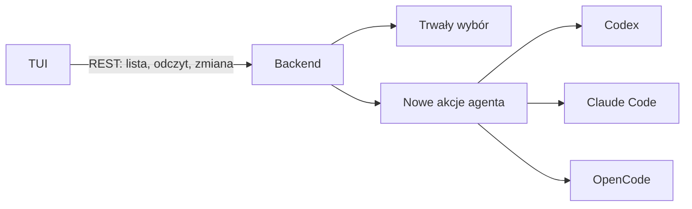
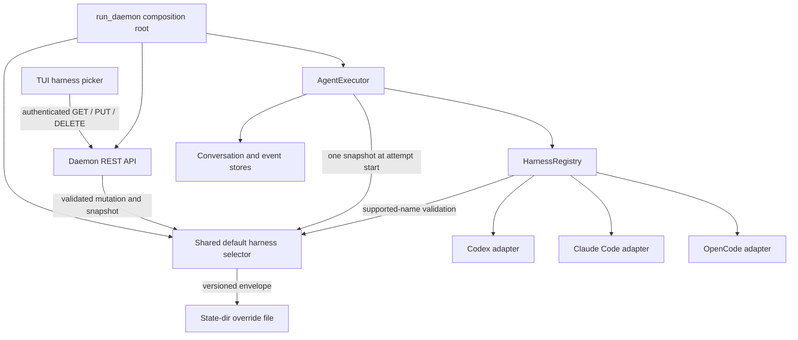
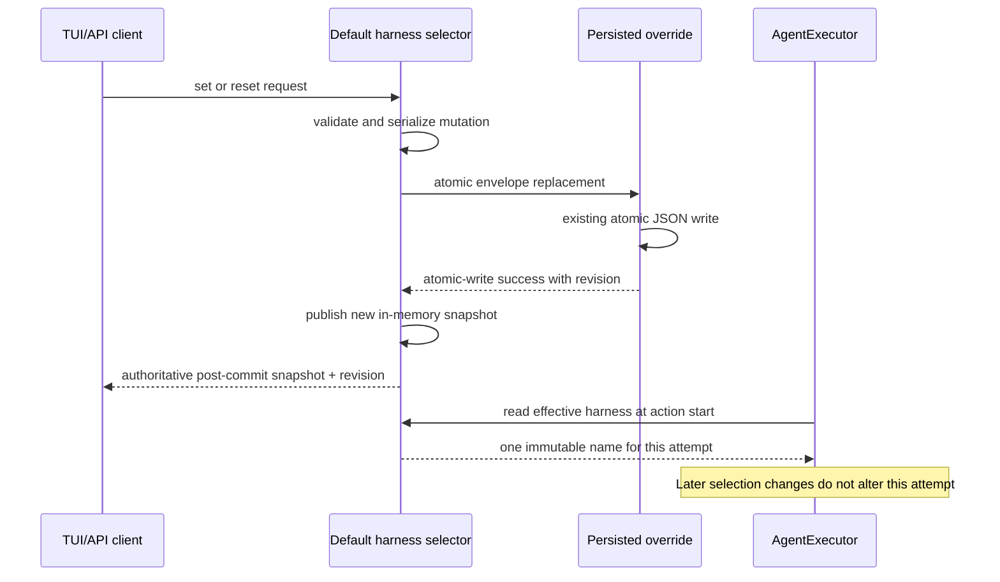
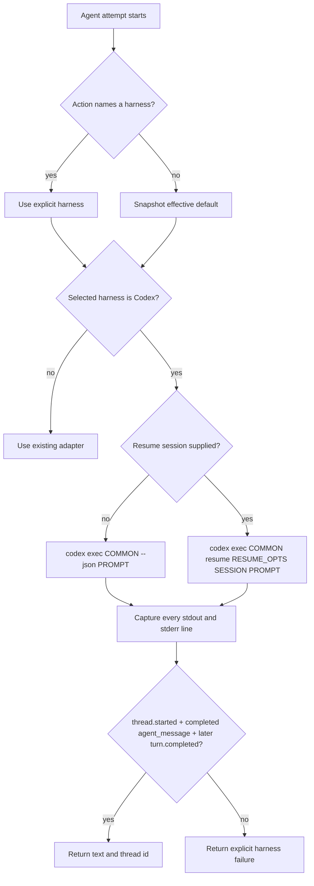

# Codex jako wybieralny domyślny harness - Plan

## Goal Capsule

- **Objective:** Operator może uruchamiać akcje agenta, także we wbudowanych workflow, przez wybrany harness Codex, Claude Code lub OpenCode i zmieniać domyślny wybór w TUI bez restartowania backendu.
- **Means:** Nowy adapter Codexa oraz wybór domyślnego harnessu zarządzany przez backend i udostępniony w REST API.
- **Product authority:** Potwierdzony zakres rozmowy z 2026-09-27: wybór w TUI, trwałość po restarcie, zastosowanie do kolejnych akcji oraz użycie domyślnego harnessu przez wbudowane workflow.
- **Open blockers:** Brak.

---

## Product Contract

### Summary

Narsor obsłuży Codex jako kolejny harness agenta. Backend będzie przechowywał domyślny wybór i udostępniał jego odczyt oraz zmianę przez REST API; TUI będzie klientem tego API. Wbudowane workflow będą używać wybranego domyślnego harnessu.

**Product Contract preservation:** Product Contract unchanged.

### Problem Frame

Narsor ma wspólny interfejs adapterów, lecz rejestr obejmuje dziś tylko Claude Code i OpenCode. Domyślny harness jest ustalany przy starcie demona, a wbudowane workflow wskazują Claude Code jawnie. Operator nie może więc wybrać Codexa ani przełączyć tych workflow z TUI. Konfiguracja może pochodzić z pliku montowanego tylko do odczytu, co wyklucza zapis wyboru przez edycję tego pliku.

### Key Decisions

- **Wbudowane workflow używają domyślnego harnessu** (session-settled: user-directed — chosen over stałe `claude-code` w definicjach: operator ma móc zastąpić Claude bez edycji workflow). Governs R6.
- **Backend jest źródłem wyboru** (session-settled: user-approved — chosen over wybór trzymany lokalnie w TUI: wszystkie klienty mają widzieć ten sam aktywny harness). Governs R7, R8.
- **Wybór przetrwa restart** (session-settled: user-directed — chosen over wybór tylko do restartu: operator potwierdził zapamiętanie ustawienia). Governs R9, R10.
- **Trwały wybór ma pierwszeństwo przed konfiguracją startową** (session-settled: user-approved — chosen over ponowne wymuszenie `agent_harness` po restarcie: TUI ma pokazywać wcześniej wybrany aktywny harness). Governs R9, R10.

### Actors

- A1. Operator wybiera domyślny harness w TUI i obserwuje, który jest aktywny.
- A2. Backend udostępnia opcje, zapisuje wybór i stosuje go do akcji agenta.
- A3. Harness wykonuje zadanie agenta i zwraca wynik oraz identyfikator sesji.

### Requirements

**Obsługa Codexa**

- R1. `codex` jest dostępną nazwą harnessu w tych samych miejscach konfiguracji i definicji akcji co `claude-code` i `opencode`.
- R2. Akcja na Codexie zachowuje istniejący kontrakt etykiety wyjścia, danych wyniku, błędów, limitu czasu i zapisu pełnego strumienia rozmowy.
- R3. Narsor zapisuje identyfikator sesji Codexa i może wznowić konkretną sesję w następnej akcji, gdy akcja tego żąda.
- R4. Ustawienia akcji istotne dla Codexa, w tym model, obszar pracy, dodatkowe ścieżki i uprawnienia, są stosowane albo odrzucane z czytelnym błędem; żadne ograniczenie nie znika po cichu.
- R5. Praca nieinteraktywna Codexa kończy się wynikiem lub jawnym błędem bez oczekiwania na odpowiedź w niedostępnym terminalu; szersze uprawnienia wymagają jawnego wyboru.

**Wybór i trwałość**

- R6. Akcje agenta we wbudowanych workflow bez jawnego wyboru harnessu używają aktualnej wartości domyślnej; jawny wybór w workflow użytkownika nadal ma pierwszeństwo.
- R7. Backend udostępnia przez uwierzytelnione REST API listę obsługiwanych harnessów oraz aktualną wartość domyślną.
- R8. Backend przyjmuje przez REST API zmianę domyślnego harnessu wyłącznie na opcję z listy i zgłasza błąd dla nieznanej nazwy.
- R9. Wybrany domyślny harness przetrwa restart backendu i ma pierwszeństwo przed wartością `agent_harness` z konfiguracji startowej.
- R10. Operator może usunąć trwały wybór, aby ponownie obowiązywała wartość wynikająca z konfiguracji startowej.
- R11. Zmiana domyślnego harnessu obejmuje akcje agenta rozpoczynane po jej przyjęciu, również w trwającym workflow; nie zmienia uruchomionej już akcji.

**TUI**

- R12. TUI pobiera listę i aktywny wybór z REST API oraz pozwala wybrać harness lub wrócić do wartości z konfiguracji.
- R13. TUI pokazuje potwierdzony przez backend aktywny wybór i czytelny błąd, gdy jego odczyt lub zmiana się nie powiedzie.
- R14. Podgląd rozmowy w TUI rozróżnia główne rodzaje zdarzeń Codexa i zachowuje surową treść każdego wpisu.

### Key Flows

- F1. Wybór domyślnego harnessu. Operator otwiera wybór w TUI; TUI pobiera opcje i aktywną wartość z backendu, wysyła wybór, a następnie pokazuje wartość potwierdzoną przez backend. Covers R7–R10, R12, R13.
- F2. Uruchomienie kolejnej akcji. Backend bierze jawny harness z akcji, a przy jego braku aktualny domyślny wybór, po czym zapisuje użyty harness wraz z przebiegiem sesji. Covers R2, R3, R6, R11.

### Acceptance Examples

- AE1. **Covers R1–R3, R6.** Gdy operator wybierze Codex, kolejna akcja wbudowanego workflow uruchamia Codex, zapisuje strumień i zwraca etykietę wyjścia oraz identyfikator sesji.
- AE2. **Covers R3.** Gdy akcja poda identyfikator wcześniejszej sesji Codexa, Narsor kontynuuje tę sesję i wiąże próbę z identyfikatorem wznowienia.
- AE3. **Covers R7–R10, R12.** Gdy operator wybierze Codex w TUI i backend zostanie uruchomiony ponownie, TUI nadal pokazuje Codex jako domyślny mimo innej wartości w konfiguracji startowej.
- AE4. **Covers R10.** Gdy operator usunie trwały wybór, backend i TUI pokazują wartość z konfiguracji startowej.
- AE5. **Covers R8, R13.** Gdy klient wyśle nieznany harness, backend odrzuca zmianę, a TUI zachowuje i pokazuje dotychczasowy wybór.
- AE6. **Covers R6, R11.** Gdy operator zmieni domyślny harness podczas trwania workflow, działająca akcja kończy się na poprzednim harnessie, a następna akcja bez jawnego wyboru używa nowego.
- AE7. **Covers R4, R5.** Gdy Codex wymaga uprawnienia nieprzyznanego akcji, próba kończy się czytelnym błędem zamiast zawisnąć lub poszerzyć uprawnienia po cichu.
- AE8. **Covers R2, R14.** Gdy Codex emituje wiadomości, wywołania narzędzi i wynik, TUI pokazuje ich rodzaje, a pełny surowy strumień pozostaje dostępny.

### Scope Boundaries

- Zmiana nie przełącza jawnych wyborów harnessu w workflow użytkownika.
- Narsor nie instaluje ani nie uwierzytelnia zewnętrznych CLI; operator zapewnia działający Codex i inne używane harnessy.
- Ten zakres nie obejmuje migracji ani instalacji umiejętności wywoływanych przez prompty workflow; zgodność tych umiejętności z Codexem trzeba sprawdzić przy planowaniu uruchomienia konkretnych workflow.

### Sources / Research

- `src/engine/actions/harness/mod.rs`, `src/engine/actions/agent.rs` — interfejs adaptera, rejestr i wybór per akcja.
- `src/cli/daemon.rs`, `src/engine/runner.rs`, `src/api/routes.rs`, `src/tui/mod.rs`, `src/tui/conversation.rs` — domyślna wartość ustawiana przy starcie, REST API i rola TUI.
- `workflows/compound-engineering.yaml`, `workflows/open-mercato-sdlc.yaml` — jawne wskazania `claude-code`.
- `ARCHITECTURE_DECISIONS.md` D47, D51 — konfiguracja i zapis rozmowy.
- [OpenAI Docs: Non-interactive mode](https://learn.chatgpt.com/docs/non-interactive-mode) — `codex exec --json`, strumień zdarzeń, tryb uprawnień i wznowienie sesji.

---

## Planning Contract

### Key Technical Decisions

- KTD1. **Codex korzysta z istniejącego kontraktu adaptera strumieniowego, ale sukces ma ścisły warunek terminalny.** Nowy adapter buduje osobne, testowane gramatyki argv dla `codex exec [wspólne opcje] --json [PROMPT]` i `codex exec [wspólne opcje] resume [opcje wznowienia] <SESSION_ID> [PROMPT]`. Sukces wymaga `thread.started`, co najmniej jednego ukończonego `agent_message` i późniejszego `turn.completed`; `turn.failed` lub top-level `error` unieważnia wcześniejszą wiadomość, natomiast item-level error pozostaje zdarzeniem pośrednim. Wspólny executor nadal odpowiada za proces, timeout, rozmowę, etykietę wyjścia i zdarzenia sesji. Oficjalny kontrakt CLI oraz lokalny `codex-cli 0.157.1` są bazą zgodności; niezgodna binarka kończy próbę czytelnym błędem procesu lub parsera, bez osobnego preflightu per akcja.
- KTD2. **Domyślny harness jest migawką wspólnego selektora pobieraną na początku próby.** `AgentExecutor` zachowuje pierwszeństwo jawnego `action.harness`; przy jego braku odczytuje efektywny wybór dokładnie raz przed utworzeniem sesji i procesu. `resume_session` wymaga jawnego `action.harness`, ponieważ niekwalifikowany identyfikator sesji nie pozwala bezpiecznie odtworzyć dostawcy po zmianie defaultu. Instancja selektora jest współdzielona przez daemon, executor i API, więc zmiana nie wymaga rekonstrukcji `Engine`. Governs R3, R6, R11.
- KTD3. **Selektor przechowuje skonfigurowaną wartość, opcjonalne trwałe nadpisanie i wartość efektywną jako jeden spójny zasób.** Stan pod `state_dir` ma wersjonowaną kopertę `{ version, revision, override }`; brak pliku jest zgodnym wstecznie stanem początkowym, a reset zapisuje `override: null` tą samą ścieżką atomowej zamiany co ustawienie. Cała walidacja, blokujące I/O i publikacja są serializowane w asynchronicznie bezpiecznej sekcji krytycznej: implementacja używa istniejącego atomowego zapisu JSON, a migawka w pamięci jest publikowana dopiero po jego sukcesie. (session-settled: user-approved — chosen over wybór przechowywany lokalnie w TUI: wszystkie klienty mają widzieć ten sam aktywny harness). Governs R7–R11.
- KTD4. **REST udostępnia jeden uwierzytelniony zasób ustawień harnessu.** Odczyt oraz odpowiedzi po ustawieniu lub resecie zwracają listę wspieranych adapterów, wartość startową, opcjonalne nadpisanie i wartość efektywną. Lista pochodzi z tego samego rejestru co wykonanie akcji, a błąd walidacji ma typowaną odpowiedź czytelną dla TUI.
- KTD5. **Codex uruchamia się bez interaktywnego oczekiwania w granicach natywnego sandboxu CLI.** Adapter wymusza `approval_policy=\"never\"`, dopuszcza tylko `read-only` i `workspace-write`, a `danger-full-access` oraz pełne ominięcie sandboxu odrzuca przed spawnem. Zachowuje środowisko i profil Codexa zapewnione przez operatora, aby nie łamać istniejącego uwierzytelnienia ani wymaganych skillów; odziedziczone rozszerzenia i odczyt plików dostępnych temu samemu użytkownikowi są jawną granicą zaufania lokalnego CLI, nie izolacją zapewnianą przez Narsora. `read_only_paths` trafiają do promptu, ponieważ Codex `--add-dir` przyznaje zapis, a nie tylko odczyt. Governs R4, R5.
- KTD6. **Wbudowane workflow dziedziczą domyślny harness przez brak pola `harness`.** Usunięcie stałego `claude-code` dotyczy wyłącznie dwóch źródeł wbudowanych workflow; parser i workflow użytkownika zachowują dotychczasowe pierwszeństwo wartości jawnej. (session-settled: user-directed — chosen over stałe `claude-code` w definicjach: operator ma móc zastąpić Claude bez edycji workflow). Governs R6.

### High-Level Technical Design

#### Component and data flow

#### Selection mutation and action snapshot

#### Codex invocation and result branch

### Assumptions

- Ponowienie akcji jest nową próbą i może pobrać domyślny harness zmieniony po poprzedniej próbie; trwający proces nigdy nie jest przełączany.
- Uszkodzona lub nieobsługiwana koperta trwałego wyboru zatrzymuje start daemona przed discovery i API, wskazuje ścieżkę pliku i pozwala operatorowi naprawić go offline zamiast cichego powrotu do konfiguracji.
- Pole `supported` oznacza adaptery zarejestrowane w tej wersji Narsora; API nie sprawdza instalacji binarki, logowania ani dostępności usługi zewnętrznej.
- TUI odświeża ustawienie przy otwarciu selektora i po mutacji. Nie powstaje osobny strumień SSE dla ustawień; przy wielu klientach wygrywa ostatnia pomyślnie utrwalona mutacja, a klient ignoruje odpowiedź o rewizji starszej niż już pokazana.
- Implementacja jest testowana względem `codex-cli 0.157.1`; nowsza lub niezgodna binarka musi zakończyć próbę czytelnym błędem procesu albo parsera, bez kosztownego preflightu przy każdej akcji.

### System-Wide Impact

- **Operator:** może zmienić aktywny harness bez restartu i zobaczyć, czy wartość pochodzi z konfiguracji, czy z trwałego nadpisania.
- **Workflow engine:** każda nowa próba bez jawnego harnessu pobiera aktualną migawkę; działające procesy zachowują swój wybór.
- **API i TUI:** powstaje nowy mutowalny zasób pod istniejącą ochroną bearer tokena oraz nowy modal TUI.
- **Dane trwałe:** `state_dir` otrzymuje mały atomowo zapisywany plik ustawienia, niezależny od potencjalnie tylko-do-odczytu katalogu konfiguracji.
- **Kontrakt harnessu:** Codex wnosi wersjonowany zewnętrzny kontrakt CLI; parser ma tolerować nieznane zdarzenia, ale nie może uznać braku końcowego wyniku za sukces.

### Risks and Dependencies

- **Dryf Codex CLI:** kolejność flag i kształt JSONL mogą zmienić się między wersjami. Testy fixture obejmują znane zdarzenia i bezpieczne zachowanie dla nieznanych linii; dokumentacja wiąże implementację z oficjalnym kontraktem `codex exec`.
- **Niespójność pliku i pamięci:** publikacja przed zapisem mogłaby potwierdzić wybór, który zniknie po restarcie. KTD3 wymusza kolejność persist-then-publish i testy awarii zapisu.
- **Zbyt szerokie uprawnienia:** `--add-dir` nie odpowiada semantyce `read_only_paths`, a `danger-full-access` omija granicę workspace. KTD5 nie mapuje ścieżek na ten flag i odrzuca tryby szersze niż `workspace-write`.
- **Konkurencyjne klienty:** równoległe ustawienie i reset muszą być serializowane razem z I/O, aby odpowiedź i plik opisywały tę samą kolejność.
- **Granica trwałości:** istniejący helper gwarantuje atomowość procesu i ponownego odczytu, ale synchronizację katalogu traktuje best-effort. Ten zakres obiecuje przeżycie zwykłego restartu backendu, nie odporność na utratę zasilania lub awarię filesystemu.
- **Lokalna granica zaufania:** Codex zachowuje profil, skille, poświadczenia i odczyt plików dostępnych użytkownikowi daemona. Natywny sandbox ogranicza zapis, lecz nie jest granicą poufności hosta; operator uruchamia daemon i CLI w odpowiednio ograniczonym koncie lub kontenerze, gdy repozytorium nie jest zaufane.
- **Pełny dostęp:** tryby `danger-full-access` i bypass nie mają w obecnej architekturze wystarczającej zewnętrznej granicy. Adapter odrzuca je jawnie zamiast traktować parametr akcji jako granicę autoryzacji.
- **Zgodność wbudowanych workflow:** usunięcie jawnych wpisów zmienia ich zachowanie celowo, lecz nie może zmienić skopiowanych ani użytkowych definicji.

### Sources and Research

- `src/engine/actions/harness/mod.rs`, `src/engine/actions/harness/claude_code.rs`, `src/engine/actions/harness/opencode.rs` — rejestr, kontrakt adaptera i parsery strumieniowe.
- `src/engine/actions/agent.rs`, `src/engine/runner.rs`, `src/cli/daemon.rs` — obecny niezmienny domyślny harness i cykl życia próby.
- `src/persistence/paths.rs`, `src/persistence/atomic.rs` — katalog stanu i wzorzec atomowego zapisu.
- `src/api/routes.rs`, `src/api/client.rs`, `src/api/dto.rs` — bearer auth, stan routera, typowany klient i kody błędów.
- `src/tui/app.rs`, `src/tui/mod.rs`, `src/tui/views.rs`, `src/tui/conversation.rs` — model modali, asynchroniczne requesty i klasyfikacja rozmowy.
- [OpenAI Codex non-interactive mode](https://learn.chatgpt.com/docs/non-interactive-mode) — `exec`, JSONL, sandbox, brak interakcji i resume.
- [OpenAI Codex developer commands](https://learn.chatgpt.com/docs/developer-commands?surface=cli) — flagi `exec`, `resume`, `--json`, `--sandbox` i niebezpieczne obejścia.
- [OpenAI Codex JSONL event definitions](https://github.com/openai/codex/blob/main/codex-rs/exec/src/exec_events.rs) — typy zdarzeń i `thread_id`.

---

## Implementation Units

### U1. Codex harness adapter

- **Goal:** Dodać Codex do rejestru i wykonać akcję przez bezpieczny, nieinteraktywny strumień JSONL.
- **Requirements:** R1–R5; AE1, AE2, AE7; KTD1, KTD5.
- **Dependencies:** None.
- **Files:**
  - Create `src/engine/actions/harness/codex.rs`.
  - Modify `src/engine/actions/harness/mod.rs`, `src/engine/mod.rs`, `WORKFLOW_SCHEMA.md`, `README.md`.
  - Test in `tests/actions_agent.rs`, `tests/config_file.rs`, `tests/config_resolve.rs`, and `tests/fixtures/harness/fake_harness.sh`.
- **Approach:**
  1. Zarejestrować stałą nazwę `codex` i adapter z wymiennym programem zgodnie z istniejącymi adapterami.
  2. Zbudować oddzielne, jawnie uporządkowane gramatyki argv dla nowej sesji i `exec resume`, zachowując obsługę modelu, katalogu workspace, dozwolonych sandboxów i polityki zatwierdzeń zgodnie z KTD5; nieobsługiwane flagi i niebezpieczne tryby odrzucić przed spawnem.
  3. Przetłumaczyć `read_only_paths` na informację w promptcie zamiast na `--add-dir`.
  4. Wyodrębnić `thread_id`, ostatni ukończony `agent_message` i terminalny stan tury; uznać sukces dopiero po `turn.completed`, a `turn.failed` lub top-level `error` traktować jako dominujące nad wcześniejszą wiadomością. Nieznane linie zachować wyłącznie w surowej rozmowie.
  5. Zachować środowisko i profil operatora potrzebne do uwierzytelnienia i skillów, a ograniczenia bezpieczeństwa oprzeć na jawnych flagach approval/sandbox i odrzuceniu niebezpiecznych trybów przed spawnem.
- **Patterns to follow:** `ClaudeCodeAdapter` dla kontraktu terminalnego wyniku i `OpenCodeAdapter` dla ścieżek tylko-do-odczytu w promptcie.
- **Test scenarios:**
  - Covers AE1. Nowa akcja Codexa buduje nieinteraktywne argv, odczytuje `thread.started` oraz końcowy `agent_message` i zwraca etykietowany wynik.
  - Covers AE2. Akcja z identyfikatorem sesji buduje gałąź `exec resume`, zwraca ten sam `thread_id` i nie pomija jawnych ustawień.
  - Model i sandbox przyjmują poprawne typy; wartości option-like, `danger-full-access`, bypass oraz nieznane tryby kończą się `invalid_parameter` lub `unsafe_harness_argument` przed spawnem.
  - Covers AE7. Brak dozwolonego uprawnienia lub zdarzenie `turn.failed`/top-level `error` zwraca czytelny błąd nawet po wcześniejszym `agent_message`; item-level error może poprzedzać późniejszy poprawny wynik.
  - Kod wyjścia różny od zera, brak końcowego `agent_message`, brak `thread_id`, niepoprawny JSON i zbyt długa linia mają deterministyczny wynik bez utraty surowej rozmowy.
- **Verification:** Rejestr wymienia trzy harnessy, konfiguracja przyjmuje `codex`, a testowy subprocess potwierdza argv, parser, sesję i zapis wszystkich linii.

### U2. Durable default harness selector

- **Goal:** Udostępnić daemonowi jeden trwały, współbieżny selektor wartości skonfigurowanej, nadpisania i wartości efektywnej.
- **Requirements:** R7–R11; AE3–AE6; KTD3.
- **Dependencies:** U1.
- **Files:**
  - Create `src/persistence/agent_harness.rs`.
  - Modify `src/persistence/mod.rs`, `src/persistence/paths.rs`, `src/cli/daemon.rs`.
  - Test in a new `tests/agent_harness_selection.rs` and `tests/daemon_lifecycle.rs`.
- **Approach:**
  1. Dodać do `StatePaths` jednoznaczną ścieżkę wersjonowanej koperty oraz typ migawki z rewizją, listą wspieranych, wartością skonfigurowaną, nadpisaniem i wartością efektywną.
  2. Przy starcie odczytać nadpisanie, zwalidować je przeciw rejestrowi adapterów i zbudować współdzielony selektor przed uruchomieniem API.
  3. W jednej asynchronicznie bezpiecznej sekcji krytycznej walidować mutację, przenieść blokujące I/O poza worker Tokio, użyć istniejącego `write_json_atomic` i opublikować nową migawkę dopiero po sukcesie I/O. Reset zapisuje `override: null`, a nie usuwa pliku.
- **Execution note:** Zacząć od testów trwałości i awarii zapisu, ponieważ kolejność persist-then-publish jest główną granicą poprawności.
- **Patterns to follow:** atomowy zapis `DaemonInfo` i scentralizowane nazewnictwo `StatePaths`.
- **Test scenarios:**
  - Brak pliku daje skonfigurowany fallback i `override = None`.
  - Covers AE3. Ustawienie Codexa, odtworzenie selektora i inna konfiguracja startowa nadal dają Codexa jako wartość efektywną.
  - Covers AE4. Reset zapisuje wyższą rewizję z `override = None` i natychmiast przywraca skonfigurowany fallback.
  - Nieznana nazwa, niepoprawny JSON oraz zapis niezgodny z rejestrem nie są przyjmowane po cichu.
  - Wstrzyknięta awaria istniejącego zapisu atomowego nie publikuje nowej migawki; po sukcesie nowy selektor odtwarza ten sam pełny snapshot, a uszkodzona koperta jest odrzucana.
  - Równoległe set/reset są serializowane i mają monotoniczne rewizje; odpowiedzi, końcowy plik i migawka opisują tę samą kolejność. Powtórzenie tej samej wartości i reset już pustego override są idempotentne.
- **Verification:** Nowa instancja selektora odtwarza poprzedni wybór, reset wraca do konfiguracji, a wstrzyknięta awaria I/O nie rozdziela stanu trwałego od pamięci.

### U3. Dynamic selection in the workflow engine

- **Goal:** Zastosować wspólny selektor do nowych prób bez wpływu na jawne wybory i trwające akcje.
- **Requirements:** R2, R3, R6, R9–R11; F2; AE1, AE2, AE6; KTD2, KTD3.
- **Dependencies:** U1, U2.
- **Files:**
  - Modify `src/engine/actions/agent.rs`, `src/engine/runner.rs`, `src/cli/daemon.rs`.
  - Test in `tests/actions_agent.rs`, `tests/engine_execution.rs`, `tests/daemon_e2e.rs`.
- **Approach:**
  1. Zastąpić niezmienny `default_harness: String` źródłem migawki, nie naruszając konstruktorów testowych ani `Engine::with_executor`.
  2. W każdej próbie wybrać jawny harness albo jedną migawkę efektywnej wartości przed utworzeniem sesji i wpisu rozmowy; odrzucić `resume_session` bez jawnego harnessu przed spawnem.
  3. W `run_daemon` utworzyć dokładnie jedno `Arc<DefaultHarnessSelector>` i przekazać je do stockowego executora oraz API, zachowując kompatybilność `Engine::with_executor` dla executorów niestandardowych.
- **Execution note:** Najpierw dodać charakterystykę pierwszeństwa istniejącego `action.harness`, a następnie test zmiany między dwiema próbami.
- **Patterns to follow:** `AgentDefaults`, `agent_executor` i istniejący moment wyboru adaptera w `AgentExecutor::run`.
- **Test scenarios:**
  - Jawny `claude-code`, `opencode` lub `codex` wygrywa z bieżącą wartością domyślną.
  - Covers AE6. Akcja zablokowana w subprocessie kończy się na wcześniej wybranym adapterze, a następna akcja bez pola `harness` używa nowej wartości.
  - Retry po zmianie domyślnego harnessu pobiera nową migawkę i zachowuje nowy `action_execution_id`.
  - Covers AE2. Wznowienie sesji z jawnym `harness: codex` pozostaje związane z Codexem; `resume_session` bez jawnego harnessu kończy się błędem walidacji, także po zmianie defaultu.
- **Verification:** Test engine przechodzi przez co najmniej dwie akcje i dowodzi kolejności explicit > effective default oraz granicy startu próby.

### U4. Authenticated harness settings API

- **Goal:** Udostępnić odczyt, ustawienie i reset selektora przez typowane REST API oraz klienta używanego przez TUI.
- **Requirements:** R7–R10, R13; F1; AE3–AE5; KTD4.
- **Dependencies:** U2, U3.
- **Files:**
  - Modify `src/api/dto.rs`, `src/api/routes.rs`, `src/api/client.rs`, `src/api/mod.rs`, `src/cli/daemon.rs`.
  - Test in `tests/api.rs`, `tests/daemon_lifecycle.rs`.
- **Approach:**
  1. Dodać snapshot DTO z rewizją i ciało ustawienia do wspólnego modułu kontraktu.
  2. Podłączyć GET, PUT i DELETE do istniejącego routera, dzięki czemu dziedziczą ten sam bearer middleware.
  3. Rozszerzyć `ApiError` i `ClientError` o typowany błąd żądania z bezpiecznym kodem/komunikatem, który TUI może pokazać bez ujawniania tokena.
  4. Zwracać snapshot dopiero po trwałym sukcesie mutacji.
- **Execution note:** Zacząć od testów kontraktu HTTP, w tym uwierzytelnienia i braku zmiany po błędzie.
- **Patterns to follow:** istniejący `AppState`, bearer middleware, DTO z `src/api/dto.rs` i pomocnicze metody klienta.
- **Test scenarios:**
  - Uwierzytelniony GET zwraca wspierane adaptery, konfigurację, nadpisanie i wartość efektywną; brak lub błędny token daje pusty `401`.
  - Covers AE3. PUT `codex` zwraca potwierdzony snapshot i przeżywa restart daemona.
  - Covers AE4. DELETE usuwa nadpisanie i zwraca skonfigurowany fallback.
  - Covers AE5. Nieznany harness daje typowany błąd, nie zmienia snapshotu ani pliku i pozostawia klientowi poprzedni wybór.
  - Błąd I/O daje błąd serwera bez publikowania niedurablej wartości.
  - Dwie równoległe mutacje zwracają snapshoty z monotonicznymi rewizjami zgodnymi z ich zserializowaną kolejnością, niezależnie od kolejności dostarczenia odpowiedzi.
- **Verification:** Testy wywołują rzeczywisty router i klienta, a nie tylko selektor, oraz potwierdzają auth, walidację, mutację i reset.

### U5. TUI harness selection and Codex conversation view

- **Goal:** Pozwolić operatorowi odczytać i zmienić wybór w TUI oraz rozpoznać zdarzenia rozmowy Codexa.
- **Requirements:** R12–R14; F1; AE3–AE5, AE8.
- **Dependencies:** U1, U4.
- **Files:**
  - Modify `src/tui/app.rs`, `src/tui/mod.rs`, `src/tui/views.rs`, `src/tui/conversation.rs`.
  - Test in `tests/tui_state.rs`, `tests/tui_conversation.rs`.
- **Approach:**
  1. Dodać wolny skrót, asynchroniczne żądania i modal ze stanami loading/error/ready zgodnie z istniejącym modelem `Modal` oraz `Request`.
  2. Przy każdym otwarciu pobrać snapshot; wyróżnić nadpisanie albo osobny wiersz powrotu do skonfigurowanej wartości.
  3. Po PUT lub DELETE renderować wyłącznie snapshot zwrócony przez backend, jeśli jego rewizja nie jest starsza od już pokazanej; przy błędzie zachować poprzedni stan i pozostawić modal otwarty.
  4. Rozszerzyć klasyfikację rozmowy o zdarzenia i zagnieżdżone typy itemów Codexa bez zmiany przechowywanego raw payloadu.
- **Patterns to follow:** selektory nowego zadania i repozytoriów, `Notice::error`, pętla requestów w `tui::run` oraz fallback `EntryKind::Raw`.
- **Test scenarios:**
  - Covers AE3. Otwarcie modala po restarcie pobiera Codexa jako efektywny wybór i zaznacza trwałe nadpisanie.
  - Covers AE4. Wiersz powrotu do konfiguracji wysyła reset i pokazuje wartość potwierdzoną przez backend.
  - Covers AE5. Nieudane ustawienie zachowuje poprzedni wybór, pozostawia modal otwarty i pokazuje czytelny notice.
  - Esc zamyka modal bez mutacji, a ponowne otwarcie pobiera stan zmieniony przez innego klienta.
  - Covers AE8. Wiadomości, reasoning, komendy/narzędzia, wyniki i błędy Codexa dostają właściwy rodzaj; nieznane zdarzenie zachowuje pełny raw payload.
- **Verification:** Testowy `ApiClient`/fixture prowadzi pełny przepływ open, set, reset i error, a renderer pokazuje aktywną wartość i jej pochodzenie.

### U6. Built-in workflow migration and end-to-end contract

- **Goal:** Przełączyć wbudowane workflow na dynamiczny default i udokumentować cały kontrakt bez zmiany jawnych wyborów użytkownika.
- **Requirements:** R1, R6, R9–R12; F1, F2; AE1, AE3, AE4, AE6; KTD6.
- **Dependencies:** U1–U5.
- **Files:**
  - Modify `workflows/compound-engineering.yaml`, `workflows/open-mercato-sdlc.yaml`, `workflows/README.md`, `README.md`, `WORKFLOW_SCHEMA.md`, `ARCHITECTURE_DECISIONS.md`.
  - Test in `tests/builtin_workflows.rs`, `tests/workflows.rs`, `tests/daemon_e2e.rs`, `tests/config_show.rs`.
- **Approach:**
  1. Usunąć jawne `harness: claude-code` wyłącznie ze źródeł wbudowanych workflow i zachować ich byte-identity z osadzonymi definicjami.
  2. Dodać test, że wbudowana akcja bez pola dziedziczy live default, a workflow użytkownika z polem zachowuje wartość jawną.
  3. Zinwentaryzować skille nazwane w promptach obu wbudowanych workflow i sprawdzić, że profil Codexa operatora potrafi je rozwiązać; nierozwiązana niezgodność blokuje U6, ale instalacja lub migracja samych skillów pozostaje poza zakresem.
  4. Zaktualizować dozwolone wartości, konfigurację, REST/TUI, trwałość, uprawnienia Codexa i ograniczenia instalacji/auth w dokumentacji oraz ADR.
- **Patterns to follow:** testy osadzonych workflow i istniejące decyzje D17–D20, D51 oraz D53.
- **Test scenarios:**
  - Covers AE1. Wbudowane workflow nie zawierają jawnego harnessu i po wyborze Codexa uruchamiają adapter Codexa.
  - Workflow użytkownika z `harness: claude-code` nadal uruchamia Claude mimo domyślnego Codexa.
  - Covers AE6. Zmiana defaultu między dwiema akcjami wbudowanego workflow wpływa tylko na drugą akcję.
  - Covers AE3 / AE4. Test daemon/API/TUI dowodzi utrwalenia nadpisania i powrotu do konfiguracji po resecie.
  - Skille wywoływane przez oba wbudowane workflow są wymienione, a smoke test lub deterministyczna walidacja profilu potwierdza ich rozwiązywanie przez Codexa bez automatycznej instalacji.
  - Dokumentowane nazwy harnessów oraz przykłady konfiguracji są zgodne z listą rejestru.
- **Verification:** Test end-to-end przechodzi od mutacji API przez wykonanie wbudowanego workflow do zdarzenia sesji z wybranym adapterem, a pełna dokumentacja nie zawiera nieaktualnego zamkniętego zbioru dwóch harnessów.

---

## Verification Contract

| Gate | Scope | Done signal |
|---|---|---|
| `cargo fmt --check` | All Rust changes | Formatter reports no diff. |
| Targeted integration tests | `actions_agent`, `agent_harness_selection`, `api`, `tui_state`, `tui_conversation`, `builtin_workflows`, `daemon_lifecycle`, `daemon_e2e`, config tests | Adapter, persistence, API, TUI and lifecycle scenarios pass independently. |
| `cargo test` | Full repository | Existing engine, persistence, workflow and CLI behavior has no regression. |
| Codex CLI smoke | Ignored/manual test with an installed authenticated `codex-cli 0.157.1` or compatible newer CLI | One read-only run emits JSONL, returns a label and stores a resumable `thread_id`; the normal suite never spends tokens or requires credentials. |
| Documentation consistency | README, schema, workflows and ADR | `codex`, reset semantics, permissions and built-in default behavior agree with code and tests. |

---

## Definition of Done

- U1 is complete when Codex is registered, its fresh/resume argv and JSONL parser meet R1–R5, and all raw conversation lines remain available.
- U2 is complete when set, reload, reset, corruption and I/O-failure tests prove one durable selector state under concurrency.
- U3 is complete when explicit harnesses keep priority and a live default change affects only attempts that start afterwards.
- U4 is complete when authenticated GET/PUT/DELETE return authoritative snapshots and invalid input cannot alter memory or disk.
- U5 is complete when the TUI selects/reset harnesses from backend data, preserves confirmed state on errors and classifies Codex conversation entries.
- U6 is complete when both built-in workflows inherit the current default, explicit user workflow choices still win and docs describe the shipped contract.
- Every applicable R, F and AE is covered by a unit or verification gate; no launch-blocking question remains.
- `cargo fmt --check`, targeted tests and the full `cargo test` suite pass.
- Experimental or abandoned implementations, temporary fixtures and debugging output are removed from the final diff.
