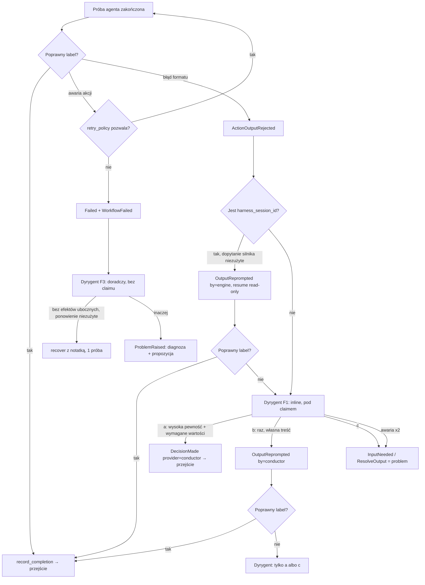
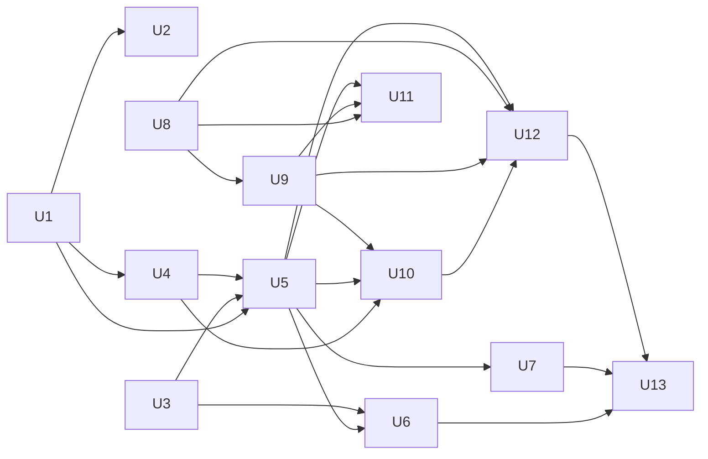

# Dyrygent, odpowiedzi na input_needed i ratowanie brakującego labela

## Summary

Implementacja w pięciu fazach. Fazy 1 i 2 to fundamenty w silniku, fazy 3–5 budują na nich TUI i
dyrygenta.

1. **Silnik:**
   - opisy labeli wyjścia, z których silnik sam buduje kontrakt wyjścia;
   - trwałe przeniesienie pytania agenta do żądań inputu;
   - klasyfikacja błędów formatu, odrębna od awarii;
   - jednorazowe dopytanie agenta przez wznowienie jego sesji w trybie tylko do odczytu, poza
     `retry_policy`.
2. **Problem jako trzeci rodzaj oczekującego inputu:** ścieżka dostarczenia label + `data` +
   `variables` oraz ochrona przed nieaktualną odpowiedzią.
3. **TUI:**
   - `i` otwiera formularz dla każdego inputu;
   - `t` kieruje do `i` przy bramkach z wymaganymi polami;
   - odświeżanie co ~10 s, które nie niszczy stanu widoku;
   - liczniki pytań i problemów oraz powiadomienia w pasku.
4. **Dyrygent:** moduł wewnątrz daemona z własnym magazynem (stan, czat, adnotacje).
   - Wywoływany jako świeże uruchomienie domyślnego harnessu z migawką taska, tylko do odczytu,
     ze strukturalną odpowiedzią.
   - Działa w trzech kontekstach: ratowanie labela (inline w przebiegu silnika), diagnoza po
     błędzie oraz czat i adnotacje bramek.
   - Każda jego akcja idzie istniejącymi ścieżkami claim/recover z kluczem epizodu.
5. **Czat dyrygenta w widoku taska:** propozycje do potwierdzenia i cofanie decyzji.

---

## Problem Frame

Wykonanie `8c171de0` workflow `compound-engineering` pokazało kilka luk:

- bramki `human` z polami tekstowymi nie da się wypełnić z TUI;
- operator nie widzi pytania agenta;
- stan nie odświeża się sam;
- brak labela w odpowiedzi agenta kończy workflow `workflow_failed`;
- nie ma kogo zapytać o stan taska.

Pełny opis problemu, wymagania i decyzje produktowe są w dokumencie źródłowym (patrz Sources &
References). Ten plan opisuje, jak to zrealizować w obecnej architekturze: daemon jest jedynym
właścicielem `Engine`, a TUI i CLI to klienci REST+SSE (D53).

Research ujawnił kilka faktów, które kształtują plan:

- **Wynik kroku nie przeżywa przejścia.** `ActionResult.data` żyje tylko w
  `metadata.engine.pending_step`, a `apply_decision` czyści je przy przejściu. Pytanie z
  `data.question` znika więc, zanim bramka `resolve_ambiguity` się zawiesi.
- **Brak labela zużywa `retry_policy`.** Wykonawca zwraca `missing_output_label` jako retriable
  `ActionError`. Label spoza zadeklarowanych kończy krok dopiero w `record_completion` przez
  `check_label`, od razu jako `fail_action`.
- **Silnik nie zna labeli przy budowie promptu.** `ActionRequest` nie niesie wyjść stanu, dlatego
  kontrakt wyjścia w `AGENT_OUTPUT_CONTRACT` odsyła do labeli „wypisanych wyżej”, które wypisuje
  tylko autor promptu.
- **`t` gubi wartości pól.** `post_transition` czyści oczekujący input i parkuje wykonanie, więc na
  bramce `human` wartości przepadają.
- **Odświeżenie niszczy stan widoku.** `App::reload_selection` czyści eventy i kursor, przez co
  auto-odświeżanie w obecnej postaci resetowałoby przewinięcie.
- **Rekoncyliacja zmieni status zbyt wcześnie.** D23 zamienia każdy `Running` z otwartym
  `ActionStarted` w `Unknown`. Bez nowych zdarzeń zamykających próbę przejęłaby ratowanie labela
  po restarcie daemona.
- **Niezacommitowana blokada `i`.** W working tree gałęzi `feat/workspace-access-policy` TUI
  odmawia `i` dla wszystkiego poza pytaniem agenta. To jest sprzeczne z R1, a modal
  `RecoveryComment` stał się przez tę zmianę nieosiągalny.

---

## Requirements

Plan realizuje wszystkie wymagania R1–R31 z dokumentu źródłowego. Poniżej skrót ze wskazaniem, gdzie
każde jest realizowane.

**Odpowiadanie na input_needed**
- R1. `i` otwiera formularz dla każdego oczekującego inputu (bramka, pytanie agenta, problem) z
  listy, panelu szczegółów i widoku taska. → U6
- R2. Formularz bramki zawiera wszystkie pola i waliduje wymagalność jak API. → U6
- R3. Wartości pól docierają do kontekstu workflow. → U6 (serwer już to obsługuje)
- R4. `t` przy bramce z wymaganymi polami kieruje do `i`. → U6
- R5. Formularz zamknięty inną ścieżką pokazuje, kto i czym odpowiedział, blokuje wysłanie i
  zachowuje wpisaną treść. → U5 (serwer), U7 (TUI)

**Treść pytania**
- R6. Żądanie inputu po kroku agenta niesie `data.question` i końcówkę odpowiedzi agenta bez zmian w
  YAML-u. → U3
- R7. Formularz i szczegóły `human_input_requested` pokazują komunikat bramki, pytanie i kontekst,
  a przy eskalacji także analizę dyrygenta. → U3, U6, U13

**Odświeżanie i sygnał**
- R8. Auto-odświeżanie co ~10 s, konfigurowalne, które nie niszczy stanu widoku. → U7
- R9. Liczniki pytań i problemów w nagłówku oraz powiadomienie w pasku. → U7

**Pytanie a problem**
- R10. Pytanie i problem różnią się kolorem, opisem i formularzem. → U5, U7
- R11. Wskaźnik „dyrygent pracuje, nad czym”. → U8, U13
- R12. Formularz problemu: label z opisami, edytowalne `data`/`variables`, komentarz, odpowiedzi
  agenta, analiza albo surowy błąd. → U5, U6, U13

**Opisy labeli**
- R13. Opcjonalne opisy labeli jako jedno źródło prawdy. Obejmuje to prompt, dopytania, formularze,
  menu `t`, migrację bundlowanych workflow i `WORKFLOW_SCHEMA.md`. → U1, U2

**Dopytanie o label**
- R14. Jedno dopytanie silnika w tej samej sesji. → U4
- R15. Błędy formatu nie zużywają `retry_policy`. Dyrygent przy błędzie wchodzi dopiero po
  wyczerpaniu `retry_policy`. → U4, U11
- R16. Po nieudanym dopytaniu sprawę przejmuje dyrygent. → U10
- R17. Drogi dyrygenta (a), (b), (c), najwyżej dwa dopytania łącznie. → U10
- R18. Przy (a) dyrygent uzupełnia `data`/`variables`, a jeśli nie da się ustalić wymaganych
  wartości, eskaluje. → U5 (walidacja), U10
- R19. Eskalacja tworzy problem. → U5, U10

**Dyrygent przy błędach**
- R20. Wyzwolenie po wyczerpaniu `retry_policy` i przy `workflow_failed`. → U11
- R21. Najwyżej jedno samodzielne ponowienie, tylko bez efektów ubocznych, ścieżką restartu z
  notatką. → U11
- R22. W pozostałych przypadkach tylko diagnoza i propozycja. → U11
- R23. Dyrygent nigdy sam nie wybiera przejścia po błędzie. → U11

**Awaria dyrygenta**
- R24. Jedna powtórka wywołania, także po restarcie daemona, potem problem z surowym kontekstem.
  → U10, U11
- R25. Awaria dyrygenta nie wyzwala dyrygenta. → U9, U11

**Zasięg, uprawnienia i czat**
- R26. Dyrygent per wykonanie z trwałą historią czatu. → U8
- R27. Migawka taska przy każdym wywołaniu. → U9
- R28. Czat z propozycjami wykonywanymi po potwierdzeniu. → U12, U13
- R29. Domyślny harness, tylko do odczytu. → U9
- R30. Bramki `human` zawsze czekają na operatora; dyrygent dodaje najwyżej podsumowanie. → U12
- R31. Decyzje w eventach z uzasadnieniem i pewnością oraz ich cofanie. → U10, U12, U13

**Origin actors:** A1 (operator), A2 (agent kroku), A3 (silnik narsora), A4 (dyrygent)

**Origin flows:**
- F1: ratowanie brakującego labela. → U4, U10
- F2: odpowiedź na bramkę `human`. → U3, U6
- F3: błąd kroku. → U11
- F4: rozmowa z dyrygentem. → U12, U13

**Origin acceptance examples:**

| AE | Realizują |
|---|---|
| AE1 | U6 |
| AE2 | U3, U6 |
| AE3 | U10 |
| AE4 | U10, U13 |
| AE5 | U10 |
| AE6 | U5, U10 |
| AE7 | U4 |
| AE8 | U11 |
| AE9 | U11 |
| AE10 | U10 |
| AE11 | U7 |
| AE12 | U7, U13 |
| AE13 | U5, U7, U12 |
| AE14 | U6 |
| AE15 | U1, U2 |
| AE16 | U12 |
| AE17 | U12 |

---

## Scope Boundaries

Te granice przenoszę bez zmian z dokumentu źródłowego:

- Uprawnienie w YAML-u, które pozwala dyrygentowi samemu wybrać przejście po błędzie.
- Globalny dyrygent obejmujący wiele tasków.
- Automatyczne odpowiadanie dyrygenta na `awaiting_input` i bramki `human`.
- Zmiany w kodzie workspace wykonywane przez dyrygenta.
- Konfigurowalne limity dopytań i ponowień. Limity są stałe: jedno dopytanie silnika, jedno
  dopytanie dyrygenta, jedno ponowienie na błąd, jedna powtórka wywołania dyrygenta.
  `retry_policy` zostaje bez zmian.
- Prompt dyrygenta per workflow.
- Żywa, dwukierunkowa sesja harnessu. Dopytanie kończy proces i wznawia sesję.

Dodatkowe granice tego planu:

- Nie zmieniamy semantyki `workflow_failed` dla prawdziwych awarii. Wykonanie po błędzie akcji
  zostaje `Failed`, a dyrygent pracuje „obok” niego (KTD4).
- Nie dodajemy nowych wariantów `ExecutionStatus` (KTD3).
- Nie naprawiamy ogólnie znanego TOCTOU w `post_transition` (residual finding). Nowe ścieżki
  dyrygenta po prostu nie kopiują tego wzorca.

### Deferred to Follow-Up Work

- **Reconnect SSE i zdarzenie `resync`** odłożone w planie daemona. Auto-odświeżanie z U7 zapewnia
  poprawność bez nich. Reconnect wracałby jako osobna poprawka.
- **Wspólny helper `status_name`**, dziś zdublowany w `cli/commands.rs`, `tui/app.rs`, `human.rs`
  i `runner.rs` (residual P2). U7 dotyka tych miejsc, ale samą deduplikację zostawiamy osobnemu
  commitowi, chyba że wyjdzie przy okazji bez kosztu.
- **Utworzenie `docs/solutions/`** i spisanie learnings z tej pracy (`/ce-compound`) po wdrożeniu.

---

## Context & Research

### Relevant Code and Patterns

**Silnik i wykonawcy**

- `src/engine/runner.rs`:
  - `run_action` z pętlą `RetrySchedule`;
  - `attempt_action`, która już dokleja do promptu odpowiedź człowieka (`take_agent_input`) i
    notatkę operatora (`take_operator_recovery_note`);
  - `record_completion`, `apply_decision` / `clear_pending_step`, `suspend_for_input`,
    `suspend_for_agent_input`;
  - `prepare_recover` / `try_begin_recover`, czyli restart z notatką (commit `a746f68`);
  - dwufazowy claim `try_begin_*` → `RunHandle`, `spawn_active` / `active_tasks`.
- `src/engine/actions/agent.rs`:
  - `AGENT_OUTPUT_CONTRACT`, `extract_response`, `no_label_error` (`missing_output_label`,
    `details.answer_tail`);
  - `resume_session()`, który wymaga jawnego `harness`, oraz `RESUME_SESSION_PARAMETER`;
  - `spawn_retrying_text_busy`, `with_default_harness_selector`.
- `src/engine/actions/human.rs`: `PendingHumanInput{request, outputs, continuation}`,
  `InputContinuation::{CompleteStep, ResumeAgent}`, `resume()` z `validate_values` i
  `resolve_label`, `agent_input_fields`.
- `src/engine/actions/harness/{claude_code,codex,opencode}.rs`: `HarnessRequest{workspace_access,
  resume_session}`. Tryb read-only mapuje się tak: claude na `--permission-mode plan`, codex na
  `--sandbox read-only`, a opencode tylko na brak `--auto`.
- `src/engine/decision.rs`: `permitted_labels`, `check_label`, `provider_name`. W
  `src/domain/decision.rs` jest `DecisionProviderType::{Rules, Agent, Human}`.

**Persystencja**

- `src/persistence/recovery.rs`: `recover` → `reconcile_all` → `reconcile` / `unfinished_action` /
  `closed_attempt_ids` (kompresja rozmów). Wywoływane w `src/cli/daemon.rs::recover_at_startup`.
- `src/persistence/agent_harness.rs`: `DefaultHarnessSelector::snapshot()` (D54). Dyrygent wybiera
  harness tak samo jak próba kroku.

**Workflow i schemat**

- `src/workflow/schema.rs`: `StateSchema.outputs: Vec<String>` z `deny_unknown_fields`. Wzorce
  „string albo obiekt” są w `TerminalStatesSchema` i `DurationSecs`.
- `src/workflow/loader.rs::compile_state` wpisuje dziś `description: None`, choć
  `OutputDefinition.description` już istnieje w `src/domain/workflow_definition.rs`.
- `src/workflow/template.rs`: rozwiązywanie `context.NAME`. Stąd weźmiemy statyczne referencje dla
  R18.

**API, zdarzenia, konfiguracja**

- `src/api/routes.rs`: `post_input`, `post_transition`, `post_recover`, `post_operator_note`, SSE
  `stream`. W `src/api/dto.rs` jest `HumanInputDelivery{values, chosen_label}`, a w
  `src/api/client.rs` jest `ApiClient`.
- `src/domain/event.rs::EventData`: nowe pola dodajemy z `#[serde(default)]`.
  - Exhaustive matche do zaktualizowania przy nowym wariancie: `Event::description`,
    `engine/timeline.rs::build_timeline`, `tui/app.rs::event_line` / `apply_to_row` /
    `notice_for`, `api/client.rs` (wykrywanie końca strumienia).
  - `recovery.rs::unfinished_action` ma ramię `_`, więc tam trzeba zdecydować jawnie.
- `src/config/settings.rs::SettingKey`: wzorzec nowego ustawienia (`AgentTimeout` jako przykład
  czasu trwania) plus `config/file.rs::value_from_text`.

**TUI**

- `src/tui/app.rs`: `InputForm::new(pending)` / `validate()`, `open_input_form`,
  `open_transition_menu`, `refresh` / `reload_selection`, `TaskView`, `Modal::*`, `Request::*`,
  `notice_for`.
- `src/tui/views.rs`: `render_input_modal`, `status_style`, `panel_block`, `render_shortcuts`.
- `src/tui/mod.rs`: pętla `select!` z `TICK` 250 ms.

**Testy**

- `tests/engine_support/mod.rs`: `Harness`, `StubAgentExecutor`, `QuestioningAgentExecutor`.
- `tests/fixtures/harness/fake_harness.sh`: odpowiedzi `stdout.<n>` per wywołanie, zapis
  `args.<n>`. Wystarcza do scenariusza „pierwsza odpowiedź bez labela, wznowiona z labelem”.
- `tests/tui_state.rs` uruchamia prawdziwy daemon per test. Stan na dysku trzeba zasiać przed
  `spawn_daemon`.

### Institutional Learnings

`docs/solutions/` nie istnieje. Źródła zastępcze to notatki pamięci, `ARCHITECTURE_DECISIONS.md`,
wcześniejsze plany i `docs/residual-review-findings/`.

- **`recover()` długo nie było wołane.** Miało testy, ale żaden binarny program go nie uruchamiał.
  Każda nowa reguła rekoncyliacji potrzebuje więc testu przez start daemona, nie tylko przez
  `reconcile_all`. Wywołanie jest dziś w `src/cli/daemon.rs`, a notatka pamięci wskazująca
  `tui::run` jest nieaktualna.
- **D23 / D24** oznaczają brak automatycznego replayu i dostarczanie at-least-once. Samodzielne
  ponowienie dyrygenta to świadomy, wąski wyjątek (R21), a dopytanie przez resume to nowa próba z
  nowym `action_execution_id` (D51 kluczuje rozmowy po tym id).
- **D18** zakłada wznowienie sesji jako ścieżkę priorytetową. **D20** mówi, że złe wyjście jest
  ponawiane, potem eskalowane, a na końcu zgłaszane jako błąd, co odpowiada kolejności dopytanie →
  dyrygent → problem. **D28/D29** („asystent: brak w MVP”) zastępujemy nowym wpisem D55.
- **SSE nie ma replayu.** Wspólny bufor ma 1024 sloty, a `Lagged` jest połykane. Nie da się więc
  polegać wyłącznie na strumieniu, potrzebny jest okresowy odczyt.
- **Wszystko, co napędza silnik, idzie przez claim.** Wzorca snapshotowego `is_active` z
  `post_transition` nie kopiujemy. Brakuje też testu współbieżności dla `/input`.
- **Flake ETXTBSY.** Nowe testy z fałszywym harnessem używają `FakeHarness::install`, a nowe
  ścieżki spawnu przechodzą przez `spawn_retrying_text_busy`.
- **Konwencje pracy:** git przez CLI, bez `git2`. Plany piszemy po polsku, komentarze w kodzie po
  angielsku. Nie dodajemy crate'a `tempfile`.

### External References

Nie użyto. Lokalne wzorce są wystarczające: adaptery harnessów z wznawianiem sesji, SSE, ścieżka
recover, formularz inputu. Zachowanie CLI przy wznawianiu jest już zmierzone w planie
`2026-09-26-002`: claude `--resume` nie odtwarza historii w strumieniu, a flaga zawsze musi mieć
wartość.

---

## Key Technical Decisions

- **KTD1. Dyrygent jest modułem daemona, nie osobnym klientem REST** (zastępuje D28/D29 przez
  D55).
  - Moduł `src/conductor/` żyje w procesie daemona i woła te same publiczne metody `Engine`, z
    których korzystają trasy API (`try_begin_*`).
  - Wyzwalacze F1 i F3 są wewnętrzne dla silnika i muszą być trwałe. Osobny proces musiałby je
    odtwarzać ze strumienia SSE, który nie ma replayu.
  - Operator widzi dyrygenta wyłącznie przez nowe endpointy API i SSE.

- **KTD2. Własny magazyn dyrygenta: `tasks/{id}/conductor/` z jednym aktorem per wykonanie.**
  - `state.json` przechowuje marker oczekującego wywołania, liczniki, zużyte ponowienia i klucze
    epizodów. `chat.jsonl` jest append-only i zawiera wiadomości, decyzje i propozycje.
    `annotations/{action_execution_id}.json` trzyma podsumowania bramek (R30).
  - Wszystkie zapisy przechodzą przez jednego aktora per wykonanie.
  - Metadane wykonania (`state.json` wykonania) zmienia wyłącznie przebieg silnika trzymający
    claim. Pętla trzyma `WorkflowExecution` w pamięci i zapisuje go w całości, więc zapis z boku
    zostałby nadpisany.
  - Z tego samego powodu adnotacje R30 nie trafiają do `pending_input.json`.

- **KTD3. Bez nowych statusów wykonania.**
  - „Pytanie” to `InputNeeded` z kontynuacją `CompleteStep` albo `ResumeAgent`.
  - „Problem przy labelu” to `InputNeeded` z nową kontynuacją `ResolveOutput`.
  - „Dyrygent pracuje” to marker w magazynie dyrygenta plus zdarzenia start/koniec.
  - Nowy status dotknąłby rekoncyliacji, `is_terminal`, `prepare_recover`, trzech kopii
    `status_name`, API i TUI, a nic nie dodaje ponad wariant kontynuacji. To rozstrzyga pytanie z
    dokumentu źródłowego o statusy.

- **KTD4. Problem po błędzie kroku: wykonanie zostaje `Failed`.**
  - Dyrygent diagnozuje po `WorkflowFailed`. Wynik (diagnoza i propozycja albo surowy błąd po
    awarii dyrygenta) jest ogłaszany nowym zdarzeniem `ProblemRaised`.
  - TUI liczy taki task w „problemach”. Pod `i` pokazuje diagnozę, potwierdzenie propozycji i
    restart z notatką, bez wyboru labela, zgodnie z R23.
  - Semantyka `workflow_failed` dla prawdziwych awarii zostaje bez zmian.

- **KTD5. Uprawnienia tylko do odczytu zależą od harnessu.**
  - Na claude i codex dyrygent pracuje w workspace taska w wymuszonym trybie read-only.
  - Na opencode, który nie ma wymuszenia, dostaje pusty katalog
    `tasks/{id}/conductor/scratch/` i kontekst wyłącznie z migawki.
  - Dopytanie o label wznawia sesję agenta również w trybie read-only. Poprawka formatu nie jest
    dalszą pracą, a brak zapisów utrzymuje czysty podział na próby z efektami ubocznymi i bez nich
    (R21).
  - To rozstrzyga pytanie o R29. Dokumentujemy wprost, że na opencode read-only oznacza izolację
    katalogu, a nie sandbox.

- **KTD6. Odpowiedź dyrygenta jest strukturalna.** Dyrygent nie dostaje narzędzi do API. Zwraca
  JSON z rodzajem decyzji, labelem, `data`, `variables`, pewnością (`high` / `low`, brak znaczy
  `low`), uzasadnieniem, proponowanymi akcjami i treścią wiadomości do czatu. Silnik parsuje ją,
  waliduje i wykonuje. Nieparsowalna odpowiedź to awaria dyrygenta: nie dopytujemy go, tylko
  stosujemy R24.

- **KTD7. Błąd formatu zamyka próbę nowym zdarzeniem i otwiera nową próbę-dopytanie.**
  - Za błąd formatu uznajemy: brak JSON-a, brak `output` i label spoza zadeklarowanych.
  - Próba kończy się zdarzeniem `ActionOutputRejected{action_execution_id, reason, answer_tail}`.
    D23 i `closed_attempt_ids` traktują je jak zamknięcie.
  - Dopytanie to nowa próba z nowym `action_execution_id` i własnym plikiem rozmowy, oznaczona
    zdarzeniem `OutputReprompted{by: engine|conductor, previous_attempt}`, a nie `ActionRetrying`.
    Licznik `retry_policy` pozostaje nietknięty.
  - Timeout bez labela to awaria, nie błąd formatu.
  - Jeśli dopytany agent odpowie `awaiting_input`, traktujemy to jako nieudane dopytanie. Pytanie
    agenta trafia do dyrygenta i ewentualnie do formularza problemu. Ścieżka `ResumeAgent`
    uruchomiłaby krok od nowa w świeżej sesji.
  - Dopytanie wznawia `harness_session_id` z poprzedniej próby, zawsze na harnessie, który tę próbę
    wykonał. Harness zapisujemy w konfiguracji sesji próby, a nie bierzemy bieżącego domyślnego,
    który operator mógł w międzyczasie zmienić.

- **KTD8. Trwałe „ostatnie wyjście agenta” w metadanych silnika.**
  - `apply_decision` przed `clear_pending_step` zapisuje, jeśli krok był krokiem agenta, rekord
    `last_agent_step{state_id, action_execution_id, question, answer_tail}`.
  - Robi to też `post_transition`, który dziś omija `apply_decision`.
  - `suspend_for_input` kopiuje rekord do `HumanInputRequest` i do zdarzenia
    `HumanInputRequested`, ale tylko wtedy, gdy pochodzi z bezpośrednio poprzedzającego przejścia.
    Zapobiega to pokazaniu nieaktualnego pytania z wcześniejszej pętli.
  - Rekord czyści zakończenie każdego kroku innego niż agent.

- **KTD9. Klucz epizodu i ochrona przed nieaktualnością.**
  - Każdy wyzwalacz dyrygenta i każdy oczekujący input ma klucz epizodu: numer sekwencyjny
    zdarzenia wyzwalającego albo `action_execution_id`.
  - Każda akcja dyrygenta, propozycja z czatu i dostarczenie z TUI niesie ten klucz. Serwer
    odrzuca je z 409, gdy klucz się zmienił.
  - Sprawdzenie odbywa się pod tym samym odczytem co zmiana, wewnątrz `human::resume` i
    `prepare_*`.
  - Ten sam klucz czyni potwierdzenie propozycji idempotentnym między dwoma oknami TUI (R5,
    AE13).

- **KTD10. Model claimu.**
  - Ratowanie labela (F1) działa inline w przebiegu silnika, który trzyma claim. Interrupt działa,
    a `/input` i `/transition` dostają 409.
  - Wywołania doradcze (diagnoza F3, adnotacja R30, czat) nie trzymają claimu i mają własny
    rejestr przerwań, osobny od `active_tasks`. Operator może w tym czasie odpowiadać.
  - Każda akcja dyrygenta (ponowienie, potwierdzona propozycja) bierze zwykły claim i sprawdza
    klucz epizodu.

- **KTD11. Jedno wywołanie dyrygenta naraz na wykonanie, z trwałą kolejką.** Wyzwalacze
  automatyczne mają pierwszeństwo przed czatem. Wiadomość z czatu bez odpowiedzi jest obsługiwana
  po restarcie daemona. To rozstrzyga pytanie o czat w trakcie automatycznego wywołania: kolejka,
  nie odrzucenie.

- **KTD12. R24 dotyczy tylko wyzwalaczy F1 i F3.** Nieudane wywołanie z czatu albo adnotacji R30
  zostawia wpis błędu w czacie i nic więcej. Nie zmienia to stanu taska w problem.

- **KTD13. Cofnięcie decyzji przywraca punkt decyzji** (R31).
  - Decyzja dyrygenta zapisuje migawkę kontekstu sprzed decyzji. Dedykowana operacja serwera
    przerywa wykonanie, czeka na zwolnienie claimu, przywraca kontekst i znów tworzy problem przy
    tym samym stanie. Kroku agenta nie uruchamia ponownie.
  - Nie wymaga `allow_manual_override`, bo nie jest dowolnym przejściem, tylko cofnięciem
    zapisanej decyzji.
  - Efekty uboczne rozpoczętego już następnego kroku nie są cofane. Operacja o tym ostrzega.

- **KTD14. Ponowienie dyrygenta (R21) to jedna próba.**
  - Nie jest to nowa runda `retry_policy`. Restart z notatką dostaje flagę pojedynczej próby
    omijającą harmonogram.
  - „Bez efektów ubocznych” rozpoznajemy konserwatywnie:
    - agent: próba nie przechwyciła `harness_session_id` i nie wyemitowała `AgentMessage`;
    - script: proces nie wystartował.
  - Ponowienie liczy się raz na epizod błędu, czyli wejście w stan, a zużycie zapisujemy trwale.
  - Świadomie akceptujemy, że awaria po utworzeniu sesji (np. błąd autoryzacji w trakcie) nie jest
    ponawiana automatycznie.

- **KTD15. Statyczna walidacja „wartości potrzebnych następnym krokom”** (R18). Silnik wyznacza
  referencje `context.X` w promptach i komunikatach stanu docelowego wybranego labela. Decyzja (a)
  dyrygenta, która ich nie pokrywa, zamienia się w eskalację. Formularz problemu pokazuje te pola
  jako wymagane.

- **KTD16. Auto-odświeżanie = odczyt okresowy plus odświeżenie po istotnych zdarzeniach SSE.**
  - Nowe ustawienie `tui_refresh_interval` (domyślnie 10 s) w rejestrze `SettingKey`.
  - Odświeżenie staje się nieniszczące: scala wiersze, zachowuje modal, zaznaczenie, kursor
    eventów, przewinięcie i tryb follow.
  - SSE daje natychmiastowe zmiany statusu i nowe eventy. Odczyt okresowy łata `Lagged`, rozłączenie
    i wszystko, czego strumień nie niesie (stan dyrygenta, adnotacje). To rozstrzyga pytanie o
    podział między strumień a odczyt.

- **KTD17. Jedno źródło etykiet w formularzu.**
  - `PendingHumanInput.outputs` niesie `{label, description}` i jest kompatybilny wstecz ze
    starymi plikami, które mają same labele.
  - Gdy bramka ma pole `select`, którego opcje pokrywają się z wyjściami (jak
    `ambiguity_decision`), formularz renderuje jeden wybór z opisami. Wybór zasila jednocześnie
    wartość pola i `chosen_label`, dzięki czemu nie mogą się rozjechać.

---

## Open Questions

### Resolved During Planning

- **Osobne statusy „problem” i „dyrygent pracuje”?** Nie. Rozstrzygają to KTD3 i KTD4.
- **Żywa sesja harnessu zamiast resume?** Nie w tej iteracji. Dopytanie to proces zakończony i
  wznowiony (KTD7). Do tematu wracamy, gdy dopytań będzie dużo.
- **Wymuszenie read-only na każdym harnessie?** Rozstrzyga KTD5: sandbox na claude/codex, izolowany
  katalog na opencode.
- **Nieudane dopytanie: osobne zdarzenia czy część próby?** Osobne zdarzenia (KTD7):
  `ActionOutputRejected` zamyka próbę, `OutputReprompted` otwiera następną.
- **„Ten sam błąd” i „brak efektów ubocznych” przy R21?** Ponowienie liczymy per epizod (wejście w
  stan), a efekty uboczne rozpoznajemy konserwatywnie (KTD14).
- **Czat w trakcie automatycznego wywołania?** Trwała kolejka z pierwszeństwem wyzwalaczy (KTD11).
- **Które odświeżenia daje strumień, a które odczyt?** Rozstrzyga KTD16.
- **Migawka przy długich taskach?** Budżet bajtowy z priorytetami (U9):
  - w całości: definicja workflow, bieżący stan, oczekujący input, adnotacje;
  - ostatnie N eventów ze skróconymi payloadami;
  - końcówki rozmów: bieżący stan w całości do limitu, wcześniejsze stany tylko ostatnia próba;
  - ostatnie N wpisów czatu.
  Liczby dobieramy przy implementacji. Przekroczenie budżetu nie jest błędem, tylko kolejnym
  skróceniem.
- **Blokada `i` z working tree:** odwracamy w U6. Testy asercji odmowy w `tests/tui_state.rs`
  zmieniają oczekiwania.

### Deferred to Implementation

- **Dokładne nazwy zdarzeń, pól i endpointów.** Plan podaje nazwy robocze.
- **Treść promptu dyrygenta i generycznego dopytania silnika.** Kształtujemy przy implementacji z
  testem snapshotowym treści, bez zamrażania w planie.
- **Timeout wywołania dyrygenta i dopytania.** Domyślnie wywodzimy go z `agent_timeout`, z
  osobnym, krótszym limitem dla dopytania, jeśli testy pokażą potrzebę.
- **Liczby w budżecie migawki (N eventów, bajty rozmów)** zależą od rozmiarów realnych tasków.
- **Graceful shutdown w trakcie wywołania inline.** Pauza jest honorowana dopiero na granicy kroku,
  więc SIGTERM może czekać do timeoutu wywołania. Akceptujemy to, bo hook startowy powtórzy
  wywołanie. Czy przerywać wywołanie wcześniej, rozstrzygniemy przy U10.

---

## High-Level Technical Design

> *To ilustruje zamierzone podejście i jest wskazówką kierunkową do review, nie specyfikacją
> implementacji. Implementujący traktuje to jako kontekst, nie kod do odtworzenia.*

### Kolejność mechanizmów po zakończeniu próby agenta

### Macierz restartu daemona

| Moment restartu | Wynik rekoncyliacji |
|---|---|
| W trakcie pierwszej próby | `Unknown` (bez zmian, D23) |
| Po `ActionOutputRejected`, przed startem dopytania | Hook startowy prowadzi dalej ścieżkę F1 od następnego kroku (dopytanie albo dyrygent). Próba jest zamknięta, więc nie ma replayu. |
| W trakcie dopytania (silnika albo dyrygenta) | `Unknown`, bo dopytana sesja mogła pracować. Marker dyrygenta jest czyszczony. |
| W trakcie wywołania dyrygenta F1 | Hook uruchamia je ponownie. To jest jedyna powtórka z R24; licznik rośnie *przed* wywołaniem. |
| Po decyzji (a) zapisanej w magazynie, przed `record_completion` | Hook stosuje zapisaną decyzję bez ponownego wywołania. |
| `Failed` + marker F3 | Hook uruchamia diagnozę ponownie (R24). Marker czyszczony w tym samym zapisie co zmiana statusu przez `prepare_recover`. |
| W trakcie wywołania z czatu albo R30 | Wiadomość wraca do kolejki. Nigdy nie eskaluje. |

Rekoncyliacja rozpoznaje „dyrygent przerwany” po połączeniu dwóch warunków: `Running` z markerem w
magazynie dyrygenta i brak otwartej próby. Taki task nie trafia do `Unknown`.

---

## Implementation Units

### Faza 1: Fundamenty silnika

### U1. Opisy labeli wyjścia i kontrakt wyjścia budowany przez silnik

**Goal:**
- Label wyjścia może mieć opis.
- Silnik dokleja do promptu agenta listę dozwolonych labeli z opisami.
- Pending input niesie opisy.
- Menu `t` pokazuje opisy.

**Requirements:** R13, AE15 (część silnika i menu)

**Dependencies:** brak

**Files:**
- Modify: `src/workflow/schema.rs`, `src/workflow/loader.rs`, `src/workflow/validator.rs`,
  `src/domain/workflow_definition.rs`
- Modify: `src/engine/actions/mod.rs` (`ActionRequest` dostaje zadeklarowane wyjścia),
  `src/engine/actions/agent.rs` (`AGENT_OUTPUT_CONTRACT` renderowany z listą),
  `src/engine/runner.rs` (przekazanie wyjść stanu), `src/engine/decision.rs` (`permitted_labels`
  z opisami)
- Modify: `src/engine/actions/human.rs` (`PendingHumanInput.outputs` z opisami, deserializacja
  wstecz)
- Modify: `src/tui/app.rs`, `src/tui/views.rs` (menu `t` z opisami)
- Modify: `WORKFLOW_SCHEMA.md` (§3.3 i §3.3.A)
- Test: `tests/schema_loading.rs`, `tests/validation.rs`, `tests/actions_agent.rs`,
  `tests/actions_human.rs`, `tests/tui_state.rs`

**Approach:**
- `outputs` akceptuje element-string albo obiekt `{label, description}`. Wzorzec „string albo
  obiekt” istnieje już w tym pliku, a `deny_unknown_fields` zostaje na obiekcie.
- `compile_state` przenosi opis, a walidator sprawdza unikalność labeli bez względu na formę.
- Kontrakt wyjścia wymienia labele w kolejności deklaracji, z opisem po myślniku, i przestaje
  mówić „wypisanych wyżej”.
- Stare pliki `pending_input.json` z samymi labelami wczytują się jako labele bez opisów.

**Patterns to follow:** `TerminalStatesSchema`, `DurationSecs` w `src/workflow/schema.rs`, a
przy doklejaniu do promptu `take_operator_recovery_note` w `runner.rs`.

**Test scenarios:**
- Happy path: YAML z mieszanką gołych labeli i obiektów się ładuje, a `OutputDefinition.description`
  jest ustawione tylko tam, gdzie podano.
- Happy path: prompt przekazany do fałszywego harnessu zawiera każdy zadeklarowany label i jego
  opis. *Covers AE15* (lista w prompcie).
- Edge case: stan bez opisów daje kontrakt z samymi labelami, bez pustych myślników.
- Error path: obiekt z nieznanym kluczem albo bez `label` to błąd ładowania ze wskazaniem stanu.
- Error path: zduplikowany label w formie mieszanej to błąd walidacji.
- Edge case: stary `pending_input.json` z `outputs: ["a","b"]` wczytuje się poprawnie.
- Integration: menu `t` w TUI zawiera opis labela, dla którego workflow go deklaruje.

**Verification:** Istniejące workflow z gołymi labelami ładują się bez zmian. Prompt agenta
zawiera listę labeli z opisami.

---

### U2. Migracja bundlowanych workflow na opisy labeli

**Goal:** `workflows/compound-engineering.yaml` i `workflows/open-mercato-sdlc.yaml` deklarują opisy
w `outputs`. Ręczne bloki „Use exactly one of these labels” znikają z promptów.

**Requirements:** R13, AE15

**Dependencies:** U1

**Files:**
- Modify: `workflows/compound-engineering.yaml` (11 bloków), `workflows/open-mercato-sdlc.yaml`
  (15 bloków)
- Test: `tests/builtin_workflows.rs`, `tests/workflows.rs`

**Approach:**
- Treść opisów bierzemy z istniejących bloków w promptach.
- W promptach zostają instrukcje dotyczące `data`, np. „state the question in `data.question`”,
  bo kontrakt z U1 mówi tylko o labelach.
- Komunikat bramki `resolve_ambiguity` („Read its question in the execution's data…”) upraszczamy,
  bo pytanie pokaże silnik (U3).

**Test scenarios:**
- Happy path: oba workflow się ładują i każdy label ma opis.
- Happy path: prompt kroku `work` nie zawiera już frazy „Use exactly one of these labels”, a
  kontrakt doklejony przez silnik zawiera `needs_human_decision` z opisem. *Covers AE15.*
- Edge case: żaden prompt nie zawiera już ręcznej listy labeli. Sprawdza to test przeszukujący
  zbudowane prompty wszystkich stanów agenta.

**Verification:** Testy bundlowanych workflow przechodzą, a w YAML-ach nie ma powielonych list.

---

### U3. Pytanie agenta w żądaniach inputu

**Goal:** Każde żądanie inputu, które powstaje bezpośrednio po kroku agenta, niesie `data.question`
(jeśli jest) i końcówkę ostatniej odpowiedzi agenta, bez zmian w YAML-u.

**Requirements:** R6, R7 (część danych), AE2, F2

**Dependencies:** brak

**Files:**
- Modify: `src/engine/runner.rs` (zapis `last_agent_step` w `apply_decision` i w
  `post_transition`, odczyt w `suspend_for_input`)
- Modify: `src/engine/actions/human.rs` (`HumanInputRequest` dostaje pola pytania i końcówki)
- Modify: `src/domain/event.rs` (`HumanInputRequested` z nowymi polami `#[serde(default)]`),
  `src/engine/timeline.rs`
- Modify: `src/api/routes.rs` (ścieżka transition zapisuje rekord), `src/api/dto.rs`, jeśli
  summary wymaga
- Test: `tests/engine_execution.rs`, `tests/actions_human.rs`, `tests/timeline.rs`

**Approach:**
- Rekord `last_agent_step` powstaje przed wyczyszczeniem `pending_step`. Końcówkę odpowiedzi
  bierzemy z tego samego mechanizmu co `answer_tail` (`harness::tail`, 2 KB).
- `suspend_for_input` używa rekordu tylko wtedy, gdy jego `state_id` to stan, z którego właśnie
  przeszliśmy (KTD8). Zakończenie kroku innego niż agent czyści rekord.
- Pole pytania jest puste, gdy agent nie podał `data.question`. Końcówka odpowiedzi jest wtedy
  jedynym kontekstem.

**Test scenarios:**
- Happy path: stub agent zwraca `needs_human_decision` z `data.question` = „Czy limit ma dotyczyć
  konta czy użytkownika?”. Pending input bramki i zdarzenie `HumanInputRequested` niosą to
  pytanie. *Covers AE2* (część silnika).
- Happy path: bez `data.question` żądanie niesie samą końcówkę odpowiedzi.
- Edge case: pętla `work` → bramka → `apply_clarification` → bramka. Druga bramka pokazuje
  pytanie z `apply_clarification`, nie z `work`.
- Edge case: bramka poprzedzona krokiem `script` nie niesie żadnego pytania.
- Integration: ręczne przejście `t` ze stanu agenta do bramki także przenosi pytanie.
- Edge case: stare zdarzenie `HumanInputRequested` bez nowych pól deserializuje się poprawnie.

**Verification:** Pytanie jest w pending input i w evencie, a fixture'y YAML są bez zmian.

---

### U4. Klasyfikacja błędów formatu i dopytanie silnika przez wznowienie sesji

**Goal:** Brak JSON-a, brak `output` i label spoza zadeklarowanych nie zużywają `retry_policy`.
Silnik raz wznawia tę samą sesję w trybie read-only z generycznym dopytaniem.

**Requirements:** R14, R15, AE7, F1 (pierwszy krok)

**Dependencies:** U1 (lista labeli w dopytaniu)

**Files:**
- Modify: `src/engine/actions/agent.rs`:
  - błąd formatu niesie `harness_session_id` i nazwę harnessu;
  - zapis konkretnego harnessu w konfiguracji sesji;
  - wznowienie po id niezależnie od parametru YAML `resume_session`.
- Modify: `src/engine/runner.rs` (routing według `error_type` przed pętlą `RetrySchedule`,
  sprawdzenie labela spoza zadeklarowanych przeniesione przed `fail_action`)
- Modify: `src/engine/actions/harness/mod.rs`, jeśli potrzebne jest jawne wymuszenie read-only
  przy wznowieniu
- Modify: `src/domain/event.rs` (`ActionOutputRejected`, `OutputReprompted`),
  `src/engine/timeline.rs`, `src/tui/app.rs` (`event_line`), `src/api/client.rs`
- Modify: `src/persistence/recovery.rs` (`unfinished_action` i `closed_attempt_ids` znają nowe
  zdarzenia)
- Test: `tests/actions_agent.rs`, `tests/engine_execution.rs`, `tests/engine_recovery.rs`,
  `tests/timeline.rs`

**Approach:**
- Wykonawca dalej nie waliduje labeli względem stanu. Runner klasyfikuje wynik.
  - `missing_output_label` oraz label spoza `permitted_labels` to błąd formatu.
  - Timeout i błąd procesu to awaria i idą do `retry_policy` jak dziś.
- Dopytanie to nowa próba z nowym `action_execution_id`. Prompt zawiera generyczną treść, listę
  labeli z opisami i wymagany format. Żądanie niesie `resume_session` = przechwycony id,
  `workspace_access` = read-only oraz harness poprzedniej próby.
- Zasady wyjścia z dopytania:
  - brak `harness_session_id` oznacza brak dopytania silnika; w tej jednostce kończy się to
    dotychczasowym `fail_action`, a U10 podmienia to na przekazanie dyrygentowi;
  - `awaiting_input` w odpowiedzi na dopytanie oznacza nieudane dopytanie (KTD7);
  - dopytanie zakończone awarią procesu to również nieudane dopytanie, bez `retry_policy`.
- Dopóki U10 nie istnieje, nieudane dopytanie kończy się `fail_action` z czytelnym błędem. Dzięki
  temu U4 jest wdrażalne samodzielnie.

**Execution note:** Zacznij od testu na fałszywym harnessie, w którym `stdout.1` nie ma labela, a
`stdout.2` ma label. Asercje: `args.2` zawiera wznowienie z id i tryb read-only, a licznik
`retry_policy` stoi w miejscu.

**Patterns to follow:** routing `AttemptFailure` w `run_action`, `resume_session()` i mapowanie
`WorkspaceAccess` w adapterach, `FakeHarness::install`.

**Test scenarios:**
- Happy path: agent kończy JSON-em bez `output`, a po dopytaniu zwraca `implemented`. Workflow
  przechodzi dalej, w eventach jest `ActionOutputRejected` i `OutputReprompted{by: engine}`, a
  drugie wywołanie harnessu wznawia sesję z pierwszego.
- Happy path: stan ma `retry_policy.max_attempts: 2`, agent zwraca JSON bez `output`. Krok nie
  rusza od nowa, dopytanie idzie w tej samej sesji, nie ma zdarzenia `ActionRetrying`. *Covers
  AE7.*
- Happy path: label spoza zadeklarowanych też wywołuje dopytanie, zamiast natychmiastowego
  `fail_action`.
- Edge case: próba wykonana na harnessie domyślnym, który potem zmieniono. Dopytanie idzie na
  harness pierwotnej próby.
- Edge case: harness nie zwrócił `harness_session_id`, więc dopytania nie ma, a sprawa od razu
  przechodzi dalej.
- Edge case: dopytany agent zwraca `awaiting_input`, co liczy się jako nieudane dopytanie, a nie
  suspensja `ResumeAgent`.
- Error path: timeout bez labela zużywa `retry_policy`, tak jak dziś.
- Error path: dopytanie też bez labela kończy się czytelnym błędem (do czasu U10).
- Integration: restart daemona między `ActionOutputRejected` a startem dopytania nie daje
  `Unknown`. Restart w trakcie dopytania daje `Unknown`, zgodnie z macierzą. Test idzie przez
  `recover()`, a nie bezpośrednio przez `reconcile`.
- Integration: kompresja rozmów traktuje próbę zamkniętą przez `ActionOutputRejected` jako
  zamkniętą.

**Verification:**
- Sam błąd formatu nie zużywa `retry_policy`.
- Dopytanie jest widoczne na osi czasu jako osobna próba z własną rozmową.

---

### Faza 2: Problem jako input

### U5. Wariant „problem” w oczekującym inpucie i ścieżka dostarczenia wyniku kroku

**Goal:**
- Nowa kontynuacja `ResolveOutput`: operator albo dyrygent dostarcza label, `data`, `variables`
  i komentarz, a silnik kończy krok tak, jakby agent przestrzegał kontraktu.
- Ochrona przed nieaktualną odpowiedzią.
- Informacja, kto zamknął input.
- Parytet w CLI.

**Requirements:** R5 (serwer), R10, R12 (dane), R18 (walidacja), R19, AE6, AE13 (serwer)

**Dependencies:** U1, U3, U4

**Files:**
- Modify: `src/engine/actions/human.rs` (kontynuacja `ResolveOutput`, rekord problemu z
  odpowiedziami agenta i ewentualną analizą, walidacja `data`/`variables` poza `fields`)
- Modify: `src/engine/runner.rs` (trzecia gałąź w `prepare_deliver_human_input` buduje
  `ActionResult` i woła `record_completion`; statyczne referencje `context.X` stanu docelowego)
- Modify: `src/workflow/template.rs` (wydobycie referencji `context.X` z szablonów stanu)
- Modify: `src/domain/decision.rs` (`DecisionProviderType::Conductor`), `src/engine/decision.rs`
- Modify: `src/domain/event.rs`:
  - `HumanInputReceived` z `answered_by` i powodem zamknięcia;
  - `ProblemRaised`;
  - pola `data`/`variables`.
- Modify: `src/api/dto.rs` (`HumanInputDelivery` z opcjonalnymi `data`, `variables`, `comment`,
  kluczem epizodu), `src/api/routes.rs` (409 przy nieaktualnym kluczu), `src/api/client.rs`
- Modify: `src/cli/commands.rs`, `src/cli/mod.rs` (`narsor input` z `--data k=v` i
  `--variable k=v`, klucz epizodu przekazywany automatycznie)
- Test: `tests/actions_human.rs`, `tests/engine_execution.rs`, `tests/api.rs`, `tests/cli_smoke.rs`

**Approach:**
- Rekord problemu jest samowystarczalny, żeby TUI nie musiało ładować definicji. Zawiera:
  - dozwolone labele z opisami;
  - wymagane klucze kontekstu per label (KTD15);
  - obie odpowiedzi agenta (końcówki);
  - opcjonalną analizę dyrygenta z proponowanym labelem, `data` i `variables`.
- Dostarczenie dla `ResolveOutput`:
  - waliduje label względem dozwolonych i wymagane klucze kontekstu dla wybranego labela;
  - buduje `ActionResult` i przechodzi przez `record_completion`, więc `data.artifacts` rejestruje
    się jak zwykle, a `ActionCompleted` zamyka próbę;
  - emituje `DecisionMade` z providerem `Human` (operator) albo `Conductor`.
- Klucz epizodu jest sprawdzany w `human::resume` pod tym samym odczytem. Starsi klienci bez
  klucza działają, ale bez ochrony.
- `post_transition`, interrupt i recover, które czyszczą oczekujący input, zapisują powód
  zamknięcia. Dzięki temu formularz w U7 potrafi powiedzieć „zamknięte przejściem” zamiast
  „odpowiedział X”.
- `ProblemRaised` ogłasza każdy nowy problem, także w wariancie `Failed` z KTD4, żeby TUI dostało
  sygnał przez SSE.

**Test scenarios:**
- Happy path: problem z labelami `implemented` i `needs_human_decision`. Operator wysyła
  `implemented` z `data.units_completed=3`. Krok kończy się `ActionCompleted`, workflow
  przechodzi, a `DecisionMade.provider` = human.
- Error path: operator wybiera `needs_human_decision` bez `data.question`, a stan docelowy
  (bramka) jej wymaga. Wynik to 400 ze wskazaniem brakującego klucza. *Covers AE6* (część
  formularza).
- Error path: dostarczenie z nieaktualnym kluczem epizodu, bo input już zamknięto, daje 409 i nic
  się nie zmienia. *Covers AE13* (serwer).
- Edge case: dwa równoczesne `POST /input` na ten sam input. Dokładnie jeden wygrywa, drugi
  dostaje 409. To uzupełnia brakujący test współbieżności.
- Edge case: `data` z `artifacts` rejestruje artefakty tak samo jak odpowiedź agenta.
- Integration: `narsor input <id> --label implemented --data units_completed=3` domyka problem z
  CLI.
- Edge case: zamknięcie inputu przez `t` zapisuje powód „transition” w zdarzeniu.

**Verification:** Problem da się rozwiązać z API i z CLI, a nieaktualne odpowiedzi są odrzucane.

---

### Faza 3: TUI

### U6. Formularz `i` dla każdego oczekującego inputu i przekierowanie z `t`

**Goal:**
- `i` z listy, panelu szczegółów i widoku taska otwiera formularz bramki, pytania agenta albo
  problemu.
- Formularz pokazuje komunikat, pytanie agenta i kontekst.
- `t` na bramce z wymaganymi polami kieruje do `i`.

**Requirements:** R1, R2, R3, R4, R7, R12 (formularz), AE1, AE2, AE14, F2

**Dependencies:** U1, U3, U5

**Files:**
- Modify: `src/tui/app.rs`:
  - odwrócenie niezacommitowanej blokady w `open_input_form` / `open_input_or_recovery_comment`;
  - warianty `InputForm` dla problemu;
  - jeden wybór dla `select` pokrywającego się z wyjściami;
  - `i` w `on_key_task`;
  - guard w `open_transition_menu`.
- Modify: `src/tui/views.rs` (`render_input_modal`: komunikat, pytanie, końcówka odpowiedzi,
  opisy labeli, edytor `data`/`variables` dla problemu)
- Modify: `src/tui/mod.rs`, jeśli potrzebne są nowe warianty `Request`
- Test: `tests/tui_state.rs`

**Approach:**
- Walidacja w TUI pozostaje jako szybka informacja, ale źródłem prawdy jest 400 z serwera.
  Formularz zostaje otwarty z błędem i zachowuje wpisaną treść.
- `data` i `variables` w problemie edytujemy jako pary klucz–wartość, z proponowanymi przez
  dyrygenta wartościami jako początkowymi. Wymagane klucze kontekstu (z rekordu problemu) są
  oznaczone.
- Guard `t`: w trybie Outputs na bramce z wymaganymi polami pokazujemy komunikat wskazujący `i`.
  Tryb Override pozostaje dostępny jako świadome nadpisanie.
- Modal `RecoveryComment` wraca jako część formularza błędu (KTD4), podłączony w U13.

**Test scenarios:**
- Happy path: task w `resolve_ambiguity`. Operator naciska `i`, wybiera `answered`, wpisuje
  „używamy wariantu B” i wysyła. Następny krok `apply_clarification` dostaje ten tekst w
  prompcie. *Covers AE1.*
- Happy path: formularz przy `resolve_ambiguity` zawiera pytanie „Czy limit ma dotyczyć konta czy
  użytkownika?” nad polami. *Covers AE2.*
- Happy path: `i` działa z listy wykonań, z panelu szczegółów i z widoku taska.
- Happy path: pytanie agenta (`ResumeAgent`) otwiera się jak dziś.
- Edge case: bramka z `select` pokrywającym się z wyjściami renderuje jeden wybór z opisami, a
  wysłana wartość pola i `chosen_label` są zgodne.
- Error path: puste wymagane pole zatrzymuje wysyłkę z błędem przy polu. Błąd 400 z serwera
  zostawia formularz otwarty z treścią.
- Error path: `t` → `answered` na `resolve_ambiguity` nie przechodzi dalej, tylko pokazuje
  komunikat kierujący do `i`. *Covers AE14.*
- Edge case: istniejące testy asercji odmowy `i` dla bramek odwracają oczekiwanie.

**Verification:**
- Każdy rodzaj oczekującego inputu da się obsłużyć spod `i`.
- Na bramce `resolve_ambiguity` `t` nie gubi wartości pól.

---

### U7. Nieniszczące auto-odświeżanie, liczniki, kolory i powiadomienia

**Goal:**
- Lista, szczegóły i widok taska odświeżają się same co `tui_refresh_interval` bez utraty stanu
  widoku.
- Nagłówek pokazuje liczbę pytań i problemów.
- Przejście dowolnego taska w jeden z tych stanów daje komunikat w pasku.
- Otwarty formularz wykrywa zamknięcie inputu.

**Requirements:** R5 (TUI), R8, R9, R10 (kolory i opisy), AE11, AE12 (liczniki i komunikat),
AE13 (TUI)

**Dependencies:** U5

**Files:**
- Modify: `src/config/settings.rs`, `src/config/file.rs`, `src/config/resolve.rs`
  (`tui_refresh_interval`)
- Modify: `src/cli/commands.rs` (przekazanie interwału do `tui::run`), `src/tui/mod.rs` (odczyt
  okresowy na `TICK`, odświeżenie po istotnych zdarzeniach SSE)
- Modify: `src/tui/app.rs`:
  - `refresh` i `reload_selection` scalają, a nie czyszczą;
  - klasyfikacja pytanie/problem na wierszu;
  - `notice_for` dla `HumanInputRequested` i `ProblemRaised`;
  - stan „zamknięty” formularza.
- Modify: `src/tui/views.rs` (linia nagłówka z licznikami, `status_style` rozróżnia pytanie od
  problemu, opis w szczegółach)
- Modify: `src/api/dto.rs`, jeśli summary nie niesie jeszcze rodzaju inputu
- Test: `tests/tui_state.rs`, `tests/config_show.rs`, `tests/config_file.rs`,
  `tests/config_resolve.rs`

**Approach:**
- Odświeżenie scala dane:
  - wiersze wykonań aktualizowane po id;
  - eventy dopisywane od ostatniej sekwencji, z zachowanym kursorem i trybem follow;
  - modal nietknięty;
  - task view odświeża oś i rozmowę z kursora, jak robi to już `refresh_task`.
- Istotne zdarzenia SSE (zmiana statusu, input requested/received, problem, zdarzenia dyrygenta)
  wyzwalają odświeżenie dotkniętego wiersza, z debounce'em. Odczyt okresowy działa niezależnie.
- Formularz porównuje swój klucz epizodu z aktualnym pending input. Gdy się różnią, przechodzi w
  stan „zamknięty”: pokazuje `answered_by` i odpowiedź albo powód zamknięcia, blokuje wysłanie i
  zostawia wpisaną treść.
- Liczniki liczymy z listy wykonań:
  - pytanie: `InputNeeded` z `CompleteStep` lub `ResumeAgent`;
  - problem: `InputNeeded` z `ResolveOutput` albo `Failed` z aktywnym problemem z `ProblemRaised`.
- Powiadomienie w pasku dotyczy każdego taska, także niezaznaczonego.

**Execution note:** Zanim zmienisz `reload_selection`, dodaj test charakteryzujący, który ustawia
przewinięcie eventów i kursor, a potem wywołuje odświeżenie.

**Test scenarios:**
- Happy path: otwarty formularz `i` z wpisaną treścią. Po upływie interwału formularz jest nadal
  otwarty z treścią, a status innego taska na liście się zaktualizował. *Covers AE11.*
- Happy path: operator ogląda task A, a task B przechodzi w problem. Nagłówek pokazuje „1
  problem”, pasek pokazuje komunikat o B. *Covers AE12* (część liczników).
- Happy path: w formularzu wpisano „wariant A”, a input zamknięto inną drogą z „wariant B” przez
  dyrygenta. Formularz pokazuje „odpowiedział już dyrygent: wariant B”, blokuje wysłanie i
  zachowuje „wariant A”. *Covers AE13* (TUI).
- Edge case: odświeżenie nie zmienia zaznaczenia, kursora eventów ani przewinięcia widoku taska.
- Edge case: rozłączony strumień SSE. Odczyt okresowy nadal aktualizuje statusy.
- Edge case: input zamknięty przejściem `t` z drugiego okna. Formularz pokazuje „zamknięte
  przejściem”.
- Happy path: `tui_refresh_interval` z pliku i z `NARSOR_*` pojawia się w `config show`, a `r`
  odświeża natychmiast.
- Edge case: pytanie i problem mają różne kolory i opisy w szczegółach.

**Verification:** Operator zauważa czekający task bez naciskania `r`, a odświeżanie niczego mu nie
zabiera.

---

### Faza 4: Dyrygent

### U8. Magazyn i aktor dyrygenta, wpis ADR

**Goal:**
- Trwały magazyn dyrygenta per wykonanie.
- Jeden aktor, który serializuje zapisy i wywołania.
- Trwała kolejka z priorytetem wyzwalaczy.
- Zdarzenia start/koniec pracy i endpoint stanu.
- Wpis D55 w ADR.

**Requirements:** R11 (dane), R26, R31 (zapis decyzji), KTD1, KTD2, KTD10, KTD11

**Dependencies:** brak (fundament fazy 4). Można go robić równolegle z fazą 3.

**Files:**
- Create: `src/conductor/mod.rs`, `src/conductor/store.rs`, `src/conductor/actor.rs`
- Modify: `src/lib.rs`, `src/cli/daemon.rs` (uruchomienie rejestru aktorów, hook startowy po
  `recover()`)
- Modify: `src/domain/event.rs` (`ConductorStarted{trigger, purpose}`,
  `ConductorFinished{outcome}`, `ConductorDecision{…, confidence, rationale}`),
  `src/engine/timeline.rs`, `src/tui/app.rs` (`event_line`), `src/api/client.rs`
- Modify: `src/persistence/recovery.rs` (reguła „dyrygent przerwany” z macierzy)
- Modify: `src/api/routes.rs`, `src/api/dto.rs`, `src/api/client.rs` (`GET` stanu dyrygenta i
  historii czatu)
- Modify: `ARCHITECTURE_DECISIONS.md` (D28/D29 oznaczone jako zastąpione, nowy D55 z
  podpunktami KTD1–KTD14)
- Test: `tests/conductor_store.rs` (nowy), `tests/engine_recovery.rs`, `tests/api.rs`,
  `tests/daemon_lifecycle.rs`

**Approach:**
- Układ katalogu `tasks/{id}/conductor/`:
  - `state.json`, zapisywany atomowo (temp + rename, jak reszta persystencji): marker oczekującego
    wywołania, liczniki powtórek, zużyte ponowienia per epizod, zapisane-lecz-niezastosowane
    decyzje;
  - `chat.jsonl`, append-only;
  - `annotations/`.
- Aktor per wykonanie ma kolejkę z dwoma priorytetami. Wyzwalacze F1 i F3 idą przed wiadomościami
  czatu i adnotacjami. Kolejkę odtwarzamy po restarcie z `state.json` i nieodpowiedzianych wpisów
  czatu.
- Hook startowy daemona uruchamia się po `recover()` i działa według macierzy restartu. To jedyne
  miejsce „replayu”, dopuszczalne, bo wywołanie dyrygenta jest tylko do odczytu.
- Rejestr przerwań wywołań doradczych jest osobny od `active_tasks`, żeby nie nadpisać uchwytu
  przebiegu silnika.

**Patterns to follow:** atomowy zapis w `src/persistence/execution_store.rs`, `append_next` w
`src/persistence/event_log.rs`, wersjonowany zapis w `src/persistence/agent_harness.rs`.

**Test scenarios:**
- Happy path: zapis i odczyt stanu dyrygenta oraz dopisywanie do czatu przetrwają ponowne otwarcie
  magazynu.
- Happy path: wyzwalacz F1 wstawiony za trzema wiadomościami czatu wykonuje się pierwszy.
- Edge case: dwie równoczesne wiadomości czatu. Obie trafiają do `chat.jsonl` w kolejności
  przyjęcia i nie tracą zapisu.
- Integration: restart daemona z nieodpowiedzianą wiadomością czatu. Wiadomość zostaje
  obsłużona po starcie. Test idzie przez start daemona.
- Integration: `Running` z markerem i bez otwartej próby nie trafia do `Unknown` po restarcie.
- Edge case: brak katalogu `conductor/` u starych wykonań oznacza pusty stan, a nie błąd.

**Verification:** Stan dyrygenta przeżywa restart TUI i daemona, a ADR opisuje nowy model.

---

### U9. Wywołanie dyrygenta: migawka, harness tylko do odczytu, strukturalna odpowiedź

**Goal:** Jedna funkcja wywołania dyrygenta, używana przez wszystkie wyzwalacze.

- Buduje migawkę w budżecie.
- Uruchamia domyślny harness w trybie read-only z KTD5.
- Parsuje i waliduje strukturalną odpowiedź.
- Stosuje jedną powtórkę przy awarii.

**Requirements:** R25, R27, R29, KTD5, KTD6, KTD12

**Dependencies:** U8

**Files:**
- Create: `src/conductor/snapshot.rs`, `src/conductor/invoke.rs`, `src/conductor/response.rs`,
  `src/conductor/prompt.rs`
- Modify: `src/engine/actions/agent.rs`, jeśli trzeba wydzielić wspólne uruchomienie harnessu (spawn
  przez `spawn_retrying_text_busy`, parsowanie strumienia) do ponownego użycia
- Modify: `src/engine/actions/harness/opencode.rs` (tryb pustego katalogu dla dyrygenta, jeśli
  wymaga zmian w adapterze)
- Test: `tests/conductor_invoke.rs` (nowy), `tests/fixtures/harness/` (odpowiedzi dyrygenta)

**Approach:**
- Migawka zawiera:
  - definicję workflow (przypiętą, D48);
  - status i bieżący stan;
  - ostatnie eventy;
  - końcówki rozmów według priorytetów z Open Questions;
  - oczekujący input z rekordem problemu;
  - adnotacje;
  - ostatnie wpisy czatu;
  - cel wywołania i dozwolone rodzaje decyzji dla tego celu.
- Na opencode migawka dołącza też pliki artefaktów workflow w budżecie (np. plan), bo dyrygent
  nie ma dostępu do workspace.
- Harness wybieramy przez `DefaultHarnessSelector::snapshot()` przy każdym wywołaniu. Na
  claude/codex cwd = workspace z read-only, na opencode cwd = `conductor/scratch/`.
- Walidacja odpowiedzi zależy od celu wywołania. Na przykład decyzja „wybierz przejście” w celu F3
  jest odrzucana (R23).
- Awaria obejmuje: błąd procesu, timeout, brak JSON-a, JSON niezgodny ze schematem i decyzję
  niedozwoloną dla celu. Po awarii następuje jedna powtórka z licznikiem zapisanym przed
  wywołaniem. Awaria nie emituje żadnego wyzwalacza dyrygenta (R25).
- Wywołanie nie tworzy próby akcji ani `ActionStarted`. Ma własne zdarzenia
  `ConductorStarted/Finished`, więc D23 go nie dotyka.

**Test scenarios:**
- Happy path: fałszywy harness zwraca poprawny JSON decyzji. Odpowiedź parsuje się do decyzji z
  pewnością `high` i uzasadnieniem.
- Happy path: harness claude-code (fałszywy) dostaje tryb read-only w argumentach, opencode
  dostaje cwd w `conductor/scratch/`.
- Edge case: brak deklaracji pewności oznacza pewność `low`.
- Edge case: migawka długiego taska mieści się w budżecie, a definicja i oczekujący input są w
  całości.
- Error path: pierwsze wywołanie zwraca błąd autoryzacji, drugie się udaje. Jest jedna powtórka i
  wynik z drugiego wywołania.
- Error path: dwa błędy dają wynik „awaria dyrygenta” i nie wyzwalają kolejnego dyrygenta.
  *Covers AE10* (część wywołania).
- Error path: odpowiedź z decyzją niedozwoloną dla celu liczy się jako awaria.

**Verification:** Wywołanie jest deterministycznie testowalne na fałszywym harnessie i nigdy nie
pisze do workspace na claude/codex.

---

### U10. Dyrygent w ratowaniu labela (F1)

**Goal:**
- Po nieudanym dopytaniu silnika, albo gdy dopytanie nie było możliwe, dyrygent działa inline pod
  claimem i wybiera drogę (a), (b) albo (c).
- Po (b) dostępne są tylko (a) albo (c).
- Awaria dyrygenta kończy się problemem z surowym kontekstem.

**Requirements:** R16, R17, R18, R19, R24 (F1), R31 (zapis), AE3, AE4, AE5, AE6, AE10, F1

**Dependencies:** U4, U5, U9

**Files:**
- Modify: `src/engine/runner.rs` (miejsce po nieudanym dopytaniu woła dyrygenta zamiast
  `fail_action`, zastosowanie decyzji (a) przez tę samą ścieżkę co dostarczenie `ResolveOutput`,
  (b) jako `OutputReprompted{by: conductor}`, (c) i awaria jako suspensja `ResolveOutput`)
- Modify: `src/conductor/mod.rs` (cel „label”, zapis decyzji przed zastosowaniem)
- Modify: `src/cli/daemon.rs` (hook: zapisana-niezastosowana decyzja zostaje zastosowana bez
  ponownego wywołania)
- Test: `tests/conductor_label.rs` (nowy), `tests/engine_recovery.rs`

**Approach:**
- Przebieg przy decyzji (a):
  - decyzję zapisujemy w magazynie przed zastosowaniem, razem z migawką kontekstu na potrzeby
    cofnięcia (KTD13);
  - walidacja KTD15 odrzuca (a) bez wymaganych wartości i zamienia je w (c) z uzasadnieniem;
  - emitowane są `ConductorDecision` i `DecisionMade{provider: conductor}`.
- Licznik dopytań zapisujemy w stanie dyrygenta: dopytanie silnika jest zawsze pierwsze, a
  dyrygenta najwyżej jedno. Po nieudanym (b) cel wywołania zabrania (b).
- Rekord problemu przy (c) i przy awarii zawiera obie odpowiedzi agenta, a przy (c) także analizę
  i proponowane wartości.
- Interrupt w trakcie wywołania inline przerywa proces dyrygenta i zostawia wykonanie w stanie,
  który obsługuje hook (marker).

**Test scenarios:**
- Happy path: agent zwrócił JSON bez `output`, a po dopytaniu „gotowe, wszystko działa”.
  Fałszywy dyrygent z pewnością `high` wybiera `implemented` z `data.units_completed`. Workflow
  przechodzi do `simplify`, a event zawiera uzasadnienie. *Covers AE3.*
- Happy path: dyrygent wybiera (c). Task jest `InputNeeded`/`ResolveOutput`, a rekord problemu
  zawiera obie odpowiedzi, analizę i labele `implemented` oraz `needs_human_decision` z opisami.
  *Covers AE4* (część silnika).
- Happy path: dyrygent wybiera (b), agent znów bez labela. Drugie wywołanie dyrygenta nie może
  wybrać (b) i kończy się (a) albo (c), a agent był dopytany łącznie dwa razy. *Covers AE5.*
- Error path: dyrygent wybiera (a) = `needs_human_decision` bez `data.question`. Walidacja zamienia
  to w eskalację. *Covers AE6.*
- Error path: dwie awarie wywołania. Task staje się problemem z surowymi odpowiedziami agenta bez
  analizy i nie ma kolejnego wywołania dyrygenta. *Covers AE10.*
- Edge case: dyrygent z pewnością `low` wybierający (a) jest traktowany jak (c).
- Integration: restart daemona w trakcie wywołania F1. Hook wywołuje dyrygenta raz, a przy
  kolejnej awarii jest problem.
- Integration: restart po zapisanej decyzji (a), a przed `record_completion`. Hook stosuje decyzję
  bez nowego wywołania.
- Integration: interrupt w trakcie wywołania inline zatrzymuje dyrygenta. Wykonanie nie przechodzi
  dalej samo.

**Verification:** Sama wadliwa forma odpowiedzi nigdy nie kończy się `workflow_failed`.

---

### U11. Dyrygent przy błędach kroku (F3)

**Goal:**
- Po `WorkflowFailed` z wyczerpanym `retry_policy` dyrygent diagnozuje doradczo.
- Przy próbie bez efektów ubocznych i niezużytym ponowieniu sam ponawia krok raz przez restart z
  notatką. W pozostałych przypadkach tylko diagnozuje i proponuje.
- Nigdy nie wybiera przejścia.

**Requirements:** R15, R20, R21, R22, R23, R24 (F3), R25, AE8, AE9, F3, KTD4, KTD14

**Dependencies:** U8, U9, U5 (`ProblemRaised`)

**Files:**
- Modify: `src/engine/runner.rs`:
  - wyzwalacz po `fail_execution`, z wyjątkiem błędów pochodzących od dyrygenta;
  - flaga pojedynczej próby w `prepare_recover`;
  - klucz epizodu w `try_begin_recover`;
  - czyszczenie markera w tym samym zapisie co zmiana statusu.
- Modify: `src/conductor/mod.rs` (cel „diagnoza”, klasyfikacja efektów ubocznych z eventów próby)
- Modify: sweep osieroconych workspace'ów (miejsce ustalane przy implementacji; Failed z markerem
  dyrygenta jest pomijany)
- Test: `tests/conductor_failure.rs` (nowy), `tests/engine_recovery.rs`, `tests/api.rs`

**Approach:**
- Wyzwalacz działa bez claimu (KTD10). Ponowienie bierze claim przez `try_begin_recover` z kluczem
  epizodu. Jeśli operator w międzyczasie coś zrobił, dostajemy 409, a dyrygent zapisuje w czacie,
  że sytuacja się zmieniła.
- Diagnoza i propozycja trafiają do czatu jako wpis dyrygenta, a `ProblemRaised` ogłasza problem.
  Proponowane akcje to ponowienie z notatką, przejście albo przerwanie. Wykonanie następuje dopiero
  po potwierdzeniu (U12).
- Zużyte ponowienie zapisujemy per epizod przed wywołaniem `recover`.
- Błąd pochodzący z wywołania dyrygenta albo ze stosowania jego decyzji nie jest wyzwalaczem
  (R25).
- TUI może pokazać krótkie „Failed → Running” przy samodzielnym ponowieniu. Powiadomienie o
  błędzie wstrzymujemy, dopóki dyrygent pracuje (U13).

**Test scenarios:**
- Happy path: harness pada przy starcie przed sesją, a `retry_policy` się wyczerpało. Dyrygent sam
  ponawia krok raz. Po drugiej takiej samej awarii pisze diagnozę i proponuje przejście, ale go nie
  wykonuje. *Covers AE8.*
- Happy path: krok `script` padł w połowie po zmianie plików. Dyrygent nie ponawia sam, tylko
  proponuje ponowienie z notatką. *Covers AE9.*
- Edge case: agent padł po utworzeniu sesji (jest `harness_session_id`). Nie ma samodzielnego
  ponowienia, jest tylko propozycja.
- Edge case: samodzielne ponowienie uruchamia jedną próbę, a nie nową rundę `retry_policy`.
- Error path: operator zrobił recover, zanim dyrygent skończył. Ponowienie dyrygenta dostaje 409 i
  nie uruchamia drugiego przebiegu.
- Error path: dwie awarie dyrygenta dają `ProblemRaised` z surowym błędem, bez analizy.
- Error path: odpowiedź dyrygenta z decyzją „przejście” w celu diagnozy jest odrzucana. *Covers R23.*
- Integration: restart daemona z `Failed` i markerem F3. Hook uruchamia diagnozę raz. Workspace
  nie jest sprzątany przez sweep.

**Verification:** Operator widzi przyczynę i propozycję. Dyrygent nie wybiera przejścia i nie
ponawia kroku z efektami ubocznymi.

---

### U12. Czat, propozycje, adnotacje bramek i cofanie decyzji (serwer i CLI)

**Goal:**
- API i CLI do czatu dyrygenta.
- Propozycje wykonywane po potwierdzeniu, z kluczem epizodu i idempotencją.
- Automatyczne, nieblokujące podsumowanie przy wejściu w bramkę `human`.
- Operacja cofnięcia decyzji dyrygenta.

**Requirements:** R28, R30, R31, AE13 (akcja dyrygenta), AE16, AE17, F4, KTD13

**Dependencies:** U8, U9, U5, U10 (decyzje do cofania)

**Files:**
- Modify: `src/api/routes.rs`, `src/api/dto.rs`, `src/api/client.rs`:
  - wysłanie wiadomości czatu;
  - potwierdzenie i odrzucenie propozycji;
  - cofnięcie decyzji;
  - adnotacja w odczycie oczekującego inputu.
- Modify: `src/conductor/mod.rs` (cele „czat” i „adnotacja”, wykonanie potwierdzonej propozycji
  przez metody `Engine`)
- Modify: `src/engine/runner.rs` (wyzwalacz adnotacji przy suspensji bramki `human`, operacja
  cofnięcia: interrupt, oczekiwanie na claim, przywrócenie kontekstu, suspensja `ResolveOutput`)
- Modify: `src/cli/commands.rs`, `src/cli/mod.rs` (`narsor conductor chat <id> "…"`,
  `narsor conductor confirm|reject <id> <proposal>`, `narsor conductor undo <id> <decision>`)
- Test: `tests/conductor_chat.rs` (nowy), `tests/api.rs`, `tests/cli_smoke.rs`

**Approach:**
- Propozycja ma typ, parametry i klucz epizodu. Typy: odpowiedź na input, wiadomość do agenta,
  ponowienie, przejście, przerwanie.
  - Wykonanie idzie istniejącymi metodami `Engine` z claimem.
  - Wiadomość do agenta to odpowiedź na oczekujące pytanie agenta albo notatka dla następnej
    próby przez istniejący mechanizm notatki operatora.
  - Potwierdzenie jest idempotentne. Drugie potwierdzenie tej samej propozycji zwraca wynik
    pierwszego, a nieaktualny epizod daje 409.
- Każde wykonanie emituje `ConductorDecision` z uzasadnieniem i pewnością oraz trafia do czatu jako
  wpis dyrygenta.
- Adnotacja R30 powstaje doradczo, bez claimu. Zapisujemy ją do `annotations/` z kluczem inputu i
  nigdy nie dostarczamy odpowiedzi. Adnotacja dla zamkniętego już inputu jest porzucana.
- Cofnięcie przyjmuje identyfikator decyzji i odrzuca decyzje, które nie są decyzjami (a)
  dyrygenta. Odpowiedź ostrzega o efektach ubocznych rozpoczętego kroku.

**Test scenarios:**
- Happy path: operator pisze „odpowiedz agentowi, że wariant B”. Dyrygent (fałszywy) zwraca
  propozycję odpowiedzi na oczekujące pytanie. Nic się nie dzieje do potwierdzenia, a po nim
  odpowiedź jest dostarczona i jest w eventach. *Covers AE17.*
- Happy path: wejście w bramkę akceptacji planu. Dyrygent dodaje podsumowanie i rekomendację
  „approved”, a bramka dalej czeka na operatora. *Covers AE16.*
- Happy path: potwierdzona propozycja dyrygenta odpowiada na input, na który drugie okno ma
  otwarty formularz. Formularz widzi `answered_by: conductor` (łączy się z U7). *Covers AE13.*
- Edge case: operator odpowiada na bramkę, zanim adnotacja się skończy. Adnotacja jest porzucana i
  nie wskrzesza inputu.
- Edge case: dwa okna potwierdzają tę samą propozycję. Wykonanie następuje raz.
- Error path: potwierdzenie propozycji po zmianie epizodu daje 409 z czytelnym komunikatem.
- Error path: awaria wywołania z czatu daje wpis błędu w czacie, a stan taska się nie zmienia
  (KTD12).
- Happy path: cofnięcie decyzji (a). Wykonanie jest przerwane, kontekst przywrócony, a task znów
  jest problemem przy tym samym stanie. Krok agenta nie jest uruchamiany.
- Integration: wiadomości czatu z CLI i z API trafiają do tej samej historii.

**Verification:** Każda akcja dyrygenta z czatu wymaga potwierdzenia i da się ją odtworzyć z
eventów.

---

### Faza 5: TUI dyrygenta

### U13. TUI: czat dyrygenta, wskaźnik pracy, formularz problemu z analizą i wariant błędu

**Goal:**
- Osobny formularz czatu w widoku taska z historią i potwierdzaniem propozycji.
- Wskaźnik „dyrygent pracuje: …” na liście i w widoku taska.
- Formularz problemu pokazuje analizę dyrygenta, a wariant błędu pokazuje diagnozę, propozycję i
  restart z notatką.
- Adnotacja bramki w formularzu `i`.
- Cofanie decyzji z czatu.

**Requirements:** R7 (analiza), R11, R12 (prezentacja), R28, R30 (widok), R31 (cofanie), AE4
(widok), AE12 (wskaźnik), AE16 (widok)

**Dependencies:** U6, U7, U12

**Files:**
- Modify: `src/tui/app.rs`:
  - nowy modal albo panel czatu w `TaskView`;
  - klawisz czatu w `on_key_task`;
  - potwierdzanie i odrzucanie propozycji;
  - cofanie;
  - wariant błędu formularza `i` z ponownie podłączonym `RecoveryComment`.
- Modify: `src/tui/views.rs` (render czatu, wskaźnik w wierszu i w nagłówku widoku taska, sekcje
  analizy i adnotacji w `render_input_modal`)
- Modify: `README.md` (klawisze i opis dyrygenta)
- Test: `tests/tui_state.rs`, `tests/tui_conversation.rs`

**Approach:**
- Czat jest niezależny od formularza inputu. Otwarcie jednego nie zamyka drugiego stanu. Wpisana
  wiadomość przetrwa odświeżanie z U7.
- Wskaźnik czyta stan dyrygenta z odświeżania (`ConductorStarted` z celem → tekst typu
  „dyrygent: wybór labela po nieudanym dopytaniu”).
- Wpis decyzji w czacie pokazuje pewność i uzasadnienie. Decyzja (a) ma akcję cofnięcia z
  potwierdzeniem.
- Powiadomienie o `WorkflowFailed` jest wstrzymywane, dopóki dyrygent pracuje nad tym epizodem.
  Pojawia się powiadomienie o problemie albo o samodzielnym ponowieniu.

**Test scenarios:**
- Happy path: podczas analizy B lista pokazuje przy B, że dyrygent pracuje. Po eskalacji nagłówek
  pokazuje „1 problem”. *Covers AE12.*
- Happy path: formularz `i` dla problemu pokazuje obie odpowiedzi agenta, analizę i wybór spośród
  `implemented`/`needs_human_decision` z opisami. *Covers AE4.*
- Happy path: formularz bramki akceptacji planu pokazuje podsumowanie dyrygenta i rekomendację.
  *Covers AE16* (widok).
- Happy path: wysłanie wiadomości z czatu i potwierdzenie propozycji wykonują akcję, a wpis pojawia
  się w historii czatu.
- Happy path: `i` na `Failed` z problemem pokazuje diagnozę i propozycję. Restart z notatką działa
  z tego formularza.
- Edge case: `Failed` po dwóch awariach dyrygenta pokazuje surowy błąd bez sekcji analizy.
- Edge case: historia czatu jest widoczna po restarcie TUI.
- Error path: potwierdzenie z 409 pokazuje komunikat o zmienionej sytuacji i odświeża widok.

**Verification:** Operator obsługuje dyrygenta w całości z TUI, bez szukania w danych wykonania.

---

## System-Wide Impact

- **Interaction graph:**
  - Runner zyskuje trzy nowe gałęzie: błąd formatu, dopytanie i wywołanie inline dyrygenta.
  - Start daemona zyskuje hook dyrygenta po `recover()`.
  - Trasy API zyskują endpointy dyrygenta.
  - SSE niesie nowe zdarzenia, a TUI odświeża stan okresowo.
  - Każdy nowy wariant `EventData` wymaga aktualizacji exhaustive matchy: `Event::description`,
    `build_timeline`, `event_line`, `apply_to_row`, `notice_for`, wykrywania końca strumienia w
    kliencie i jawnej decyzji w `unfinished_action`.
- **Error propagation:**
  - Błędy formatu nie są już `AttemptFailure::retriable`.
  - Awaria dyrygenta nigdy nie wraca jako wyzwalacz. Kończy się problemem (F1, F3) albo wpisem w
    czacie (czat, R30).
  - Błędy API dyrygenta to 409 dla nieaktualnego epizodu i 400 dla walidacji.
- **State lifecycle risks:**
  - Stan dyrygenta żyje poza `state.json` wykonania (KTD2), więc nie ma utraconych aktualizacji.
  - Zapisane-niezastosowane decyzje są stosowane przez hook.
  - Marker F3 jest czyszczony w tym samym zapisie co zmiana statusu przy recover.
  - Sweep workspace'ów pomija `Failed` z aktywnym dyrygentem.
- **API surface parity:**
  - Każda nowa operacja TUI ma odpowiednik w CLI: `narsor input` z `--data`/`--variable`,
    `narsor conductor …`.
  - `HumanInputDelivery` rozszerza się kompatybilnie wstecz, a stare pliki pending i eventy
    deserializują się bez zmian.
- **Integration coverage:**
  - macierz restartu, zawsze przez start daemona;
  - wyścigi: recover operatora kontra ponowienie dyrygenta, dwa okna potwierdzające propozycję,
    adnotacja kontra dostarczenie, interrupt w trakcie wywołania inline, dwa `POST /input`.
- **Unchanged invariants:**
  - D23: przerwana próba akcji to `Unknown`, bez replayu. Wyjątkiem jest wyłącznie wywołanie
    dyrygenta, które nie jest próbą akcji.
  - `retry_policy` działa jak dotąd dla awarii.
  - `post_transition` i override (D30) działają jak dotąd.
  - `workflow_failed` dla prawdziwych awarii działa jak dotąd.
  - Workflow z gołymi labelami są poprawne.

---

## Risks & Dependencies

| Ryzyko | Mitygacja |
|---|---|
| Dopytanie przez resume zachowuje się różnie na harnessach (claude nie odtwarza historii w strumieniu, codex `exec resume`, opencode `--session`) | Testy per adapter na fałszywym harnessie sprawdzają argumenty. Brak id sesji oznacza przejście od razu do dyrygenta. Zmierzone fakty z planu `2026-09-26-002`. |
| Read-only na opencode to izolacja katalogu, nie sandbox | Jawnie opisane w D55 i README. Dyrygent na opencode działa w `conductor/scratch/`, a migawka niesie artefakty. |
| Nowe zdarzenia rozjadą się z D23 i kompresją rozmów | `ActionOutputRejected` jest jawnie w `unfinished_action` i `closed_attempt_ids`. Macierz restartu to testy przez start daemona. |
| Wyścigi dyrygent–operator–drugie okno | Klucz epizodu (KTD9) sprawdzany pod tym samym odczytem co zmiana. Akcje biorą claim. Dedykowane testy wyścigów. |
| Koszt: wywołanie modelu przy każdej bramce (R30) i każdej awarii | Wywołania są doradcze i nieblokujące, a budżet migawki ogranicza rozmiar. W razie problemu adnotacja R30 staje się łatwa do wyłączenia, bo to osobny cel wywołania. |
| Duży zakres zmian w TUI i ryzyko regresji w `reload_selection` | Test charakteryzujący przed zmianą (U7). Istniejące testy `tests/tui_state.rs` jako siatka. |
| Nieaktualne wyobrażenie dyrygenta przy długich taskach (budżet migawki) | Priorytety w migawce. Bieżący stan i oczekujący input zawsze w całości. |
| Niezacommitowane zmiany na `feat/workspace-access-policy` kolidują z U6 | Zmiany z tej gałęzi trzeba wdrożyć albo zacommitować przed startem U6. Blokadę `i` odwraca U6. |

---

## Phased Delivery

- **Faza 1 (U1–U4):** wartość samodzielna. Opisy labeli i dopytanie usuwają najczęstszy
  `workflow_failed`. Nieudane dopytanie kończy się jak dziś, czytelnym błędem.
- **Faza 2 (U5):** problem jako input, na razie tworzony tylko przez silnik (U10 dodaje
  dyrygenta). Do tego czasu nieudane dopytanie może też od razu tworzyć problem bez analizy, jeśli
  faza 4 się opóźni.
- **Faza 3 (U6, U7):** TUI rozwiązuje obie luki operatora z wykonania `8c171de0` (bramka
  `human`, brak odświeżania) niezależnie od dyrygenta.
- **Faza 4 (U8–U12):** dyrygent. U8 i U9 można robić równolegle z fazą 3.
- **Faza 5 (U13):** TUI dyrygenta.

---

## Documentation / Operational Notes

- `WORKFLOW_SCHEMA.md`: forma `outputs` z opisem (U1) i opis kontraktu wyjścia budowanego przez
  silnik.
- `ARCHITECTURE_DECISIONS.md`: D28/D29 oznaczone jako zastąpione. Nowy D55 obejmuje dyrygenta,
  model claimu, magazyn, uprawnienia per harness i klucz epizodu. Wpis D20 dostaje odnośnik do
  nowej kolejności dopytanie → dyrygent → problem (U8).
- `README.md`: klawisze `i` i czatu, liczniki, ustawienie `tui_refresh_interval`, zachowanie
  dyrygenta (U13).
- Notatkę pamięci o `recover()` w `tui::run` trzeba zaktualizować (wywołanie jest w
  `src/cli/daemon.rs`). Robimy to przy okazji U8.

---

## Sources & References

- **Origin document:** [docs/brainstorms/2026-09-29-dyrygent-i-obsluga-input-needed-requirements.md](../brainstorms/2026-09-29-dyrygent-i-obsluga-input-needed-requirements.md)
- ADR: `ARCHITECTURE_DECISIONS.md` (D18, D20, D23, D24, D28, D29, D30, D48, D51, D53, D54)
- Powiązane plany:
  - `docs/plans/2026-09-27-001-feat-daemon-lokalny-plan.md` (SSE, claim, daemon);
  - `docs/plans/2026-09-26-002-feat-tui-podglad-zdarzen-i-rozmow-plan.md` (zachowanie resume w
    CLI, D51);
  - `docs/plans/2026-09-27-0645-feat-codex-harness-default-plan.md` (read-only per harness, D54).
- Residual findings: `docs/residual-review-findings/feat-daemon-lokalny-2654853.md` (SSE Lagged,
  TOCTOU `post_transition`)
- Powiązany commit: `a746f68` (restart z notatką)
