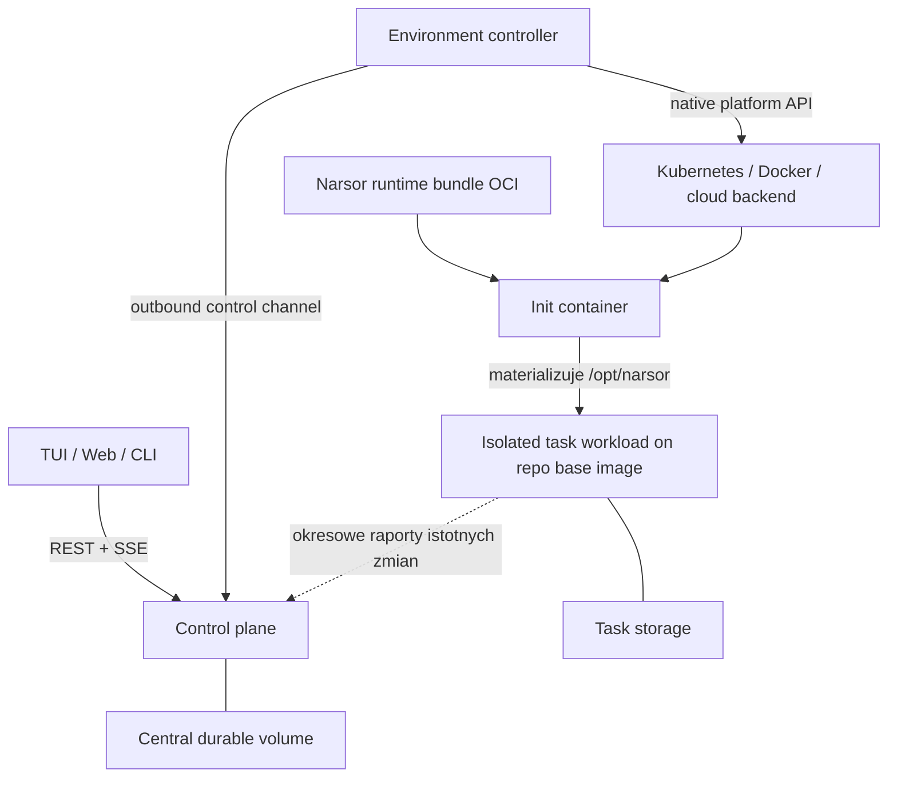
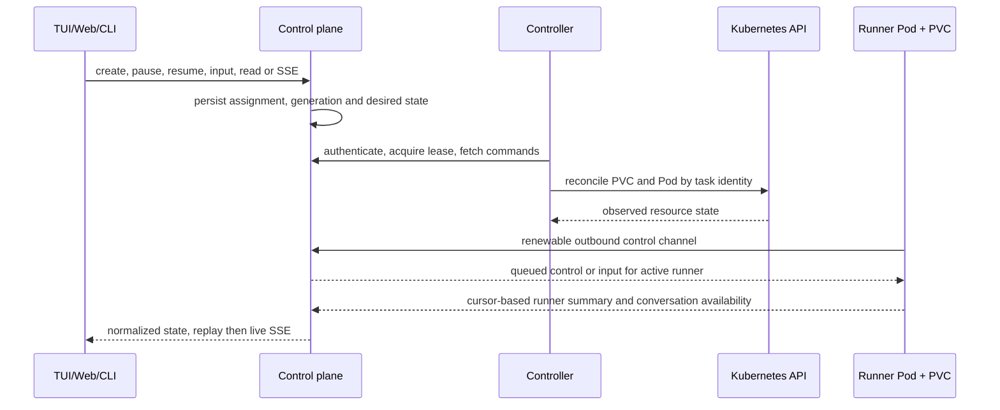
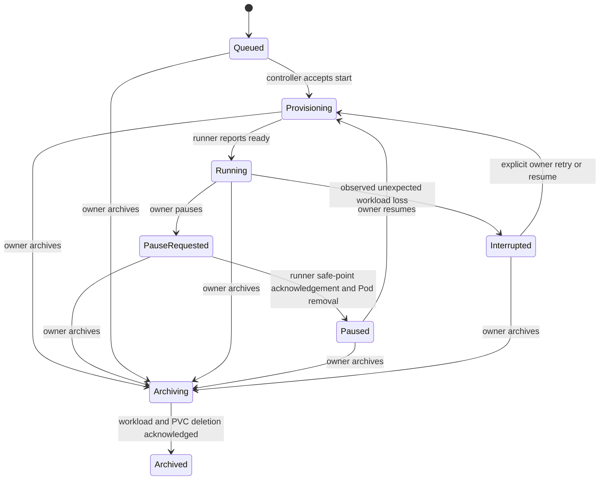

# Zdalne backendy wykonawcze - Plan

## Goal Capsule

- **Objective:** Programista uruchamia, zatrzymuje i przegląda taski agentów na wybranym lokalnym lub zdalnym backendzie bez przygotowywania każdego środowiska od nowa, a architektura pozostawia miejsce na późniejszą lokalną korektę workspace'u.
- **Means:** Centralny control plane steruje wymiennymi controllerami środowisk, a każdy aktywny task otrzymuje izolowany workload, własny storage i przypięty profil środowiska.
- **Product authority:** Ten dokument opisuje osobny wariant wielobackendowy. Nie zastępuje `docs/brainstorms/2026-09-25-rozproszony-narsor-requirements.md` ani nie włącza do pierwszego zakresu przekazywania tasków między użytkownikami.
- **Open blockers:** Brak blokujących decyzji produktowych przed planowaniem. Szczegóły zasobów Kubernetes, transportu controllera i budowania obrazów należą do planowania.

---

## Product Contract

### Summary

Narsor udostępni jeden centralny interfejs REST/SSE dla TUI, Web i CLI, a wykonanie tasków zleci controllerom zarejestrowanych backendów.
Pierwszy zakres obsłuży cykl pracy jednego programisty: wybór backendu, uruchomienie izolowanego taska, pauzę, wznowienie oraz jawne usunięcie infrastruktury.
Lokalne pobieranie i korygowanie workspace'u pozostaje planowanym rozszerzeniem, którego obecny model nie może zablokować.

### Problem Frame

Dzisiaj programista instaluje narzędzia, konfiguruje je i nadaje im uprawnienia na własnej stacji roboczej.
Uruchomienie tasków na Kubernetesie lub innym zdalnym środowisku nie może powtarzać tego przygotowania dla każdego workloadu.

Izolacja per task ma zapobiec konkurencji agentów o ten sam filesystem i niekontrolowane zasoby.
Jednocześnie środowiska muszą pozostać różne dla repozytoriów, użytkowników i backendów.

Kluczową przewagą zdalnego backendu jest ciągłość pracy niezależna od laptopa: uruchomiony task kontynuuje pracę po zamknięciu klienta oraz podczas czasowej niedostępności interfejsu lub control plane'u.
Kubernetes jest pierwszym backendem realizującym ten model, a nie celem produktu samym w sobie.

Narsor ma już lokalny daemon REST/SSE, plikową persystencję jednego pisarza oraz rozdzielone katalogi katalogu, stanu i workspace'ów.
Nowy wariant rozszerza te granice, zamiast przyjmować Kubernetes jako źródło prawdy o tasku.

### Key Decisions

- **Control plane pozostaje źródłem prawdy o orkiestracji.** (session-settled: user-directed — chosen over Kubernetes as the source of truth for assignment: the same task lifecycle must work with Kubernetes, local Docker, and future cloud backends. The task storage remains authoritative for the work itself.) Governs R1-R5, R14.
- **Controller działa przy backendzie i sam łączy się z centralą.** (session-settled: user-approved — chosen over one central controller holding every infrastructure credential: backend credentials remain inside their execution environment.) Governs R3-R5, R19.
- **Pierwsza instalacja pozostaje mała i samowystarczalna.** (session-settled: user-directed — chosen over mandatory database, queue, and object storage dependencies: Narsor is an agent orchestrator with only a few concurrent tasks.) Governs R6, R29.
- **Pierwszy produkcyjny adapter obsługuje Kubernetes.** (review-settled: user-approved — chosen over building Kubernetes and local Docker adapters in parallel: a backend-neutral contract and test adapter prove portability before another production implementation.) Governs R4, R8.
- **Jeden aktywny task ma jeden izolowany workload.** (session-settled: user-directed — chosen over shared workers: isolation, resource control, and distinct environments are the primary reasons for the remote model.) Governs R7-R9.
- **Działające taski nie są automatycznie wywłaszczane ani odtwarzane.** (session-settled: user-directed — chosen over automatic preemption and crash restart: the owner decides what happens to work already in progress.) Governs R11, R13. *(Częściowo zastąpione przez D58 w `ARCHITECTURE_DECISIONS.md`: wywłaszczania nadal nie ma, ale zadanie `Interrupted` po utracie workloadu control plane wznawia sam, z limitem prób.)*
- **Repozytorium dostarcza obraz bazowy, a Narsor wstrzykuje własny runtime.** (review-settled: user-approved after independent Claude cross-check — chosen over building a derived image for every environment or requiring one Narsor-owned Ubuntu base: an init container materializes the pinned Narsor runtime bundle without a release-one builder or writable registry.) Governs R15-R22, R40.
- **Pierwsza centrala ma jednego właściciela.** (review-settled: user-directed — chosen over implementing teams in the first release: deployment configuration or a one-time claim binds the instance to one OIDC identity.) Governs R31-R33, R38.
- **Przyszła rewizja workspace'u służy lokalnej współpracy, nie odzyskiwaniu.** (session-settled: user-directed — chosen over recovery checkpoints and continuous central replication: task storage is assumed stable and remains authoritative, while workspace transfer will happen only on demand.) Governs R23-R30.
- **Archiwizację uruchamia właściciel.** (session-settled: user-directed — chosen over automatic retention cleanup: early versions must not delete task infrastructure without an explicit command.) Governs R34.
- **Klient rozmawia z taskiem wyłącznie przez centralę.** (session-settled: user-directed — chosen over bezpośredni dostęp TUI do runnera: jeden punkt komunikacji upraszcza klienta i zachowuje granicę backendu.) Governs R1, R5, R41.

### Architecture Boundary

Control plane zapisuje przypisanie i polecenia orkiestracyjne, controller uzgadnia je z backendem, a task runner przechowuje stan pracy na task storage'u i raportuje jedynie istotne zmiany.
Stałe połączenie task runnera z centralą nie jest wymagane; centrala pokazuje ostatni znany status, gdy runner lub backend są nieosiągalne.
Żaden klient ani controller nie zapisuje bezpośrednio do centralnego magazynu stanu.

### Actors

- A1. **Programista / właściciel taska** wybiera backend, ustala kolejność swoich tasków, prowadzi rozmowy z agentem i zatwierdza zmiany.
- A2. **Control plane Narsora** jest autorytatywnym źródłem własności, przypisań, profili, kolejek i poleceń orkiestracyjnych oraz obsługuje REST/SSE; przechowuje ostatni znany, a nie pełny stan pracy taska.
- A3. **Environment controller** reprezentuje backend, materializuje stan pożądany i raportuje stan infrastruktury.
- A4. **Task runner** prowadzi workflow i agenta wewnątrz izolowanego workloadu.
- A5. **Backend wykonawczy** dostarcza compute, task storage oraz mechanizm materializacji sekretów.

### Requirements

**Control plane i backendy**

- R1. TUI, Web i CLI komunikują się z jednym control plane'em przez REST/SSE i nie sterują backendami bezpośrednio.
- R2. Control plane przechowuje autorytatywny stan orkiestracji i przypisania taska, task storage przechowuje autorytatywny stan pracy, a stan zasobu Kubernetes, Dockera lub chmury pozostaje stanem obserwowanym.
- R3. Backend jest zarejestrowanym środowiskiem wykonawczym z controllerem, możliwościami, zakresem zaufania, limitami i sposobem dostarczania sekretów.
- R4. Environment controller tłumaczy neutralny cykl życia taska na natywne operacje backendu bez ujawniania ich szczegółów klientom.
- R5. Controller inicjuje uwierzytelnioną komunikację wychodzącą do control plane'u. Task runner nie wymaga stałego połączenia z centralą i raportuje istotne przejścia stanu, gdy komunikacja jest dostępna.
- R6. Podstawowa instalacja działa z jedną aktywną centralą i jednym trwałym wolumenem, bez wymaganej zewnętrznej bazy, kolejki ani storage'u obiektowego.
- R35. Wdrożenie sieciowe uwierzytelnia użytkownika przez OIDC u skonfigurowanego dostawcy, a każda operacja na tasku jest autoryzowana względem jego właściciela.
- R36. Instalacja działająca w całości na jednym laptopie może jawnie włączyć tryb zaufany bez dodatkowego uwierzytelniania; tryb ten jest konfigurowalny i nie może zostać przypadkowo wystawiony na interfejs sieciowy dostępny z innych hostów.
- R37. Każdy environment controller posiada własną tożsamość, przypisany zakres backendów i poświadczenie, które operator może unieważnić.
- R38. Pierwsza centrala jest przypisana do jednego właściciela OIDC przez konfigurację wdrożenia albo jednorazowy kod lub link przejęcia. Po skutecznym przejęciu dane jednorazowe są unieważniane, a pozostali użytkownicy nie uzyskują dostępu.

**Cykl życia i zasoby taska**

- R7. Jeden aktywny task używa najwyżej jednego izolowanego workloadu oraz własnego task storage'u. Workload ma deterministyczną tożsamość wynikającą z taska, dzięki czemu ponowione utworzenie uzgadnia istniejący zasób zamiast tworzyć duplikat.
- R8. Model domenowy nie przesądza, czy backend reprezentuje workload przez `Pod`, `Job`, `StatefulSet`, kontener Dockera czy zasób innej platformy.
- R9. Task storage należy do backendu, przeżywa zwinięcie compute do zera i nie jest traktowany jako backup.
- R10. Użytkownik ręcznie wybiera aktywny backend domyślny i może nadpisać go dla konkretnego taska; istniejący task nie migruje po zmianie tego ustawienia.
- R11. Priorytet zmienia kolejność tasków oczekujących, ale nigdy automatycznie nie zatrzymuje taska w toku.
- R12. Jawna pauza doprowadza task do bezpiecznej granicy i pozwala zwinąć jego compute do zera bez usuwania task storage'u.
- R13. Nieoczekiwana śmierć workloadu ustawia task w stanie przerwanym lub nieznanym i wymaga decyzji właściciela przed odtworzeniem. *(Superseded by D58: zadanie `Interrupted` control plane wznawia sam — 5 prób z odstępami do 30 min, bez liczenia utrat po restarcie controllera; decyzji właściciela wymagają już tylko utrata z `PauseRequested`, wyczerpany limit i `Unknown` bez potwierdzonej śmierci workloadu.)*
- R14. Utrata łączności z centralą nie zatrzymuje automatycznie taska. Centrala pokazuje ostatni znany status lub stan nieznany, a po reconnect controller uzgadnia przypisanie z zasobem o deterministycznej tożsamości; nie rekonstruuje historii pracy przechowywanej na task storage'u.

**Środowiska, konfiguracje i sekrety**

- R15. Każde repozytorium zarejestrowane w Narsorze wskazuje obraz bazowy; brak obrazu jest błędem walidacji przed utworzeniem taska. Workflow lub jego krok może jawnie nadpisać tę wartość.
- R16. Profil użytkownika dodaje do środowiska repozytorium jego dozwolone ustawienia, skille, narzędzia i referencje do sekretów.
- R17. Każdy task otrzymuje świeży prywatny katalog domowy; równoległe taski nie współdzielą zapisywalnego `$HOME`.
- R18. Narsor zapisuje źródło wyboru obrazu bazowego, jego digest oraz deskryptor `ResolvedEnvironment` obejmujący digest runtime bundle'a, pakietów narzędzi i wersję profilu. Późniejszy upgrade któregoś składnika wymaga jawnej decyzji.
- R19. Użytkownik konfiguruje poświadczenia raz per backend i narzędzie, a controller wstrzykuje je przy uruchomieniu task-poda w formie wymaganej przez narzędzie, na przykład jako zmienną środowiskową lub plik w prywatnym katalogu domowym. Wartości nie są wbudowywane w obraz ani umieszczane w logach, artefaktach lub rewizjach workspace'u; ich ważność i unieważnienie pozostają odpowiedzialnością użytkownika oraz dostawcy narzędzia.
- R20. Narsor publikuje wersjonowany runtime bundle jako obraz OCI zawierający runner, obsługiwane harnessy, ich przenośne zależności i skille. Init container kopiuje wybrane bundle'e do współdzielonego wolumenu poda montowanego w głównym kontenerze pod `/opt/narsor`; obraz bazowy repozytorium nie jest przebudowywany.
- R21. Controller uruchamia główny kontener na obrazie bazowym repozytorium, nadpisuje jego komendę startową runnerem Narsora i dodaje `/opt/narsor/bin` do `PATH`. Tożsamość środowiska jest hashem przypiętych składników, a ich warstwy mogą korzystać z cache'u runtime'u kontenerowego.
- R22. Przed uruchomieniem pracy runner sprawdza kontrakt obrazu bazowego i zgłasza czytelny błąd, gdy środowisko nie zapewnia wspieranej platformy i architektury, `/bin/sh`, podstawowych narzędzi, `git`, certyfikatów CA, wykonania jako non-root, zapisywalnego montowanego `$HOME` lub możliwości nadpisania komendy startowej. Start taska nie wykonuje instalacji pakietów systemowych ani interaktywnego logowania.
- R39. Nowy task repozytorium Git klonuje wskazany remote i przypięty commit do pustego task storage'u przy użyciu skonfigurowanego poświadczenia użytkownika. Późniejsze wznowienie korzysta z istniejącego workspace'u i nie wykonuje ponownego klonowania.
- R40. Narsor może publikować własny zgodny obraz Ubuntu jako wygodną opcję, ale nie jest on obowiązkową bazą i nie ogranicza repozytorium do jednej dystrybucji.
- R41. Centrala pośredniczy w odczycie stanu, timeline'u i rozmowy taska oraz w dostarczaniu inputu użytkownika; klient nie łączy się bezpośrednio z runnerem ani backendem.
- R42. Wznowienie po pauzie używa tego samego task storage'u, w tym trwałego prywatnego katalogu domowego i przypiętego wyboru harnessa; zmiana globalnej wartości domyślnej dotyczy wyłącznie nowych tasków.

**Materiały oraz przyszły dostęp lokalny**

- R23. Użytkownik może jednorazowo przesłać pliki lub snapshot lokalnego folderu jako materiały taska bez tworzenia żywego montowania komputera do workloadu.
- R24. Przyszła rewizja workspace'u powstaje wyłącznie na żądanie po obowiązkowej pauzie i nie jest checkpointem odzyskiwania ani backupem.
- R25. Przyszła rewizja workspace'u zawiera manifest oraz deltę względem znanej bazy, aby podgląd lub kolejna synchronizacja nie wymagały przesłania całego repozytorium.
- R26. Przyszłe CLI materializuje rewizję jako zwykły lokalny katalog, wykorzystując istniejący klon lub przypięty bazowy commit, gdy workspace pochodzi z Git.
- R27. Użytkownik może edytować pobrany katalog w dowolnym IDE i przesłać tylko różnicę względem numeru rewizji.
- R28. Control plane odrzuca ciche nadpisanie nowszej rewizji i wymaga rozwiązania konfliktu, gdy korekta bazuje na nieaktualnej rewizji.
- R29. Narsor zakłada stabilność task storage'u zapewnianego przez backend; rewizja workspace'u nie jest backupem, mechanizmem odzyskiwania ani ciągłą centralną repliką.
- R30. Tymczasowe materiały, rewizje workspace'u i artefakty nie wymagają commitów w repozytorium produktu; commit pozostaje jawnym wynikiem workflow.

**Własność, zespoły i retencja**

- R31. Pierwszy zakres zakłada jednego właściciela taska, który kontroluje jego kolejkę, rozmowy, pauzy, a w przyszłości również rewizje workspace'u i korekty.
- R32. Model taska nie utrwala właściciela, profilu ani sesji agenta w sposób uniemożliwiający przyszłą zmianę właściciela i rozpoczęcie nowej sesji.
- R33. Zespoły, role lidera i współdzielenie centrali pozostają poza pierwszym zakresem. Model własności nie może jednak zakładać, że właściciel taska lub centrali nigdy nie będzie mógł się zmienić.
- R34. Archiwizację inicjuje właściciel, a operacja zawsze usuwa workload i task storage z backendu.

### Key Flows

- F1. **Uruchomienie taska**
  - **Trigger:** A1 uruchamia workflow bez jawnego wskazania backendu.
  - **Actors:** A1-A5.
  - **Steps:** Control plane wybiera aktywny backend domyślny, waliduje i przypina obraz bazowy oraz runtime bundle, a controller tworzy storage, klonuje przypięty commit i uruchamia pod o deterministycznej tożsamości. Init container materializuje `/opt/narsor`, po czym runner startuje w głównym kontenerze obrazu repozytorium.
  - **Outcome:** Jeden izolowany runner prowadzi task i raportuje stan do centrali.
  - **Covers:** R1-R10, R15-R22, R39-R40.

- F2. **Przyszła pauza i korekta w IDE — poza pierwszym zakresem**
  - **Trigger:** A1 żąda udostępnienia bieżącego workspace'u.
  - **Actors:** A1-A4.
  - **Steps:** Runner dochodzi do bezpiecznej granicy, task przechodzi w pauzę, a przyszły mechanizm tworzy rewizję na task storage'u i udostępnia ją użytkownikowi bez trwałego kopiowania workspace'u do centrali.
  - **Outcome:** Control plane przyjmuje nową rewizję albo zgłasza konflikt, po czym właściciel może wznowić task.
  - **Covers:** R12, R24-R30.

- F3. **Awaria workloadu**
  - **Trigger:** Backend zgłasza nieoczekiwane zakończenie instancji taska.
  - **Actors:** A1-A3.
  - **Steps:** Controller raportuje stan infrastruktury, control plane oznacza task jako przerwany lub nieznany i nie tworzy kolejnej instancji bez polecenia właściciela.
  - **Outcome:** Użytkownik decyduje o wznowieniu, ponowieniu akcji, pozostawieniu pauzy albo zakończeniu.
  - **Covers:** R13.

- F4. **Zmiana środowiska użytkownika**
  - **Trigger:** A1 zatwierdza zmianę obrazu bazowego, konfiguracji, skilla, runtime bundle'a lub pakietu narzędzi.
  - **Actors:** A1-A3.
  - **Steps:** Narsor rozwiązuje i przypina digest każdego składnika nowego `ResolvedEnvironment`; przy następnym uruchomieniu backend pobiera brakujące warstwy, a init container materializuje właściwe bundle'e bez budowania obrazu pochodnego.
  - **Outcome:** Nowe taski mogą użyć nowej wersji; istniejące pozostają przy przypiętym środowisku do jawnego upgrade'u.
  - **Covers:** R18, R20-R22.

- F5. **Archiwizacja taska**
  - **Trigger:** A1 jawnie archiwizuje task.
  - **Actors:** A1-A3.
  - **Steps:** Control plane zatrzymuje wykonanie, controller usuwa workload oraz task storage i raportuje zakończenie sprzątania.
  - **Outcome:** Infrastruktura taska nie zużywa zasobów backendu.
  - **Covers:** R34.

### Acceptance Examples

- AE1. **Covers R7-R9, R12.** Dwa taski jednego użytkownika działają równolegle z osobnymi limitami i storage'ami; pauza jednego usuwa jego compute bez wpływu na drugi.
- AE2. **Covers R3-R5, R8.** Produkcyjny controller Kubernetes i adapter testowy przechodzą ten sam zestaw testów kontraktowych bez ujawniania typów Kubernetes w zachowaniu TUI lub Web.
- AE3. **Covers R10-R11.** Użytkownik zmienia domyślny backend i priorytet nowego taska; działający task pozostaje na swoim backendzie i nie zostaje automatycznie zatrzymany.
- AE4. **Covers R13.** Workload ginie podczas akcji; Narsor pokazuje stan przerwany lub nieznany i nie uruchamia nowej instancji przed decyzją właściciela. *(Superseded by D58: po zgłoszonej utracie zadanie `Interrupted` jest wznawiane automatycznie; `Unknown` czeka, dopóki controller nie potwierdzi śmierci workloadu przy obecnym storage'u.)*
- AE5. **Covers R15-R22, R40.** Dwa taski tego samego użytkownika dla jednego repo wykorzystują ten sam przypięty obraz bazowy i runtime bundle, startują bez budowania obrazu, instalacji pakietów i logowania, lecz otrzymują osobne zapisywalne katalogi domowe.
- AE6. **Future compatibility for R24-R28.** Model nie wymaga centralnej kopii workspace'u i pozwala później dodać pobieranie rewizji z task storage'u po obowiązkowej pauzie bez zmiany kontraktu własności taska lub backendu.
- AE7. **Covers R23, R30.** Użytkownik przesyła materiały wejściowe i pobiera tymczasową dokumentację bez tworzenia commitów w repozytorium produktu.
- AE8. **Covers R14.** Runner traci kontakt z centralą i kontynuuje pracę na swoim storage'u; centrala pokazuje ostatni znany status, a reconnect nie tworzy drugiego workloadu o tej samej deterministycznej tożsamości.
- AE9. **Covers R34.** Zakończony task zachowuje storage, dopóki właściciel nie wybierze archiwizacji; po niej backend nie utrzymuje workloadu ani wolumenu taska.
- AE10. **Covers R35-R38.** Operator przypisuje nową centralę do wskazanego użytkownika OIDC albo przekazuje mu jednorazowy link przejęcia; po związaniu właściciela inny użytkownik nie może odczytać ani sterować taskami tej centrali.
- AE11. **Covers R15, R39.** Repo bez obrazu bazowego jest odrzucane podczas walidacji; poprawnie skonfigurowany task klonuje przypięty commit tylko przy tworzeniu pustego task storage'u.
- AE12. **Covers R1, R5, R41-R42.** TUI odczytuje bieżący lub ostatnio zaobserwowany stan i rozmowę przez centralę, dostarcza input do właściwego oczekującego runnera, a po pauzie i wznowieniu ten sam task zachowuje workspace, prywatny HOME oraz przypięty harness.

<!-- ce-section: work-relationships -->
### How This Work Fits Together

Ten plan obejmuje wariant wielobackendowy dla jednego właściciela taska.
Poniższe obszary pozostają kontekstem, a nie zobowiązanym roadmapem:

- **Enables:** przyszłe przekazanie taska A → B przez rozdzielenie task workspace'u, profilu użytkownika, sekretów i sesji agenta.
- **Shares:** istniejące REST/SSE oraz plikowy model jednego pisarza z lokalnym daemonem opisanym w `docs/plans/2026-09-27-001-feat-daemon-lokalny-plan.md`.
- **Can proceed independently of:** ostateczna polityka współdzielenia workflow między zespołami.
- **Still to decide:** model przejęcia przez lidera, zawartość pakietu przekazania oraz zachowanie historii po archiwizacji.

### Success Criteria

- Jeden programista przechodzi pełny podstawowy cykl: wybór backendu, uruchomienie taska, pauza, wznowienie i archiwizacja.
- Uruchomiony zdalny task kontynuuje pracę po odłączeniu laptopa użytkownika i podczas czasowej niedostępności interfejsu lub control plane'u.
- Kilka tasków działa równolegle bez współdzielenia zapisywalnego katalogu domowego lub task storage'u.
- Dodanie drugiego adaptera wykonawczego nie zmienia kontraktu klientów ani domenowego cyklu życia taska.
- Żaden start taska nie wymaga ręcznej instalacji narzędzi lub ponownego logowania użytkownika.
- Start taska nie wymaga budowania ani publikowania obrazu pochodnego; środowisko jest odtwarzalne z digestów obrazu bazowego, runtime bundle'i i profilu.
- Awaria workloadu i utrata łączności są widoczne i nie prowadzą do automatycznego, cichego odtworzenia pracy.
- Model task storage'u i controllera pozostawia możliwość późniejszego dodania przyrostowego pobierania oraz odsyłania rewizji workspace'u bez wprowadzenia centralnej repliki.

### Scope Boundaries

- Przekazanie taska między użytkownikami, nowa sesja po przejęciu i polityka zawartości pakietu przekazania są odłożone.
- Uprawnienia lidera do przejęcia taska są odłożone, ale model własności musi pozostać zmienny.
- Członkostwo w zespołach, role i współdzielenie jednej centrali przez wielu użytkowników są odłożone; pierwsza centrala ma jednego właściciela.
- Rewizje workspace'u nie zapewniają backupu, disaster recovery ani ciągłej replikacji task storage'u.
- Pobieranie, lokalna materializacja i odsyłanie rewizji workspace'u nie należą do pierwszego zakresu i wymagają osobnego planu bezpieczeństwa oraz synchronizacji.
- Pierwszy zakres nie obejmuje automatycznego wywłaszczania ani automatycznego restartu po awarii.
- Pierwszy zakres nie wymaga HA centrali, zewnętrznej bazy, brokera wiadomości ani storage'u obiektowego.
- Live mount workspace'u do IDE oraz ogólna obsługa Snapa pozostają poza zakresem.
- Narsor nie zapewnia izolacji ruchu wychodzącego task-poda. Użytkownik lub operator odpowiada za ograniczenia wynikające z obrazu bazowego, konfiguracji harnessa i mechanizmów backendu.
- Automatyczne wykrywanie konfiguracji laptopa, promocja lokalnych zmian oraz ogólny interfejs instalowania pakietów systemowych pozostają poza pierwszym zakresem.
- Builder obrazów, registry zarządzane przez Narsora, fragmenty Dockerfile użytkownika, cache buildów i garbage collection obrazów pochodnych pozostają poza pierwszym zakresem.
- Lokalny Docker oraz adaptery chmurowe pozostają poza pierwszym zakresem; neutralność kontraktu potwierdza adapter testowy.
- Semantyka zachowania historii po archiwizacji pozostaje do późniejszego brainstormingu.

### Dependencies / Assumptions

- Pojedyncza instalacja obsługuje kilka równoległych tasków, a operator akceptuje jedną aktywną centralę.
- Backend zapewnia trwały storage dla taska, mechanizm uruchomienia izolowanego workloadu i wychodzący HTTPS do control plane'u.
- Backend potrafi pobrać przypięty obraz bazowy oraz obrazy OCI zawierające runtime bundle'e Narsora i przechować poświadczenia aktywowane przez użytkownika.
- Repozytorium Git ma osiągalny remote i przypięty bazowy commit, jeżeli przyszła synchronizacja rewizji ma korzystać z optymalizacji Git.
- Stabilność task storage'u jest odpowiedzialnością backendu; rewizje workspace'u nie zastępują tej gwarancji.

### Outstanding Questions

**Deferred to Planning**

- Który zasób Kubernetes najlepiej reprezentuje wymienny workload 0/1 oraz osobno zarządzany task storage?
- Jaki protokół obsłuży okresową komunikację controllera, polecenia orkiestracyjne oraz ostatni znany stan bez wymagania stałego połączenia task-poda?
- Jakie dokładne zależności należy dołączyć do runtime bundle'a, aby Claude Code, Codex i OpenCode działały na reprezentatywnych obrazach Ubuntu/Debian, .NET SDK oraz Alpine lub obrazie minimalnym?
- Czy pomiary czasu startu uzasadnią w przyszłości opcjonalne materializowanie tego samego `ResolvedEnvironment` jako obrazu pochodnego?
- Osobny plan lokalnego udostępniania workspace'u określi format manifestu i delty, kanał transferu, zastosowanie korekt, limity oraz zasady garbage collection.

### Sources / Research

- `docs/brainstorms/2026-09-25-rozproszony-narsor-requirements.md` — wcześniejszy model centrala-worker, użyty wyłącznie jako kontekst i źródło konfliktów do jawnego rozdzielenia.
- `docs/plans/2026-09-27-001-feat-daemon-lokalny-plan.md` — plan lokalnego daemona oraz klienta API.
- `src/api/routes.rs` i `src/api/client.rs` — istniejące REST/SSE oraz klient HTTP.
- `src/persistence/paths.rs` — rozdzielenie katalogów katalogu, stanu i pracy oraz ograniczenie state root do jednego procesu.
- `src/workspace/provisioner.rs` — istniejące kopiowanie lokalnego źródła do task workspace'u.
- `src/engine/actions/agent.rs` i `src/persistence/agent_harness.rs` — konfiguracja harnessa jest obecnie rozwiązywana per attempt; globalny wybór nie jest w pełni przypięty per execution.
- [Kubernetes: Init Containers](https://kubernetes.io/docs/concepts/workloads/pods/init-containers/) — mechanizm przygotowania plików we współdzielonym wolumenie przed startem głównego kontenera.
- [OCI Image Configuration](https://github.com/opencontainers/image-spec/blob/main/config.md) — rozdzielenie warstw filesystemu od konfiguracji obrazu, w tym użytkownika, entrypointu i komendy.
- [BuildKit](https://github.com/moby/buildkit) — punkt odniesienia dla odłożonego wariantu budowania i cache'owania obrazów pochodnych.

## Deferred / Open Questions

### From 2026-10-02 review

- **Granica bezpieczeństwa lokalnej materializacji workspace'u** — Materiały oraz przyszły dostęp lokalny (P1, security-lens and Claude, confidence 100)

  Przyszły mechanizm pobierania plików z task-poda może nadpisać dane poza wybranym katalogiem, odtworzyć aktywne elementy repozytorium albo ujawnić poświadczenia. Osobny plan lokalnego udostępniania workspace'u musi objąć walidację ścieżek i dowiązań, ochronę metadanych `.git`, wykluczanie sekretów oraz podgląd manifestu przed zastosowaniem zmian.

---

## Planning Contract

### Product Contract preservation

Product Contract changed: R41-R42 and AE12 record two user-directed clarifications made during planning: clients communicate with tasks through the control plane, and a resumed task retains its private HOME and resolved harness. Existing requirements and identifiers are otherwise unchanged.

### Key Technical Decisions

- KTD1. **Separate orchestration from runner work state.** The control plane persistently owns task assignment, desired lifecycle, command generation, controller lease and the last observed runner/backend summary; the runner owns the existing execution store on task storage. Controllers and runners use authenticated protocol endpoints rather than mounting or writing the central state directory. This preserves the single-writer file-store boundary while allowing remote reconciliation. (R2-R5, R13-R14, R41)
- KTD2. **Use a directly managed Kubernetes Pod plus one PVC per task.** The controller creates and observes a deterministically named Pod with `restartPolicy: Never` and an independently named PVC with no Pod owner reference; pause removes only the Pod after the runner acknowledges a safe point, resume waits for deletion observation then creates a replacement Pod against the same PVC, and archive deletes both. Archive wins over every nonterminal desired state. The backend admits only a storage class whose reclaim policy fulfils archive-as-destruction, otherwise archive remains cleanup-failed rather than claiming removal. (session-settled: user-approved — chosen over StatefulSet or Job: Narsor already owns lifecycle reconciliation, while a direct Pod avoids replica and retry semantics that would violate no automatic restart.) (R7-R9, R12-R14, R34, R39, R42) *(Reformulated by D58: neither Kubernetes nor the controller restarts a Pod; a replacement Pod is created only for a newer launch generation recorded by the control plane — the owner's start/resume or the resume policy's `Resume`.)*
- KTD3. **Make commands and reports idempotent, ordered protocol messages.** Each task mutation carries a control-plane generation and idempotency key; a controller holds one fenced lease per backend and reports resource UID, generation and lease epoch. A runner initiates an outbound renewable long-poll to the control plane while it is active, using a short-lived read-only file credential bound to task, generation and Pod incarnation; it reports immutable progress cursors and receives queued input only for the matching pending-input/attempt identifier. At-least-once delivery is expected; stale commands, reports and incarnations are rejected or deduplicated. Controllers never use Pod exec or port-forward. (R4-R5, R10-R14, R41)
- KTD4. **Proxy task interaction through the control plane.** The control plane exposes normalized task summaries, cursor-based SSE and paged conversations while the runner is connected, marking stale data with its observation time; once a Pod is paused or interrupted it returns the last safe summary and explicit conversation-unavailable state rather than recreating compute or replicating raw transcript storage. Raw workspace files, secret values and raw conversation storage never become central replicas. (R1-R2, R5, R19, R23-R30, R41)
- KTD5. **Pin the complete runner environment at task creation.** `ResolvedEnvironment` includes base-image digest, runtime bundle digest, profile version and the effective harness selection. The task PVC persists workspace, Engine files and private HOME; controller-injected credentials are recreated on each Pod start and are not persisted in this descriptor or copied to the control plane. (R15-R22, R39-R42)
- KTD6. **Use two explicit trust planes.** Networked user access identifies its owner by immutable `(issuer, subject)` after exact issuer/audience, algorithm, signature and lifetime validation; initial claim is an atomic one-time transaction. Each controller has a separately revocable identity scoped to one backend, never a user token. Trusted mode remains loopback-only and is rejected for a wildcard, mapped or non-loopback bind. A Kubernetes controller receives namespaced Pod/PVC/event permissions only, but Pod creation is itself a secret-injection capability: admission policy must restrict generated Pod shape, image digests, secret/key references, service account, volumes and security context. (R3, R19, R35-R38)

### High-Level Technical Design

The runner's Engine files, workspace and private HOME live on the PVC. The central durable volume holds orchestration records and observed summaries only. A controller reconnect reconciles a task identity plus generation; it never infers that a remote runner died solely because its own connection was lost.

`Running`, `Paused`, `Interrupted` and `Archived` are orchestration states; the runner's existing `ExecutionStatus` remains the work-state detail. Unknown or disconnected observations retain an explicit last-observed timestamp instead of silently changing work state.

*(Superseded by D58: `Interrupted --> Provisioning` is also taken by the control plane's resume policy (a `Resume` with the `Policy` actor), and `Unknown --> Interrupted` by a controller's `LossConfirmed` once the workload is gone or exited while the storage is present.)*

### System-Wide Impact

- The existing API changes from local `Engine` invocation to owner-authorized desired-state commands for remote tasks. Local daemon behavior remains an adapter-compatible path during the migration.
- Task storage becomes the durable home for the existing execution store, event log, conversation records, workspace and private HOME. The current local `{work}/tasks/...` layout is not reused as a portable backend identifier.
- All clients gain one control-plane API, including conversation and input routing. SSE must replay durable control-plane events before switching to live delivery.
- The security boundary expands from a process-local bearer token to OIDC users and revocable controller identities. Controller Kubernetes credentials are intentionally narrow and namespaced.

### Alternatives Considered

- **Kubernetes Job:** rejected for v1 because its retry and terminal semantics are a poor fit for a task which must not restart automatically and may pause/resume repeatedly.
- **StatefulSet:** rejected for v1 because stable replica management is unnecessary for one independently controlled Pod and would duplicate lifecycle authority held by Narsor.
- **Direct client-to-runner access:** rejected because it splits TUI/Web/CLI integration by backend and bypasses the control-plane authorization boundary.
- **Central replication of task storage:** rejected because it conflicts with task-storage authority, adds a backup system and is outside the workspace-revision scope.

### Risks & Dependencies

- Kubernetes clusters need a storage class that supports the requested PVC access mode and an admission policy compatible with the Pod security contract.
- A controller compromise can otherwise mount approved namespace secrets despite no `get Secret` permission; rollout requires a dedicated backend trust namespace, fixed secret mappings, Pod Security/admission enforcement and an incident path for controller revocation plus secret rotation.
- Controller command delivery, runner reporting and SSE replay are new distributed protocols; contract tests must cover duplicate, stale and reordered messages before a production adapter is trusted.
- OIDC discovery/key rotation, controller mTLS or signed credentials, and the initial owner-claim flow need a deployment configuration contract before network exposure.
- Network exposure also depends on TLS, explicit CORS/proxy policy, controller enrollment/revocation, namespace quotas and a disposable-namespace smoke test.
- Current local recovery marks interrupted actions `Unknown`; remote records must bypass that recovery path until controller reconciliation determines the observed workload state.

---

## Implementation Units

### U1. Model remote task orchestration

- **Goal:** Add durable backend-neutral task assignment, desired-state and observed-state records without changing the Engine's authority over workflow files.
- **Requirements:** R2-R5, R7-R14, R31-R34, R41. Implements KTD1 and KTD3.
- **Dependencies:** None.
- **Files:** `src/domain/workflow_execution.rs`, `src/domain/mod.rs`, `src/persistence/execution_store.rs`, `src/persistence/paths.rs`, new `src/orchestration/`, `tests/persistence.rs`, new `tests/orchestration.rs`.
- **Approach:** Define an orchestration state machine separate from `ExecutionStatus`, task/backend identifiers, a resolved assignment, desired generation, controller lease/fencing data, archival tombstone and versioned immutable `TaskLaunchSpec`. Store atomic control-plane records under the state root and give every mutation one serialized writer; launch data is copied to task storage once and never reconstructed from mutable defaults.
- **Patterns to follow:** Atomic versioned persistence in `src/persistence/execution_store.rs`; state transitions and recovery distinctions in `src/engine/runner.rs`; durable path ownership in `src/persistence/paths.rs`.
- **Test scenarios:**
  - Creating a task records a queued assignment and monotonically increasing desired generation.
  - Repeating a start, pause, resume or archive command with its idempotency key leaves one logical command and one desired state.
  - A stale controller lease or older generation cannot overwrite a newer assignment or archival intent.
  - An unexpected observed workload loss enters the interrupted/unknown orchestration path without creating a replacement.
- Repeating archive converges through a tombstone and does not erase the control-plane audit record.
- Archiving a queued, provisioning or pause-requested task fences old work; absent never-created resources count as already clean before the tombstone becomes archived.
- A reconnect cannot bootstrap a second runner when an identical launch-spec digest already initialized task storage.
- **Verification:** Persistence and domain tests prove legal transitions, recovery after partial writes and per-task mutation serialization.

### U2. Define controller and runner protocols

- **Goal:** Establish authenticated, versioned control-plane contracts for controller registration, reconciliation, runner reports and task input.
- **Requirements:** R1-R5, R10-R14, R37, R41. Implements KTD1, KTD3 and KTD4.
- **Dependencies:** U1.
- **Files:** `src/api/routes.rs`, `src/api/dto.rs`, `src/api/mod.rs`, `src/api/client.rs`, new `src/controller_protocol/`, `tests/api.rs`, `tests/sse.rs`, new `tests/controller_protocol.rs`.
- **Approach:** Add controller registration/heartbeat/revocation, lease acquisition, desired-command polling or streaming, acknowledgements and observed-resource reports. Define runner snapshots with execution/action cursor, pending input identity, event cursor, conversation availability and last-observed time. Normalize reported changes into durable control-plane SSE events with cursor replay before live streaming.
- **Patterns to follow:** Route and DTO error conventions in `src/api/routes.rs` and `src/api/dto.rs`; client request handling in `src/api/client.rs`; API/SSE integration tests in `tests/api.rs` and `tests/sse.rs`.
- **Test scenarios:**
  - A reconnecting controller receives only commands newer than its acknowledged generation and duplicate acknowledgements are harmless.
  - An offline runner leaves the API showing an explicitly stale last observation rather than a fabricated terminal state.
  - A client reconnecting SSE with a cursor receives missed normalized events once, then live events.
  - An input for an obsolete pending-input or attempt identifier is refused without mutating runner state.
  - Covers AE12. A client reads a timeline/conversation summary and submits input through the control plane without opening a backend connection.
- **Verification:** API contract tests prove authentication boundaries, cursor semantics, idempotency and client-facing failure responses.

### U3. Make the runner portable and resumable

- **Goal:** Run the existing Engine against task-local durable storage and preserve session semantics across compute recreation.
- **Requirements:** R5, R9, R12-R14, R17-R22, R39, R42. Implements KTD5.
- **Dependencies:** U1, U2.
- **Files:** `src/engine/runner.rs`, `src/engine/actions/agent.rs`, `src/persistence/agent_harness.rs`, `src/persistence/mod.rs`, `src/workspace/provisioner.rs`, new `src/runner/`, `tests/engine_recovery.rs`, `tests/actions_agent.rs`, `tests/agent_harness_selection.rs`, `tests/workspace.rs`.
- **Approach:** Define a versioned immutable `TaskLaunchSpec` in U1 with definition snapshot, inputs, Git identity, resolved environment and digest. Extract a runner entrypoint that consumes it once on a mounted task store, uses KTD3's outbound channel, reports snapshots and accepts validated input. Keep private HOME on task storage, but mount runner credentials and tool secrets as read-only ephemeral files outside it; never copy them into workspace, state or process environment. Use an initialization marker to clone a pinned Git commit only into empty storage.
- **Execution note:** Start with characterization coverage around existing recovery, agent session and harness-selection behavior before moving the entrypoint.
- **Patterns to follow:** Engine claim and recovery rules in `src/engine/runner.rs`; live conversation persistence in `src/engine/actions/agent.rs`; workspace clone safety in `src/workspace/provisioner.rs`.
- **Test scenarios:**
  - A newly initialized task storage clones the pinned commit once; a resumed storage never reclones it.
  - A paused runner reports a durable safe point before compute removal is allowed.
- A resumed runner sees its previous Engine state, workspace, HOME and resolved harness; a global default change affects only a subsequently created task.
- Process recreation preserves event and report cursors but does not invoke ordinary Engine recovery after an unexpected Pod loss until the owner explicitly chooses recovery.
  - A runner that cannot reach the control plane continues its workflow and reports a later reconciled cursor without replaying work.
  - A base image that lacks a required contract capability fails before agent work begins with a diagnosable result.
- **Verification:** Engine, workspace and harness tests prove one-time initialization, durable session boundaries and offline progress reconciliation.

### U4. Add a backend-neutral controller contract and test adapter

- **Goal:** Separate desired task lifecycle from backend primitives, preserve the existing local-daemon path as a supported local adapter, and prove portability with an in-memory adapter before Kubernetes.
- **Requirements:** R3-R5, R7-R14, R34, R37. Implements KTD1-KTD3.
- **Dependencies:** U1, U2, U3.
- **Files:** new `src/backends/`, `src/tasks/mod.rs`, new `tests/backend_contract.rs`, `src/domain/mod.rs`, `tests/registry.rs`.
- **Approach:** Define capabilities, resource observations, task-storage lifecycle and operations for provision, observe, stop-at-safe-point, resume and archive. Wrap the existing daemon start/resume path as the local adapter; give the fake adapter deterministic resource identity and controllable failure/reconnect behavior; keep Kubernetes types outside domain and client DTOs.
- **Patterns to follow:** Action abstraction in `src/engine/actions/mod.rs`; registered harness validation in `src/persistence/agent_harness.rs`; test fixtures and doubles in `tests/engine_support/mod.rs`.
- **Test scenarios:**
- The same lifecycle suite passes against the fake adapter without exposing backend-specific types.
- The local adapter preserves current Engine events and recovery behavior while clients invoke it through the same control-plane lifecycle contract.
  - Reconciliation finds a resource with matching task identity instead of creating a duplicate.
  - A failed observation reports interrupted/unknown and requires an explicit owner command before replacement. *(Superseded by D58: a confirmed loss in `Interrupted` is resumed by the control plane's resume policy.)*
  - Archive deletes compute and storage exactly once even when the command is delivered repeatedly.
- **Verification:** Backend-contract tests define the required semantics independently of Kubernetes API objects.

### U5. Implement the Kubernetes Pod and PVC adapter

- **Goal:** Materialize one isolated task as a directly managed Pod with independently retained PVC storage.
- **Requirements:** R7-R9, R12-R14, R15-R22, R34, R39-R40, R42. Implements KTD2, KTD5 and KTD6.
- **Dependencies:** U3, U4, U6.
- **Files:** new `src/backends/kubernetes/`, `Cargo.toml`, new `tests/kubernetes_adapter.rs`, new deployment manifests under `deploy/kubernetes/`.
- **Approach:** Reconcile deterministic Pod/PVC names and labels carrying task, generation and lease epoch. Generate `restartPolicy: Never`, non-root Pod security, `automountServiceAccountToken: false`, fixed zero-RBAC workload service account, and read-only ephemeral runner/secret mounts outside the PVC. Ship namespaced RBAC, fixed secret mappings and admission policy that rejects any other Pod shape. Use a statically linked runner bundle or preflight libc/loader compatibility before launch. Archive checks absent resources idempotently, fences pending start/pause work, then explicitly deletes both resources; pause deletes only the Pod after U3 acknowledgement.
- **Execution note:** Prefer adapter contract and manifest-shape tests before an optional cluster smoke test; do not require a live cluster for the ordinary suite.
- **Patterns to follow:** Process/runtime validation style in `src/engine/actions/harness/`; error categorization in `src/engine/runner/failure.rs`.
- **Test scenarios:**
- The generated Pod has one main runner container, one init container, separate task/PATH volumes and non-root-compatible security context.
- The generated Pod uses `restartPolicy: Never`, disables automatic service-account token mounting and rejects privileged, host, foreign-volume or unapproved-secret shapes before Kubernetes creation.
- Namespaced controller RBAC cannot operate outside its backend namespace or use exec, attach, port-forward or ephemeral containers; admission rejects a foreign image, service account, PVC or secret mapping.
  - Pause preserves the PVC while removing the Pod; resume recreates one Pod mounting the same PVC.
- A failed or deleted Pod is observed as interrupted and does not cause automatic recreation. *(Superseded by D58: the controller still never recreates it on its own, but the control plane's resume policy resumes the interrupted task, which creates a new Pod.)*
- A delayed Pod deletion, lease handoff, resume during pause or archive racing start cannot produce a second current Pod or recreate a tombstoned task.
- Archive removes the Pod and PVC, then reports success only after both deletions are observed.
- A storage class that retains backing data after PVC deletion is rejected for archive-as-destruction semantics or leaves cleanup visibly failed.
  - Unsupported base-image contract, missing image digest or invalid resource profile is rejected before resource creation.
  - Covers AE1, AE4, AE5, AE8, AE9 and AE11.
- **Verification:** Contract tests plus manifest validation demonstrate lifecycle, volume retention, idempotency and no-auto-restart posture.

### U6. Add environment, backend and secret-reference configuration

- **Goal:** Let the owner configure backends, repository base images, profiles, limits and non-secret references with validation and immutable resolution per task.
- **Requirements:** R3, R6, R10, R15-R21, R37, R39-R40, R42. Implements KTD5 and KTD6.
- **Dependencies:** U1.
- **Files:** `src/config/settings.rs`, `src/config/file.rs`, `src/config/resolve.rs`, `src/registry/store.rs`, `src/domain/workflow_definition.rs`, `src/workflow/schema.rs`, `src/workflow/validator.rs`, `tests/config_resolve.rs`, `tests/registry.rs`, `tests/schema_loading.rs`, `tests/validation.rs`.
- **Approach:** Extend repository entries with the base-image reference and digest policy; resolve explicit workflow and step-level overrides with recorded provenance. Define backend/profile records, per-backend limits, allowed secret references and resolved environment serialization. Validate all references before task creation and never serialize secret values into state, logs or API DTOs.
- **Patterns to follow:** Configuration cascade in `src/config/cascade.rs`; repository registry persistence in `src/registry/store.rs`; workflow validation in `src/workflow/validator.rs`.
- **Test scenarios:**
  - A task for a repository without a base image fails validation before a command reaches the controller.
- A workflow override wins over the repository image and its digest becomes part of resolved environment.
- A step override wins over the workflow and repository values, while an existing task retains its already resolved digest.
  - Invalid backend limits, unregistered secret references or unsupported harness values are rejected without persisting a partial assignment.
  - Credential reference values never appear in serialized execution state, API responses or event payloads.
- **Verification:** Configuration, registry and schema tests prove precedence, immutability and secret redaction.

### U7. Secure network and ownership modes

- **Goal:** Replace the local-only bearer assumption with explicit trusted-loopback and OIDC/single-owner modes plus controller identity controls.
- **Requirements:** R31-R33, R35-R38. Implements KTD6.
- **Dependencies:** U1, U2, U6.
- **Files:** `src/api/mod.rs`, `src/api/routes.rs`, `src/api/client.rs`, `src/config/settings.rs`, `src/config/resolve.rs`, new `src/auth/`, `tests/api.rs`, new `tests/auth.rs`, `tests/config_startup.rs`.
- **Approach:** Keep the present loopback random-token route as an explicit trusted mode guarded by resolved-address validation and protected discovery-file permissions. For network mode, implement OIDC discovery and token validation against configured issuer/audience, durable one-owner claim/bootstrap data, per-task owner authorization, TLS/proxy policy and controller enrollment by expiry-bound one-time code into mTLS or signed proof-of-possession credentials with rotation and revocation.
- **Patterns to follow:** Constant-time local bearer handling in `src/api/routes.rs`; loopback startup ownership in `src/api/mod.rs`; settings validation in `src/config/settings.rs`.
- **Test scenarios:**
  - Trusted mode refuses a non-loopback bind and preserves current local-client behavior on loopback.
  - A valid OIDC token with configured issuer/audience can claim an unowned installation once; a second identity cannot read or mutate its tasks.
- Invalid issuer, audience, expired token or revoked controller identity is refused without revealing task data.
- A concurrent owner claim, disallowed signing algorithm, unknown key, stale controller lease or old runner incarnation cannot mutate or report for the task.
- A controller identity scoped to one backend cannot acquire another backend's lease or fetch its commands.
- A former owner or controller cannot replay SSE, read conversation metadata or send input with an old cursor/capability; active streams end at credential expiry.
- **Verification:** Authentication and API integration tests demonstrate owner isolation, trusted-mode safety and revocation.

### U8. Move clients to the remote-aware control plane and document operation

- **Goal:** Keep TUI, CLI and future Web clients backend-agnostic while exposing task selection, queue state, observations, conversation and lifecycle controls through one API.
- **Requirements:** R1, R10-R14, R23, R31, R34, R41. Implements KTD4.
- **Dependencies:** U2, U6, U7.
- **Files:** `src/api/client.rs`, `src/api/dto.rs`, `src/tui/app.rs`, `src/tui/views.rs`, `src/tui/refresh.rs`, `src/cli/commands.rs`, `tests/api_discovery.rs`, `tests/tui_state.rs`, `tests/tui_conversation.rs`, `tests/cli_smoke.rs`, `README.md`, new `docs/operations/remote-backends.md`.
- **Approach:** Replace local-engine assumptions in client flows with control-plane task summaries and commands. Surface backend selection, queue/last-observed state, explicit pause/resume/archive outcomes and conversation/input availability; after pause/interruption show an explicit transcript-unavailable state with the last safe summary. Keep workspace revision and raw backend diagnostics out of the client contract.
- **Patterns to follow:** API client use in `src/api/client.rs`; TUI refresh and state management in `src/tui/refresh.rs` and `src/tui/app.rs`; CLI integration style in `tests/cli_smoke.rs`.
- **Test scenarios:**
  - Selecting a default backend affects new tasks only; an existing running task remains assigned to its original backend.
  - A disconnected controller appears as a stale/unknown observation while the client can still read the last durable state.
  - A user pauses, resumes and archives a task through one client API without any backend address or credential in the request.
  - Covers AE2, AE3, AE6, AE7, AE10 and AE12. The TUI reads a remote conversation and submits an awaiting input through the control plane.
- **Verification:** Client/API/TUI smoke tests prove backend-neutral interaction and user-visible state distinctions.

### U9. Deliver bounded task materials

- **Goal:** Implement the one-off material upload/download flow without creating a live local mount or a product-repository commit.
- **Requirements:** R23, R30. Advances AE7.
- **Dependencies:** U1, U2, U3, U7.
- **Files:** `src/api/routes.rs`, `src/api/dto.rs`, `src/api/client.rs`, `src/persistence/paths.rs`, new `src/materials/`, `src/runner/`, `tests/api.rs`, new `tests/materials.rs`, `tests/workspace.rs`.
- **Approach:** Define owner-authorized, size-bounded material manifests and opaque blobs outside task workspace history. Validate paths and links, attach only the recorded manifest to the target task storage through the runner channel, and expose retrieval or expiry through the same control plane. Keep material bytes out of event payloads, conversations and product-repository commits.
- **Patterns to follow:** Atomic path/persistence ownership in `src/persistence/paths.rs`; API error discipline in `src/api/routes.rs`; workspace safety tests in `tests/workspace.rs`.
- **Test scenarios:**
  - An owner uploads a bounded file set and the target runner receives exactly its validated manifest without a live host mount.
  - Oversize, traversal, symlink, stale-task and cross-owner submissions are rejected without leaving blobs or partial manifests.
  - Download and expiry require the task owner and never serialize material content into SSE, task state or conversation records.
  - Covers AE7. Uploading materials does not create a product-repository commit.
- **Verification:** Material API and storage tests prove ownership, cleanup, byte limits and workspace isolation.

### U10. Schedule queued tasks by backend capacity

- **Goal:** Make default backend selection, per-backend limits and owner priority determine which queued task receives a controller command.
- **Requirements:** R3, R6, R10-R11, R31. Advances AE3.
- **Dependencies:** U1, U2, U6.
- **Files:** `src/orchestration/`, `src/api/routes.rs`, `src/api/dto.rs`, `src/tui/views.rs`, `src/cli/commands.rs`, `tests/orchestration.rs`, `tests/api.rs`, `tests/tui_state.rs`.
- **Approach:** Persist capacity reservations and a deterministic priority/FIFO tie rule per backend. Re-evaluate queue admission after controller observation, task terminality, backend selection change or archive; serialize one scheduling decision per backend and expose a human-readable queued/block reason through the control plane.
- **Patterns to follow:** Active-run conflict handling in `src/api/active.rs`; state mutation guards in `src/engine/runner.rs`; TUI state rendering in `src/tui/views.rs`.
- **Test scenarios:**
  - A new task inherits the owner default backend, while an explicit task backend wins and an existing task never migrates.
  - At capacity, priority orders waiting tasks and FIFO resolves equal priority without interrupting a running task.
  - Offline controller, revoked lease, archive and cancelled provisioning release or withhold capacity deterministically and update the visible block reason.
  - Covers AE3. Changing priority or default backend does not stop a task already running.
- **Verification:** Orchestration/API/TUI tests prove deterministic admission, limits and non-preemptive behavior.

---

## Verification Contract

| Area | Evidence |
| --- | --- |
| Domain and persistence | `cargo test --test persistence --test orchestration --test backend_contract` |
| Control-plane API and protocol | `cargo test --test api --test sse --test controller_protocol --test auth` |
| Runner and environment | `cargo test --test engine_recovery --test actions_agent --test agent_harness_selection --test workspace` |
| Configuration and validation | `cargo test --test config_resolve --test registry --test schema_loading --test validation` |
| Kubernetes adapter | `cargo test --test kubernetes_adapter` plus manifest/schema validation without a live cluster |
| Client regression | `cargo test --test api_discovery --test tui_state --test tui_conversation --test cli_smoke` |
| Full regression | `cargo test` and `cargo fmt --check` |

Before a deployment smoke test, an operator supplies a disposable namespace, storage class, controller service account and OIDC test issuer. The smoke test verifies a complete create/pause/resume/archive cycle and removes only resources labelled for that test.

---

## Definition of Done

- U1-U8 meet their listed verification outcomes and the full Rust test suite and formatter pass.
- The backend-neutral contract passes unchanged for the fake adapter and the Kubernetes adapter, including delayed deletion, lease handoff and archive/start races.
- The control plane remains the only client-facing task endpoint; no client needs Kubernetes credentials or runner addresses.
- A Kubernetes task has exactly one active Pod and one retained PVC, pauses only after runner acknowledgement, never restarts automatically after unexpected loss, and deletes PVC storage only on explicit archive. *(Superseded by D58: after an unexpected loss the control plane resumes the task automatically, up to the resume limit.)*
- OIDC network mode enforces one immutable owner identity and revocable controller/runner identities; trusted mode cannot bind to a non-loopback interface.
- Production network exposure follows successful TLS, OIDC, controller-revocation, RBAC/admission and disposable-namespace rollout checks.
- Resolved environments, secret references and controller observations contain no secret values; workspace revision, multi-user transfer, local Docker and central workspace replication remain absent from the implementation.
- The final diff contains no abandoned experimental adapters, protocol variants or generated credentials.

---

## Sources / Research

- `src/tasks/mod.rs`, `src/engine/runner.rs`, `src/engine/actions/agent.rs` and `src/persistence/execution_store.rs` establish the current local Engine and durable-work-state boundaries.
- `src/api/routes.rs`, `src/api/client.rs`, `src/api/dto.rs`, `tests/api.rs` and `tests/sse.rs` are the existing REST/SSE/client conventions to extend.
- `src/registry/store.rs`, `src/config/cascade.rs`, `src/workflow/validator.rs` and related tests establish configuration and validation patterns.
- [Kubernetes Jobs](https://kubernetes.io/docs/concepts/workloads/controllers/job/) documents retry and suspend semantics that make Job a poor fit for no-auto-restart task control.
- [Kubernetes Volumes](https://kubernetes.io/docs/concepts/storage/volumes/) documents PVC mounting as the durable storage primitive for a Pod.
- [Kubernetes Service Accounts](https://kubernetes.io/docs/concepts/security/service-accounts/) documents short-lived projected service-account tokens; controller permissions remain namespaced and separate from user credentials.
- [OpenID Connect Core](https://openid.net/specs/openid-connect-core-1_0.html) supplies issuer, audience, signature, expiry and nonce validation requirements for network mode.
