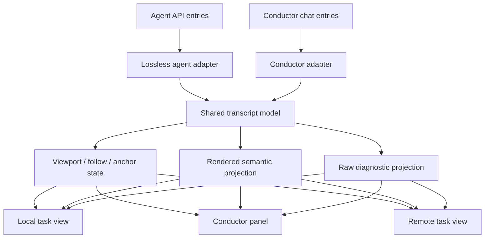

# Chat presentation - Plan

## Goal Capsule

- **Objective:** Operator can quickly understand and navigate long conductor and agent conversations without losing access to their diagnostic record.
- **Product authority:** This plan owns the presentation and navigation of all conversation surfaces in the TUI, including local, conductor, and remote views; capture, persistence, and conductor permissions remain unchanged.
- **Open blockers:** None.

---

## Product Contract

### Summary

The TUI will present conductor and agent conversations as chronological semantic transcripts rather than raw transport records.
It will open a conversation at its newest entry, support independent scrolling through long history, and retain a global raw mode for diagnosis.
Rendered transcripts will use a colour-coded log: the full short message blocks of the operator and conductor are visually distinct, while longer agent replies retain the terminal's default background.

### Problem Frame

The conductor panel derives its visible position from the selected message, so a long history opened with the draft focused is pinned to its beginning and has no independent text scroll.
The agent view can distinguish entry kinds, but still exposes the decoded harness envelope as the primary body, which makes routine reading unnecessarily log-like.
Operators need a readable account of what happened while retaining exact data when they investigate a failure.

### Key Decisions

- **One transcript experience covers conductor and agent conversations.** The same operator intent should not require learning separate reading and navigation models. Governs R1, R3, R5. (session-settled: user-directed — chosen over conductor-only scope: the user explicitly requested both surfaces.)
- **Rendered transcript is the default and raw is a diagnostic mode.** The primary view favors comprehension, while exact source content remains reachable. Governs R2, R4. (session-settled: user-directed — chosen over two equal views or a dense log: readable chronology without losing diagnostics.)
- **Newly opened conversations start at the newest entry.** This makes active and recently completed work immediately visible. Governs R3. (session-settled: user-directed — chosen over opening at the first entry: the user chose the newest message.)
- **Rendered conversations are a colour-coded log with role-specific message blocks.** Operator and conductor messages use distinct full-block backgrounds; agent replies use the default background with a coloured, bold role label. Technical kinds retain their own status styles, and every colour cue also has a text label. Governs R7, R8. (session-settled: user-directed — chosen over label-only highlighting: the user wants the whole, typically short operator and conductor utterance distinguished by its background.)
- **Links are safe, generated presentation, not source terminal control data.** Recognised URLs become terminal hyperlinks where supported and blue underlined text otherwise; retained source data continues through sanitisation. Governs R9. (session-settled: user-approved — chosen over plain unstyled URLs: readable, actionable links without trusting agent-supplied escape sequences.)

### Actors

- A1. **Operator:** reads conversations, inspects details, and acts on conductor proposals or decisions.
- A2. **Conductor:** contributes messages, proposals, and decisions whose available actions must remain visible.
- A3. **Agent harness:** supplies typed conversation entries whose raw content remains the diagnostic source.

### Key Flows

- F1. **Read a current conversation**
  - **Trigger:** Operator opens the conductor chat or an agent conversation.
  - **Actors:** A1, A2 or A3.
  - **Steps:** The view opens at the latest entry, renders entries chronologically by their semantic role, and lets the operator move through history without changing the message draft or an actionable selection.
  - **Outcome:** The current state is immediately visible and older context remains reachable.
  - **Covers R1, R2, R3.**
- F2. **Inspect technical context**
  - **Trigger:** Operator needs the arguments, result, thinking, system event, or exact source record behind an entry.
  - **Actors:** A1, A3.
  - **Steps:** The operator expands a technical entry or switches the current conversation to raw mode.
  - **Outcome:** Diagnosis has access to full retained content without making that content the default reading path.
  - **Covers R2, R4.**
- F3. **Act on a conductor item**
  - **Trigger:** A visible conductor proposal needs confirmation or rejection, or a decision can be undone.
  - **Actors:** A1, A2.
  - **Steps:** The operator navigates the transcript, identifies the actionable entry, and invokes its existing action.
  - **Outcome:** Presentation changes do not alter the conductor's confirmation and undo semantics.
  - **Covers R5.**

### Requirements

**Shared reading model**

- R1. Conductor and agent conversations render as chronological transcripts with a readable role and state for every entry.
- R2. Rendered mode presents conversational messages, proposals, decisions, errors, and technical entries in distinct forms; technical entries are collapsed by default and can be expanded in place.
- R3. Opening either conversation positions the viewport at its newest entry, and `j`/`k`, page movement, and top/bottom navigation scroll the transcript independently of the draft and action selection.
- R4. The operator can switch the current conversation to a global raw mode that exposes the complete retained source content in chronological order; rendered mode must not discard or mutate that content.

**Continuity and actions**

- R5. Refreshing a conversation preserves the operator's reading position unless they are following its newest end, and conductor proposal confirmation, rejection, and decision undo remain available from the rendered transcript.
- R6. The focused panel and shortcut help make clear whether a key scrolls history, changes an actionable entry, expands detail, or edits the conductor draft.

**Semantic formatting**

- R7. Rendered transcript entries preserve semantic presentation from adapter to local and remote view: a bold timestamp and textual role/type label, stable colour by entry kind, and a distinct full-message background for operator and conductor utterances; agent replies retain the default terminal background.
- R8. Tool calls, tool results, thinking, system messages, raw fallbacks, and errors each have a readable, stable visual treatment; errors receive an additional non-colour emphasis, and raw mode remains a complete neutral diagnostic record.
- R9. URLs in rendered message text are rendered as terminal hyperlinks when the terminal capability permits it and as blue, underlined visible URLs otherwise. Untrusted conversation content must never supply terminal escape sequences or arbitrary styles.

### Acceptance Examples

- AE1. **Covers R1, R2.** Given an agent attempt containing a prompt, assistant text, thinking, a tool call, a large tool result, and a final result, when the operator opens it, they see a chronological transcript with readable messages and collapsed technical details rather than JSON envelopes as the primary content.
- AE2. **Covers R3.** Given a conductor chat longer than its viewport, when the operator opens it, the newest message is visible; when they use history navigation, they can reach every earlier entry without moving the draft cursor or being returned to the start.
- AE3. **Covers R4.** Given a rendered agent conversation with an unrecognized harness event, when the operator switches to raw mode, the event's full retained raw content is visible in order.
- AE4. **Covers R5, R6.** Given the operator is reading older conductor context while new entries arrive, when the chat refreshes, their viewport stays on that context and an open proposal remains actionable through the documented controls.
- AE5. **Covers R7, R8.** Given a transcript containing operator, conductor, agent, tool, and error entries, when it is rendered locally or remotely, the full operator and conductor message blocks have distinct backgrounds, agent content uses the default background, and each entry retains a bold text label as well as its colour.
- AE6. **Covers R9.** Given a safe HTTP(S) URL in an operator, conductor, or agent message, when the terminal supports hyperlinks it is actionable; otherwise the exact visible URL is blue and underlined. Given source text containing ANSI or OSC controls, those controls are rendered safely rather than executed.

### Scope Boundaries

- No change to the capture format, persistence, completeness, or transport contract of conversation records.
- No automatic or live refresh behavior beyond preserving usability of the existing refresh path.
- No change to conductor authority, proposal confirmation, rejection, or undo semantics.
- No graphical UI outside the terminal interface.
- No user-selectable theme editor or configurable per-role palette in this change.
- No Markdown renderer beyond safe URL recognition in transcript text.

### Sources / Research

- `src/tui/views.rs:185-260` — conductor visibility is currently derived from selection rather than an independent scroll position.
- `src/tui/app.rs:2874-2944` — conductor history controls currently select actionable entries.
- `src/tui/conversation.rs:40-109` — typed agent entries retain complete raw content.
- `src/tui/app.rs:4908-4945` — agent entries already have collapsed presentation behavior to extend.
- `src/tui/transcript.rs:54-87,324-345` — the shared model currently reduces rendered lines to plain strings, so style metadata needs a lossless presentation path.
- `src/tui/views.rs:374-396`, `src/tui/remote_views.rs:181-186` — local and remote renderers currently convert transcript lines directly to unstyled Ratatui lines.
- `src/tui/scroll.rs:190-225` — sanitisation strips ANSI and OSC controls; generated links must stay separate from source text.
- `docs/brainstorms/2026-09-26-tui-podglad-zdarzen-i-rozmow-requirements.md:97-111` — task-view and refresh constraints for agent conversations.

---

## Planning Contract

### Product Contract preservation

Preserve the Product Contract above, including R7-R9: semantic styles travel with transcript lines, full short operator and conductor blocks receive their distinct backgrounds, agent replies retain the default terminal background, and generated link presentation never weakens sanitisation or raw fidelity.

### Key Technical Decisions

- KTD1. **Build one transcript presentation model with surface adapters.** A reusable TUI model owns chronological entries, rendered/raw mode, logical-line viewport state, follow-end state, anchor restoration, and expansion identity. Agent, conductor, and remote adapters supply their own entry data and actions. This implements the shared reading model in R1 and R3 without coupling conductor actions to scrolling.
- KTD2. **Keep a lossless diagnostic representation alongside a semantic projection.** Agent entry classification will retain the raw retained payload and derive a readable role/body projection. Unknown, malformed, and binary-origin records remain readable technical/raw entries. Raw mode displays chronological metadata plus the complete retained source after terminal-safe encoding, satisfying R2 and R4 without changing capture, persistence, or API.
- KTD3. **Use independent viewport and action state.** `j`/`k`, paging, and top/bottom commands move a line-based transcript viewport. `Tab` cycles draft, reading, and action focus; action focus visibly identifies one proposal or undoable decision, uses `[` and `]` to change that target, and lets `y`/`n`/`u` act only when the target supports the key. Conductor actions resolve an immutable entry identifier rather than a displayed index. This instantiates the shared transcript decision governing R1, R3, R5, and R6.
- KTD4. **Follow only when already at the newest end; otherwise restore an entry anchor.** On first successful load, each transcript positions at the latest entry. On append, refresh, detail expansion, or mode switch, a following viewport stays at the end; any other viewport restores its `(entry identity, logical line)` anchor and clamps to the nearest preceding entry when needed. This implements R3 and R5.
- KTD5. **Prepare the complete forward-paged buffer before first display.** Local and remote agent views request successive existing forward pages from the beginning until the record's current end, then open the ordered lossless buffer at its newest entry. The view visibly remains loading until that preparation completes and distinguishes end-of-record from an incomplete tail. This preserves R3 and R4 without changing the existing byte-bounded read APIs.
- KTD6. **Treat transcript styling as structured, terminal-safe presentation.** Adapters emit role/type and inline-link spans rather than ANSI-bearing strings; the shared renderer applies the palette, full-block backgrounds, bold labels, and terminal-hyperlink capability fallback after sanitisation. This satisfies R7-R9 while keeping raw mode and untrusted source data lossless and inert.

### High-Level Technical Design

The adapters preserve source-specific behavior, while the transcript model owns only presentation and navigation. Conductor confirmation, rejection, undo, draft submission, API retrieval, persistence, and harness capture stay outside that model.

### Assumptions

- Logical-line scrolling remains the established `ScrollState` contract; rendering continues to wrap only the visible slice rather than eagerly wrapping multi-megabyte transcripts.
- Remote pagination can be requested before a visible gap is presented and can retain the same lossless entry representation as local conversation reads.

### System-Wide Impact

Operators receive the same reading and diagnostic model in local task, conductor, and remote task views. The change centralizes presentation state but must not broaden the trusted data path: untrusted source text continues through terminal sanitization, and raw mode never mutates retained content.

### Risks & Dependencies

- `ClassifiedEntry` currently stores lossy decoded text even though the API transports byte-for-byte base64. The shared model must retain a reversible raw representation before raw-mode claims are made.
- Claude envelopes may contain several semantic blocks while current classification picks one entry kind. Semantic projection must represent the useful blocks without dropping the original envelope.
- Local and remote APIs return byte-bounded pages. Pagination and incomplete-tail signals are required to avoid falsely implying that raw history is complete.
- A conductor action can become stale after refresh. Action execution must re-resolve the proposal or decision by immutable ID and show the existing API refusal or a clear stale notice.

---

## Implementation Units

### U1. Shared transcript state and safe data contract

- **Goal:** Define a reusable presentation model that can render, scroll, anchor, follow, expand, and switch modes for any chronological conversation without owning its source-specific actions.
- **Requirements:** R1, R3, R4, R5, R6, R7, R8, R9.
- **Dependencies:** None.
- **Files:** `src/tui/transcript.rs` (new), `src/tui/scroll.rs`, `src/tui/mod.rs`, `tests/tui_state.rs`.
- **Approach:**
  1. Introduce transcript entry, stable entry identity, display mode, technical-detail state, logical-line mapping, and viewport/follow/anchor state under a TUI-only module.
  2. Reuse `ScrollState` for line/page/top/bottom behavior and record the rendered viewport height before applying movement or end-following.
  3. Scope expanded state by conversation identity and entry identity so an attempt switch cannot reuse expansion from another attempt whose entry numbers restart.
  4. Expose a terminal-safe raw representation that is reversible to the retained payload rather than storing only lossy display text. Follow KTD1, KTD2, and KTD4.
  5. Carry semantic entry and inline presentation spans alongside display text, including a block-background role treatment, without allowing source strings to inject terminal styles or affecting anchors and logical-line navigation.
- **Patterns to follow:** `src/tui/scroll.rs` keeps view state independent from wrapping; `EventDetail` in `src/tui/app.rs` owns a stable copy and its own scroll state.
- **Test scenarios:**
  - A long transcript supports line, page, top, and bottom movement within legal logical-line bounds.
  - Opening after entries load starts at the newest end, while an empty transcript remains ready to follow its first entry.
  - Appending while at the end continues following, while appending during older-context reading restores the same entry and logical line.
  - Expanding a technical entry, changing rendered/raw mode, or resizing re-anchors the same entry when possible and clamps safely when it is absent.
  - Expansion state for entry `1` in one attempt does not affect entry `1` in another attempt.
  - Raw display input with controls, ANSI escapes, or non-UTF-8 bytes remains terminal-safe and recoverably represents the retained payload.
  - Styled rendered lines preserve their role/type labels and block background through wrapping, resizing, raw/rendered switching, and remote pagination.
- **Verification:** Pure state and rendering-model tests prove independent viewport, follow, anchor, expansion, and safe raw-data behavior.

### U2. Agent semantic projection and complete paged history

- **Goal:** Convert local and remote agent records into readable transcript entries while preserving exact diagnostic source and loading all retained history on demand.
- **Requirements:** R1, R2, R3, R4, R7, R8, R9; Covers AE1, AE3, AE5, AE6.
- **Dependencies:** U1.
- **Files:** `src/tui/conversation.rs`, `src/tui/app.rs`, `src/tui/remote.rs`, `src/tui/remote_views.rs`, `tests/tui_conversation.rs`, `tests/tui_state.rs`.
- **Approach:**
  1. Extend agent classification into a semantic projection for assistant text, thinking, tool calls, tool results, final results, system events, and raw fallback while retaining source metadata and the original payload for KTD2.
  2. Replace raw-envelope-first local task rendering with the shared transcript model and retain explicit technical expand/collapse behavior.
  3. Make local and remote page loading append ordered entries into the shared buffer from the beginning through the current end before first display, and visibly distinguish loading, end-of-record, no-record, and incomplete-tail states.
  4. Use the same transcript presentation in `remote_views.rs`; keep remote task lifecycle and owner controls separate. Follow KTD1 and KTD5.
  5. Assign role/type presentation from classified agent records and recognise safe URLs only in visible text; preserve the existing sanitisation and raw-byte contract.
- **Execution note:** Start with classification and raw-fidelity characterization tests before replacing the current envelope renderer.
- **Patterns to follow:** `src/tui/conversation.rs` is the existing harness-shape boundary; `TaskContent::Conversation` and `PageView` already retain pagination metadata; `src/tui/scroll.rs` avoids whole-record eager wrapping.
- **Test scenarios:**
  - Covers AE1. A mixed Claude, OpenCode, or Codex record renders readable assistant content and collapsed thinking/tool material instead of a primary JSON envelope.
  - A technical entry expands in place without losing the reader's anchor or leaking its expansion into another attempt.
  - Covers AE3. An unrecognized or malformed event remains visible in raw mode with chronological entry number, timestamp, source, and full retained payload.
  - A conversation larger than one response page loads and appends every forward page before first display, opens at the final entry, preserves order, and never labels a loading or incomplete tail as complete.
  - A closed record, a no-record attempt, and an incomplete trailing record each show their distinct state without hiding already retained entries.
  - The remote detail view renders the same mode, navigation, latest-open, and raw fallback behavior as the local agent view.
  - Agent text keeps the default background while a safe URL receives either hyperlink semantics or the visible blue-underlined fallback.
- **Verification:** Agent parser tests cover every supported harness shape and raw fallback; local and remote state tests cover page continuation and displayed history states.

### U3. Conductor transcript and action-target separation

- **Goal:** Move conductor history onto the shared transcript model while retaining draft editing, proposal confirmation/rejection, and decision undo semantics.
- **Requirements:** R1, R2, R3, R5, R6, R7, R8, R9; Covers F1, F3, AE2, AE4, AE5, AE6.
- **Dependencies:** U1.
- **Files:** `src/tui/chat.rs`, `src/tui/app.rs`, `src/tui/views.rs`, `tests/tui_state.rs`, `tests/conductor_chat.rs`.
- **Approach:**
  1. Adapt `ChatItem` data into semantic transcript entries that include complete `ChatEntry` diagnostic fields for raw mode and retain existing proposal, confidence, rationale, and undo derivation for rendered mode.
  2. Replace selection-derived history placement with the shared viewport and use a separate immutable proposal/decision target when an action is invoked.
  3. Define clear focus and shortcut behavior: `Tab` cycles draft, reading, and action focus; reading keys navigate history; `[` and `]` change the visibly marked action target; draft focus edits text; detail toggles affect technical content; and `y`/`n`/`u` report a clear no-target or unsupported-action notice when no valid target is active.
  4. On refresh or conductor-action reread, re-resolve an open proposal or undoable decision by ID; preserve draft and reading anchor, and close or disable stale action state with a notice. Follow KTD3 and KTD4.
  5. Render the full visible message block of operator and conductor entries with their distinct background treatments while preserving proposal, decision, confidence, rationale, and action affordances.
- **Patterns to follow:** `ChatPanel::append` already deduplicates ordered entries; `ChatItem::open_proposal` and `undoable_decision` are the current authority for available actions; API mutations remain in the existing app flow.
- **Test scenarios:**
  - Covers AE2. A long conductor history opens with the newest content visible; history keys reach older content without moving the draft cursor.
  - An operator can enter action focus, choose a visibly marked proposal or undoable decision, and then return to reading without changing that target; `y`/`n`/`u` operate on its stable ID rather than its current display offset.
  - An action key with no valid action target leaves data unchanged and reports why it is unavailable.
  - Covers AE4. When entries arrive while the operator reads older content, refresh retains that anchor; a viewport following the end advances to the new latest entry.
  - A proposal settled or decision invalidated by refresh is no longer acted on, and the operator receives a clear stale-state result.
  - Raw mode includes a conductor entry's payload and ordering, while rendered mode retains proposal state, confidence, rationale, and undo affordance.
  - A cramped chat pane keeps a usable history viewport and reachable draft or undo controls.
  - Operator and conductor blocks retain their distinct background and textual author label after wrapping, refresh, and action targeting.
- **Verification:** State and integration tests demonstrate scroll/action independence and preserve existing confirmation, rejection, undo, and draft behavior.

### U4. Shared rendering, input mapping, and help across all conversation surfaces

- **Goal:** Make the three transcript adapters use one rendering path and one comprehensible keyboard model.
- **Requirements:** R1, R3, R5, R6, R7, R8, R9.
- **Dependencies:** U1, U2, U3.
- **Files:** `src/tui/views.rs`, `src/tui/remote_views.rs`, `src/tui/app.rs`, `src/tui/remote.rs`, `tests/tui_state.rs`.
- **Approach:**
  1. Render rendered and raw projections through the shared logical-line viewport with surface-specific headers and action/footer regions.
  2. Bind history navigation, page movement, top/bottom jumps, raw-mode switching, and technical-detail expansion consistently wherever a transcript is visible.
  3. Update shortcut bars and help so they distinguish reading, action targeting, expanding detail, raw diagnostics, and conductor-draft editing; retain existing remote owner-command keys.
  4. Ensure first data load follows the latest entry for each local and remote conversation, and refresh applies the KTD4 anchor rule rather than resetting to top.
  5. Render generated semantic spans consistently in local, conductor, and remote transcript surfaces, including terminal hyperlinks when supported and visible underlined URL fallback when not.
- **Patterns to follow:** `render_task_content`, `render_chat_panel`, and `remote_views::render_conversation` are the current three render seams; `RemoteApp::on_key` and task-view input handling own their respective request dispatch.
- **Test scenarios:**
  - Each local agent, conductor, and remote agent surface advertises the same transcript navigation and raw/detail controls where those controls apply.
  - `j`/`k`, page, and top/bottom movement change only transcript position, while existing task-axis, remote task-list, draft, and owner-command controls retain their behavior.
  - A resize or a one-row content region clamps safely and still exposes loading/end status and an actionable footer.
  - Switching raw/rendered mode preserves the reader's nearest stable entry rather than resetting history.
  - Local and remote views show the same role backgrounds, bold labels, technical/error styles, and safe-link fallback without exposing source escape sequences.
- **Verification:** Rendered-state tests assert shortcut/help text, safe small-pane behavior, and consistent local/remote transcript navigation.

### U5. Regression coverage and operator-facing completion pass

- **Goal:** Prove the presentation layer preserves diagnostics and existing interaction guarantees across supported conversation sources.
- **Requirements:** R1-R9; Covers F1-F3 and AE1-AE6.
- **Dependencies:** U2, U3, U4.
- **Files:** `tests/tui_conversation.rs`, `tests/tui_state.rs`, `tests/conductor_chat.rs`.
- **Approach:** Consolidate fixture-based tests around the shared transcript contract and retain current behavior tests for proposal actions, undo, remote task controls, and harness classification. Cover source-specific adapters rather than duplicating the shared navigation matrix for every renderer.
- **Test scenarios:**
  - A complete end-to-end local agent transcript, conductor chat, and remote agent transcript each open at newest, navigate independently, enter raw mode, expand technical content, and preserve a non-following anchor on refresh.
  - Existing conductor confirm/reject/undo flows, remote owner commands, and task-axis selection remain available after the transcript changes.
  - Unknown source events and oversized paged histories remain diagnosable without data loss or a misleading completeness claim.
  - Keyboard help describes the effective focused behavior for draft, history, action target, and raw/detail controls.
  - Snapshot or rendered-buffer coverage proves role backgrounds span wrapped operator and conductor messages, agent replies keep the default background, and colour is never the only role/error signal.
  - URL recognition accepts safe URLs, applies hyperlink/fallback presentation without changing text, and cannot revive source ANSI/OSC sequences.
- **Verification:** The focused TUI test suites and the full Rust test suite pass; formatting and lint checks show no regressions.

---

## Verification Contract

| Check | Applies to | Evidence |
| --- | --- | --- |
| `cargo fmt --check` | All units | Rust formatting is clean. |
| `cargo test --test tui_conversation` | U1, U2, U5 | Semantic extraction, raw preservation, and fallback coverage pass. |
| `cargo test --test tui_state` | U1-U5 | Local, conductor, and remote state/render/input behavior passes. |
| `cargo test --test conductor_chat` | U3, U5 | Proposal confirmation, rejection, and undo semantics remain intact. |
| `cargo test` | All units | Full repository regression suite passes. |
| `cargo clippy --all-targets -- -D warnings` | All units | New shared state and adapters introduce no lint warnings. |

---

## Definition of Done

- All conversation surfaces use the shared transcript presentation model and open a loaded conversation at its newest entry.
- Rendered mode is readable by semantic role; raw mode retains complete chronological diagnostic source without changing capture, persistence, or API contracts.
- Navigation is independent from conductor draft editing, task selection, and conductor action targeting.
- Refresh preserves older-context reading anchors and follows new content only when the operator was already at the end.
- Local and remote views prepare the complete forward-paged record before first display and never misrepresent loading or an incomplete history as complete.
- Existing conductor proposal confirmation, rejection, decision undo, remote owner controls, and terminal-safe rendering remain intact.
- Rendered transcripts consistently provide the colour-coded log: full operator and conductor message backgrounds, default-background agent replies, bold textual labels, distinct technical/error styles, and safe linked URLs with a readable fallback.
- The verification contract passes, and abandoned experimental presentation code is removed from the final diff.
