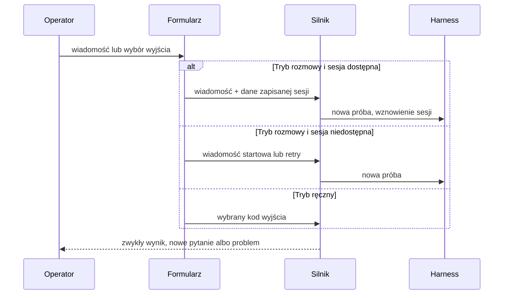

# Kontynuacja rozmowy z zatrzymanym agentem - Plan

## Goal Capsule

- **Objective:** Operator może przekazać agentowi dalsze wskazówki po zatrzymaniu jego kroku, a potem pozwolić agentowi normalnie dokończyć ten sam krok albo ręcznie rozstrzygnąć jego wyjście.
- **Product authority:** Ten dokument określa zachowanie dla kroków `agent`. Nie zmienia działania bramek `human` ani kroków innych typów.
- **Open blockers:** Brak.

---

## Product Contract

### Summary

Formularz zatrzymanego kroku agenta staje się miejscem dalszej rozmowy z agentem. Operator może wysłać wielowierszową wiadomość do istniejącej sesji, a gdy sesji nie ma albo odmawia wznowienia, rozpocząć nową z zachowaną treścią albo powtórzyć próbę. Ręczny wybór kodu wyjścia nadal jest dostępny jako osobny tryb formularza.

### Problem Frame

Po zatrzymaniu kroku agentowego operator może dziś albo odpowiedzieć na pytanie agenta, albo ręcznie rozstrzygnąć problem z brakiem poprawnego kodu wyjścia. Te ścieżki nie dają spójnego sposobu przekazania dalszego kontekstu agentowi po błędzie, pytaniu lub niepełnej odpowiedzi. Edytor tekstu formularza jest jednoliniowy i nie pozwala poprawiać wcześniejszej części wpisanej treści.

### Key Decisions

- **Rozmowa jest domyślną ścieżką formularza kroku agenta.** Operator wysyła wiadomość do zachowanej sesji zamiast tworzyć ręczne przejście. (session-settled: user-directed — chosen over a fresh harness session: zachowanie ma być kontynuacją rozmowy z agentem.) Governs R1, R2, R3.
- **Akcja wynika z aktywnego trybu, nie z obecności tekstu.** Tryb rozmowy i ręczny wybór kodu wyjścia są wyraźnie rozróżnione przez fokus. (session-settled: user-directed — chosen over inferring the action from whether a comment exists: operator must clearly identify what Enter will do.) Governs R5, R6, R9.
- **Brak sesji zachowuje możliwość udzielenia agentowi wskazówki.** Operator może powtórzyć próbę albo przekazać wiadomość startową do nowej sesji. (session-settled: user-directed — chosen over disabling conversation when a session is unavailable: the operator still needs a recovery path.) Governs R4.

### Actors

- A1. **Operator:** przekazuje wskazówki, wybiera ręczne wyjście lub zamyka formularz.
- A2. **Agent kroku:** kontynuuje istniejącą sesję albo rozpoczyna nową sesję z wiadomością operatora.
- A3. **Silnik narsora i dyrygent:** po wysłaniu wiadomości obsługują krok według zwykłych zasad wykonania, błędów i eskalacji.

### Requirements

**Kontynuacja pracy agenta**

- R1. Przy każdym zatrzymaniu kroku `agent` formularz pozwala operatorowi wysłać wiadomość do agenta, niezależnie od tego, czy przyczyną było pytanie, błąd czy brak poprawnego kodu wyjścia.
- R2. Gdy istnieje sesja agenta możliwa do wznowienia, wysłana wiadomość trafia do tej samej sesji i ten sam krok kontynuuje przetwarzanie bez ręcznej tranzycji.
- R3. Po wysłaniu wiadomości krok wraca do zwykłego cyklu obsługi, tak jak przy nowym rozpoczęciu tego kroku: ponownie działają normalne reguły błędów, dopytań i wsparcia dyrygenta, bez przenoszenia ich zużytego stanu z poprzedniego zatrzymania.
- R4. Gdy sesji agenta nie można wznowić, formularz daje operatorowi dostępne dla sytuacji wyjście: powtórzenie próby, gdy błąd nastąpił przed rozpoczęciem pracy przez agenta, albo przekazanie wpisanej treści jako wiadomości startowej nowej sesji agenta. Gdy zapisany identyfikator sesji odmawia wznowienia, formularz proponuje nową sesję z przygotowaną treścią.

**Ręczne rozstrzygnięcie**

- R5. Operator nadal może wybrać jeden z dozwolonych kodów wyjścia i ręcznie rozstrzygnąć krok bez wysyłania wiadomości do agenta.
- R6. Formularz wyraźnie pokazuje aktywny tryb i element, który zatwierdzi `Enter`; treść wiadomości nie zmienia samoczynnie wybranej akcji.

**Edycja i klawiatura**

- R7. Pole wiadomości pozwala wpisywać treść wielowierszową oraz przesuwać kursor i poprawiać dowolne miejsce przed wysłaniem.
- R8. W trybie rozmowy `Enter` wysyła wiadomość, a `Alt+Enter` dodaje nową linię.
- R9. `Tab` przełącza z trybu rozmowy do wyboru kodu wyjścia; w tym trybie strzałki zmieniają zaznaczony kod, a `Enter` zatwierdza wybór.
- R10. `Esc` zamyka cały formularz bez wysłania wiadomości i bez ręcznego rozstrzygnięcia kroku.

### Key Flows

- F1. **Kontynuacja istniejącej sesji:** operator wysyła poprawioną wiadomość do zachowanej sesji, a silnik normalnie prowadzi ten sam krok dalej. **Covered by:** R1, R2, R3, R7, R8.
- F2. **Brak sesji po błędzie:** operator powtarza próbę przed startem harnessu albo wysyła instrukcję startową do nowej sesji. **Covered by:** R3, R4.
- F3. **Ręczny wybór wyjścia:** operator przełącza fokus, wybiera kod strzałkami i zatwierdza go bez wysyłania wiadomości. **Covered by:** R5, R6, R9.

### Acceptance Examples

- AE1. **Covers R2, R3, R8.** Agent pyta o limit. Operator wpisuje dwie linie wskazówek, używa `Alt+Enter` między nimi i wysyła je `Enter`. Ta sama sesja agenta dostaje obie linie, a jej następna odpowiedź jest obsłużona normalnie.
- AE2. **Covers R3, R4.** Harness nie utworzył sesji, więc formularz oferuje powtórzenie próby. Operator je zatwierdza, a kolejna próba korzysta z pełnego zwykłego cyklu obsługi błędów i dyrygenta.
- AE3. **Covers R4, R7, R8.** Sesja poprzedniej próby nie istnieje, ale operator wpisuje poprawianą wielowierszową instrukcję. `Enter` uruchamia nową sesję z tą instrukcją jako wiadomością startową.
- AE4. **Covers R5, R6, R9.** Agent nie zwrócił poprawnego kodu wyjścia. Operator naciska `Tab`, widzi zaznaczony kod, zmienia go strzałką i zatwierdza `Enter`. Wiadomość wpisana wcześniej nie jest wysyłana.
- AE5. **Covers R7, R10.** Operator przesuwa kursor w środku wielowierszowej wiadomości i poprawia tekst, a następnie naciska `Esc`. Formularz zamyka się, a krok nadal czeka bez nowego wejścia.

### Success Criteria

- Operator może kontynuować rozmowę z agentem po każdym zatrzymaniu jego kroku, jeśli istniejąca lub nowa sesja jest możliwa.
- Operator może bez opuszczania formularza odróżnić wysłanie wiadomości od ręcznego wyboru kodu wyjścia.
- Dłuższa wskazówka dla agenta daje się wygodnie napisać i poprawić przed wysłaniem.

### Scope Boundaries

- Nie zmieniamy semantyki ani formularzy bramek `human`.
- Nie zmieniamy obsługi kroków `script`, `wait` ani innych nieagentowych akcji.
- Nie tworzymy nowego graficznego układu TUI; interakcja pozostaje zgodna z obecnym, konsolowym formularzem.
- Nie zapisujemy niedokończonej wiadomości po zamknięciu formularza klawiszem `Esc`.

### Product Contract preservation

Changed: R4 — użytkownik potwierdził, że odmowa wznowienia zapisanej sesji ma prowadzić do propozycji nowej sesji z przygotowaną treścią.

---

## Planning Contract

### High-Level Technical Design

### Key Technical Decisions

- KTD1. **Trwały wariant dostarczenia wiadomości agenta.** Utrwalony wpis oczekujący rozróżni kontynuację rozmowy od `ResolveOutput` i zachowa harness, identyfikator sesji oraz informację potrzebną do retry. Dzięki temu wiadomość nie jest interpretowana jako ręczny wybór wyjścia. Governs R1, R4, R5, R6.
- KTD2. **Kontynuacja tworzy nową próbę w zwykłym cyklu runnera.** Runner zużyje wiadomość tylko raz, odtworzy zapisany harness i sesję, a następnie uruchomi pełną ścieżkę prób, pytań, błędów i dyrygenta. Przy odmowie wznowienia zachowa wiadomość do świadomie wybranej nowej sesji. Governs R2, R3, R4. (session-settled: user-directed — chosen over abandoning the drafted message after a resume rejection: operator accepted a prefilled new-session proposal.)
- KTD3. **Formularz ma jawne tryby rozmowy i ręcznego wyjścia.** Wspólny model formularza przechowuje fokus akcji niezależnie od edytowanej treści; tryb rozmowy jest domyślny dla kroku `agent`. Governs R5, R6, R9.
- KTD4. **Wielowierszowy edytor należy do wspólnego formularza.** Obsłuży wstawianie, usuwanie i ruch kursora w pełnym tekście, aby lokalne i zdalne TUI zachowały tę samą semantykę. Governs R7, R8, R10.

### System-Wide Impact

- Wznowienie musi użyć harnessu, który utworzył poprzednią sesję, a nie aktualnego domyślnego wyboru.
- Nowa próba nie może odziedziczyć zużytego odrzucenia wyjścia, rescue dyrygenta ani stanu retry z poprzedniego zatrzymania.
- Ta sama struktura `InputForm` obsługuje TUI lokalne i zdalne, więc zmiana klawiatury oraz walidacji obejmuje oba interfejsy.

### Risks & Dependencies

- Adapter może odrzucić identyfikator sesji dopiero po rozpoczęciu wznowienia. Implementacja musi zachować wpisaną wiadomość i wrócić do formularza z propozycją nowej sesji, bez automatycznego uruchamiania dodatkowej pracy.
- Zmiana trwałego formatu oczekującego wejścia wymaga zgodnej deserializacji starszych rekordów oraz jednoznacznej walidacji dostarczonej akcji.

### Implementation Units

### U1. Rozszerzenie trwałego kontraktu kontynuacji agenta

**Goal:** Zapisać kontekst potrzebny do wysłania wiadomości do konkretnej sesji albo rozpoczęcia nowej próby bez niejawnego wyboru wyjścia.

**Requirements:** R1, R4, R5, R6; F1, F2, F3.

**Dependencies:** None.

**Files:** `src/engine/actions/human.rs`, `src/engine/runner/failure.rs`, `src/api/dto.rs`, `tests/actions_human.rs`, `tests/api.rs`.

**Approach:** Rozszerzyć oczekujące wejście kroku agenta o wariant kontynuacji i dane pochodzenia sesji, zachowując odczyt starszych zapisów. Oddzielić dostarczenie wiadomości od ręcznego kodu wyjścia i przekazać formularzowi dane o retry, wznowieniu oraz nowej sesji. Dla zakończonego błędu kroku agenta zachować epizod recovery i udostępnić tę samą akcję przez jego ochronę przed nieaktualnym lub równoległym żądaniem.

**Patterns to follow:** `PendingHumanInput::for_agent`, `PendingHumanInput::for_problem`, kontrakt serializowany przez `src/api/dto.rs`.

**Test scenarios:**

- Zapis i ponowny odczyt wejścia kontynuacji zachowują harness, identyfikator sesji oraz akcję rozmowy.
- Starszy zapis bez nowych pól nadal otwiera istniejący formularz i nie deklaruje fałszywie sesji możliwej do wznowienia.
- Dostarczenie wiadomości nie może zawierać ręcznie wybranego kodu wyjścia, a dostarczenie ręcznego wyboru nie wysyła pola wiadomości.
- Odpowiedź API dla oczekującego kroku przekazuje dane potrzebne lokalnemu i zdalnemu formularzowi.
- Błąd zakończonej próby agenta daje formularz rozmowy lub retry związany z właściwym epizodem recovery.

**Verification:** Wpis oczekujący odróżnia trzy akcje operatora bez zmiany kontraktu bramek `human`.

### U2. Uruchamianie kontynuacji w sesji i odzyskiwanie po jej odrzuceniu

**Goal:** Doprowadzić wiadomość operatora do tej samej sesji, a przy braku lub odmowie sesji uruchomić właściwą nową próbę bez przecieku starego stanu.

**Requirements:** R1, R2, R3, R4; F1, F2; AE1, AE2, AE3.

**Dependencies:** U1.

**Files:** `src/engine/runner.rs`, `src/engine/runner/failure.rs`, `src/engine/actions/agent.rs`, `src/engine/actions/harness/mod.rs`, `src/api/routes.rs`, `tests/engine_execution.rs`, `tests/actions_agent.rs`, `tests/api.rs`.

**Approach:** Oprzeć konfigurację wznowienia na istniejącym wzorcu repromptu, przypinając ją do historycznego harnessu i identyfikatora sesji. Zużyć wiadomość dokładnie przez jedną następną próbę, wyczyścić stan poprzedniego problemu, rescue oraz retry, a potem wrócić do zwykłego runnera. Powiązać błąd zakończonej próby z jego epizodem recovery, aby formularz rozmowy oraz retry przechodziły przez istniejący lifecycle recovery. Rozróżnić błąd przed uruchomieniem harnessu od utraconej lub odrzuconej sesji.

**Execution note:** Zacząć od testów silnika opisujących ponowne wejście w lifecycle; nie testować tego wyłącznie przez TUI.

**Patterns to follow:** `agent::reprompt_config`, `Engine::reprompt`, `store_agent_input`, `take_agent_input`, adaptery przyjmujące `HarnessRequest::resume_session`.

**Test scenarios:**

- Covers AE1. Wielowierszowa odpowiedź wznawia tę samą sesję na harnessie poprzedniej próby i nie wybiera tranzycji sama przez się.
- Covers AE2. Retry po błędzie przed uruchomieniem harnessu zaczyna pełny zwykły cykl i może ponownie wejść w obsługę błędu albo dyrygenta.
- Covers AE3. Brak identyfikatora sesji uruchamia nową sesję z wiadomością operatora jako wskazówką startową.
- Odrzucone wznowienie zapisanej sesji przywraca formularz z niezmienioną wiadomością oraz możliwością rozpoczęcia nowej sesji.
- Zakończony błąd kroku agenta otwiera ten sam formularz z aktualnym epizodem recovery i odrzuca spóźnione albo równoległe dostarczenie.
- Kolejne pytanie agenta, błąd harnessu i problem z kodem wyjścia po kontynuacji trafiają do tych samych ścieżek co świeża próba.

**Verification:** Testy silnika pokazują właściwy harness i sesję dla wznowienia oraz świeży stan obsługi dla każdej dalszej odpowiedzi.

### U3. Tryby formularza i wielowierszowa edycja

**Goal:** Umożliwić wygodne napisanie wiadomości oraz jednoznacznie oddzielić wysłanie jej od ręcznego rozstrzygnięcia.

**Requirements:** R1, R5, R6, R7, R8, R9, R10; F1, F3; AE4, AE5.

**Dependencies:** U1.

**Files:** `src/tui/input_form.rs`, `src/tui/failure_form.rs`, `src/tui/app.rs`, `src/tui/views.rs`, `src/tui/remote.rs`, `tests/tui_state.rs`.

**Approach:** Rozszerzyć wspólny stan formularza o tryb rozmowy, tryb ręcznego wyjścia i edytor tekstu z pozycją kursora. Po odrzuconym wznowieniu formularz przechodzi do jawnej propozycji nowej sesji, zachowuje treść i pokazuje, że `Enter` uruchomi nową sesję; operator może nadal anulować formularz. Mapować `Enter`, `Alt+Enter`, `Tab`, strzałki i `Esc` według aktywnego trybu, zachowując wpisaną wiadomość po przejściu do ręcznego wyboru. Renderować aktywny tryb oraz element zatwierdzany przez `Enter` bez zmiany formularzy `human`.

**Patterns to follow:** Czyste składanie klawiszy w `InputForm`, przekazywanie żądań przez `App::submit_input`, współdzielony formularz używany przez `RemoteApp`.

**Test scenarios:**

- Covers AE1. `Alt+Enter` tworzy nową linię, a `Enter` w trybie rozmowy wysyła dokładnie wielowierszową treść.
- Covers AE4. `Tab` przełącza do ręcznego wyboru; strzałki zmieniają kod, a `Enter` nie wysyła wcześniej wpisanej wiadomości.
- Covers AE5. Ruch kursora oraz usuwanie i wstawianie w środku wielowierszowej treści zmieniają właściwe znaki; `Esc` zamyka formularz bez dostarczenia wejścia.
- Po odrzuconym wznowieniu formularz zachowuje treść, pokazuje akcję nowej sesji pod `Enter` i pozwala zrezygnować przed jej uruchomieniem.
- Formularz kroku `human` zachowuje dotychczasową nawigację i zatwierdzanie.
- Lokalny i zdalny widok tworzą tę samą akcję formularza dla identycznej sekwencji klawiszy.

**Verification:** Widok jednoznacznie komunikuje akcję `Enter`, a wszystkie skróty są sprawdzone bez terminala.

### U4. Integracja dostarczenia formularza z daemonem

**Goal:** Przesłać nowy wariant działania formularza przez lokalny i zdalny klient do silnika bez utraty błędów walidacji ani ochrony przed równoległym uruchomieniem.

**Requirements:** R1, R3, R4, R5, R6; F1, F2, F3.

**Dependencies:** U1, U2, U3.

**Files:** `src/api/client.rs`, `src/api/dto.rs`, `src/api/routes.rs`, `src/tui/app.rs`, `src/tui/remote.rs`, `tests/api.rs`, `tests/tui_state.rs`.

**Approach:** Przenieść jawną akcję formularza przez istniejący kanał dostarczania wejścia albo przez odpowiadający mu kanał recovery dla zakończonego błędu kroku agenta. Zostawić formularz z wpisaną treścią po odrzuconej walidacji, konflikcie aktywnego uruchomienia albo odmowie wznowienia sesji. Zwracać stan potrzebny do ponownego wyboru nowej sesji bez automatycznego zatwierdzania kodu wyjścia.

**Patterns to follow:** Dwufazowe `try_begin_deliver_human_input`, obsługa błędu w `App::submit_input`, kontrakty wejścia API.

**Test scenarios:**

- Dostarczenie wiadomości przez klienta daemona uruchamia kontynuację w tle, a formularz znika tylko po przyjęciu żądania.
- Błąd walidacji lub konflikt aktywnego runu pozostawia formularz i pełną wielowierszową treść do poprawy albo ponowienia.
- Ręczne rozstrzygnięcie nadal przechodzi przez istniejącą ścieżkę decyzji i nie wywołuje harnessu.
- Przypadek odrzuconej sesji wraca do dostępnej dla operatora propozycji nowej sesji z przygotowaną treścią.
- Formularz otwarty z zakończonego błędu przekazuje wiadomość lub retry przez właściwy endpoint recovery i zachowuje ochronę przed starym epizodem.

**Verification:** Oba klienty zachowują tę samą semantykę dostarczenia, a daemon nadal odrzuca nieaktualne lub równoległe żądania.

### Verification Contract

- `cargo fmt --check`
- `cargo test --test actions_human`
- `cargo test --test actions_agent`
- `cargo test --test engine_execution`
- `cargo test --test api`
- `cargo test --test tui_state`
- `cargo clippy --all-targets -- -D warnings`

### Definition of Done

- Każdy zatrzymany krok `agent` daje operatorowi rozmowę albo wskazane przez sytuację wyjście recovery.
- Wznowienie zachowuje właściwy harness i sesję, a nowa próba nie dziedziczy zużytego stanu poprzedniego zatrzymania.
- Ręczny kod wyjścia pozostaje odrębną, świadomą akcją operatora.
- Lokalne i zdalne TUI obsługują te same skróty, wielowierszową edycję oraz błędy dostarczenia.
- Wszystkie bramki z Verification Contract przechodzą, a w zmianie nie zostaje porzucony kod eksperymentalny.

---

## Sources / Research

- `src/engine/actions/human.rs` utrwala oczekujące wejście i rozdziela `ResumeAgent` od `ResolveOutput`.
- `src/engine/runner.rs` obecnie zapisuje odpowiedź w metadanych i uruchamia akcję ponownie; `reprompt` pokazuje wzorzec wznowienia na historycznym harnessie i sesji.
- `src/engine/actions/agent.rs` oraz adaptery harnessów obsługują `resume_session`.
- `src/tui/input_form.rs`, `src/tui/app.rs`, `src/tui/remote.rs` i `src/tui/views.rs` współdzielą obecny formularz i jego obsługę klawiatury.
- `tests/engine_execution.rs`, `tests/actions_agent.rs`, `tests/actions_human.rs`, `tests/api.rs` i `tests/tui_state.rs` zawierają najbliższe wzorce testów.
