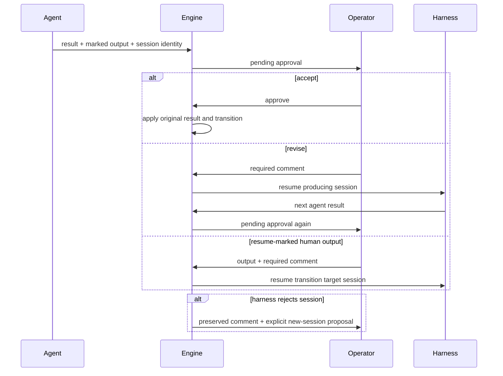

# Output Approval and Agent Resume - Plan

## Goal Capsule

- **Objective:** Workflows can require a human to approve selected agent outputs and can send a required comment from a selected human output back into the session that produced the result.
- **Product authority:** The two mechanisms are generic workflow features. They apply only where the workflow explicitly marks an output; existing outputs and transitions retain their current automatic behavior.
- **Open blockers:** None.

---

## Product Contract

### Summary

An agent output marked as requiring approval stops before its transition. The operator may accept the result, or return it to the producing agent with a required comment. A human output may separately be marked as resuming the agent state named by its transition; its required comment becomes the next message in that state’s historical session. Either loop may repeat until the operator accepts a result or follows another declared path.

### Problem Frame

Today an agent output immediately selects its workflow transition. A following `human` state can approve a broader decision, but it cannot distinguish acceptance of the preceding result from rejection with feedback to its exact agent session. A `human` transition also cannot express that it should resume an earlier agent rather than start its target as a new attempt.

### Key Decisions

- A workflow opts into approval per agent output, rather than making every agent completion interactive. (session-settled: user-directed — chosen over a global approval rule: routine agent outputs must remain automatic.) Governs R1, R2, R3.
- Rejection resumes the session that produced the pending candidate result, not an arbitrary latest session of the target state. (session-settled: user-directed — chosen over implicit latest-session selection: feedback must reach the work the operator is reviewing.) Governs R3, R5.
- A marked human output derives its resume target from its declared transition, and requires a comment. (session-settled: user-directed — chosen over a new special-purpose workflow action: authors should express the behavior on the output that causes it.) Governs R4, R5.
- A rejected historical session preserves the comment and offers an explicit new-session action. (session-settled: user-directed — chosen over discarding feedback or silently starting work: the operator retains control over the fallback.) Governs R6.

### Requirements

- R1. An `agent` output may declare that it requires human approval; only such outputs pause before their declared transition.
- R2. The approval form shows the candidate output and its available actions: accept it, or return it to the producing agent with a required comment.
- R3. Accepting commits the original agent result through the normal decision and transition lifecycle. Returning it clears only transient failure/rescue state, sends the comment to the exact producing session, and may repeat the approval cycle.
- R4. A `human` output may declare that its transition resumes the target `agent` state. Its delivery records the normal human decision and transition atomically, then enters the target action as a continuation rather than as a fresh attempt.
- R5. A resume-marked human output names one required text input as its comment source and resumes the most recent completed attempt of the transition target that existed when the gate was raised. A workflow definition is rejected when the target is not an `agent` state or the named input is not required text.
- R6. When target-session provenance is absent or a harness cannot resume the stored session, the form keeps the resolved comment and offers a new session. Starting that new session is an explicit operator action.
- R7. Existing workflow files, durable pending-input records, API clients, local TUI, and remote TUI remain compatible when no new marker is used.

### Key Flows

- F1. An agent emits an approval-required `reviewed` output; the operator accepts it; the engine applies `reviewed` and enters its declared target.
- F2. The operator rejects that candidate with feedback; the producing session resumes; its next approval-required output returns to the same approval form.
- F3. A regular `human` gate chooses a resume-marked `revise` output; the engine records its decision and transition to the named agent state, then resumes that state’s snapshotted session with the required note.
- F4. The stored harness session rejects F2 or F3; the operator sees the preserved note and chooses whether to start a fresh session.

### Acceptance Examples

- AE1. Covers R1-R3. An agent emits `reviewed` with `requires_human_approval`; accepting it takes the same transition that the current automatic flow would take.
- AE2. Covers R2-R3. Rejecting `reviewed` with a multiline comment resumes its captured harness and session, and a second `reviewed` requires a second approval.
- AE3. Covers R4-R5. A `human` output `revise` names `scope_notes` as its resume comment, rejects it when blank, then resumes its transition target agent with the submitted text.
- AE4. Covers R5. Loading a workflow where a resume-marked output targets a `human`, `script`, `wait`, or unknown state fails validation with the output and target named.
- AE5. Covers R6-R7. Missing provenance or a rejected harness resume preserves the note for an explicit new-session proposal, while an old workflow and pending-input JSON deserialize and run unchanged.

### Scope Boundaries

- The feature does not make unmarked outputs interactive.
- It does not infer a resume target from execution history when the workflow transition does not name an `agent` state.
- It does not resume a session across executions; all session lookup is scoped to the current execution and its persisted event/result history.
- It does not change manual transition override semantics.

---

## Planning Contract

### High-Level Technical Design

### Key Technical Decisions

- KTD1. **Extend output metadata, not the transition map.** Add opt-in output flags and a `resume_comment_field` to `OutputSchema` / `OutputDefinition`; preserve `transitions: label -> state` as the source of the target. This keeps old YAML valid and lets validation verify the target and its required text input. Governs R1, R4, R5.
- KTD2. **Snapshot deterministic approval/resume provenance.** At gate suspension, store the original result or the most recent completed attempt of the exact target agent state, including action ID, harness, and harness session. Pending input never reconstructs a session from a later event-log scan. A missing target attempt snapshots as unavailable and enters the explicit fresh-session path. Governs R2, R3, R5-R7.
- KTD3. **Route all continuation through the existing one-shot agent-input lifecycle.** Reuse `store_agent_input`, `take_agent_input`, and `agent::continuation_config`; add an explicit continuation mode so acceptance and resume paths clear the correct transient metadata without accidentally taking a transition. Governs R3, R5, R6.
- KTD4. **Use one explicit form action model.** Local and remote clients submit `approve`, `resume`, or `start_new_session` as a typed delivery, rather than inferring behavior from whether a comment happens to be present. Governs R2, R5, R6, R7.

### System-Wide Impact

- `OutputDefinition` becomes a behavioral contract carried through YAML parsing, domain serialization, pending input, API DTOs, and TUI rendering.
- The engine needs durable per-execution provenance for completed agent sessions so a later human gate can name the precise target session safely.
- Conductor proposals must not auto-accept or auto-resume an approval-required output unless their existing authorization model explicitly permits that delivery.

### Risks and Mitigation

- A historical session may be missing or unavailable after the human has written feedback. Preserve the exact text in a new pending request before offering a fresh session.
- A malformed resume marker could otherwise jump to a non-agent state. Reject it during workflow validation and validate the target again when applying a delivery.
- A stale tab or concurrent operator could deliver a comment to a replaced approval. Reuse pending episode keys and the existing active-run guard.

---

## Implementation Units

### U1. Extend workflow output schema and validation

- **Goal:** Make approval-required agent outputs and resume-marked human outputs expressible, loadable, and unambiguous.
- **Requirements:** R1, R4, R5, R7.
- **Dependencies:** None.
- **Files:** `src/workflow/schema.rs`, `src/workflow/loader.rs`, `src/workflow/validator.rs`, `src/domain/workflow_definition.rs`, `WORKFLOW_SCHEMA.md`, `tests/schema_loading.rs`, `tests/workflow_validation.rs`.
- **Approach:** Add backward-compatible metadata to object-form outputs. Validate that approval markers occur on agent states, that resume markers occur on human states, and that a resume marker names a required text input while its existing transition target is an agent state. Preserve bare-output YAML and current transition-map behavior.
- **Patterns to follow:** `OutputSchema`’s custom bare/object deserializer and the output/transition checks in `workflow::validator`.
- **Test scenarios:**
  - Parse bare outputs and unmarked object outputs exactly as before.
  - Parse each new marker and carry it into `OutputDefinition`.
  - Reject an approval marker on non-agent actions.
  - Reject a resume marker whose output has no transition, targets a non-agent state, or names an absent, optional, or non-text comment field.
  - Document both markers with a complete YAML example.
- **Verification:** A valid existing workflow remains loadable; invalid marker/target combinations fail before execution.

### U2. Persist candidate results and session provenance

- **Goal:** Give delayed approval and resume deliveries a stable, execution-local reference to the exact agent result and harness session they address.
- **Requirements:** R2, R3, R5-R7.
- **Dependencies:** U1.
- **Files:** `src/engine/actions/human.rs`, `src/engine/runner.rs`, `src/engine/actions/agent.rs`, `src/persistence/recovery.rs`, `src/api/dto.rs`, `tests/actions_human.rs`, `tests/persistence.rs`, `tests/engine_execution.rs`.
- **Approach:** Introduce typed pending-input continuation/provenance variants for output approval and transition-triggered agent resume. Record the completed agent result and harness/session identity before automatic decision handling; when a human gate is suspended, resolve and snapshot the most recent completed attempt of each resume-marked transition target. Make absent fields deserialize as the legacy behavior, and keep the episode guard on every new request.
- **Patterns to follow:** `PendingHumanInput::for_agent`, `PendingHumanInput::for_problem`, `OutputRescue`, `HumanInputDelivery`, and agent session events.
- **Test scenarios:**
  - An approval request survives store reload with the candidate result and producing session intact.
  - A resume-marked human request resolves its declared comment field, transition target, and matching prior agent session.
  - Repeated visits to the target state snapshot its most recent completed attempt at gate creation, rather than a later or older session.
  - A forward target with no completed attempt records unavailable provenance without failing the gate.
  - Old pending-input JSON still deserializes without claiming an approval or resume action.
  - A stale or concurrent delivery is refused without changing the stored candidate.
- **Verification:** Every suspended approval/resume request contains enough data to be processed after a daemon restart without event-log guessing.

### U3. Add runner lifecycles for approval and declared resume

- **Goal:** Apply accepted results normally, and return rejected or resume-marked human deliveries to the correct agent session without leaking prior attempt state.
- **Requirements:** R1-R6.
- **Dependencies:** U1, U2.
- **Files:** `src/engine/runner.rs`, `src/engine/actions/agent.rs`, `src/engine/actions/harness/mod.rs`, `src/engine/runner/failure.rs`, `tests/engine_execution.rs`, `tests/actions_agent.rs`.
- **Approach:** Intercept approval-required agent completions before `complete_step` applies their decision. Accepting re-enters existing completion logic with the original result. Revising re-enters its producing state through a one-shot continuation. A resume-marked human output records its ordinary decision and `TransitionTaken` to the declared target in the same durable lifecycle, then enqueues the target’s snapshotted continuation instead of a fresh target action. Clear only the resumed agent’s prior output-rejection/rescue metadata. Reuse the resume-rejection recovery to restore the draft and require an explicit fresh-session action.
- **Execution note:** Start with engine integration tests that assert state, transition count, session/harness selection, and preserved comments before changing the runner.
- **Patterns to follow:** `continuation_config`, `store_agent_input`, `take_agent_input`, `prepare_deliver_human_input`, and `raise_output_problem`.
- **Test scenarios:**
  - Covers AE1. Accepting an approval-required result produces the same decision and target state as the unmarked result.
  - Covers AE2. Revising with a multiline note resumes the producing harness/session, does not transition first, and raises a fresh approval on the next marked result.
  - Covers AE3. A resume-marked `human` output records its transition to the target and sends its required comment to that target agent session instead of starting a fresh attempt.
  - A resume-marked human output records exactly one decision and transition to its target before the continuation action starts, and recovery after each persistence boundary leaves it either answerable or resumable.
  - Covers AE5. Missing session provenance and a harness resume rejection each reopen a request with the unchanged comment and no automatic fresh work.
  - A retry, agent question, output problem, or conductor rescue after resumed work follows the normal lifecycle with fresh transient state.
- **Verification:** No path can accept or reject a candidate twice, resume a session from another execution, or transition before an acceptance.

### U4. Deliver and render explicit approval/resume actions

- **Goal:** Make the available action and required comment clear and identical in local and remote TUI/API clients.
- **Requirements:** R2, R5-R7.
- **Dependencies:** U2, U3.
- **Files:** `src/api/client.rs`, `src/api/dto.rs`, `src/api/routes.rs`, `src/tui/input_form.rs`, `src/tui/app.rs`, `src/tui/remote.rs`, `src/tui/views.rs`, `tests/api.rs`, `tests/tui_state.rs`.
- **Approach:** Extend the shared pending-form model and delivery DTO with explicit approval, resume, and fresh-session actions. For a resume-marked output, bind the comment to its declared text-field name rather than adding an ambiguous second note. Render the candidate result, selected action, and comment requirement. Preserve multiline text on validation errors, stale episodes, active-run conflicts, missing provenance, and resume rejection. Keep ordinary human forms visually and behaviorally unchanged unless their selected output carries the new marker.
- **Patterns to follow:** `ProblemMode`, `InputForm::validate`, `App::submit_input`, and the shared `PendingHumanInput` used by `RemoteApp`.
- **Test scenarios:**
  - Covers AE1. The approval form accepts a candidate without sending a comment.
  - Covers AE2. Switching to revise requires a nonblank multiline comment and sends no manual output decision.
  - Covers AE3. Selecting a marked human output uses its declared required text field as the only resume comment.
  - Covers AE5. Missing provenance or a rejected resume leaves the exact text visible and labels `Enter` as a new-session action only after the operator chooses it.
  - API validation and local/remote forms produce the same typed action for the same selection.
- **Verification:** The UI never implies that Enter will transition, resume, or start fresh ambiguously.

### U5. Adopt the mechanisms in the compound-engineering workflow

- **Goal:** Make scope review demonstrate the new generic controls without changing unmarked pipeline behavior.
- **Requirements:** R1-R7.
- **Dependencies:** U1-U4.
- **Files:** `workflows/compound-engineering.yaml`, `tests/workflows.rs`, `docs/plans/2026-10-05-0003-feat-kontynuacja-rozmowy-agenta-plan.md`.
- **Approach:** Mark `doc_review.reviewed` as requiring approval, and make `approve_scope.revise` resume its declared `brainstorm` transition target with the scope note. Update the earlier continuation plan’s scope note to point to this generalization rather than leaving conflicting product boundaries.
- **Patterns to follow:** Existing human gates in `compound-engineering.yaml` and the end-to-end answer sequence in `tests/workflows.rs`.
- **Test scenarios:**
  - The compound workflow blocks after `reviewed` until an operator accepts or revises it.
  - Rejecting `doc_review.reviewed` resumes `doc_review`; selecting `approve_scope.revise` resumes its declared `brainstorm` target with `scope_notes`, and either loop can return to approval multiple times.
  - Approved scope proceeds to `plan`; unmarked outputs elsewhere retain automatic routing.
- **Verification:** The sample pipeline expresses the intended review loop declaratively and its full workflow test reaches a terminal state.

---

## Verification Contract

| Scope | Evidence |
| --- | --- |
| Schema and validation | `cargo test --test schema_loading` and the workflow validation coverage | 
| Engine lifecycle | `cargo test --test actions_human`, `cargo test --test actions_agent`, and `cargo test --test engine_execution` | 
| API and clients | `cargo test --test api` and `cargo test --test tui_state` | 
| Workflow adoption | `cargo test --test workflows` | 
| Quality gates | `cargo fmt --check`, `cargo clippy --all-targets -- -D warnings`, and `git diff --check` | 

---

## Definition of Done

- Marked agent outputs stop for a human decision; unmarked outputs keep automatic transitions.
- Acceptance applies the original agent result exactly once, while rejection resumes the producing session with a required comment and can repeat.
- Marked human outputs resume only their declared agent transition target with a required comment.
- Resume rejection preserves the operator’s draft and offers an explicit fresh-session fallback.
- Older workflow and persistence data remain compatible, and local/remote/API behavior has matching coverage.

---

## Sources and Research

- `src/workflow/schema.rs`, `src/workflow/loader.rs`, and `src/workflow/validator.rs` define the current output and transition grammar and its validation boundary.
- `src/engine/actions/human.rs` and `src/engine/runner.rs` already provide durable pending input, episode protection, and one-shot agent continuation seams.
- `src/engine/actions/agent.rs` preserves harness/session identity and already supports explicit resume plus an operator-controlled new-session fallback.
- `workflows/compound-engineering.yaml` currently routes `doc_review.reviewed` to `approve_scope`; it demonstrates why a following human gate is not itself approval of the prior output.
