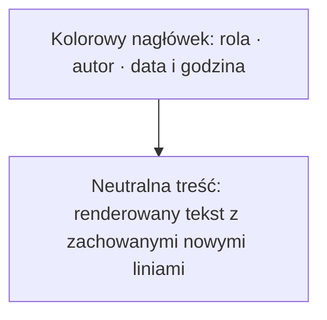
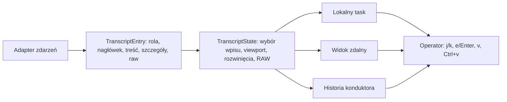

# TUI Wypowiedzi z Kursorem - Plan

## Goal Capsule

- **Objective:** Operator czyta rozmowę Narsor jako wyraźnie oddzielone wypowiedzi, szybko przechodzi między nimi kursorem i otwiera szczegóły bez utraty kontekstu.
- **Means:** Jednolita prezentacja wpisu rozmowy łączy nagłówek roli i czasu, czytelną treść oraz progresywne ujawnianie szczegółów i RAW.
- **Authority:** Potwierdzone decyzje z sesji określają wygląd tła, zaznaczenia, role i dwa zakresy widoku RAW.
- **Stop conditions:** Wszystkie lokalne i zdalne rozmowy rozróżniają role, pokazują treść wejścia Narsor, pozwalają wybrać pojedynczy wpis i zachowują źródłowe dane w RAW.

---

## Product Contract

### Summary

Widok rozmowy TUI będzie renderował wypowiedzi jako pełnoszerokie bloki z kursorem na wpisie. Domyślny widok ma służyć czytaniu przebiegu rozmowy, a szczegóły techniczne i surowy payload pozostają dostępne na żądanie.

### Problem Frame

Obecny transcript przewija zawinięte linie, ma jeden tryb RAW dla całej rozmowy i ukrywa treść wejścia Narsor w szczegółach. Style dotyczą pojedynczych linii, więc granice wypowiedzi i aktualny cel działania są słabo widoczne.

### Key Decisions

- **Nagłówek jest kolorowym nośnikiem roli, a treść pozostaje neutralna.** Governs R2, R3, R4. (session-settled: user-directed — chosen over tło pod nagłówkiem i treścią: zachowuje neutralną powierzchnię do czytania długiej treści.)
- **Kursor wybiera wypowiedź przez znacznik po lewej.** Governs R5. (session-settled: user-directed — chosen over obrys całego wpisu i jasny aktywny nagłówek: zachowuje kolor roli i jest najmniej inwazyjny.)
- **Thinking/reasoning jest obecnie techniczne.** Governs R3, R6. Oddzielna rola może powstać później, bez blokowania tej zmiany.
- **RAW ma zakres wpisu albo całej rozmowy.** Governs R8, R9. Widok renderowany nigdy nie zastępuje treści źródłowym JSON-em.

### Requirements

**Struktura i role**

- R1. Każdy wpis rozmowy jest jedną pełnoszeroką wypowiedzią, niezależnie od liczby zawiniętych linii jej treści.
- R2. Wypowiedź pokazuje nagłówek z nazwą roli, nazwą wypowiadającego oraz pełną datą i godziną.
- R3. SYSTEM, USER, AGENT, KONDUKTOR i TECHNICZNE mają odrębne style nagłówków; `thinking/reasoning` używa stylu TECHNICZNE.
- R4. Tło roli obejmuje tylko nagłówek wypowiedzi, a treść pozostaje na neutralnym tle przez całą szerokość widoku.

**Nawigacja i szczegóły**

- R5. Nawigacja kursorem między wpisami wybiera całe wypowiedzi i wskazuje aktywną wypowiedź pionowym znacznikiem po lewej.
- R6. Domyślny wpis techniczny pokazuje nagłówek i jedną semantyczną linię; rozwinięcie ujawnia pełny renderowany opis bez prezentowania źródłowego JSON-a.
- R7. Wejście wysłane do czata przez Narsor pokazuje w domyślnym widoku co najmniej początek przekazanego prompta, a rozwinięcie udostępnia jego pełną wyrenderowaną treść.

**RAW i odporność danych**

- R8. `v` przełącza RAW wyłącznie dla aktualnie zaznaczonej wypowiedzi, zachowując pozycję kursora i umożliwiając powrót do renderowanego wpisu.
- R9. `Ctrl+v` przełącza całą rozmowę między widokiem renderowanym a RAW.
- R10. RAW pokazuje terminal-safe, bezstratną reprezentację źródłowego payloadu; tylko ten tryb pokazuje pełny JSON.
- R11. Lokalne widoki tasku, widoki zdalne i historia konduktora mają spójne role, zachowanie kursora, rozwijania i RAW.

### Actors

- A1. **Operator** czyta rozmowę, porusza kursorem po wypowiedziach i otwiera szczegóły lub RAW.
- A2. **Narsor** przekazuje prompt, zdarzenia workflow i komunikaty konduktora.
- A3. **Agent/harness** przekazuje odpowiedzi, reasoning oraz zdarzenia narzędziowe.

### Key Flows

- F1. Czytanie rozmowy
  - **Trigger:** Operator otwiera rozmowę lokalną, zdalną albo historię konduktora.
  - **Steps:** Widok otwiera się przy najnowszej wypowiedzi, pokazuje rozdzielone wpisy i pozwala kursorem przechodzić po wpisach.
  - **Outcome:** Operator rozpoznaje autora, czas i sens kolejnych wypowiedzi bez otwierania szczegółów.
  - **Covers R1, R2, R3, R4, R5, R11.**
- F2. Inspekcja wpisu technicznego lub prompta Narsor
  - **Trigger:** Operator zatrzymuje kursor na wpisie wymagającym kontekstu.
  - **Steps:** Domyślny widok pokazuje zwięzłe podsumowanie albo początek prompta; `e` lub Enter rozwija pełny renderowany wpis.
  - **Outcome:** Szczegóły są czytelne i nie ujawniają JSON-a przed wejściem do RAW.
  - **Covers R6, R7.**
- F3. Inspekcja surowych danych
  - **Trigger:** Operator chce zdiagnozować aktualny wpis albo cały przebieg.
  - **Steps:** `v` przełącza RAW zaznaczonego wpisu, a `Ctrl+v` RAW całej rozmowy; ponowienie skrótu przywraca widok renderowany.
  - **Outcome:** Operator ma dwa jawne poziomy diagnostyki, bez utraty danych lub pozycji.
  - **Covers R8, R9, R10.**

### Acceptance Examples

- AE1. **Covers R2, R3, R4.** Gdy rozmowa zawiera wpis systemowy, użytkownika, agenta, konduktora i techniczny, każdy ma własny kolorowy nagłówek z rolą, autorem i datą z godziną, a ich treści pozostają na neutralnym tle.
- AE2. **Covers R5.** Gdy operator naciska `j` lub `k` na wielowierszowej wypowiedzi, kursor przechodzi do poprzedniej lub następnej wypowiedzi i znacznik po lewej wskazuje cały aktywny wpis.
- AE3. **Covers R6, R7.** Gdy Narsor wysyła długi prompt, zwykły widok pokazuje jego początek, a rozwinięcie pokazuje pełną treść z zachowaniem nowych linii, nie JSON.
- AE4. **Covers R6, R10.** Gdy wpis narzędziowy ma długie dane, zwykły widok zawiera jedną semantyczną linię, rozwinięcie pełny opis, a RAW dopiero payload źródłowy.
- AE5. **Covers R8, R9.** Gdy zaznaczony jest pojedynczy wpis, `v` przełącza RAW tylko tego wpisu; `Ctrl+v` przełącza RAW wszystkich wpisów w rozmowie.
- AE6. **Covers R11.** Ten sam zestaw zdarzeń ma równoważną prezentację i skróty w lokalnym widoku tasku, widoku zdalnym i historii konduktora.

### Scope Boundaries

- Nie zmieniać formatu utrwalania rozmów, API, odświeżania ani retencji surowych bajtów.
- Nie tworzyć osobnej roli wizualnej dla `thinking/reasoning` w tej zmianie.
- Nie wymuszać kompletnego parsera dla nieznanych przyszłych kopert harnessu; fallback pozostaje czytelny i zachowawczy.

### Sources / Research

- `src/tui/transcript.rs` — wspólny stan transcriptu ma dziś globalny tryb Rendered/Raw, entry-local expansion i anchoring.
- `src/tui/app.rs`, `src/tui/remote.rs` — obecne skróty i lokalno-zdalne ścieżki renderowania.
- `src/tui/views.rs`, `src/tui/remote_views.rs` — style są obecnie nakładane na zawinięte linie, nie pełne wpisy.
- `src/tui/conversation.rs` — wejście Narsor posiada semantyczne podsumowanie, a treść prompta jest obecnie szczegółem.
- `docs/plans/2026-10-04-1652-fix-tui-czytelny-format-rozmowy-plan.md` i `docs/plans/2026-10-04-1930-refactor-tui-unified-transcript-event-plan.md` — wcześniejszy kierunek wspólnego modelu zdarzeń, czytelnego defaultu i bezstratnego RAW.

---

## Planning Contract

**Product Contract preservation:** Product Contract unchanged.

### Key Technical Decisions

- KTD1. **Stan transcriptu rozdziela wybór wpisu od pozycji viewportu.** Stabilne `TranscriptEntryId` jest celem `j`/`k`, a viewport odsłania jego nagłówek; odświeżenie zachowuje wybór albo wybiera najbliższy pozostały wpis. Realizuje R1, R5, R11.
- KTD2. **Wpis ma strukturalny nagłówek i treść.** Renderer otrzymuje osobne segmenty nagłówka, treści i zaznaczenia zamiast gotowych, jednolicie ostylowanych linii. Realizuje R2, R3, R4, R5, R11.
- KTD3. **RAW jest kompozycją zakresu globalnego i wpisowego.** Globalny RAW ma pierwszeństwo wizualne, zachowuje flagi wpisów na później, a `v` nie zmienia niewidocznego stanu w globalnym RAW. Realizuje R8, R9, R10.
- KTD4. **Szczegóły renderowane są semantyczne.** Adaptery przekazują treść prompta i opis techniczny jako tekst do rozwinięcia; znormalizowane dane i źródłowy payload nie są serializowane do widoku renderowanego. Realizuje R6, R7, R10.
- KTD5. **Wszystkie powierzchnie używają tego samego modelu widocznych wpisów.** Lokalny task, zdalny detail i historia konduktora dzielą reguły szerokości, zaznaczenia i skrótów, przy zachowaniu niezależnego action target konduktora. Realizuje R5, R11.

### High-Level Technical Design

### Assumptions

- Nagłówek wyświetla pełną lokalną datę i godzinę, aby czas był porównywalny między wszystkimi powierzchniami TUI.
- Gdy wybrany wpis znika przy odświeżeniu, wybór przechodzi do najbliższego pozostałego wpisu.
- Wpis techniczny bez semantycznych szczegółów nie rozwija się.
- RAW dla danych niebędących poprawnym UTF-8 używa odwracalnej reprezentacji; zachowane bajty źródłowe nie są modyfikowane.

### Sequencing

Najpierw zmienić wspólny model wpisu i stan wyboru, następnie adaptery semantyczne, potem renderery i obsługę klawiszy. Dzięki temu wszystkie widoki korzystają z jednego kontraktu, a testy integracyjne mogą sprawdzić parytet końcowy.

---

## Implementation Units

### U1. Wprowadzić wybór wpisu i dwa zakresy RAW

- **Goal:** Zastąpić nawigację po logicznych wierszach stabilnym wyborem całej wypowiedzi, zachowując anchoring, follow-at-end i bezpieczeństwo surowych danych.
- **Requirements:** R1, R5, R8, R9, R10, R11; F1, F3; AE2, AE5.
- **Dependencies:** None.
- **Files:** `src/tui/transcript.rs`, `tests/tui_state.rs`.
- **Approach:**
  1. Rozdzielić identyfikację wybranego wpisu od offsetu przewijania i udostępnić ruch, paging oraz odsłanianie wybranego wpisu na poziomie wpisów.
  2. Zachować wybór po append, replace, resize i rozwinięciu; follow-at-end może przejąć wybór nowego końcowego wpisu tylko wtedy, gdy operator nadal śledzi koniec.
  3. Zastąpić pojedynczy tryb RAW stanem globalnym oraz zbiorem wpisów RAW, z zachowaniem terminal-safe i odwracalnej reprezentacji danych.
- **Execution note:** Zacząć od testów charakteryzujących odświeżanie i reflow, aby zmiana kursora nie zerwała istniejącego anchoringu.
- **Patterns to follow:** `TranscriptAnchor`, `replace_entries`, `append`, `restore_after_change` i `raw_display` w `src/tui/transcript.rs`.
- **Test scenarios:**
  - `j` i `k` przechodzą po wpisach, a nie po zawiniętych wierszach wielowierszowej treści. Covers AE2.
  - Pierwsze ładowanie wybiera najnowszy wpis; append zachowuje starszy wybór poza follow-at-end, a brakujący wpis degraduje się do najbliższego dostępnego.
  - Resize, rozwinięcie i przełączenie wpisowego RAW zachowują wybrany identyfikator oraz widoczność jego nagłówka.
  - `v` przełącza RAW tylko wpisu wybranego w widoku renderowanym, a `Ctrl+v` przełącza globalny RAW bez gubienia flag wpisów. Covers AE5.
  - RAW oczyszcza kontrolki terminala i pokazuje nie-UTF-8 w odwracalnej postaci, nie zmieniając zapamiętanych bajtów. Covers AE4.
- **Verification:** Stan transcriptu utrzymuje selekcję i pozycję czytania we wszystkich zmianach prezentacji.

### U2. Dostarczyć semantyczne segmenty ról, promptów i detali

- **Goal:** Znormalizować dane prezentacyjne tak, aby adaptery dostarczały rolę, autora, czas, czytelną treść i semantyczne szczegóły bez przekazywania JSON-a do widoku renderowanego.
- **Requirements:** R2, R3, R6, R7, R10, R11; F2; AE1, AE3, AE4, AE6.
- **Dependencies:** U1.
- **Files:** `src/tui/conversation.rs`, `src/tui/app.rs`, `src/tui/chat.rs`, `src/tui/transcript.rs`, `tests/tui_conversation.rs`, `tests/tui_state.rs`.
- **Approach:**
  1. Ukształtować wpis transcriptu jako dane nagłówka i treści zamiast preformatowanego nagłówka w `agent_transcript_entry` oraz odpowiedniku konduktora.
  2. Zmapować typy na pięć zatwierdzonych ról; reasoning pozostawić techniczne, a błędy zachować jako techniczny wariant wizualny.
  3. Dla wejścia Narsor wyprowadzić początek prompta do widoku domyślnego i pełną treść, z zachowaniem nowych linii, do semantycznego rozwinięcia.
  4. Ograniczyć wpisy techniczne do jednej oczyszczonej linii w stanie zwiniętym oraz przekazywać rozwijalne szczegóły jako tekst, nie `serde_json`-owy dump.
- **Patterns to follow:** `TranscriptEvent`, `EntryKind`, `adapt_narsor`, klasyfikatory Claude/OpenCode/Codex oraz `ChatPanel::append`.
- **Test scenarios:**
  - Każdy typ roli przekazuje etykietę roli, autora i pełny lokalny czas wymagany przez nagłówek. Covers AE1.
  - `thinking/reasoning` jest techniczne, a odpowiedź agenta i wynik końcowy są agentowe.
  - Prompt Narsor pokazuje znormalizowany pierwszy wiersz bez rozwinięcia oraz pełną, wielowierszową treść po rozwinięciu. Covers AE3.
  - Tool call, tool result, system i reasoning mają jedną linię domyślną; rozwinięcie nie pokazuje normalizowanego JSON-a. Covers AE4.
  - Nieznana lub niepełna koperta zachowuje czytelny fallback i dokładne raw bytes.
- **Verification:** Wspólny adapter przekazuje wystarczające dane do ról i szczegółów bez parsowania kopert w rendererach.

### U3. Renderować pełnoszerokie wypowiedzi ze stylem nagłówka

- **Goal:** Narysować spójne, pełnoszerokie bloki wypowiedzi z neutralnym body, kolorowym nagłówkiem i lewym znacznikiem aktywnego wpisu.
- **Requirements:** R1, R2, R3, R4, R5, R6, R11; F1, F2; AE1, AE2, AE4, AE6.
- **Dependencies:** U1, U2.
- **Files:** `src/tui/views.rs`, `src/tui/remote_views.rs`, `src/tui/transcript.rs`, `tests/tui_state.rs`.
- **Approach:**
  1. Zastąpić liniowy model renderowania widoczną strukturą wpisu, która zachowuje segment nagłówka, neutralne body i znacznik selekcji przy zawijaniu.
  2. Rozciągnąć styl nagłówka na dostępną szerokość panelu, bez nakładania tła roli na body.
  3. Użyć tej samej kalkulacji szerokości, wysokości i widocznego wycinka w task view oraz remote view, zamiast nakładać offset przed niezależnym zawijaniem paragrafu.
  4. Zachować w historii konduktora osobny marker action target; nie może on zmieniać ani przesłaniać markera kursora czytania.
- **Patterns to follow:** `render_task_content`, `render_chat_panel`, `page_lines`, `wrap_visible_lines` oraz `transcript_style`.
- **Test scenarios:**
  - Nagłówki pięciu ról wypełniają szerokość dostępnego panelu, a zawinięte body pozostaje neutralne. Covers AE1.
  - Zaznaczenie jest jednym lewym znacznikiem dla całego wpisu także po zawinięciu na wąskim panelu. Covers AE2.
  - Wpis techniczny pozostaje kompaktowy, a po rozwinięciu jego treść łamie się jak zwykły tekst, bez JSON-a. Covers AE4.
  - Local, remote i conductor renderują ten sam model ról i zaznaczenia; action target konduktora pozostaje niezależny. Covers AE6.
- **Verification:** Test backend Ratatui potwierdza kontrast nagłówków, neutralne body, pełną szerokość oraz zgodny widoczny wpis w każdej powierzchni.

### U4. Ujednolicić skróty i pomoc rozmowy

- **Goal:** Nadać tym samym skrótom identyczne znaczenie w tasku, widoku zdalnym i historii konduktora bez przejmowania Entera z pola draftu.
- **Requirements:** R5, R6, R8, R9, R11; F1, F2, F3; AE2, AE4, AE5, AE6.
- **Dependencies:** U1, U3.
- **Files:** `src/tui/app.rs`, `src/tui/remote.rs`, `src/tui/views.rs`, `src/tui/remote_views.rs`, `tests/tui_state.rs`, `tests/tui_conversation.rs`.
- **Approach:**
  1. Kierować `j`/`k`, paging i `g`/`G` do nawigacji po wpisach we właściwym focusie rozmowy.
  2. Kierować `e`, Enter i spację do rozwijania wybranego wpisu tylko w widoku czytania; draft konduktora zachowuje Enter do wysyłki.
  3. Rozróżnić zwykłe `v` od `Ctrl+v` przed ogólnym dopasowaniem klawisza i uaktualnić widoczne skróty oraz pomoc.
- **Patterns to follow:** `App::on_key_task`, `App::on_key_chat`, `RemoteApp::on_key`, `App::shortcuts` i `RemoteApp::shortcuts`.
- **Test scenarios:**
  - Lokalne, zdalne i konduktorowe klawisze wybierają, rozwijają i przełączają RAW tego samego wpisu. Covers AE2, AE4, AE5, AE6.
  - `Ctrl+v` przełącza globalny RAW, a `v` nie zmienia ukrytych flag wpisowych podczas globalnego RAW. Covers AE5.
  - Enter i spacja rozwijają tylko w focusie czytania; Enter w focusie Draft nadal wysyła wiadomość.
  - Pasek skrótów i pomoc opisują `v` jako RAW wpisu oraz `Ctrl+v` jako RAW rozmowy.
- **Verification:** Testy stanu wejścia i testy renderingu potwierdzają parytet skrótów oraz brak regresji akcji konduktora.

---

## System-Wide Impact

- Zmiana dotyka jednego współdzielonego stanu używanego przez trzy powierzchnie, dlatego każdy nowy stan zaznaczenia i RAW musi być odtwarzalny po refreshu oraz resize.
- Widok raw pozostaje diagnostyczny i jedyny pokazuje dane źródłowe; rozdzielenie od szczegółów renderowanych zmniejsza ryzyko przypadkowego ujawnienia JSON-a w zwykłym czytaniu.
- Zmiana modyfikatorów klawiszy wymaga jawnego testu priorytetu `Ctrl+v`, aby zwykły handler `v` nie przechwycił obu kombinacji.

---

## Risks & Dependencies

- **Różne strategie zawijania local i remote:** zmiana wspólnego wycinka widocznych wpisów jest wymagana, inaczej kursor i marker mogą wskazywać inne treści.
- **Live refresh:** błędne powiązanie wyboru z offsetem spowoduje skok do końca albo zmianę wpisu czytanego przez operatora.
- **Kanał konduktora:** marker kursora czytania nie może naruszyć action targetu propozycji i decyzji.
- **Kompatybilność klawiatury:** `Ctrl+v` musi być rozpoznane z modyfikatorem przed prostym dopasowaniem `v`.

---

## Verification Contract

| Gate | Evidence |
| --- | --- |
| Transcript state | `cargo test --test tui_state` obejmuje wybór wpisu, anchoring, follow, resize i dwa zakresy RAW. |
| Conversation semantics | `cargo test --test tui_conversation` obejmuje mapowanie ról, prompt Narsor, techniczne szczegóły i raw-byte retention. |
| TUI rendering | Test backend Ratatui w `tests/tui_state.rs` potwierdza pełnoszerokie nagłówki, neutralne body, marker i skróty. |
| Static quality | `cargo fmt --check` i `cargo clippy --all-targets -- -D warnings` przechodzą bez ostrzeżeń. |

---

## Definition of Done

- U1–U4 spełniają wskazane scenariusze testowe oraz wszystkie bramki Verification Contract.
- Operator widzi role, autora, pełną datę i godzinę oraz renderowaną treść bez wchodzenia w szczegóły; prompt Narsor nie jest ukryty.
- Kursor porusza się po wypowiedziach i zachowuje cel przez odświeżenie, zawijanie i zmianę rozmiaru panelu.
- Rozwinięcie pokazuje semantyczną treść, a tylko RAW pokazuje payload źródłowy; `v` i `Ctrl+v` mają odrębne, przetestowane zakresy.
- Lokalne, zdalne i konduktorowe powierzchnie mają zgodny widok i skróty, bez regresji wysyłania draftu ani action targetu.
- Diff nie zawiera martwych rendererów, eksperymentalnych ścieżek ani porzuconych wariantów stanu.
