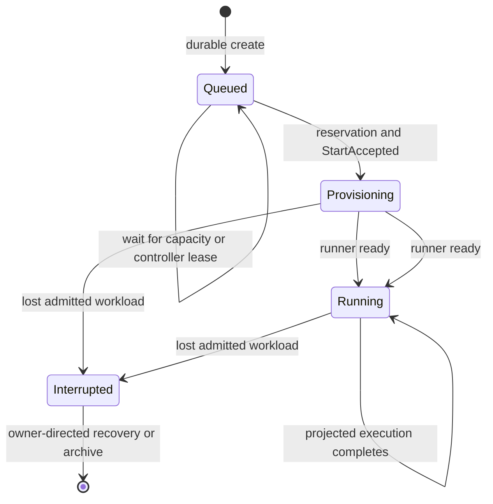

# Unified Task Scheduler - Plan

## Goal Capsule

- **Objective:** An operator can submit a task promptly and know it is durably queued, while the backend starts work only when capacity and ordering allow it.
- **Means:** Make the existing control-plane scheduler the sole admission path for tasks created through the local API, TUI, and CLI.
- **Product authority:** The decisions in this plan come from the 2026-10-07 debugging and scoping conversation about local task creation.
- **Open blockers:** None.

---

## Product Contract

### Summary

This plan converts the local task-creation surfaces to the existing control-plane task model, then lets the scheduler and a daemon-owned local controller advance work through provisioning and execution.
It keeps the current local creation entry point as a compatibility facade, but changes acknowledgement to a task identity and queued lifecycle rather than an execution identity.

### Problem Frame

Creating a workflow currently performs workspace provisioning before the client receives a response.
A Git checkout can exceed the local API client's 800 ms request timeout, so the operator sees a daemon-unreachable error even though an execution was created and continues running.
The same path bypasses the scheduler that already owns queue order and capacity for control-plane tasks.

### Key Decisions

- **One admission authority.** The existing scheduler governs every task creation path rather than a second local queue. (session-settled: user-directed — chosen over a separate local queue: ordering and capacity must be shared.) Governs R1, R2, R3.
- **Queued creation is the acknowledgement boundary.** A task is accepted when it is durably queued, not when its workspace is ready. Governs R1, R4, R6.
- **Priority starts at zero.** The operator may change it later from the queue. (session-settled: user-directed — chosen over choosing priority in the creation form: creation stays simple.) Governs R3, R5.
- **Backends remain independent.** A task stays with the backend that accepted it; changing the TUI connection changes neither its storage nor its execution. (session-settled: user-directed — chosen over migrating queued tasks: each backend has independent storage and process ownership.) Governs R2.

### Requirements

**Creation and admission**

- R1. TUI, CLI, and local API task creation must create the same durable queued-task record and must not directly start an execution.
- R2. Each task must be associated with exactly one backend when created, and later connection changes must not move it to another backend.
- R3. The scheduler must admit queued tasks by descending priority and FIFO order for equal priority, subject to that backend's capacity.
- R4. Workspace provisioning and execution must begin only after scheduler admission grants a slot.

**Operator experience and safety**

- R5. A newly created task must use priority `0`, and an operator must be able to change the priority while it remains queued.
- R6. Creation must return a stable task identity promptly enough that a slow checkout cannot be reported as a lost daemon connection.
- R7. Retrying an uncertain create request must identify the already-created task instead of creating a duplicate.
- R8. The TUI must show whether a task is queued, provisioning, or running, and must select the newly queued task after creation.

### Key Flows

- F1. Create a task
  - **Trigger:** An operator submits a workflow from TUI, CLI, or the local API.
  - **Steps:** The backend records one queued task at priority `0`, returns its stable identity, and the client shows it in the queue.
  - **Outcome:** The operator receives confirmation without waiting for checkout or execution startup.
  - **Covers:** R1, R2, R5, R6, R8.

- F2. Admit work
  - **Trigger:** Capacity becomes available on the task's backend.
  - **Steps:** The scheduler selects the highest-priority waiting task, breaking ties by queue order, then grants its slot.
  - **Outcome:** Provisioning and execution start only for the admitted task.
  - **Covers:** R3, R4.

- F3. Retry an uncertain submission
  - **Trigger:** A client loses the create response or times out before receiving it.
  - **Steps:** The client repeats the same logical create request.
  - **Outcome:** The backend returns the original queued task rather than creating another one.
  - **Covers:** R7.

### Acceptance Examples

- AE1. **Given** a workflow whose Git checkout takes longer than 800 ms, **when** an operator creates it, **then** the client promptly shows one queued task and does not claim that the daemon is unreachable. **Covers R1, R4, R6, R8.**
- AE2. **Given** a full backend with queued tasks at different priorities, **when** a slot becomes free, **then** the highest-priority task starts first and equal-priority tasks retain FIFO order. **Covers R3, R4.**
- AE3. **Given** a lost create response, **when** the client retries the same submission, **then** the queue contains one task for that submission. **Covers R7.**
- AE4. **Given** a task queued on backend A, **when** the operator connects TUI to backend B, **then** the task remains owned and visible through backend A only. **Covers R2.**

### Scope Boundaries

- Migrating, copying, or re-scheduling tasks between independent backends is out of scope.
- Switching the active backend and its configuration is out of scope.
- A separate local-only scheduler is out of scope.

#### Deferred to Follow-Up Work

- Redesigning the remote control-plane protocol for arbitrary external local workflow paths is deferred; the local adapter will preserve existing local workflow resolution without exposing a client filesystem path through the generic control-plane API.
- Broader consolidation of the legacy execution-only and remote TUI architectures is deferred beyond the task-first creation and detail path needed here.

### Dependencies / Assumptions

- The control plane remains the durable source of queue state and capacity reservations.
- A local backend can report lifecycle progress to the same task model used by the scheduler.
- Existing execution history remains available after task admission; implementation must define the compatibility projection without weakening R1-R8.

### Product Contract Preservation

Product Contract unchanged.

---

## Planning Contract

### Key Technical Decisions

- KTD1. **Use the control-plane create service as the local admission boundary.** The local `/tasks` facade, TUI, and CLI will translate their validated launch intent into the same durable control-plane create operation, which resolves and seals backend, workflow definition, environment, logical workspace specification, profile, harness, resources, inputs, and request digest before queue insertion. A local resolver adapter preserves the currently supported file and catalogue workflow references plus their workspace modes by sealing them into `TaskLaunchSpec`; references the adapter cannot safely seal are rejected before persistence. This pre-create work must not checkout, materialize, or create a workspace directory; `tasks::start_task` remains exclusively on the admitted controller path. This implements R1, R2, R4, R6, and R7.
- KTD2. **A task is canonical before an execution exists.** Creation returns a `TaskSummary`-shaped task identity and lifecycle. The existing runner snapshot projection gains the backend/storage location needed to resolve its real execution id after admitted initialization; task detail remains authoritative before then. Historic execution endpoints route through that extension or remain explicitly limited to legacy local executions, but are never given synthetic queued records. This preserves R1, R4, R6, and R8.
- KTD3. **Make create idempotency a client-owned submission lifetime.** The client generates one valid task id before its first attempt, retains it and the byte-equivalent payload for transport replay, and exposes the control-plane conflict when that id is reused with different intent. A retry with the same payload returns the original task, satisfying R7 without TUI-only deduplication.
- KTD4. **Run the local backend as a leased controller owned by the daemon.** The daemon provisions or reloads a persistent controller identity, starts its listener before the controller loop, supervises lease renewal and loop failure, then cancels, joins, and releases the controller before final shutdown. It reports `StartAccepted` before workspace provisioning. A missing lease keeps an unadmitted task queued with its offline reason, while admitted, provisioning, and running tasks retain their reservation and follow existing interrupted/unknown recovery rules rather than silently requeueing or reprovisioning. This instantiates R3 and R4 using the existing controller contract.
- KTD5. **Present local work task-first.** The primary local TUI and `narsor run` consume task lifecycle and queue events from creation onward. `narsor run` remains attached after submission, showing queue, provisioning, and execution progress; its completion and exit code come from the projected terminal execution status, not merely a task lifecycle that can remain `Running`. If admitted provisioning fails before an execution exists, the task detail/event surface must expose a terminal task-side failure and `narsor run` must terminate nonzero from it. The TUI reuses the control-plane lifecycle and queue reason rather than inferring state from an execution list, implementing R5 and R8.
- KTD6. **Keep the legacy route as an atomic in-tree compatibility migration.** `POST /tasks` remains the local entry point but changes from an execution-start response to a task response, and all in-tree TUI and CLI callers migrate in the same change. This makes R1 achievable while keeping one local API acknowledgement surface; external compatibility commitments are not assumed.

### High-Level Technical Design

```mermaid
sequenceDiagram
  participant Client as TUI / CLI / local API
  participant Create as Local create facade
  participant Control as Control plane
  participant Scheduler as Scheduler
  participant Local as Daemon local controller
  participant Runner as Workspace + engine
  Client->>Create: submission id + validated launch intent
  Create->>Control: resolve, seal, persist queued task
  Control-->>Client: task id + queued lifecycle
  Control->>Scheduler: reschedule backend
  Scheduler-->>Local: admitted Start command
  Local->>Control: StartAccepted
  Local->>Runner: provision workspace and start execution
  Runner-->>Control: runner lifecycle and execution projection
  Control-->>Client: queued / provisioning / running updates
```



### Alternatives Considered

- **Separate local queue:** rejected by the settled one-admission-authority decision; it would split capacity and ordering from existing control-plane tasks.
- **Create an execution before scheduler admission:** rejected because a checkout or placeholder execution would make the acknowledgement boundary depend on work that R4 reserves for admitted tasks.
- **Make `narsor run` enqueue and exit:** rejected by user confirmation; it remains an attached task-lifecycle command after its prompt acknowledgement.
- **Move local clients directly to `/control/v1/tasks`:** deferred in favor of an atomic in-tree migration behind the established local `/tasks` facade.

### Risks and Mitigations

- **No local controller lease:** an unadmitted local task would never start. Start and recover the daemon-owned adapter explicitly, and test listener readiness, enrollment, lease acquisition, loop restart, and clean release.
- **Duplicate provisioning after retry or restart:** keep request idempotency at creation and use the controller's existing reservation, fencing, and reconciliation protocol before touching workspace storage; never automatically requeue work after `StartAccepted`.
- **Launch drift while queued:** seal the resolved definition, backend, environment, and defaults at creation; test changes to defaults and catalogue after insertion.
- **Execution-only UI assumptions:** treat lack of execution as a normal queued-task state, not a missing record or daemon error.
- **Compatibility break at `/tasks`:** update all in-tree clients and contract tests together; document the response-model change in the API-facing code comments.

### Sources and Research

- `src/api/routes.rs`, `src/api/client.rs`, `src/cli/commands.rs`, and `src/tui/app.rs` currently form the synchronous local creation path and expose its execution-id assumption.
- `src/controller_protocol/service.rs`, `src/controller_protocol/wire.rs`, `src/orchestration/control_plane.rs`, and `src/orchestration/scheduler.rs` provide durable idempotent creation, backend pinning, priority/FIFO admission, and reservation fencing.
- `src/backends/local.rs`, `src/backends/controller.rs`, and `src/cli/daemon.rs` establish the local adapter pattern and reveal the missing daemon-owned controller lifecycle.
- `docs/plans/2026-10-01-2329-feat-zdalne-backendy-wykonawcze-plan.md` records the existing queue, lifecycle, and immutable launch-spec decisions.
- `docs/plans/2026-09-27-001-feat-daemon-lokalny-plan.md` preserves the 800 ms request timeout and prompt control-operation acknowledgement.

---

## Implementation Units

### U1. Seal and persist local queued-task submissions

- **Goal:** Replace local synchronous execution creation with one reusable translation from local workflow input to a sealed, durable control-plane task.
- **Requirements:** R1, R2, R4, R5, R6, R7; F1, F3; AE1, AE3.
- **Dependencies:** None.
- **Files:** `src/api/dto.rs`, `src/api/routes.rs`, `src/api/client.rs`, `src/controller_protocol/service.rs`, `src/controller_protocol/wire.rs`, `src/environment/resolver.rs`, `tests/api.rs`, `tests/controller_protocol.rs`.
- **Approach:**
  1. Define the local create request and response around a stable client task id and `TaskSummary`-level acknowledgement, while defaulting local priority to zero and omitting a create-time priority control per R5.
  2. Adapt existing local workflow-reference validation and resolution into a sealed launch request that can enter the same create service used by control-plane tasks, without persisting client-local paths as generic remote launch input.
  3. Preserve `ProtocolService::create_task` request-digest replay and conflict semantics, including default backend resolution exactly once before persistence.
- **Execution note:** Start with API-level contract tests that prove a successful response does not require a workspace or execution.
- **Patterns to follow:** `ProtocolService::create_task`, `CreateTaskRequest`, `TaskLaunchSpec`, and request-digest handling in `src/controller_protocol/service.rs`.
- **Test scenarios:**
  - Covers AE1. Submit a workflow with a deliberately delayed checkout and assert local creation returns one queued task within the existing client timeout, before workspace provisioning or engine execution.
  - Covers AE3. Persist a request, lose its response, then replay the identical task id and payload; assert the same task identity, revision, queue position, and a single creation event.
  - Reuse the task id with different inputs or workflow intent and assert a typed conflict with no second queued record.
  - Submit without an explicit backend, change the owner's default after insertion, and assert the stored backend and launch digest remain unchanged.
  - Reject invalid workflow input before queue persistence and assert no task record or workspace directory is created.
- **Verification:** All local create callers can receive and render a durable queued task without calling `tasks::start_task` or waiting for checkout.

### U2. Own the local controller and admitted runner lifecycle

- **Goal:** Make the local daemon a real controller that starts provisioning only for scheduler-admitted local tasks and recovers safely after restart.
- **Requirements:** R1, R3, R4, R6; F2; AE1, AE2.
- **Dependencies:** U1.
- **Files:** `src/cli/daemon.rs`, `src/backends/local.rs`, `src/backends/controller.rs`, `src/runner/mod.rs`, `src/tasks/mod.rs`, `src/orchestration/control_plane.rs`, `tests/backend_contract.rs`, `tests/backend_contract_support/mod.rs`, `tests/daemon_lifecycle.rs`, `tests/tasks.rs`.
- **Approach:**
  1. Provision or load the durable local backend record before the API accepts creates, including its identity, capacity, and storage root; make controller enrollment and scheduler capacity depend on that resolved record.
  2. Create or reload a persistent daemon-owned controller credential, bind its controller client to that backend, and start its supervision loop only after the API listener has a usable control-plane URL.
  3. Consume only admitted start work, report controller acceptance before provisioning, and invoke existing workspace and engine paths only after that lifecycle transition.
  4. Retain the controller supervision handle, signal cancellation, join it with bounded error reporting, and release its lease before tearing down the API or draining legacy in-process runs.
  5. Record and reconcile the existing runner snapshot execution projection once initialization creates a real execution, including restart, fencing, provisioning failure, and separate runner storage.
- **Execution note:** Add characterization coverage around the existing `tasks::start_task` provisioning guarantees before moving its caller boundary.
- **Patterns to follow:** Controller report ordering in `src/backends/controller.rs`, local adapter ownership in `src/backends/local.rs`, and backend contract fixtures.
- **Test scenarios:**
  - Covers AE2. At capacity one, submit tasks through separate local entry points and assert priority-first, FIFO-within-priority admission with no preemption of a reserved or running task.
  - Start a fresh daemon and assert the local backend record and capacity exist before creation is accepted, then controller enrollment and listener readiness precede its start loop; restart it and assert the credential is reused, the lease is reacquired, and clean shutdown joins and releases it before API teardown.
  - Submit while the local controller is absent or its lease expires before admission; assert the task remains queued with the offline reason, no workspace, and no execution, then starts after lease recovery.
  - Restart the daemon with queued and admitted tasks; assert no duplicate task, workspace, or runner is created, and an already accepted workload follows interrupted/unknown recovery rather than automatic requeue.
  - Cause provisioning to fail after `StartAccepted` and assert lifecycle, reservation, and owner-recovery behavior follow the existing backend contract instead of fabricating a legacy execution-only failure.
  - Change workflow defaults, catalogue data, or harness selection after queuing and assert the admitted runner uses the sealed launch snapshot.
- **Verification:** Workspace provisioning and `Engine::run` are reachable only from the local controller's admitted lifecycle, and daemon shutdown accounts for controller-owned runners.

### U3. Project task lifecycle to execution history and API compatibility

- **Goal:** Preserve access to real execution history without pretending a queued task already has an execution.
- **Requirements:** R1, R4, R6, R8; F1, F2; AE1.
- **Dependencies:** U1, U2.
- **Files:** `src/orchestration/model.rs`, `src/orchestration/control_plane.rs`, `src/controller_protocol/wire.rs`, `src/controller_protocol/service.rs`, `src/api/routes.rs`, `src/api/dto.rs`, `src/runner/storage.rs`, `src/backends/local.rs`, `tests/orchestration.rs`, `tests/api.rs`.
- **Approach:**
  1. Extend the existing runner snapshot execution projection with the backend/storage location needed to resolve its real execution id after runner initialization.
  2. Keep task list/detail/event responses authoritative for queued and provisioning states, and make the execution-read routing boundary explicit for runner-owned versus legacy local execution storage.
  3. Define the task-side terminal failure projection for admitted provisioning failures that occur before execution initialization, including its event and CLI-visible outcome.
  4. Update the local `/tasks` compatibility response and documentation to describe task acknowledgement, lifecycle, and later execution availability.
- **Patterns to follow:** `TaskSummary`, task events, runner snapshots, and existing execution API DTOs.
- **Test scenarios:**
  - Create a task before admission and assert task detail is available while execution-specific reads are not offered a synthetic identifier.
  - Admit and initialize the task, then assert task detail exposes the real execution relationship, resolves its backend-local storage after restart, and existing execution history remains readable through its declared boundary.
  - Create colliding execution identifiers on independent backend storage and assert the projection never resolves history from the wrong backend.
  - Fail admitted provisioning before execution initialization and assert task detail emits the declared terminal failure, with no synthetic execution record.
  - Replay a create after its execution begins and assert the original task response is returned rather than a new execution or task.
  - Verify pre-existing executions remain listable and readable through their current endpoints.
- **Verification:** The API has one clear identity at each lifecycle point: task first, execution only after initialization.

### U4. Make the local TUI task-first at creation and during lifecycle updates

- **Goal:** Let the TUI acknowledge, select, and follow a queued task before any execution exists.
- **Requirements:** R2, R5, R6, R8; F1, F2; AE1, AE2, AE4.
- **Dependencies:** U1, U3.
- **Files:** `src/tui/app.rs`, `src/tui/remote.rs`, `src/tui/remote_views.rs`, `src/tui/views.rs`, `src/api/client.rs`, `tests/tui_state.rs`, `tests/api.rs`.
- **Approach:**
  1. Change new-task submission and selection from execution identity to returned task identity.
  2. Reuse the control-plane `TaskLifecycle`, queue reason, events, and priority-edit behavior for queued, provisioning, and running presentation.
  3. Link to execution-specific detail only when the task projection supplies a real execution, and keep backend-scoped task visibility independent of connection changes.
- **Patterns to follow:** `RemoteApp::select`, queue/status badges in `src/tui/remote.rs`, and control-plane event-stream updates.
- **Test scenarios:**
  - Covers AE1. Submit a slow-checkout task and assert the TUI immediately selects the queued task without refreshing or selecting an execution.
  - Stream queued, provisioning, and running lifecycle events and assert each visible label and detail state changes without inventing an execution before runner initialization.
  - Covers AE2. Show a capacity-waiting queue reason and updated ordering after a queued priority edit; reject or disable priority editing once the task is no longer eligible.
  - Covers AE4. Switch the active TUI connection after creating a task and assert the task remains associated with its original backend rather than migrating or appearing under the other backend.
  - Simulate a lost creation response followed by replay and assert the TUI selects the original task, not a duplicate or daemon-unavailable error.
- **Verification:** Local task creation is visibly queued-first, and all displayed lifecycle state comes from the shared task model.

### U5. Migrate CLI run semantics to the task lifecycle

- **Goal:** Keep `narsor run` attached to submitted work while allowing the initial acknowledgement to complete before checkout.
- **Requirements:** R1, R3, R4, R6, R7; F1, F2, F3; AE1, AE2, AE3.
- **Dependencies:** U1, U3.
- **Files:** `src/cli/commands.rs`, `src/cli/remote.rs`, `src/api/client.rs`, `src/controller_protocol/wire.rs`, `tests/cli_smoke.rs`, `tests/api.rs`.
- **Approach:**
  1. Print the queued task identity immediately after durable acknowledgement, then observe task lifecycle rather than calling the legacy execution-only wait path.
  2. Transition to execution progress only after the task projection names a real execution, and use its projected terminal execution status—not task lifecycle alone—for the attached command's completion and failure reporting.
  3. Retain the submission id and identical create payload across an uncertain transport retry before beginning lifecycle observation.
- **Patterns to follow:** Existing CLI output and error conventions in `src/cli/commands.rs`; control-plane client task reads and events in `src/api/client.rs`.
- **Test scenarios:**
  - Submit a delayed-checkout workflow and assert `run` prints a queued task promptly, then remains attached through provisioning and terminal execution outcome.
  - Run against a full or offline backend and assert queue state is reported rather than an execution-not-found or daemon-unreachable error.
  - Replay a timed-out submission using the retained id and assert the command observes the original task and eventually its single execution.
  - Verify a projected terminal execution failure yields the existing meaningful nonzero CLI outcome even if the task lifecycle remains `Running` pending later controller cleanup.
  - Fail admitted provisioning before an execution exists and assert the command terminates nonzero from the task-side failure rather than waiting for a projection that cannot arrive.
- **Verification:** `narsor run` no longer waits on an execution id before one exists, while preserving its attached-run user experience.

### U6. Align end-to-end contracts and regression coverage

- **Goal:** Replace obsolete synchronous-create expectations with cross-surface evidence for the unified scheduler contract.
- **Requirements:** R1-R8; F1-F3; AE1-AE4.
- **Dependencies:** U1, U2, U3, U4, U5.
- **Files:** `tests/api.rs`, `tests/orchestration.rs`, `tests/backend_contract.rs`, `tests/backend_contract_support/mod.rs`, `tests/tui_state.rs`, `tests/cli_smoke.rs`, `tests/daemon_e2e.rs`, `docs/README.md`.
- **Approach:**
  1. Replace tests that assert `POST /tasks` synchronously creates an execution with task-first contract tests.
  2. Exercise shared scheduling with local API, TUI, and CLI submissions against the same backend, including controller availability and restart boundaries.
  3. Update operator-facing documentation to distinguish queued task identity from later execution history and explain attached `narsor run` behavior.
- **Test scenarios:**
  - Submit one task from each surface at constrained capacity and assert a single priority/FIFO ordering domain.
  - Verify every surface defaults to priority zero and only queued tasks can be reprioritized.
  - Verify an accepted task remains pinned to its backend across default changes and TUI reconnection.
  - Verify a create response loss, daemon restart, controller recovery, and controller-loop crash never produce a duplicate task, workspace, or runner.
  - Snapshot the local `POST /tasks` success and error contract, including malformed submission ids, replay after lifecycle advancement, divergent replay conflict, and rejection without workspace or execution side effects.
  - Verify the 800 ms client timeout remains unchanged while slow checkout no longer appears as a lost daemon connection. Covers AE1.
- **Verification:** The affected integration, backend-contract, TUI, CLI, and daemon suites collectively prove the queued acknowledgement and scheduler-only admission contract.

---

## Verification Contract

| Area | Evidence | Done signal |
| --- | --- | --- |
| Creation acknowledgement | API and client contract coverage | A durable queued task is returned before workspace or execution work starts. |
| Scheduler admission | Orchestration and backend-contract coverage | Priority/FIFO ordering, capacity reservations, lease gating, and non-preemption remain intact across all local entry points. |
| Idempotency | API, service, and CLI retry coverage | A replay returns the original task; conflicting reuse cannot create another record. |
| Lifecycle recovery | Daemon and backend-contract coverage | Startup ordering, credential reuse, lease recovery, controller-loop failure, and shutdown do not duplicate tasks, workspaces, or runners. |
| Operator experience | TUI and CLI state coverage | Both surfaces show queued, provisioning, and running states before and after the execution projection exists. |

---

## Definition of Done

- All local creation paths enqueue through the control plane and no longer provision workspaces or start engines on the request path.
- The daemon owns a supervised local controller identity and lease, admits local work only through the scheduler, and preserves admitted-work recovery semantics through restart or controller loss.
- A stable task id, durable launch snapshot, backend pinning, and idempotent replay behavior are observable at the local API boundary.
- The TUI immediately selects queued work, and `narsor run` follows task lifecycle until an execution projection is available, then ends from projected execution status or an explicit pre-execution provisioning failure.
- Regression coverage proves all acceptance examples and protects historic execution visibility once a task has started.
