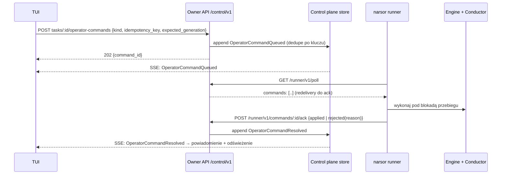
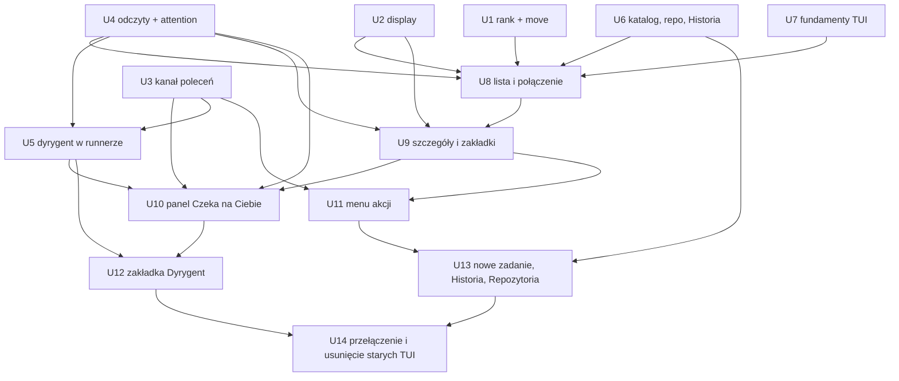

# feat: Przeprojektowanie TUI na modelu tasków control plane

## Summary

Faza A rozszerza control plane o brakujące elementy:

- `rank` i atomowy `move` w miejsce `priority`;
- sekcję `display` w schemacie workflow;
- ogólny kanał poleceń operatora do runnera, zbudowany na istniejącym long-pollu `/runner/v1/poll`;
- odczyty na żądanie (zdarzenia, stan dyrygenta), zrobione tak jak stronicowanie rozmowy;
- dyrygenta hostowanego w runnerze;
- katalog workflow, repozytoria i Historię przez `/control/v1`.

Faza B buduje jedno TUI na bazie `src/tui/remote.rs`:

- nowe moduły: mapa klawiszy, role stylów, komponent „lista + opis + pola”, lista, szczegóły z zakładkami, panel „Czeka na Ciebie”;
- funkcje przeniesione z lokalnego `App`;
- na końcu usunięcie starego `App` i `RemoteApp`.

---

## Problem Frame

Dziś są dwa TUI:

- lokalne `App` na starym API `/executions/*`;
- `RemoteApp` na `/control/v1`.

Mają rozbieżne skróty i różne zestawy funkcji. Od wdrożenia Unified Task Scheduler każde nowe lokalne zadanie jest taskiem control plane. Wykonuje je osobny proces `narsor runner`, a nie silnik w daemonie. Lokalne API odrzuca dla takich executions wszystkie mutacje (`require_legacy_execution` → „runner-owned”). W efekcie dla tasków nie działają:

- dyrygent;
- restart kroku z notatką;
- przejścia ręczne i override;
- przerwanie kroku.

Bez tego TUI nie może działać „wyłącznie przez owner API”, jak wymaga projekt (see origin: `docs/brainstorms/2026-10-08-tui-przeprojektowanie-design.md`). Ten plan domyka te braki, a potem buduje nowy interfejs.

---

## Requirements

Decyzje projektu (D-T1…D-T11) są wymaganiami nadrzędnymi. Poniższe R-ID wiążą je z jednostkami.

**Faza A — control plane**

- R1. Kolejka bez priorytetu: każdy task ma jawną pozycję `rank`.
  - Atomowa operacja `move` przyjmuje warianty: przed / za zadaniem, na początek, na koniec.
  - Scheduler przydziela sloty według `rank`.
  - Nowe zadanie trafia na koniec kolejki.
  - Zadania przyjęte do realizacji i zakończone zachowują swoje miejsce.
  - `priority` znika z API, CLI i zdarzeń. (D-T3, D-T4)
- R2. Sekcja `display` w YAML workflow (`title`, `links[]`) jest walidowana i renderowana do `TaskSummary`.
  - Nierozwiązana wartość daje pusty link, nie błąd.
  - Dopuszczalne schematy URL to tylko `http` i `https`. (D-T7)
- R3. `/control/v1` daje dla tasków:
  - przerwanie kroku;
  - przejście ręczne;
  - override z powodem i wpisem audytowym;
  - restart nieudanego kroku z notatką.
  - Polecenia dochodzą do runnera i są przez niego potwierdzane. (D-T11, origin §6 pkt 4)
- R4. `/control/v1` daje odczyt osi kroków, surowych zdarzeń execution i stanu dyrygenta (czat, decyzje, propozycje, diagnoza nieudanego kroku). (origin §6 pkt 4)
- R5. Dyrygent działa w runnerze na każdym backendzie, który ma dostęp do harnessu.
  - Wspiera czat, potwierdzanie i odrzucanie propozycji, cofanie decyzji oraz wybór harnessu.
  - Gdy dyrygent jest niedostępny, task zgłasza to jawnie.
- R6. `TaskSummary` niesie podsumowanie uwagi:
  - rodzaj oczekiwania: pytanie, approval, problem, nieudany krok, propozycja dyrygenta, nieudany provisioning;
  - liczbę oczekiwań.
  
  Dzięki temu lista nie musi dociągać szczegółów.
- R7. `/control/v1` udostępnia:
  - katalog workflow z opisami i deklaracjami wejść;
  - walidację workflow ze ścieżki (tylko lokalny daemon);
  - CRUD repozytoriów;
  - listę zarchiwizowanych tasków;
  - odczyt starych executions z jedną akcją wznów / recover.
- R8. Każda akcja TUI ma odpowiednik w CLI. Dotyczy to m.in. `narsor task move`, `interrupt`, `transition`, `restart-step` i `conductor …`. (D-T11)

**Faza B — TUI**

- R9. Jeden tryb TUI, wyłącznie przez `/control/v1`, z backendem wynikającym z konfiguracji.
  - `tui --remote` zostaje jako ignorowany alias z ostrzeżeniem.
  - Gdy serwer jest nieosiągalny, TUI i tak się otwiera. (D-T1, D-T10, origin §4)
- R10. Stabilna lista w kolejności `rank`, niegrupowana i niesortowana według stanu.
  - Wiersze zmieniają pozycję wyłącznie po jawnej akcji.
  - Zaznaczenie trzyma się `task_id`.
  - `z` ukrywa zakończone (jako filtr), `a` archiwizuje. (D-T2, D-T3, D-T5)
- R11. Układ: wąska lista (ok. 28 kolumn) i szczegóły z nagłówkiem `display` oraz zakładkami *Przebieg*, *Rozmowa*, *Zdarzenia*, *Dyrygent*, *Info*.
  - Poniżej 100 kolumn układ pełnoekranowy.
  - Poniżej ok. 60×20 komunikat „powiększ okno”. (D-T6, origin §1)
- R12. Panel „Czeka na Ciebie” na dole szczegółów obsługuje wszystkie rodzaje oczekiwania w schemacie lista + opis + pola.
  - Szkice przetrwają odświeżenie.
  - Szybka ścieżka `Space` / `Enter`.
  - Odmowa serwera i zniknięcie oczekiwania są obsłużone zgodnie z origin §2. (D-T8, D-T9)
- R13. Menu akcji `.` z bezpośrednimi skrótami.
  - Akcje niedostępne są wyszarzone z powodem.
  - Akcje `!` wymagają jednakowego potwierdzenia `y`/`n`.
  - Tryb przesuwania `m` oraz `K`/`J`. (origin §3)
- R14. Formularz nowego zadania w panelu szczegółów.
  - Klient generuje id zadania, a przy zgubionej odpowiedzi ponawia z tym samym id.
  - Wiersze `↻ wysyłanie…` i `✗ nie wysłano`. (origin §3)
- R15. Widoki Historia (`H`) i Repozytoria (`R`) w tym samym schemacie. (origin §3)
- R16. Jedna mapa klawiszy jest źródłem obsługi, podpowiedzi i pomocy `?`. Żaden klawisz nie ma dwóch znaczeń w jednym kontekście. (D-T10)
- R17. Kolorystyka:
  - role w jednym module;
  - wyłącznie 16 kolorów ANSI;
  - `NO_COLOR` bez utraty informacji;
  - kolor nigdy nie niesie informacji sam. (origin §5)
- R18. Odświeżanie:
  - zdarzenia `lifecycle` / `queue` / `move` / `input` łatają wiersz od razu;
  - pozostałe zdarzenia uruchamiają odświeżenie z opóźnieniem 400 ms;
  - działa okresowe `tui_refresh_interval`;
  - odświeżenie nie zmienia zaznaczenia, fokusu, zakładki, kursorów, trybu podążania ani szkiców;
  - bez połączenia dane są wyszarzone i oznaczone wiekiem, a mutacje zablokowane z powodem. (origin §4)

---

## Scope Boundaries

- Zmiana backendu i jego konfiguracji z poziomu TUI. (origin)
- Wiele backendów lub serwerów naraz. (origin)
- Wyszukiwanie na liście oraz filtrowanie inne niż przełącznik `z` ukrywający zakończone. (origin)
- Migracja zadań między backendami. (origin)
- Alias kompatybilności dla `priority` w API i CLI. Usunięcie jest twarde; jedynymi klientami są klienci in-tree.
- Nowe mutacje starych executions sprzed schedulera. Historia jest tylko do odczytu, z jedną akcją wznów / recover.
- Zmiana kolorów rodzajów wpisów rozmowy. Zostają jak dziś (origin §5); przenosimy je jedynie do modułu ról jako osobną skalę.

### Deferred to Follow-Up Work

- Usunięcie lokalnych tras `/executions/*` i komend CLI dla starych executions (`narsor input`, `conductor`, `steps` …). Zostają dla CLI i Historii. Decyzja o ich wygaszeniu po migracji starych danych zapadnie w osobnej zmianie.
- Ujednolicenie mapowania błędów klienta (`client_error` w `src/cli/commands.rs` vs `client_error_message` w `src/tui/app.rs`). Zrobimy to przy U14 tylko w zakresie, w jakim nowe TUI potrzebuje jednego mapowania. Pełne scalenie z CLI jest osobną zmianą.
- Konsolidacja wniosków z przeprojektowania w `docs/solutions/` (`/ce-compound`) po wdrożeniu.

---

## Context & Research

### Relevant Code and Patterns

- **Model i store control plane:** `src/orchestration/model.rs` i `src/orchestration/store.rs`.
  - `TaskRecord` z polami `priority`, `queue_sequence`, `revision`, `generation`.
  - Pliki JSON z atomowym zapisem, wersja `TASK_RECORD_VERSION`.
  - Pola dodawane z `#[serde(default)]`.
  - Brak frameworka migracji: rekord z wyższą wersją jest odrzucany.
- **Admisja:** `ControlPlane::schedule` w `src/orchestration/scheduler.rs` sortuje według `priority` malejąco i `queue_sequence` rosnąco. `set_priority` jest wzorcem dla `move`: tylko `Queued`, `expected_generation`, odmowa → odświeżenie.
- **Owner API:** `owner_routes` w `src/controller_protocol/http.rs`, typy w `src/controller_protocol/wire.rs`, logika w `src/controller_protocol/service.rs`, klient w `src/api/client.rs`.
- **Kanał do runnera:** `RunnerPollResponse`, `InputQueued`, `POST /runner/v1/inputs/:id/ack`.
  - Dostarczanie trwa do potwierdzenia; to wzorzec dla poleceń operatora.
  - `ConversationPageRequest` i `POST /runner/v1/conversation-pages/:request_id` to relay w pamięci, bez centralnej repliki; wzorzec dla odczytów na żądanie.
- **Runner:** `src/runner/*` oraz `src/backends/local.rs`. Lokalny backend uruchamia osobny proces `narsor runner`.
- **Dyrygent:** `src/conductor/*` (`ConductorRegistry`, chat, proposal, undo, failure).
  - Dziś jest podpięty tylko w daemonie: `src/cli/daemon.rs`, `Engine::attach_conductor` w `src/engine/runner.rs`.
  - Odtwarzanie przy starcie: `restore_at_startup` i `restore_failures_at_startup`.
- **Lokalne trasy starych executions:** `src/api/routes.rs`.
  - Wzorce semantyki: `post_transition` (`allow_manual_override`), `post_recover` (klucz epizodu awarii), interrupt, operator-note, conductor.
  - `require_legacy_execution` odcina taski.
- **Schemat workflow:**
  - `WORKFLOW_SCHEMA.md` (katalog główny repo);
  - `src/workflow/schema.rs` (`deny_unknown_fields`);
  - `src/workflow/validator.rs` (zbiera pełną listę naruszeń);
  - `src/workflow/template.rs` (własny silnik: `inputs.X`, `context.variables.X`; nieznana zmienna to błąd).
- **CLI:** `src/cli/remote.rs` (`TaskCommand`) i `src/cli/mod.rs`. `tui` / `tui --remote` wybierane w `src/cli/mod.rs`, implementacja w `src/cli/commands.rs`.
- **TUI do ponownego użycia:**
  - `src/tui/remote.rs`: `RemoteApp`, `RemoteStream`, `on_stream`, `select`, generacje, idempotency key;
  - `src/tui/refresh.rs`: `RefreshSchedule`, debounce 400 ms;
  - `src/tui/transcript.rs`, `src/tui/conversation.rs`, `src/tui/scroll.rs`;
  - `src/tui/input_form.rs`: `InputForm`, `InputKind`, `ProblemForm`;
  - `src/tui/failure_form.rs`;
  - `src/tui/chat.rs`.
- **Testy TUI:**
  - `tests/tui_state.rs`: lokalne testy z prawdziwym daemonem; moduł `remote_tasks` na `tests/remote_support/mod.rs::RemoteHarness`;
  - render przez `TestBackend` ze spłaszczonym buforem;
  - `views::layout` testowany jako czysta geometria.

### Institutional Learnings

- Stabilna kolejność listy (memory `tui-stable-task-order`). Notatka wspomina zmianę priorytetu i wymaga aktualizacji na `move`.
- Zombie daemony w testach: `pid_alive` musi sprawdzać stan `Z` w `/proc/<pid>/stat` (commit `c7f3f0d`). Nowe fixture'y korzystają z tego helpera.
- Testy stanu i renderu nie powinny uruchamiać daemona (commit `5728910`). Należy preferować `RemoteHarness` albo czyste funkcje.
- Wyścig observe/remove w `LocalBackend::observe` jest naprawiony. Flake ETXTBSY w `actions_agent` istniał wcześniej; nie traktować go jako regresji.
- SSE `/control/v1` wznawia od kursora, a mimo to okresowy odczyt listy zostaje jako zabezpieczenie (residual review).
- Semantyka formularzy odpowiedzi wynika z poprawek `3f3dab2`, `4ca1e73`, `2a9c6f2`, `9c6af7f` i `c7f3f0d`. Testy w `tests/tui_state.rs` ją kodują, więc należy je przepisać, a nie usuwać.
- Recovery: każda nowa reguła odtwarzania musi być testowana przez prawdziwy start (`tests/daemon_lifecycle.rs`). Dotyczy to też odtwarzania dyrygenta w runnerze.
- `post_transition` ma TOCTOU (sprawdza stan raz, potem zapisuje). Polecenia przejścia w runnerze wykonujemy pod tą samą blokadą aktywnego przebiegu co silnik.

### External References

Nie użyto. Repo ma silne wzorce dla ratatui 0.30 i control plane.

---

## Key Technical Decisions

- **`rank` jako gęsta pozycja w kolejce backendu, przenumerowywana pod blokadą harmonogramu.**
  - `move` przyjmuje kotwicę (przed / za `task_id`, początek, koniec) i `expected_revision` listy albo `expected_generation` przesuwanego tasku.
  - Wykonuje się pod `backends/{b}/schedule.lock`.
  - Przesuwać można tylko zadania `Queued`. Kotwica może być dowolnym widocznym zadaniem.
  - Zadania przyjęte i zakończone mają `rank`, ale `move` ich nie dotyczy.
  - Uzasadnienie: kilkanaście zadań nie uzasadnia rangi ułamkowej. Gęsta pozycja jest czytelna w CLI i w zdarzeniach.
- **Migracja przy odczycie, bez frameworka migracji.**
  - `TASK_RECORD_VERSION` rośnie do 2.
  - Store wczytuje rekordy v1 i nadaje im `rank` z dotychczasowej kolejności (priority malejąco, `queue_sequence` rosnąco). Robi to raz, pod blokadą harmonogramu, przy pierwszym dostępie do backendu.
  - Pole `priority` jest ignorowane przy odczycie.
  - Zdarzenie `PriorityChanged` zostaje tylko do deserializacji starych logów (wyświetlane jako historyczne). Nowe zdarzenie `Moved` niesie nową pozycję.
- **Kolejność listy liczy serwer.** `list_tasks` zwraca taski według `rank`, a klient nie sortuje. Zdarzenie `Moved` w strumieniu niesie pełną nową kolejność backendu, więc klient łata listę bez ponownego odczytu.
- **Szablony `display` używają istniejącej składni:** `inputs.X` oraz `context.variables.X`. Przykład w dokumencie projektu zostanie poprawiony.
  - Dla `display` dodajemy łagodny tryb renderowania: nieznana albo nieobecna zmienna daje pusty wynik, a nie błąd.
  - Walidacja statyczna nadal odrzuca odwołanie do niezadeklarowanego `inputs.X`.
- **Renderowanie `display` w dwóch miejscach.**
  - Control plane renderuje `title` i `links` z zapieczętowanych `inputs` przy tworzeniu, więc zadanie w kolejce ma tytuł od razu.
  - Runner renderuje je ponownie z `context.variables` i raportuje w snapshocie. Ostatni raport wygrywa.
  - URL jest walidowany po renderowaniu; schemat inny niż `http(s)` daje pusty link.
- **Polecenia operatora mają wzorzec „queue on task, deliver via poll, ack”**, taki sam jak `InputQueued`.
  - Nowy typ `OperatorCommand`:
    - `Interrupt`;
    - `Transition { target, override, reason }`;
    - `RestartStep { note, failure_key }`;
    - `ConductorChat { text }`;
    - `ConfirmProposal` i `RejectProposal`;
    - `UndoDecision`;
    - `SetConductorHarness`.
  - Każde polecenie ma idempotency key i `expected_generation`.
  - Polecenie trafia do rekordu jako zdarzenie `OperatorCommandQueued`. Runner odbiera je w `RunnerPollResponse.commands`, wykonuje pod blokadą przebiegu silnika i potwierdza wynikiem (zastosowane / odrzucone z powodem). Potwierdzenie daje zdarzenie `OperatorCommandResolved`.
  - Klient czeka na rozstrzygnięcie przez strumień.
  - Gdy runner nie żyje, a task nie ma statusu `Running`, polecenie jest odrzucane od razu z powodem.
  - Uzasadnienie: jeden mechanizm dla lokalnego i zdalnego backendu, z istniejącym fencingiem i redelivery.
- **Odczyty na żądanie mają wzorzec relay, jak strony rozmowy.** Zdarzenia execution i stan dyrygenta pobiera się przez żądanie w `RunnerPollResponse` i upload odpowiedzi; nie ma centralnej repliki.
  - Dla lokalnego backendu, gdy runner nie działa (task wstrzymany albo zakończony), owner API czyta wprost ze storage tasku, tak jak dziś `owner_execution_store_for`.
  - Dla zdalnego backendu bez żywego runnera zakładki pokazują „dostępne, gdy runner działa”.
- **Podsumowanie uwagi w snapshocie runnera.**
  - Runner raportuje:
    - `attention`: lista oczekiwań z rodzajem, krokiem, czasem i id;
    - `conductor_available`;
    - `failure_pending`: nieudany krok czekający na dyrygenta albo operatora;
    - wyrenderowany `display`.
  - Control plane dodaje do tego nieudany provisioning.
  - `TaskSummary` niesie tylko listę metadanych. Treść (pytanie, propozycje) pobiera się z detalem.
- **Dyrygent w runnerze.**
  - Runner tworzy `ConductorRegistry` z `HarnessInvoker` i podpina go do swojego `Engine`.
  - Stan dyrygenta zapisuje w storage tasku, a przy starcie runnera wywołuje `restore_at_startup` i `restore_failures_at_startup`.
  - Brak harnessu: `conductor_available = false` z powodem, a nieudany krok idzie wprost do operatora jako oczekiwanie „Nieudany krok” bez propozycji.
  - Kod z `src/cli/daemon.rs` jest wydzielony do wspólnej funkcji składającej dyrygenta, której używają daemon (stare executions) i runner.
- **Ścieżka workflow w nowym zadaniu tylko dla lokalnego daemona.**
  - Lokalna fasada tworzenia już pieczętuje referencje plikowe (KTD1 planu schedulera).
  - Owner API zgłasza w `capabilities`, czy przyjmuje ścieżkę. Dla zdalnego serwera pozycja „ścieżka…” jest wyszarzona z powodem.
- **Nowy `App` buduje się obok starych, a przełączenie następuje w ostatniej jednostce.** Nowe moduły powstają w `src/tui/` pod nowymi nazwami, a `tui::run` przełącza się na nie w U14, razem z usunięciem `app.rs`, `views.rs`, `remote.rs` i `remote_views.rs`. Pozwala to rozwijać fazę B przyrostowo bez psucia działającego TUI.
- **Mapa klawiszy jako dane.**
  - Statyczna tabela `(kontekst, klawisz, akcja, etykieta, opis)` generuje obsługę (lookup), pasek podpowiedzi i pomoc `?`.
  - Test spójności sprawdza unikalność klawisza w kontekście oraz zgodność pomocy z obsługą.
- **Moduł ról stylów.**
  - Widoki odwołują się do ról (`Attention`, `Problem`, `Live`, `Calm`, `Done`, `Focus`, `Conductor`, `Link`, `Selected`) i skali wpisów rozmowy. Nie odwołują się do `Color::`.
  - Przy `NO_COLOR` moduł mapuje role na pogrubienie, przygaszenie i odwrócenie.
  - Test sprawdza, że w nowych widokach nie ma `Color::` poza modułem ról.
  - Obecne kolory RGB rozmowy zamieniamy na najbliższe z 16 kolorów ANSI. Zasada „tylko 16 kolorów” obowiązuje cały TUI, a origin zachowuje jedynie *rozróżnienie* rodzajów wpisów.

---

## Open Questions

### Resolved During Planning

- **Zakres parytetu:** jeden plan, fazy A i B, z pełnym parytetem łącznie z dyrygentem w runnerze (decyzja Artura).
- **`priority`:** twarde usunięcie z migracją przy odczycie (potwierdzone).
- **Składnia szablonów `display`:** `context.variables.X` (potwierdzone).
- **Dyrygent na Kubernetes:** wszędzie, gdzie runner ma harness; poza tym jawny brak (potwierdzone).
- **Stare executions:** tylko Historia, z akcją wznów / recover (potwierdzone).
- **Kolejność listy:** liczy serwer według `rank`. Klient nie sortuje.

### Deferred to Implementation

- Dokładny kształt `attention` w snapshocie oraz to, czy liczyć go w runnerze, czy w projekcji control plane z `pending_input` i `problem`. Rozstrzygnie się po dotknięciu `runner_state.rs`.
- Czy relay odczytów (zdarzenia, dyrygent) dzieli jeden typ żądania z `ConversationPageRequest`, czy ma osobne typy.
- Co Historia pokazuje dla zarchiwizowanego tasku, którego storage usunięto. Prawdopodobnie tylko rekord i log zdarzeń control plane, a zakładki *Rozmowa* i *Zdarzenia* z komunikatem „storage usunięty przy archiwizacji”.
- Mapowanie obecnych kolorów RGB rozmowy na 16 kolorów ANSI. Ustalić wizualnie na jasnym i ciemnym tle.
- Czy `restart kroku` dla nieudanego provisioningu korzysta z istniejącego `OwnerCommand::Start`, czy potrzebuje osobnego wariantu.

---

## High-Level Technical Design

> *Poniższe ilustruje zamierzone podejście i jest wskazówką kierunkową do przeglądu, nie specyfikacją implementacji. Implementujący traktuje to jako kontekst, nie kod do odtworzenia.*

Przepływ polecenia operatora (np. przerwanie kroku, potwierdzenie propozycji dyrygenta):

Kolejność jednostek i zależności:

U7 nie zależy od fazy A i może iść równolegle z U1–U6.

---

## Implementation Units

### Faza A — control plane

### U1. Kolejka według `rank` i operacja `move`

**Goal:** Zastąpić `priority` jawną pozycją w kolejce z atomowym `move`. Zmiana obejmuje model, scheduler, API, CLI i dokumentację.

**Requirements:** R1, R8

**Dependencies:** brak

**Files:**
- Modify:
  - `src/orchestration/model.rs`
  - `src/orchestration/store.rs`
  - `src/orchestration/scheduler.rs`
  - `src/orchestration/error.rs`
  - `src/controller_protocol/wire.rs`
  - `src/controller_protocol/service.rs`
  - `src/controller_protocol/http.rs`
  - `src/api/client.rs`
  - `src/cli/remote.rs`
  - `src/tui/remote.rs`, `src/tui/remote_views.rs`, `src/tui/app.rs`, `src/tui/views.rs`, `src/tui/mod.rs` (usunięcie `P` / `+` / `-`, żeby stare TUI się kompilowały)
  - `README.md`
  - `docs/operations/remote-backends.md`
  - `docs/plans/2026-10-07-1923-feat-unified-task-scheduler-plan.md` (R3, R5, KTD „Priority starts at zero”, AE2: adnotacja o zastąpieniu)
- Test:
  - `tests/orchestration.rs`
  - `tests/controller_protocol.rs`
  - `tests/api.rs`
  - `tests/sse.rs`
  - `tests/cli_smoke.rs`
  - `tests/remote_support/mod.rs`
  - `tests/tui_state.rs` (usunięcie testów priorytetu)

**Approach:**
- Rekord: nowe pole `rank`. Usunięcie `priority` z `NewTask`, `CreateTaskRequest`, `TaskSummary` i `SetPriorityRequest`.
- Store:
  - wersja rekordu 2;
  - jednorazowe nadanie rangi dla rekordów v1 przy pierwszym dostępie do backendu, pod `schedule.lock`;
  - `list_tasks` sortuje według `rank`.
- `schedule` wybiera spośród `Queued` bez rezerwacji najniższy `rank`. Pozycja oczekiwania w `QueueReason::WaitingForCapacity` liczy się według `rank`.
- `move`:
  - wykonuje się pod `schedule.lock`;
  - działa tylko na `Queued`;
  - przenumerowuje pozycje i emituje zdarzenie `Moved` z pełną nową kolejnością.
  - Odrzuca, gdy:
    - kotwica nie istnieje;
    - task nie jest w kolejce;
    - `expected_generation` się nie zgadza.
- Nowe zadanie dostaje `rank` = koniec kolejki.
- CLI:
  - `narsor task move <task> --before <X> | --after <X> | --top | --bottom`;
  - usunięcie `task priority` i `--priority`;
  - kolumna `p{n}` w `task list` zastąpiona `#n`.
- Zaktualizować notatkę pamięci `tui-stable-task-order.md`, żeby mówiła o `move` zamiast priorytetu.

**Patterns to follow:** `ControlPlane::set_priority` (guard generacji, idempotencja), atomowy zapis w `store.rs`, zdarzenie `QueueChanged`.

**Test scenarios:**
- Happy path:
  - Trzy taski w kolejce A, B, C, `move C --top` → lista C, A, B; zdarzenie `Moved` z tą kolejnością; scheduler przy wolnym slocie przyjmuje C.
  - Nowe zadanie przy kolejce A, B → ląduje na końcu z pozycją oczekiwania #3.
  - `move A --after C` i `--before B` dają oczekiwaną kolejność. `--bottom` na ostatnim jest idempotentny i nie emituje zdarzenia.
- Edge case:
  - Zadania przyjęte i zakończone zachowują miejsce na liście, gdy queued przesuwa się nad nie albo pod nie.
  - Pozycja oczekiwania `#n` liczy tylko zadania w kolejce.
  - Store z rekordami v1 o priorytetach 5, 0, 0 (FIFO) → po wczytaniu rank odpowiada kolejności „priority malejąco, potem FIFO”, a ponowny odczyt nie zmienia rang.
  - Zdarzenie `PriorityChanged` w starym logu deserializuje się i nie psuje strumienia.
- Error path:
  - `move` zadania `Running` → odmowa z powodem.
  - `move` z nieaktualnym `expected_generation` → konflikt.
  - Kotwica nieistniejąca albo z innego backendu → odmowa.
  - Dwa równoległe `move` są szeregowane i oba zdarzenia odzwierciedlają ostateczny stan.
- Integration:
  - SSE dostarcza `Moved` klientowi, który wznawia od kursora sprzed ruchu.
  - `narsor task move` daje ten sam wynik co owner API.
  - `narsor task create --priority` jest odrzucane jako nieznana flaga.

**Verification:** W kodzie, API i CLI nie ma `priority` dotyczącego tasków; zostaje tylko kolejka dwupriorytetowa dyrygenta i deserializacja starych zdarzeń. Admisja i lista działają według `rank`.

---

### U2. Sekcja `display` w workflow

**Goal:** Workflow deklaruje tytuł i linki zadania. Control plane i runner renderują je do `TaskSummary`.

**Requirements:** R2

**Dependencies:** brak

**Files:**
- Modify:
  - `src/workflow/schema.rs`
  - `src/workflow/validator.rs`
  - `src/workflow/template.rs`
  - `src/domain/workflow_definition.rs`
  - `src/controller_protocol/wire.rs` (`TaskSummary.display`, pole w snapshocie runnera)
  - `src/controller_protocol/service.rs`
  - `src/orchestration/model.rs`
  - `src/orchestration/runner_state.rs`
  - `src/runner/snapshot.rs`
  - `WORKFLOW_SCHEMA.md`
  - `docs/brainstorms/2026-10-08-tui-przeprojektowanie-design.md` (przykład `context.variables`)
  - wbudowane workflow w `src/workflows/` (tytuł i linki tam, gdzie mają sens)
- Test:
  - `tests/validation.rs`
  - `tests/template.rs`
  - `tests/schema_loading.rs`
  - `tests/controller_protocol.rs`
  - `tests/builtin_workflows.rs`

**Approach:**
- Opcjonalna sekcja `display { title?, links[] { label, text?, url } }` w `WorkflowFile`.
- Walidacja statyczna:
  - odwołania `inputs.X` muszą być zadeklarowane;
  - `label` jest niepusty i unikalny;
  - błędy trafiają do tej samej listy naruszeń co reszta walidacji.
- Łagodny tryb renderowania w `template.rs`: brakująca zmienna daje pusty tekst; składnia i odwołania do filtrów dalej są błędem walidacji.
- Po renderowaniu URL jest parsowany. Schemat inny niż `http` / `https` albo pusty URL daje link bez wartości.
- `TaskSummary.display { title, links[] { label, text, url? } }` jest renderowane przy tworzeniu z `inputs`, a nadpisywane z raportu runnera, który ma `context.variables`.

**Patterns to follow:** `validate` / `ValidationError` w `src/domain/workflow_definition.rs`, `TemplateScope::render`.

**Test scenarios:**
- Happy path:
  - Workflow z `title: "{{ inputs.ticket_id }}"` i linkiem Jira → po utworzeniu `TaskSummary.display.title == "NAR-12"`, link z pełnym URL.
  - Link PR z `context.variables.pr_url`: przy tworzeniu bez wartości; po raporcie runnera, gdy zmienna jest ustawiona, z URL.
- Edge case:
  - Brak sekcji `display` → `title` jest pusty i TUI użyje id zadania.
  - Zmienna nieobecna → link bez wartości, nie błąd.
  - Pusty tekst linku → etykieta z `—`.
- Error path:
  - `inputs.nieistnieje` w `display` → naruszenie w `narsor validate`, razem z innymi naruszeniami, nie zamiast nich.
  - Zduplikowany `label` → naruszenie.
  - Wyrenderowany URL `javascript:alert(1)` albo `file:///etc/passwd` → link bez wartości.
  - Nieznane pole w `display` → odrzucone (`deny_unknown_fields`).
- Integration: wszystkie wbudowane workflow przechodzą walidację z nową sekcją.

**Verification:** `narsor validate` raportuje naruszenia `display`. `narsor task show` i `TaskSummary` pokazują tytuł i linki.

---

### U3. Kanał poleceń operatora do runnera

**Goal:** Owner może przez `/control/v1` przerwać krok, wykonać przejście ręczne lub override i zrestartować nieudany krok z notatką. Polecenia dochodzą do runnera niezawodnie.

**Requirements:** R3, R8

**Dependencies:** brak (U5 rozszerza ten kanał o polecenia dyrygenta)

**Files:**
- Modify:
  - `src/orchestration/model.rs` (zdarzenia `OperatorCommandQueued` / `OperatorCommandResolved`, stan oczekujących poleceń w rekordzie)
  - `src/orchestration/control_plane.rs`
  - `src/controller_protocol/wire.rs`
  - `src/controller_protocol/service.rs`
  - `src/controller_protocol/http.rs` (owner: `POST /control/v1/tasks/:id/operator-commands`; runner: `commands` w poll i `POST /runner/v1/commands/:id/ack`)
  - `src/controller_protocol/client.rs`
  - `src/runner/mod.rs`
  - `src/engine/runner.rs` (wejścia dla przerwania, przejścia i restartu wywoływane spoza API)
  - `src/api/routes.rs` (wydzielenie logiki przejść, restartu i przerwania z handlerów)
  - `src/api/client.rs`
  - `src/cli/remote.rs`
- Test:
  - `tests/controller_protocol.rs`
  - `tests/orchestration.rs`
  - `tests/runner.rs`
  - `tests/backend_contract.rs`
  - `tests/cli_smoke.rs`

**Approach:**
- `OperatorCommand` z wariantami `Interrupt`, `Transition { target, override, reason }` i `RestartStep { note, failure_key }`. Lista jest otwarta na warianty dyrygenta z U5.
- Owner API:
  - waliduje wstępnie stan tasku (`Running`, runner żywy) i `expected_generation`;
  - zapisuje polecenie idempotentnie po kluczu.
- Override:
  - wymaga `allow_manual_override` w zapieczętowanej definicji;
  - wymaga niepustego powodu;
  - powód i autor trafiają do zdarzenia jako audyt.
- Runner wykonuje polecenia pod tą samą blokadą przebiegu co silnik (bez TOCTOU) i potwierdza wynikiem. Redelivery trwa do potwierdzenia; ponowne wykonanie tego samego id jest no-op.
- Logika przejść, restartu i przerwania jest wydzielona z handlerów w `src/api/routes.rs` do funkcji silnika używanych przez obie ścieżki.
- CLI:
  - `narsor task interrupt <task>`;
  - `narsor task transition <task> <target> [--override --reason <r>]`;
  - `narsor task restart-step <task> --note <n>`.
  - Wszystkie komendy czekają na rozstrzygnięcie albo timeout z informacją, że polecenie jest w kolejce.

**Patterns to follow:** `InputQueued` + `DeliveredInput` + `post_input_ack`, `post_transition` / `post_recover` / interrupt w `src/api/routes.rs`.

**Test scenarios:**
- Happy path:
  - Task w kroku agenta, `Interrupt` → runner potwierdza, krok przerwany, zdarzenie `OperatorCommandResolved(applied)`.
  - Przejście ręczne do dozwolonego wyjścia → execution przechodzi do stanu docelowego.
  - `RestartStep` z notatką na nieudanym kroku → krok startuje ponownie, notatka widoczna w kontekście agenta.
- Edge case:
  - Ten sam idempotency key dwa razy → jedno polecenie.
  - Runner restartuje się przed ack → polecenie dostarczone ponownie i wykonane raz.
  - Polecenie dla tasku `Queued` → odmowa z powodem „jeszcze nie wystartowało”.
- Error path:
  - Override bez `allow_manual_override` → odmowa.
  - Override bez powodu → odmowa.
  - `RestartStep` z nieaktualnym `failure_key` (awaria już obsłużona) → runner odrzuca z powodem, a zdarzenie `Resolved(rejected)` niesie przyczynę.
  - Przejście do stanu, który nie jest wyjściem i nie ma override → odmowa.
- Integration:
  - Lokalny backend end-to-end: daemon, kontroler, proces runnera. CLI `task interrupt` kończy się sukcesem.
  - Kontrakt backendu (fake / local) dostarcza polecenia przez poll.
  - Zdarzenie z audytem override pojawia się w `narsor task events`.

**Verification:** Każda mutacja, którą dziś lokalne API odrzuca jako „runner-owned”, ma odpowiednik w owner API i CLI. Działa na lokalnym i zdalnym runnerze.

---

### U4. Odczyty szczegółów tasku i podsumowanie uwagi

**Goal:** TUI dostaje przez `/control/v1` wszystko, czego potrzebuje do zakładek i listy:

- oś kroków;
- surowe zdarzenia execution ze szczegółem;
- treść oczekiwań;
- podsumowanie uwagi na poziomie `TaskSummary`.

**Requirements:** R4, R6

**Dependencies:** brak

**Files:**
- Modify:
  - `src/controller_protocol/wire.rs` (`TaskSummary.attention`, żądania relay dla zdarzeń, odpowiedzi)
  - `src/controller_protocol/http.rs` (`GET /control/v1/tasks/:id/execution-events?after=`, uzupełnienie `timeline`)
  - `src/controller_protocol/service.rs`
  - `src/orchestration/runner_state.rs`
  - `src/runner/snapshot.rs`
  - `src/runner/mod.rs`
  - `src/api/client.rs`
  - `src/cli/remote.rs` (`narsor task steps`, `narsor task events --execution`)
- Test:
  - `tests/controller_protocol.rs`
  - `tests/runner.rs`
  - `tests/sse.rs`
  - `tests/cli_smoke.rs`

**Approach:**
- Snapshot runnera rozszerzony o `attention` (rodzaj, `state_id`, `since`, id oczekiwania) wyliczone z `pending_input.continuation` i `problem`.
- Control plane dokłada do `attention` nieudany provisioning.
- Zdarzenia execution idą przez relay jak strony rozmowy. Dla lokalnego backendu bez żywego runnera owner API czyta je ze storage tasku.
- Oś kroków: istniejący `timeline` ze snapshotu, z bieżącą próbą.

**Patterns to follow:** `ConversationPageRequest` relay, `owner_execution_store_for`.

**Test scenarios:**
- Happy path:
  - Runner czeka na approval → `TaskSummary.attention == [Approval{state, since}]`.
  - Runner z problemem → `[Problem]`.
  - Nieudany provisioning → `[ProvisioningFailed]` bez execution.
- Edge case:
  - Dwa oczekiwania naraz (pytanie + propozycja dyrygenta, po U5) → oba w kolejności czasu.
  - Task wstrzymany na lokalnym backendzie → zdarzenia czytane ze storage.
  - Task zdalny bez żywego runnera → odpowiedź „niedostępne, runner nie działa”, nie 500.
- Error path:
  - Relay bez odpowiedzi runnera w limicie czasu → błąd 503 z powodem; klient pokazuje go w zakładce.
- Integration: zmiana `attention` emituje zdarzenie `RunnerReported`, które łata wiersz w kliencie bez pełnego odczytu.

**Verification:** Lista TUI może pokazać znaczniki `?` / `!` z samego `TaskSummary`, a zakładki mają źródło danych dla każdego stanu tasku.

---

### U5. Dyrygent w runnerze

**Goal:** Dyrygent działa dla tasków na każdym backendzie z harnessem. Czat, propozycje, decyzje, cofanie i wybór harnessu są dostępne przez `/control/v1` i CLI.

**Requirements:** R3, R4, R5, R8

**Dependencies:** U3, U4

**Files:**
- Create: `src/conductor/assembly.rs` (wspólne składanie `ConductorRegistry` dla daemona i runnera)
- Modify:
  - `src/cli/daemon.rs`
  - `src/runner/mod.rs`
  - `src/runner/init.rs`
  - `src/conductor/mod.rs`
  - `src/conductor/chat.rs`
  - `src/controller_protocol/wire.rs` (warianty `OperatorCommand` dla dyrygenta, relay stanu dyrygenta, `conductor_available` w snapshocie)
  - `src/controller_protocol/http.rs` (`GET /control/v1/tasks/:id/conductor`)
  - `src/controller_protocol/service.rs`
  - `src/cli/remote.rs` (`narsor task conductor chat|history|confirm|reject|undo|harness`)
  - `src/backends/kubernetes/*` (przekazanie konfiguracji harnessu, jeśli obraz go ma)
  - `docs/follow-ups/2026-10-03-zdalne-backendy-pozostale-prace.md` (zamknięcie punktu „Conductor w runnerze”)
- Test:
  - `tests/conductor_chat.rs`
  - `tests/conductor_failure.rs`
  - `tests/runner.rs`
  - `tests/controller_protocol.rs`
  - `tests/daemon_lifecycle.rs`
  - `tests/cli_smoke.rs`

**Approach:**
- Wydzielić z `src/cli/daemon.rs` składanie dyrygenta i odtwarzanie przy starcie.
- Runner składa dyrygenta przy starcie, gdy harness jest dostępny, i wywołuje `restore_at_startup` oraz `restore_failures_at_startup` na swoim storage.
- Nowe warianty `OperatorCommand`: `ConductorChat`, `ConfirmProposal`, `RejectProposal`, `UndoDecision` i `SetConductorHarness`.
- Odczyt stanu dyrygenta (czat, decyzje, propozycje, diagnoza nieudanego kroku) przez relay, a dla lokalnego backendu bez runnera ze storage.
- Snapshot: `conductor_available` z powodem. Przy braku dyrygenta nieudany krok trafia do `attention` jako „Nieudany krok” bez propozycji (restart z notatką, przejścia).
- Propozycje z czatu pojawiają się w `attention` jako „Propozycja dyrygenta”.

**Execution note:** Najpierw przenieść istniejące testy `tests/conductor_*.rs` na wydzielone składanie (charakteryzacja), dopiero potem podpiąć runner.

**Patterns to follow:** `ConductorRegistry::new(...).with_pass_launcher(...)` w `src/cli/daemon.rs`, `Engine::attach_conductor`.

**Test scenarios:**
- Happy path:
  - Nieudany krok w tasku lokalnym → dyrygent diagnozuje i zgłasza propozycję. `attention` zawiera „Nieudany krok” z propozycjami. `ConfirmProposal` wykonuje ją i oczekiwanie znika.
  - `ConductorChat` → odpowiedź dyrygenta widoczna w odczycie czatu.
  - `UndoDecision` → decyzja cofnięta, wpis w historii.
- Edge case:
  - Restart runnera w trakcie nieodpowiedzianego czatu → po starcie czat odtworzony (test przez prawdziwy start w `tests/daemon_lifecycle.rs`).
  - `SetConductorHarness` w trakcie przebiegu działa od następnego wywołania.
- Error path:
  - Runner bez harnessu → `conductor_available=false` z powodem, nieudany krok od razu w `attention` bez propozycji.
  - `ConfirmProposal` dla propozycji już rozstrzygniętej → odrzucone z powodem.
- Integration:
  - Stare executions w daemonie nadal mają dyrygenta (regresja `tests/conductor_*.rs`).
  - CLI `task conductor confirm` daje ten sam efekt co owner API.

**Verification:** Punkt „Conductor w runnerze” z follow-upów jest zamknięty. Testy dyrygenta przechodzą zarówno dla starych executions, jak i dla tasków.

---

### U6. Katalog workflow, repozytoria, Historia i capabilities przez `/control/v1`

**Goal:** Nowe zadanie, Repozytoria i Historia działają przez owner API, także na zdalnym serwerze.

**Requirements:** R7, R8

**Dependencies:** brak

**Files:**
- Modify:
  - `src/controller_protocol/http.rs` (`GET /control/v1/workflows`, `POST /control/v1/workflows/validate`, `GET|POST|DELETE /control/v1/repositories`, `GET /control/v1/tasks?archived=true`, `GET /control/v1/executions` z odczytem szczegółów i `POST …/executions/:id/recover`, `GET /control/v1/capabilities`)
  - `src/controller_protocol/wire.rs`
  - `src/controller_protocol/service.rs`
  - `src/api/client.rs`
  - `src/registry/store.rs`
  - `src/api/routes.rs` (wspólne funkcje odczytu starych executions)
- Test:
  - `tests/controller_protocol.rs`
  - `tests/registry.rs`
  - `tests/api.rs`
  - `tests/workflows.rs`

**Approach:**
- Katalog zwraca workflow wbudowane i z katalogu, z `description`, deklaracjami wejść (typ, opis, wymagane) i wersją.
- `capabilities` mówi m.in.:
  - czy serwer przyjmuje ścieżkę workflow (tylko lokalny daemon);
  - czy ma stare executions;
  - jaka jest nazwa połączenia, potrzebna do nagłówka TUI.
- Walidacja ścieżki zwraca pełną listę naruszeń jak `narsor validate`.
- Repozytoria: CRUD na `RepositoryRegistry` serwera.
- Historia:
  - zarchiwizowane taski (od najnowszych);
  - stare executions z lokalnego store, gdy są (tylko lokalny daemon);
  - recover dla starego execution, które na to pozwala.

**Patterns to follow:** istniejące odczyty `/executions/*` w `src/api/routes.rs`, `narsor repo` w `src/cli/mod.rs`.

**Test scenarios:**
- Happy path:
  - Katalog zawiera wbudowane `implement-feature` z opisem i wejściami.
  - Dodanie, lista i usunięcie repozytorium przez API są widoczne w `narsor repo list`.
  - Historia zawiera zarchiwizowany task i stare execution.
  - Recover starego execution w stanie Failed wznawia je.
- Edge case:
  - Zdalny serwer → `capabilities.workflow_paths=false`, Historia bez starych executions.
  - Pusta Historia → pusta lista, nie błąd.
- Error path:
  - Walidacja ścieżki z trzema naruszeniami → wszystkie trzy w odpowiedzi.
  - Usunięcie nieistniejącego repozytorium → 404.
  - Recover execution, które na to nie pozwala → odmowa z powodem.
- Integration: owner gate obowiązuje na nowych trasach (`tests/auth.rs`).

**Verification:** Wszystko, czego potrzebuje nowe TUI, jest osiągalne przez `/control/v1`, bez sięgania do lokalnych plików ani tras `/executions/*`.

---

### Faza B — TUI

### U7. Fundamenty: role stylów, mapa klawiszy, komponent wyboru, stan połączenia

**Goal:** Wspólne klocki, z których korzystają wszystkie widoki nowego TUI.

**Requirements:** R16, R17, R18 (stan połączenia), D-T9

**Dependencies:** brak

**Files:**
- Create:
  - `src/tui/style.rs`
  - `src/tui/keymap.rs`
  - `src/tui/chooser.rs` (lista + opis + pola: zaznaczenie, znaczniki `↩` / `◆` / `!`, wybór cyfrą, pola zachowujące wartości między akcjami, układ wąski z opisem pod listą)
  - `src/tui/connection.rs` (stany `live` / `ponawiam (Ns)` / `brak połączenia`, wiek danych, blokada mutacji z powodem)
- Modify: `src/tui/mod.rs`
- Test:
  - `tests/tui_state.rs` (nowy moduł `foundations`)
  - `tests/tui_render.rs` (nowy plik na testy renderu `TestBackend`)

**Approach:**
- Role zgodne z tabelą origin §5. `NO_COLOR` czytany raz przy starcie i przekazywany do stylu.
- Mapa klawiszy:
  - konteksty: wszędzie, lista, szczegóły, panel, menu, formularz, tryb przesuwania;
  - akcje jako enum;
  - jedna tabela danych.
- `chooser` jest czystym stanem plus funkcją renderu. Pola korzystają z obecnej logiki `InputForm` (typy, walidacja, multiline `Alt+Enter`), wydzielonej tak, żeby działała w osadzonym panelu.

**Execution note:** Test spójności mapy klawiszy powstaje przed tabelą (test-first).

**Patterns to follow:** `ToneLine` / `Tone` w `src/tui/remote.rs`, `InputForm` w `src/tui/input_form.rs`, czysty `RefreshSchedule`.

**Test scenarios:**
- Happy path:
  - Generator pomocy zwraca dla kontekstu „lista” wszystkie klawisze z tabeli origin §3 z opisami.
  - Pasek podpowiedzi dla fokusu „panel” zawiera `Tab`, `Enter`, `Alt+Enter`, `Esc`.
- Edge case:
  - `chooser`: zmiana akcji z polami i powrót zachowuje wpisane wartości.
  - Cyfra `3` przy dwóch akcjach nie zmienia wyboru.
  - Wąska szerokość daje opis pod listą.
- Error path: dodanie do tabeli drugiego wpisu `(lista, 'n')` powoduje błąd testu spójności.
- Kolorystyka:
  - Render chooser i ról z `NO_COLOR` zachowuje znaczniki `?` `!` `◆` `↩` i rozróżnia zaznaczenie odwróceniem.
  - Test skanujący źródła nowych widoków nie znajduje `Color::` poza `style.rs`.
- Stan połączenia: przejścia `live → ponawiam → brak → live` zmieniają etykietę i blokują / odblokowują mutacje z powodem.

**Verification:** Fundamenty są pokryte testami i niezależne od fazy A.

---

### U8. Nowy `App`: lista, nagłówek, strumień, odświeżanie, przesuwanie

**Goal:** Szkielet nowego TUI: nagłówek ekranu, stabilna lista, pasek z powiadomieniami, fokus lista / szczegóły, układy szeroki i wąski, strumień z kursorem, przesuwanie zadań.

**Requirements:** R9, R10, R11 (układ), R13 (`K` / `J` / `m`), R18

**Dependencies:** U1, U2, U4, U6, U7

**Files:**
- Create (nowy `App` budowany obok starego; w U14 przejmuje nazwę modułu):
  - `src/tui/task_app/mod.rs`
  - `src/tui/task_app/list.rs`
  - `src/tui/task_app/layout.rs`
  - `src/tui/task_app/notify.rs`
- Modify: `src/tui/refresh.rs`
- Test:
  - `tests/tui_state.rs` (moduł `task_app_list`)
  - `tests/tui_render.rs`

**Approach:**
- Stan bazowy przeniesiony z `RemoteApp`:
  - `tasks`;
  - zaznaczenie po `task_id`;
  - kursor strumienia;
  - `RemoteStream`;
  - generacje;
  - idempotency keys.
- Łatanie zdarzeniami:
  - `lifecycle`, `QueueChanged`, `Moved` (pełna kolejność), `InputQueued` / `RunnerReported` (attention) — od razu;
  - reszta — debounce 400 ms.
- Wiersz listy (cztery kolumny z origin §1):
  - uwaga: problem ma pierwszeństwo przed pytaniem;
  - stan;
  - tytuł z `display.title` albo id;
  - etykieta: krok / `#n` / `offline`.
- Nagłówek: nazwa połączenia z `capabilities`, stan strumienia, `sloty n/m`, liczniki `? n · ! n`.
- `Space` przechodzi do następnego czekającego (cyklicznie). `z` ukrywa zakończone bez zmiany kolejności.
- Znikające zaznaczenie przechodzi na wiersz, który był pod nim, i daje powiadomienie.
- Przesuwanie:
  - `K` / `J` wysyła `move` przed / za sąsiadem;
  - `m` wchodzi w tryb z podglądem pozycji, `Enter` zatwierdza, `Esc` anuluje;
  - odrzucony `move` przeładowuje listę i daje powiadomienie z przyczyną.
- Bez połączenia:
  - dane wyszarzone, z wiekiem;
  - mutacje zablokowane z powodem;
  - otwarcie TUI przy nieosiągalnym serwerze pokazuje „łączę z … ◌”.

**Patterns to follow:** `RemoteApp::refresh` / `select` / `on_stream`, `follow_control_events`, `RefreshSchedule`.

**Test scenarios:**
- Happy path:
  - Strumień zdarzeń zmieniających stan (queued → provisioning → running → done) dla trzech tasków → kolejność wierszy się nie zmienia, a zmieniają się ikony i etykiety.
  - `Space` przy dwóch czekających zaznacza je cyklicznie, wiersze stoją.
- Edge case:
  - Odświeżenie przy otwartej zakładce i szkicu nie zmienia zaznaczenia, fokusu, zakładki ani szkicu.
  - `z` ukrywa `✓`, a pozostałe zachowują względną kolejność; ponowne `z` przywraca.
  - Zaznaczone zadanie zarchiwizowane z CLI → zaznaczenie na wierszu poniżej i powiadomienie.
  - Terminal 90 kolumn → układ pełnoekranowy. 50×15 → komunikat „powiększ okno”.
- Error path:
  - `K` na zadaniu `running` → powiadomienie „przesuń: zadanie nie jest w kolejce”, bez żądania.
  - `move` odrzucony przez serwer (inny klient przesunął) → lista przeładowana i powiadomienie z przyczyną.
  - Serwer nieosiągalny przy starcie → TUI otwarte z „łączę z … ◌”, a po starcie serwera przechodzi w `● live` bez restartu.
- Integration:
  - `m` + `j` `j` + `Enter` wysyła `move --after` do `RemoteHarness`, a zdarzenie `Moved` łata listę bez pełnego odczytu.
  - Po zerwaniu strumienia klient wznawia od kursora i nie gubi `Moved`.

**Verification:** Lista spełnia D-T2, D-T3 i D-T5 w testach stanu. Render szeroki i wąski jest pokryty `TestBackend`.

---

### U9. Szczegóły zadania: nagłówek `display` i zakładki

**Goal:** Prawy panel z dwulinijkowym nagłówkiem i zakładkami *Przebieg*, *Rozmowa*, *Zdarzenia* i *Info*.

**Requirements:** R11, R2 (prezentacja), R18

**Dependencies:** U2, U4, U8

**Files:**
- Create:
  - `src/tui/task_app/detail.rs`
  - `src/tui/task_app/tabs/progress.rs`
  - `src/tui/task_app/tabs/conversation.rs`
  - `src/tui/task_app/tabs/events.rs`
  - `src/tui/task_app/tabs/info.rs`
- Modify:
  - `src/tui/transcript.rs`, `src/tui/conversation.rs` (bez zmian zachowania; ewentualnie uniezależnienie od starego `App`)
- Test:
  - `tests/tui_state.rs` (moduł `task_app_detail`)
  - `tests/tui_render.rs`

**Approach:**
- Nagłówek:
  - linia 1: tytuł, opis, workflow z wersją;
  - linia 2: linki (OSC 8 tam, gdzie terminal to obsługuje, `PR: —` bez wartości), lifecycle, krok `n/m`, czas;
  - dla kolejki: `#2 · czeka na slot (2/3)` albo `kontroler offline 4m`.
- *Przebieg*:
  - oś kroków (jeden wiersz na próbę akcji) i treść wybranego kroku;
  - podąża za bieżącym krokiem, a `f` przełącza podążanie.
  - Logika jest przeniesiona z `TaskView` starego `App`.
- *Rozmowa*: pełny transcript z `transcript.rs`.
- *Zdarzenia*: surowy log ze szczegółem (`v` / `Ctrl+v`).
- *Info*: zapieczętowane wejścia, workflow, workspace, runner, kontroler.
- Zadanie bez execution: zakładki *Przebieg* / *Rozmowa* / *Zdarzenia* mówią „jeszcze nie wystartowało, #2 w kolejce”.
- Fokus:
  - `Enter` przenosi do szczegółów, `Esc` wraca;
  - `←` / `→` zmieniają zakładki;
  - `j` / `k` / `PgUp` / `PgDn` / `g` / `G` przewijają.
- Kursory i tryb podążania są zapamiętane per task.

**Patterns to follow:** `TaskView`, `TaskContent`, `task_conversation_lines` w `src/tui/app.rs`, `TranscriptState`.

**Test scenarios:**
- Happy path:
  - Task running z `display` → nagłówek zawiera tytuł, `Jira NAR-12`, `krok 3/5`.
  - *Przebieg* podąża za nowym krokiem po zdarzeniu.
  - `f` wyłącza podążanie i kursor zostaje na wybranym kroku.
- Edge case:
  - Link PR bez wartości → `PR: —`.
  - Task queued → zakładki z komunikatem „jeszcze nie wystartowało”, a *Info* pokazuje zapieczętowane wejścia.
  - Powrót do tasku zachowuje zakładkę i kursor.
  - Zdalny task bez żywego runnera → *Zdarzenia* pokazuje powód niedostępności.
- Error path: odczyt zakładki kończy się błędem relay → komunikat w zakładce, a reszta szczegółów działa.
- Integration: render szeroki z otwartymi szczegółami tasku z `RemoteHarness` odpowiada układowi z origin §1 (zawiera nagłówek, zakładki i oś).

**Verification:** Wszystkie zakładki poza *Dyrygent* działają dla tasków lokalnych i zdalnych.

---

### U10. Panel „Czeka na Ciebie”

**Goal:** Jeden panel odpowiedzi na dole szczegółów dla wszystkich rodzajów oczekiwania, z szybką ścieżką i obsługą błędów.

**Requirements:** R12, D-T8, D-T9

**Dependencies:** U3, U4, U5, U7, U9

**Files:**
- Create: `src/tui/task_app/waiting.rs`
- Modify:
  - `src/tui/input_form.rs` (osadzenie w `chooser`, zachowanie semantyki rodzajów)
  - `src/tui/failure_form.rs` (jako źródło akcji „Nieudany krok”)
- Test:
  - `tests/tui_state.rs` (moduł `task_app_waiting`, przeniesione scenariusze formularzy)
  - `tests/tui_render.rs`

**Approach:**
- Panel buduje z `attention` i detalu oczekiwania listę akcji dla rodzaju (tabela origin §2):
  - **pytanie** — wyjścia stanu, a wyjście ze wznowieniem ma wymagany komentarz;
  - **approval** — akceptacja, zwrot agentowi, nowa sesja;
  - **problem** — wyjścia z polami `data` / `variables` oraz „Napisz do agenta”;
  - **nieudany krok** — propozycje dyrygenta i restart z notatką (przez U3 / U5);
  - **propozycja dyrygenta** — potwierdź / odrzuć;
  - **nieudany provisioning** — uruchom od nowa / archiwizuj.
- Rekomendacja `◆` jest domyślnie zaznaczona; bez niej zaznaczona jest akcja najbezpieczniejsza. Wartości dyrygenta są oznaczone `◆`, dopóki operator ich nie zmieni.
- `[` / `]` przełącza między wieloma oczekiwaniami.
- Szkic jest trzymany per (task, id oczekiwania) i przetrwa odświeżenie.
- Odmowa serwera zostawia panel otwarty z tekstem operatora i odświeża kontekst.
- Zniknięcie oczekiwania zwija panel; szkic jest dostępny do skopiowania.
- Po wysłaniu fokus wraca na listę z powiadomieniem.
- `Enter` na liście na czekającym tasku otwiera panel z fokusem na akcjach.

**Execution note:** Najpierw przenieść istniejące testy semantyki formularzy (commity `3f3dab2`, `4ca1e73`, `2a9c6f2`, `9c6af7f`, `c7f3f0d`) na nowy panel jako testy charakteryzujące.

**Patterns to follow:** `InputForm::validate` → `HumanInputDelivery`, `FailureForm`, `post_input` z `pending_input_id` i idempotency key.

**Test scenarios:**
- Happy path:
  - Covers origin §2: `Space` → `Enter` → wybór „Akceptuj” → `Enter` → odpowiedź wysłana, fokus na liście, powiadomienie „NAR-12: zaakceptowano reviewed → test”.
  - Pytanie z wyjściem `revise ↩` → wymagany komentarz; `Enter` bez komentarza przenosi do pola, a z komentarzem wysyła.
  - Problem z polami `data` → wartości trafiają do `HumanInputDelivery`.
  - Nieudany krok z propozycją dyrygenta → „Potwierdź” wysyła `ConfirmProposal`.
  - Nieudany provisioning → „Uruchom od nowa” wysyła `Start`.
- Edge case:
  - Dwa oczekiwania → nagłówek `1/2`, a `]` przełącza.
  - Odświeżenie w trakcie pisania nie gubi szkicu.
  - `Esc` zwija panel, a ponowne otwarcie przywraca szkic.
  - Wartość z `◆` traci znacznik po edycji.
- Error path:
  - Odpowiedź z 409 (zadanie przeszło dalej) → komunikat w panelu, tekst operatora zostaje, kontekst odświeżony.
  - Oczekiwanie znika (odpowiedź z CLI) w trakcie pisania → panel zwinięty, szkic dostępny do skopiowania.
  - Wysłanie bez połączenia → zablokowane z powodem.
- Render: panel z opisem w układzie szerokim i wąskim (opis pod listą); `NO_COLOR` zachowuje `?` / `!` / `◆` / `↩`.

**Verification:** Każdy rodzaj oczekiwania z tabeli origin §2 ma pełny cykl w testach stanu. Semantyka poprzednich formularzy jest zachowana.

---

### U11. Menu akcji i akcje operatora

**Goal:** Menu `.` i bezpośrednie skróty dla akcji z origin §3, z dostępnością, powodami i potwierdzeniami.

**Requirements:** R13, R3 (użycie), R10 (archiwizacja)

**Dependencies:** U3, U9

**Files:**
- Create: `src/tui/task_app/actions.rs`
- Test:
  - `tests/tui_state.rs` (moduł `task_app_actions`)
  - `tests/tui_render.rs`

**Approach:**
- Czysta funkcja dostępności `(TaskSummary, akcja) → Dostępna | Niedostępna(powód)` obsługuje menu, skróty i powiadomienia.
- Akcje:
  - pauza / wznowienie;
  - przerwij `!`;
  - przejście ręczne z listą wyjść i override jako osobną pozycją `!` z wymaganym powodem;
  - uruchom od nowa;
  - archiwizuj `!`;
  - `o` — menu linków.
- Potwierdzenie `y` / `n` pokazuje skutek akcji.
- Wynik polecenia przychodzi przez `OperatorCommandResolved` i trafia do powiadomienia.

**Patterns to follow:** `command_outcome` i `OwnerCommandRequest` w `src/tui/remote.rs`, `TransitionMenu` w `src/tui/app.rs`.

**Test scenarios:**
- Happy path:
  - `.` na tasku running → menu z „wstrzymaj”, „przerwij krok `!`” i „przejście ręczne”, a „przesuń” jest wyszarzone z powodem.
  - `x` → okno `y` / `n` ze skutkiem, `y` wysyła `Interrupt`, wynik w powiadomieniu.
  - `t` → lista wyjść z opisami, wybór wysyła `Transition`.
- Edge case:
  - Override widoczny tylko przy `allow_manual_override` i wymaga powodu przed wysłaniem.
  - `o` bez wartości linków → niedostępne z powodem.
  - `a` na tasku zakończonym → archiwizacja z potwierdzeniem; wiersz znika, a zaznaczenie przechodzi niżej.
- Error path:
  - `p` na tasku queued → powiadomienie „pauza: zadanie jest w kolejce”.
  - Polecenie odrzucone przez runnera → powiadomienie z przyczyną.
  - Akcje mutujące bez połączenia → zablokowane z powodem.
- Integration: z `RemoteHarness` symulującym runnera `x` → `y` kończy się zdarzeniem `OperatorCommandResolved(applied)` i aktualizacją wiersza.

**Verification:** Tabela akcji z origin §3 jest w pełni pokryta funkcją dostępności i testami.

---

### U12. Zakładka *Dyrygent*

**Goal:** Czat z dyrygentem, historia decyzji z cofaniem i wybór harnessu dyrygenta dla tasku.

**Requirements:** R5, R11

**Dependencies:** U5, U10

**Files:**
- Create: `src/tui/task_app/tabs/conductor.rs`
- Modify: `src/tui/chat.rs` (stan czatu niezależny od starego `App`)
- Test: `tests/tui_state.rs` (moduł `task_app_conductor`)

**Approach:**
- Czat wysyła `ConductorChat`. Propozycje z czatu pojawiają się w panelu „Czeka na Ciebie” (U10), nie w zakładce.
- Historia decyzji z cofaniem: `UndoDecision` z potwierdzeniem `y` / `n`.
- Wybór harnessu w schemacie `chooser`.
- Przy `conductor_available=false` zakładka pokazuje powód i nie ma pola czatu.

**Patterns to follow:** `ChatPanel`, `ChatItem`, `UndoState` w `src/tui/chat.rs`.

**Test scenarios:**
- Happy path:
  - Wiadomość w czacie → wpis operatora, a po odpowiedzi wpis dyrygenta w kolorze roli dyrygenta.
  - Cofnięcie decyzji z historii → wpis cofnięcia.
- Edge case:
  - Dyrygent proponuje akcję w czacie → panel pokazuje „Propozycja dyrygenta” z potwierdź / odrzuć.
  - Szkic czatu przetrwa odświeżenie.
- Error path:
  - Task bez dyrygenta → zakładka z powodem i bez pola czatu.
  - Cofnięcie odrzucone → powiadomienie z przyczyną.

**Verification:** Funkcje czatu starego `App` są dostępne dla tasków przez nową zakładkę.

---

### U13. Nowe zadanie, Historia, Repozytoria

**Goal:** Formularz nowego zadania w panelu szczegółów oraz widoki Historia i Repozytoria.

**Requirements:** R14, R15, R7 (użycie)

**Dependencies:** U6, U7, U11

**Files:**
- Create:
  - `src/tui/task_app/new_task.rs`
  - `src/tui/task_app/history.rs`
  - `src/tui/task_app/repositories.rs`
- Modify: `src/tui/input_form.rs` (pola wejść workflow: `boolean`, `repository`, `integer`)
- Test:
  - `tests/tui_state.rs` (moduł `task_app_create`)
  - `tests/tui_render.rs`

**Approach:**
- Nowe zadanie:
  - `chooser` z workflow z katalogu i pozycją „ścieżka…” (wyszarzona, gdy `capabilities` jej nie dają);
  - walidacja ścieżki z pełną listą naruszeń;
  - pola wejść z opisem bieżącego pola i błędami przy polach.
- Wysłanie:
  - id zadania jest generowane przed pierwszą próbą;
  - wiersz `◷ <tytuł> #n` na końcu listy, zaznaczony;
  - przy utracie odpowiedzi ponowienie z tym samym id (`↻ wysyłanie…`), a po nieudanym ponowieniu `✗ nie wysłano` z akcją „ponów” i zachowanymi danymi.
- `Esc` przywraca poprzednie szczegóły; dane formularza są zapamiętane do następnego `n`.
- Historia:
  - lista zarchiwizowanych tasków i starych executions (od najnowszych);
  - te same zakładki w trybie tylko do odczytu;
  - jedyna akcja: wznów / recover;
  - `Esc` wraca do listy zadań.
- Repozytoria: lista, `a` dodaj, `d` usuń z potwierdzeniem; wszystko w schemacie lista + opis.

**Patterns to follow:** `NewTaskForm` i `submission_id` w `src/tui/app.rs`; KTD3 planu schedulera (id generowane przez klienta).

**Test scenarios:**
- Happy path:
  - `n` → wybór `implement-feature` → `ticket_id` → `Enter` → nowy wiersz `◷` na końcu, zaznaczony, a lista poniżej nietknięta.
  - Historia pokazuje zarchiwizowany task z zakładkami tylko do odczytu.
  - Dodanie repozytorium pojawia się na liście i w polu `repository` formularza.
- Edge case:
  - `Esc` w formularzu → poprzedni task zaznaczony, a ponowne `n` przywraca wpisane dane.
  - Zdalny serwer → „ścieżka…” wyszarzona z powodem.
  - Recover w Historii dostępny tylko dla execution, które na to pozwala.
- Error path:
  - Zgubiona odpowiedź tworzenia → ponowienie z tym samym id daje jeden task (`↻` → `◷`).
  - Ponowienie też się nie udaje → `✗ nie wysłano`, „ponów” wysyła z tym samym id.
  - Błędne wejście `integer` → błąd przy polu, bez wysyłki.
  - Ścieżka z naruszeniami → pełna lista w opisie.
- Render: formularz nowego zadania (szeroki i wąski).

**Verification:** Tworzenie, Historia i Repozytoria działają w jednym TUI dla lokalnego daemona i zdalnego serwera.

---

### U14. Przełączenie na nowe TUI i usunięcie starych

**Goal:** `narsor tui` uruchamia wyłącznie nowe TUI. Stare `App` i `RemoteApp` znikają, a dokumentacja jest zaktualizowana.

**Requirements:** R9, D-T10

**Dependencies:** U8–U13

**Files:**
- Modify:
  - `src/tui/mod.rs` (jedna pętla zdarzeń)
  - `src/cli/mod.rs` (`--remote` jako ignorowany alias z ostrzeżeniem)
  - `src/cli/commands.rs` (`tui` przez `crate::api::connect`; lokalny daemon uruchamiany automatycznie jak dziś)
  - `README.md`
  - `docs/operations/remote-backends.md`
- Delete:
  - stare `src/tui/app.rs` (zastąpione nowym), `src/tui/views.rs`, `src/tui/remote.rs`, `src/tui/remote_views.rs`;
  - nieużywane części `src/tui/failure_form.rs` i `src/tui/chat.rs` po przeniesieniu.
- Test:
  - `tests/tui_state.rs` (usunięcie testów starego `App` i `RemoteApp`, które nie zostały przeniesione)
  - `tests/cli_smoke.rs`
  - `tests/tui_render.rs`

**Approach:**
- Nowy `App` przejmuje nazwę modułu.
- Testy starych aplikacji są albo przeniesione wcześniej (U8–U13), albo usunięte z uzasadnieniem w opisie zmiany.
- Jedno mapowanie błędów klienta dla TUI.
- Usunięcie martwego pola `WorkPaths`.

**Test scenarios:**
- Integration:
  - `narsor tui --remote` wypisuje ostrzeżenie i uruchamia to samo TUI.
  - `narsor tui` bez serwera uruchamia lokalny daemon i łączy się przez `/control/v1`.
  - Render całego ekranu głównego z origin §1 na `RemoteHarness`.
- Spójność:
  - Test mapy klawiszy przechodzi dla całej aplikacji.
  - Test „brak `Color::` poza `style.rs`” obejmuje cały `src/tui`.

**Verification:**
- W `src/tui` nie ma kodu korzystającego z lokalnych tras `/executions/*`, poza Historią przez `/control/v1`.
- Pełny zestaw testów przechodzi.
- `README.md` opisuje jeden tryb TUI.

---

## System-Wide Impact

- **Interaction graph:**
  - owner API → store → SSE → TUI / CLI;
  - owner API → poll runnera → `Engine` / `ConductorRegistry` w procesie runnera.
  - Daemon nadal hostuje dyrygenta dla starych executions.
- **Error propagation:**
  - Odmowy owner API (konflikt generacji, niedostępna akcja, brak runnera) mają czytelne powody, które TUI pokazuje w powiadomieniu albo panelu.
  - Odmowy runnera wracają w `OperatorCommandResolved(rejected, reason)`.
- **State lifecycle risks:**
  - Przenumerowanie `rank` przy migracji v1 → v2 musi być jednorazowe i atomowe.
  - Polecenia operatora nie mogą wykonać się dwa razy po restarcie runnera (idempotencja po id).
  - Stan dyrygenta w storage tasku znika przy archiwizacji.
- **API surface parity:** każda nowa operacja owner API ma komendę `narsor task …` (R8). `README.md` i `docs/operations/remote-backends.md` opisują `move` zamiast `priority`.
- **Integration coverage:** polecenia i dyrygent przez prawdziwy proces runnera na lokalnym backendzie (`tests/runner.rs`, `tests/daemon_lifecycle.rs`); `RemoteHarness` dla TUI.
- **Unchanged invariants:**
  - zadanie nie migruje między backendami;
  - admisja tylko przez scheduler;
  - surowe transkrypty nie są replikowane centralnie (relay);
  - lokalne trasy `/executions/*` dla starych executions działają bez zmian;
  - semantyka odpowiedzi na oczekiwania pozostaje jak dziś.

---

## Risks & Dependencies

| Ryzyko | Mitygacja |
|---|---|
| Dyrygent w runnerze na Kubernetes wymaga harnessu w obrazie runnera | `conductor_available=false` z powodem i ścieżka „Nieudany krok” bez propozycji. Konfiguracja obrazu poza tym planem. |
| Migracja v1 → v2 na istniejących danych użytkownika | Jednorazowe nadanie rang pod `schedule.lock`, test na fixture z rekordami v1. Rekord v2 nie jest czytany przez starą binarkę (odmowa wersji, jak dziś). |
| Relay odczytów przy zdalnym runnerze bez połączenia | Komunikat „dostępne, gdy runner działa” zamiast błędu. Dla lokalnego backendu odczyt ze storage. |
| Rozmiar fazy B i przepisanie ponad 6 tys. linii testów `tests/tui_state.rs` | Nowe TUI powstaje obok starego. Testy semantyki formularzy są przenoszone jako charakteryzujące (U10), a stare usuwane dopiero w U14. |
| Wyścig przejścia ręcznego (TOCTOU z `post_transition`) | Runner wykonuje polecenia pod blokadą przebiegu silnika. |
| Flaki testów z daemonem i runnerem | Testy stanu i renderu na `RemoteHarness` bez daemona. Helper `pid_alive` z obsługą zombie. ETXTBSY jest znanym, istniejącym wcześniej flake'iem. |
| Terminale bez OSC 8 | Linki zawsze dostępne przez `o` (menu linków). |

---

## Phased Delivery

### Faza A (U1–U6)

U1, U2, U3, U4 i U6 są od siebie niezależne. U5 wymaga U3 i U4. Każda jednostka jest kompletna sama w sobie: CLI daje do niej dostęp, zanim powstanie nowe TUI. U1 usuwa obsługę priorytetu ze starych TUI, żeby się kompilowały.

### Faza B (U7–U14)

U7 może iść równolegle z fazą A. U8–U13 budują nowe TUI obok starego, a U14 przełącza i usuwa stare aplikacje. Do czasu U14 `narsor tui` działa jak dziś (bez priorytetu).

---

## Documentation / Operational Notes

- `WORKFLOW_SCHEMA.md`: sekcja `display`.
- `README.md`, `docs/operations/remote-backends.md`: `narsor task move`, nowe komendy `task interrupt|transition|restart-step|conductor …`, jeden tryb TUI.
- Plan schedulera: adnotacja, że R3, R5, KTD dotyczące priorytetu i AE2 zastąpiono `rank` / `move`.
- Notatka pamięci `tui-stable-task-order`: `move` zamiast zmiany priorytetu.
- Follow-up „Conductor w runnerze”: zamknięty w U5.

---

## Sources & References

- **Origin document:** [docs/brainstorms/2026-10-08-tui-przeprojektowanie-design.md](../brainstorms/2026-10-08-tui-przeprojektowanie-design.md)
- Plan schedulera: [docs/plans/2026-10-07-1923-feat-unified-task-scheduler-plan.md](2026-10-07-1923-feat-unified-task-scheduler-plan.md)
- Follow-upy: `docs/follow-ups/2026-10-03-zdalne-backendy-pozostale-prace.md`
- Residual review: `docs/residual-review-findings/feat-daemon-lokalny-2654853.md`, `docs/residual-review-findings/feat-remote-backends-review-needed.md`
- Kod: `src/tui/remote.rs`, `src/tui/app.rs`, `src/orchestration/scheduler.rs`, `src/controller_protocol/http.rs`, `src/runner/mod.rs`, `src/conductor/mod.rs`, `src/workflow/template.rs`
