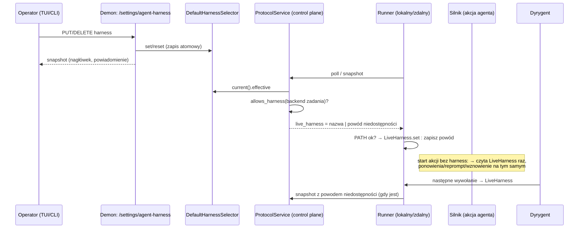
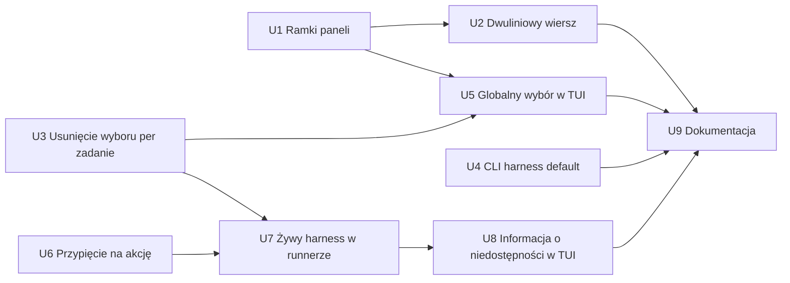

# feat: TUI — ramki paneli, dwuliniowy wiersz zadania, globalny harness obejmujący zadania w toku

## Summary

Każdy panel TUI rysuje własną ramkę przez jeden pomocnik w module ról (`Focus` + gruba linia przy fokusie, `Done` + cienka bez), zewnętrzna ramka znika, a nagłówek trafia do pierwszej linii ekranu. Wiersz zadania staje się dwuliniowym `ListItem`, więc `ListState` dalej przewija o całe zadanie. Globalny domyślny harness (`DefaultHarnessSelector`, już istniejący) wraca do TUI: nagłówek i klawisz `h` przez istniejący endpoint `/settings/agent-harness`, plus nowa komenda `narsor harness default`. Zadania w toku podążają za nim: control plane dokłada obowiązujący harness do każdej odpowiedzi na poll runnera, runner trzyma go jako żywy harness agentów i dyrygenta, a silnik przypina harness na czas całego kroku agenta. Wybór harnessu dyrygenta per zadanie znika w TUI, CLI i storage runnera.

---

## Problem Frame

Po przeprojektowaniu TUI fokus jest słabo widoczny (jedna szara ramka ekranu, prawa krawędź listy, kolor zakładki), wiersz listy skleja markery, ucina tytuł i chowa etykietę, a globalny harness — ustawienie, które wybiera, na czym pracują zadania — zniknął z interfejsu. Dodatkowo operator chce, żeby zmiana harnessu obejmowała też pracę, która już trwa, czego dziś nie robi nic: runner przypina harness przy starcie (R42), a jedyny mechanizm zmiany w locie to wybór harnessu dyrygenta per zadanie. Szczegóły: (see origin: docs/brainstorms/2026-10-10-tui-czytelnosc-requirements.md).

---

## Requirements

**Ramki i fokus**
- R1. Lista i szczegóły mają po jednej pełnej ramce; zewnętrzna ramka ekranu znika; nagłówek (`narsor · połączenie · status`, liczniki) zostaje w górnej linii ekranu.
- R2. Ramka panelu z fokusem: rola `Focus`, linia gruba; bez fokusu: szara, cienka. Tytuł panelu ma kolor ramki.
- R3. Z `NO_COLOR` aktywny panel rozpoznawalny po grubości ramki i pogrubionym tytule.
- R4. Gdy fokus jest w panelu odpowiedzi, ramka szczegółów pozostaje aktywna; panel odpowiedzi zachowuje własną ramkę w roli `Attention`.
- R5. Na wąskim terminalu (jeden panel) ten panel też ma ramkę `Focus`.
- R6. Nowe zadanie, historia, repozytoria i lista historii — te same ramki i reguła fokusu.

**Wiersz zadania**
- R7. Zadanie = dwie linie: marker uwagi, spacja, ikona stanu, dwie spacje, tytuł na całą resztę; pod spodem etykieta wcięta pod początek tytułu.
- R8. Etykieta zachowuje znaczenie i role kolorów; podgląd przesuwania `↕ n/m` w drugiej linii.
- R9. Zaznaczenie (reverse) obejmuje obie linie; przewijanie i nawigacja o całe zadanie.
- R10. Wiersze oczekujące i lista historii — ten sam układ.
- R11. Kolejność listy i zasada „stan to atrybut wiersza" bez zmian.

**Globalny harness**
- R12. Nagłówek pokazuje obowiązujący domyślny harness; wartość z konfiguracji (bez nadpisania) oznaczona, np. `harness claude-code (konfiguracja)`.
- R13. `h` otwiera wybór z listy i ze szczegółów w każdej zakładce; nie działa w polu tekstowym ani przy innej nakładce.
- R14. Wybór pokazuje harnessy obsługiwane przez demona, zaznacza obecny, ma pozycję „domyślny z konfiguracji (<nazwa>)" kasującą nadpisanie.
- R15. Po zmianie nagłówek i powiadomienie pokazują nową wartość; przy błędzie powiadomienie o problemie z przyczyną, nagłówek ze starą wartością.
- R16. Zmiana obowiązuje od razu dla nowych zadań i dla dyrygentów wszystkich zadań, także w toku (od następnego wywołania).
- R16a. Krok agenta, który trwa, kończy się na swoim harnessie (łącznie z ponowieniami i wznowieniem sesji); kolejny krok agenta bierze nowy domyślny.
- R16b. *(Doprecyzowane w dialogu planowania.)* Nowy domyślny nie dotyczy wyłącznie kroku, którego workflow wskazuje `harness:` (w akcji lub decyzji agenta). Harness podany przy tworzeniu zadania (żądanie, profil) **nie** przypina zadania — takie zadanie też podąża za domyślnym, łącznie z dyrygentem. Zadania sprzed tej zmiany podążają za domyślnym.
- R16c. Gdy backend lub obraz zadania nie może uruchomić nowego harnessu, kolejny krok zostaje na dotychczasowym harnessie zadania; operator widzi jedną informację przy zadaniu, bez błędu kroku.
- R17. Wybór harnessu dyrygenta per zadanie znika (klawisz `h` na *Dyrygencie*, komenda operatora w TUI, wpis w pomocy); zakładka *Dyrygent* tylko pokazuje harness. *(Doprecyzowane w dialogu planowania: znika też `narsor task conductor harness` w CLI i zapisany wybór per zadanie w storage runnera.)*
- R18. Pasek skrótów, pomoc i README opisują `h` jako globalny wybór; tabela TUI→CLI wskazuje odpowiednik w CLI.

**Origin acceptance examples:** AE1 (R2, R3), AE2 (R7, R9), AE3 (R12, R14, R16), AE4 (R13), AE5 (R16a, R16b), AE6 (R16c).

**Decyzje z dialogu planowania:**
- Tylko jawne `harness:` w workflow i trwający krok blokują zmianę; harness z żądania/profilu nie przypina zadania (zmienia drugie zdanie R16b z origin). Dzięki temu nie trzeba zapisywać pochodzenia harnessu zadania.
- Zadania sprzed zmiany podążają za domyślnym.
- Zmiana dociera do runnerów razem z odpowiedzią na poll (nie komendą operatora).
- Niedostępność nowego harnessu sprawdzają dwa miejsca: control plane (dozwolone harnessy backendu w katalogu) i runner (binarka w jego środowisku). Informacja w nagłówku szczegółów i w zakładce *Info*, nie jako marker `!`.
- TUI i nowa komenda `narsor harness default get|set|reset` korzystają z istniejącego `/settings/agent-harness` (owner-gated, działa w trybie sieciowym); TUI odczytuje wartość przy każdym odświeżeniu, bez zdarzeń push.
- „Krok agenta" = jedna akcja agenta (z ponowieniami i wznowieniem sesji). Kolejna akcja agenta w tym samym stanie workflow już się przełącza.

---

## Scope Boundaries

- Nie przerywamy ani nie przełączamy akcji agenta w trakcie (origin).
- Bez wyboru harnessu per zadanie w formularzu nowego zadania (origin).
- Paleta ról i zasada „tylko 16 kolorów ANSI" bez zmian (origin).
- Szerokość listy (`LIST_WIDTH = 28`) zostaje (origin).
- Brak zdarzeń push o zmianie ustawień (SSE) — TUI odpytuje przy odświeżeniu.
- Brak nowego endpointu `/control/v1/default-harness`; stary `/settings/agent-harness` zostaje jedynym kanałem.
- Harness przypięty w `ResolvedEnvironment.harness` nie zmienia znaczenia hasha tożsamości; pole zostaje i staje się „harnessem rezerwowym" zadania.

### Deferred to Follow-Up Work

- Zdarzenie o zmianie ustawień na strumieniu kontrolnym, żeby TUI widział zmianę z CLI bez czekania na odświeżenie: osobna praca, gdy pojawi się więcej ustawień globalnych.
- Wpis w `docs/solutions/` (przez `/ce-compound`) o odwróceniu R42 po wdrożeniu.

---

## Context & Research

### Relevant Code and Patterns

- **Układ ekranu:** `src/tui/task_app/layout.rs` (`areas`, `render`, `header_left`/`header_right`, stałe `MIN_WIDTH`, `SPLIT_MIN_WIDTH`, `LIST_WIDTH`); prostokąt nakładek liczony z `outer`.
- **Panele:** `src/tui/task_app/list.rs` (`TaskList::render`, `Borders::RIGHT`, `row_line`, `RowText`, `label_of`, `PendingRow::text`), `src/tui/task_app/history.rs` (`render_list`, `render_details`), `src/tui/task_app/detail.rs` (`render`, `render_view`, `tab_bar`, `areas`), `src/tui/task_app/waiting.rs` (ramka panelu odpowiedzi, przełączanie `Focus`/rola wpisu), `src/tui/task_app/new_task.rs`, `src/tui/task_app/repositories.rs`, `src/tui/chooser/inputs.rs::render_strip`.
- **Role:** `src/tui/style.rs` (`Role`, `Styles::of`, `Styles::new(bool)`, `from_env`, pomocniki `strong`/`selected`/`selected_tab`); test dyscypliny kolorów w `tests/tui_render.rs::colour_discipline`.
- **ratatui 0.30.2:** `BorderType::Thick`/`Plain`, `Block::border_type`, `title_style`; `ListItem` z wieloliniowym `Text` jest zaznaczany i przewijany jako całość.
- **Keymap:** `src/tui/keymap.rs` (`BINDINGS`, `bind(...)`, `Action::ChooseHarness`, `check_consistency`, `inherits_global`, `hint_line`, `help_entries`).
- **Nakładka harnessu:** `src/tui/task_app/actions.rs` (`HarnessList`, `Overlay::Harness`) — do przerobienia na wybór globalny; dawny wybór globalny: `git show 3147acf -- src/tui/app.rs src/tui/views.rs`.
- **Selektor:** `src/persistence/agent_harness.rs` (`DefaultHarnessSelector`, `HarnessSelectionSnapshot`), API `src/api/routes.rs` (`/settings/agent-harness`), klient `src/api/client.rs` (`harness_selection`, `set_harness_selection`, `reset_harness_selection`), wpięcie w `src/cli/daemon.rs::run_daemon`.
- **Wzorzec CLI dla ustawienia globalnego:** `narsor backend default get|set|reset` w `src/cli/remote.rs` + `src/cli/task_text.rs::default_backend_line`.
- **Rozwiązywanie harnessu:** `src/environment/resolver.rs` (`CatalogLaunchResolver::harness`, `HarnessDefaults`, dokument modułu z R42), `src/environment/backend.rs::allows_harness`.
- **Runner:** `src/runner/mod.rs` (`Engine::new(...).with_agent_defaults(...)` „never a live default (R42)", pierwszy poll, obsługa odpowiedzi poll), `src/runner/conductor.rs` (`ConductorHost::assemble`, `harness_unavailable`, `set_conductor_harness`), `src/runner/storage.rs` (`conductor_harness`, `ConductorSettings`), `src/runner/commands.rs`, `src/runner/snapshot.rs`.
- **Control plane:** `src/controller_protocol/service.rs` (budowa `RunnerPollResponse` ~1468, `default_backend` jako wzór dostępu do ustawienia, walidacja `SetConductorHarness` ~1922, mapowanie `RunnerView` ~1675), `src/controller_protocol/wire.rs` (`RunnerPollResponse`, `RunnerSnapshotResponse`, `RunnerView`, `conductor_unavailable_reason`).
- **Silnik:** `src/engine/actions/agent.rs` (`AgentExecutor::run` — odczyt domyślnego per próba, `continuation_config`, `reprompt_config`), `src/engine/runner.rs` (pętla `RetrySchedule`, `OutputRescue.harness`).
- **Dyrygent:** `src/conductor/invoke.rs` (`HarnessInvoker::try_invoke`, `LiveHarness`).
- **Komenda operatora:** `src/orchestration/model.rs` (`OperatorCommand::SetConductorHarness`), `src/cli/remote.rs` (`ConductorCommand::Harness`).

### Institutional Learnings

- `docs/plans/2026-09-27-0645-feat-codex-harness-default-plan.md` — selektor jest jedynym źródłem wyboru (nie TUI); KTD2: akcja czyta domyślny raz na próbę; wznowienie wymaga jawnego harnessu. Model dla R16a.
- `docs/plans/2026-10-01-2329-feat-zdalne-backendy-wykonawcze-plan.md` — R42/KTD5 (harness przypięty przy tworzeniu); ten plan świadomie to odwraca.
- `docs/plans/2026-10-09-001-feat-tui-przeprojektowanie-plan.md` i `docs/brainstorms/2026-10-08-tui-przeprojektowanie-design.md` — projekt od początku zakładał ramki per panel (cyan aktywny, szary nieaktywny); widoki używają ról, nigdy `Color::`; `NO_COLOR` czytany raz; jedna tabela keymapy steruje paskiem, pomocą i obsługą klawiszy.
- Pamięć projektu: stabilna kolejność listy (nie sortować wg stanu); testy nie mogą zostawiać demonów (`RemoteHarness`, sprzątanie w `Drop`); git przez CLI.
- `docs/plans/2026-10-05-0003-feat-kontynuacja-rozmowy-agenta-plan.md` — wznowienie sesji na harnessie, który ją utworzył.

### External References

- Brak — lokalne wzorce wystarczają (ratatui 0.30 już w repo, selektor i kanał poll istnieją).

---

## Key Technical Decisions

- **Jeden pomocnik ramki w `src/tui/style.rs`:** zwraca `Block` z typem linii i stylem ramki/tytułu wg `focused`. Kolor: `Focus` + `Thick` / `Done` + `Plain`. `NO_COLOR`: grubość + pogrubiony tytuł (rola `Focus` mapuje się na bold). Widoki nie dotykają `Color::`, więc test dyscypliny przechodzi bez zmian.
- **Nagłówek w linii 0, bez zewnętrznej ramki:** `areas()` rezerwuje wiersz 0 na nagłówek i ostatni wiersz na pasek; reszta dzielona między panele. Kolejność skracania nagłówka przy wąskim terminalu: najpierw `sloty`, potem `(konfiguracja)` → `(konf.)`, potem wiek połączenia; liczniki `? n · ! n` i nazwa harnessu zostają zawsze (≥ 60 kolumn mieści `narsor · ● · harness opencode (konf.) · ? 9 · ! 9`).
- **Dwuliniowy `ListItem`, nie `Paragraph`:** `row_line` zamienia się w funkcję zwracającą dwie linie (`Text`), współdzieloną przez listę zadań, wiersze oczekujące i historię. `ListState` dalej indeksuje zadania, więc R9 i „zaznaczenie po `task_id`" zostają bez zmian w nawigacji.
- **Panel odpowiedzi zawsze w roli wpisu:** ramka `Attention`/`Problem` niezależnie od fokusu; o aktywności informuje gruba ramka szczegółów (R4).
- **Globalny wybór przez istniejący endpoint:** TUI używa `ApiClient::{harness_selection, set_…, reset_…}`; odczyt przy każdym odświeżeniu (obok odczytu możliwości) i po każdej zmianie. Nowa komenda `narsor harness default get|set|reset` odbija wzorzec `narsor backend default`.
- **Nakładka `Overlay::Harness` zmienia przeznaczenie:** z wyboru harnessu dyrygenta na wybór globalny; dostaje pozycję „domyślny z konfiguracji (<nazwa>)" i znacznik obecnego. `ChooseHarness` **nie** trafia do `Context::Global` — `inherits_global` przepuszcza Global do Menu, Confirm, Move i Panel, co łamałoby R13. Zamiast tego jawne wiązania `h` w kontekstach `List`, `Details`, `History`, `HistoryDetails`, `Repositories` (i ewentualnie wyboru workflow w nowym zadaniu, jeśli nie jest polem tekstowym).
- **Żywy harness płynie przez poll:** `LaunchResolver` dostaje metodę wyliczającą żywy harness dla backendu zadania (`CatalogLaunchResolver` ma już selektor jako `HarnessDefaults` i katalog z `allows_harness`) — bez osobnego wstrzykiwania selektora do `ProtocolService`. Każda odpowiedź `RunnerPollResponse` i `RunnerSnapshotResponse` niesie pole: albo nazwę (gdy backend ją dopuszcza), albo powód niedostępności. Błąd odczytu katalogu → pole puste, nigdy błąd poll. Pole opcjonalne z `serde(default)`, więc starsze runnery i odpowiedzi są zgodne. `set`/`reset` selektora budzi oczekujące długie polle (jak inne zmiany w `ProtocolService`), żeby zmiana nie czekała do 25 s.
- **Runner: jeden `LiveHarness` dla silnika i dyrygenta:** runner startuje z ostatnio zastosowanego harnessu zapisanego w storage runnera (a gdy go brak — z `spec.environment.harness`), a przed uruchomieniem pierwszego przebiegu silnika w `Session::begin` robi jeden poll bez czekania (`client.poll(None, 0)`, jak `owner_decision`) i stosuje żywy harness; bez łącza — rusza na zapisanym/rezerwowym. Po każdej odpowiedzi control plane aktualizuje `LiveHarness` (pole stosowane **przed** wejściami i komendami w `absorb`/`report`), chyba że binarki brak w `PATH` (`harness_unavailable`) — wtedy zostaje przy dotychczasowym i zapisuje powód. Każda zmiana zapisywana atomowo w storage runnera (przeżywa pauzę i restart). Silnik dostaje dostawcę domyślnego czytanego przy starcie akcji zamiast stałego `AgentDefaults.harness`.
- **Informacja o niedostępności jako pole migawki runnera:** nowe opcjonalne pole obok `conductor_unavailable_reason` (np. powód „harness X niedostępny w tym środowisku"), przeniesione do `RunnerView`; TUI pokazuje je w nagłówku szczegółów i w *Info*. Nie jest `RunnerProblem`, więc nie zapala `!`.
- **Przypięcie harnessu na akcję agenta w silniku (R16a):** harness akcji bez własnego `harness:` rozstrzygany raz, przy pierwszej próbie, i wpisywany jawnie do konfiguracji kolejnych prób (ponowienia, reprompt, kontynuacja). Wznowienie po restarcie runnera już korzysta z `OutputRescue.harness` / `AgentSessionStarted`.
- **Dyrygent bez wyboru per zadanie:** `ConductorHost::assemble` zawsze składa rejestr dyrygenta ze wspólnym `LiveHarness` (dziś przy niedostępnym harnessie startowym rejestr jest `None` na zawsze); „niedostępny" staje się wartością przeliczaną przy każdej aktualizacji `LiveHarness`, a `registry()` odmawia, gdy jest ustawiona. Plik `conductor_harness` w storage runnera jest ignorowany (nie kasowany — nieszkodliwy).
- **`SetConductorHarness` jako wariant historyczny:** wariant zostaje w `OperatorCommand`, żeby stare dzienniki zdarzeń się dekodowały; control plane odmawia nowych (typowany błąd), runner potwierdza dostarczone wcześniej jako no-op. Znika z TUI i CLI.
- **Demon:** silnik i `HarnessInvoker` demona już czytają selektor na żywo — bez zmian poza przypięciem na akcję (wspólny kod silnika).

---

## Open Questions

### Resolved During Planning

- Czy dyrygent czyta domyślny na żywo, czy przypina przy starcie? — W runnerze przypina dziś; po zmianie czyta `LiveHarness` aktualizowany z poll przy każdym wywołaniu.
- Co z harnessem ustawionym wcześniej przez `SetConductorHarness`? — Ignorowany; jedno źródło prawdy.
- Jak odpiąć R42? — Harness z `ResolvedEnvironment` staje się rezerwowym; o bieżącym decyduje żywa wartość z control plane; jawne `harness:` w workflow nadal wygrywa (już dziś w `AgentExecutor`).
- Jak runner na zdalnym backendzie dowiaduje się o zmianie? — Pole w odpowiedziach poll/snapshot.
- Gdzie zapisać harness kroku? — W konfiguracji akcji w pętli prób silnika; dla wznowień — istniejące `OutputRescue.harness` / `AgentSessionStarted`.
- Jak odróżnić jawny harness od domyślnego? — Nie trzeba (decyzja z dialogu: przypina tylko workflow).
- Skąd wiadomo, że backend nie ma harnessu? — Control plane: `allows_harness` rekordu backendu z katalogu; runner: `harness_unavailable` (PATH).
- Kanał TUI w trybie sieciowym? — `/settings/agent-harness`, owner-gated w routerze właściciela.
- `SetConductorHarness` i CLI? — Znikają z CLI i TUI; wariant zostaje tylko do dekodowania historii.
- Nagłówek w 60 kolumnach? — Kolejność skracania w Key Technical Decisions.
- Czy pierwsza akcja po starcie runnera zdąży dostać żywy harness? — Nie sama z siebie: `Session::begin` uruchamia przebieg silnika przed pierwszym poll. Rozwiązanie: poll bez czekania przed startem przebiegu (U7).

### Deferred to Implementation

- Dokładne miejsce przypięcia w pętli prób (`src/engine/runner.rs` vs `AgentExecutor`) i czy decyzje agenta (`DecisionConfig::Agent`) przechodzą tą samą ścieżką.
- Jak wyczyścić informację o niedostępności, gdy operator wróci do harnessu dostępnego (najpewniej: pole liczone od nowa przy każdej odpowiedzi control plane).
- Kształt błędu odmowy `SetConductorHarness` w control plane (nowy kod vs istniejący `unsupported`).
- Ile asercji w `tests/tui_render.rs` opiera się na pozycjach wierszy (`rows[1]`, `"│ ● NAR-14"`) — przepisanie zależne od nowego układu.

---

## High-Level Technical Design

> *This illustrates the intended approach and is directional guidance for review, not implementation specification. The implementing agent should treat it as context, not code to reproduce.*

Rozstrzyganie harnessu akcji agenta po zmianie:

| Sytuacja | Harness |
|---|---|
| Akcja ma `harness:` w workflow | ten z workflow |
| Ponowienie / reprompt / wznowienie sesji akcji | ten, na którym akcja wystartowała |
| Nowa akcja, żywy harness dostępny | żywy domyślny |
| Nowa akcja, żywy harness niedostępny (katalog lub PATH) | dotychczasowy (rezerwowy lub ostatni dostępny) + informacja przy zadaniu |
| Dyrygent | żywy domyślny przy każdym wywołaniu (te same reguły dostępności) |

---

## Implementation Units

### U1. Ramki paneli i nagłówek w pierwszej linii

**Goal:** Każdy panel ma pełną ramkę zależną od fokusu; zewnętrzna ramka znika; nagłówek w wierszu 0.

**Requirements:** R1, R2, R3, R4, R5, R6; AE1

**Dependencies:** brak

**Files:**
- Modify: `src/tui/style.rs` (pomocnik ramki panelu)
- Modify: `src/tui/task_app/layout.rs` (`areas`, `render`, nagłówek, prostokąt nakładek, przesunięcie `detail_area.x + 1`)
- Modify: `src/tui/task_app/list.rs`, `src/tui/task_app/history.rs` (`render_list`, `render_details`), `src/tui/task_app/detail.rs` (ramka wokół szczegółów, obszar wewnętrzny dla `areas`), `src/tui/task_app/waiting.rs` (ramka zawsze w roli wpisu), `src/tui/task_app/new_task.rs`, `src/tui/task_app/repositories.rs`, `src/tui/chooser/inputs.rs` (`render_strip` — wewnętrzny panelik zostaje w roli `Done`, ale musi zmieścić się w nowej ramce panelu)
- Test: `tests/tui_render.rs`

**Approach:**
- Pomocnik w `style.rs` przyjmuje tytuł i `focused`, zwraca `Block::bordered()` z `BorderType::Thick` + `Role::Focus` albo `Plain` + `Role::Done`; tytuł w stylu ramki (pogrubiony przy fokusie).
- `layout::areas`: wiersz 0 = nagłówek (lewa i prawa część w jednej linii), ostatni wiersz = pasek, środek: Split → lista `LIST_WIDTH` + szczegóły; Full → jeden panel z ramką `Focus`.
- Szczegóły: ramka aktywna, gdy `Focus::Details` — także gdy fokus jest w panelu odpowiedzi (R4); zakładki mogą zachować `selected_tab`.
- Nowe zadanie, historia, repozytoria rysują się w tej samej ramce panelu szczegółów, lista historii jak lista zadań. Tytuły ramek niosą tożsamość panelu (ważne w trybie Full, gdzie jedyny panel ma zawsze ramkę `Focus`): lista ` Zadania ` (z `· ✓ ukryte N` jak dziś), szczegóły ` NAR-14 · <tytuł zadania> ` (obcięty), ` Nowe zadanie `, ` Historia `, ` Repozytoria (n) `.
- Nakładki (`actions::render`, pomoc) liczone od nowego obszaru ekranu.

**Patterns to follow:**
- Role zamiast kolorów (`styles.of(Role::…)`), `Styles::new(false)` w testach `NO_COLOR`.

**Test scenarios:**
- Covers AE1. Happy path: fokus na liście → komórki ramki listy to znaki grube (`┏━┓`) w kolorze Cyan, ramka szczegółów cienka (`┌─┐`) w DarkGray; po `Tab` odwrotnie.
- Covers AE1. `NO_COLOR`: ten sam ekran — ramka aktywna gruba, tytuł aktywnego panelu pogrubiony, żadna komórka nie ma koloru.
- Happy path: wiersz 0 zawiera `narsor` i liczniki `? n · ! n`, a nie ma lewego górnego narożnika zewnętrznej ramki.
- Edge case: terminal 80×24 (Full) — jedyny widoczny panel ma ramkę grubą; po przełączeniu na szczegóły też.
- Edge case: fokus w panelu odpowiedzi → ramka szczegółów gruba, panel odpowiedzi w roli `Attention` (żółty), nie Cyan.
- Happy path: widoki nowe zadanie / historia / repozytoria — ramka gruba przy fokusie w szczegółach, cienka przy fokusie na liście.
- Edge case: 60×20 — ekran się rysuje, nakładka pomocy mieści się w obszarze.
- Integration: `colour_discipline` nadal przechodzi (brak `Color::` poza modułem ról).

**Verification:** Wszystkie testy renderowania przechodzą po przepisaniu asercji pozycji; ręczny podgląd `narsor tui` pokazuje dwie ramki i nagłówek w pierwszej linii.

---

### U2. Dwuliniowy wiersz zadania

**Goal:** Zadanie, wiersz oczekujący i wpis historii zajmują po dwie linie, zaznaczenie obejmuje obie.

**Requirements:** R7, R8, R9, R10, R11; AE2

**Dependencies:** U1 (te same pliki i asercje testów)

**Files:**
- Modify: `src/tui/task_app/list.rs` (`row_line` → dwie linie, `TaskList::render`, podgląd `↕ n/m`, `PendingRow`)
- Modify: `src/tui/task_app/history.rs` (`render_list`)
- Test: `tests/tui_render.rs`, `tests/tui_state.rs` (moduł `task_app_list` — jeśli nawigacja ma testy zależne od wysokości)

**Approach:**
- Linia 1: marker uwagi, spacja, ikona stanu, dwie spacje, tytuł obcięty do szerokości wewnętrznej (26 kolumn po ramce, z wielokropkiem jak dziś). Linia 2: wcięcie = szerokość prefiksu (marker + spacja + ikona + dwie spacje), etykieta w roli wg dzisiejszych reguł (`label_of` zwraca jedną etykietę — bez łączenia kilku). Linia 2 istnieje zawsze, także pusta, żeby każde zadanie miało stałą wysokość. Podgląd `↕ n/m` zastępuje etykietę, jak dziś.
- Zaznaczenie: styl `selected()` nakładany na wszystkie spany obu linii; markery zachowują kolor wewnątrz reverse (jak dziś).
- `ListItem::new(Text::from(vec![l1, l2]))`; `ListState` bez zmian — przewijanie po elementach daje R9.
- Liczenie „ile zadań mieści się na ekranie" (jeśli gdzieś używane do PageUp/PageDown) dzieli wysokość przez 2.

**Patterns to follow:**
- `label_of`, `attention_of`, role etykiet z obecnego `row_line`.

**Test scenarios:**
- Covers AE2. Happy path: zadanie „Refactor parser" w kroku `implement` → wiersz N zawiera `● ` + `Refactor parser`, wiersz N+1 zaczyna się od wcięcia i zawiera `implement`; po `j` obie linie następnego zadania mają `REVERSED`, poprzedniego nie.
- Happy path: etykiety `offline` (Attention), `nie wysłano` (Problem), `#3` (Calm), krok (Done) w drugiej linii z właściwą rolą.
- Edge case: tytuł dłuższy niż 28 − prefiks − ramki → obcięty, nie zawija się do trzeciej linii.
- Edge case: lista dłuższa niż ekran, zaznaczenie na ostatnim zadaniu → widoczne obie jego linie, żadne zadanie nie jest pokazane w połowie u góry.
- Happy path: tryb przesuwania → druga linia przesuwanego zadania pokazuje `↕ 2/5`.
- Happy path: wiersze `↻ wysyłanie…` i `✗ nie wysłano` — dwie linie, ten sam układ.
- Happy path: lista historii — dwie linie na wpis, zaznaczenie obejmuje obie.
- `NO_COLOR`: zaznaczenie widoczne (reverse) na obu liniach, markery `?`/`!` zachowane.
- Integration: kolejność listy po zdarzeniu `Moved` taka jak przed zmianą (R11).

**Verification:** Testy listy/historii przechodzą; lista w 24 wierszach pokazuje ~10 zadań w dwóch liniach.

---

### U3. Usunięcie wyboru harnessu dyrygenta per zadanie

**Goal:** Znika jedyny drugi poziom nadpisania harnessu; zwalnia się `h`.

**Requirements:** R17

**Dependencies:** brak

**Files:**
- Modify: `src/tui/task_app/tabs/conductor.rs` (usunięcie `open_harnesses`, `chosen_harness`, wpisu w `key_line`; status ` · harness X` zostaje; dokument modułu)
- Modify: `src/tui/task_app/actions.rs` (usunięcie gałęzi `ConductorSent::Harness` i obsługi wysłanej komendy)
- Modify: `src/tui/task_app/mod.rs` (routing `ChooseHarness` w `Context::Details`)
- Modify: `src/tui/keymap.rs` (wiązanie `h` na zakładce *Dyrygent*)
- Modify: `src/cli/remote.rs` (`ConductorCommand::Harness`, tekst ~1520)
- Modify: `src/controller_protocol/service.rs` (odmowa `SetConductorHarness`)
- Modify: `src/runner/commands.rs` (no-op + ack dla historycznego wariantu), `src/runner/conductor.rs` (`assemble` nie czyta `storage.conductor_harness()`; usunięcie `set_conductor_harness` lub przeniesienie logiki do U7), `src/runner/storage.rs` (odczyt nadpisania znika)
- Modify: `src/orchestration/model.rs` (komentarz: wariant historyczny)
- Test: `tests/tui_state.rs` (`task_app_conductor`: usunięcie testów `h_lists_the_harnesses…`, `the_current_harness_cannot_be_chosen_again`, `an_unknown_harness_is_refused_early…`), `tests/runner.rs` (`a_chosen_conductor_harness_applies_from_the_next_invocation` → zastąpiony testem w U7), `tests/controller_protocol.rs` (~2954), `tests/tui_render.rs` (`the_harness_list_fits_a_narrow_terminal` → przeniesiony do U5)

**Approach:**
- Część runnerowa (U3: `assemble` przestaje czytać nadpisanie) ląduje w tym samym wydaniu co U7, żeby nie było okna, w którym dyrygent nie ma żadnego sposobu zmiany harnessu w locie; test `a_chosen_conductor_harness_applies_from_the_next_invocation` znika w U3, a jego następca powstaje w U7.
- Wariant `OperatorCommand::SetConductorHarness` zostaje w modelu (serde), ale `ProtocolService` odpowiada typowanym błędem dla nowych zgłoszeń; runner, który dostanie go z kolejki sprzed aktualizacji, potwierdza bez zmiany stanu.
- Plik nadpisania w storage runnera nie jest czytany ani kasowany.

**Patterns to follow:**
- Odmowa komend przez istniejące typowane błędy w `service.rs` (np. dla zadań nie-Running).

**Test scenarios:**
- Happy path: zakładka *Dyrygent* pokazuje ` · harness claude-code`, a pasek skrótów nie ma `h`.
- Error path: `POST` komendy `SetConductorHarness` do control plane → typowany błąd, w dzienniku brak `OperatorCommandQueued`.
- Edge case: runner dostaje z kolejki `SetConductorHarness` sprzed aktualizacji → ack, harness dyrygenta bez zmian.
- Edge case: storage runnera ma zapisany `conductor_harness = opencode`, domyślny to `claude-code` → dyrygent startuje na `claude-code`.
- Integration: stary dziennik zdarzeń z `OperatorCommandQueued{SetConductorHarness}` dekoduje się (test na zapisanym JSON).

**Verification:** `cargo build` bez martwego kodu wokół wyboru per zadanie; `narsor task conductor harness` nie istnieje w `--help`.

---

### U4. Komenda CLI `narsor harness default`

**Goal:** Odpowiednik CLI globalnego wyboru dla tabeli TUI→CLI.

**Requirements:** R18 (część CLI)

**Dependencies:** brak

**Files:**
- Modify: `src/cli/remote.rs` (lub moduł, w którym zdefiniowano `narsor backend default` — nowa podkomenda `harness default get|set|reset`)
- Modify: `src/cli/task_text.rs` (linia tekstowa wyniku, wzór `default_backend_line`)
- Test: `tests/cli_*.rs` właściwy dla `backend default` (znaleźć istniejący plik testów tej komendy) lub `tests/api.rs`

**Approach:**
- `get` drukuje obowiązujący, skonfigurowany i nadpisanie (np. `harness opencode (nadpisanie; konfiguracja: claude-code)`), `set <nazwa>` i `reset` drukują nowy stan; błąd `unsupported_harness` z listą obsługiwanych.
- Używa `ApiClient::{harness_selection, set_harness_selection, reset_harness_selection}` — pierwsze produkcyjne wywołania tych metod.

**Patterns to follow:**
- `narsor backend default get|set|reset` i jego testy.

**Test scenarios:**
- Happy path: `get` bez nadpisania → wartość z konfiguracji oznaczona jako z konfiguracji.
- Happy path: `set opencode` → wynik i kolejny `get` pokazują `opencode`; `reset` → wraca konfiguracja.
- Error path: `set nieznany` → kod wyjścia ≠ 0, komunikat z listą obsługiwanych, stan bez zmian.
- Integration: w trybie sieciowym bez tokenu właściciela → odmowa autoryzacji (jeśli istniejące testy `backend default` mają ten przypadek).

**Verification:** Komenda działa na lokalnym demonie (`RemoteHarness`/demon testowy bez wycieku procesów).

---

### U5. Globalny wybór harnessu w TUI (nagłówek + `h`)

**Goal:** Nagłówek pokazuje obowiązujący harness; `h` zmienia go z listy i szczegółów.

**Requirements:** R12, R13, R14, R15, R18 (pasek, pomoc); AE3, AE4

**Dependencies:** U1 (nagłówek), U3 (zwolnione `h`, nakładka)

**Files:**
- Modify: `src/tui/task_app/mod.rs` (stan wyboru w `TaskApp`, odczyt w `refresh`/`read_capabilities`, obsługa wyniku set/reset)
- Modify: `src/tui/task_app/layout.rs` (`header_left`/`header_right` z harnessem i kolejnością skracania)
- Modify: `src/tui/task_app/actions.rs` (`HarnessList`/`Overlay::Harness` jako wybór globalny z pozycją konfiguracji)
- Modify: `src/tui/keymap.rs` (`h` → `ChooseHarness` w `Context::Global`; teksty paska i pomocy)
- Test: `tests/tui_state.rs` (nowy moduł np. `task_app_harness`), `tests/tui_render.rs`, `tests/task_app_support/mod.rs` (fikstura migawki selekcji)

**Approach:**
- Migawka `HarnessSelectionSnapshot` trzymana w `TaskApp`; odczyt przy każdym odświeżeniu, przy każdym otwarciu nakładki i po zmianie; błąd odczytu nie kasuje ostatniej znanej wartości. Demon bez selektora (odpowiedź „brak selektora") nie oznacza połączenia jako zepsutego — nagłówek pokazuje `harness ?`.
- Nagłówek: `harness <effective>` + ` (konfiguracja)` gdy `override` puste; przed pierwszym odczytem `harness ?`. Budżet szerokości: lewa część `narsor · <nazwa> ● <stan> · <wiek>`, prawa `harness <nazwa> (konfiguracja) · sloty u/l · ? n · ! n`. Skracanie w kolejności: `sloty` → wiek → `(konfiguracja)`→`(konf.)` → nazwa połączenia; nazwa harnessu dłuższa niż reszta miejsca obcinana z `…`; liczniki nigdy. Test sprawdza 60, 80 i 120 kolumn.
- Nakładka (pionowa lista w ramce `Focus`, tytuł ` Domyślny harness `): najpierw „domyślny z konfiguracji (<configured>)", potem obsługiwane harnessy w kolejności z demona; obecny oznaczony `●` i wyciszony (jego wybór to no-op), a gdy nadpisania brak, oznaczona jest pozycja konfiguracji. Kursor startuje na obecnym. `Enter` wybiera, `Esc` zamyka. Nakładka zamyka się od razu po wyborze; w nagłówku do odpowiedzi serwera widać `harness <nowy>…`. Pusta lista obsługiwanych → nakładka pokazuje tylko pozycję konfiguracji i informację, że demon nie zgłasza harnessów.
- Wynik: powiadomienie potwierdzające z nową wartością; błąd → powiadomienie w roli Problem z przyczyną, migawka bez zmian.
- `h` nie działa w kontekstach pól tekstowych (`Form`, czat dyrygenta, panel odpowiedzi) ani w Menu/Confirm/Move ani przy otwartej nakładce — bo wiązania są jawne per kontekst (Key Technical Decisions), a nie globalne.

**Patterns to follow:**
- Dawny `Modal::HarnessSelection` (`git show 3147acf -- src/tui/app.rs src/tui/views.rs`): `accept_harness_snapshot`, `harness_selection_error`.
- Powiadomienia z `src/tui/task_app/notify.rs`.

**Test scenarios:**
- Covers AE3. Happy path: konfiguracja `claude-code`, brak nadpisania → nagłówek `harness claude-code (konfiguracja)`; `h`, wybór `opencode` → wysłane `set opencode`, nagłówek `harness opencode`, powiadomienie z `opencode`; `h`, „domyślny z konfiguracji" → `reset`, nagłówek znów `… (konfiguracja)`.
- Covers AE4. Edge case: fokus w czacie dyrygenta / panelu odpowiedzi / formularzu → `h` wpisuje literę, nakładka się nie otwiera.
- Happy path: `h` działa z listy i ze szczegółów w każdej zakładce (Postęp, Rozmowa, Zdarzenia, Dyrygent, Info).
- Edge case: otwarte menu akcji → `h` nie otwiera drugiej nakładki; `lookup(Context::Menu, 'h')` i `lookup(Context::Confirm, 'h')` zwracają `None`.
- Happy path: nakładka startuje z kursorem na obecnym harnessie, pozycja konfiguracji jest pierwsza i oznaczona, gdy brak nadpisania.
- Error path: serwer odpowiada `unsupported_harness` → powiadomienie o problemie z przyczyną, nagłówek ze starą wartością.
- Error path: odczyt migawki się nie udaje przy odświeżeniu → nagłówek pokazuje ostatnią znaną wartość (albo `harness ?` przed pierwszym odczytem).
- Edge case: nagłówek przy 60 kolumnach i nadpisaniu z konfiguracji → widoczne `harness`, nazwa i liczniki; `sloty` znikają pierwsze.
- Happy path: nakładka mieści się w wąskim terminalu (przeniesiony `the_harness_list_fits_a_narrow_terminal`).
- Integration: `check_consistency` przechodzi — `h` nie koliduje w żadnym kontekście; pasek skrótów listy i pomoc `?` zawierają `h` jako globalny wybór harnessu.

**Verification:** Zmiana z TUI widoczna w `narsor harness default get`; zmiana z CLI pojawia się w nagłówku po kolejnym odświeżeniu.

---

### U6. Przypięcie harnessu na czas akcji agenta w silniku

**Goal:** Akcja bez `harness:` bierze domyślny raz; ponowienia, reprompt i kontynuacja zostają na nim.

**Requirements:** R16a, R16b; AE5

**Dependencies:** brak

**Files:**
- Modify: `src/engine/actions/agent.rs` (rozdział „rozstrzygnij harness" od „uruchom próbę"; źródło domyślnego jako dostawca czytany na żądanie)
- Modify: `src/engine/runner.rs` (pętla `RetrySchedule`: rozstrzygnięcie przed pierwszą próbą, jawny harness w kolejnych)
- Test: `tests/actions_agent.rs`, `tests/engine_*.rs` dotyczący ponowień (znaleźć właściwy)

**Execution note:** Zacząć od testu, który dziś nie przechodzi: zmiana domyślnego między pierwszą próbą a ponowieniem tej samej akcji nie może zmienić harnessu ponowienia.

**Approach:**
- Dzisiejszy test `live_default_changes_apply_to_the_next_harnessless_attempt` zmienia znaczenie: „następna akcja", nie „następna próba".
- Jawne `harness:` (także szablonowane po rozwinięciu) wygrywa jak dziś.
- Ten sam mechanizm obsługuje silnik demona (selektor) i runnera (żywy harness z U7) — źródło domyślnego jako wspólny abstrakt (np. trait/closure zwracający bieżącą nazwę).

**Patterns to follow:**
- `continuation_config` / `reprompt_config` — jawne wpisanie harnessu do konfiguracji.

**Test scenarios:**
- Covers AE5. Happy path: akcja `implement` startuje na `claude-code`, domyślny zmienia się na `opencode`, próba się nie udaje i jest ponawiana → ponowienie na `claude-code`; następna akcja `review` bez `harness:` → `opencode`; akcja `analyze` z `harness: claude-code` → `claude-code`.
- Happy path: reprompt po odrzuceniu wyniku → harness odrzuconej próby (istniejący test dalej przechodzi).
- Edge case: decyzja agenta (`DecisionConfig::Agent`) bez `harness:` → bierze bieżący domyślny przy starcie decyzji.
- Edge case: domyślny zmienia się dwa razy w trakcie jednej akcji → akcja i jej ponowienia na pierwotnym.
- Integration: wznowienie sesji po restarcie (`OutputRescue.harness`) → harness z zapisu, nie bieżący domyślny.

**Verification:** `tests/actions_agent.rs` i testy ponowień przechodzą; żaden test nie zakłada już odczytu domyślnego per próba.

---

### U7. Żywy domyślny harness w runnerze (poll → silnik i dyrygent)

**Goal:** Zadania w toku — lokalne i zdalne — podążają za globalnym domyślnym.

**Requirements:** R16, R16b, R16c; AE3, AE6

**Dependencies:** U3 (dyrygent bez nadpisania per zadanie), U6 (przypięcie na akcję)

**Files:**
- Modify: `src/controller_protocol/wire.rs` (opcjonalne pole żywego harnessu w `RunnerPollResponse` i `RunnerSnapshotResponse`; pole powodu niedostępności w migawce runnera i `RunnerView`)
- Modify: `src/controller_protocol/service.rs` (wywołanie nowej metody resolvera w `runner_poll`/`runner_snapshot` z backendem z `launch_spec`; budzenie długich polli po zmianie selektora; mapowanie powodu do `RunnerView`)
- Modify: `src/environment/resolver.rs` (`LaunchResolver`: metoda żywego harnessu dla backendu; implementacja w `CatalogLaunchResolver`)
- Modify: `src/persistence/agent_harness.rs` i/lub `src/cli/daemon.rs` (powiadomienie `ProtocolService` o `set`/`reset`, żeby obudzić długie polle)
- Modify: `src/orchestration/model.rs` (`RunnerSnapshot`: nowe pole powodu), `src/orchestration/runner_state.rs` (jeśli przycina/normalizuje pola jak `conductor_unavailable_reason`)
- Modify: `src/runner/mod.rs` (wspólny `LiveHarness`; poll bez czekania w `Session::begin` przed startem przebiegu; aktualizacja na początku `absorb`/`report`; silnik z dostawcą zamiast stałej; komentarz R42), `src/runner/conductor.rs` (`assemble` zawsze składa rejestr; dostępność przeliczana przy zmianie), `src/runner/storage.rs` (zapis ostatnio zastosowanego harnessu), `src/runner/snapshot.rs` (powód w migawce)
- Modify: `src/environment/resolver.rs` (dokument modułu: R42 odwrócone — harness z tworzenia to rezerwowy)
- Modify: `src/backends/fake.rs` (nowe pola w fikcyjnym backendzie)
- Test: `tests/runner.rs`, `tests/controller_protocol.rs`, `tests/remote_support` (jeśli potrzebna fikstura), `tests/conductor_invoke.rs`

**Approach:**
- Control plane: przy każdej odpowiedzi poll/snapshot pyta resolver o żywy harness backendu zadania; jeśli backend go dopuszcza → nazwa, w przeciwnym razie → powód niedostępności. Bez selektora (testy, starsze wpięcia) lub przy błędzie odczytu katalogu → pole puste.
- Runner: `LiveHarness` startuje z zapisanego w storage ostatnio zastosowanego harnessu (albo ze spec), a przed pierwszym przebiegiem silnika robi poll bez czekania. Na nazwę z control plane → sprawdza `harness_unavailable` i albo ustawia (i zapisuje w storage), albo zapisuje powód; na powód → zapisuje powód, zostaje przy bieżącym; brak pola → bez zmian (bieżący zostaje, także po wcześniejszym przełączeniu). Powód kasuje się, gdy kolejna odpowiedź wskazuje harness dostępny.
- Zmiana powodu wymusza wysłanie migawki (jak inne zmiany pól migawki), żeby TUI ją zobaczył.
- Dyrygent: przy zmianie `LiveHarness` dostępność przeliczona; brak binarki → dyrygent zostaje przy poprzednim dostępnym (nie wyłącza się).

**Technical design:** *(directional)* stan runnera: `rezerwowy` (ze spec) → `bieżący` (ostatni zastosowany) + `powód?`; wejście z control plane: `nazwa | powód | brak`; reguła: `nazwa ∧ PATH ok → bieżący := nazwa, powód := ∅`; `nazwa ∧ ¬PATH → powód := brak binarki`; `powód → powód := powód`; `brak → bez zmian`.

**Patterns to follow:**
- `conductor_unavailable_reason` (migawka → `RunnerView` → TUI).
- `LiveHarness` w `src/conductor/invoke.rs`.
- Dostęp do ustawienia globalnego w `ProtocolService::default_backend`.

**Test scenarios:**
- Covers AE3. Integration: zadanie w toku na `claude-code`, selektor ustawiony na `opencode` → kolejna odpowiedź poll niesie `opencode`; następne wywołanie dyrygenta i następna akcja bez `harness:` idą na `opencode`.
- Covers AE6. Error path: backend zadania w katalogu dopuszcza tylko `claude-code`, selektor = `opencode` → odpowiedź niesie powód; kolejna akcja na `claude-code`; migawka i `RunnerView` mają powód; brak `RunnerProblem` i brak błędu kroku.
- Error path: control plane wysyła `opencode`, ale binarki brak w PATH runnera → zostaje `claude-code`, powód „brak binarki" w migawce.
- Edge case: powrót selektora do `claude-code` → powód znika z następnej migawki.
- Edge case: zadanie utworzone z jawnym harnessem w żądaniu (`codex`) → po zmianie domyślnego na `opencode` następna akcja na `opencode` (R16b po dialogu).
- Edge case: odpowiedź bez pola (stary control plane / brak selektora) → runner zostaje przy bieżącym harnessie (na świeżym starcie: ze spec, jak dziś).
- Edge case: zadanie w kolejce lub wznawiane po pauzie, gdy domyślny zmienił się w międzyczasie → pierwsza akcja po starcie na nowym domyślnym (poll bez czekania przed przebiegiem).
- Edge case: zastosowany `opencode`, potem domyślny `codex` niedozwolony na backendzie, pauza i wznowienie → następna akcja dalej na `opencode` (zapis w storage), nie na harnessie ze spec.
- Integration: runner startuje z niedostępnym harnessem (dyrygent niedostępny), control plane wysyła dostępny → następne wywołanie dyrygenta działa.
- Edge case: odpowiedź poll niesie jednocześnie nowe wejście i nowy harness → akcja wznowiona tym wejściem rusza na nowym harnessie.
- Integration: zmiana selektora przy otwartym długim poll → runner dostaje odpowiedź od razu, nie po 25 s.
- Integration: `RunnerPollResponse` bez nowego pola deserializuje się (zgodność wstecz).

**Verification:** Testy runnera i control plane przechodzą; ręcznie: zadanie lokalne w toku, `narsor harness default set opencode`, następny krok w `narsor task events` na `opencode`.

---

### U8. Informacja o niedostępnym harnessie w TUI; *Dyrygent* tylko pokazuje

**Goal:** Operator widzi przy zadaniu jedną informację, że nowy harness jest tu niedostępny.

**Requirements:** R16c, R17 (pokazywanie); AE6

**Dependencies:** U7

**Files:**
- Modify: `src/tui/task_app/detail.rs` (linia w nagłówku szczegółów)
- Modify: `src/tui/task_app/tabs/info.rs` (wiersz z powodem obok dostępności dyrygenta)
- Modify: `src/tui/task_app/tabs/conductor.rs` (status ` · harness X` z bieżącego harnessu dyrygenta)
- Test: `tests/tui_render.rs`, `tests/task_app_support/mod.rs` (fikstura `with_runner` z powodem)

**Approach:**
- Nagłówek szczegółów: jedna linia pod nagłówkiem zadania, nad zakładkami, w roli `Attention`, krótka i obcinana z `…` (np. „opencode niedostępny tutaj — zostaje claude-code"); pojawia się i znika razem z polem (zakładki przesuwają się o linię tylko wtedy). To jest „ta jedna informacja" z R16c; wiersz w *Info* to szczegół (pełny powód), nie drugie powiadomienie.
- Lista zadań bez nowego markera (nie `!`), żeby nie mylić z problemem.

**Test scenarios:**
- Covers AE6. Happy path: `RunnerView` z powodem → nagłówek szczegółów i *Info* pokazują tekst; marker `!` na liście nie pojawia się.
- Edge case: brak powodu → żadnej dodatkowej linii, układ nagłówka jak przed zmianą.
- Happy path: zakładka *Dyrygent* pokazuje harness, na którym dyrygent działa, i nie oferuje jego zmiany.

**Verification:** Testy renderowania przechodzą; informacja widoczna jako jedna linia w nagłówku szczegółów, a pełny powód w *Info*.

---

### U9. Dokumentacja

**Goal:** README, pomoc i dokumenty operacyjne opisują nowe zachowanie.

**Requirements:** R18

**Dependencies:** U2, U4, U5, U8

**Files:**
- Modify: `README.md` (sekcja `### tui`: makieta ekranu z ramkami i dwuliniowymi wierszami ~455–470, opis wiersza ~474, opis szczegółów ~485, tabela TUI→CLI ~501–520: wiersz `h` → `narsor harness default set|reset`, usunięcie wiersza *Dyrygent*; sekcja dyrygenta ~622; sekcja `agent_harness` — zmiana obejmuje zadania w toku od następnej akcji)
- Modify: `docs/operations/remote-backends.md` (~468–480, ~518: brak `SetConductorHarness`, żywy harness przez poll, informacja o niedostępności)
- Modify: `ARCHITECTURE_DECISIONS.md` (D54 i/lub nowy wpis: odwrócenie R42 — harness zadania to rezerwowy; tylko `harness:` w workflow przypina akcję)

**Test expectation:** none -- dokumentacja; spójność paska i pomocy pokrywa test `check_consistency` w U5.

**Verification:** `grep` po `narsor task conductor harness` i „harness wybrany w interfejsie" nie znajduje nieaktualnych wpisów.

---

## System-Wide Impact

- **Interaction graph:** selektor demona → (API ustawień, `ProtocolService` poll/snapshot, silnik demona, `HarnessInvoker` demona); runner → (silnik akcji, dyrygent, migawka); TUI → (nagłówek, nakładka, szczegóły).
- **Error propagation:** niedostępność harnessu nie jest błędem kroku — tylko pole informacyjne; błąd zapisu selektora wraca do TUI/CLI jako typowany błąd API, stan bez zmian.
- **State lifecycle risks:** plik `conductor_harness` w storage runnera osieroca się (nieszkodliwy); `ResolvedEnvironment.harness` zmienia znaczenie, ale nie format — hashe tożsamości bez zmian.
- **API surface parity:** CLI (`narsor harness default`), TUI i HTTP `/settings/agent-harness` pokazują tę samą migawkę; `SetConductorHarness` znika z CLI i TUI jednocześnie.
- **Integration coverage:** zmiana selektora → odpowiedź poll → akcja runnera — test integracyjny w `tests/runner.rs`/`tests/controller_protocol.rs` z prawdziwym control plane (`RemoteHarness`).
- **Unchanged invariants:** kolejność listy (rank serwera), walidacja harnessów przy tworzeniu zadania (`allows_harness` w resolverze), wznowienie sesji na harnessie sesji, jawne `harness:` w workflow wygrywa zawsze.

---

## Risks & Dependencies

| Risk | Mitigation |
|------|------------|
| Pierwsza akcja po starcie runnera rusza przed pierwszą odpowiedzią poll i bierze harness rezerwowy | Poll bez czekania w `Session::begin` przed startem przebiegu (U7); bez łącza — zapisany/rezerwowy |
| Zadanie utworzone z harnessem, którego wymaga obraz (np. profil tylko z `opencode`), przełącza się na niedostępny | Podwójne sprawdzenie (katalog + PATH) i pozostanie przy rezerwowym z informacją (R16c) |
| Masowe przepisanie asercji `tests/tui_render.rs` ukrywa regresje | U1 i U2 jako osobne commity; asercje oparte na treści i rolach, nie tylko pozycjach |
| Nieaktualny runner (stara wersja) ignoruje nowe pole | Pole opcjonalne; stary runner zachowuje się jak dziś (przypięty harness) |
| Testy zostawiają procesy demona | `RemoteHarness`/funkcje czyste; sprzątanie w `Drop` (pamięć projektu) |

---

## Documentation / Operational Notes

- Po wdrożeniu: zadania w toku zaczną podążać za globalnym harnessem od następnej akcji — warto to odnotować w notkach wydania.
- Po zakończeniu: `/ce-compound` z opisem odwrócenia R42.

---

## Sources & References

- **Origin document:** [docs/brainstorms/2026-10-10-tui-czytelnosc-requirements.md](../brainstorms/2026-10-10-tui-czytelnosc-requirements.md)
- Plany powiązane: `docs/plans/2026-09-27-0645-feat-codex-harness-default-plan.md`, `docs/plans/2026-10-01-2329-feat-zdalne-backendy-wykonawcze-plan.md`, `docs/plans/2026-10-09-001-feat-tui-przeprojektowanie-plan.md`
- Projekt TUI: `docs/brainstorms/2026-10-08-tui-przeprojektowanie-design.md`
- Dawny wybór globalny w TUI: commity `9098793`, `3147acf`
