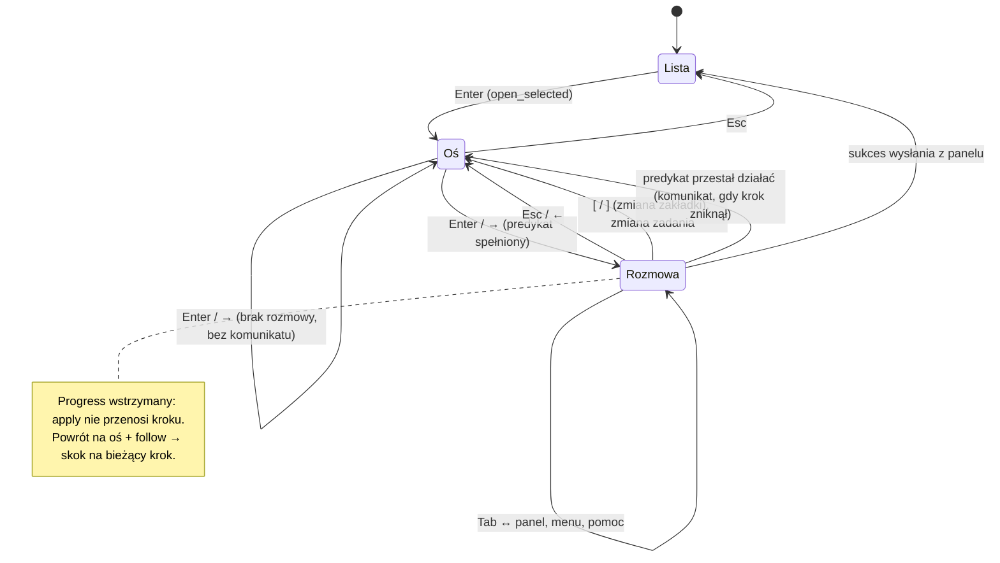
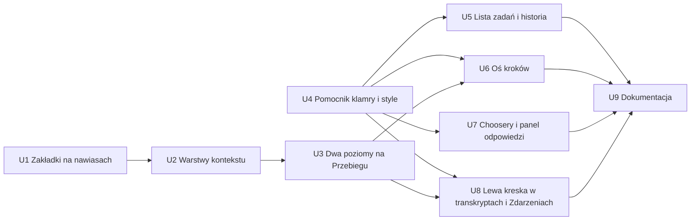

# feat: TUI — klamra zaznaczenia zamiast reverse video i wejście w rozmowę kroku na Przebiegu

## Summary

Jeden pomocnik rysuje listę z wierszami odstępu i klamrą zaznaczenia (kreska pozioma nad i pod elementem, osobna lewa kreska; gruba `Focus` przy fokusie, cienka `Done` bez). Zastępuje on `ListState`, znacznik `▸` i reverse video w liście zadań, historii, osi kroków i w chooserach, a lista akcji w panelu „Czeka na Ciebie” przewija się w swoim obszarze. Transkrypty i *Zdarzenia* dostają samą lewą kreskę z tą samą regułą fokusu. `Role::Selected` znika. Na *Przebiegu* fokus ma dwa poziomy (oś ↔ rozmowa kroku), wyrażone jako warstwy kontekstu klawiszy nałożone na szczegóły. Zakładki we wszystkich szczegółach i w historii przełączają `[`/`]`, a `←`/`→` służą wejściu w rozmowę kroku i powrotowi z niej.

---

## Problem Frame

Na *Przebiegu* `j`/`k` zawsze przesuwają krok na osi, więc wpisu rozmowy kroku nie da się wybrać, rozwinąć ani pokazać surowo. Na zakładce *Rozmowa* to działa. Zaznaczenie w listach to pełne pasy reverse video, które wyglądają topornie i gubią kolory ról. Transkrypt już dziś oznacza wybrany wpis kreską `┃` i to działa lepiej. Szczegóły w dokumencie źródłowym (see origin: docs/brainstorms/2026-10-10-tui-zaznaczenie-i-rozmowa-kroku-requirements.md).

---

## Requirements

**Wejście w rozmowę kroku**
- R1. Na *Przebiegu* fokus ma dwa poziomy: oś i rozmowa kroku. Po wejściu w szczegóły fokus jest na osi.
- R2. `Enter`/`→` na osi wchodzą do rozmowy kroku. Gdy krok nie ma rozmowy do pokazania, fokus zostaje na osi.
- R3. W rozmowie kroku działają `j`/`k`/`↑`/`↓` (wybór wpisu) oraz te same klawisze co na *Rozmowie*: strony, początek/koniec, rozwinięcie, widok surowy wpisu i całości.
- R4. `Esc`/`←` w rozmowie wracają na oś z tym samym krokiem. `Esc` na osi wraca na listę.
- R5. Gdy fokus jest w rozmowie, oś nie zmienia kroku sama z siebie (także przy śledzeniu `f`).
- R6. Pasek skrótów i pomoc pokazują klawisze poziomu, na którym jest fokus.

**Klamra zaznaczenia**
- R7. Reverse video nigdzie nie oznacza zaznaczenia.
- R8. Klamra = kreska pozioma w wierszu nad elementem, kreska pozioma w wierszu pod nim i pionowa kreska z lewej przy każdej linii elementu, bez narożników. Kreski poziome zaczynają się za kolumną pionowej.
- R9. Klamra dotyczy listy zadań, historii, osi kroków, chooserów (menu akcji, wybór workflow, harnessu, repozytoriów, wybór wpisu w formularzu wejść) i listy akcji panelu „Czeka na Ciebie”.
- R10. Stały wiersz odstępu między elementami, także nad pierwszym i pod ostatnim. Ruch kursora nie przesuwa wierszy. Zadanie zajmuje 3 wiersze.
- R11. Przewijanie i nawigacja o cały element. Klamra zaznaczonego elementu mieści się w widoku w całości.
- R12. Panel z fokusem: klamra gruba w roli `Focus`. Bez fokusu: ta sama klamra, cienka i szara.
- R13. Zaznaczony wiersz zachowuje kolory ról swojej treści.
- R14. Z `NO_COLOR` zaznaczenie i fokus rozpoznawalne po kształcie i grubości.

**Lewa kreska w rozmowach i Zdarzeniach**
- R15. Transkrypty (*Rozmowa*, rozmowa kroku, czat dyrygenta) i *Zdarzenia* oznaczają wybrany element samą lewą kreską, bez kresek poziomych i odstępów.
- R16. Lewa kreska stosuje regułę fokusu klamry. W rozmowie kroku kreska jest cyan tylko przy fokusie w rozmowie.

**Panel „Czeka na Ciebie”**
- R17. Lista akcji przewija się w swoim obszarze i nie zabiera miejsca kontekstowi ani polom odpowiedzi.

**Origin acceptance examples:** AE1 (R2, R3, R4), AE2 (R2), AE3 (R5), AE4 (R8, R10, R12), AE5 (R13), AE6 (R14), AE7 (R17).

**Decyzje z dialogu planowania:**
- Zakładki w szczegółach zadania, w szczegółach historii i na liście historii przełączają `[`/`]` zamiast `←`/`→`. Dzięki temu `→`/`←` mogą wejść do rozmowy kroku i z niej wyjść, jak chce R2/R4, bez łamania zasady „jeden klawisz — jedno znaczenie”. W innych zakładkach `←`/`→` nic nie robią.
- Oś traci klawisze rozmowy. PgUp/PgDn, Spacja, `v` i `Ctrl+V` działają dopiero w rozmowie kroku. Na osi zostają: `j`/`k`/`g`/`G`, `f`, `Enter`/`→`, `Esc`.
- Fokus sam wraca na oś przy przełączeniu zakładki, zmianie zadania, powrocie na listę i wtedy, gdy rozmowa przestaje dać się pokazać. Zniknięcie kroku z przebiegu pokazuje komunikat na pasku. Panel odpowiedzi (`Tab`), menu, potwierdzenie i pomoc zostawiają fokus w rozmowie. W rozmowie `f` nic nie robi, a odroczony skok śledzenia następuje po powrocie na oś.
- Szczegóły historii dostają te same dwa poziomy na *Przebiegu* (bez śledzenia, bo przebieg jest zamknięty).
- Przy 60×20 panel „Czeka na Ciebie” pokazuje jedną akcję z klamrą naraz, a resztę przewija `j`/`k`. W chooserze ułożonym pionowo najpierw kurczy się opis. Lista akcji ma zawsze miejsce na jeden element z klamrą.
- Do rozmowy trwającego kroku da się wejść dopiero po pierwszym wpisie. `Enter` na kroku bez rozmowy nic nie robi i nie pokazuje komunikatu (AE2).

---

## Scope Boundaries

- Rozmowy i *Zdarzenia* nie dostają klamry ani odstępów (origin).
- Bez zmian palety ról i zasady „tylko 16 kolorów ANSI” (origin).
- `LIST_WIDTH = 28` zostaje. Lista mieści mniej zadań (origin).
- Inne wyróżnienia zostają bez zmian (origin): błąd w transkrypcie (`chat_header(Error)` z REVERSED w `NO_COLOR`), aktywna zakładka, `key_cap` na pasku skrótów (REVERSED w `NO_COLOR`), podświetlenie nazwy pola z fokusem w formularzach.
- Bez nowych poziomów fokusu w innych zakładkach (np. *Dyrygent*: czat ↔ historia decyzji) (origin).
- Ramki paneli wewnątrz choosera („Akcje”, „Opis”) zostają cienkie jak dziś. Zmienia się tylko oznaczenie zaznaczonego wpisu.

### Deferred to Follow-Up Work

- Wpis w `docs/solutions/` (przez `/ce-compound`) o regule „klamra w listach, lewa kreska w transkryptach” i o warstwach kontekstu klawiszy, po wdrożeniu.

---

## Context & Research

### Relevant Code and Patterns

- **Role i ramki:** `src/tui/style.rs`
  - `Role::Selected` (REVERSED), `Styles::selected`, `Role::ALL`.
  - Dokument modułu mówi „tło tylko dla zaznaczenia i key caps”.
  - `Styles::panel(title, focused)` i `render_panel`: `BorderType::Thick` + `Focus` / `Plain` + `Done`. To wzór reguły klamry.
- **Lista zadań:** `src/tui/task_app/list.rs`
  - `TaskList::render`: `List` + `ListState` (`view`), dwuliniowe `ListItem`.
  - `row_text(row, width, styles, stale, selected)` dopełnia linie do pełnej szerokości i nakłada `styles.selected`.
  - `ROW_PREFIX`, `PendingRow::text`.
- **Historia:** `src/tui/task_app/history.rs`
  - `render_list` (używa `row_text`, `view: ListState`).
  - `on_history_key`, `on_detail_action`, `history_context`.
  - Szczegóły rysuje `detail::render_view`.
- **Oś kroków:** `src/tui/task_app/tabs/progress.rs`
  - `Progress`: `selected` (etykieta), `follow`, `top`.
  - `apply` przenosi zaznaczenie, gdy `follow || lost`. Są też `toggle_follow`, `select_index`.
  - `render` rysuje jednowierszowe pozycje osi z `▸` i `Role::Selected` przy fokusie.
  - `render_step`/`render_attempt` dopasowują stany bez rozmowy: `(Recorded, None)`, `NoRecord`, `NotCreated`, brak wczytanej próby, `attempt.no_record()`.
- **Routing szczegółów:** `src/tui/task_app/detail.rs`
  - `TaskDetail::on_action`, `on_progress_action`: `j`/`k`/`g`/`G`/`f` idą na oś, reszta do transkryptu próby.
  - `recorded_attempt`, `areas`, `render_view`, pasek zakładek z `↧ podąża`.
- **Klawisze aplikacji:** `src/tui/task_app/mod.rs`
  - `DetailTab::shifted`, `key_context`, `on_key` (`PrevTab`/`NextTab`, `Back`), `on_cursor`, `on_detail_action`, `open_selected`, `announce`, `panel_focus`.
- **Transkrypt:** `src/tui/task_app/tabs/conversation.rs`
  - `transcript_row` rysuje `"┃ "` zawsze w `Focus`. Jest też `render_transcript`.
  - `transcript_action` to wspólna mapa akcji na dowolny `TranscriptState`.
  - `Attempts`/`Attempt` to stan per próba, który przeżywa odświeżenie.
  - `src/tui/transcript.rs`: `TranscriptLine.selected`, `wrap_visible_lines`.
- **Zdarzenia:** `src/tui/task_app/tabs/events.rs` (`render` z `▸` + `Role::Selected`, ręczne `cursor`/`top`).
- **Dyrygent:** `src/tui/task_app/tabs/conductor.rs` (`render` → `render_transcript`, tryb pisania).
- **Chooser:** `src/tui/chooser.rs`
  - Rysowanie: `list_line` (`▸`, reverse), `render_list` (`first = selected + 1 - height`), `render`, `pane`.
  - Rozmiary: `preferred_height`, `SIDE_BY_SIDE_MIN_WIDTH`, `list_width`.
  - Konsumenci: `waiting.rs`, `actions.rs` (menu, harness), `new_task.rs`, `repositories.rs`. `chooser/inputs.rs` nie rysuje listy, gdy fokus jest w polach.
- **Panel odpowiedzi:** `src/tui/task_app/waiting.rs`
  - Stałe: `KEEP_FOR_CONTENT`, `MAX_CONTEXT_ROWS`.
  - Wysokość: `preferred_height`, `render` (chooser bierze resztę). Dodatkowe przycięcie robi `detail::areas`.
- **Układ:** `src/tui/task_app/layout.rs` (`MIN_WIDTH=60`, `MIN_HEIGHT=20`, `LIST_WIDTH=28`, `context_of`, pasek skrótów, nakładka pomocy).
- **Keymap:** `src/tui/keymap.rs`
  - `Context`, `Context::ALL`, `name`, `inherits_global`.
  - `BINDINGS`: `Details` ma 33 wiersze, w tym `Left`/`Right` → `PrevTab`/`NextTab` i `Enter`/`Space` → `Expand`. `HistoryDetails` i `History` mają swoje `Left`/`Right`.
  - Funkcje: `lookup_in`, `key_of`, `check_consistency`, `help_entries_in`, `hints`, `hint_line`, `render_help`.
  - `[`/`]` są już zajęte w `Context::Panel` (poprzednie/następne oczekiwanie). Inny kontekst, więc nie ma kolizji.
- **Testy:**
  - `tests/tui_render.rs`: `draw`, `cell_at`, `bold_at`, `column_of`, `THICK`/`THIN`, `assert_frame`. Asercje REVERSED do przepisania: `selection_is_reversed_in_colour_and_in_no_color_and_markers_survive`, `live_markers_keep_their_colours_and_the_selection_is_reversed`, `without_colour_every_marker_and_the_selection_survive`, `all_reversed`/`none_reversed`, `pending_rows_take_two_lines…`, `the_history_is_a_list_beside_read_only_details`. Jest też test dyscypliny kolorów.
  - `tests/tui_state.rs`: `press`, `ch`, `details_app`, `read_timeline`, `selected_step`; moduły `progress`, `events_and_conversation`, `style_roles` (`selection_is_reverse_video_in_both_modes_and_keeps_the_base`), testy `check_consistency`.
  - `tests/task_app_support/`.

### Institutional Learnings

- D-T10 „jeden klawisz — jedno znaczenie” (`docs/brainstorms/2026-10-08-tui-przeprojektowanie-design.md`): jedna tabela `BINDINGS` steruje obsługą, paskiem i pomocą. Handlery dopasowują `Action`, nigdy surowy klawisz.
- Konteksty z polem tekstowym (`Form`) nie dziedziczą nic z `Global`. Pułapka z planu formularza: `Panel` i `Form` wiążą `Newline` osobno.
- Kolory tylko przez `Role`. Test `nothing_in_the_tui_names_a_colour_outside_the_role_module` pilnuje tego w źródłach. `NO_COLOR` czytany raz. Kolor nigdy nie niesie informacji sam.
- Odświeżenie nigdy nie przesuwa tego, co operator wybrał: zaznaczenia, fokusu, zakładki, kursorów, śledzenia (plany 2026-10-09-001 i 2026-10-06-2038).
- Kursor transkryptu to lewa kreska, a nie obrys ani reverse, bo zachowuje kolor roli. To decyzja Artura z planu 2026-10-06-2038. Ten plan rozszerza ją na listy jako klamrę.
- Pamięć projektu: stabilna kolejność listy (nie sortować wg stanu); testy nie mogą zostawiać demonów.
- Ten plan zastępuje R9 z `docs/brainstorms/2026-10-10-tui-czytelnosc-requirements.md` (zaznaczenie reverse) (origin).

### External References

- Brak. ratatui 0.30.2 jest już w repo, a pomocnik listy powstaje lokalnie.

---

## Key Technical Decisions

- **Jeden pomocnik „lista z odstępami” w nowym module `src/tui/selection.rs`:**
  - Wejście: elementy jako linie (wysokość dowolna, dla danej listy zwykle stała), indeks zaznaczonego, `focused`, `stale` i trwały `top` (indeks pierwszego widocznego elementu), który przeżywa odświeżenie.
  - Rysuje wiersz odstępu, element, wiersz odstępu itd. Każda linia elementu ma z lewej kolumnę kreski i kolumnę przerwy (`"┃ "`/`"│ "`/`"  "`), jak dziś transkrypt.
  - Kreski poziome leżą w wierszach odstępu nad i pod zaznaczonym elementem. Zaczynają się w kolumnie treści (za przerwą) i biegną do prawej krawędzi obszaru, więc nie stykają się z pionową.
  - `top` przesuwa się minimalnie, tak by zaznaczony element razem z obiema kreskami był w widoku (R11).
  - Gdy obszar jest niższy niż element + 2, pomocnik rysuje samą lewą kreskę. To przypadek awaryjny, bo przy 60×20 każdy obszar mieści co najmniej jeden element.
  - Pomocnik zastępuje `ListState` w liście zadań i historii, ręczne `top` na osi oraz `first` w chooserze.
- **Kreski z `style.rs`:** metoda w rodzaju „styl i znaki zaznaczenia dla `focused`”.
  - Z fokusem: grube `━`/`┃` w roli `Focus`. Bez fokusu: cienkie `─`/`│` w roli `Done`. Te same znaki co `BorderType::Thick`/`Plain` ramek paneli, więc wyglądają spójnie w typowych fontach.
  - `NO_COLOR`: `Focus` daje pogrubienie, `Done` przyciemnienie, a różnicę zawsze niesie kształt znaku (R14).
  - `Role::Selected` i `Styles::selected` znikają. Dokument modułu przestaje wymieniać tło zaznaczenia.
  - Treść wiersza nie dostaje żadnego stylu zaznaczenia, więc role zostają nienaruszone (R13).
- **Kreska nie greje się przy `stale`:** pokazuje, gdzie są klawisze, a o braku połączenia mówi szara treść. Dziś transkrypt już tak robi, a *Zdarzenia* i oś nie, więc ujednolicamy w tę stronę.
- **Lewa kreska w transkryptach przez parametr `focused`:** `render_transcript`/`transcript_row` dostają `focused`. Grube `┃` `Focus` albo cienkie `│` `Done`, kolumna `"┃ "` bez zmian szerokości. *Zdarzenia* zamieniają `▸ ` + reverse na tę samą kolumnę. `conversation::render`, `conductor::render` i `events::render` dostają `focused` od `detail::render_view`.
- **Reguła „panel z fokusem” dla każdego miejsca:**

  | Miejsce | Gruba / `Focus`, gdy | W przeciwnym razie |
  |---|---|---|
  | Lista zadań, lista historii | fokus na liście (także tryb przesuwania) | cienka |
  | Oś kroków | szczegóły z fokusem, poziom = oś, panel odpowiedzi bez fokusu | cienka |
  | Rozmowa kroku (lewa kreska) | szczegóły z fokusem, poziom = rozmowa, panel bez fokusu | cienka |
  | *Rozmowa*, *Zdarzenia* | szczegóły z fokusem, panel bez fokusu | cienka |
  | Czat dyrygenta | jw. i operator nie pisze wiadomości | cienka |
  | Lista akcji panelu odpowiedzi | panel z fokusem i fokus choosera na akcjach | cienka; brak, gdy lista jest ukryta (`inputs_layout` z fokusem w polach) |
  | Nakładki (menu, harness) | zawsze | — |
  | Wybór workflow w nowym zadaniu, repozytoria | fokus na liście choosera | cienka, gdy fokus w polach |

  W układzie wąskim (jeden panel) widoczny panel ma fokus, więc działa ta sama reguła.
- **Warstwy kontekstu klawiszy zamiast kopii `Details`:** kontekst klawiszy staje się stosem: opcjonalna warstwa nad bazą (`Details` albo `HistoryDetails`), a nad nimi `Global` dla kontekstów, które go dziedziczą.
  - Wiersze `Details` i `HistoryDetails`, które działają na treść zakładki (`j`/`k`/`↑`/`↓`, strony, `g`/`G`, `Enter`/`Spacja`, `v`, `Ctrl+V`, `f`), przechodzą do warstw:
    - „czytanie”: zakładki inne niż *Przebieg* oraz rozmowa kroku;
    - „oś”: `j`/`k`/`↑`/`↓`/`g`/`G`, `f`, `Enter`/`→` → wejście;
    - „rozmowa kroku”: warstwa czytania bez `f` oraz `Esc`/`←` → oś.
  - Baza zachowuje to, co działa w każdej zakładce: `[`/`]`, `Tab`, `.`, akcje zadania, `h` i klawisze dyrygenta.
  - Warstwy są wspólne dla szczegółów zadania i historii. Nie zawierają akcji zmieniających stan, więc nic z menu zadania nie przecieka do historii tylko do odczytu.
  - `check_consistency` sprawdza każdy dopuszczalny stos: klawisz nie może znaczyć dwóch rzeczy w warstwie, w bazie, między warstwą a bazą ani przesłaniać `Global`. Nadpisywanie przestaje być potrzebne, bo `Enter` żyje tylko w warstwach, a w rozmowie kroku `Esc` z warstwy jest jedynym `Esc` na stosie. Dlatego `Esc` musi wyjść z bazy do warstw: oś i czytanie → lista, rozmowa kroku → oś.
  - Pomoc i pasek: najpierw warstwa, potem baza, potem `Global`.
  - `key_of(Context::Details, …)` w `chat.rs` i `tabs/conductor.rs` musi szukać w stosie, który obowiązuje w danym miejscu.
- **Poziom fokusu w stanie aplikacji, nie w `Progress`:**
  - Poziom jest jeden dla szczegółów zadań (obok `focus`/`panel_focus`) i osobny w widoku historii.
  - Wraca na oś przy: `Back`, wejściu w szczegóły (`open_selected`, R1), zmianie wybranego zadania (także po `announce` przy zniknięciu), `[`/`]`, sukcesie wysłania z panelu (fokus → lista), wejściu w szczegóły historii.
  - Zostaje przy `Tab` (panel) tam i z powrotem, przy nakładkach i przy pomocy.
- **Wstrzymanie śledzenia (R5, AE3):**
  - `Progress` dostaje stan „wstrzymane”, ustawiany przy wejściu do rozmowy. Wtedy `apply` nie przenosi zaznaczenia, chyba że krok zniknął (wtedy fokus i tak spada na oś).
  - Przy powrocie na oś wstrzymanie znika, a jeśli `follow` jest włączone, zaznaczenie skacze na bieżący krok.
  - `f` nie jest związany w rozmowie kroku.
- **Predykat „krok ma rozmowę do pokazania”:** obok `Progress`/`Attempts`, sprawdzany przy wejściu (R2) i po każdym `apply` szczegółów.
  - Wszystkie warunki naraz: pozycja `Recorded` z `action_execution_id`, wczytana próba, brak `no_record()`, co najmniej jeden wpis.
  - Gdy przestaje być spełniony w trakcie, fokus spada na oś. Komunikat `Warning` pojawia się tylko, gdy krok zniknął z przebiegu.
  - Baner błędu nad istniejącymi wpisami nie wyrzuca z rozmowy.
- **Stan kursora rozmowy kroku to istniejący `TranscriptState` próby.** Wejście nie resetuje wyboru: zostaje ostatni wpis ze śledzeniem końca, jak w podglądzie i na *Rozmowie*. Powrót do kroku przywraca miejsce.
- **R17 przez trwały `top` w `Chooser`:**
  - `render_list` używa pomocnika listy zamiast `first = selected + 1 - height`.
  - Wysokości: `preferred_height` liczy `2N+1` wierszy listy plus ramkę. W układzie pionowym lista dostaje co najmniej jeden element z klamrą (3 wiersze + ramka), a opis kurczy się pierwszy.
  - Kontekst i pola odpowiedzi zachowują swoje rezerwy z `waiting.rs`.
  - `top` jest polem choosera i przenosi się w `Chooser::rebuilt`, żeby odświeżenie nie przesuwało listy.

---

## Open Questions

### Resolved During Planning

- Kolizja `←`/`→` z zakładkami? Zakładki przechodzą na `[`/`]` (decyzja Artura).
- Ile akcji mieści panel przy 60×20? Jedną z klamrą: szczegóły mają ok. 16 wierszy, panel ≤ 10, chooser ≥ 5, lista 3 + ramka. Przewijanie R17 jest więc konieczne.
- Znaki cienkie i grube? `─`/`│` i `━`/`┃`, te same co ramki paneli.
- Czy historia dostaje poziomy? Tak, bo dzieli `TaskDetail`/`render_view`.
- Czy wejść do rozmowy trwającego kroku bez wpisów? Nie, dopiero po pierwszym wpisie.
- Komunikat przy odmowie wejścia? Nie (AE2). Komunikat jest tylko przy automatycznym spadku na oś po zniknięciu kroku.
- Gdzie zaczynają się kreski poziome? W kolumnie treści, za kolumną kreski i przerwą.

### Deferred to Implementation

- Kształt stosu kontekstów w kodzie (nowy typ z warstwą i bazą czy `Context` z metodą rodzica) i jak go przyjmują `hint_line`/`render_help`/`key_of`.
- Czy `Down`/`Up` itp. w warstwach dalej idą przez `on_cursor`, czy prosto do `on_detail_action`.
- Dokładny podział 33 wierszy `Details` między bazę a warstwy. Klawisze dyrygenta (`Compose`, `UndoDecision`, `LoadMore`) najpewniej zostają w bazie, bo `on_key` już je zawęża do zakładki.
- Czy predykat rozmowy sprawdzać po każdym `on_detail_read`, czy też w rysowaniu (rysowanie nie powinno zmieniać stanu, więc raczej przy odczycie i przy akcji).
- Liczba asercji pozycyjnych w `tests/tui_render.rs` do przepisania po zmianie wysokości wierszy listy (3 zamiast 2) i kolumny kreski.
- Czy w historii *Przebieg* w ogóle pokazuje `f` (dziś `HistoryDetails` go nie wiąże); najpewniej warstwa osi historii pomija `f`, co wymaga osobnego wariantu warstwy albo odfiltrowania.

---

## High-Level Technical Design

> *This illustrates the intended approach and is directional guidance for review, not implementation specification. The implementing agent should treat it as context, not code to reproduce.*

Kształt listy z klamrą (zadanie: 2 linie, kolumna kreski + przerwa, szerokość wewnętrzna 26):

```
                              <- odstęp
  ! ✗  Fix login              <- element niezaznaczony
       #3 · claude-code
                              <- odstęp
    ━━━━━━━━━━━━━━━━━━━━━━━━  <- kreska górna (od kolumny treści)
┃ ! ●  Refactor parser        <- lewa kreska przy każdej linii
┃      w toku · implement
    ━━━━━━━━━━━━━━━━━━━━━━━━  <- kreska dolna
  ? ◆  Add docs
       czeka na Ciebie
                              <- odstęp
```

Bez fokusu te same pozycje, znaki `─`/`│` w roli `Done`.

Poziomy fokusu na *Przebiegu*:



Stos kontekstów klawiszy:

| Gdzie | Warstwa | Baza |
|---|---|---|
| Szczegóły zadania, *Przebieg*, oś | oś | `Details` |
| Szczegóły zadania, *Przebieg*, rozmowa | rozmowa kroku | `Details` |
| Szczegóły zadania, inne zakładki | czytanie | `Details` |
| Szczegóły historii (te same trzy przypadki) | jw. | `HistoryDetails` |
| Pozostałe | brak | jak dziś |

---

## Implementation Units



### U1. Zakładki przełączane `[`/`]`

**Goal:** `PrevTab`/`NextTab` przechodzą z `←`/`→` na `[`/`]` w szczegółach zadania, szczegółach historii i na liście historii, co zwalnia strzałki.

**Requirements:** warunek R2/R4 (decyzja z dialogu planowania)

**Dependencies:** brak

**Files:**
- Modify: `src/tui/keymap.rs` (wiersze `Details`, `HistoryDetails`, `History`)
- Test: `tests/tui_state.rs`

**Approach:**
- Zamiana klawiszy w tabeli. Etykieta „zakładki” zostaje przy pierwszym wierszu.
- `check_consistency` przechodzi (w `Panel` `[`/`]` znaczą co innego, ale to inny kontekst).

**Patterns to follow:** istniejące wiersze `Panel` dla `[`/`]`.

**Test scenarios:**
- Happy path: szczegóły zadania na *Przebiegu*, `]` → *Rozmowa*; `[` z *Przebiegu* → *Info* (zawijanie).
- Happy path: lista historii i szczegóły historii — `]`/`[` zmieniają zakładkę.
- Edge case: `→` w szczegółach na zakładce *Info* nie zmienia zakładki.
- Integration: `check_consistency(BINDINGS)` jest `Ok`; pomoc szczegółów wymienia `[`/`]` jako zakładki.

**Verification:** Testy stanu przechodzą, a pasek szczegółów pokazuje `[/]` zakładki.

---

### U2. Warstwy kontekstu klawiszy

**Goal:** Kontekst klawiszy staje się stosem warstwa → baza → `Global`, a klawisze treści zakładki przechodzą do warstw „oś”, „rozmowa kroku” i „czytanie”.

**Requirements:** R3, R4, R6

**Dependencies:** U1

**Files:**
- Modify: `src/tui/keymap.rs` (nowe warstwy, `lookup_in`, `check_consistency`, `help_entries_in`/`hints`/`hint_line`/`render_help`, `key_of`)
- Modify: `src/tui/task_app/mod.rs` (`key_context`, `on_key`/`on_cursor` dopasowują nowy stos)
- Modify: `src/tui/task_app/layout.rs` (`context_of`, pasek i pomoc z bieżącego stosu)
- Modify: `src/tui/task_app/history.rs` (`history_context`, `on_history_key`)
- Modify: `src/tui/chat.rs`, `src/tui/task_app/tabs/conductor.rs` (`key_of` w tekstach)
- Test: `tests/tui_state.rs`

**Approach:**
- Warstwa „czytanie” zbiera dzisiejsze wiersze treści z `Details` (i ich odpowiedniki z `HistoryDetails`) oraz `Esc` → lista.
- Warstwa „oś”: `j`/`k`/`↑`/`↓`/`g`/`G`, `f`, `Enter`/`→` (nowa akcja „wejdź”), `Esc` → lista.
- Warstwa „rozmowa kroku”: czytanie bez `f`, `Esc`/`←` (nowa akcja „wróć na oś”).
- Baza bez `Esc` (każda warstwa ma własny) i bez klawiszy treści.
- `check_consistency` przechodzi po wszystkich dopuszczalnych stosach. Test negatywny: ten sam klawisz w warstwie i w bazie daje błąd.
- Na tym etapie *Przebieg* zachowuje się jak dziś: bez poziomów warstwa jest zawsze „oś”, a klawisze rozmowy są nieaktywne do U3. Dlatego U2 i U3 trafiają razem albo U3 zaraz po U2.

**Patterns to follow:** `inherits_global` (wyłączenie dziedziczenia dla `Form`), test `check_consistency` na zduplikowanym wierszu.

**Test scenarios:**
- Happy path: na *Rozmowie* `j`, `Enter` i `v` działają jak dziś (warstwa czytania).
- Happy path: pasek na osi zawiera „Enter/→” z etykietą wejścia i nie zawiera „rozwiń”; pasek w rozmowie kroku zaczyna się od `Esc/←` z etykietą powrotu na oś.
- Happy path: pomoc w rozmowie kroku zawiera PgUp/PgDn, `v`, `Ctrl+V` i nie zawiera `f`.
- Edge case: szczegóły historii używają tych samych warstw, a pomoc nie pokazuje akcji zadania (`p`, `x`, …).
- Error path: tabela z klawiszem związanym w warstwie i w bazie nie przechodzi `check_consistency`.
- Integration: `check_consistency(BINDINGS)` jest `Ok`; `Form` dalej nie dziedziczy `Global` (`q` wpisuje literę).

**Verification:** Wszystkie testy keymapy i istniejące testy klawiszy szczegółów przechodzą, a stos jest jedynym źródłem paska i pomocy.

---

### U3. Dwa poziomy fokusu na *Przebiegu*

**Goal:** Wejście w rozmowę kroku i powrót, routing klawiszy wg poziomu, wstrzymanie śledzenia, automatyczny spadek na oś.

**Requirements:** R1, R2, R3, R4, R5; AE1, AE2, AE3

**Dependencies:** U2

**Files:**
- Modify: `src/tui/task_app/mod.rs` (stan poziomu, resety: `Back`, `open_selected`, zmiana zadania/`announce`, `[`/`]`, sukces wysłania z panelu)
- Modify: `src/tui/task_app/detail.rs` (`on_progress_action` wg poziomu, predykat po `on_detail_read`)
- Modify: `src/tui/task_app/tabs/progress.rs` (wstrzymanie w `apply`, wznowienie przy powrocie, predykat „ma rozmowę”)
- Modify: `src/tui/task_app/tabs/conversation.rs` (predykat na `Attempt`, jeśli tam pasuje)
- Modify: `src/tui/task_app/history.rs` (poziom w widoku historii, reset przy wejściu w szczegóły i przy `[`/`]`)
- Modify: `src/tui/task_app/waiting.rs` (sukces wysłania — reset poziomu razem z fokusem)
- Test: `tests/tui_state.rs`

**Approach:**
- Akcja „wejdź”: sprawdza predykat dla wybranego kroku. Gdy jest spełniony, ustawia poziom „rozmowa” i wstrzymuje `Progress`. W przeciwnym razie nic się nie dzieje.
- W rozmowie akcje czytania idą do `transcript_action` na `TranscriptState` wybranej próby, a akcje osi nie są związane.
- Akcja „wróć na oś”: zdejmuje wstrzymanie; gdy `follow`, zaznaczenie skacze na bieżący krok.
- Po każdym odczycie szczegółów (`timeline`, próba) w poziomie „rozmowa” predykat jest sprawdzany ponownie. Gdy nie działa, fokus spada na oś. Zniknięcie kroku daje komunikat `Warning`.
- Historia: ten sam mechanizm, `follow` nieobecny.

**Execution note:** Zacznij od testów stanu dla AE1–AE3, zanim zmienisz routing.

**Patterns to follow:** `toggle_follow`/`select_index` w `Progress`; `focus_panel` i `notify(Severity::Warning, …)` w `mod.rs`; testy `mod progress` w `tests/tui_state.rs` (`read_timeline`, `selected_step`).

**Test scenarios:**
- Covers AE1. Happy path: krok `implement` z wczytaną próbą i wpisami. `Enter` wchodzi do rozmowy, `j` przesuwa wybrany wpis, `Esc` wraca na oś (krok nadal `implement`), drugi `Esc` przenosi fokus na listę.
- Covers AE1. `→` wchodzi, `←` wraca — to samo co `Enter`/`Esc`.
- Covers AE2. Krok w stanie `NoRecord` — `Enter` nie zmienia poziomu i nie dodaje powiadomienia.
- Edge case: próba jeszcze niewczytana, `NotCreated`, `attempt.no_record()`, trwający krok bez wpisów — wejście odmówione.
- Covers AE3. Fokus w rozmowie kroku `plan`, `follow` włączony, przychodzi timeline z nowym bieżącym krokiem → wybrany dalej `plan`; po `Esc` wybrany jest nowy bieżący krok.
- Edge case: `follow` wyłączony, powrót na oś → krok bez zmian.
- Edge case: w rozmowie `f` nic nie robi (stan `follow` bez zmian).
- Edge case: w rozmowie przychodzi timeline bez wybranego kroku → poziom „oś”, powiadomienie o zniknięciu kroku.
- Edge case: w rozmowie próba przechodzi w `no_record()` → poziom „oś”, bez powiadomienia.
- Edge case: `]` w rozmowie → *Rozmowa*; po `[` z powrotem na *Przebiegu* poziom to „oś”.
- Edge case: zmiana wybranego zadania przy fokusie w szczegółach (zadanie zniknęło, `announce`) → poziom „oś”.
- Edge case: `Tab` do panelu odpowiedzi i z powrotem → poziom „rozmowa” zachowany; otwarcie i zamknięcie menu `.` → zachowany.
- Edge case: sukces wysłania z panelu → fokus na liście; ponowne `Enter` na zadaniu → poziom „oś” (R1).
- Integration: odświeżenie z nowymi wpisami w rozmowie nie zmienia wybranego wpisu, chyba że był na końcu (dotychczasowe zachowanie `TranscriptState`).
- Happy path (historia): szczegóły historii, *Przebieg*, `Enter` → rozmowa, `j`/`Esc` działają, `Esc` na osi → lista historii.

**Verification:** Testy AE1–AE3 przechodzą, a pasek pokazuje klawisze właściwe dla poziomu.

---

### U4. Pomocnik listy z klamrą i style zaznaczenia

**Goal:** Wspólny moduł rysujący listę z odstępami i klamrą oraz style kresek; `Role::Selected` znika.

**Requirements:** R7, R8, R10, R11, R12, R13, R14

**Dependencies:** brak

**Files:**
- Create: `src/tui/selection.rs`
- Modify: `src/tui/mod.rs` (rejestracja modułu)
- Modify: `src/tui/style.rs` (styl i znaki zaznaczenia dla `focused`; usunięcie `Role::Selected`, `Styles::selected`; dokument modułu)
- Test: `tests/tui_render.rs` (moduł dla pomocnika), `tests/tui_state.rs` (`style_roles`)

**Approach:**
- Pomocnik przyjmuje elementy (linie), zaznaczony indeks lub brak, `focused` i `&mut top` (indeks elementu).
  - Rysuje do obszaru: odstęp, element, odstęp…
  - Każda linia elementu dostaje prefiks dwóch kolumn: kreska z przerwą albo dwie spacje. Wywołujący dostarcza linie o szerokości obszaru minus 2.
- Kreski poziome biegną od kolumny 2 do prawej krawędzi w wierszach odstępu sąsiadujących z zaznaczonym elementem.
- `top` jest korygowany minimalnie, tak żeby zaznaczony element razem z odstępami nad i pod nim był w widoku. Przy obszarze niższym niż element + 2 rysowana jest sama lewa kreska.
- Funkcja czysta względem stanu poza `top`, żeby testy mogły ją wołać bezpośrednio na `TestBackend`.
- `NO_COLOR`: tylko modyfikatory z ról (`Focus` → pogrubienie, `Done` → przyciemnienie).

**Patterns to follow:** `Styles::panel`/`render_panel` (reguła `focused`), `transcript_row` (kolumna `"┃ "`).

**Test scenarios:**
- Covers AE4. Happy path: 3 elementy po 2 linie, zaznaczony środkowy, `focused` — wiersz nad nim to `━` od kolumny 2, kolumny 0–1 tego wiersza są puste, obie linie elementu mają `┃` w kolumnie 0, wiersz pod nim to `━`; kolor `Cyan`.
- Covers AE4. Bez fokusu: te same pozycje, znaki `─`/`│` w `DarkGray`.
- Covers AE6. `NO_COLOR`: z fokusem `━`/`┃` pogrubione, bez fokusu `─`/`│` przyciemnione, żadna komórka nie ma koloru ani REVERSED.
- Covers AE5. Treść zaznaczonego elementu zachowuje swoje style (np. span w roli `Problem` dalej czerwony), żadna komórka nie ma REVERSED.
- Edge case: zmiana zaznaczenia z elementu 0 na 1 nie zmienia wiersza, w którym leży tekst elementu 2 (R10).
- Edge case: zaznaczony pierwszy element — kreska górna w wierszu 0; zaznaczony ostatni — kreska dolna w ostatnim wierszu listy.
- Edge case: lista dłuższa niż obszar, zaznaczenie na ostatnim elemencie → `top` przesunięty tak, że klamra mieści się cała; ruch w górę nie przesuwa widoku, dopóki klamra się mieści.
- Edge case: brak zaznaczenia lub pusta lista → żadnych kresek.
- Edge case: obszar niższy niż element + 2 → sama lewa kreska, bez paniki.
- Integration: test dyscypliny kolorów przechodzi; `Role::ALL` nie zawiera `Selected`; test `style_roles` przepisany na nowe znaki.

**Verification:** Testy pomocnika przechodzą, a nigdzie w `src/tui` nie zostaje `Modifier::REVERSED` poza `key_cap` i `chat_header(Error)`.

---

### U5. Klamra w liście zadań i liście historii

**Goal:** Lista zadań (z wierszami oczekującymi) i lista historii rysują się pomocnikiem: zadanie = 2 linie + odstęp, klamra zamiast reverse.

**Requirements:** R8, R9, R10, R11, R12, R13; AE4, AE5, AE6

**Dependencies:** U4

**Files:**
- Modify: `src/tui/task_app/list.rs` (`TaskList::render`, `row_text` bez `selected`, szerokość treści minus kolumna kreski, `view: ListState` → `top`)
- Modify: `src/tui/task_app/history.rs` (`render_list`, `view`)
- Test: `tests/tui_render.rs`, `tests/tui_state.rs` (jeśli testy sięgają `ListState`)

**Approach:**
- `row_text` przestaje dopełniać do pełnej szerokości i nakładać styl zaznaczenia; dostaje szerokość pomniejszoną o 2.
- `top` przechowywany w `TaskList`/historii obok dzisiejszego `view`, przeżywa odświeżenie; zaznaczenie dalej po `task_id`.
- `focused` listy pochodzi z dzisiejszego parametru `render` (fokus na liście).

**Patterns to follow:** dotychczasowe `TaskList::render`, `render_panel`.

**Test scenarios:**
- Covers AE4. Fokus na liście, zaznaczone „Refactor parser” — grube kreski cyan nad i pod, `┃` przy obu liniach; po `Enter` (fokus w szczegółach) ta sama klamra cienka szara, a wiersze, w których leżą tytuły zadań, są te same co przed `Enter`.
- Covers AE5. Zaznaczone zadanie z `!` i `✗` — komórki markerów czerwone, żadna komórka listy nie ma REVERSED.
- Covers AE6. `NO_COLOR`: lista z fokusem gruba, bez fokusu cienka.
- Happy path: zadanie zajmuje 3 wiersze (2 linie + odstęp); pierwszy wiersz wnętrza listy to odstęp.
- Edge case: długa lista, zaznaczone ostatnie zadanie — obie jego linie i kreska dolna widoczne, żadne zadanie nie jest ucięte na górze.
- Edge case: wiersze oczekujące (`PendingRow`) zaznaczane tak samo.
- Edge case: tryb przesuwania — klamra gruba, etykieta `↕ n/m` widoczna.
- Edge case: tytuł dłuższy niż szerokość — ucięty o 2 kolumny wcześniej niż dziś, bez zawijania.
- Happy path (historia): lista historii z klamrą, cienką gdy fokus w szczegółach historii.
- Integration: odświeżenie listy (nowe zadanie na końcu) nie zmienia `top` ani pozycji zaznaczonego.

**Verification:** Przepisane testy listy i historii przechodzą bez asercji REVERSED.

---

### U6. Klamra na osi kroków

**Goal:** Oś kroków rysuje się pomocnikiem; klamra gruba na poziomie osi, cienka w rozmowie i bez fokusu szczegółów.

**Requirements:** R9, R10, R11, R12; AE1 (stan kreski)

**Dependencies:** U3, U4

**Files:**
- Modify: `src/tui/task_app/tabs/progress.rs` (`render`: pozycje osi jako elementy pomocnika, `top` jako stan pomocnika, bez `▸` i `Role::Selected`; szerokość osi uwzględnia kolumnę kreski)
- Modify: `src/tui/task_app/detail.rs` (przekazanie `focused` osi wg poziomu)
- Test: `tests/tui_render.rs`

**Approach:**
- Pozycja osi = jeden wiersz + odstęp. Wiersz błędu nad osią zostaje bez zmian.
- `focused` osi = szczegóły z fokusem, panel bez fokusu, poziom „oś”.

**Patterns to follow:** U5.

**Test scenarios:**
- Happy path: fokus na osi — wybrany krok z grubą cyan klamrą; po wejściu do rozmowy klamra osi cienka szara.
- Edge case: fokus na liście zadań — klamra osi cienka.
- Edge case: wiele kroków przy 60×20 — wybrany krok z klamrą zawsze w widoku po `G` i `g`.
- Edge case: `NO_COLOR` — grubość odróżnia poziom osi od poziomu rozmowy.

**Verification:** Testy renderowania osi przechodzą, a na osi nie ma `▸` ani reverse.

---

### U7. Klamra w chooserach i przewijanie listy akcji w panelu odpowiedzi

**Goal:** Lista choosera rysuje się pomocnikiem z trwałym `top` i regułą fokusu, a panel „Czeka na Ciebie” przewija akcje w swoim obszarze.

**Requirements:** R9, R10, R11, R12, R13, R17; AE7

**Dependencies:** U4

**Files:**
- Modify: `src/tui/chooser.rs` (`list_line` bez `▸` i reverse; `render_list` przez pomocnik; `render` z parametrem `focused`; `top` w `Chooser` i w `rebuilt`; `preferred_height` i układ pionowy: lista ≥ 1 element z klamrą, opis kurczy się pierwszy; `list_width` bez kolumny kursora `▸`, z kolumną kreski)
- Modify: `src/tui/task_app/waiting.rs` (przekazanie `focused` = panel z fokusem i fokus na akcjach; rezerwy kontekstu i pól bez zmian)
- Modify: `src/tui/task_app/actions.rs` (menu i harness — zawsze `focused`)
- Modify: `src/tui/task_app/new_task.rs`, `src/tui/task_app/repositories.rs` (`focused` wg fokusu choosera)
- Modify: `src/tui/task_app/tabs/conductor.rs`, `src/tui/failure_form.rs` (jeśli wołają `chooser::render`)
- Test: `tests/tui_render.rs`, `tests/tui_state.rs`

**Approach:**
- Element choosera = jedna linia (numer, etykieta, markery `↩`/`◆`/`!`) + odstęp.
- `top` korygowany przez pomocnik przy rysowaniu i zachowany przy przebudowie choosera po odświeżeniu.
- PgUp/PgDn w `Panel` dalej przewijają opis; `j`/`k` przesuwają zaznaczenie, a lista podąża.

**Patterns to follow:** U5; `Chooser::rebuilt` (przenoszenie stanu po etykiecie).

**Test scenarios:**
- Covers AE7. Krok z 6 akcjami, panel mieszczący 3 akcje z odstępami — po `j` ×4 zaznaczona akcja z pełną klamrą widoczna; pytanie (kontekst) i pole komentarza w tych samych wierszach co przed `j`.
- Happy path: przy 60×20 panel odpowiedzi pokazuje jedną akcję z klamrą; `j` przewija na następną.
- Happy path: menu akcji `.` — klamra gruba cyan; markery `◆`, `!`, `↩` w swoich kolorach (R13).
- Edge case: panel odpowiedzi, fokus w polach (bez `inputs_layout`) — klamra cienka; fokus w treści zakładki — cienka.
- Edge case: `inputs_layout` z fokusem w polach — lista niewidoczna, nic nie pęka.
- Edge case: chooser ułożony pionowo (szerokość < 64) — lista ma co najmniej jeden element z klamrą, opis dostaje resztę.
- Edge case: wpis niedostępny (`unavailable`) zaznaczony — treść szara, klamra wg fokusu.
- Covers AE6. `NO_COLOR`: menu z grubą klamrą, markery widoczne, brak REVERSED.
- Integration: odświeżenie, które przebudowuje chooser panelu z tym samym zestawem akcji, nie zmienia zaznaczenia ani `top`.
- Happy path: wybór workflow w nowym zadaniu i lista repozytoriów — klamra gruba przy fokusie na liście, cienka przy fokusie w polach.

**Verification:** Przepisany test `selection_is_reversed_…` (teraz o klamrze) przechodzi dla każdego konsumenta choosera, a test AE7 przechodzi.

---

### U8. Lewa kreska w transkryptach i *Zdarzeniach*

**Goal:** Kreska wybranego wpisu i wybranego zdarzenia zależy od fokusu; *Zdarzenia* tracą `▸` i reverse.

**Requirements:** R15, R16; AE1 (kreska wpisu cyan → szara)

**Dependencies:** U3, U4

**Files:**
- Modify: `src/tui/task_app/tabs/conversation.rs` (`transcript_row`, `render_transcript`, `render` z `focused`)
- Modify: `src/tui/task_app/tabs/progress.rs` (`render_attempt` przekazuje `focused` wg poziomu)
- Modify: `src/tui/task_app/tabs/conductor.rs` (`focused` = szczegóły z fokusem i operator nie pisze)
- Modify: `src/tui/task_app/tabs/events.rs` (`render` z `focused`, kolumna kreski zamiast `▸ ` + reverse)
- Modify: `src/tui/task_app/detail.rs` (`render_view` przekazuje `focused` do zakładek)
- Test: `tests/tui_render.rs`, `tests/tui_conversation.rs` (jeśli testuje `transcript_row`)

**Approach:**
- Kreska i jej styl pochodzą z tej samej metody `style.rs` co klamra (U4), żeby obie reguły nie rozjechały się.
- Szerokość kolumny bez zmian (2), więc zawijanie transkryptu i `wrap_visible_lines` zostają nietknięte.

**Patterns to follow:** dotychczasowe `transcript_row`; plan 2026-10-06-2038 (kursor wpisu, wspólne cięcie widocznego wycinka).

**Test scenarios:**
- Covers AE1. Rozmowa kroku: fokus w rozmowie — `┃` cyan przy wybranym wpisie; po `Esc` (poziom oś) — `│` szary w tych samych komórkach.
- Happy path: *Rozmowa* z fokusem w szczegółach — `┃` cyan; fokus na liście — `│` szary.
- Happy path: *Zdarzenia* — wybrane zdarzenie ma `┃` w kolumnie 0, żadna komórka nie ma REVERSED, brak `▸`.
- Edge case: czat dyrygenta podczas pisania wiadomości — kreska cienka szara.
- Edge case: wpis zawinięty na kilka wierszy — kreska przy każdym fragmencie treści, przy nagłówku tylko na pierwszym (jak dziś).
- Edge case: `stale` — kreska wg fokusu, treść szara.
- Covers AE6. `NO_COLOR` — `┃` pogrubiona przy fokusie, `│` przyciemniona bez.

**Verification:** Testy transkryptów i *Zdarzeń* przechodzą, a w `src/tui` nie ma już `Role::Selected`.

---

### U9. Dokumentacja i teksty pomocy

**Goal:** README, pomoc i dokument modułu ról opisują nowe klawisze i nowe zaznaczenie.

**Requirements:** R6 (spójność opisu), decyzje z dialogu planowania

**Dependencies:** U1–U8

**Files:**
- Modify: `README.md` (tabela klawiszy: wiersz Details — `[`/`]` zakładki, oś/rozmowa kroku na *Przebiegu*; wiersz historii)
- Modify: `src/tui/style.rs` (dokument modułu — zasada klamry i lewej kreski, tło tylko dla key caps)
- Modify: `docs/brainstorms/2026-10-10-tui-czytelnosc-requirements.md` (adnotacja przy R9: zastąpione przez nowy dokument), jeśli projekt tak robi przy innych zastąpionych wymaganiach
- Test expectation: none — dokumentacja; teksty pomocy pokrywają testy U2.

**Approach:**
- README odwzorowuje to, co pokazuje `?`, w tej samej kolejności.

**Verification:** README i pomoc w TUI mówią to samo o `[`/`]`, `Enter`/`→` i `Esc`/`←`.

---

## System-Wide Impact

- **Interaction graph:**
  - Pomocnik klamry dotyka wszystkich konsumentów choosera: panelu odpowiedzi, menu, harnessu, nowego zadania, repozytoriów, dyrygenta i formularza błędu.
  - Zmiana sygnatury `chooser::render` (parametr `focused`) przechodzi przez każde wywołanie.
- **State lifecycle risks:**
  - Poziom fokusu i wstrzymanie `Progress` muszą wracać do „oś” w każdym miejscu, w którym fokus opuszcza szczegóły albo zmienia się zadanie. Pominięcie jednego zostawi oś na stałe zamrożoną. Testy U3 wymieniają każde przejście.
  - `top` choosera i list nie może być zerowany przez odświeżenie.
- **API surface parity:** brak zmian w CLI i API. Tabela TUI→CLI w README bez zmian.
- **Integration coverage:** testy stanu dla AE1–AE3 przez `TaskApp::on_key` i `on_detail_read`; testy renderowania przez `layout::render` na `TestBackend`, w obu trybach kolorów.
- **Unchanged invariants:**
  - Kolejność listy (stan to atrybut wiersza).
  - Zaznaczenie po `task_id`.
  - Paleta ról i zasada 16 kolorów ANSI.
  - `Form` nie dziedziczy `Global`.
  - Przewijanie transkryptu po liniach logicznych (`ScrollState`).
  - `key_cap` i prezentacja błędu w `NO_COLOR`.

---

## Risks & Dependencies

| Ryzyko | Mitygacja |
|---|---|
| Przepisanie wielu asercji pozycyjnych w `tests/tui_render.rs` (wysokość wiersza 3, kolumna kreski) | Asercje szukają wierszy po tekście (`row_of`, `column_of`), a nie po stałych indeksach; przepisywać jednostkami U5–U8 |
| Podział `Details` na bazę i warstwy łamie klawisze innych zakładek | U2 ma testy dla każdej zakładki (`j`, `Enter`, `v` na *Rozmowie*, `Compose` na *Dyrygencie*); `check_consistency` po stosach |
| Lista zadań traci 2 kolumny tytułu | Zaakceptowane w origin (szerokość listy zostaje); tytuł ucinany jak dziś |
| Panel odpowiedzi przy 60×20 pokazuje jedną akcję | Zaakceptowane w dialogu planowania; przewijanie `j`/`k` i test AE7 |
| Flake ETXTBSY / wyciekające demony w innych testach (pamięć projektu) | Bez związku z tą pracą; nie dotykać tych testów |

---

## Sources & References

- **Origin document:** [docs/brainstorms/2026-10-10-tui-zaznaczenie-i-rozmowa-kroku-requirements.md](docs/brainstorms/2026-10-10-tui-zaznaczenie-i-rozmowa-kroku-requirements.md)
- Poprzedni plan TUI: `docs/plans/2026-10-10-001-feat-tui-czytelnosc-globalny-harness-plan.md`
- Kursor wpisu w transkrypcie: `docs/plans/2026-10-06-2038-feat-tui-wypowiedzi-z-kursorem-plan.md`
- Projekt TUI (D-T9, D-T10): `docs/brainstorms/2026-10-08-tui-przeprojektowanie-design.md`
- Wymagania czytelności (R9 zastępowane): `docs/brainstorms/2026-10-10-tui-czytelnosc-requirements.md`
