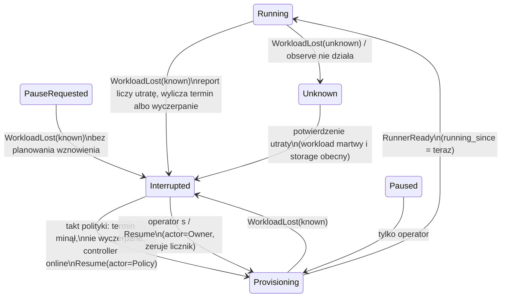

# feat: automatyczne wznawianie zadań po utracie runnera i odczyt rozmowy lokalnego zadania z zapisu

## Summary

Control plane w daemonie dostaje przebieg polityki wznawiania, wołany z istniejącego taktu schedulera (co 5 s). Zadanie `Interrupted` wznawia przez prawdziwy `Resume` oznaczony jako automatyczny, z licznikiem kolejnych utrat i rosnącym odstępem. Licznik i powód wyczerpania są zapisane w rekordzie zadania. Controller przy `Hold` na zadaniu `Unknown` sprawdza workload i zgłasza potwierdzoną śmierć, co przenosi zadanie w `Interrupted`. Odczyt rozmowy lokalnego zadania bez runnera powiela wzorzec `stored_events`: odpowiedzi dostają źródło i wiek zapisu, TUI pokazuje „zapis sprzed N min”, a CLI ten sam wiek po angielsku. Szkic w panelu „Czeka na Ciebie” wraca, gdy po wznowieniu pojawi się to samo oczekiwanie. Nowe wpisy D58 i D59 zastępują regułę „nigdy automatycznie” (R13 z planu zdalnych backendów).

---

## Problem Frame

Restart daemona zabija runnery lokalnych zadań. Zadania stoją w `Interrupted` do ręcznego `s`, a ich rozmowy nie da się wtedy przeczytać, bo serwer czyta ją wyłącznie od żywego runnera. Pełny opis i przykład z zadaniem „sprawdź możliwości aktualizacji pakietów” są w dokumencie źródłowym (see origin: docs/brainstorms/2026-10-10-wznawianie-utraconych-zadan-requirements.md).

Uwaga do źródła o przyczynie: lokalne runnery działają we własnej grupie procesów i z założenia przeżywają controller i łagodny restart daemona (`src/backends/local.rs`, „Runners … survive the controller”). Śmierć runnerów w przypadku Artura miała więc przyczynę spoza samego restartu, np. zabicie całej sesji lub cgroupy, zmianę adresu daemona albo nieaktualne poświadczenia runnera po restarcie. Ten plan nie zależy od tej przyczyny: polityka reaguje na zaobserwowaną utratę, niezależnie od tego, co ją spowodowało. Ustalenie przyczyny jest osobnym zadaniem (Deferred to Follow-Up Work).

Uwaga do źródła: TUI nie ma dziś klawisza `u` dla zadań przerwanych. Dla `Interrupted`/`Unknown` oferuje `s` (`OwnerCommand::Start`), a `p` (`Resume`) tylko dla `Paused`. Na serwerze `Start` i `Resume` z `Interrupted`/`Unknown` dają to samo przejście w `Provisioning`. W tym planie „ręczne wznowienie” oznacza każde z nich.

---

## Requirements

**Automatyczne wznawianie**
- R1. Zadanie przechodzące w `Interrupted` control plane wznawia sam, na każdym backendzie. Wyjątkiem jest utrata z `PauseRequested` (patrz decyzje niżej).
- R2. Wznawiane jest zadanie przerwane w dowolnym miejscu przebiegu, także w środku akcji agenta.
- R3. `Unknown` jest wznawiane dopiero po potwierdzeniu przez controller, że runner nie żyje. Wtedy przechodzi w `Interrupted` i dalej według R1. Gdy runner żyje albo nie da się tego stwierdzić, zadanie zostaje w `Unknown`.
- R4. `Paused` nie jest wznawiane automatycznie.
- R5. Wznawianie ma limit prób z rosnącym odstępem. Licznik dotyczy kolejnych utrat bez udanego startu runnera.
- R6. Po wyczerpaniu limitu zadanie zostaje w `Interrupted` z powodem „nie udało się wznowić automatycznie: …”. Ręczne wznowienie działa i zeruje licznik.
- R7. Każde automatyczne wznowienie i wyczerpanie limitu zostawia zdarzenie w historii zadania i powiadomienie w TUI.
- R8. Wznowione zadanie wraca w to samo miejsce przebiegu, a szkic odpowiedzi operatora nie ginie.

**Odczyt rozmowy bez żywego runnera**
- R9. Rozmowy lokalnego zadania bez żywego runnera da się czytać z zapisu na dysku: w TUI (*Rozmowa*, rozmowa kroku na *Przebiegu*) i w CLI (`narsor task conversation`).
- R10. Rozmowa z zapisu jest tylko do odczytu, ma oznaczenie wieku zapisu i sama wraca do odczytu na żywo po powrocie runnera.
- R11. Zadania zdalne bez żywego runnera zachowują się jak dziś (KTD4).

**Origin acceptance examples:** AE1 (R1, R7, R8), AE2 (R2), AE3 (R5, R6), AE4 (R3), AE5 (R4, R9, R10), AE6 (R11).

**Decyzje z dialogu planowania (potwierdzone przez Artura):**
- Limit wynosi 5 prób, jest wspólny dla wszystkich backendów i nie da się go konfigurować. Odstępy: od razu, 30 s, 2 min, 10 min, 30 min. Kolejna utrata nr k (k = 1..5) planuje próbę k z k-tym odstępem. Szósta kolejna utrata wyczerpuje limit. Utrata jest „kolejna”, gdy runner przed nią był gotowy krócej niż 10 min albo wcale nie zdążył zgłosić gotowości.
- Utrata wykryta przez świeżo uruchomiony daemon/controller na runnerze uruchomionym przed jego startem nie zużywa próby. Kilka przebudowań z rzędu nie wyczerpie zdrowych zadań.
- Utrata z `PauseRequested` (runner zginął przed bezpiecznym punktem) nie jest wznawiana. Zadanie zostaje w `Interrupted` i czeka na operatora.
- `Unknown` z żywym runnerem zostaje w `Unknown` (AE4). Powrotu do `Running` nie ma.
- Zadania, które są już w `Interrupted` przy pierwszym starcie nowej wersji, też są wznawiane, chyba że historia zdarzeń zadania pokazuje utratę z `PauseRequested`.

---

## Scope Boundaries

- Brak automatycznego wznawiania `Paused` (R4) i utraty z `PauseRequested`.
- Brak odczytu rozmowy z zapisu dla zadań zdalnych (KTD4).
- Brak konfiguracji polityki per workflow, per zadanie i per backend.
- Brak zmian w ponawianiu pojedynczej akcji przez `retry_policy` kroku.
- Brak powrotu `Unknown` → `Running`, gdy runner okaże się żywy.
- Brak odczytu rozmowy zadań w `Archiving`/`Archived`. Archiwizacja usuwa storage zadania, więc nie ma czego czytać, a odpowiedź zostaje dzisiejsza. Kryterium „rozmowę lokalnego zadania da się zawsze przeczytać” dotyczy zadań niezarchiwizowanych.

### Deferred to Follow-Up Work

- Ustalenie, co zabija lokalne runnery przy restarcie daemona, choć z założenia mają go przeżyć (patrz Problem Frame). Jeśli to błąd narsora (np. adres daemona albo poświadczenia), jego naprawa sprawi, że restart w ogóle nie będzie utratą. Do zbadania przez `ce-debug`.
- Miękka odpowiedź albo ostrzeżenie, gdy operator naciśnie `s` w chwili automatycznego wznowienia. Dziś skończy się to komunikatem o niedozwolonym poleceniu. To rzadki wyścig, nieobjęty R1–R11.

- Ostrzeżenie przy `s` na zadaniu `Unknown` z żywym runnerem. Dziś `provision()` zabija starszy workload przed nowym startem. Ta luka istniała już wcześniej, ten plan jej nie pogłębia.
- Pokazywanie w TUI czasu następnej próby („wznowienie za 2 min”) na wierszu zadania. R7 wymaga tylko śladu po fakcie.
- Domknięcie przecieków `narsor daemon` w `tests/config_startup.rs` i `tests/builtin_workflows.rs` (pamięć projektu). Nowe testy restartu muszą sprzątać same.

---

## Context & Research

### Relevant Code and Patterns

- `src/orchestration/lifecycle.rs`: czyste `command_effect` / `observation_effect`. Gałąź `WorkloadLost` ma dziś komentarz „Never a replacement”.
- `src/orchestration/model.rs`: `TaskRecord`, `CommandReceipt`, `TaskEventKind` (tag serde `type`, nowe pola z `#[serde(default)]`), `launch_command(gen)`, `holds_capacity()` (`Interrupted`/`Unknown` trzymają slot, więc wznowienie nie czeka na pojemność).
- `src/orchestration/control_plane.rs`: `command` (idempotentne po kluczu, `expected_generation`), `report` (fencing epoką dzierżawy), `mutate` (jedna mutacja = jedno zdarzenie `last_event`).
- `src/orchestration/scheduler.rs`: `command_with_capacity`, `controller_online(backend)`.
- `src/controller_protocol/service.rs`: `ProtocolService::command` (notify + reschedule), `desired_command` (mapa lifecycle → `DesiredAction`; `DesiredCommand` niesie `lifecycle`), `launch_view` (`authorized_by`), `conversation` / `conversation_page` / `live_read_blocker`, `task_attention`.
- `src/controller_protocol/service/events.rs`: `LocalTaskStorage`, `execution_events` → `stored_events`. To wzorzec odczytu z lokalnego storage'u z `ExecutionEventsSource::Storage`. Ten sam kształt ma `service/conductor.rs::stored_conductor`.
- `src/backends/controller.rs`: `reconcile` (`DesiredAction::Hold => Settled`), `observe` (licznik niepowodzeń → `WorkloadLost{state_known:false}`), `lost`, `provision` (zwalnia nieaktualny workload), `launch` / `launch_failed` (`StorageMissing` → `state_known:false`).
- `src/backends/local.rs`: `phase()` sprawdza PID z `start_ticks` z `/proc`. `src/backends/kubernetes/mod.rs`: `observe` czyta Pod i PVC.
- `src/runner/mod.rs`: sprawdzenie `authorized_by` po nieczystym zatrzymaniu (`PROBLEM_OWNER_DECISION`), `recover()` z komentarzem „owner resume…”, `serve_page`.
- `src/runner/snapshot.rs::summaries` (prywatne, po stronie runnera) buduje podsumowania prób z `ConversationStore`. Trzeba je udostępnić serwerowi.
- `src/persistence/conversation.rs::ConversationStore::read` to odczyt po numerze wpisu, odporny na urwaną ostatnią linię i na kompresję (D51).
- `src/engine/retry.rs::RetrySchedule` liczy wykładniczy odstęp. Tu stała tablica odstępów jest prostsza i czytelniejsza.
- `src/cli/daemon.rs::spawn_periodic_admission` to takt 5 s (`reschedule_all`, `sweep_materials`) w `spawn_blocking`.
- TUI: `src/tui/task_app/tabs/conversation.rs` (`read_attempt`, cache `Attempts`, `needs_read` po rewizji wiersza), `tabs/progress.rs`, `detail.rs` (`sync_detail`), `tabs/events.rs` (etykieta źródła `Available(ExecutionEventsSource)`, precedens oznaczenia), `notify.rs` (`Notifier`), `list.rs::apply_event` → `EventEffect`, `waiting.rs::WaitingPanel::sync` (szkic znikającego oczekiwania trafia do `released`).
- CLI: `src/cli/remote.rs` (`TaskCommand::Conversation`, `print_event`, `print_conversation_entries`), `src/cli/task_text.rs::conversation_lines`.
- Testy: `tests/orchestration.rs`, `tests/controller_protocol.rs` (precedens `a_paused_local_task_is_read_from_its_own_storage`), `tests/backend_contract.rs` + `tests/backend_contract_support/mod.rs` (`contract_suite!`, `kill_workload`, `fail_observes`), `tests/kubernetes_adapter.rs` + `tests/kubernetes_support`, `tests/daemon_lifecycle.rs` (`DaemonGuard`), `tests/tui_state.rs`, `tests/tui_render.rs`, `tests/tui_conversation.rs`, `tests/cli_task_text.rs`, `tests/runner.rs`.

### Institutional Learnings

- Pamięć `narsor-recovery-never-wired`: D23 `recover()` istniało, ale nikt go nie wołał. Każdą nową regułę odzyskiwania trzeba przetestować przez prawdziwy start daemona (`tests/daemon_lifecycle.rs`), nie tylko jednostkowo.
- Pamięć `runner-paused-resume-flake`: `tests/runner.rs` losowo kończy się `runner_timeout`. Nowe testy wznowienia na runnerze potrzebują hojnych limitów czasu i odpytywania, a porażkę trzeba powtórzyć, zanim uzna się ją za regresję.
- Pamięć `tests-leak-narsor-daemons`: każdy test uruchamiający daemona sprząta w `Drop` (`DaemonGuard`, `kill_processes_under`).
- Pamięć `tui-stable-task-order`: wznowienie i utrata zmieniają znacznik wiersza i dają powiadomienie, nigdy pozycję na liście.
- Pamięć `actions-agent-etxtbsy-flake`: nowe binarki fixture'ów kopiować pod tymczasową nazwę i przemianowywać.

### External References

- Nie było potrzebne. Wszystkie warstwy (lifecycle, controller, odczyt z lokalnego storage'u, powiadomienia TUI) mają w repo bezpośrednie wzorce.

---

## Key Technical Decisions

- **Polityka żyje w control plane, nie w controllerze.** Jedno miejsce działa tak samo dla każdego backendu i widzi licznik w rekordzie. Controller zdalny może być starszej wersji, a nawet offline. Przebieg wołany z taktu 5 s zachowuje się jak `reschedule_all`.
- **Wznowienie to prawdziwy `CommandReceipt` z `Resume`, oznaczony aktorem `Policy`.** Runner sprawdza `authorized_by` (KTD2) i ta ścieżka zostaje bez zmian. `CommandReceipt` dostaje pole aktora (`Owner` domyślnie przez serde, `Policy` dla automatu). Licznik zerują tylko polecenia z aktorem `Owner`. Klucz idempotencji jest deterministyczny per generacja, w zarezerwowanej przestrzeni (np. prefiks `auto-resume:`), a klucze klientów z tym prefiksem są odrzucane. Automat podaje `expected_generation`, więc wyścig z poleceniem operatora kończy się cichym `GenerationMismatch`.
- **Automat ma własne zdarzenie zamiast `OwnerCommandAccepted`.** `mutate` publikuje jedno zdarzenie na mutację. Ścieżka automatu zapisuje receipt, aktualizuje stan wznawiania i emituje nowe zdarzenie „wznowiono automatycznie” (numer próby, limit, powód utraty) w jednej mutacji, więc licznik nie rozjeżdża się z receiptami.
- **Licznik rośnie przy zgłoszeniu utraty, nie przy wznowieniu.** `report` przy przejściu w `Interrupted` liczy utratę i wylicza czas następnej próby albo wyczerpanie. Przebieg polityki tylko odczytuje gotowe „termin minął, nie wyczerpane”. Wyczerpanie ustawia `report` w stanie wznawiania razem z powodem (zdarzeniem tej mutacji jest `ControllerReported`). Zdarzenie „wyczerpano” emituje następny takt polityki w osobnej mutacji, gdy zobaczy wyczerpanie jeszcze nieogłoszone. Znacznik „ogłoszone” w stanie wznawiania sprawia, że zdarzenie pojawia się dokładnie raz. Powód nie leży w `observed.summary.detail`, bo każdy kolejny raport controllera nadpisuje `observed`.
- **„Udany start” liczony przez okno stabilności.** Rekord dostaje znacznik `running_since` z przejścia `RunnerReady`. Utrata z `Provisioning` albo przed upływem 10 min od `running_since` jest kolejna. Późniejsza zeruje licznik do jednej próby. Dzięki temu „runner ginie zaraz po starcie” (AE3) wyczerpuje limit.
- **Utrata po restarcie nie zużywa próby.** Utrata zgłoszona przez controller w dzierżawie (epoce) nowszej niż ta, w której workload uruchomiono, oznacza, że controller (i lokalnie daemon) w międzyczasie się zrestartował. Taka utrata planuje natychmiastowe wznowienie bez zwiększania licznika. Dokładny nośnik epoki uruchomienia (receipt, `RunnerObservation`, `workload.json`) rozstrzygnie implementacja.
- **Pochodzenie utraty.** Stan wznawiania zapamiętuje lifecycle, z którego nastąpiła utrata, jej czas i epokę dzierżawy. Zapisuje je już przy przejściu w `Unknown`, a przy potwierdzeniu `Unknown` → `Interrupted` liczy według zapamiętanych wartości, nie według `Unknown`. Utrata z `PauseRequested`, także przez `Unknown`, nie planuje wznowienia.
- **`Unknown` → `Interrupted` tylko przy potwierdzonej śmierci i istniejącym storage'u.** Controller przy `Hold` z `lifecycle == Unknown` woła `observe`. Gdy workload jest nieobecny albo martwy, a storage obecny, zgłasza nową obserwację potwierdzenia utraty, którą `observation_effect` mapuje `Unknown` → `Interrupted`. Gdy storage'u brak, zadanie zostaje w `Unknown`. To zamyka pętlę `StorageMissing` → `Unknown` → `Interrupted` → wznowienie → `StorageMissing`. Osobna obserwacja zamiast ponownego użycia `WorkloadLost{state_known:true}` nie zmienia znaczenia istniejącej gałęzi dla `Running`/`Provisioning`. Starszy controller zdalny tej obserwacji nie wyśle, więc zadanie po prostu zostaje w `Unknown`.
- **Kubernetes: „martwy” to tylko Pod nieobecny albo w fazie `Succeeded`/`Failed`.** Pod w fazie `Unknown` lub na węźle `NotReady` może jeszcze działać za partycją, więc zadanie zostaje w `Unknown`. PVC ReadWriteOnce jest drugim zabezpieczeniem przed dwoma runnerami.
- **Runner dostaje aktora tylko do komentarza.** `RunnerLaunchView` dostaje opcjonalne `authorized_by_actor` (domyślnie brak), a `authorized_by` zostaje `Resume`. Starszy obraz runnera nadal deserializuje odpowiedź. Komentarz w historii wykonania mówi wtedy „wznowiono automatycznie po utracie workloadu” zamiast „owner resume”.
- **Polityka pomija backend z controllerem offline.** Wznowienie nic by nie dało, a historia pokazałaby fałszywe „wznowiono”.
- **Odczyt z zapisu powiela `stored_events`.** `conversation` i `conversation_page` dla blokady innej niż `Archived` i dla `local_storage.backend_id == assignment.backend_id` czytają `ConversationStore` w `spawn_blocking`. `execution_id` pochodzi z ostatniego snapshotu runnera. Podsumowania prób buduje ta sama funkcja co runner, przeniesiona do modułu w `src/engine` obok `Timeline` (zależy od `build_timeline`, więc nie może trafić do `src/persistence`). Odpowiedzi dostają źródło (`Runner`/`Storage`, wzorem `ExecutionEventsSource`) i czas zapisu, nie czas snapshotu. Dla próby otwartej czasem zapisu jest mtime pliku `.jsonl`, a dla zamkniętej znacznik czasu ostatniego wpisu, bo kompresja do `.zst` zmienia mtime. Zadania zdalne zachowują 409 i `Unavailable`.
- **Kursor po numerze wpisu jest wspólny dla obu źródeł.** TUI dalej czyta od `next_entry` i nie unieważnia cache'u przy zmianie źródła. Oznaczenie wynika ze źródła ostatniej strony. Powrót na żywo (R10) wymusza ponowny odczyt przy zmianie lifecycle'u w `Running`. Dziś `needs_read` reaguje na rewizję wiersza, co to obejmuje, i test ma to potwierdzić.
- **Szkic w „Czeka na Ciebie” wraca po `waiting_id`.** `Released` zapamiętuje `waiting_id`. Gdy to samo oczekiwanie wróci (klucz epizodu jest stały między runnerami), szkic wraca do wpisu, a pozycja z `released` znika. Duplikatu nie ma, nawet gdy operator edytował wydany tekst: wygrywa tekst z `released`.

---

## Open Questions

### Resolved During Planning

- Liczba prób, krzywa i zasięg limitu: 5 prób, od razu / 30 s / 2 min / 10 min / 30 min, wspólny limit, bez konfiguracji. Wartości trafiają do `ProtocolConfig`, żeby testy mogły je skrócić.
- Gdzie żyje polityka: w control plane, w takcie schedulera. Nie koliduje z dzierżawą, bo wynikiem jest polecenie dla controllera, a nie jego akcja. Nie koliduje z `recover_at_startup`, bo pierwszy takt po starcie daemona widzi zgłoszone utraty.
- Jak sprawdzić, że runner nie żyje: lokalnie `phase()` (PID + `start_ticks`), na Kubernetes nieobecny Pod albo `Succeeded`/`Failed`.
- Kontrakt odczytu z zapisu: te same endpointy, nowe pola źródła i czasu zapisu, kursor bez zmian.
- Czy szkic przeżywa wznowienie: `waiting_id` to klucz epizodu ze storage'u, stały między runnerami. Krótkie zniknięcie oczekiwania w trakcie odbudowy obsługuje przywracanie z `released`.
- Założenie ze źródła „wznowienie wraca do tego samego punktu oczekiwania”: runner po autoryzowanym wznowieniu robi `recover()` + `reconcile` na tym samym storage'u. Lokalnie pokrywa to `local_engine_work_survives_loss_and_owner_resume`, a zdalnie test w U4.

### Deferred to Implementation

- Dokładne nazwy nowych wariantów `TaskEventKind`, `Observation` i pól stanu wznawiania.
- Gdzie zapisać epokę dzierżawy, w której uruchomiono workload. Wybór zależy od tego, co już niesie `RunnerObservation` i `workload.json`.
- Polecenie polityki idzie dziś przez `command_with_capacity` → `ControlPlane::command`, które emituje `OwnerCommandAccepted`. Potrzebny jest wariant tej ścieżki z aktorem i własnym zdarzeniem. `Interrupted` trzyma slot, więc można też ominąć sprawdzanie pojemności. Wybór należy do implementacji.
- Wejście zakolejkowane, gdy zadanie było `Interrupted`, a wznowiona akcja otwiera nowy epizod. Istniejąca odmowa nieaktualnego klucza epizodu (D55 pkt 9) powinna to obsłużyć. Do sprawdzenia testem w U7, bez nowej logiki, jeśli działa.

---

## High-Level Technical Design

> *This illustrates the intended approach and is directional guidance for review, not implementation specification. The implementing agent should treat it as context, not code to reproduce.*

Reguła liczenia przy utracie (kierunkowo):

| Warunek utraty | Efekt na licznik | Następna próba |
|---|---|---|
| Z `PauseRequested` (także przez `Unknown`) | bez zmian | brak (czeka na operatora) |
| Wykryta w nowszej epoce controllera niż start workloadu | bez zmian | od razu |
| Z `Provisioning` albo < 10 min od `running_since` | +1 | licznik ≤ 5: odstęp[licznik] (od razu, 30 s, 2 min, 10 min, 30 min); licznik = 6: wyczerpanie |
| ≥ 10 min od `running_since` | = 1 | od razu |

Wszystkie warunki dotyczą chwili utraty (zapamiętanej przy wejściu w `Unknown`), nie chwili potwierdzenia.

---

## Implementation Units

### U1. Model i lifecycle: stan wznawiania, aktor receiptu, nowe zdarzenia i obserwacja

**Goal:** Dać rekordowi zadania wszystko, czego potrzebuje polityka, bez zmiany zachowania.

**Requirements:** R3, R5, R6, R7

**Dependencies:** brak

**Files:**
- Modify: `src/orchestration/model.rs`, `src/orchestration/lifecycle.rs`, `src/controller_protocol/wire.rs`
- Test: `tests/orchestration.rs`

**Approach:**
- `TaskRecord` dostaje stan wznawiania (`#[serde(default)]`): liczba kolejnych utrat, termin następnej próby, lifecycle pochodzenia utraty, ostatni powód utraty, powód wyczerpania. Dostaje też `running_since`.
- `CommandReceipt` i `CommandRequest` dostają aktora `Owner | Policy`, domyślnie `Owner`.
- Nowe `TaskEventKind`: automatyczne wznowienie (próba, limit, powód utraty) i wyczerpanie (próby, powód). Starsi klienci muszą je tolerować. Sprawdzić deserializację nieznanego `type` w TUI/CLI i dodać wariant awaryjny, jeśli go brak.
- Nowa `Observation` potwierdzenia utraty. `observation_effect`: `Unknown` → `Interrupted`, a z każdego innego stanu `Unchanged`. `Observation` trafia też do `ControllerReported` i do `observed`. Starszy klient TUI/CLI musi przeżyć nieznany wariant (`kind`) w zdarzeniu, np. przez wariant awaryjny albo pominięcie zdarzenia. Sprawdzić, jak dziś reagują na nieznany wariant.
- Zaktualizować dokumentację modułu `lifecycle.rs` (diagram, „never automatic”) i komentarz gałęzi `WorkloadLost`.

**Patterns to follow:** istniejące pola z `#[serde(default)]` w `TaskRecord`; testy przejść w `tests/orchestration.rs`.

**Test scenarios:**
- Happy path: potwierdzenie utraty na `Unknown` daje `Interrupted`.
- Edge case: potwierdzenie utraty na `Running`, `Paused`, `Interrupted` i `Archiving` daje `Unchanged`.
- Edge case: rekord zapisany bez nowych pól deserializuje się z pustym stanem wznawiania i aktorem `Owner` na receiptach.
- Happy path: nowe zdarzenia przechodzą round-trip serde.
- Edge case: klient z deserializacją jak dziś dostaje `ControllerReported` z nową obserwacją i nie przerywa strumienia.

**Verification:** Istniejące testy orchestration przechodzą bez zmian. Nowe typy są serializowalne i wstecznie zgodne.

---

### U2. Liczenie utrat i reset w control plane

**Goal:** `report` i `command` utrzymują stan wznawiania zgodnie z tabelą z High-Level Technical Design.

**Requirements:** R5, R6

**Dependencies:** U1

**Files:**
- Modify: `src/orchestration/control_plane.rs`, `src/controller_protocol/service.rs` (`ProtocolConfig`: limit, odstępy, okno stabilności)
- Test: `tests/orchestration.rs`

**Approach:**
- W `report`: `RunnerReady` ustawia `running_since`. Przejście w `Unknown` zapamiętuje pochodzenie utraty (lifecycle, czas, epokę). Przejście w `Interrupted` (z `WorkloadLost` albo z potwierdzenia utraty) liczy utratę według reguł i pochodzenia zapamiętanego przy utracie, zapisuje termin albo ustawia wyczerpanie z powodem „nie udało się wznowić automatycznie: <ostatni powód utraty>”. Utrata z nowszej epoki controllera niż epoka startu workloadu nie zwiększa licznika.
- W `command`: polecenie z aktorem `Owner`, które przenosi zadanie z `Interrupted`/`Unknown`, zeruje stan wznawiania (R6).
- Gdy zapisane zadanie ma `Interrupted` bez stanu wznawiania (sprzed tej wersji), polityka odczytuje z dziennika zdarzeń zadania lifecycle sprzed `WorkloadLost`. Dla `PauseRequested` zadanie czeka na operatora, a w każdym innym przypadku dostaje świeżą utratę z terminem „teraz”.
- Zaktualizować dokumentację `ControlPlane::report` („Workload loss never schedules a replacement”).

**Test scenarios:**
- Happy path: utrata z `Running` po > 10 min od `running_since` daje licznik 1 i termin „teraz”.
- Happy path: utrata z `Provisioning` daje licznik +1 i termin zgodny z tablicą odstępów.
- Edge case: piąta kolejna szybka utrata planuje próbę z odstępem 30 min. Szósta ustawia wyczerpanie z powodem zawierającym szczegół ostatniej utraty i nie planuje terminu. Covers AE3.
- Edge case: utrata z `PauseRequested` nie ustawia terminu.
- Edge case: `PauseRequested` → `Unknown` → potwierdzenie → `Interrupted` nie ustawia terminu.
- Edge case: zadanie `Interrupted` sprzed wersji, z historią `PauseRequested` → `WorkloadLost`, nie dostaje terminu. Z historią `Running` → `WorkloadLost` dostaje termin „teraz”.
- Edge case: utrata zgłoszona w nowszej epoce dzierżawy niż epoka uruchomienia nie zmienia licznika, a termin jest „teraz”.
- Happy path: owner `Start` z wyczerpanego `Interrupted` zeruje stan. Owner `Resume` też.
- Edge case: receipt z aktorem `Policy` nie zeruje licznika.
- Edge case: kolejny raport controllera (np. `Status`) nie usuwa powodu wyczerpania.

**Verification:** Stan wznawiania zmienia się wyłącznie w `report`/`command` i w przebiegu polityki (U3).

---

### U3. Przebieg polityki w takcie daemona i aktor w runnerze

**Goal:** Zadania `Interrupted` z minionym terminem wznawiają się same, zostawiając zdarzenie. Runner przyjmuje to jako autoryzowane wznowienie.

**Requirements:** R1, R2, R4, R7, R8

**Dependencies:** U2

**Files:**
- Create: `src/controller_protocol/service/auto_resume.rs`
- Modify: `src/controller_protocol/service.rs` (`launch_view`, odrzucanie zarezerwowanego prefiksu klucza w `command`), `src/orchestration/control_plane.rs` (wejście dla polecenia polityki), `src/cli/daemon.rs` (`spawn_periodic_admission`), `src/controller_protocol/wire.rs` (`RunnerLaunchView.authorized_by_actor`), `src/runner/mod.rs` (komentarz odzyskania, dokumentacja l.60-75)
- Test: `tests/controller_protocol.rs`, `tests/backend_contract_support/mod.rs`, `tests/backend_contract.rs`

**Approach:**
- `ProtocolService` dostaje metodę przebiegu polityki: dla każdego `Interrupted` z minionym terminem, bez wyczerpania i z controllerem online wydaje `Resume` z aktorem `Policy`, kluczem `auto-resume:<generacja>` i `expected_generation`, przez `command_with_capacity`. Receipt, wyzerowanie terminu i zdarzenie powstają w jednej mutacji. Potem `notify` i `reschedule`. Błędy `GenerationMismatch`/`IllegalCommand` są logowane na poziomie debug.
- Takt w `daemon.rs` woła przebieg obok `reschedule_all`.
- `launch_view` wypełnia `authorized_by_actor` z receiptu. Runner zmienia tylko tekst komentarza.
- Klucze klientów z prefiksem `auto-resume:` dostają 400.
- Zaktualizować testy kontraktowe, które dziś sprawdzają brak automatu: `workload_death_waits_for_the_owner` i `a_failed_observation_reports_unknown_and_waits` dostają nowe oczekiwania i nazwy, a `local_engine_work_survives_loss_and_owner_resume` dostaje wariant automatyczny.

**Execution note:** Najpierw zmienić testy kontraktowe na nowe oczekiwanie (niebieskie → czerwone), potem implementacja.

**Test scenarios:**
- Happy path: lokalne zadanie z zabitym workloadem wraca do `Running` bez polecenia operatora. Historia zawiera utratę i zdarzenie automatycznego wznowienia. Covers AE2.
- Happy path (contract suite, fake + local + kubernetes): zabicie workloadu kończy się nowym workloadem (`workloads_created` +1) i lifecycle'em `Running`.
- Edge case: zadanie `Paused` z martwym workloadem nie jest wznawiane. Covers R4.
- Edge case: utrata z `PauseRequested` zostaje `Interrupted` przez kilka taktów.
- Edge case: dwa takty przed przetworzeniem polecenia przez controller dają jeden receipt (idempotencja klucza).
- Edge case: owner `Start` między odczytem a wydaniem polecenia polityki daje cichy `GenerationMismatch` i jeden przebieg.
- Edge case: controller offline, takt nic nie wydaje, licznik bez zmian.
- Error path: klient wysyłający `idempotency_key` z prefiksem `auto-resume:` dostaje błąd walidacji.
- Integration: runner przy automatycznym wznowieniu przechodzi sprawdzenie `authorized_by` i zapisuje komentarz o automatycznym wznowieniu. Nie ma problemu `owner_decision_required`.
- Integration: zadanie czekające na approval po wznowieniu ma ten sam `waiting_id` w `task_attention`. Covers R8.

**Verification:** Żaden test nie zakłada już „brak zastąpienia”. Pełny `cargo test --no-fail-fast` przechodzi, z powtórzeniem znanych flake'ów runnera.

---

### U4. Controller potwierdza śmierć runnera zadania `Unknown`

**Goal:** `Unknown` przechodzi w `Interrupted` tylko po potwierdzeniu śmierci workloadu przy istniejącym storage'u, na obu backendach.

**Requirements:** R3

**Dependencies:** U1. Asercja „potem samo wraca do `Running`” wymaga U3. Bez niej test U4 kończy się na `Interrupted`.

**Files:**
- Modify: `src/backends/controller.rs` (`reconcile` dla `Hold` + `lifecycle == Unknown`, dokumentacja modułu), `src/backends/local.rs` (bez zmian logiki `phase`, ewentualnie tylko pomocnik), `src/backends/kubernetes/mod.rs` (mapowanie faz na „martwy”), `src/controller_protocol/wire.rs` (dokumentacja `DesiredAction::Hold`)
- Test: `tests/backend_contract_support/mod.rs`, `tests/backend_contract.rs`, `tests/kubernetes_adapter.rs`

**Approach:**
- Na `Hold` controller woła `observe` tylko dla `Unknown`. Workload nieobecny albo `!is_alive()` przy obecnym storage'u daje potwierdzenie utraty. Workload żywy daje `Settled` bez raportu. Niepowodzenie obserwacji też daje `Settled`, bez kolejnego `WorkloadLost`.
- Kubernetes: Pod w fazie `Unknown` albo na nieosiągalnym węźle to „nie da się stwierdzić”, nie „martwy”.

**Test scenarios:**
- Happy path: `fail_observes(n)` doprowadza zadanie do `Unknown`. Workload potem ginie, observe znowu działa i zadanie przechodzi w `Interrupted`, a następnie samo wznawia się (`Running`).
- Edge case: `Unknown` z żywym workloadem zostaje `Unknown` przez kilka kroków, a `workloads_created` się nie zmienia. Covers AE4.
- Edge case: `Unknown` z nieobecnym storage'em zostaje `Unknown`, bez pętli wznowień.
- Edge case (kubernetes): Pod w fazie `Unknown` zostawia zadanie w `Unknown`. Pod `Failed` albo usunięty prowadzi do `Interrupted`.
- Integration (kubernetes): po automatycznym wznowieniu nowy Pod wraca do tego samego punktu oczekiwania (weryfikacja założenia ze źródła).

**Verification:** Dwa runnery na jednym storage'u nie powstają w żadnym scenariuszu z suity kontraktowej.

---

### U5. Restart daemona: test end-to-end

**Goal:** Udowodnić AE1 i regułę „restart nie zużywa próby” przez prawdziwy restart daemona.

**Requirements:** R1, R5, R7, R8, sukces „restart nie zostawia martwych zadań”

**Dependencies:** U3

**Files:**
- Test: `tests/daemon_lifecycle.rs` (albo `tests/daemon_e2e.rs`, zależnie od tego, gdzie żyje fixture zadania z approvalem)

**Approach:** Daemon z fake harnessem i workflow, który dochodzi do approvalu. Runnery z założenia przeżywają łagodny restart, więc test między zatrzymaniem a ponownym startem daemona (`DaemonGuard`) sam zabija grupę procesów runnera (PID z `workload.json` lokalnego controllera). To odtwarza utratę przy restarcie niezależnie od jej przyczyny. Test odpytuje z hojnym limitem czasu, aż zadanie znów czeka na ten sam approval. Osobny scenariusz sprawdza, że runner, który przeżył restart, nie powoduje wznowienia.

**Test scenarios:**
- Integration: zadanie czekające na approval po restarcie daemona wraca do czekania na ten sam approval (ten sam `waiting_id`), a historia ma zdarzenie automatycznego wznowienia. Covers AE1.
- Integration: sześć restartów z rzędu, każdy z zabiciem runnera i w oknie stabilności, nie wyczerpuje limitu.
- Integration: restart bez zabicia runnera zostawia zadanie w `Running` z tym samym runnerem i bez zdarzenia wznowienia.
- Integration: zadanie w `Interrupted` zapisane bez stanu wznawiania (rekord jak sprzed tej wersji) jest wznawiane po starcie.

**Verification:** Po teście nie zostaje żaden proces `narsor daemon` (`pgrep`).

---

### U6. Odczyt rozmowy lokalnego zadania z zapisu

**Goal:** Serwer oddaje podsumowanie i strony rozmowy lokalnego zadania bez żywego runnera ze storage'u, ze źródłem i czasem zapisu.

**Requirements:** R9, R10, R11

**Dependencies:** brak (niezależne od U1–U5)

**Files:**
- Create: `src/controller_protocol/service/conversation.rs` (przeniesione `conversation`, `conversation_page` i nowe gałęzie storage'u)
- Create: `src/engine/conversation_summary.rs` (`summaries` i cache zamkniętych prób przeniesione z runnera, błędy jako `PersistenceError`; runner i serwer trzymają własne instancje cache'u)
- Modify: `src/controller_protocol/service.rs` (`conversation` staje się async), `src/api/routes/control.rs` (trasy), `src/controller_protocol/wire.rs` (`ConversationResponse::Available` dostaje źródło, strona dostaje źródło i czas zapisu), `src/api/routes.rs` (`ConversationResponse`/DTO strony), `src/runner/snapshot.rs` (używa przeniesionej funkcji)
- Test: `tests/controller_protocol.rs`, `tests/conversation_store.rs`

**Approach:**
- Gałąź storage'u jak w `stored_events`: zgodny `backend_id`, `is_safe_component` dla `execution_id` i `attempt_id`, odczyt w `spawn_blocking`. Blokada `Archived` i zadania zdalne dostają dzisiejszą odpowiedź.
- Podsumowanie prób buduje ta sama funkcja co runner, więc lista prób z zapisu i na żywo jest identyczna.
- Czas zapisu: dla otwartej próby mtime pliku `.jsonl`, dla zamkniętej znacznik ostatniego wpisu. Podsumowanie bierze najnowszy z prób.
- Stany lokalnego zadania bez żywego runnera są jawne i żaden nie używa „cannot be read right now”: zapis z wpisami, zapis bez prób (brak `execution_id` w snapshocie albo brak plików, czyli `Available` z pustą listą / `NoRecord`) oraz błąd odczytu z dysku (osobny powód niedostępności z treścią błędu).
- Nowe pola są opcjonalne (`#[serde(default)]`), a brak źródła oznacza `Runner`. Starszy klient dalej działa.

**Patterns to follow:** `src/controller_protocol/service/events.rs::stored_events`; test `a_paused_local_task_is_read_from_its_own_storage`.

**Test scenarios:**
- Happy path: wstrzymane lokalne zadanie z zapisaną próbą daje podsumowanie `Available` ze źródłem `Storage` i stronę z wpisami, źródłem `Storage` i czasem zapisu. Covers AE5.
- Happy path: `Interrupted` i `Provisioning` lokalnego zadania czytają z zapisu.
- Edge case: zdalne zadanie `Interrupted` daje 409 `conversation_unavailable` jak dziś. Covers AE6.
- Edge case: zarchiwizowane lokalne zadanie zachowuje się jak dziś.
- Edge case: lokalne zadanie w `Provisioning` bez snapshotu runnera daje pustą listę prób, nie błąd.
- Error path: nieczytelny plik rozmowy daje powód „błąd odczytu zapisu” z treścią, nie 409 `conversation_unavailable`.
- Edge case: plik z urwaną ostatnią linią (runner właśnie pisze) daje wpisy do ostatniej pełnej linii, bez błędu.
- Edge case: `attempt_id` z `..` albo `/` jest odrzucany.
- Integration: numery wpisów i `next_entry` z zapisu są takie same jak z żywego runnera dla tej samej próby. Czytanie od `next_entry` ze storage'u, a potem od runnera, nie gubi ani nie dubluje wpisów.
- Edge case: podsumowanie z zapisu i snapshot runnera dają tę samą listę prób dla tego samego storage'u.

**Verification:** Komunikat „cannot be read right now” występuje w testach tylko dla zadań zdalnych i zarchiwizowanych.

---

### U7. TUI: oznaczenie zapisu, powrót na żywo, powiadomienia, szkic

**Goal:** Operator widzi w TUI rozmowę z zapisu z jej wiekiem, powiadomienia o wznowieniu i wyczerpaniu, a jego szkic przeżywa wznowienie.

**Requirements:** R7, R8, R9, R10

**Dependencies:** U1 (zdarzenia), U6 (źródło w odpowiedzi)

**Files:**
- Modify: `src/tui/task_app/tabs/conversation.rs`, `src/tui/task_app/tabs/progress.rs`, `src/tui/task_app/detail.rs`, `src/tui/task_app/list.rs` (`apply_event` → `EventEffect`), `src/tui/task_app/mod.rs` (`on_stream`, powiadomienia), `src/tui/task_app/waiting.rs` (`Released.waiting_id`, przywracanie w `sync`), `src/tui/task_app/actions.rs` (komunikat dla `Interrupted`/`Unknown`), renderer opisu przerwanego zadania (podstan i powód wyczerpania ze stanu wznawiania)
- Test: `tests/tui_conversation.rs`, `tests/tui_state.rs`, `tests/tui_render.rs`, `tests/task_app_support/mod.rs`

**Approach:**
- Cache prób pamięta źródło i czas zapisu ostatniej strony. Stała linia nagłówka rozmowy (zakładka i rozmowa kroku, tam gdzie dziś stoją komunikaty o odczycie) pokazuje „zapis sprzed N min”, gdy źródło to `Storage`. Format wieku: „przed chwilą” poniżej minuty, potem N min, N h, N d. Wiek liczy się z zegara TUI przy każdym rysowaniu, bez ponownego odczytu. Oznaczenie to tekst, więc działa z `NO_COLOR`. W wąskim terminalu skraca się do „zapis · N min”.
- Pusty zapis pokazuje „brak zapisanej rozmowy”, a błąd odczytu z dysku „nie udało się odczytać zapisu: …”.
- Zmiana lifecycle'u w `Running` (nowa rewizja wiersza) wymusza ponowny odczyt od `next_entry`, więc oznaczenie znika samo. Pozycja przewijania i zaznaczony wpis zostają, bo numery wpisów są te same.
- `EventEffect` dostaje skutki dla nowych zdarzeń. Powiadomienie zawiera nazwę zadania: `Warning` „<zadanie>: wznowiono automatycznie po utracie runnera (próba k/5)” i `Error` „<zadanie>: nie udało się wznowić automatycznie: …”. `Notifier` ma jedno miejsce, więc kilka wznowień tuż po sobie (np. po restarcie) scala się w „wznowiono automatycznie N zadań”. Zdarzenia dogrywane przy (ponownym) podłączeniu strumienia nie dają powiadomień, tak jak dziś inne efekty.
- Szczegóły zadania `Interrupted` mówią, na co ono czeka: „wznowienie automatyczne, próba k/5” (bez czasu, który jest odroczony), „nie udało się wznowić automatycznie: …, uruchom od nowa (s)” albo „utracone podczas wstrzymywania, czeka na Ciebie (s)”. Wiersz listy dostaje znacznik „wymaga uwagi” tylko w dwóch ostatnich przypadkach, a jego pozycja się nie zmienia.
- `WaitingPanel::sync`: wydany szkic z tym samym `waiting_id` wraca do wpisu na jego miejsce w kolejności panelu. Przywrócenie nie zmienia fokusu, bieżącego wpisu ani edycji innego wpisu.

**Test scenarios:**
- Happy path: strona ze źródłem `Storage` renderuje oznaczenie „zapis sprzed 3 min” na *Rozmowie* i w rozmowie kroku. Strona `Runner` go nie ma. Covers AE5.
- Integration: po zmianie zadania z `Interrupted` na `Running` następny odczyt idzie od `next_entry`, a oznaczenie znika (R10).
- Happy path: zdarzenie automatycznego wznowienia ze strumienia daje powiadomienie z nazwą zadania, a pozycja wiersza na liście się nie zmienia. Covers AE1.
- Edge case: trzy zdarzenia wznowienia tuż po sobie dają jedno powiadomienie „wznowiono automatycznie 3 zadania”.
- Edge case: zdarzenia dogrywane po ponownym podłączeniu strumienia nie dają powiadomień.
- Happy path: szczegóły `Interrupted` pokazują właściwy tekst dla każdego z trzech podstanów.
- Edge case: pusty zapis daje „brak zapisanej rozmowy”, a błąd odczytu daje „nie udało się odczytać zapisu: …”.
- Happy path: zdarzenie wyczerpania daje powiadomienie błędu, a szczegóły pokazują powód. Covers AE3.
- Edge case: oczekiwanie znika (szkic trafia do `released`) i wraca z tym samym `waiting_id`. Szkic wraca do wpisu, `released` jest pusty i nie ma duplikatu. Covers R8.
- Edge case: wraca inne oczekiwanie. Szkic zostaje w `released`.
- Edge case: zdalne zadanie `Interrupted` nadal pokazuje „rozmowa niedostępna” z powodem. Covers AE6.
- Edge case: wejście wysłane do oczekiwania sprzed utraty, gdy wznowiona akcja otwiera nowy epizod, jest odrzucone, a tekst wraca do szkicu z komunikatem.

**Verification:** Snapshoty renderu z `NO_COLOR` nadal rozróżniają oznaczenie zapisu (tekst, nie tylko kolor).

---

### U8. CLI: rozmowa z zapisu, nowe zdarzenia, powód wyczerpania

**Goal:** `narsor task conversation`, `events` i `show` mówią to samo co TUI.

**Requirements:** R7, R9, R10, R11

**Dependencies:** U1, U6

**Files:**
- Modify: `src/cli/task_text.rs` (`conversation_lines`, opis zadania), `src/cli/remote.rs` (`print_event`, `print_conversation_entries`)
- Test: `tests/cli_task_text.rs`

**Approach:** CLI pisze po angielsku, jak jego istniejące komunikaty. Podsumowanie ze źródła `Storage` drukuje „Conversation from record, N min old”, z wiekiem w tym samym formacie co TUI (just now / N min / N h / N d). Strona drukuje tę samą linię nad wpisami. `print_event` renderuje „Resumed automatically after runner loss (attempt k/5)” i „Automatic resume gave up after 5 attempts: <reason>”. `show` na zadaniu `Interrupted` pokazuje ten sam podstan co TUI.

**Test scenarios:**
- Happy path: podsumowanie `Storage` daje linię z wiekiem. `Runner` daje „Conversation live”.
- Happy path: nowe zdarzenia mają czytelną linię z numerem próby i limitem.
- Edge case: odpowiedź bez pola źródła (starszy serwer) daje „live”.

**Verification:** Teksty CLI i TUI opisują te same stany.

---

### U9. Decyzje i dokumentacja

**Goal:** Zapisać zmianę reguły w miejscach, które dziś mówią „nigdy automatycznie”.

**Requirements:** wszystkie (spójność dokumentów)

**Dependencies:** U1–U8

**Files:**
- Modify: `ARCHITECTURE_DECISIONS.md` (D58: automatyczne wznawianie zastępuje R13 i regułę z planu schedulera, z limitem, oknem stabilności, wyłączeniem restartów i `PauseRequested`, potwierdzaniem `Unknown` i aktorem `Policy`; KTD2 przeformułowane na „nowszą generację uruchomienia zapisuje control plane”. D59: odczyt rozmowy lokalnego zadania z zapisu jako doprecyzowanie KTD4)
- Modify: `DOMAIN_MODEL.md` (jeśli opisuje cykl życia zadania), `docs/plans/2026-10-07-1923-feat-unified-task-scheduler-plan.md` i `docs/plans/2026-10-01-2329-feat-zdalne-backendy-wykonawcze-plan.md` (adnotacja *Superseded by D58* przy R13 / „automatic requeue”, wzorem istniejących adnotacji)

**Test expectation:** none -- zmiany wyłącznie w dokumentacji.

**Verification:** `grep` po „never automatic” / „Never a replacement” / „waits for an explicit owner command” zwraca tylko miejsca opisujące `Paused`, `PauseRequested` i wyczerpanie.

---

## System-Wide Impact

- **Interaction graph:** takt daemona → `ProtocolService` → `ControlPlane::mutate` → SSE (`notify`) → TUI/CLI; controller (long-poll) → `provision` → runner `recover()`. Polityka nie dotyka silnika ani dyrygenta bezpośrednio. Wznowiony runner sam odtwarza D55 (`continue_at_startup` po swojej stronie).
- **Error propagation:** błędy polecenia polityki są logowane i nie przerywają taktu. Wyczerpanie jest stanem, nie błędem.
- **State lifecycle risks:** licznik i receipt są zapisywane w jednej mutacji. Utrata liczy się raz, w `report` fencowanym epoką i generacją. Ryzyko pętli ze `StorageMissing` zamyka warunek obecnego storage'u.
- **API surface parity:** nowe pola wire są opcjonalne, a nowe zdarzenia wymagają tolerancji nieznanego `type` u starszych klientów. Starszy controller zdalny nie potwierdza `Unknown` (zadanie czeka jak dziś). Starszy runner ignoruje `authorized_by_actor`.
- **Integration coverage:** suita kontraktowa (fake, local, kubernetes), restart daemona, przejście zapis → żywy odczyt po kursorze.
- **Unchanged invariants:** `Paused` wznawia tylko operator. Zadania zdalne nie mają kopii rozmów na serwerze (KTD4). `retry_policy` kroków się nie zmienia. `Interrupted`/`Unknown` trzymają slot pojemności. Kolejność listy w TUI się nie zmienia.

---

## Risks & Dependencies

| Risk | Mitigation |
|------|------------|
| Ponowne wykonanie przerwanej akcji agenta z efektami ubocznymi (np. push) | Świadoma decyzja źródła. Ślad w historii i powiadomienie (R7). Brak konfiguracji per krok jest poza zakresem. |
| Zdalne zadanie w pętli tworzy kolejne Pody | Limit 5 prób z odstępami do 30 min, potem wyczerpanie. Utraty liczone w `report`. |
| Dwa runnery na jednym storage'u | `Unknown` tylko po potwierdzonej śmierci. Na K8s `Unknown` Poda nie jest śmiercią. `provision` zwalnia nieaktualny workload. PVC RWO. |
| Reguła epoki źle rozpozna restart i wyczerpie zdrowe zadania albo nigdy nie wyczerpie pętli | Test U5 (sześć restartów) i test U2 (utrata w tej samej epoce liczy się). |
| Flake'i runnera w nowych testach | Hojne limity czasu i odpytywanie. Porażki powtarzać przed uznaniem za regresję (pamięć projektu). |
| Wiek zapisu z mtime myli się po kompresji `.zst` (nowy mtime) | Zamknięta próba bierze znacznik czasu ostatniego wpisu (U6). |
| Controller ponownie zdobywa dzierżawę bez restartu (np. po zablokowaniu), a szybkie utraty w pętli wyglądają jak restarty | Rzadkie. Wtedy pętla trwa tylko do kolejnej utraty w tej samej epoce, bo ta liczy się normalnie. Test U2 sprawdza utratę w tej samej epoce. |
| AE3 („binarka harnessu zniknęła”) może nie być utratą workloadu, bo runner zgłasza `default_harness_unavailable` i żyje | Ścieżkę wyczerpania testować przez utratę faktycznie zgłoszoną przez controller (odrzucony start, natychmiastowa śmierć runnera). Brak harnessu jako problem runnera zostaje poza polityką. |
| Przyczyna śmierci lokalnych runnerów przy restarcie jest nieznana | Polityka nie zależy od przyczyny. Zbadanie przyczyny jest w Deferred to Follow-Up Work. |

---

## Documentation / Operational Notes

- Nowe wpisy D58 i D59 w `ARCHITECTURE_DECISIONS.md` (U9).
- Po wdrożeniu pierwszy start daemona wznowi wszystkie zadania, które już stoją w `Interrupted`. To zamierzone, ale warto o tym wiedzieć przed restartem.

---

## Sources & References

- **Origin document:** [docs/brainstorms/2026-10-10-wznawianie-utraconych-zadan-requirements.md](../brainstorms/2026-10-10-wznawianie-utraconych-zadan-requirements.md)
- Plany: `docs/plans/2026-10-07-1923-feat-unified-task-scheduler-plan.md`, `docs/plans/2026-10-01-2329-feat-zdalne-backendy-wykonawcze-plan.md` (KTD2, KTD4, R13)
- Decyzje: D23, D51, D53, D55 w `ARCHITECTURE_DECISIONS.md`
