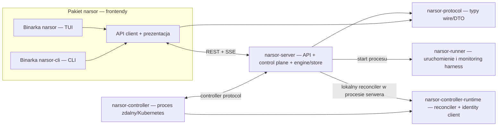

# Refactor: rozdzielenie klienta, serwera i procesów wykonawczych w Cargo workspace

## Goal Capsule

Przekształcić obecny pojedynczy pakiet `narsor` w Cargo workspace z osobnymi binarkami klienta, serwera, runnera i kontrolera, zachowując obecne zachowanie produktu. TUI i CLI mają używać API serwera do operacji na zadaniach; graf zależności ma uniemożliwiać im bezpośrednie korzystanie z silnika, store'u i implementacji serwera.

## Product Contract

### Summary

Wydzielić granice pakietów i procesów zgodnie z ich odpowiedzialnościami: klient (domyślny TUI `narsor` oraz `narsor-cli`), `narsor-server`, `narsor-runner` i `narsor-controller`, wraz z wąskimi pakietami współdzielonymi dla protokołu i kodu rzeczywiście współdzielonego. Zmiana jest refaktoryzacją architektury i dystrybucji, nie zmianą zachowania zadań.

### Problem Frame

Kod TUI, CLI, lokalnego API, runtime'u daemona, runnera i kontrolera Kubernetes znajduje się w jednym pakiecie i jest udostępniany przez jedną bibliotekę. TUI i CLI mają ścieżki zależności do typów silnika, persystencji i orkiestracji mimo docelowej granicy API. Jedna binarka i wspólny bootstrap zaciemniają, który proces jest właścicielem danego obowiązku i jakie komponenty muszą być obecne w danym wdrożeniu.

### Requirements

- R1. Jedynym właścicielem `Engine` i zapisu do `ExecutionStore` pozostaje serwer; wszystkie operacje TUI/CLI na zadaniach i ich stanie przechodzą przez REST/SSE API.
- R2. `narsor` uruchamia TUI jako domyślne i jedyne zachowanie tej binarki. CLI jest osobną binarką `narsor-cli`; komendy nie są współdzielone z TUI.
- R3. Proces API/control plane jest dostarczany jako `narsor-server`; jego runtime, routy i serwisowe odpowiedzialności są pogrupowane po stronie pakietu serwera.
- R4. Proces uruchamiający i monitorujący harness jest osobną binarką/pakietem `narsor-runner`. Lokalny backend serwera uruchamia sąsiednią binarkę `narsor-runner` zamiast subkomendy `narsor runner`, z jawnym override ścieżki dla testów.
- R5. Proces `narsor controller`, który nadzoruje zdalne backendy/Kubernetes, jest odrębny od serwera i dostarczany jako `narsor-controller`. Operacje administracyjne kontrolera pozostają komendami CLI i korzystają z API.
- R6. Biblioteka klienta TUI/CLI nie zależy od pakietów implementujących serwer, silnik, persystencję ani wykonanie runnera. Granica jest egzekwowana przez zależności Cargo, nie tylko konwencję modułów.
- R7. Typy przesyłane przez API są wire/protocol types niezależne od wewnętrznych typów `Engine`, orkiestracji i persystencji. Konwersje między modelem wewnętrznym a DTO należą do serwera.
- R8. Odkrywanie i automatyczne uruchamianie serwera z klienta wskazuje sąsiednią binarkę `narsor-server`, zachowując przekazywanie konfiguracji/root, uwierzytelnianie i sprzątanie nieaktualnych wpisów odkrywania. Plik discovery nadal jest atomowo publikowany z uprawnieniami `0600`, należy do bieżącego użytkownika i jest odrzucany, jeśli nie jest chroniony.
- R9. Konfiguracja, ścieżki stanu, workflow i prezentacja są współdzielone tylko tam, gdzie kod rzeczywiście ma wspólnego właściciela; nie powstaje catch-all `shared` zawierający silnik lub trwały stan.
- R10. Zachowane zostają aktualne semantyki API, SSE, auth, CLI, TUI, harnessów, recovery, kontrolera i zapisanych danych. Brak wymogu kompatybilności ze starą nazwą `narsor runner`; projekt nie został wdrożony.
- R11. Dokumentacja, skrypty/buildy i testy odzwierciedlają osobne artefakty i sposób ich uruchamiania.

### Key Decisions

- KD1. Użyć Cargo workspace z osobnymi pakietami i grafem zależności zamiast jednego pakietu generującego wiele binarek. Rozdziela to zależności i własność kodu, zachowując wspólny build oraz lockfile. (Governs R2–R9.)
- KD2. `narsor` jest pakietem klienta i udostępnia binarki `narsor` (TUI) oraz `narsor-cli` (CLI); `narsor` uruchamia TUI bez podkomendy. (Governs R2, R6; session-settled: user-approved — osobna binarka TUI pozostawia `narsor` domyślną aplikacją kliencką, a CLI otrzymuje własne wejście.)
- KD3. Użyć nazwy `narsor-server` dla lokalnego procesu API/control plane. Osobny controller nie jest tym serwerem: w repo realizuje cykl życia zdalnych backendów/Kubernetes. (Governs R3, R5.)
- KD4. `narsor-runner` jest osobnym pakietem/binarką, bez kompatybilnościowej podkomendy `narsor runner`. (Governs R4, R10; session-settled: user-approved — runner ma samodzielnie procesować taski, a brak wdrożeń oznacza brak potrzeby aliasu kompatybilnościowego.)
- KD5. `narsor-controller` jest osobnym pakietem/binarką; komendy administracyjne (np. enroll/list/revoke) są częścią klienta CLI, a nie procesu kontrolera. (Governs R5; session-settled: user-approved — to proces zdalnego reconciliatora Kubernetes, odrębny od lokalnego serwera API/control plane.)
- KD6. Wydzielić niezależne kontrakty wire/API od modelu wewnętrznego i wymusić brak zależności klientów od implementacji serwera/silnika/persystencji. (Governs R1, R6, R7.)

### Scope Boundaries

- Nie zmieniać semantyki zadań, workflow, API, SSE, polityk recovery/resume, autoryzacji ani formatu danych na dysku.
- Nie wprowadzać nowego transportu ani przeglądarkowego klienta.
- Nie zachowywać starych aliasów CLI wymaganych wyłącznie dla kompatybilności wdrożeń; żadnego wdrożenia jeszcze nie ma.
- Nie rozbudowywać pakietu współdzielonego o logikę serwera, silnika lub trwałego stanu tylko po to, by uprościć przenoszenie modułów.
- Nie zmieniać zachowania harnessów ani polityki sekretów/HOME runnera.

### Success Criteria

- Da się zbudować osobno `narsor`, `narsor-cli`, `narsor-server`, `narsor-runner` i `narsor-controller` z jednego workspace.
- TUI i CLI nie mają zwykłej zależności Cargo od pakietów serwera, silnika, persistence ani runnera; mutacje i odczyty zadań przechodzą przez API.
- Klient potrafi odkryć/uruchomić `narsor-server`; lokalny backend potrafi uruchomić `narsor-runner`; deploy kontrolera uruchamia `narsor-controller`.
- Istniejące testy regresyjne pozostają i są dostosowane do granic pakietów; nic nie jest usuwane wyłącznie dlatego, że stało się niewygodne po podziale.
- Dokumentacja builda i wdrożeń wymienia właściwe binarki dla klienta, serwera, runnera i kontrolera.

## Planning Contract

### Key Technical Decisions

- KTD1. Zorganizować repo jako workspace z pakietami `narsor` (frontendy), `narsor-server`, `narsor-runner`, `narsor-controller`, `narsor-controller-runtime`, `narsor-protocol` oraz innymi wąskimi pakietami runtime/shared tylko jeśli po analizie granic modułów są potrzebne. `narsor-controller-runtime` zawiera współdzielony mechanizm reconciliacji i obsługę tożsamości używaną przez serwer (dla lokalnego backendu) oraz proces kontrolera; binarka `narsor-controller` dostarcza bootstrap i integrację Kubernetes. Nazwy pakietów wewnętrznych powinny odzwierciedlać właściciela (np. `narsor-engine`), nie być ogólnym koszem. (session-settled: user-approved — wybrany workspace zamiast jednego pakietu z wieloma sprzężonymi binarkami, bo pozwala rozdzielić zależności przy wspólnym buildzie i lockfile.)
- KTD2. Ustawić binarny target `narsor` jako `default-run`, a CLI jako target `narsor-cli`; rozdzielić bootstrap logowania/konfiguracji tak, by TUI zachowało log plikowy, a CLI zachowało oczekiwane stderr/exit status.
- KTD3. Utrzymać `narsor-protocol` jako warstwę typów DTO/wire i serwerową warstwę adapterów. Client error/HTTP/SSE transport pozostaje po stronie klienta albo osobnego client crate, jeśli to potrzebne bez pociągania zależności serwera.
- KTD4. `narsor-server` zawiera endpointy, autoryzację serwerową, runtime, scheduler/recovery i integracje control plane. Klient może uruchomić binarkę serwera jako bootstrap procesu, ale wszystkie odczyty/mutacje zadań przechodzą przez API; jawne lifecycle (np. stop) ma korzystać z API lub wąskiego kontraktu discovery, nie z wewnętrznych typów serwera.
- KTD5. Przed przeniesieniem modułów ustalić rzeczywiste pakiety bazowe z grafu zależności: frontendy nie mogą dostać `Engine`, `ExecutionStore` ani typów domenowych wymagających implementacji. Konwersje domena↔DTO pozostają w warstwie serwerowej; czyste wartości/prezentacja mogą być w protocol/client/shared po odsprzęgleniu.
- KTD6. Zachować semantykę controller protocol i kompatybilne fallbacki enumów; serwer wdrażany jest przed kontrolerami i klientami zgodnie z istniejącą kolejnością aktualizacji.
- KTD7. Przenosząc runnera, zachować ustawienia HOME/CODEX_HOME/CLAUDE_CONFIG_DIR, czyszczenie odziedziczonych kluczy API, `kill_on_drop`, argumenty uruchomieniowe i obecną semantykę monitorowania harnessu.
- KTD8. Testy binarek używają właściwych `CARGO_BIN_EXE_*` dla nowych targetów. Weryfikacja zależności frontendu używa `cargo tree` i/lub testu architektonicznego, a nie wyłącznie przeszukania nazw modułów.
- KTD9. Oddzielić bibliotekę runtime kontrolera od jego binarki: lokalny reconciler uruchamiany dziś przez `narsor-server` pozostaje częścią cyklu życia serwera, a proces `narsor-controller` używa tej samej biblioteki dla zdalnego backendu. Funkcje ładowania/rejestracji credentiali nie mogą pozostać w warstwie CLI, skoro korzysta z nich także serwer.

### High-Level Technical Design



Zależności bazowe kierują do kontraktów (`narsor-protocol`), a nie z klienta do implementacji. Serwer jest właścicielem silnika, persystencji i polityk control plane. Serwer nadal uruchamia lokalny reconciler we własnym cyklu życia; `narsor-controller` jest osobnym procesem zdalnym, a nie zamiennikiem serwera ani jego lokalnego controllera. Oba korzystają ze współdzielonej biblioteki `narsor-controller-runtime`. Runner i zdalny controller są osobnymi procesami wdrażanymi/uruchamianymi zgodnie z backendem. Moduły API klienta i serwera, dziś zmieszane w `src/api`, rozdzielają się na dwa kierunki. `src/controller_protocol` rozdziela wire/client od serwisowej implementacji po stronie serwera. Konkretny podział wewnętrznych crate'ów engine/config/shared jest rozstrzygany na podstawie cykli zależności podczas wykonania, z warunkiem architektonicznym, że klient nie importuje implementacji.

### Assumptions and Dependencies

- Obecny `src/daemon/runtime.rs` jest właściwym punktem wejścia runtime'u serwera; bieżące niezacommitowane zmiany w `src/cli/daemon.rs`, `src/daemon/mod.rs` i `src/daemon/runtime.rs` są istniejącą pracą użytkownika i nie są częścią planowanego zakresu.
- `src/main.rs` i wybór logowania zależny od komendy trzeba zastąpić bootstrapem właściwym dla targetu binarnego.
- `src/api/discovery.rs` obecnie znajduje/uruchamia bieżącą binarkę; migracja wymaga rozwiązywania binarki serwera jako rodzeństwa i jawnego test override.
- Integracje deploymentu mogą zakładać dotychczasowy pojedynczy artefakt. Wszystkie manifesty, obrazy i instrukcje instalacji muszą zostać przejrzane pod kątem tego, które procesy pakują.
- Konfiguracja nie jest jeszcze niezależnym, czystym crate'em: odwołuje się do `Engine`, `StatePaths`, typów registry i ustawień runnera. Jej granica wymaga odsprzęglenia albo pozostawienia części adapterów w ich właścicielach.
- Obecne testy integracyjne używają `env!("CARGO_BIN_EXE_narsor")` i importów `narsor::*`; przeniesienie testów nie może osłabić scenariuszy procesowych.

### Risks and Mitigations

- **Niepełne API dla obecnych operacji TUI/CLI.** Spisanie wywołań direct Engine/store i zapewnienie endpointów/odpowiedzi API przed usunięciem zależności; testy API oraz regresyjne UI/CLI.
- **DTO nadal importują silnik albo orkiestrację.** Zależności typu `narsor-protocol` mają być możliwe do zbudowania bez runtime'u serwera; konwersje wewnętrzne w adapterach serwera.
- **Cykliczne crate'y przez config, workflow i controller protocol.** Przenosić w pionowych, kompilowalnych krokach; unikać tymczasowego `shared` ściągającego implementację.
- **Uruchamianie niewłaściwej binarki po podziale.** Testować discovery przy braku/nieaktualnym daemon info oraz lokalny backend z targetem runnera; testy wykorzystują jawne ścieżki do binarek.
- **Pominięte artefakty wdrożeniowe.** Przejrzeć skrypty, Kubernetes manifests, obrazy, README i `docs/operations/remote-backends.md`; ustalić listę binarek per rola.
- **Regresje procesu runnera lub uwierzytelniania harnessu.** Zachować testy HOME, env i runner end-to-end; porównać args/env procesu przed i po przeniesieniu.
- **Utrata pokrycia w wyniku przenoszenia testów.** Mapować istniejące testy do nowych pakietów i uruchamiać zarówno unit, integration, jak i ignored real-process suites.

## Output Structure

Docelowa orientacyjna struktura (nazwy plików/modułów mogą dopasować się do istniejących konwencji; granice pakietów są wymaganiem):

```text
Cargo.toml                         # workspace i wspólne ustawienia
crates/
  narsor/                           # biblioteka klienta + dwa binarki
    src/bin/narsor.rs               # domyślne TUI
    src/bin/narsor-cli.rs           # CLI
    src/{api_client,cli,tui}/
  narsor-protocol/                  # DTO, wire enums, wspólne komunikaty
  narsor-server/                    # binarka + runtime/routes/auth/control plane
  narsor-runner/                    # binarka + uruchamianie/monitorowanie harnessu
  narsor-controller-runtime/        # współdzielony reconciler i klient tożsamości
  narsor-controller/                # binarka procesu zdalnego kontrolera/Kubernetes
  narsor-engine/                    # przykładowy crate implementacji core, jeśli potrzebny
  narsor-shared/                    # tylko czyste typy/utilities realnie współdzielone
```

Nie należy tworzyć `narsor-engine` ani `narsor-shared` bez potwierdzenia ich roli w grafie zależności. Wymagane jest natomiast zachowanie separacji klient/server/protocol/process.

## Implementation Units

### U1. Zmapować i ustanowić docelowy graf workspace

- **Zakres:** sporządzić mapę właścicieli modułów i krawędzi Cargo; wyodrębnić workspace oraz minimalne manifesty pakietów/targetów; ustalić, które typy czystego config/workflow mogą być wspólne, a które są adapterami. Zachować jeden lockfile i workspace-level dependency/version settings. Nie przenosić zachowania w tym kroku.
- **Zależności:** brak.
- **Testy/weryfikacja:** `cargo metadata --no-deps`; `cargo check --workspace --all-targets`; `cargo tree -p narsor --edges normal` jako punkt odniesienia i kontrola zakazanych implementacyjnych zależności.
- **Done:** graf pakietów jest acykliczny i opisuje granice klienta, serwera, runnera, kontrolera i protokołu.

### U2. Wydzielić protocol i niezależny klient API

- **Zakres:** przenieść wire DTO/enums do `narsor-protocol`; rozdzielić `src/api` na serwerowe routes/state oraz klienta HTTP/SSE/discovery; wydzielić konwersje z typów engine/conductor/orchestration do serwera. Podobnie rozdzielić controller protocol na kontrakt i implementację/client. Utrzymać fallbacki dla rozszerzalnych enumów i obecny model auth.
- **Zależności:** U1.
- **Testy:** `tests/api.rs`, `tests/sse.rs`, `tests/auth.rs`, `tests/api_discovery.rs`, `tests/controller_protocol.rs`; testy serializacji DTO i nieznanych wariantów protokołu. Nowe testy kompilacji potwierdzają, że protocol crate nie zależy od engine.
- **Done:** klient może kompilować transport/protocol bez zależności od pakietu serwera ani core; kontrakt REST/SSE/auth pozostaje zgodny.

### U3. Przenieść odpowiedzialności serwera do `narsor-server`

- **Zakres:** przenieść runtime (w tym obecny `src/daemon/runtime.rs`), API server, scheduler/recovery, zarządzanie store/engine, lifecycle i właściwe serwisowe elementy controller protocol do pakietu serwera. Utrzymać zasadę jednego właściciela engine/store. Rozdzielić lifecycle serwera od operacji client bootstrap.
- **Zależności:** U1–U2.
- **Testy:** `tests/daemon_lifecycle.rs`, `tests/daemon_e2e.rs`, `tests/api.rs`, `tests/engine_recovery.rs`, `tests/tasks.rs`; pokryć start/stop i recovery oraz równoległe klienty na API. Zachować test seam bezpośredniego periodic pass przy przenoszeniu runtime'u.
- **Done:** buduje się `narsor-server`; nie ma ścieżki klienta konstruującej Engine ani otwierającej store do zapisu.

### U4. Dodać osobne binarki TUI/CLI i odłączyć je od implementacji

- **Zakres:** `narsor` uruchamia TUI domyślnie; `narsor-cli` zawiera komendy CLI. Przenieść obecne widoki, interakcje, formatowanie i komendy do granicy klienta. Zastąpić direct importy Engine/conductor/persistence/workflow registry/backend implementacji operacjami API albo czystymi typami klienta. Zachować operacje administracyjne kontrolera jako komendy CLI. Przerobić discovery, by uruchamiał rodzeństwo `narsor-server`, przekazując config/root i zachowując obsługę nieaktualnego discovery. `narsor-server stop`/jawny stop należy do lifecycle serwera, nie do bezpośredniej persystencji klienta.
- **Zależności:** U2–U3.
- **Testy:** `tests/cli_smoke.rs`, `tests/config_startup.rs`, `tests/tui_state.rs`, `tests/tui_render.rs`, `tests/tui_conversation.rs`, `tests/api_discovery.rs`; sprawdzić wszystkie wywołania bezpośredniego Engine/store wykryte w TUI i CLI oraz ochronę pliku discovery (`0600`, właściciel, odrzucenie niechronionego pliku). Potwierdzić, że default `narsor` otwiera TUI, a `narsor-cli` przyjmuje komendy CLI i zachowuje exit status.
- **Done:** graf normalnych zależności klienta nie zawiera server/engine/store/runner implementation; task operations działają wyłącznie przez API.

### U5. Wydzielić `narsor-runner` jako autonomiczny proces

- **Zakres:** przenieść uruchamianie i monitoring harnessu do pakietu/binarnego targetu `narsor-runner`; usunąć komendę `narsor runner`; zmienić lokalny backend/config na uruchamianie sąsiedniej binarki `narsor-runner` względem `narsor-server`, z jawnym override ścieżki dla testów. Zachować protokół sterowania oraz konfigurację HOME/credential/environment.
- **Zależności:** U1–U3; kontrakt runnera przez protocol/shared API.
- **Testy:** `tests/runner.rs`, `tests/backend_contract.rs`, `tests/controller_supervision.rs`, `tests/config_resolve.rs`; wszystkie testy `HarnessHome`, usuwania API keys i przekazywania HOME; fake harness end-to-end oraz test rozwiązywania sąsiedniej binarki z override. Użyć `CARGO_BIN_EXE_narsor-runner` tam, gdzie target należy do danego pakietu testowego.
- **Done:** lokalny backend uruchamia nową binarkę; zachowane są monitoring, sygnały, args i środowisko; stara subkomenda nie jest wymagana.

### U6. Wydzielić `narsor-controller` i współdzielony runtime

- **Zakres:** rozdzielić entrypoint CLI procesu kontrolera od biblioteki runtime. Przenieść współdzielone mechanizmy reconciliacji i ładowania/rejestracji credentiali (obecnie m.in. `Controller` z `src/backends/controller.rs` oraz `load_or_enroll` z `src/cli/controller.rs`) do `narsor-controller-runtime`; nie przenosić helpera do warstwy CLI. Zachować uruchamianie lokalnego reconciliatora przez `narsor-server` z `LocalBackend`, a `narsor-controller` wykorzystać jako osobny proces dla backendu Kubernetes. Oddzielić komendy administracyjne CLI, które pozostają klientem API. Zaktualizować konfigurację i deployment zdalnego kontrolera.
- **Zależności:** U2–U3.
- **Testy:** `tests/controller_protocol.rs`, `tests/controller_supervision.rs`, `tests/backend_contract.rs`, testy lifecycle serwera dla lokalnego controllera; test komendy administracyjnej CLI oraz osobnego uruchomienia binarki Kubernetes controller z prawidłowym config/env. Zachować testy zapisu credentialu z prawami `0600`.
- **Done:** proces zdalny jest osobną binarką, lokalny reconciler pozostaje uruchamiany przez serwer przez wspólną bibliotekę, a admin commands nie uruchamiają implementacji backendu lokalnie.

### U7. Dokończyć migrację testów, artefaktów i dokumentacji

- **Zakres:** przenieść testy do pakietów właściwych właścicieli, aktualizując `CARGO_BIN_EXE_*`, fixtures i helpers bez redukcji scenariuszy. Testy integracyjne uruchamiające binarki z innych pakietów muszą otrzymać ich ścieżki jawnie lub działać przez workspace-level harness; nie zakładać, że `CARGO_BIN_EXE_*` jednego pakietu udostępnia targety wszystkich członków workspace. Dla lokalnego uruchomienia klient, serwer i runner współistnieją w jednym katalogu binarek w wersji z tego samego workspace; nie dodawać osobnego systemu instalacji/aktualizacji. Przejrzeć README, `docs/operations/remote-backends.md`, pozostałe docs, skrypty, obrazy i manifesty deploymentu; wskazać binarki dla każdej roli. Aktualizować build/test commands dla workspace i ignored suites.
- **Zależności:** U2–U6.
- **Testy:** pełne `cargo test --workspace`; `cargo test --workspace -- --include-ignored`; `cargo clippy --workspace --all-targets -- -D warnings`; `cargo fmt --all -- --check`; czyste buildy `cargo build -p narsor --bins`, `cargo build -p narsor-server`, `cargo build -p narsor-runner`, `cargo build -p narsor-controller`. Wykonać testy binarkowe/integracyjne w środowisku repo zgodnie z wymaganiami procesu.
- **Done:** dokumentacja, CI/automation i deployment wskazują nowe nazwy; wszystkie dotychczasowe gwarancje regresyjne są mapowane i zielone.

## Verification Contract

- **Granice kompilacji:** `cargo check --workspace --all-targets`; `cargo tree -p narsor --edges normal` oraz analogicznie dla `narsor-cli` nie pokazują `narsor-server`, `narsor-engine`, persistence/runtime ani runner implementation. Dodać automatyczny test/lint architektoniczny, jeśli `cargo tree` nie daje stabilnej asercji dla pakietów pośrednich.
- **API-only:** testy API, SSE, auth i discovery dowodzą, że odczyt/zapis task state następuje przez serwer; przeszukanie źródeł frontendu potwierdza brak bezpośrednich importów Engine/ExecutionStore.
- **Procesy:** testy integracyjne używają właściwych executable paths i dowodzą osobnego startu server, runner i controller; automatyczny discovery zachowuje root/config i odświeża nieaktualny wpis.
- **Regresje zachowania:** wszystkie istniejące testy API, CLI, TUI, recovery, runner, backend contract i controller protocol zachowują pokrycie po migracji.
- **Build i jakość:** wszystkie binarki budują się niezależnie z workspace, testy przechodzą, Clippy nie zgłasza warningów, `cargo fmt --check` i `git diff --check` przechodzą.
- **Deployment/docs:** manifesty i instrukcje per rola instalują/uruchamiają właściwy zestaw binarek; nie pozostaje wymóg wywołania `narsor runner`.

## Definition of Done

- Każdy proces ma osobny target i jasno ograniczony pakiet: domyślny TUI (`narsor`), CLI (`narsor-cli`), API/control plane (`narsor-server`), harness (`narsor-runner`) i zdalny reconciler (`narsor-controller`).
- Klient nie zawiera implementacji domeny/serwera i wykonuje operacje tasków wyłącznie przez API.
- API wire contract jest niezależny od wewnętrznych typów serwera, a pakiety wspólne są wąskie.
- Discovery, lokalny backend i deployment odwołują się do właściwych binarek; konfiguracja i bezpieczeństwo runnera pozostają bez regresji.
- Testy, komendy builda, dokumentacja i artefakty są zgodne z workspace; niezacommitowane zmiany istniejące przed refaktorem zostały zachowane i nie zostały przypadkowo wchłonięte.
