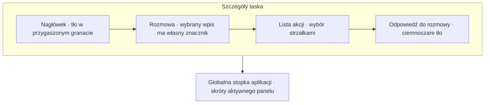
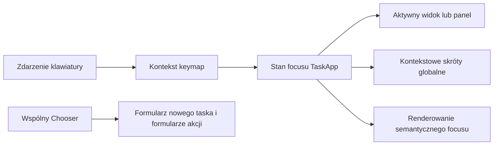

# Spójny focus i formularze w widokach TUI - Plan

## Goal Capsule

- **Objective:** Operator może rozpoznać miejsce fokusu i sprawnie używać klawiatury w szczegółach taska, formularzu nowego zadania oraz pozostałych widokach korzystających ze wspólnej nawigacji i oznaczeń fokusu.
- **Means:** Wspólne zachowanie klawiatury pozostaje w `keymap` i `Chooser`, a widoki korzystają z centralnego modelu fokusu i semantycznych stylów (KTD1–KTD3).
  - **Product authority:** Zachowaj wymagania Product Contract i cztery decyzje session-settled. Zakres dodatkowych widoków wynika z potwierdzenia użytkownika w tej sesji.
- **Tail ownership:** `ce-work` odpowiada za implementację i jej weryfikację.
- **Open blockers:** Brak.

---

## Product Contract

### Summary

Widoki TUI rozdzielają nawigację między panelami od nawigacji po akcjach i polach formularza. Focus jest widoczny przez właściwy dla widoku znacznik i semantyczny styl, a globalna stopka pokazuje skróty aktywnego kontekstu. Formularz nowego zadania zachowuje się zgodnie z pozostałymi formularzami.

### Problem Frame

Gdy operator wejdzie klawiszem `Tab` do panelu odpowiedzi, przestaje móc zmieniać zakładki i przewijać rozmowę. `Esc` zwija panel odpowiedzi, a dostępne klawisze zależą od panelu, więc trudno ustalić, gdzie znajduje się focus i co zrobi następny skrót.

### Key Decisions

- **`Tab` i `Shift+Tab` przełączają panele szczegółów** (session-settled: user-directed — chosen over `Ctrl+Tab`: kodowanie klawiszy sterujących w terminalach może zrównywać `Ctrl+I` z `Tab`, więc zwykły `Tab` jest przewidywalniejszy). Governs R1.
- **Odpowiedź tekstowa jest polem pod listą akcji** (session-settled: user-directed — chosen over traktowania odpowiedzi jak kolejnej akcji: operator może dopisać wiadomość do bieżącej rozmowy niezależnie od wyboru akcji). Governs R3.
- **Strzałki na granicach pola wielowierszowego przechodzą do sąsiedniego pola** (session-settled: user-directed — chosen over zatrzymania strzałek w polu: pozwala nawigować formularz bez używania `Tab`). Governs R5.
- **Kolory tła rozróżniają nagłówek i panel odpowiedzi, a focus odpowiedzi ma lewy znacznik** (session-settled: user-approved — chosen over oddzielania tych obszarów liniami: kolor i znacznik pokazują focus bez dodatkowych separatorów). Governs R7, R8.

### Requirements

**Focus i nawigacja paneli**

- R1. `Tab` i `Shift+Tab` cyklicznie przenoszą focus między panelami szczegółów taska, bez zwijania ani ukrywania panelu odpowiedzi.
- R2. Widok wskazuje aktualnie sfokusowany panel, a globalna stopka aplikacji pokazuje skróty dostępne w tym panelu.

**Akcje i formularze**

- R3. Lista dostępnych akcji znajduje się nad osobnym polem zwykłej odpowiedzi do rozmowy; strzałki wybierają akcje, a pole odpowiedzi dopisuje wiadomość do bieżącej sesji.
- R4. Zatwierdzenie akcji wymagającej dodatkowych danych otwiera przypisany jej formularz.
- R5. W formularzu strzałki nawigują między polami; w polu wielowierszowym `Up` na początku całej treści przenosi do poprzedniego pola, a `Down` na końcu całej treści do następnego.
- R6. `Enter` przechodzi do kolejnego pola lub przycisku zatwierdzenia, a istniejące skróty wstawiania nowej linii pozostają dostępne.

**Wizualna hierarchia**

- R7. Nagłówek szczegółów taska i panel odpowiedzi mają różne, czytelne tła RGB zamiast linii oddzielających je od treści; nagłówek używa przygaszonego granatu, a panel odpowiedzi ciemnej szarości.
- R8. Gdy panel odpowiedzi ma focus, po jego lewej stronie pojawia się jasnoszary znacznik; wybrany wpis rozmowy zachowuje własny znacznik focusu.
- R9. Formularz nowego zadania stosuje tę samą nawigację po polach co pozostałe formularze: strzałki przechodzą między polami, a `Enter` do kolejnego pola lub przycisku zatwierdzenia; `Tab` i `Shift+Tab` zachowują funkcję nawigacji między panelami widoku.
- R10. Widoki TUI korzystające ze wspólnej nawigacji lub oznaczeń focusu pokazują aktywny kontekst i jego skróty zgodnie ze wspólnym modelem klawiatury i semantycznymi rolami focusu.

### Key Flows

- F1. **Przejście między panelami:** operator przegląda rozmowę, naciska `Tab` lub `Shift+Tab`, przechodzi do innego panelu szczegółów, a panel odpowiedzi pozostaje widoczny. **Covered by:** R1, R2.
- F2. **Wysłanie zwykłej odpowiedzi:** operator przechodzi do pola odpowiedzi pod listą akcji, wpisuje treść i zatwierdza ją zgodnie z dostępnym skrótem. **Covered by:** R3, R6.
- F3. **Wypełnienie formularza akcji:** operator wybiera akcję, przechodzi między jej polami strzałkami lub `Enter`, po czym dociera do przycisku zatwierdzenia. **Covered by:** R4–R6.
- F4. **Praca w widokach ze wspólną nawigacją:** operator przechodzi między widokiem zadania, formularzem lub innym wspieranym panelem; oznaczenie fokusu i globalne skróty opisują ten sam aktywny kontekst. **Covered by:** R2, R9, R10.

### Acceptance Examples

- AE1. **Covers R1, R2.** Operator jest w panelu odpowiedzi i naciska `Tab`; focus przechodzi do kolejnego panelu, panel odpowiedzi pozostaje widoczny, a globalna stopka pokazuje skróty nowego panelu.
- AE2. **Covers R3, R4.** Operator wybiera akcję wymagającą uzasadnienia; otwiera się jej formularz. Zwykłe pole odpowiedzi pozostaje osobnym elementem pod listą akcji.
- AE3. **Covers R5, R6.** W polu wielowierszowym kursor na początku tekstu i naciśnięcie `Up` przenosi do poprzedniego pola; kursor na końcu i `Down` przenosi do następnego. Wstawianie nowej linii nadal działa dotychczasowymi kombinacjami, w tym `Ctrl+J` oraz obsługiwanymi wariantami `Shift+Enter` i `Alt+Enter`.
- AE4. **Covers R7, R8.** Focus panelu odpowiedzi wyróżnia jasnoszara kreska na ciemnoszarym tle; nagłówek ma odmienny przygaszony granat, a wybrany wpis rozmowy zachowuje swój własny znacznik.
- AE5. **Covers R1, R5, R6, R9.** W formularzu nowego zadania i formularzu akcji strzałki oraz `Enter` przechodzą między polami, a `Tab`/`Shift+Tab` w szczegółach taska przełączają panele bez utraty szkicu formularza.
- AE6. **Covers R2, R10.** W widoku zadań, historii, repozytoriów lub oczekującego panelu operator może wskazać aktywny kontekst po oznaczeniu fokusu, a globalna stopka pokazuje skróty tego kontekstu.

### Scope Boundaries

- Globalna stopka oznacza pasek skrótów całej aplikacji; nie jest stopką panelu odpowiedzi.
- Zakres obejmuje spójność formularza nowego zadania oraz widoki korzystające ze wspólnej nawigacji i oznaczeń focusu, w tym listę zadań, historię, wybór repozytorium i panele oczekiwania/akcji.
- Zakres nie obejmuje niezależnej przebudowy treści lub układu widoków, które nie korzystają ze wspólnej nawigacji ani oznaczeń focusu, ani zmiany semantyki niezwiązanych skrótów.
- Wyróżnianie focusu panelu rozmowy korzysta ze znacznika wybranego wpisu; nie dodaje drugiej kreski dla całego panelu.

### Product Contract Preservation

changed: R9–R10 — po potwierdzeniu użytkownika zakres obejmuje formularz nowego zadania oraz widoki używające wspólnej nawigacji lub oznaczeń focusu.

### Sources / Research

- `src/tui/keymap.rs` obsługuje aktualnie przejście do panelu odpowiedzi, nawigację formularza i zamknięcie panelu klawiszem `Esc`.
- `src/tui/chooser.rs` zawiera nawigację po akcjach i polach formularza oraz skróty przechodzenia między polami.
- `src/tui/task_app/layout.rs` buduje kontekstowe podpowiedzi w globalnej stopce aplikacji.
- `src/tui/task_app/tabs/conversation.rs` i `src/tui/selection.rs` już renderują lewy znacznik wybranego wpisu rozmowy.
- Dokumentacja klawiatury Kitty opisuje niejednoznaczność kodowania `Ctrl+I` i `Tab`: https://sw.kovidgoyal.net/kitty/keyboard-protocol/.
- lazygit pokazuje wzorzec przełączania paneli klawiszem `Tab` oraz podpowiedzi skrótów zależne od kontekstu: https://lazygit.dev/docs/getting-started/.

---

## Planning Contract

### Key Technical Decisions

- KTD1. **Zachowaj osobne poziomy focusu.** Focus widoku, focus panelu szczegółów i focus akcji/pól formularza pozostają odrębnymi stanami; przejście między nimi nie może nadpisywać kursora, zakładki ani szkicu. `TaskApp` już rozdziela `Focus`, `panel_focus` i `StepFocus`.
- KTD2. **Użyj `Chooser` jako wspólnego mechanizmu formularzy.** Nawigacja akcji i pól formularza należy do `src/tui/chooser.rs`; formularz nowego zadania już korzysta z tego mechanizmu przez `with_inputs_layout()`. Nie dodawaj obsługi klawiszy specyficznej dla widoku, jeśli wspólny chooser może zachować ten kontrakt.
- KTD3. **Zachowaj centralne mapowanie klawiszy i kontekstową stopkę.** Nowe przejścia dodaj do `src/tui/keymap.rs`, a kontekst prowadź przez `TaskApp::key_context()` i renderer stopki w `src/tui/task_app/layout.rs`, tak aby skróty, pomoc i działanie klawiszy opisywały ten sam kontekst.
- KTD4. **Wspólne widoki korzystają z semantycznych oznaczeń, a szczegóły zachowują własną hierarchię.** Użyj `selection_marks` i `Styles::render_panel` dla wspólnych list i paneli. Odpowiedź i stopka szczegółów pozostają dedykowanym renderowaniem; nie zmieniaj globalnie wyglądu współdzielonego choosera, by odtworzyć styl panelu szczegółów. (Zob. `docs/solutions/design-patterns/task-detail-action-footer-visual-hierarchy.md`.)

### High-Level Technical Design

Focus zewnętrznego widoku, panelu szczegółów taska oraz akcji/pola w chooserze pozostają osobnymi poziomami. Każdy widok przekazuje aktywny poziom do mapy klawiszy i renderera. Dokładna reprezentacja stanów i przejść pozostaje decyzją implementacyjną, ale zmiana focusu musi zachować wybór i szkice danego widoku.

### Sequencing

1. Uzgodnić konteksty mapy klawiszy i przejścia focusu w szczegółach oraz widokach ze wspólną nawigacją.
2. Ujednolicić zachowanie pól choosera i formularza nowego zadania.
3. Zaktualizować renderowanie i globalne skróty w objętych widokach, a następnie pokryć wspólne i specyficzne przypadki.

---

## Implementation Units

### U1. Task detail panel focus and shared key contexts

**Goal:** Ujednolicić przejścia focusu w szczegółach taska i widokach używających wspólnej nawigacji.

**Requirements:** R1, R2, R10; supports F1 and AE1.

**Dependencies:** None.

**Files:** `src/tui/keymap.rs`, `src/tui/task_app/mod.rs`, `src/tui/task_app/detail.rs`, `src/tui/task_app/history.rs`, `src/tui/task_app/waiting.rs`, `tests/tui_state.rs`.

**Approach:** Dodaj nawigację paneli do istniejącej mapy kontekstów i akcji oraz zachowaj odrębne poziomy focusu widoku, panelu szczegółów i choosera (KTD1, KTD3). Poprowadź szczegóły bieżących i historycznych tasków przez wspólną ścieżkę nawigacji.

**Patterns to follow:** `TaskApp::key_context()` i `TaskApp::on_key()` w `src/tui/task_app/mod.rs`; `detail_keys`; istniejące mapowanie kontekstu historii w `src/tui/task_app/history.rs`; testy spójności mapowania klawiszy w `tests/tui_state.rs`.

**Test scenarios:**

- Covers AE1. Przy focusie w panelu odpowiedzi `Tab` przechodzi do kolejnego panelu szczegółów, pozostawia panel odpowiedzi widoczny i pokazuje skróty nowego kontekstu.
- Z każdego panelu szczegółów `Tab` i `Shift+Tab` cyklicznie przechodzą w przeciwnych kierunkach bez zmiany wybranego taska, zakładki, pozycji przewijania ani szkicu.
- W szczegółach historii obsługiwane klawisze nawigacji paneli zmieniają focus i kontekst bez udostępniania niedostępnych tam operacji zapisu.
- W widokach oczekiwania i akcji zmiana focusu między treścią a panelem zmienia aktywny kontekst klawiszy, a informacje o oczekiwaniu pozostają widoczne.

**Verification:** Testy stanu potwierdzają zgodność mapy klawiszy z kontekstem oraz zachowanie focusu w widokach taska, historii i oczekiwania.

---

### U2. Shared form navigation and new-task consistency

**Goal:** Ujednolicić nawigację po polach formularza nowego zadania i pozostałych formularzy opartych na chooserze.

**Requirements:** R3–R6, R9; supports F2–F4, AE2, AE3, and AE5.

**Dependencies:** U1.

**Files:** `src/tui/chooser.rs`, `src/tui/task_app/new_task.rs`, `src/tui/task_app/actions.rs`, `src/tui/task_app/repositories.rs`, `tests/tui_state.rs`, `tests/tui_render.rs`.

**Approach:** Pozostaw wybór akcji, kolejność pól, focus walidacji i edycję pól w `Chooser` (KTD2). Przejścia z pola wielowierszowego uzależnij od pozycji kursora tak, aby `Up` i `Down` nadal przesuwały kursor wewnątrz tekstu. Zachowaj skróty wstawiania nowej linii i dotychczasowe zatwierdzanie (R6). Sprawdź, że `with_inputs_layout()` w formularzu nowego zadania stosuje ten sam kontrakt co pozostałe formularze choosera (R9).

**Patterns to follow:** `Chooser::on_fields_key`, `focus_order` i `move_field` w `src/tui/chooser.rs`; inicjalizacja formularza nowego zadania i obsługa zdarzeń w `src/tui/task_app/new_task.rs`; istniejące testy stanu choosera i układu pól w `tests/tui_state.rs` oraz `tests/tui_render.rs`.

**Test scenarios:**

- Covers AE3. W polu wielowierszowym z kursorem poza początkiem i końcem treści `Up`/`Down` pozostawia focus w polu i przesuwa kursor; na początku `Up` wybiera poprzednie pole, a na końcu `Down` następne.
- Strzałki i `Enter` przechodzą między polami i przyciskiem zatwierdzenia tak samo w formularzu nowego zadania i formularzach akcji; walidacja wymaganego pola przywraca focus na błędne pole.
- Covers AE5. W formularzu akcji otwartym w szczegółach `Tab` i `Shift+Tab` przełączają panel szczegółów, nie wysyłają formularza i nie gubią jego szkicu; powrót przywraca focus pola.
- `Ctrl+J` i obsługiwane warianty `Enter` z modyfikatorem wstawiają nową linię w polach wielowierszowych bez wysłania; zwykły `Enter` zachowuje ustalone przechodzenie lub zatwierdzanie.
- Covers AE2. Wybranie workflow z wymaganymi danymi otwiera jego pola, a zmiana akcji i powrót zachowuje szkic każdej akcji.
- Formularz repozytorium i formularz akcji zachowują wybór, kolejność pól i walidację po zmianie wspólnej nawigacji.

**Verification:** Testy stanu i renderowania obejmują nawigację choosera oraz potwierdzają wspólne zachowanie focusu pól w formularzu nowego zadania i pozostałych formularzach choosera.

---

### U3. Focus indicators and contextual hints across shared views

**Goal:** Zapewnić czytelne oznaczenie focusu i dostępnych skrótów na liście tasków, w szczegółach bieżących i historycznych, formularzu nowego zadania, wyborze repozytorium oraz widokach oczekiwania i akcji.

**Requirements:** R2, R7, R8, R10; supports F4, AE1, AE4, and AE6.

**Dependencies:** U1, U2.

**Files:** `src/tui/style.rs`, `src/tui/selection.rs`, `src/tui/task_app/layout.rs`, `src/tui/task_app/detail.rs`, `src/tui/task_app/history.rs`, `src/tui/task_app/repositories.rs`, `src/tui/task_app/new_task.rs`, `src/tui/task_app/waiting.rs`, `src/tui/task_app/tabs/conversation.rs`, `src/tui/task_app/tabs/events.rs`, `src/tui/task_app/tabs/conductor.rs`, `tests/tui_render.rs`.

**Approach:** Przekaż aktywny poziom focusu do objętych rendererów i użyj istniejących ról semantycznych oraz pomocników zaznaczenia we wspólnych widokach (KTD4). Zachowaj dedykowane kolory nagłówka i panelu odpowiedzi oraz znacznik z R7–R8. `layout` pozostaje źródłem globalnych podpowiedzi kontekstowych (KTD3).

**Patterns to follow:** `Styles::render_panel` i `Styles::selection_marks` w `src/tui/style.rs`; `render_bracketed_list` w `src/tui/selection.rs`; renderowanie stopki zależne od kontekstu w `src/tui/task_app/layout.rs`; asercje focusu i jego braku w modułach `task_app_create_render` i `task_app_waiting_render` w `tests/tui_render.rs`.

**Test scenarios:**

- Covers AE4. Nagłówek szczegółów i panel odpowiedzi mają różne tła; focus odpowiedzi pokazuje lewy znacznik, a wybrany wpis rozmowy zachowuje własny znacznik.
- Lista tasków, historia, chooser repozytorium, formularz nowego zadania i widoki oczekiwania/akcji wskazują aktywny panel lub wybór, a oznaczenie zmienia się razem z focusem.
- Globalna stopka zmienia skróty wraz ze zmianą kontekstu i nie pokazuje klawiszy niedostępnych podczas pisania w formularzu.
- Focus pozostaje rozpoznawalny przy `NO_COLOR`, a ramki i znaczniki są wyrównane w wąskim terminalu oraz przy długich etykietach.

**Verification:** Asercje `TestBackend` obejmują stan focusu i jego brak, kontekstowe skróty, `NO_COLOR` oraz kompaktowy układ każdej rodziny objętych widoków.

---

## Verification Contract

- `tests/tui_state.rs`: keymap consistency, panel cycling, chooser field transitions, new-task consistency, read-only history, and focus/draft preservation.
- `tests/tui_render.rs`: detail panel colors and markers, global hints, shared-view focus indicators, `NO_COLOR`, long labels, and compact layouts.
- The implementation passes the focused TUI state/rendering suites and the repository's applicable formatting and workspace checks.

## Definition of Done

- [ ] R1–R10 and AE1–AE6 są zrealizowane bez zmiany semantyki niezwiązanych skrótów.
- [ ] Szczegóły tasków, formularz nowego zadania i pozostałe widoki ze wspólną nawigacją/focusem mają spójne zachowanie klawiatury i czytelne oznaczenia aktywnego kontekstu.
- [ ] Panel odpowiedzi pozostaje widoczny bez focusu; jego kolory i znaczniki są odróżnialne od ogólnego stylu choosera.
- [ ] Testy stanu i renderowania obejmują każdą objętą rodzinę widoków, także przy `NO_COLOR` i wąskim terminalu.
- [ ] Ukierunkowana weryfikacja i właściwe kontrole workspace przechodzą, a porzucony kod eksperymentalny jest usunięty.
