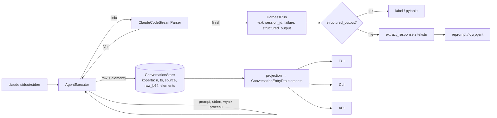

# feat: Zunifikowany model rozmowy i rozbudowany adapter Claude Code

## Summary

Parser strumienia każdego harnessu zwraca dla każdej linii listę elementów wspólnego modelu czatu. Silnik zapisuje te elementy w tym samym wpisie rozmowy co surową linię. API, TUI i CLI czytają tylko elementy. Klasyfikacja formatu harnessu znika z TUI. Adapter Claude Code przekazuje kontrakt wyjścia jako `--json-schema`, a `structured_output` ma pierwszeństwo przed parsowaniem tekstu. Obecne ratowanie labela zostaje jako zapas. Opencode i codex zwracają tylko elementy „nieklasyfikowane”.

---

## Problem Frame

Widok rozmowy jest pełen linii technicznych bez treści i nie rozdziela ról: co przesłano do agenta, co agent myślał, co napisał, o co pytał i jakich narzędzi użył. Klasyfikacja jest dziś tylko w TUI (`src/tui/conversation.rs`) i działa przez rozpoznawanie kształtu surowych linii. Pełny opis problemu jest w dokumencie źródłowym (see origin: `docs/brainstorms/2026-10-16-zunifikowany-model-rozmowy-claude-code-requirements.md`).

---

## Requirements

Model elementów:
- R1. Jeden model elementów rozmowy, niezależny od harnessu.
- R2. Kategorie: przesłane do agenta, myślenie, tekst agenta, pytanie agenta, wywołanie narzędzia, wynik narzędzia, wynik końcowy (z danymi strukturalnymi).
- R3. Kilka kategorii technicznych. Ta praca ich nie ukrywa ani nie filtruje.
- R4. Krótki opis z kluczowym parametrem narzędzia i pełna treść do rozwinięcia.
- R5. „Pytanie agenta” ma dwa źródła (kontrakt wyjścia i narzędzie), a element podaje źródło.
- R6. Wynik narzędzia jest powiązany z wywołaniem i ma status sukces albo błąd.
- R7. Metadane przebiegu: model, wersja CLI, sesja, koszt, tokeny, tury, czas, przyczyna zakończenia.
- R8. Nierozpoznana linia staje się elementem „nieklasyfikowane” i nigdy nie powoduje błędu przebiegu.

Adapter Claude Code:
- R9. Elementy powstają na żywo, linia po linii.
- R10. Kontrakt wyjścia jest przekazywany jako schemat JSON dla kroków i dyrygenta.
- R11. Gdy brak ustrukturyzowanego wyniku, działa obecne ratowanie labela.
- R12. Klasyfikacja jest sprawdzana na zarejestrowanych przebiegach prawdziwego `claude`.

Konsumenci:
- R13. API zwraca elementy i metadane, a surowa linia jest diagnostyką.
- R14. TUI i CLI nie rozpoznają formatu harnessu.

Pozostałe harnessy i dane:
- R15. Opencode i codex: każda linia jest elementem „nieklasyfikowane”.
- R16. Brak migracji istniejących zapisów.

**Origin actors:** A1 (operator), A2 (agent kroku i dyrygent), A3 (adapter harnessu), A4 (konsumenci modelu)
**Origin acceptance examples:** AE1 (R4), AE2 (R6), AE3 (R5, R10), AE4 (R5), AE5 (R11), AE6 (R8), AE7 (R3), AE8 (R15)

---

## Scope Boundaries

- Brak decyzji o widoczności kategorii (ukrywanie, filtry, domyślny widok).
- Brak pełnej klasyfikacji i schematu wyjścia dla opencode i codex.
- Brak wejścia `stream-json` i brak częściowych wiadomości (`--include-partial-messages`).
- Brak migracji starych zapisów. Wpis bez elementów jest pokazywany jako jeden element „nieklasyfikowane”, aby nic się nie psuło.

### Deferred to Follow-Up Work

- Migawka rozmowy dla dyrygenta (`crates/narsor-engine/src/conductor/snapshot.rs`) na elementach zamiast surowych linii: osobna praca.
- Pełna klasyfikacja opencode i codex na model: osobne prace, po jednej na harness.
- Metadane przebiegu w podsumowaniu próby (`ConversationAttemptSummary`), np. koszt na liście prób: osobna praca. W tej pracy metadane są tylko w elementach.

---

## Context & Research

### Relevant Code and Patterns

- Przepływ zapisu: `crates/narsor-engine/src/engine/actions/agent.rs` (`AgentExecutor::run`, `open_conversation`, `spawn_and_wait`, `ConversationSink`). Każda linia stdout trafia do `conversation.append(...)` i do `parser.on_stdout_line(...)`, gdy ma najwyżej `PARSE_LINE_LIMIT`.
- Zapis: `crates/narsor-engine/src/persistence/conversation.rs` (`Envelope{n, ts, source, raw_b64}`, `ConversationEntry`, `ConversationWriter::append`/`append_narsor`, `ConversationStore::read`, `close_attempt`).
- Projekcja do API: `crates/narsor-engine/src/api/projection.rs::conversation_response_from_snapshot` i `ConversationEntryDto` w `crates/narsor-protocol/src/api.rs`. Projekcja jest używana przez serwer (`narsor-server/src/api/routes.rs`), runner (`crates/narsor-runner/src/runner/mod.rs::serve_page`) i control plane (`controller_protocol/wire.rs`, `service/conversation.rs`).
- Klasyfikacja dziś: `src/tui/conversation.rs` (`classify`, `EntryKind`, `adapt_claude`, `adapt_opencode`, `adapt_codex`, `adapt_narsor`). Użycie: `src/tui/task_app/tabs/conversation.rs`, `src/cli/commands.rs::print_conversation_entry`, `src/cli/remote.rs::print_conversation_entries`.
- Kontrakt wyjścia: `agent.rs::output_contract`, `extract_response`, `json_objects`. Ratowanie: `engine/runner.rs` (`OutputRejection`, `reprompt`) i `engine/runner/rescue.rs`.
- Dyrygent: `crates/narsor-engine/src/conductor/invoke.rs::try_invoke` używa tego samego `HarnessAdapter` i `stream_parser()` z `ConversationSink::none()`. Odpowiedź: `conductor/prompt.rs::answer_contract`, `conductor/response.rs::ConductorResponse::parse`.
- Wzorce enumów na wire: `#[serde(rename_all = "snake_case")]` z `#[serde(other)] Unrecognized` (`crates/narsor-protocol/src/controller.rs`, `ConversationUnavailableReason`, test `unknown_conversation_reasons_keep_the_forward_compatible_fallback`). Uwaga: `#[serde(other)]` działa tylko na wariancie jednostkowym.
- Testy: fałszywy harness `tests/fixtures/harness/fake_harness.sh` instalowany w `tests/actions_agent.rs` (kopiowanie i rename, obejście ETXTBSY) oraz pomocniki `claude_stream`, `opencode_stream`, `ndjson`. Testy rozmowy: `tests/conversation_store.rs`, `tests/tui_conversation.rs`, `tests/api.rs`, `tests/tui_render.rs`. Test z prawdziwym `claude` w `tests/actions_agent.rs` jest `#[ignore]` i pomija się, gdy brak binarki.

### Institutional Learnings

- D51 (`ARCHITECTURE_DECISIONS.md`): surowy zapis bajt w bajt, kursor po numerze wpisu, R9 „nic nie ginie przez obcięcie”. Ta praca zmienia rolę surowej linii, więc potrzebny jest wpis D60. Kursor i bezstratność zostają.
- `docs/plans/2026-10-11-1723-feat-tui-transcript-views-plan.md`: macierz rozpoznawanych linii (Claude: `assistant`/`user`/`system`/`result`, `hook_*`, `thinking_tokens`, `rate_limit_event`). Zasady: nieznany wariant staje się Raw/Unsupported, surowych bajtów nie odtwarza się z obiektu typowanego, a identyfikatory korelacji zostają.
- `docs/solutions/architecture-patterns/auto-resume-policy-for-lost-workloads-2026-10-11.md` §6: każdy enum na granicy komponentów ma wariant `Unrecognized`.
- `docs/plans/2026-09-29-001-feat-dyrygent-i-obsluga-input-needed-plan.md`: błąd formatu nie korzysta z `retry_policy`. Najpierw jest reprompt w tej samej sesji, potem dyrygent, potem człowiek. Bez `harness_session_id` nie ma repromptu. Ścieżka ma zostać niezależna od harnessu.
- `docs/solutions/integration-issues/runner-private-home-hides-harness-login-2026-10-10.md`: fałszywy harness nie dowodzi zachowania prawdziwego CLI, więc zmiana flag wymaga ręcznego testu na prawdziwym `claude`.
- Notatki pamięci: losowe ETXTBSY w `actions_agent` i losowy błąd `runner` (paused resume) istniały przed tą pracą. Testy z daemonem mają `#[ignore]`.

### External References

- Lokalny `claude` 2.1.302 ma `--json-schema`, `--include-partial-messages`, `--input-format` i `--replay-user-messages` (`claude --help`). Plik `docs/sources/claude-code-json.md` nie jest źródłem prawdy o formacie (see origin).

---

## Key Technical Decisions

- **Model w `narsor-protocol`.** Elementy przechodzą przez API, runner i control plane, a `narsor-protocol` już łączy silnik z klientami. Nowy moduł, np. `crates/narsor-protocol/src/chat.rs`.
- **Elementy w tym samym wpisie co surowa linia.** Koperta zapisu dostaje listę elementów, a `ConversationEntryDto` dostaje to samo pole. Kursor po numerze wpisu, stronicowanie i podsumowania prób (liczba wpisów) zostają bez zmian. Budżet bajtów strony liczy od teraz także elementy wpisu (U3). Jedna linia może dać zero, jeden lub kilka elementów. Na przykład wiadomość `assistant` z tekstem i dwoma `tool_use` daje trzy elementy.
- **Parser zwraca elementy dla linii.** `HarnessStreamParser::on_stdout_line` zwraca listę elementów, którą executor zapisuje razem z linią. Elementy linii pisanych przez narsora (prompt, wynik procesu) i linii stderr tworzy executor, a nie adapter. Dyrygent używa tego samego parsera, ale odrzuca elementy (brak zapisu, jak dziś).
- **Powiązanie narzędzia bez sięgania do innych stron.** Parser pamięta mapę `id wywołania → nazwa i opis narzędzia`. Element wyniku zawiera id wywołania, nazwę narzędzia i jego krótki opis. Konsument nie musi szukać wywołania na innej stronie API.
- **Wynik narzędzia ma ograniczony podgląd.** Treść wyniku w elemencie ma limit (rząd kilku KiB) i flagę obcięcia. Pełna treść zostaje w surowej linii. Tekst i myślenie agenta są zapisane w całości.
- **Linia za długa do parsowania** (powyżej `PARSE_LINE_LIMIT`) dostaje element „nieklasyfikowane” z przyczyną „za duża”, bez odczytu treści.
- **Metadane przebiegu jako elementy.** `system/init` daje element „sesja rozpoczęta” (model, wersja CLI, sesja, katalog, tryb uprawnień). `result` daje element „wynik przebiegu” (tekst, `structured_output`, przyczyna zakończenia, koszt, tokeny, tury, czas).
- **Pytanie agenta.** Gdy `structured_output` (albo zapasowy JSON z tekstu) ma `status: awaiting_input`, powstaje element „pytanie agenta” ze źródłem „kontrakt wyjścia”. Dla `structured_output` tworzy go parser. Dla zapasu z tekstu tworzy go executor jako wpis narsora. Wywołanie `AskUserQuestion` daje element „pytanie agenta” ze źródłem „narzędzie” zamiast zwykłego wywołania narzędzia. Jego wynik jest nadal zwykłym wynikiem narzędzia.
- **Schemat jest dodatkiem do tekstowego kontraktu.** Tekst kontraktu zostaje w prompcie dla wszystkich harnessów. `HarnessRequest` dostaje opcjonalny schemat. Adapter Claude zamienia go na `--json-schema`, a inne adaptery go ignorują. `HarnessRun` dostaje opcjonalny `structured_output`. Executor najpierw próbuje `structured_output`, a potem obecne `extract_response(text)`.
- **Schemat z definicji wyjść.** Kształt: `anyOf` z dwóch gałęzi. Pierwsza to `{output: enum labeli, data, variables, artifacts}`. Druga to `{status: "awaiting_input", question, options}`. Dyrygent dostaje schemat według celu wywołania, zbudowany z tego samego kształtu, który dziś opisuje `answer_contract`. Dokładne słowa kluczowe dobieramy po U1.
- **Kategorie techniczne Claude:** inicjalizacja sesji, hook, limit zapytań, kompaktowanie kontekstu, inne `system`, stderr, wynik procesu narsora (kod wyjścia, timeout, błąd startu). Nieznany `type` albo blok treści daje „nieklasyfikowane”.
- **Enum elementów na wire:** tag `kind`, `snake_case`, jednostkowy wariant `Unrecognized` z `#[serde(other)]`. Nieznany wariant od nowszego serwera nie psuje starszego klienta.
- **Wpis bez elementów** (stary zapis albo klient czyta stary serwer) jest pokazywany jako jeden element „nieklasyfikowane”. To tylko obrona przed awarią, a nie migracja.

---

## Open Questions

### Resolved During Planning

- Gdzie trzymać elementy: w tym samym wpisie co surowa linia (decyzja potwierdzona przez Artura).
- Jak wiązać wynik narzędzia z wywołaniem między stronami: parser kopiuje nazwę i opis wywołania do elementu wyniku.
- Czy dyrygent dostaje schemat: tak, ma ten sam adapter. Migawka dyrygenta zostaje na surowych liniach (praca odłożona).
- Czy `claude` ma `--json-schema`: tak, w 2.1.302.

### Deferred to Implementation

- Czy `structured_output` jest w linii `result` w trybie `stream-json` i po `--resume`, oraz co CLI robi, gdy model nie spełni schematu: wynik nagrań w U1. Zapas z R11 obsługuje każdy wynik.
- Które słowa kluczowe JSON Schema CLI akceptuje (`anyOf`, `enum`, `additionalProperties`): wynik nagrań w U1. Gdy `anyOf` nie działa, wersja zapasowa to jeden obiekt z opcjonalnymi polami i walidacja po stronie narsora.
- Jak `AskUserQuestion` wygląda w strumieniu `--print`: nagranie w U1.
- Pełna lista typów `system` w aktualnej wersji: z nagrań w U1.
- Dokładny limit podglądu wyniku narzędzia: dobrany w U4.

---

## High-Level Technical Design

> *This illustrates the intended approach and is directional guidance for review, not implementation specification. The implementing agent should treat it as context, not code to reproduce.*



Szkic modelu (kierunek, nie specyfikacja):

```text
ChatElement (tag: kind)
  prompt            { text, resumed_session?, purpose: step|reprompt|... }   # przesłane do agenta
  user_message      { text }                                                  # przesłane do agenta, z harnessu
  thinking          { text }
  agent_text        { text }
  agent_question    { question, options[], source: output_contract|tool, call_id? }
  tool_call         { call_id?, tool, summary, input }
  tool_result       { call_id?, tool?, call_summary?, status: ok|error, content, truncated }
  session_started   { session_id?, model?, cli_version?, cwd?, permission_mode? }
  run_result        { text?, structured_output?, stop_reason?, is_error, cost_usd?, usage?, turns?, duration_ms? }
  technical         { category: hook|rate_limit|compaction|system|stderr|process, summary, data? }
  unclassified      { reason: unknown_type|invalid_json|too_large|harness_not_classified }
  unrecognized                                                                # serde(other), od nowszego serwera
```

---

## Implementation Units

### U1. Nagrania prawdziwych przebiegów Claude Code

**Goal:** Zebrać dane testowe z prawdziwego `claude` jako źródło prawdy o formacie i odpowiedzieć na pytania odłożone do implementacji.

**Requirements:** R12; wspiera R3, R5, R7, R10, R11

**Dependencies:** Brak

**Files:**
- Create: `tests/fixtures/claude-code/README.md` (wersja CLI, data, polecenia, użyte maskowanie)
- Create: `tests/fixtures/claude-code/*.ndjson` (po jednym pliku na scenariusz)

**Approach:**
- Scenariusze: zwykła odpowiedź z narzędziami (`Read`, `Bash`, `Grep`, `Skill`); błąd narzędzia; myślenie; limit tur (`--max-turns 1`); `AskUserQuestion`; `--json-schema` ze schematem kontraktu (sukces i odpowiedź `awaiting_input`); `--json-schema` z `--resume`; tryb `plan`; `--json-schema` z `--permission-mode plan` i `--resume` (kształt repromptu); `--json-schema` z `plan` bez resume (kształt dyrygenta).
- Maskowanie: zamienić ścieżki domowe, nazwy repozytoriów i identyfikatory na wartości testowe. Nie zapisywać danych klientów ani sekretów.
- Zapisać w README odpowiedzi na pytania odłożone do implementacji (słowa kluczowe schematu, miejsce `structured_output`, zachowanie przy niezgodności, kształt `AskUserQuestion`).

**Execution note:** Zrobić najpierw. Wynik może zmienić kształt schematu w U5. Test zużywa limit subskrypcji Artura, więc nagrania wykonuje Artur albo agent po jego zgodzie.

**Test expectation:** none -- to dane testowe. Używają ich U4 i U5.

**Verification:**
- Każdy scenariusz ma plik z wersją CLI w README, a odłożone pytania mają zapisane odpowiedzi.

---

### U2. Model elementów czatu w protokole

**Goal:** Wprowadzić wspólny typ elementu rozmowy i jego zachowanie na wire.

**Requirements:** R1, R2, R3, R5, R6, R7, R8

**Dependencies:** Brak

**Files:**
- Create: `crates/narsor-protocol/src/chat.rs`
- Modify: `crates/narsor-protocol/src/lib.rs`
- Test: `crates/narsor-protocol/src/chat.rs` (moduł testów, jak w `controller.rs`)

**Approach:**
- Enum z tagiem `kind`, `snake_case`, wariant `Unrecognized` z `#[serde(other)]`. Pola opcjonalne z `#[serde(default, skip_serializing_if = "Option::is_none")]`.
- Metoda dająca krótki opis elementu do jednej linii (używana przez TUI i CLI), aby konsumenci nie powtarzali logiki.
- Metoda dająca kategorię wyższego poziomu (przesłane, myślenie, tekst, pytanie, narzędzie, wynik, techniczne, nieklasyfikowane). Na niej opierają się TUI i późniejsze filtry widoczności.

**Patterns to follow:**
- `ConversationUnavailableReason` i jego test zgodności w przód w `crates/narsor-protocol/src/controller.rs`.

**Test scenarios:**
- Happy path: każdy wariant przechodzi serializację i deserializację bez zmian.
- Edge case: nieznany `kind` (`{"kind":"future_thing","x":1}`) daje `Unrecognized`.
- Edge case: pola opcjonalne nieobecne w JSON dają `None` i nie są serializowane.
- Happy path: opis `tool_call` dla `Skill` z `summary: "ce-plan"` zawiera nazwę narzędzia i skilla.

**Verification:**
- Typ jest dostępny z `narsor-protocol`, a testy serde przechodzą.

---

### U3. Elementy w zapisie rozmowy, w trait parsera i w API

**Goal:** Przeprowadzić elementy od parsera do zapisu i do `ConversationEntryDto`, bez zmiany kursora i stronicowania.

**Requirements:** R9, R13, R15, R16; wspiera R8

**Dependencies:** U2

**Files:**
- Modify: `crates/narsor-engine/src/engine/actions/harness/mod.rs` (trait `HarnessStreamParser`, `HarnessRequest`, `HarnessRun`)
- Modify: `crates/narsor-engine/src/engine/actions/harness/opencode.rs`, `crates/narsor-engine/src/engine/actions/harness/codex.rs` (każda linia daje „nieklasyfikowane”)
- Modify: `crates/narsor-engine/src/engine/actions/agent.rs` (`spawn_and_wait`, `open_conversation`, wpisy narsora i stderr z elementami)
- Modify: `crates/narsor-engine/src/persistence/conversation.rs` (koperta, `ConversationEntry`, `append`, `append_narsor`)
- Modify: `crates/narsor-engine/src/api/projection.rs`, `crates/narsor-protocol/src/api.rs` (`ConversationEntryDto.elements`)
- Modify: `crates/narsor-engine/src/conductor/invoke.rs` (odrzuca elementy)
- Test: `tests/conversation_store.rs`, `tests/actions_agent.rs`, `tests/api.rs`

**Approach:**
- Na tym etapie parser Claude zwraca „nieklasyfikowane” dla każdej linii, a pełną klasyfikację wnosi U4. Dzięki temu U3 jest samodzielnym, zielonym krokiem.
- Wpis promptu narsora daje element `prompt` (cel: krok albo reprompt, według konfiguracji próby). Linie stderr dają `technical/stderr`. Wpisy wyniku procesu dają `technical/process`.
- Linia powyżej `PARSE_LINE_LIMIT` daje `unclassified/too_large` bez wołania parsera.
- Koperta czyta brak pola elementów jako pustą listę. Projekcja zamienia pustą listę dla linii stdout na jeden element „nieklasyfikowane”, aby konsumenci zawsze mieli co pokazać.
- Budżet bajtów strony liczy także elementy, aby strona nie przekroczyła limitu.

**Patterns to follow:**
- Obecny podział odpowiedzialności w `spawn_and_wait`: zapis zawsze, parsowanie tylko do limitu.

**Test scenarios:**
- Happy path: przebieg fałszywego harnessu z trzema liniami stdout zapisuje trzy wpisy, a każdy ma elementy zwrócone przez parser.
- Happy path: pierwszy wpis próby to prompt narsora z elementem `prompt` zawierającym pełny tekst z kontraktem.
- Edge case: linia stdout dłuższa niż limit parsowania jest zapisana w całości z elementem `unclassified/too_large`.
- Edge case: koperta bez pola elementów (stary format) wczytuje się bez błędu, a API pokazuje dla niej element „nieklasyfikowane”.
- Happy path: krok opencode zapisuje każdą linię z elementem `unclassified/harness_not_classified`. Covers AE8.
- Integration: strona API z `byte_budget` mniejszym niż suma elementów kończy się wcześniej, a następny kursor wskazuje następny wpis.
- Integration: dyrygent na fałszywym harnessie działa jak dziś i nic nie zapisuje.

**Verification:**
- Wszystkie ścieżki zapisu i odczytu rozmowy niosą elementy. Liczba wpisów w podsumowaniach prób się nie zmienia.

---

### U4. Klasyfikacja Claude Code w parserze

**Goal:** Parser Claude Code zamienia każdą linię `stream-json` na elementy modelu z opisem, powiązaniem narzędzi i metadanymi.

**Requirements:** R2, R3, R4, R5, R6, R7, R8, R9, R12

**Dependencies:** U1, U3

**Files:**
- Modify: `crates/narsor-engine/src/engine/actions/harness/claude_code.rs`
- Create: `crates/narsor-engine/src/engine/actions/harness/claude_code/tools.rs` albo podobny moduł z regułami kluczowego parametru (zależnie od struktury pliku)
- Test: `tests/claude_code_classification.rs` (nowy, na nagraniach z U1), `tests/actions_agent.rs`

**Approach:**
- `assistant`: każdy blok `content[]` daje element. `text` daje `agent_text`, `thinking` daje `thinking`, `redacted_thinking` daje `thinking` z oznaczeniem, `tool_use` daje `tool_call` (albo `agent_question` dla `AskUserQuestion`), a nieznany blok daje „nieklasyfikowane”.
- `user`: blok `tool_result` daje `tool_result` (status z `is_error`, nazwa i opis z mapy wywołań). Blok tekstowy daje `user_message`.
- `system`: `init` daje `session_started`. `hook_*` daje `technical/hook`. Kompaktowanie daje `technical/compaction`. Inny podtyp daje `technical/system`.
- `rate_limit_event` daje `technical/rate_limit`. `result` daje `run_result` z metadanymi, a przy `structured_output` z `status: awaiting_input` także `agent_question` ze źródłem „kontrakt wyjścia”.
- Reguły kluczowego parametru: `Bash`→`command`; `Read`/`Write`/`Edit`/`NotebookEdit`→`file_path`; `Glob`/`Grep`→`pattern` (z `path`, gdy jest); `WebFetch`→`url`; `WebSearch`→`query`; `Skill`→`skill`; `Task`/`Agent`→`description` (z typem agenta); `TodoWrite`→liczba zadań; `mcp__<serwer>__<narzędzie>`→serwer i narzędzie. Narzędzie bez reguły: tylko nazwa. Opis ma jedną linię z limitem długości.
- Obecne zbieranie `HarnessRun` (tekst, sesja, błąd) zostaje bez zmian.

**Execution note:** Najpierw testy tabelaryczne na nagraniach z U1, potem kod.

**Patterns to follow:**
- Macierz linii z `docs/plans/2026-10-11-1723-feat-tui-transcript-views-plan.md` i obecne `adapt_claude` w `src/tui/conversation.rs` (logika do przeniesienia, nie do skopiowania).

**Test scenarios:**
- Covers AE1. Linia `assistant` z `tool_use` `Skill` i `input.skill = "ce-plan"` daje `tool_call` z opisem zawierającym `Skill` i `ce-plan`.
- Covers AE2. `tool_use` `Bash` i następny `tool_result` z `is_error: true` dają wynik z tym samym `call_id`, nazwą `Bash`, opisem polecenia i statusem `error`.
- Covers AE4. `tool_use` `AskUserQuestion` daje `agent_question` ze źródłem `tool` i treścią pytania.
- Covers AE6. Linia z nieznanym `type` daje „nieklasyfikowane”, a następna linia jest dalej klasyfikowana.
- Covers AE7. `system/init` daje `session_started` z modelem i wersją, a `rate_limit_event` daje `technical/rate_limit`.
- Happy path: wiadomość `assistant` z tekstem i dwoma `tool_use` daje trzy elementy w tej kolejności.
- Happy path: `result` z sukcesem daje `run_result` z kosztem, tokenami, turami i czasem.
- Edge case: `result` z `subtype: error_max_turns` daje `run_result` z przyczyną zakończenia i `is_error`.
- Edge case: wynik narzędzia większy niż limit podglądu jest obcięty i ma flagę obcięcia.
- Edge case: `tool_result` bez znanego wywołania (np. po wznowieniu sesji) ma `call_id`, ale nie ma nazwy, i nie powoduje błędu.
- Edge case: linia, która nie jest JSON-em, daje `unclassified/invalid_json`.
- Integration: każde nagranie z U1 klasyfikuje się bez żadnego elementu „nieklasyfikowane” (kryterium sukcesu z dokumentu źródłowego).

**Verification:**
- Wszystkie nagrania mają pełną klasyfikację, a stare testy `HarnessRun` przechodzą bez zmian.

---

### U5. Kontrakt wyjścia jako `--json-schema`

**Goal:** Kroki i dyrygent na Claude dostają kontrakt jako schemat, a narsor czyta label, dane i pytanie z `structured_output`. Gdy go brak, działa obecny zapas.

**Requirements:** R5, R10, R11

**Dependencies:** U1, U3 (U4 dla elementu `agent_question` ze `structured_output`)

**Files:**
- Modify: `crates/narsor-engine/src/engine/actions/agent.rs` (budowa schematu z `OutputDefinition`, wybór `structured_output` przed `extract_response`, wpis narsora z `agent_question` dla zapasu tekstowego)
- Modify: `crates/narsor-engine/src/engine/actions/harness/mod.rs` (`HarnessRequest.output_schema`, `HarnessRun.structured_output`)
- Modify: `crates/narsor-engine/src/engine/actions/harness/claude_code.rs` (`--json-schema`, odczyt `structured_output`)
- Modify: `crates/narsor-engine/src/conductor/prompt.rs`, `crates/narsor-engine/src/conductor/response.rs`, `crates/narsor-engine/src/conductor/invoke.rs` (schemat według celu, parsowanie z wartości)
- Test: `tests/actions_agent.rs`, `tests/conductor_failure.rs`, `tests/conductor_chat.rs`

**Approach:**
- Schemat ma kształt kontraktu z `output_contract`: label z enum dozwolonych labeli albo `awaiting_input` z pytaniem i opcjami. Szczegóły słów kluczowych według U1.
- `--json-schema` jest przed `--permission-mode`, bo jego wartość jest jednym argumentem. Wartość to zwarty JSON zaczynający się od `{`, więc `reject_option_like` jej nie odrzuci. Kolejność argumentów zostaje zgodna z komentarzem modułu.
- `structured_output` przechodzi tę samą walidację co dziś JSON z tekstu (`extract_output`). Gdy jest niezgodny albo go brak, executor wraca do `extract_response(text)`, a potem do repromptu i dyrygenta (bez zmian w `engine/runner.rs`, poza przekazaniem schematu).
- Opencode i codex ignorują schemat.
- Przy pustej liście wyjść pole `output` w schemacie ma typ `string` bez `enum`, tak jak tekstowa gałąź `output_contract` dla pustych wyjść.
- Reprompt dostaje schemat bez zmian w `engine/runner.rs`, bo `execute_rendered` przekazuje `state.outputs` przy każdej próbie.
- `conversation.finish()` w `AgentExecutor::run` trzeba przenieść za `extract_response`, aby wpis narsora z `agent_question` (zapas tekstowy) był zapisany przed zamknięciem rozmowy.
- Zaktualizować komentarz modułu `claude_code.rs` (kształt wywołania).

**Patterns to follow:**
- Obecne `string_parameter` i `reject_option_like` w `harness/mod.rs`. Zapisywanie argumentów przez fałszywy harness (`args.<n>`) w `tests/actions_agent.rs`.

**Test scenarios:**
- Happy path: krok Claude z dwoma labelami przekazuje `--json-schema`, a schemat zawiera oba labele (sprawdzone w `args.<n>`).
- Happy path: `result` z `structured_output` `{output: "done", data: {...}}` i z tekstem bez JSON-a kończy krok labelem `done`.
- Covers AE3. `structured_output` z `status: awaiting_input` i pytaniem przechodzi w stan oczekiwania na wejście, a rozmowa ma element `agent_question` ze źródłem `output_contract`.
- Happy path: `result` bez `structured_output`, ale z JSON-em w tekście, kończy krok jak dziś.
- Covers AE5. Error path: `result` bez `structured_output` i bez JSON-a w tekście uruchamia reprompt w tej samej sesji, a reprompt też ma `--json-schema`.
- Error path: `structured_output` z labelem spoza listy jest traktowany jak dziś zły label z tekstu.
- Happy path: krok opencode nie dostaje żadnej flagi schematu, a jego prompt nadal zawiera tekstowy kontrakt.
- Happy path: dyrygent na Claude dostaje schemat według celu, a jego odpowiedź jest czytana ze `structured_output`.
- Integration (`#[ignore]`, prawdziwy `claude`): krok z dwoma labelami kończy się labelem ze `structured_output`.

**Verification:**
- Kroki Claude z poprawną odpowiedzią nie potrzebują parsowania tekstu, a stare testy ratowania labela przechodzą.

---

### U6. TUI na elementach

**Goal:** Widok rozmowy TUI pokazuje elementy modelu i nie rozpoznaje już formatu harnessu.

**Requirements:** R14; wspiera R2, R3, R4, R5, R6

**Dependencies:** U3 (U4 dla pełnej treści w Claude)

**Files:**
- Modify: `src/tui/conversation.rs` (zamiana `classify` i `adapt_*` na mapowanie elementów, `EntryKind` z kategorii elementu)
- Modify: `src/tui/transcript.rs`, `src/tui/task_app/tabs/conversation.rs` (jeden wpis może dać kilka zdarzeń transkryptu)
- Test: `tests/tui_conversation.rs`, `tests/tui_render.rs`, `tests/tui_state.rs`

**Approach:**
- Każdy element staje się jednym zdarzeniem transkryptu. Tryb raw nadal pokazuje surowe bajty wpisu.
- Usunąć `adapt_claude`, `adapt_opencode` i `adapt_codex`. Linie opencode i codex wyglądają jako „nieklasyfikowane” (zgodnie z R15, świadomy koszt).
- Rozszerzyć `EntryKind` o pytanie agenta i kategorie techniczne. Widoczność wszystkich kategorii zostaje taka jak dziś (wszystko widoczne).
- Wynik narzędzia pokazuje nazwę i opis wywołania, do którego należy, oraz status.

**Patterns to follow:**
- Obecne `TranscriptEvent`, `agent_transcript_entry` i style w `src/tui/style.rs`.

**Test scenarios:**
- Happy path: wpis z elementami `agent_text` i `tool_call` daje dwa zdarzenia transkryptu z właściwymi etykietami.
- Covers AE1. Zdarzenie `tool_call` `Skill` ma w opisie nazwę skilla.
- Happy path: `agent_question` ma własną etykietę, różną od tekstu agenta.
- Happy path: `tool_result` z błędem pokazuje status błędu i nazwę narzędzia.
- Edge case: element `Unrecognized` jest pokazany jako „nieklasyfikowane” i nie przerywa renderowania.
- Edge case: tryb raw dla wpisu z trzema elementami pokazuje jedną surową linię.
- Integration: render zakładki rozmowy z nagrania U1 nie zawiera etykiety „raw” ani „nieklasyfikowane”.

**Verification:**
- `src/tui` nie zawiera kodu, który czyta pola formatu harnessu (`type`, `message.content` itd.).

---

### U7. CLI, decyzja architektoniczna i dokumentacja

**Goal:** CLI pokazuje rozmowę z elementów, a decyzja i źródła są zapisane.

**Requirements:** R14, R12; wspiera R16

**Dependencies:** U3, U6

**Files:**
- Modify: `src/cli/commands.rs` (`print_conversation_entry`), `src/cli/remote.rs` (`print_conversation_entries`)
- Modify: `ARCHITECTURE_DECISIONS.md` (nowy wpis D60, odwołanie przy D51)
- Modify: `docs/sources/claude-code-json.md` (nota na początku: nie jest źródłem prawdy, odwołanie do `tests/fixtures/claude-code/README.md`) albo usunięcie pliku, według decyzji Artura przy wdrożeniu
- Test: `tests/cli_smoke.rs` albo test jednostkowy formatowania w `src/cli`

**Approach:**
- CLI drukuje jedną linię na element: etykietę kategorii i krótki opis. Wpisy narsora drukuje tak jak dziś.
- D60: elementy czatu są emitowane przez adapter i zapisywane z surową linią. Konsumenci czytają elementy. Surowa linia jest bezstratnym logiem diagnostycznym. Kursor i zasada „nic nie ginie przez obcięcie” z D51 zostają.

**Test scenarios:**
- Happy path: `task conversation` dla próby z `tool_call` `Bash` drukuje linię z etykietą narzędzia i poleceniem.
- Edge case: wpis z elementem `Unrecognized` drukuje „nieklasyfikowane” bez błędu.

**Verification:**
- CLI i TUI dają tę samą etykietę i ten sam opis dla tego samego elementu. D60 jest w tabeli decyzji.

---

## System-Wide Impact

- **Interaction graph:** Zapis (executor, `ConversationStore`), odczyt (projekcja w serwerze, runnerze i control plane), klient API, TUI, CLI i dyrygent (wspólny adapter).
- **Error propagation:** Błąd klasyfikacji nigdy nie przerywa przebiegu. Daje element „nieklasyfikowane”. Błąd zapisu elementów jest ignorowany jak dziś błąd zapisu linii.
- **State lifecycle risks:** Koperta rośnie o elementy, więc pliki rozmów są większe. Podgląd wyniku narzędzia z limitem ogranicza ten wzrost. Kompresja zstd przy zamknięciu próby zostaje.
- **API surface parity:** `ConversationEntryDto` zmienia się na serwerze, w runnerze i w control plane jednocześnie, bo wszystkie używają tej samej projekcji. Wersje runnera i control plane muszą się zgadzać. Nowe pole jest opcjonalne przy deserializacji, a enum ma `Unrecognized`.
- **Integration coverage:** Prawdziwy `claude` z `--json-schema` (test `#[ignore]` i ręczny test na subskrypcji). Fałszywy harness nie dowodzi zachowania CLI.
- **Unchanged invariants:** Bajty surowej linii, numeracja wpisów, kursor stron, kompresja przy zamknięciu, podsumowania prób, ścieżka repromptu i dyrygenta, uprawnienia (`acceptEdits`/`plan`) i kolejność argumentów z prompt na końcu.

---

## Risks & Dependencies

| Risk | Mitigation |
|------|------------|
| `structured_output` nie działa w `stream-json` albo po `--resume` | U1 sprawdza to przed U5. Zapas R11 obsługuje brak pola, więc najgorszy wynik to stan dzisiejszy. |
| CLI nie przyjmuje `anyOf` albo innych słów kluczowych | Wersja zapasowa schematu: jeden obiekt z opcjonalnymi polami i walidacja w narsorze. |
| Nowa wersja `claude` zmienia format | Nieznane linie dają „nieklasyfikowane”, a nagrania mają wersję. Ponowne nagranie pokazuje różnice. |
| Opencode wygląda gorzej niż dziś | Świadomy koszt (see origin). Pełna klasyfikacja jest w osobnej pracy. |
| Większe pliki rozmów | Limit podglądu wyniku narzędzia. Kompresja przy zamknięciu. |
| Losowe błędy testów (ETXTBSY, paused resume) | Znane wcześniej. Uruchomić ponownie przed diagnozą regresji. |
| Nagrania mogą zawierać dane prywatne | Maskowanie w U1. Tylko dane testowe w repozytorium. |

---

## Documentation / Operational Notes

- Nowy wpis D60 w `ARCHITECTURE_DECISIONS.md`.
- Nota w `docs/sources/claude-code-json.md` albo usunięcie pliku.
- Po wdrożeniu: usunąć stare zapisy rozmów lokalnego daemona (R16) i zapisać wnioski przez `/ce-compound`. Nie ma jeszcze dokumentu `docs/solutions/` o adapterach i transkrypcie.

---

## Sources & References

- **Origin document:** [docs/brainstorms/2026-10-16-zunifikowany-model-rozmowy-claude-code-requirements.md](../brainstorms/2026-10-16-zunifikowany-model-rozmowy-claude-code-requirements.md)
- Related code: `crates/narsor-engine/src/engine/actions/harness/`, `crates/narsor-engine/src/engine/actions/agent.rs`, `crates/narsor-engine/src/persistence/conversation.rs`, `src/tui/conversation.rs`
- Related plans: `docs/plans/2026-10-11-1723-feat-tui-transcript-views-plan.md`, `docs/plans/2026-09-29-001-feat-dyrygent-i-obsluga-input-needed-plan.md`
- Decisions: D51, D59 w `ARCHITECTURE_DECISIONS.md`
