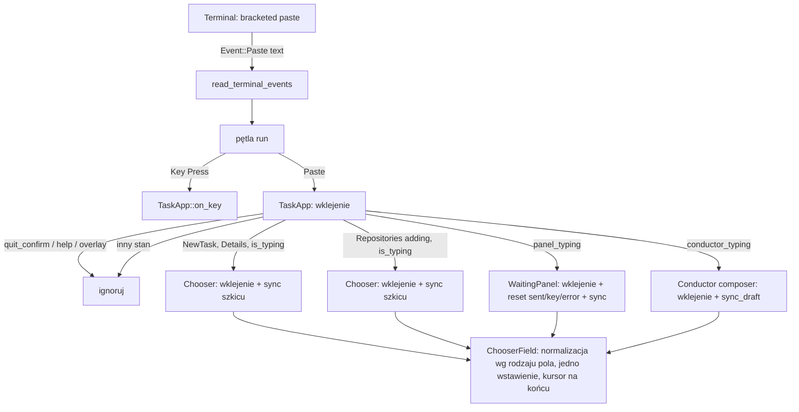

# feat: Wklejanie wieloliniowej treści do pól tekstowych TUI

## Summary

TUI włącza tryb wklejania terminala (bracketed paste). Pętla zdarzeń odbiera zdarzenie wklejenia jako jedno zdarzenie i przekazuje je do pola tekstowego, które ma fokus. Pole wstawia całą treść jako jedną operację. Wklejenie nie wysyła formularza. Gdy fokus nie jest w edytowalnym polu, TUI ignoruje wklejenie.

---

## Problem Frame

Dziś `src/tui/mod.rs` nie włącza trybu wklejania. Terminal wysyła wklejoną treść jako ciąg klawiszy. Każdy znak nowej linii dochodzi jako `Enter`, a `Enter` wysyła formularz (`Chooser::on_fields_key` → `Action::Submit`). Reszta treści trafia jako klawisze do następnego widoku i może wywołać akcje (np. `q`). Pętla zdarzeń w `run` obsługuje tylko `TerminalEvent::Key` i ignoruje inne zdarzenia (see origin: docs/brainstorms/2026-10-17-tui-wklejanie-wieloliniowe-requirements.md).

Zasada `Enter` = wyślij, `Ctrl+J` / `Shift+Enter` / `Alt+Enter` = nowa linia zostaje bez zmian.

---

## Requirements

- R1. Wklejenie wstawia całą treść w pozycji kursora jako jedną operację. Nie wysyła formularza i nie wywołuje innych akcji.
- R2. Pole wieloliniowe: nowe linie zostają nowymi liniami. `\r\n` i pojedyncze `\r` dają jedną nową linię.
- R3. Pole jednoliniowe: nowe linie stają się spacjami. Pole zostaje jednoliniowe.
- R4. Po wklejeniu kursor jest na końcu wklejonej treści, fokus zostaje w polu, `Enter` wysyła jak dotąd.
- R5. Pozostałe znaki (tabulatory, polskie znaki, emoji) trafiają do pola bez zmian.
- R6. Zasada dotyczy wszystkich pól tekstowych TUI.
- R7. Wklejenie poza polem tekstowym nie wywołuje akcji. Treść jest ignorowana.
- R8. TUI włącza tryb wklejania przy starcie i wyłącza go przy wyjściu, także po błędzie i panice.
- R9. Terminal bez trybu wklejania: TUI działa jak dziś.

**Origin acceptance examples:** AE1 (R1, R2, R4), AE2 (R4), AE3 (R2), AE4 (R3), AE5 (R6), AE6 (R7).

---

## Scope Boundaries

- Znaczenie `Enter` i klawiszy nowej linii — bez zmian (dokument z 2026-10-09).
- Obejście dla terminali bez trybu wklejania (heurystyka czasowa) — odłożone, do zgłoszenia przez operatora.
- Potwierdzenie lub podgląd przed wysłaniem — poza zakresem.
- Cofanie wklejenia (undo) — poza zakresem.
- Limit długości i ostrzeżenia o dużej treści — poza zakresem.
- Wsparcie Windows: plan nie dodaje kodu specyficznego dla Windows. Na Windows tryb wklejania działa tak, jak go obsługuje crossterm. Gdy crossterm zwraca błąd, obowiązuje R9 (zob. KTD-2).

### Deferred to Follow-Up Work

- Wskazówka w pomocy lub README dla terminali bez trybu wklejania (DR10 z przeglądu origin): osobna zmiana dokumentacji, gdy operator zgłosi problem.
- Komunikat w linii statusu o zignorowanym wklejeniu (DR6): odłożone, zob. Assumptions.

---

## Context & Research

### Relevant Code and Patterns

- `src/tui/mod.rs` — `TerminalGuard::enter`, `restore_terminal`, `install_panic_hook`, `arm_modifier_reporting` z flagą `ENHANCEMENT_ARMED`. Ten wzorzec (próba włączenia, flaga „uzbrojony”, wyłączenie w `restore_terminal`, błąd nie przerywa startu) jest wzorcem dla trybu wklejania. Pętla `run` i wątek `read_terminal_events` (wątek już przekazuje wszystkie zdarzenia, także `Paste`).
- `src/tui/task_app/mod.rs` — `TaskApp::on_key`: kolejność routingu (`quit_confirm` → `help_open` → `overlay` → widok `NewTask` / `History` / `Repositories` → panel → Dyrygent → keymap). `on_paste` musi mieć tę samą kolejność.
- `src/tui/chooser.rs` — `ChooserField` (`value`, `cursor` jako indeks znaku, `FieldKind::Text { multiline }`, `Integer`, `Select`), `ChooserField::edit` (filtr znaków dla `Integer`, zerowanie `proposed` i `error`), `Chooser::is_typing`, `Chooser::edit_field`. Jedyny prymityw edycji tekstu w TUI.
- `src/tui/input_form.rs` — wspólne funkcje edycji pola: `text_insert`, `text_backspace`, `text_step`, `char_byte_index`. Miejsce na wspólną funkcję wstawiania tekstu.
- Hosty pól tekstowych (zamknięta lista dla R6, odpowiedź na DR3):
  - formularz nowego zadania — `src/tui/task_app/new_task.rs` (`on_new_task_key`, `sync_new_task_draft`);
  - formularz dodania repozytorium — `src/tui/task_app/repositories.rs` (`on_repositories_key`, `adding`, `sync_repository_draft`);
  - panel odpowiedzi na pytanie kroku — `src/tui/task_app/waiting.rs` (`WaitingPanel::on_key`, `entry.chooser` i `entry.composer`, `panel_typing`, efekt `ChooserAction::None` zeruje `sent` / `key` / `error`); formularz błędu (`src/tui/failure_form.rs`) jest wpisem tego samego panelu;
  - zakładka Dyrygent — `src/tui/task_app/tabs/conductor.rs` (`conductor_typing`, `compose_key`, `sync_draft`).
  - Bez pól tekstowych: lista zadań, historia (`history.rs`), lista repozytoriów, nakładki `Overlay` (`Menu`, `Transitions`, `Links`, `Harness`, `Confirm`), okno wyjścia `quit_confirm`, pomoc `help_open`.
- Rysowanie pól: `src/tui/chooser.rs` `field_lines` i `src/tui/chooser/inputs.rs` `main_body` już przewijają widok do wiersza kursora. `sanitize` w `src/tui/scroll.rs` zmienia `\t` na spacje przy rysowaniu.
- Testy: `tests/tui_state.rs` (moduły `foundations::chooser_state`, `task_app_waiting`, `task_app_create::the_form`, `task_app_create::repositories`, test `the_terminal_is_restored_on_exit_and_on_panic`), `tests/tui_render.rs` (`chooser_render`, `task_app_create_render`).

### Institutional Learnings

- `docs/solutions/design-patterns/tui-modal-confirmation-keyboard-contract.md`: okno modalne przyjmuje tylko swoje klawisze, a inne wejście nie zmienia jego stanu. Dla wklejenia: przy otwartym `quit_confirm` lub pomocy wklejenie nic nie zmienia.

### External References

- crossterm 0.29: `EnableBracketedPaste` / `DisableBracketedPaste` i `Event::Paste(String)` (cecha `bracketed-paste`, domyślnie włączona). `Cargo.toml` deklaruje `crossterm = "0.29.0"` bez wyłączania cech domyślnych. Zachowanie na Windows nie jest sprawdzone w tej sesji.

---

## Key Technical Decisions

- **KTD-1. Tryb wklejania terminala, nie heurystyka.** Zgodnie z origin (Key Decisions). Zdarzenie `Paste` jest jednoznaczne.
- **KTD-2. Włączenie trybu jest „najlepszą próbą”.** Błąd `EnableBracketedPaste` nie przerywa startu TUI (DR11). Kod zapisuje flagę „uzbrojony” (jak `ENHANCEMENT_ARMED`), a `restore_terminal` wyłącza tryb tylko przy ustawionej fladze. Uzasadnienie: R9 wymaga, aby TUI działało jak dziś na terminalu bez wsparcia, a `restore_terminal` jest wspólną ścieżką dla `Drop` i panic hook (R8).
- **KTD-3. Wklejenie ma osobną ścieżkę, nie jest ciągiem klawiszy.** `TaskApp` dostaje metodę wklejenia obok `on_key`, `Chooser` i `ChooserField` dostają metodę wklejenia obok `on_key` / `edit`. Ścieżka nigdy nie zwraca `Submit` ani `Request` innego niż „brak”. Uzasadnienie: zamiana treści na klawisze odtworzyłaby błąd (`\n` → `Enter`) i wymagałaby specjalnych przypadków w keymap.
- **KTD-4. Normalizacja treści w jednej wspólnej funkcji** w `src/tui/input_form.rs`, obok `text_insert`, w kolejności:
  1. usuń sekwencje ESC w całości (CSI, OSC — tak jak `consume_escape_sequence` w `scroll.rs`);
  2. zamień `\r\n` i pojedyncze `\r` na `\n`;
  3. usuń pozostałe znaki sterujące C0/C1 oprócz `\n` i `\t`;
  4. zastosuj regułę rodzaju pola: wieloliniowe — `\n` zostaje; jednoliniowe — każde `\n` staje się jedną spacją; `Integer` — zostają tylko cyfry i `-`; `Select` — wklejenie ignorowane.
  Uzasadnienie: R5 mówi „tak samo jak przy wpisywaniu z klawiatury”. Z klawiatury nie można wpisać znaków sterujących ani sekwencji ESC, a pole `Integer` przyjmuje tylko cyfry i `-` (DR4, DR12). Sekwencje ANSI z logów nie trafiają do wartości wysyłanej do serwera.
- **KTD-5. Tabulator zostaje znakiem `\t` w wartości.** R5 wymienia tabulatory jako znaki „bez zmian”. Rysowanie (`sanitize`) zamienia `\t` na spacje. Implementacja musi sprawdzić, czy kursor po `\t` jest w poprawnej kolumnie (scenariusz testu w U3). Gdy nie jest, poprawka rysowania jest w zakresie tego planu.
- **KTD-6. Wstawienie jako jedna operacja na łańcuchu**, nie pętla `text_insert` po znaku. Jedno obliczenie indeksu bajtu, jedno `insert_str`, kursor przesunięty o liczbę znaków. Uzasadnienie: R1 (jedna operacja) i wydajność dla długiego logu (pętla po znaku jest O(n²)).
- **KTD-7. Wklejenie zachowuje się dla stanu pola jak edycja z klawiatury.** Pole zeruje `proposed` i `error`. Host wykonuje te same kroki co po `ChooserAction::None` z klawisza: synchronizacja szkicu (`sync_new_task_draft`, `sync_repository_draft`, `sync_draft`) i w panelu wyzerowanie `sent` / `key` / `error`. Uzasadnienie: bez tego szkic wklejonej treści ginie przy zmianie widoku, a stary błąd walidacji zostaje na ekranie.
- **KTD-8. Warunek „pole aktywne i edytowalne” = warunek, którego host już używa dla klawiszy** (`Chooser::is_typing`, `panel_typing`, `conductor_typing`, widok w `Focus::Details`). W każdym innym stanie obowiązuje R7 (DR9). Pola TUI nie mają zaznaczenia tekstu (`ChooserField` ma tylko `value` i `cursor`), więc DR7 nie wymaga decyzji.
- **KTD-9. Okna modalne mają pierwszeństwo.** Przy `quit_confirm`, `help_open` lub otwartej nakładce wklejenie jest ignorowane i nie zamyka okna. Uzasadnienie: learning o kontrakcie klawiatury okna modalnego; przypadkowe wklejenie nie może potwierdzić wyjścia ani zamknąć okna.

---

## Assumptions

Przegląd origin (DR1–DR12) zawiera zalecenia, których dokument nie przyjął. Plan rozstrzyga je tak (do weryfikacji przez właściciela wymagań):

- **AE4 dosłownie (DR8).** W polu jednoliniowym `ABC-123\n` daje `ABC-123 ` z końcową spacją, zgodnie z R3 i AE4. Plan nie usuwa nowych linii z początku i końca treści. Zmiana (np. obcinanie końcowych nowych linii) wymaga zmiany AE4 w origin; wtedy zmienia się tylko krok 4 w KTD-4.
- **Ciche ignorowanie (DR6).** Wklejenie poza polem nie daje komunikatu, zgodnie z R7 („treść jest ignorowana”).
- **Kryteria sukcesu dotyczą terminali z trybem wklejania (DR2).** Na terminalu bez wsparcia, w tym w tmux bez `paste-buffer -p` lub w mosh, obowiązuje R9 i błąd z Problem Frame zostaje.
- **Windows (DR11).** Plan nie wymaga testów na Windows. KTD-2 gwarantuje tylko, że błąd włączenia trybu nie blokuje startu.

---

## High-Level Technical Design

> Ten szkic pokazuje zamierzony kierunek i jest materiałem do przeglądu, nie specyfikacją implementacji. Implementujący traktuje go jako kontekst, nie jako kod do przepisania.

---

## Implementation Units

### U1. Normalizacja i wstawienie treści w polu

**Goal:** Pole `ChooserField` i `Chooser` przyjmują wklejoną treść zgodnie z rodzajem pola.

**Requirements:** R1, R2, R3, R4, R5; AE1, AE3, AE4.

**Dependencies:** brak.

**Files:**
- Modify: `src/tui/input_form.rs` (wspólna funkcja normalizacji i wstawiania łańcucha w pozycji kursora)
- Modify: `src/tui/chooser.rs` (metoda wklejenia w `ChooserField` i w `Chooser`; `Chooser` przekazuje treść tylko przy fokusie `Fields`)
- Test: `tests/tui_state.rs` (moduł `foundations::chooser_state`)

**Approach:**
- Funkcja normalizacji wg KTD-4 przyjmuje treść i rodzaj pola, zwraca treść do wstawienia (lub brak dla `Select`).
- Wstawienie wg KTD-6; kursor przesuwa się o liczbę wstawionych znaków (znaki Unicode, nie bajty).
- Metoda pola zwraca, czy treść była użyta; przy użyciu zeruje `proposed` i `error` (jak `edit`).
- Metoda `Chooser` przy fokusie `Actions` lub polu `Select` nic nie zmienia i nie zwraca akcji wysyłki.

**Patterns to follow:** `ChooserField::edit`, `text_insert`, `consume_escape_sequence` w `src/tui/scroll.rs`.

**Test scenarios:**
- Covers AE1. Pole wieloliniowe puste, wklejenie `a\nb\nc` → wartość `a\nb\nc`, kursor = 5 (koniec), brak akcji wysyłki.
- Covers AE3. Pole wieloliniowe, wklejenie `a\r\nb\r\nc` → `a\nb\nc`, bez pustych linii.
- Pojedyncze `\r`: `a\rb` → `a\nb` w polu wieloliniowym.
- Covers AE4. Pole jednoliniowe, wklejenie `ABC-123\n` → `ABC-123 `.
- Pole jednoliniowe, `x\r\ny` → `x y` (jedna spacja).
- Wklejenie w środku: wartość `ab`, kursor 1, wklejenie `XY` → `aXYb`, kursor 3.
- Znaki wielobajtowe: wartość `zażółć`, kursor 2, wklejenie `🦀ę` → znaki w poprawnym miejscu, kursor 4.
- `\t` zostaje w wartości bez zmian.
- Sekwencja `\x1b[31mred\x1b[0m` → `red`; znak `\x07` i `\x00` usunięte.
- Pole `Integer`: wklejenie `4a2\n` → `42`.
- Pole `Select`: wklejenie dowolnej treści → wartość bez zmian, metoda zwraca „nie użyto”.
- Pusta treść lub treść tylko ze znaków sterujących → wartość bez zmian.
- Pole z błędem walidacji i znacznikiem `proposed` → po wklejeniu oba wyzerowane.
- `Chooser` z fokusem na liście akcji → wklejenie nic nie zmienia.

**Verification:** Wszystkie scenariusze przechodzą; wklejenie nie zwraca nigdy akcji wysyłki.

---

### U2. Routing wklejenia w `TaskApp`

**Goal:** `TaskApp` kieruje wklejenie do pola, które ma fokus, i ignoruje je w każdym innym stanie.

**Requirements:** R1, R4, R6, R7; AE1, AE2, AE5, AE6.

**Dependencies:** U1.

**Files:**
- Modify: `src/tui/task_app/mod.rs` (publiczna metoda wklejenia z kolejnością routingu jak `on_key`)
- Modify: `src/tui/task_app/new_task.rs` (wklejenie do formularza + `sync_new_task_draft`)
- Modify: `src/tui/task_app/repositories.rs` (wklejenie do `adding` + `sync_repository_draft`)
- Modify: `src/tui/task_app/waiting.rs` (wklejenie do `entry.composer` lub `entry.chooser` + reset `sent` / `key` / `error`, sync szkicu)
- Modify: `src/tui/task_app/tabs/conductor.rs` (wklejenie do composera + `sync_draft`)
- Test: `tests/tui_state.rs` (nowy moduł `task_app_paste`, z pomocnikami z `task_app_support`)

**Approach:**
- Kolejność: `quit_confirm` → `help_open` → `overlay` → widoki formularzy z `Focus::Details` → `panel_focused` → `conductor_typing` → ignoruj (KTD-8, KTD-9).
- Przy `quit_confirm` i `help_open` wklejenie nie zmienia flag (w odróżnieniu od `on_key`, który zamyka pomoc dowolnym klawiszem).
- Metoda nie zwraca `Request` wysyłki; pętla nie musi wywoływać `perform` (decyzja o sygnaturze należy do implementacji).

**Patterns to follow:** `TaskApp::on_key`, `on_new_task_key`, `on_repositories_key`, `on_panel_key`, `on_conductor_typing_key`.

**Test scenarios:**
- Covers AE1. Formularz nowego zadania, kursor w polu promptu, wklejenie trzech linii → pole ma trzy linie, brak wysyłki, kursor na końcu.
- Covers AE2. Po AE1: `Up` do drugiej linii, edycja, `Enter` → wysyłka z poprawioną treścią.
- Covers AE5. Panel odpowiedzi z polem tekstowym, wklejenie kilku linii → odpowiedź nie wysłana, treść w polu, `sent` wyzerowane.
- Zakładka Dyrygent w trybie pisania, wklejenie → treść w composerze, brak wiadomości do Dyrygenta, szkic zapisany (`sync_draft`).
- Formularz błędu w panelu (`failure_form`) z polem tekstowym, wklejenie → treść w polu, brak wysyłki.
- Formularz dodania repozytorium, wklejenie ścieżki z `\n` na końcu → treść w polu jednoliniowym, brak wysyłki.
- Szkic formularza nowego zadania po wklejeniu przetrwa wyjście z widoku i powrót.
- Covers AE6. Fokus na liście zadań, wklejenie `q\nq\n` → brak `quit_confirm`, brak wyjścia, zaznaczone zadanie bez zmian, brak otwarcia szczegółów.
- Otwarte okno `quit_confirm`, wklejenie `q` → TUI nie wychodzi, okno zostaje otwarte.
- Otwarta pomoc, wklejenie → pomoc zostaje otwarta.
- Otwarta nakładka (`Menu`, `Confirm`), wklejenie `y\n` → nakładka bez zmian, brak potwierdzenia.
- Formularz nowego zadania z fokusem na liście workflow (nie w polu) → wklejenie ignorowane.
- Panel z fokusem na akcjach (nie w polu) → wklejenie ignorowane.
- Historia otwarta → wklejenie ignorowane.

**Verification:** Każdy host z listy w Context & Research ma co najmniej jeden test wklejenia; każdy stan bez pola ma test „ignorowane”.

---

### U3. Wygląd pola po wklejeniu

**Goal:** Potwierdzić, że widok pola pokazuje kursor po dużym wklejeniu i że `\t` nie przesuwa kursora.

**Requirements:** R4, R5.

**Dependencies:** U1.

**Files:**
- Modify (tylko gdy test nie przechodzi): `src/tui/chooser.rs` (`field_lines`), `src/tui/chooser/inputs.rs` (`main_body`, `wrapped`)
- Test: `tests/tui_render.rs` (moduły `chooser_render`, `task_app_create_render`)

**Approach:** Kod już przewija do wiersza kursora. Ten unit dodaje testy rysowania. Gdy kursor po `\t` jest w złej kolumnie (rysowanie rozwija `\t` do spacji, a kursor jest indeksem znaku), implementacja mapuje pozycję kursora przez to samo rozwinięcie.

**Execution note:** Najpierw testy; zmiana kodu rysowania tylko przy niezdanym teście.

**Test scenarios:**
- Wklejenie 200 linii do pola promptu → ostatni rysowany wiersz pola zawiera kursor i ostatnią linię treści.
- Wklejenie `a\tb` → znak kursora jest za `b` na ekranie, nie wewnątrz rozwiniętych spacji.
- Wklejenie do pola jednoliniowego treści z nowymi liniami → pole rysuje jeden wiersz.

**Verification:** Testy rysowania przechodzą w obu układach pól (lista z polami i układ formularza wejść).

---

### U4. Tryb wklejania w cyklu życia terminala i w pętli zdarzeń

**Goal:** TUI włącza tryb wklejania przy starcie, wyłącza go przy każdym wyjściu i przekazuje zdarzenie `Paste` do `TaskApp`.

**Requirements:** R1, R8, R9.

**Dependencies:** U2.

**Files:**
- Modify: `src/tui/mod.rs` (`TerminalGuard::enter`, `restore_terminal`, flaga „uzbrojony”, gałąź `Paste` w `run`, dokumentacja modułu)
- Test: `tests/tui_state.rs` (obok `the_terminal_is_restored_on_exit_and_on_panic`)

**Approach:**
- Po `EnterAlternateScreen` próba `EnableBracketedPaste`; sukces ustawia flagę (KTD-2). Błąd jest pomijany.
- `restore_terminal` wyłącza tryb przy ustawionej fladze i zeruje flagę, przed `LeaveAlternateScreen`. Funkcja zostaje idempotentna i nadal pomija błędy.
- W `run` gałąź `TerminalEvent::Paste(text)` wywołuje metodę wklejenia `TaskApp`. Następny obrót pętli rysuje stan.
- Komentarz modułu opisuje trzeci stan terminala (obok raw mode i flag klawiatury), który przywraca `restore_terminal`.

**Patterns to follow:** `arm_modifier_reporting`, `ENHANCEMENT_ARMED`.

**Test scenarios:**
- `restore_terminal` wywołane bez wcześniejszego włączenia trybu → licznik wywołań rośnie o 1, brak paniki (flaga nie ustawiona).
- Dwa wywołania `restore_terminal` po sobie → obie przechodzą bez błędu (idempotencja).
- Test expectation dla włączenia na prawdziwym terminalu: poza testami automatycznymi (brak tty w harnessie testów, jak w istniejącym teście); sprawdzenie ręczne w Verification.

**Verification:**
- Testy automatyczne przechodzą.
- Sprawdzenie ręczne w prawdziwym terminalu (np. Linux + tmux z `paste-buffer -p` oraz terminal bez tmux): AE1, AE6; po wyjściu przez `q q` i po wymuszonej panice wklejenie w powłoce nie pokazuje znaczników `200~` / `201~`.

---

## System-Wide Impact

- **Interaction graph:** pętla `run` → `TaskApp` → hosty pól (`new_task`, `repositories`, `waiting`, `conductor`) → `Chooser` / `ChooserField` → funkcje w `input_form.rs`. Klawisze i ich keymap bez zmian.
- **Error propagation:** błąd włączenia trybu jest pomijany (KTD-2); `restore_terminal` pomija błędy jak dotąd.
- **State lifecycle risks:** szkice formularzy i Dyrygenta muszą być zsynchronizowane po wklejeniu (KTD-7). Flaga trybu wklejania musi być zerowana, aby panic hook i `Drop` nie wyłączały trybu dwa razy (nieszkodliwe, ale niespójne z wzorcem).
- **API surface parity:** brak zmian w API serwera. Wartość wysyłana do serwera nie ma już sekwencji ESC ani znaków sterujących z wklejonej treści.
- **Unchanged invariants:** `Enter` wysyła, `Ctrl+J` / `Shift+Enter` / `Alt+Enter` dodają nową linię, `Tab` zmienia fokus.

---

## Risks & Dependencies

| Ryzyko | Mitygacja |
|---|---|
| Terminal lub multiplekser operatora nie przekazuje trybu wklejania (tmux bez `-p`, mosh, konsola webowa). | R9: zachowanie jak dziś. Odłożona wskazówka w dokumentacji. |
| crossterm na Windows nie obsługuje `EnableBracketedPaste` lub nie daje `Event::Paste`. | KTD-2: błąd nie blokuje startu; obowiązuje R9. |
| Pominięty host pola tekstowego. | Zamknięta lista hostów w Context & Research i test na każdy host w U2. |
| Kursor w złej kolumnie po `\t`. | Test w U3, poprawka rysowania w zakresie. |
| Duże wklejenie spowalnia rysowanie (zawijanie całej wartości w każdej klatce). | Poza zakresem (brak limitu długości); obserwować przy sprawdzeniu ręcznym w U4. |

---

## Deferred to Implementation

- Dokładne nazwy i sygnatury metod wklejenia (`TaskApp`, `Chooser`, `ChooserField`, `WaitingPanel`, composer Dyrygenta).
- Czy metoda `TaskApp` zwraca `Request` (zawsze „brak”), czy nic.
- Czy funkcja usuwania sekwencji ESC może współdzielić kod z `consume_escape_sequence` w `src/tui/scroll.rs`, czy potrzebuje własnej kopii.
- Czy poprawka kolumny kursora po `\t` jest potrzebna (wynik testu U3).

---

## Sources & References

- **Origin document:** [docs/brainstorms/2026-10-17-tui-wklejanie-wieloliniowe-requirements.md](../brainstorms/2026-10-17-tui-wklejanie-wieloliniowe-requirements.md)
- Learning: `docs/solutions/design-patterns/tui-modal-confirmation-keyboard-contract.md`
- Kod: `src/tui/mod.rs`, `src/tui/task_app/mod.rs`, `src/tui/chooser.rs`, `src/tui/input_form.rs`, `src/tui/task_app/waiting.rs`, `src/tui/task_app/tabs/conductor.rs`, `src/tui/task_app/new_task.rs`, `src/tui/task_app/repositories.rs`
