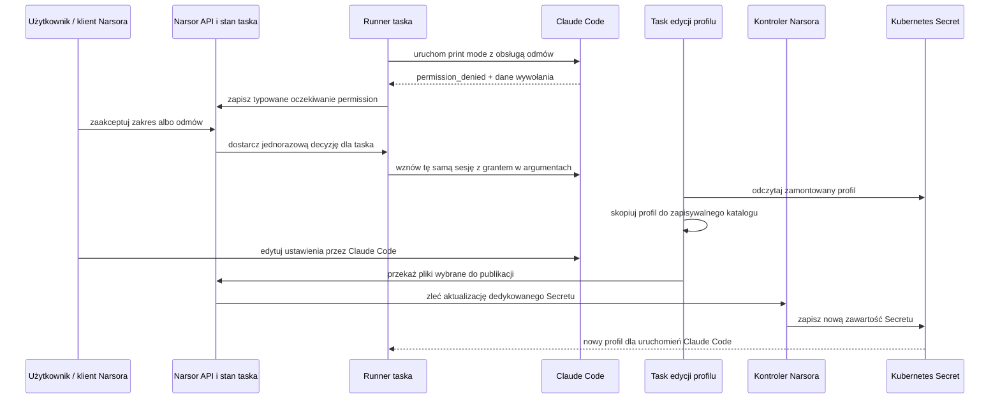

# Odroczone decyzje o uprawnieniach harnessu - Plan

## Goal Capsule

- **Objective:** Task Narsora może zatrzymać się na prośbie Claude Code o uprawnienie, poczekać na późniejszą decyzję użytkownika i kontynuować bez interaktywnego terminala.
- **Means:** Narsor zapisuje prośbę jako trwały stan oczekiwania, a zgodę przekazuje wyłącznie do wznowienia danego taska. Runner K8s otrzymuje bazową konfigurację Claude Code i kopiuje ją do zapisywalnej konfiguracji prywatnej taska.
- **Product authority:** Zgody na polecenia są lokalne dla taska i wygasają wraz z nim. Dedykowany Secret Claude Code jest źródłem prawdy: jego zewnętrzna zmiana jest przyjmowana bez weta Narsora. Zmiana inicjowana w Narsorze uruchamia edytowalną kopię konfiguracji w Claude Code, po czym Narsor zapisuje wybrane pliki z powrotem do Secretu.
- **Open blockers:** Brak blokujących decyzji produktowych. Szczegóły protokołu wznowienia Claude Code i aktualizacji Secretu należą do planowania technicznego.

---

## Product Contract

### Summary

Plan realizuje trwałe, taskowe decyzje o uprawnieniach Claude Code przez istniejące kanały Narsora, zachowanie znaczenia pominiętego `workspace_access` oraz używanie i edycję profilu Claude Code w K8s. Sekret zawiera pliki potrzebne harnessowi, w tym uwierzytelnianie, ustawienia uprawnień, MCP, pluginy i skills.

### Problem Frame

Obecny adapter Claude Code potrafi zapisać `permission_denied` jako zdarzenie techniczne, ale Narsor nie zamienia go w trwałą prośbę do użytkownika. Runner uruchamia proces bez stdin, więc standardowy interaktywny permission prompt nie pasuje do autonomicznego taska. Log `docs/sources/permissions.log` zawiera identyfikator wywołania narzędzia oraz polecenie, co daje podstawę do powiązania odmowy z konkretną akcją.

Użytkownik może odpowiedzieć później, dlatego task nie może traktować braku odpowiedzi jak odmowy ani kończyć się nieczytelnym błędem. Jednocześnie decyzja o jednym poleceniu nie może stać się trwałym uprawnieniem dla kolejnych tasków.

W lokalnym runnerze Claude może korzystać z konfiguracji lokalnego środowiska. W K8s nie ma dostępu do konfiguracji z komputera operatora: domyślny `HOME` jest prywatny dla taska. Potrzebny jest zatem jawny profil bazowy dostarczany podom runnerów.

### Key Decisions

- **Asynchroniczna obsługa uprawnień.** (session-settled: user-directed — decyzja użytkownika może nadejść po zatrzymaniu taska.) Governs R1-R8.
- **Jedno ustawienie workflow.** (session-settled: user-directed — używamy istniejącego `workspace_access`, bez dodatkowego pola trybu uprawnień.) Governs R9-R10.
- **Konfiguracja taska bazuje na wersji Secretu z inicjalizacji.** (session-settled: user-directed — wszystkie runnery Claude Code korzystają z profilu, a task zachowuje prywatną kopię.) Governs R11-R13.
- **Sekret jest źródłem prawdy, a zarządzana edycja zapisuje kopię użytkownika.** (session-settled: user-directed — zewnętrznych zmian Secretu Narsor nie kwestionuje; podczas edycji Narsor przekazuje kopię do Claude Code i zapisuje wynik.) Governs R14-R17.
- **Pierwszy zakres obejmuje Claude Code.** (inferred — rzeczywisty log i obecny parser dotyczą tego harnessu; inne adaptery można rozszerzyć, gdy dostarczą równoważny sygnał.) Governs R1, R17.

### Actors

- A1. **Właściciel taska** przegląda oczekujące prośby i wybiera zakres zgody; przy edycji profilu sam uruchamia Claude Code i zmienia konfigurację.
- A2. **Runner Narsora** obserwuje zdarzenia harnessu, zapisuje oczekiwanie, wstrzymuje task i wznawia go z lokalną decyzją.
- A3. **Claude Code** wykonuje narzędzia zgodnie ze swoją konfiguracją oraz zgodami przekazanymi dla bieżącego taska.
- A4. **Narsor** zarządza cyklem życia runnerów; w zadaniu edycji kopiuje profil do zapisywalnego miejsca i publikuje wybrane pliki po zakończeniu pracy użytkownika.
- A5. **Pod runnera** wykonuje każde zadanie Claude Code w K8s i otrzymuje dedykowany Secret profilu tylko do odczytu.

### Requirements

**Oczekiwanie i zgoda taskowa**

- R1. Gdy Claude Code zgłosi zdarzenie uprawnienia możliwe do rozstrzygnięcia przez użytkownika, Narsor tworzy trwałe oczekiwanie typu `permission`, odrębne od zwykłego pytania agenta i od błędu wykonania.
- R2. Prośba pokazuje nazwę narzędzia, dokładne polecenie lub akcję, katalog roboczy, powód odmowy, dostępne źródło decyzji oraz powiązanie z wywołaniem narzędzia i sesją.
- R3. Użytkownik może odmówić, zezwolić na ponowienie konkretnego polecenia albo zezwolić na podobne polecenia określonego typu do końca taska. Interfejs jasno pokazuje wybrany zakres.
- R4. Po odmowie task może wznowić agenta z informacją o decyzji, aby agent mógł wybrać inną drogę lub zakończyć pracę.
- R5. Po zgodzie Narsor wznawia tę samą logiczną sesję i przekazuje grant wyłącznie temu taskowi. Grant nie zmienia plików konfiguracji Claude Code, ustawień użytkownika ani konfiguracji Secretu.
- R6. Jawna reguła `deny` lub odmowa wynikająca z polityki, której użytkownik nie może nadpisać lokalną zgodą, nie jest przedstawiana jako prośba możliwa do zatwierdzenia. Narsor pokazuje ją jako blokadę z wyjaśnieniem.
- R7. Stan oczekiwania i decyzja pozostają trwałe po zatrzymaniu runnera, utracie klienta i odtworzeniu poda. Zgoda wygasa po zakończeniu lub usunięciu taska.
- R8. Oczekiwanie jest dostępne przez istniejące kanały Narsora obsługujące decyzje użytkownika; odpowiedź nie wymaga otwartego terminala ani żywego stdin procesu harnessu.
- R9. W workflow pozostaje wyłącznie `workspace_access`. Jawne `read-only` ogranicza dostęp, jawne `read-write` wybiera tryb zapisu danego adaptera, a pominięcie pola nie wymusza trybu i pozostawia decyzję konfiguracji harnessu dostępnej w środowisku.
- R10. Schemat workflow zachowuje informację, czy `workspace_access` podano jawnie, aby wartość domyślna nie wymuszała niejawnie trybu harnessu. Istniejące workflow otrzymują zdefiniowaną, kompatybilną interpretację.

**Konfiguracja Claude Code w Kubernetesie**

- R11. Instalacja K8s udostępnia każdemu runnerowi Claude Code dedykowany Secret profilu jako wolumen tylko do odczytu; konfiguracja nie pochodzi z lokalnego `HOME` operatora.
- R12. Przed pierwszym uruchomieniem Claude Code runner kopiuje pliki bazowej konfiguracji do zapisywalnego katalogu prywatnego taska i wskazuje ten katalog jako konfigurację harnessu.
- R13. Runner nie nadpisuje konfiguracji prywatnej przy wznowieniu taska. Task używa wersji profilu, z której został zainicjalizowany; nowe taski korzystają z bieżącej zawartości Secretu.
- R14. Każdy runner Claude Code dostaje Secret profilu tylko do odczytu, ponieważ jest on potrzebny do uruchomienia harnessu. Ten dostęp nie oznacza, że pozostałe operacje Narsora używają profilu.
- R15. W trybie edycji Narsor kopiuje zawartość zamontowanego profilu do zapisywalnego katalogu, uruchamia Claude Code z tą kopią, a po zakończeniu zbiera pliki konfiguracji i publikuje je do Secretu. Claude Code nie zapisuje bezpośrednio do Secretu.
- R16. Zewnętrzna zmiana dedykowanego Secretu jest nadrzędna i nie jest przez Narsor odrzucana, cofana ani zastępowana. Jeśli koliduje z trwającą publikacją Narsora, Narsor odczytuje aktualny Secret i ponawia publikację na jego aktualnej zawartości albo zgłasza konflikt użytkownikowi; nie cofa zewnętrznej zmiany.
- R17. Do Secretu można zapisać co najmniej uwierzytelnianie, ustawienia i reguły uprawnień, MCP, pluginy oraz skills. Historia sesji i dane konkretnego taska nie są częścią współdzielonego profilu.
- R18. Obecne zachowanie innych harnessów pozostaje bez zmian, dopóki ich adaptery nie obsłużą własnego źródła i cyklu życia próśb o uprawnienia.

### Key Flows

- F1. **Odmowa harnessu:** Claude Code emituje odmowę powiązaną z wywołaniem narzędzia; Narsor zapisuje prośbę, zatrzymuje task i pokazuje polecenie oraz przyczynę. **Covers:** R1-R2.
- F2. **Zgoda na polecenie:** Użytkownik zatwierdza konkretne polecenie; Narsor zapisuje grant w stanie taska i wznawia sesję. **Covers:** R3, R5, R7.
- F3. **Zgoda na grupę:** Zgodne akcje tego taska nie tworzą ponownie tej samej prośby, ale inny task wymaga własnej decyzji. **Covers:** R3, R5, R7.
- F4. **Odmowa użytkownika:** Agent wznawia pracę z informacją o decyzji i może dobrać alternatywę. **Covers:** R4.
- F5. **Blokada polityki:** Narsor pokazuje nieprzekraczalną regułę `deny` bez opcji jej obejścia. **Covers:** R6.
- F6. **Start taska K8s:** Runner kopiuje aktualną bazową konfigurację z Secretu do prywatnego `HOME` taska, następnie uruchamia Claude Code z zapisywalnym katalogiem konfiguracji. **Covers:** R11-R12, R16-R17.
- F7. **Wznowienie poda:** Prywatna konfiguracja, sesja i oczekiwanie są zachowane, a bootstrap nie kopiuje ponownie ustawień bazowych. **Covers:** R7, R13, R16.
- F8. **Edycja profilu:** Narsor kopiuje zamontowaną konfigurację do katalogu roboczego, uruchamia Claude Code dla użytkownika, zbiera pliki profilu i zapisuje je do Secretu. Każdy runner Claude Code dostaje montowany Secret. Zmiany dokonane poza Narsorem pozostają obowiązujące. **Covers:** R14-R17.

### Acceptance Examples

- AE1. Covers R1-R3. Po odmowie Bash z dokładnym poleceniem `cargo build`, użytkownik widzi przyczynę i wybiera zgodę tylko dla tego polecenia; prośba nie jest klasyfikowana jako zwykłe pytanie agenta.
- AE2. Covers R3, R5, R7. Zgoda na grupę poleceń działa w pozostałej części taska i znika po jego zakończeniu; drugi task nadal zatrzymuje się przy analogicznej odmowie.
- AE3. Covers R4, R6. Po odmowie użytkownika agent może kontynuować inną ścieżką, a jawna polityka `deny` nie może zostać nadpisana przez lokalną zgodę.
- AE4. Covers R8-R10. Klient może odpowiedzieć na oczekiwanie, gdy proces runnera jest zatrzymany lub został odtworzony; workflow bez jawnego `workspace_access` nie wysyła harnessowi wymuszonego trybu, a jawne `read-only` nadal ogranicza zapis.
- AE5. Covers R11-R13, R16-R17. Nowy pod kopiuje bazowy plik konfiguracji do katalogu prywatnego taska; wznowiony pod zachowuje tę kopię, a identyfikator wersji bazowej taska jest widoczny.
- AE6. Covers R14-R17. Zwykły runner i runner edycji widzą skonfigurowany Secret jako read-only; edycja zapisuje kopię do Secretu przez Narsor. Zmiana Secretu wykonana poza Narsorem nie jest odrzucana ani cofana.
- AE7. Covers R18. Harness inny niż Claude Code zachowuje dotychczasowy przebieg i nie otrzymuje nowego zachowania przez przypadkowe współdzielenie parsera zdarzeń.

### Scope Boundaries

- Funkcja nie wprowadza interaktywnego terminala ani nie czeka na stdin procesu Claude Code.
- Zgoda na polecenie nie zmienia konfiguracji Claude Code ani nie nadaje podowi nowych uprawnień infrastrukturalnych. (R5-R6)
- Task zachowuje swoją kopię profilu do wznowienia; nowy task czyta aktualny Secret. Zewnętrzna aktualizacja nie czeka na akceptację Narsora. (R13, R16)
- Zakres nie zmienia domyślnego zachowania innych harnessów. (R18)

---

## Planning Contract

Product Contract unchanged.

### High-Level Technical Design

`permission_denied` staje się oczekiwaniem dopiero po zakończeniu nieinteraktywnego wywołania Claude Code. Narsor zapisuje request razem z sesją i identyfikatorem wywołania, a dedykowana decyzja właściciela albo odmawia, albo dodaje ograniczony grant do wznowienia. Zwykłe odpowiedzi na pytania agenta i ogólne polecenie wznowienia nie mogą tworzyć grantów.

Profil K8s ma trzy odrębne warstwy: dedykowany Secret, zapisywalną kopię konfiguracji taska oraz granty przechowywane w stanie taska. Każdy runner Claude Code dostaje Secret read-only i inicjalizuje prywatną kopię na trwałym storage. W zadaniu edycji Narsor publikuje pliki z kopii przez kontroler z uprawnieniami ograniczonymi do nazwanego Secretu. Zewnętrzne zmiany Secretu pozostają źródłem prawdy i nie są przez Narsor cofane.

### Key Technical Decisions

- KTD1. **Użyj jawnego trybu odmów Claude Code w nieinteraktywnym print mode.** Uruchamiaj z `--permission-prompts none` i klasyfikuj strukturalne `system/permission_denied` oraz `result.permission_denials`. Flaga wymaga CLI v2.1.259+; dla runtime przyjmij wspieraną i nagraną wersję co najmniej 2.1.302. W obecnym wspieranym `-p` `AskUserQuestion` jest niedostępne już bez tej flagi, więc nie obiecuj ścieżki narzędziowej: zachowaj testy syntetycznego requestu `tool_use` i tekstowego fallbacku agenta, a nagranie realnego CLI ma potwierdzić strukturalną odmowę oraz brak retry. Zmiana tego kontraktu w nowszej wersji wymaga aktualizacji fixture i testów przed dopuszczeniem jej do runtime. (see [Claude Code headless mode](https://code.claude.com/docs/en/headless), [CLI reference](https://code.claude.com/docs/en/cli-reference))
- KTD2. **Rozszerz trwałe oczekiwanie człowieka o typowaną decyzję permission.** Reuse pliku i statusu `InputNeeded` z `human.rs`, ale dodaj oddzielną kontynuację i operację `resolve_permission`; zwykły endpoint `/input` nie może obsłużyć tej kontynuacji. Zapisz oczekiwanie przed zmianą statusu, waliduj identyfikator requestu i atomowo zamykaj je po jednej decyzji. (session-settled: user-directed — wybrane zamiast interaktywnego promptu stdin, ponieważ odpowiedź może przyjść po zatrzymaniu taska; governs R1-R8)
- KTD3. **Przekazuj zgodę tylko w kontekście bieżącego taska i requestu.** Decyzja ma zamknięty typ `deny` albo `allow`; `allow` wymaga jawnego zakresu `exact_operation` albo `command_group`. Zapisz grant wraz z task ID, request ID i fingerprintem strukturalnej operacji (narzędzie, executable, argumenty i katalog roboczy); `command_group` dopasowuje wyłącznie jawnie zatwierdzony executable i stały prefiks argumentów z granicą argumentu. Grupę oferuj tylko dla pojedynczej komendy, którą gramatyka Claude `--allowedTools` potrafi reprezentować równie wąsko; odrzucaj operatory sterujące powłoki, pipe, redirection, substitution, glob i inne złożone formy, jeśli mogłyby zmienić zakres. Nie interpretuj substringów ani składni powłoki jako szerszego wzorca. Grant jest jednorazowy dla wznowienia requestu; jeśli zakresu nie da się wiernie wyrazić przez `--allowedTools`, odrzuć go zamiast poszerzać. Nie zapisuj grantów do settings ani bazowego Secretu. Jawne reguły `deny` pozostają nadrzędne wobec allow rules. (session-settled: user-directed — wybrane zamiast trwałej konfiguracji harnessu, ponieważ grant dotyczy tylko bieżącego taska; governs R3-R7)
- KTD4. **Zachowaj obecne powierzchnie decyzji i daj im wspólny typ requestu.** Każdy endpoint autoryzuje właściciela względem taska, a request permission musi należeć do tego taska. API, CLI, TUI i kontroler tasków używają tej samej struktury i walidacji; stare `/input` i `/resume` nie mogą ominąć decyzji permission. Odpowiedź wiąże się z ID oczekiwania i ma pojedynczego zwycięzcę przy równoczesnych zgłoszeniach. (governs R2-R8)
- KTD5. **Zachowaj obecność pola workflow osobno od wartości.** Nowy workflow z pominiętym `workspace_access` nie przekazuje jawnego trybu do adaptera; jawne `read-only` i `read-write` nadal są mapowane. Rekordy wykonania zapisane przed zmianą zachowują dotychczasowe znaczenie `read-write`. (session-settled: user-directed — wybrane zamiast nowego pola trybu uprawnień, ponieważ workflow ma nadal jedno ustawienie dostępu; governs R9-R10)
- KTD6. **Przypnij pełny profil taska przy pierwszej inicjalizacji trwałego HOME.** Runner kopiuje zawartość zamontowanego katalogu profilu i zapisuje digest; przy wznowieniu marker chroni kopię przed nadpisaniem późniejszą zmianą Secretu. Kopiowane pliki obejmują ustawienia, uwierzytelnianie i pozostałe pliki profilu. (session-settled: user-directed — task zachowuje wersję z inicjalizacji; governs R11-R13, R16-R17)
- KTD7. **Edycja profilu odbywa się na kopii, a zapis wykonuje Narsor.** Każdy runner Claude Code, także dedykowany edytor, otrzymuje Secret profilu read-only. Narsor przygotowuje kopię w zapisywalnym miejscu, uruchamia Claude Code, a po pracy użytkownika zbiera pliki profilu i zleca kontrolerowi zapis do nazwanego Secretu. CAS może wykryć wyścig, ale nie może usuwać ani cofać zewnętrznej zmiany: Narsor odświeża bazę i ponawia zapis albo pokazuje konflikt. RBAC daje zapis tylko kontrolerowi; runner nie zapisuje Secretu bezpośrednio. (session-settled: user-directed — użytkownik edytuje konfigurację w Claude Code, Narsor publikuje rezultat; governs R14-R17)

### Risks and Mitigations

- **Niewspierany lub zmieniony protokół CLI.** Utrzymuj zarejestrowane przykłady prawdziwego CLI dla dozwolonej odmowy, blokady polityki i wznowienia. Oddziel test syntetycznego `AskUserQuestion` od realnego tekstowego fallbacku w `-p`; przed wdrożeniem potwierdź korelację, brak ponawiania odmowy oraz skuteczność ograniczonego grantowania. Przy braku rozstrzygających danych nie pokazuj opcji zatwierdzenia.
- **Wyciek sekretu z treści polecenia.** Polecenia i ścieżki mogą zawierać poufne wartości; przechowuj pełny request tylko w prywatnym stanie taska, autoryzuj jego odczyt przez właściciela, redaguj znane wartości Secretów w widokach i nie kopiuj treści requestu do logów ani ogólnych eventów.
- **Zbyt szeroka zgoda dla grupy poleceń.** Pokaż dokładny zakres przed zatwierdzeniem, przechowuj grant w tasku i odrzucaj go po zamknięciu taska.
- **Odmowa pomylona z prośbą o zgodę.** Koreluj ustrukturyzowane źródło i powód z wywołaniem narzędzia; tekst odmowy sam nie wystarcza. Nie oferuj override’u dla jawnej polityki `deny`.
- **Zmiana konfiguracji nadpisuje konfigurację taska.** Inicjalizować prywatną kopię jednokrotnie i przypiąć task do wersji bazowej.
- **Proces agenta modyfikuje konfigurację całego wdrożenia.** Proposer nie ma tokenu Kubernetes ani dostępu do Secretu; manager akceptuje zmianę, a wskazany controller wykonuje jej wersjonowany zapis. Wartości Secretu nie trafiają do logów, błędów ani eventów.
- **Wyścig dwóch decyzji albo odpowiedź po zamknięciu taska.** Wymagaj aktualnego ID oczekiwania i pojedynczego warunkowego przejścia; duplikaty i spóźnione odpowiedzi kończą się czytelnym wynikiem bez grantu.
- **Zgoda Claude Code mylona z dostępem infrastrukturalnym.** UI i kontrakt API rozróżniają zgodę harnessu od ograniczeń K8s, systemu plików i sieci.

### Sources and Existing Evidence

- `docs/sources/permissions.log` — rzeczywiste zdarzenia odmowy, treść polecenia, `tool_use_id` i `permission_decision`.
- `tests/fixtures/claude-code/README.md` i `tests/fixtures/claude-code/` — nagrania Claude Code 2.1.302; README dokumentuje brak `AskUserQuestion` w `--print` i tekstowy fallback. Aktualizuj nagrania o protokół odmowy i wznowienia zamiast polegać na fake harnessie.
- `crates/narsor-engine/src/engine/actions/harness/claude_code/classify.rs` — bieżąca klasyfikacja `permission_denied` jako elementu technicznego.
- `crates/narsor-engine/src/engine/actions/agent.rs` i `crates/narsor-engine/src/engine/actions/human.rs` — harness działa bez stdin; istnieje trwały zapis oczekiwania, status `InputNeeded` i wznowienie tej samej sesji agenta.
- `crates/narsor-engine/src/domain/workflow_definition.rs`, `crates/narsor-engine/src/workflow/schema.rs` i `crates/narsor-engine/src/workflow/loader.rs` — `workspace_access` jest dziś konkretną wartością z domyślnym `read-write`, więc schema musi zachować informację o pominięciu.
- `crates/narsor-engine/src/engine/actions/harness/claude_code.rs` — adapter obecnie przekazuje tryb uprawnień do Claude Code.
- `src/cli/remote.rs`, `src/tui/task_app/waiting.rs`, `crates/narsor-server/src/api/routes.rs` i `crates/narsor-api-client/src/api/client.rs` — obecne ścieżki wyświetlania i dostarczania decyzji właściciela.
- `crates/narsor-runner/src/runner/{home,storage,init,cli}.rs` — prywatny HOME na storage taska i istniejąca obsługa `CLAUDE_CONFIG_DIR`.
- `crates/narsor-controller/src/kubernetes/manifest.rs` i `deploy/kubernetes/controller-rbac.yaml` — Secret launchu jest tylko do odczytu dla runnera, a kontroler ma obecnie tylko `create` dla Secretów; zapis profilu wymaga nowego, wąsko ograniczonego uprawnienia.
- `docs/solutions/integration-issues/runner-private-home-hides-harness-login-2026-10-10.md` — nie kopiuj historii ani poświadczeń do profilu bazowego; fake harness nie dowodzi zachowania CLI.
- `docs/solutions/integration-issues/claude-code-json-schema-rejects-top-level-anyof-2026-10-17.md` — używaj nagrań prawdziwego CLI do kontraktów protokołu; wynik `subtype` sam nie jest wystarczającym sygnałem błędu.
- `docs/solutions/architecture-patterns/auto-resume-policy-for-lost-workloads-2026-10-11.md` — wiąż decyzje z generacją/ID, obsługuj duplikaty i zachowuj zgodność enumów protokołu.
- [Claude Code: zmienne środowiskowe](https://code.claude.com/docs/en/env-vars) — `CLAUDE_CONFIG_DIR` zmienia domyślny katalog `~/.claude`.
- [Claude Code: headless mode](https://code.claude.com/docs/en/headless) i [CLI reference](https://code.claude.com/docs/en/cli-reference) — `--permission-prompts none` emituje `permission_denied` w `stream-json`; `--allowedTools` przyjmuje reguły narzędzi, a `--resume` wznawia sesję.
- [Claude Code: permissions](https://code.claude.com/docs/en/permissions) — jawne reguły deny są oceniane przed allow rules.
- [Kubernetes: wolumeny](https://kubernetes.io/docs/concepts/storage/volumes/) — wolumen Secretu jest tylko do odczytu.
- [Kubernetes: ServiceAccount](https://kubernetes.io/docs/concepts/security/service-accounts/) — uprawnienia poda do aktualizacji obiektu Secret wynikają z RBAC.
- [Kubernetes: dobre praktyki dla Secretów](https://kubernetes.io/docs/concepts/security/secrets-good-practices/) — przyznawaj dostęp tylko komponentom, które go potrzebują.

Brak repozytoryjnego `STRATEGY.md` i `CONCEPTS.md`; plan używa pojęć z istniejącego modelu taska i dokumentacji operacyjnej.

---

## Implementation Units

### Sequencing

- U1 ustala kontrakt zdarzeń Claude Code i może powstawać niezależnie od U5 i U6.
- U2 zależy od U1, bo zapisuje typowane requesty z tego kontraktu. U3 zależy od U2, bo jego API, CLI, TUI i protokół kontrolera udostępniają i rozstrzygają trwały request. U4 zależy od U1-U3, bo przed wznowieniem Claude Code łączy sklasyfikowaną odmowę z zakresem zgody i trwałą decyzją.
- U5 może powstawać równolegle z U2-U3; przed zakończeniem U4 trzeba zintegrować opcjonalne `workspace_access` na granicy wywołania Claude.
- U6 może powstawać równolegle z U1-U5. U7 zależy od nazwy Secretu profilu i kontraktu montowania ustalonych w U6; zmiany protokołu kontrolera i RBAC muszą wejść razem z przepływem akceptacji w control plane.

### U1. Klasyfikacja i rejestracja odmów Claude Code

- **Goal:** rozpoznawać możliwą do rozstrzygnięcia odmowę na podstawie strukturalnych danych Claude Code i zachować jej źródło, polecenie, katalog, sesję oraz ID wywołania.
- **Requirements:** R1-R2, R6, R18; **Flows:** F1, F5; **Acceptance:** AE1, AE3, AE7.
- **Files:** `crates/narsor-engine/src/engine/actions/harness/claude_code/classify.rs`, `crates/narsor-engine/src/engine/actions/harness/claude_code.rs`, `tests/fixtures/claude-code/`, `tests/fixtures/claude-code/README.md`, `tests/claude_code_classification.rs`.
- **Approach:** dodaj typowane dane requestu dla zdarzeń `permission_denied` i końcowego `permission_denials`. Nie klasyfikuj po tekście ani samym `subtype`. Utrzymuj kompatybilność z nieznanymi podtypami oraz dotychczasowymi nagraniami.
- **Test Scenarios:** nagranie z `decision_reason_type` i `tool_use_id` tworzy request z pełną korelacją; jawny deny pozostaje blokadą bez akcji approve; zdarzenie bez wymaganych identyfikatorów pozostaje błędem/elementem technicznym; syntetyczny request `AskUserQuestion` nadal klasyfikuje się jako pytanie agenta, a rzeczywiste nagranie print mode zachowuje tekstowy fallback; brak odpowiedzi nie zmienia się w retry permission; nieznany podtyp nie przerywa parsowania; końcowy wynik nie zamienia błędu Claude w sukces.
- **Verification:** `cargo test --test claude_code_classification --test actions_agent`.
- **Execution note:** nagraj i sprawdź prawdziwe CLI dla wspieranej wersji runtime, z `--permission-prompts none`; potwierdź strukturalną odmowę, brak retry i tekstowy fallback pytania agenta. Oddzielny test fixture sprawdza syntetyczne zdarzenie `AskUserQuestion`. Fake harness nie wystarcza do zatwierdzenia tego kontraktu.

### U2. Trwałe, typowane oczekiwanie permission

- **Goal:** zawieszać wykonanie na prośbie Claude Code i wznawiać je po późniejszej decyzji także po restarcie procesu.
- **Requirements:** R1-R2, R4-R8; **Flows:** F1, F2, F3, F4, F7; **Acceptance:** AE1-AE4.
- **Files:** `crates/narsor-engine/src/engine/actions/human.rs`, `crates/narsor-engine/src/engine/runner.rs`, `crates/narsor-engine/src/persistence/execution_store.rs`, `crates/narsor-engine/src/domain/event.rs`, `tests/actions_human.rs`, `tests/engine_execution.rs`, `tests/engine_recovery.rs`.
- **Approach:** użyj istniejącego pending record i statusu `InputNeeded`, dodając osobną kontynuację permission oraz walidowaną operację rozstrzygnięcia. Operacja zwykłego `HumanInputDelivery` i ogólne resume muszą odrzucać pending permission. Zapis requestu musi poprzedzać zmianę statusu; decyzja musi atomowo sprawdzać bieżące ID i stan taska.
- **Test Scenarios:** odmowa użytkownika wznawia tę samą sesję z tekstową informacją o decyzji; akceptacja zapisuje wybrany scope i wznawia task; po odtworzeniu engine request pozostaje czytelny; stare ID, duplikat oraz odpowiedź po zamknięciu taska nie zmieniają stanu; zwykłe `/input` i `/resume` nie tworzą grantu.
- **Verification:** `cargo test --test actions_human --test engine_execution --test engine_recovery`.

### U3. Decyzje przez API, CLI, TUI i protokół kontrolera

- **Goal:** pozwolić właścicielowi obejrzeć i rozstrzygnąć identyczny pending permission przez dostępne kanały Narsora.
- **Requirements:** R2-R3, R7-R8; **Flows:** F1-F5; **Acceptance:** AE1-AE4.
- **Files:** `crates/narsor-protocol/src/api.rs`, `crates/narsor-protocol/src/controller.rs`, `crates/narsor-server/src/api/routes.rs`, `crates/narsor-engine/src/controller_protocol/`, `crates/narsor-api-client/src/api/client.rs`, `src/cli/remote.rs`, `src/cli/task_text.rs`, `src/tui/task_app/waiting.rs`, `src/tui/task_app/list.rs`, `tests/api.rs`, `tests/auth.rs`, `tests/controller_protocol.rs`, `tests/cli_control_text.rs`, `tests/cli_task_text.rs`, `tests/tui_state.rs`, `tests/tui_render.rs`.
- **Approach:** współdziel DTO i semantykę decyzji; renderuj nieufny tekst polecenia jako dane. Odpowiedź wymaga ID oczekiwania, zakresu jawnie wybranego przez użytkownika i atrybucji użytkownika. Odmów zwracają stan blokady, a nie formularz approve.
- **Test Scenarios:** to samo oczekiwanie i szczegóły są widoczne w API, CLI i TUI; approve z jednego kanału zamyka request obserwowany przez pozostałe; równoczesne approve/deny daje jednego zwycięzcę; spóźnione lub powtórzone zgłoszenie zwraca stan stale/already-answered; niezaufane znaki polecenia nie są interpretowane jako składnia terminala.
- **Verification:** `cargo test --test api --test auth --test controller_protocol --test cli_control_text --test cli_task_text --test tui_state --test tui_render`.

### U4. Grant taskowy i wznowienie Claude Code

- **Goal:** ponowić pracę z grantem ograniczonym do zatwierdzonego polecenia lub wspieranego typu poleceń w bieżącym tasku.
- **Requirements:** R3-R7; **Flows:** F2-F5; **Acceptance:** AE1-AE3.
- **Files:** `crates/narsor-engine/src/engine/actions/agent.rs`, `crates/narsor-engine/src/engine/actions/harness/mod.rs`, `crates/narsor-engine/src/engine/actions/harness/claude_code.rs`, `crates/narsor-engine/src/engine/actions/harness/claude_code/tools.rs`, `tests/actions_agent.rs`, `tests/agent_harness_selection.rs`, `tests/fixtures/claude-code/`.
- **Approach:** zapisuj grant w trwałym stanie taska i przekazuj jako oddzielne argumenty CLI podczas wznowienia zachowanej sesji. Nie buduj argumentów przez shell string. Pozostałe adaptery nie mogą otrzymać grantów Claude przez współdzielony, niejawny parser.
- **Test Scenarios:** dokładny grant pozwala wznowionej sesji na zatwierdzone polecenie; reguła grupowa dopasowuje tylko zatwierdzony typ; dopisane argumenty, zmieniony katalog, prefiksy podobne do zatwierdzonych oraz `;`, `&&`, pipe, redirection, substitution, glob i quoting nie mogą rozszerzyć grantu; task drugi nie dziedziczy żadnego grantu; zamknięcie lub usunięcie taska kasuje możliwość ponownego użycia; jawne deny nadal blokuje polecenie nawet przy allow argumentach; brak lub odrzucenie wznowienia kończy się widoczną blokadą, nie szerszym trybem.
- **Verification:** `cargo test --test actions_agent --test agent_harness_selection` oraz nagranie prawdziwego CLI dla odmowy, wznowienia i ponownego wywołania.

### U5. Jawne i pominięte `workspace_access`

- **Goal:** zachować różnicę między wartością podaną w workflow a wartością pominiętą, bez zmiany interpretacji zapisanych wykonań.
- **Requirements:** R9-R10, R18; **Acceptance:** AE4, AE7.
- **Files:** `crates/narsor-engine/src/workflow/schema.rs`, `crates/narsor-engine/src/workflow/loader.rs`, `crates/narsor-engine/src/domain/workflow_definition.rs`, `crates/narsor-engine/src/engine/actions/harness/mod.rs`, `crates/narsor-engine/src/engine/actions/harness/claude_code.rs`, adaptery pozostałych harnessów, `tests/schema_loading.rs`, `tests/workflows.rs`, `tests/agent_harness_selection.rs`.
- **Approach:** zachowaj presence bit/optional na granicy parsowania workflow i przekaż brak trybu jako brak override’u. Jawny `read-only` zawsze ogranicza zapis, a jawny `read-write` wybiera tryb zapisu adaptera. Stare rekordy z zapisanym `read-write` pozostają zgodne.
- **Test Scenarios:** nowy workflow bez pola nie dodaje flagi/ustawienia adaptera; jawne `read-only` i `read-write` mapują się zgodnie z kontraktem; rekord wykonania sprzed zmiany zachowuje dawną wartość; Claude respektuje ustawienia harnessu przy pominięciu; pozostałe harnessy nie dostają przypadkowej zmiany zachowania.
- **Verification:** `cargo test --test schema_loading --test workflows --test agent_harness_selection`.

### U6. Profil Claude Code w runnerach

- **Goal:** dać każdemu runnerowi Claude Code pełny profil z dedykowanego Secretu, zachowując prywatną kopię taska przy wznowieniu.
- **Requirements:** R11-R13, R16-R17; **Flows:** F6-F7; **Acceptance:** AE5.
- **Files:** `crates/narsor-controller/src/kubernetes/manifest.rs`, `crates/narsor-controller/src/kubernetes/objects.rs`, backend configuration schema, `crates/narsor-runner/src/runner/home.rs`, `crates/narsor-runner/src/runner/storage.rs`, `crates/narsor-runner/src/runner/init.rs`, `crates/narsor-runner/src/runner/cli.rs`, `deploy/kubernetes/admission-policy.yaml`, `docs/operations/remote-backends.md`, `tests/kubernetes_adapter.rs`, `tests/runner.rs`.
- **Approach:** montuj dedykowany Secret tylko do odczytu w każdym podzie Claude Code. Runner kopiuje wszystkie pliki z zamontowanego katalogu do prywatnego `CLAUDE_CONFIG_DIR`, zapisuje digest i zachowuje kopię przy wznowieniu. Secret zawiera wyłącznie pliki profilu, w tym dane uwierzytelniające, settings, MCP, pluginy i skills; nie zawiera historii taska.
- **Test Scenarios:** manifest montuje Secret read-only dla każdego runnera; świeży task kopiuje wszystkie pliki i zapisuje digest; wznowienie nie nadpisuje kopii; zewnętrzna zmiana Secretu nie jest walidowana ani cofana przez runner.
- **Verification:** `cargo test --test kubernetes_adapter --test runner`.

### U7. Edycja i publikacja profilu przez Narsor

- **Goal:** pozwolić użytkownikowi edytować kopię profilu w Claude Code, a następnie zapisać wybrane pliki do dedykowanego Secretu przez Narsor.
- **Requirements:** R14-R16; **Flow:** F8; **Acceptance:** AE6.
- **Files:** `crates/narsor-server/src/`, `crates/narsor-protocol/src/controller.rs`, `crates/narsor-controller/src/kubernetes/`, `deploy/kubernetes/controller-rbac.yaml`, `deploy/kubernetes/workload-serviceaccount.yaml`, `deploy/kubernetes/admission-policy.yaml`, `docs/operations/remote-backends.md`, `tests/api.rs`, `tests/auth.rs`, `tests/kubernetes_adapter.rs`, `tests/controller_protocol.rs`.
- **Approach:** dedykowany task edycji dostaje Secret read-only i prywatną kopię profilu. Po zakończeniu pracy Narsor zbiera profile files i zleca kontrolerowi aktualizację wyłącznie skonfigurowanego Secretu; Claude Code nie dostaje uprawnień Kubernetes. Publikacja zapisuje pliki uwierzytelniania, settings, MCP, pluginów i skills. Konflikt wersji wymusza odświeżenie kopii; nigdy nie cofa zewnętrznej aktualizacji. Kontroler zachowuje minimalne `get`/`update` do wskazanego Secretu.
- **Test Scenarios:** edycja startuje z aktualnego Secretu; użytkownik może zmienić ustawienia, auth, MCP, pluginy, skills i reguły uprawnień; Narsor publikuje wybrane pliki; niezmieniony plik nie jest nadpisany; zewnętrzna zmiana w czasie edycji pozostaje w Secret i nie jest cofana; runner nie ma praw zapisu; kontroler modyfikuje wyłącznie nazwany Secret; wartości Secretu nie trafiają do logów ani błędów.
- **Verification:** `cargo test --test api --test auth --test kubernetes_adapter --test controller_protocol` oraz przegląd manifestów RBAC i admission policy.

---

## Verification Contract

| Scope | Verification | Done signal |
| --- | --- | --- |
| Claude permission protocol | `cargo test --test claude_code_classification --test actions_agent` plus recorded runs of the supported real Claude CLI | Structured denial, deny-vs-approvable distinction, session/tool correlation and resumed grant all match the supported CLI. |
| Durable request and channel parity | `cargo test --test actions_human --test engine_execution --test engine_recovery --test api --test auth --test controller_protocol --test cli_control_text --test cli_task_text --test tui_state --test tui_render` | One durable typed request is visible and answerable through all existing owner surfaces; stale, duplicate and unauthorized decisions cannot grant access. |
| Workflow compatibility | `cargo test --test schema_loading --test workflows --test agent_harness_selection` | Explicit and omitted values differ for newly loaded workflows, while old persisted records and other harnesses retain defined behavior. |
| Kubernetes profile lifecycle | `cargo test --test kubernetes_adapter --test runner` | Secret mount, one-time copy, task revision, restart behavior and access boundaries pass. |
| Full repository | `cargo fmt --check` and `cargo test --workspace` | Formatting and workspace tests pass with the feature enabled. |

## Definition of Done

- A task can wait on a resolvable Claude Code permission request and accept or refuse it later without an interactive terminal.
- Only the current task receives the approved scope; explicit policy denies, sandbox limits and infrastructure permissions remain enforced.
- The pending request and its attribution survive runner and control-plane recovery, and all existing owner channels observe the same decision state.
- Omitted `workspace_access` remains distinct from explicit values, with legacy persisted executions preserving their previous interpretation.
- Every Claude Code K8s runner receives the dedicated profile Secret read-only and uses a private writable copy pinned across resume.
- External changes to the dedicated Secret remain authoritative; a Narsor-led edit copies the profile for Claude Code and Narsor publishes the resulting files back through the controller.
- The shared profile supports authentication, permissions, MCP, plugins, and skills without including task session history.
- Other harness permission behavior remains unchanged, documentation describes installation and operations, and the verification contract passes.

---
