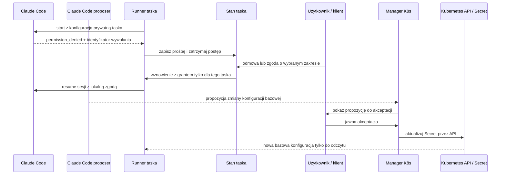

# Odroczone decyzje o uprawnieniach harnessu - Plan

## Goal Capsule

- **Objective:** Task Narsora może zatrzymać się na prośbie Claude Code o uprawnienie, poczekać na późniejszą decyzję użytkownika i kontynuować bez interaktywnego terminala.
- **Means:** Narsor zapisuje prośbę jako trwały stan oczekiwania, a zgodę przekazuje wyłącznie do wznowienia danego taska. Runner K8s otrzymuje bazową konfigurację Claude Code i kopiuje ją do zapisywalnej konfiguracji prywatnej taska.
- **Product authority:** Zgody na polecenia są lokalne dla taska i wygasają wraz z nim. Zmiana bazowej konfiguracji K8s jest osobnym działaniem, wymagającym jawnej akceptacji użytkownika.
- **Open blockers:** Brak blokujących decyzji produktowych. Szczegóły protokołu wznowienia Claude Code i aktualizacji Secretu należą do planowania technicznego.

---

## Product Contract

### Summary

Narsor zatrzymuje task, gdy Claude Code zgłosi prośbę o uprawnienie, i czeka na asynchroniczną decyzję użytkownika. Workflow nadal używa tylko `workspace_access`, a pominięta wartość pozwala harnessowi zastosować jego konfigurację domyślną. Runner K8s kopiuje bazową konfigurację tylko do odczytu do zapisywalnego katalogu taska; jej zmiany wymagają osobnej akceptacji użytkownika.

### Problem Frame

Obecny adapter Claude Code potrafi zapisać `permission_denied` jako zdarzenie techniczne, ale Narsor nie zamienia go w trwałą prośbę do użytkownika. Runner uruchamia proces bez stdin, więc standardowy interaktywny permission prompt nie pasuje do autonomicznego taska. Log `docs/sources/permissions.log` zawiera identyfikator wywołania narzędzia oraz polecenie, co daje podstawę do powiązania odmowy z konkretną akcją.

Użytkownik może odpowiedzieć później, dlatego task nie może traktować braku odpowiedzi jak odmowy ani kończyć się nieczytelnym błędem. Jednocześnie decyzja o jednym poleceniu nie może stać się trwałym uprawnieniem dla kolejnych tasków.

W lokalnym runnerze Claude może korzystać z konfiguracji lokalnego środowiska. W K8s nie ma dostępu do konfiguracji z komputera operatora: domyślny `HOME` jest prywatny dla taska. Potrzebny jest zatem jawny profil bazowy dostarczany podom runnerów.

### Key Decisions

- **Asynchroniczna obsługa uprawnień.** (session-settled: user-directed — decyzja użytkownika może nadejść po zatrzymaniu taska.) Governs R1-R8.
- **Jedno ustawienie workflow.** (session-settled: user-directed — używamy istniejącego `workspace_access`, bez dodatkowego pola trybu uprawnień.) Governs R9-R10.
- **Konfiguracja taska bazuje na wersji wdrożenia.** (session-settled: user-approved — runner kopiuje konfigurację do zapisywalnego katalogu taska.) Governs R11-R13, R16-R17.
- **Zmiana profilu K8s wymaga osobnej akceptacji.** (session-settled: user-directed — Claude przygotowuje propozycję, a manager stosuje ją po decyzji użytkownika.) Governs R14-R15.
- **Pierwszy zakres obejmuje Claude Code.** (inferred — rzeczywisty log i obecny parser dotyczą tego harnessu; inne adaptery można rozszerzyć, gdy dostarczą równoważny sygnał.) Governs R1, R17.

### Actors

- A1. **Właściciel taska** przegląda oczekujące prośby, wybiera zakres zgody i w razie potrzeby zatwierdza zmianę konfiguracji bazowej.
- A2. **Runner Narsora** obserwuje zdarzenia harnessu, zapisuje oczekiwanie, wstrzymuje task i wznawia go z lokalną decyzją.
- A3. **Claude Code** wykonuje narzędzia zgodnie ze swoją konfiguracją oraz zgodami przekazanymi dla bieżącego taska.
- A4. **Pod managerski** obsługuje API dla klientów, zarządza cyklem życia runnerów i stosuje zatwierdzone wersje konfiguracji bazowej.
- A5. **Pod runnera** wykonuje task w izolowanym środowisku K8s i otrzymuje bazową konfigurację tylko do odczytu.

### Requirements

**Oczekiwanie i zgoda taskowa**

- R1. Gdy Claude Code zgłosi zdarzenie uprawnienia możliwe do rozstrzygnięcia przez użytkownika, Narsor tworzy trwałe oczekiwanie typu `permission`, odrębne od zwykłego pytania agenta i od błędu wykonania.
- R2. Prośba pokazuje nazwę narzędzia, dokładne polecenie lub akcję, katalog roboczy, powód odmowy, dostępne źródło decyzji oraz powiązanie z wywołaniem narzędzia i sesją.
- R3. Użytkownik może odmówić, zezwolić na ponowienie konkretnego polecenia albo zezwolić na podobne polecenia określonego typu do końca taska. Interfejs jasno pokazuje wybrany zakres.
- R4. Po odmowie task może wznowić agenta z informacją o decyzji, aby agent mógł wybrać inną drogę lub zakończyć pracę.
- R5. Po zgodzie Narsor wznawia tę samą logiczną sesję i przekazuje grant wyłącznie temu taskowi. Grant nie zmienia plików konfiguracji Claude Code, ustawień użytkownika ani konfiguracji Secretu.
- R6. Jawna reguła `deny` lub odmowa wynikająca z polityki, której użytkownik nie może nadpisać lokalną zgodą, nie jest przedstawiana jako prośba możliwa do zatwierdzenia. Narsor pokazuje ją jako blokadę z wyjaśnieniem.
- R7. Stan oczekiwania i decyzja pozostają trwałe po zatrzymaniu runnera, utracie klienta i odtworzeniu poda. Zgoda wygasa po zakończeniu lub usunięciu taska.
- R8. Oczekiwanie jest dostępne przez istniejące kanały Narsora obsługujące decyzje użytkownika; odpowiedź nie wymaga otwartego terminala ani żywego stdin procesu harnessu.
- R9. W workflow pozostaje wyłącznie `workspace_access`. Jawne `read-only` ogranicza dostęp, jawne `read-write` wybiera tryb zapisu danego adaptera, a pominięcie pola nie wymusza trybu i pozostawia decyzję konfiguracji harnessu dostępnej w środowisku.
- R10. Schemat workflow zachowuje informację, czy `workspace_access` podano jawnie, aby wartość domyślna nie wymuszała niejawnie trybu harnessu. Istniejące workflow otrzymują zdefiniowaną, kompatybilną interpretację.

**Konfiguracja Claude Code w Kubernetesie**

- R11. Instalacja K8s udostępnia runnerom bazową konfigurację Claude Code jako wolumen Secretu tylko do odczytu; konfiguracja nie pochodzi z lokalnego `HOME` operatora.
- R12. Przed pierwszym uruchomieniem Claude Code runner kopiuje pliki bazowej konfiguracji do zapisywalnego katalogu prywatnego taska i wskazuje ten katalog jako konfigurację harnessu.
- R13. Runner nie nadpisuje konfiguracji prywatnej przy wznowieniu taska. Task używa wersji bazowej, z której został zainicjalizowany; nowe taski korzystają z najnowszej zatwierdzonej wersji.
- R14. Manager udostępnia kontrolowany sposób uruchomienia Claude Code do przygotowania propozycji w odizolowanym miejscu roboczym, waliduje jej format i zakres, a zastosowanie zmiany bazowej wymaga jawnej akceptacji użytkownika.
- R15. Aktualizacja obiektu Secret odbywa się przez Kubernetes API z minimalnymi uprawnieniami RBAC managera. Runner nie ma uprawnień do zapisu Secretów, a proces Claude Code generujący propozycję nie dziedziczy uprawnień do ich modyfikacji.
- R16. Zmiana wersji konfiguracji bazowej nie zmienia automatycznie aktywnych ani wznowionych tasków. Wersja użyta przez task jest możliwa do ustalenia.
- R17. Konfiguracja bazowa nie zawiera historii sesji ani zgód taskowych. Sekrety uwierzytelniające harness są dostarczane zgodnie z istniejącym mechanizmem sekretów i nie są kopiowane do konfiguracji współdzielonej.
- R18. Obecne zachowanie innych harnessów pozostaje bez zmian, dopóki ich adaptery nie obsłużą własnego źródła i cyklu życia próśb o uprawnienia.

### Key Flows

- F1. **Odmowa harnessu:** Claude Code emituje odmowę powiązaną z wywołaniem narzędzia; Narsor zapisuje prośbę, zatrzymuje task i pokazuje polecenie oraz przyczynę. **Covers:** R1-R2.
- F2. **Zgoda na polecenie:** Użytkownik zatwierdza konkretne polecenie; Narsor zapisuje grant w stanie taska i wznawia sesję. **Covers:** R3, R5, R7.
- F3. **Zgoda na grupę:** Zgodne akcje tego taska nie tworzą ponownie tej samej prośby, ale inny task wymaga własnej decyzji. **Covers:** R3, R5, R7.
- F4. **Odmowa użytkownika:** Agent wznawia pracę z informacją o decyzji i może dobrać alternatywę. **Covers:** R4.
- F5. **Blokada polityki:** Narsor pokazuje nieprzekraczalną regułę `deny` bez opcji jej obejścia. **Covers:** R6.
- F6. **Start taska K8s:** Runner kopiuje aktualną bazową konfigurację z Secretu do prywatnego `HOME` taska, następnie uruchamia Claude Code z zapisywalnym katalogiem konfiguracji. **Covers:** R11-R12, R16-R17.
- F7. **Wznowienie poda:** Prywatna konfiguracja, sesja i oczekiwanie są zachowane, a bootstrap nie kopiuje ponownie ustawień bazowych. **Covers:** R7, R13, R16.
- F8. **Zmiana profilu:** Manager waliduje propozycję, użytkownik ją akceptuje, a manager aktualizuje Secret. Kolejne taski otrzymują nową wersję. **Covers:** R14-R16.

### Acceptance Examples

- AE1. Covers R1-R3. Po odmowie Bash z dokładnym poleceniem `cargo build`, użytkownik widzi przyczynę i wybiera zgodę tylko dla tego polecenia; prośba nie jest klasyfikowana jako zwykłe pytanie agenta.
- AE2. Covers R3, R5, R7. Zgoda na grupę poleceń działa w pozostałej części taska i znika po jego zakończeniu; drugi task nadal zatrzymuje się przy analogicznej odmowie.
- AE3. Covers R4, R6. Po odmowie użytkownika agent może kontynuować inną ścieżką, a jawna polityka `deny` nie może zostać nadpisana przez lokalną zgodę.
- AE4. Covers R8-R10. Klient może odpowiedzieć na oczekiwanie, gdy proces runnera jest zatrzymany lub został odtworzony; workflow bez jawnego `workspace_access` nie wysyła harnessowi wymuszonego trybu, a jawne `read-only` nadal ogranicza zapis.
- AE5. Covers R11-R13, R16-R17. Nowy pod kopiuje bazowy plik konfiguracji do katalogu prywatnego taska; wznowiony pod zachowuje tę kopię, a identyfikator wersji bazowej taska jest widoczny.
- AE6. Covers R14-R15. Propozycja wygenerowana przez Claude nie zmienia Secretu przed akceptacją; runner i proces generujący nie mają uprawnień RBAC do zapisu Secretów.
- AE7. Covers R18. Harness inny niż Claude Code zachowuje dotychczasowy przebieg i nie otrzymuje nowego zachowania przez przypadkowe współdzielenie parsera zdarzeń.

### Scope Boundaries

- Funkcja nie wprowadza interaktywnego terminala ani nie czeka na stdin procesu Claude Code.
- Zgoda na polecenie nie zmienia konfiguracji Claude Code ani nie nadaje podowi nowych uprawnień infrastrukturalnych. (R5-R6)
- Zmiana Secretu nie jest częścią zwykłego zatwierdzania polecenia i nie synchronizuje się automatycznie do już utworzonych tasków. (R14-R16)
- Zakres nie zmienia domyślnego zachowania innych harnessów. (R18)

---

## Planning Contract

### High-Level Technical Design

Wymagania rozdzielają trzy zakresy uprawnień: konfigurację bazową wdrożenia, konfigurację zapisywalną taska oraz krótkotrwały grant taskowy. Plan techniczny powinien ustalić format ich reprezentacji, sposób bezpiecznego wznowienia odrzuconego wywołania Claude Code oraz walidację i wersjonowanie propozycji Secretu. Zgoda na polecenie nie może służyć jako obejście reguł odmowy ani granic sandboxa.

### Planning Questions

- Jaki format zgody lokalnej potrafi Claude Code przyjąć podczas wznowienia sesji, tak aby ponowić zablokowane wywołanie i ograniczyć grant do polecenia lub jego typu?
- Jakie warianty odmowy Claude Code należy uznać za oczekiwanie użytkownika, a jakie za nieprzekraczalną blokadę? Parser powinien opierać się na strukturze JSON i źródle decyzji, nie na samym tekście komunikatu.
- Jak zachować kompatybilność obecnych workflow, gdy `workspace_access` przestanie być niejawnie ustawiane na `read-write`?
- Czy Secret zawiera tylko bazowe ustawienia/politykę, czy również inne pliki profilu? Format powinien unikać współdzielenia historii, sesji i poświadczeń.
- Jak manager stosuje walidację zmiany Secretu i jak użytkownik przegląda różnice przed zatwierdzeniem?

### Risks and Mitigations

- **Zbyt szeroka zgoda dla grupy poleceń.** Pokazać zakres przed zatwierdzeniem, ograniczyć go do taska i nie pozwalać jej przetrwać zakończenia taska.
- **Odmowa pomylona z prośbą o zgodę.** Korelować zdarzenie z wywołaniem narzędzia i zachować źródło/powód; nie oferować override'u dla polityki `deny`.
- **Zmiana konfiguracji nadpisuje konfigurację taska.** Inicjalizować prywatną kopię jednokrotnie i przypiąć task do wersji bazowej.
- **Proces agenta modyfikuje konfigurację całego wdrożenia.** Proces generujący propozycję nie ma RBAC do Secretów; zapis wykonuje osobny manager dopiero po akceptacji użytkownika.
- **Zgoda Claude Code mylona z dostępem infrastrukturalnym.** UI i kontrakt API rozróżniają zgodę harnessu od ograniczeń K8s, systemu plików i sieci.

### Sources and Existing Evidence

- `docs/sources/permissions.log` — rzeczywiste zdarzenia odmowy, treść polecenia, `tool_use_id` i `permission_decision`.
- `crates/narsor-engine/src/engine/actions/harness/claude_code/classify.rs` — bieżąca klasyfikacja `permission_denied` jako elementu technicznego.
- `crates/narsor-engine/src/engine/actions/agent.rs` — proces harnessu jest uruchamiany bez stdin; obecny kontrakt nie używa `awaiting_input` dla błędów permission.
- `crates/narsor-engine/src/domain/workflow_definition.rs` i `crates/narsor-engine/src/workflow/schema.rs` — `workspace_access` znajduje się w konfiguracji kroku agenta i ma dziś domyślną wartość `read-write`.
- `crates/narsor-engine/src/engine/actions/harness/claude_code.rs` — adapter obecnie przekazuje tryb uprawnień do Claude Code.
- `docs/operations/remote-backends.md` — K8s używa prywatnego `HOME` taska i wspiera `CLAUDE_CONFIG_DIR`.
- [Claude Code: zmienne środowiskowe](https://code.claude.com/docs/en/env-vars) — `CLAUDE_CONFIG_DIR` zmienia domyślny katalog `~/.claude`.
- [Kubernetes: wolumeny](https://kubernetes.io/docs/concepts/storage/volumes/) — wolumen Secretu jest tylko do odczytu.
- [Kubernetes: ServiceAccount](https://kubernetes.io/docs/concepts/security/service-accounts/) — uprawnienia poda do aktualizacji obiektu Secret wynikają z RBAC.

---
