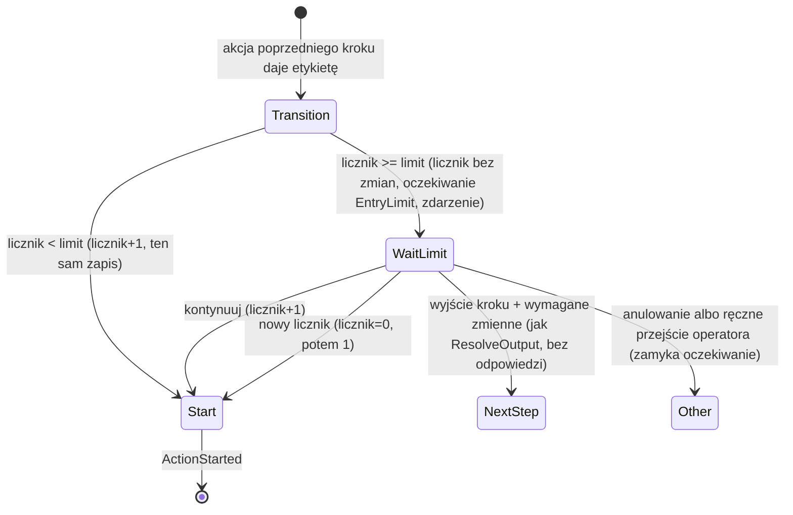
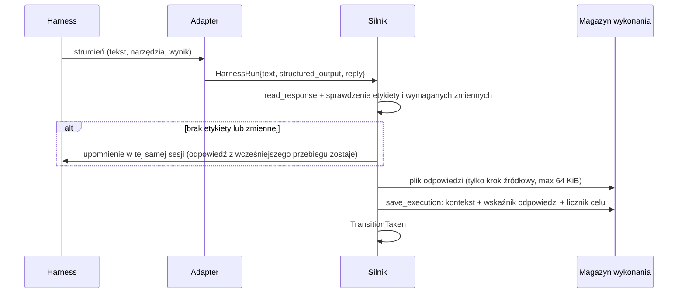
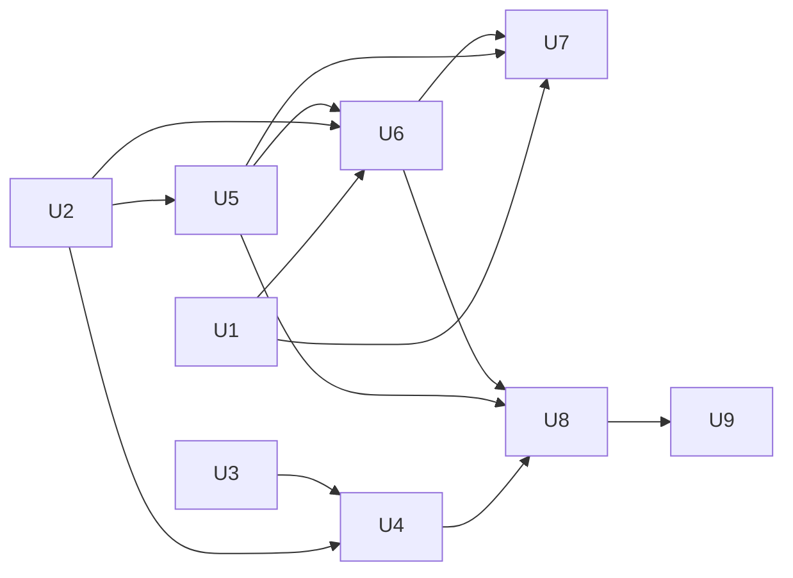

# feat: Przekaz kontekstu między krokami workflow

## Summary

Plan dodaje trzy mechanizmy silnika:
- **Odwołanie do odpowiedzi kroku.** Szablon `{{ steps.<krok>.reply }}` czyta końcową odpowiedź agenta innego kroku. Adaptery zbierają tę odpowiedź ze strumienia harnessu. Silnik zapisuje ją tylko dla kroków, do których odwołuje się jakiś szablon.
- **Wymagane zmienne na wyjściu.** Brak wymaganej zmiennej idzie tą samą ścieżką co brak etykiety: upomnienie, dyrygent, problem dla operatora.
- **Limit wejść w krok.** Licznik jest w metadanych silnika. Zatrzymanie na limicie to nowy rodzaj oczekiwania w istniejącym statusie `InputNeeded`.

Pierwszym odbiorcą jest `workflows/compound-engineering.yaml`.

---

## Problem Frame

Pętla `code_review → fix_review_findings → code_review` w `compound-engineering` nie ma limitu. Agent naprawiający nie dostaje pełnego raportu recenzenta (see origin: `docs/brainstorms/2026-10-18-przekaz-kontekstu-miedzy-krokami-requirements.md`).

Od czasu brainstormu zmieniły się dwa fakty:
- Commit `bfee134` przełączył `code_review` na `mode:autofix` i przekazuje `variables.review_findings`. Krok nie jest już `read-only`, ale problem przekazu i pętli pozostaje.
- Badanie obaliło założenie z brainstormu: claude-code z `--json-schema` daje w polu `result` tylko JSON. Raport jest we wcześniejszych blokach tekstu asystenta, przed wywołaniem narzędzia `StructuredOutput`. Dziś silnik nie zapisuje tego tekstu w żadnym miejscu, które czyta (zapis jest tylko w pliku rozmowy).

---

## Requirements

Wymagania R1–R17 pochodzą z dokumentu źródłowego. Poniżej są doprecyzowania z sesji planowania.

**Odpowiedź nazwanego kroku**
- R1. Szablon w prompcie kroku agenta i w treści bramy `human` może odwołać się do końcowej odpowiedzi innego kroku agenta po jego identyfikatorze.
- R2. Odwołanie zwraca odpowiedź z najnowszego wejścia zakończonego etykietą. Wejście zakończone błędem akcji nie zastępuje wcześniejszej odpowiedzi.
- R3. Odpowiedź to tekst agenta bez obiektu JSON kontraktu. Odpowiedź z przebiegu po pytaniu do człowieka, po decyzji o uprawnieniach i po odrzuceniu wyniku zastępuje wcześniejszą odpowiedź. **Przebieg upomnienia o format (silnika lub dyrygenta) nie zastępuje odpowiedzi.** Silnik używa jego tekstu tylko wtedy, gdy wcześniejszy przebieg nie miał tekstu. (Decyzja użytkownika z sesji planowania: odstępstwo od dosłownego R3 w dokumencie źródłowym.)
- R4. Odwołanie do kroku bez odpowiedzi to błąd, który przerywa akcję.
- R5. Walidator odrzuca odwołanie do nieistniejącego kroku, do kroku, który nie jest krokiem agenta, oraz odwołanie w polu innym niż prompt agenta i treść bramy `human`.

**Wymagane zmienne**
- R6. Wyjście kroku agenta może zadeklarować wymagane zmienne.
- R7. Brak wymaganej zmiennej idzie tą samą ścieżką co brak etykiety: jedno upomnienie silnika (wspólne z brakiem etykiety), potem dyrygent, potem problem dla operatora. Formularze operatora (problem, zatwierdzenie wyniku, decyzja na limicie) wymagają tych zmiennych. (Decyzja użytkownika: zastępuje dosłowne „wejście kończy się błędem akcji” z R7 w dokumencie źródłowym.)
- R8. Kontrakt wyjścia w prompcie wymienia wymagane zmienne przy każdej etykiecie.

**Limit wejść**
- R9. Krok może mieć opcjonalny limit wejść.
- R10. Licznik rośnie tylko przy przejściu workflow do kroku, czyli po akcji poprzedniego kroku. Licznik nie rośnie przy żadnym wznowieniu sesji (także przy `resume_comment_field` bez zapisanej sesji), przy decyzji o uprawnieniach, przy upomnieniu, przy odrzuceniu wyniku, przy ponowieniu z `retry_policy`, przy ponowieniu przez dyrygenta ani przy restarcie kroku przez operatora. (Doprecyzowanie użytkownika z sesji planowania.)
- R10a. Ręczne przejście operatora do kroku z limitem zwiększa licznik, ale nie zatrzymuje zadania.
- R11. Licznik obejmuje całe zadanie. Brama `human` go nie zeruje.
- R12. Na limicie silnik nie startuje kroku i czeka na decyzję operatora: kontynuuj, kontynuuj z nowym licznikiem albo jedno z wyjść kroku. Wybór wyjścia wymaga wymaganych zmiennych tej etykiety i nie zapisuje nowej odpowiedzi kroku.
- R13. Zatrzymanie, decyzja i zerowanie są zdarzeniami. Licznik przetrwa restart daemona.

**`compound-engineering`**
- R14. `fix_review_findings` dostaje odpowiedź `code_review` zamiast zmiennej `review_findings` i ma zakaz własnego przeglądu diffu. Pętla zostaje (decyzja użytkownika: sprawdzimy jej zachowanie w praktyce).
- R15. `code_review` ma limit wejść.
- R16. `requirements_doc`, `plan_doc` i `pr_url` są wymagane na właściwych wyjściach. `pr_url` jest wymagane tylko w `publish_work`.
- R17. `work` zwraca stan bazowy testów, a `fix_review_findings` i `work_revision` dostają go w prompcie.

**Origin actors:** A1 (autor workflow), A2 (agent kroku), A3 (operator), A4 (silnik)
**Origin flows:** F1 (przekaz raportu przeglądu do naprawy), F2 (zatrzymanie na limicie wejść)
**Origin acceptance examples:** AE1–AE8 (pokrycie w scenariuszach testów jednostek U4–U6)

---

## Scope Boundaries

Pozycje z dokumentu źródłowego:
- Dziennik wspólnej wiedzy zadania jest odłożony. Warunek powrotu: 2–3 nowe przypadki innego rodzaju niż stan bazowy testów.
- Kontynuacja sesji wskazanego kroku (np. `plan → plan_revision`) to osobny temat.
- Dyrygent nie wyciąga wniosków między krokami.
- Silnik nie przekazuje `data` ani `artifacts` w szablonach.
- Dopisywanie do zmiennych jest poza zakresem.
- Odwołanie do „poprzedniego kroku” bez nazwy jest poza zakresem.

Pozycje z planowania:
- Schemat JSON dla claude-code (`--json-schema`) zostaje płaski. Wymagane zmienne sprawdza tylko silnik po odczycie odpowiedzi. Powód: claude-code odrzuca warunkowe `anyOf` na najwyższym poziomie (`docs/solutions/integration-issues/claude-code-json-schema-rejects-top-level-anyof-2026-10-17.md`).
- Odwołanie do odpowiedzi kroku w `display`, `workspace`, parametrach skryptów i filtrach zdarzeń jest zabronione.

### Deferred to Follow-Up Work

- Ostrzeżenie walidatora, że krok odbiorca jest osiągalny przed krokiem źródłowym: walidator dziś zwraca tylko błędy. Ostrzeżenia wymagają nowego kanału w wyniku walidacji. Osobna zmiana.
- Nagrania prawdziwego CLI dla codex i opencode, aby sprawdzić wyciąganie odpowiedzi: osobna zmiana, gdy ktoś uruchomi te harnessy.
- Ocena pętli `code_review → fix_review_findings` po kilku prawdziwych przebiegach: osobna decyzja o tym, czy przejście `findings` ma prowadzić do naprawy.

---

## Context & Research

### Relevant Code and Patterns

- Szablony: `crates/narsor-engine/src/workflow/template.rs` (`TemplateScope::lookup`, `check_syntax`, `context_references`). Wywołania `TemplateScope`: `engine/runner.rs` (`attempt_action`), `tasks/mod.rs`, `environment/resolver.rs`, `crates/narsor-runner/src/runner/snapshot.rs`, `controller_protocol/service.rs`.
- Schemat YAML: `crates/narsor-engine/src/workflow/schema.rs` (`StateSchema`, `OutputObjectSchema` z własnym `Deserialize`). Domena: `crates/narsor-engine/src/domain/workflow_definition.rs` (`State`, `OutputDefinition`, `ValidationError`). Kompilacja: `crates/narsor-engine/src/workflow/loader.rs`. Walidator: `crates/narsor-engine/src/workflow/validator.rs`.
- Kontrakt i odczyt odpowiedzi: `crates/narsor-engine/src/engine/actions/agent.rs` (`output_contract`, `output_schema`, `read_response`, `extract_response`, `json_objects`, `build_result`, `reprompt_config`).
- Adaptery: `crates/narsor-engine/src/engine/actions/harness/` (`mod.rs` z `HarnessRun`, `claude_code.rs`, `claude_code/classify.rs`, `codex.rs`, `opencode.rs`).
- Upomnienie KTD7: `engine/runner.rs` (`OutputRejection::from_error`, `OutputRejection::from_result`, `reject_output`, `reprompt`, `reprompt_attempt`). Dyrygent: `engine/runner/rescue.rs`. Wymagania wyniku dla operatora: `output_requirements()` w `runner.rs` i `OutputRequirement` w `engine/actions/human.rs` (KTD15).
- Zapis kontekstu (D10): `Engine::apply_decision` w `runner.rs`. Mapa per krok jako wzór: `metadata.engine.completed_agent_sessions`.
- Ręczne przejścia: `engine/runner/operations.rs` (`apply_manual_transition`, `take_operator_transition`, `plan_operator_transition`).
- Oczekiwanie na człowieka: `engine/actions/human.rs` (`PendingHumanInput`, `InputContinuation`, `suspend`, `close_pending`, klucz epizodu KTD9). Widok: `crates/narsor-protocol/src/api/human_input.rs` (`InputContinuationView`). Uwaga: rodzaj oczekiwania (`AttentionItem.kind`) dla operatora wylicza `crates/narsor-runner/src/runner/snapshot.rs`.
- Zdarzenia: `crates/narsor-protocol/src/event.rs` (`EventData`). Obsługa nowych wariantów: `engine/timeline.rs`, `persistence/recovery.rs`, `conductor/snapshot.rs`, `src/tui/event_text.rs`, `src/cli/task_history.rs`.
- TUI: `src/tui/input_form.rs` (`InputPanel`), `src/tui/task_app/actions.rs`, `src/tui/task_app/list.rs`.
- Odzyskiwanie po restarcie: `crates/narsor-engine/src/persistence/recovery.rs`; hook startu `crates/narsor-server/src/runtime.rs` (`recover_at_startup`, `continue_at_startup`).

### Institutional Learnings

- `docs/solutions/integration-issues/claude-code-json-schema-rejects-top-level-anyof-2026-10-17.md`: schemat ma być płaski; awarię wykrywamy z `is_error`/`terminal_reason`; wywołania `StructuredOutput` liczą się jako tury, więc dodatkowe upomnienie zużywa budżet `max_turns`; prawdziwe nagrania są w `tests/fixtures/claude-code/`.
- `docs/solutions/architecture-patterns/auto-resume-policy-for-lost-workloads-2026-10-11.md`: licznik zmienia się w tym samym zapisie co zdarzenie; zerowanie jest pierwsze, przed innymi sprawdzeniami; decyzje operatora są idempotentne i sprawdzają epizod; nowe warianty wire enumów wymagają wariantu rezerwowego (`#[serde(other)]`) i testów dekodowania surowego JSON; logikę testujemy bez daemona.
- Pamięć projektu: testy z prawdziwym daemonem są `#[ignore]`; fake harness nie dowodzi zachowania prawdziwego CLI.

### Badanie: odpowiedź kroku w adapterach

- claude-code: `ResultLine::take` czyta tylko linię `result`. W `tests/fixtures/claude-code/schema_done.ndjson` proza jest we wcześniejszym bloku `assistant` typu `text`, a `result` zawiera tylko JSON.
- codex: ostatni `item.completed` typu `agent_message`; JSON kontraktu jest na końcu tekstu; `structured_output` zawsze `None`.
- opencode: tekst ostatniej linii typu `text`/`result`; każda nowa linia zastępuje poprzednią. Brak nagrań prawdziwego CLI.
- Silnik nigdzie nie usuwa JSON z tekstu. `truncate` (64 KiB, początek tekstu i znacznik `[truncated by narsor]`) jest w `actions/script.rs`.

---

## Key Technical Decisions

- **Składnia `{{ steps.<krok>.reply }}`.** Nowy korzeń `steps` obok `inputs` i `context`. Pole `reply` zostawia miejsce na inne pola kroku w przyszłości bez zmiany składni.
- **Odpowiedź jest nowym polem `HarnessRun` i `ActionResult`, a nie zmienną.** Odpowiedź nie trafia do `context.variables` (D10 nie zmienia się, zmienne zostają małe).
- **claude-code: proza ostatniej tury agenta.** Adapter zbiera bloki tekstu asystenta. Zeruje zbiór przy każdym wywołaniu narzędzia innym niż `StructuredOutput`. Pomija wiadomości podagentów (z `parent_tool_use_id`). Gdy zbiór jest pusty, adapter bierze tekst `result` bez obiektu kontraktu.
- **codex i opencode: końcowy tekst bez obiektu kontraktu.** Silnik usuwa obiekt, który wybrał `extract_response`, razem z otaczającym blokiem kodu i białymi znakami. Brak nagrań CLI to znane ryzyko.
- **Odpowiedź zapisywana tylko dla kroków, do których odwołuje się szablon.** Silnik wylicza zbiór kroków źródłowych statycznie z definicji (definicja jest niezmienna w trakcie wykonania, D31).
- **Przechowywanie odpowiedzi: plik per wejście i wskaźnik w `state.json`.** Treść jest w osobnym pliku w katalogu wykonania, nazwanym identyfikatorem próby akcji. `metadata.engine` trzyma tylko mapę `krok → identyfikator próby`. Silnik zapisuje plik atomowo przed `save_execution` w `apply_decision`, a wskaźnik zmienia w tym samym zapisie co kontekst. Awaria między zapisami zostawia osierocony plik, który nikt nie czyta. Silnik nie zapisuje treści ponownie przy każdym zapisie stanu.
- **Limit rozmiaru 64 KiB.** Silnik zachowuje początek tekstu, tak jak obecny `truncate`. Raporty przeglądu mają najważniejsze ustalenia na początku (sortowanie P0 najpierw). Znacznik skrócenia mówi agentowi, że tekst jest niepełny.
- **Wymagane zmienne: forma krótka i forma z opisem.** Lista nazw albo obiekty `{name, description}`, tak jak dziś wyjścia. Kontrakt wypisuje opis, więc autor nie musi powtarzać polecenia „Set `variables.X`” w prompcie.
- **Pusta wartość wymaganej zmiennej:** brak klucza, `null` albo tekst pusty po przycięciu. Wartość `none`, liczby, listy i obiekty są poprawne.
- **Licznik w `metadata.engine` w `state.json`.** Mapa `krok → liczba wejść`. Silnik zmienia ją w tym samym zapisie co `TransitionTaken`. Licznik nie jest odtwarzany ze zdarzeń. Zdarzenia służą do audytu (D10/D23: rekord jest punktem zatwierdzenia).
- **Licznik rośnie przy przejściu.** Silnik zwiększa licznik w `apply_decision` i w `apply_manual_transition`. Wyjątek: przejście z `resume_comment_field`, które kontynuuje sesję kroku docelowego lub startuje go z komentarzem. Przejście kroku do samego siebie też liczy się jako wejście. Start zadania w stanie początkowym liczy się jako wejście 1, aby limit N znaczył N startów.
- **Sprawdzenie limitu w momencie przejścia, a krok czeka przed `ActionStarted`.** Silnik wykonuje przejście (`current_state` = krok z limitem) i w tym samym zapisie tworzy oczekiwanie na decyzję operatora. Krok nie dostaje `ActionStarted`. Ten kształt jest zgodny z pytaniami, zatwierdzeniami i problemami, które też czekają w kroku.
- **Nowy wariant `InputContinuation`, bez nowego statusu.** Status `InputNeeded`, plik `pending_input.json` i klucz epizodu zostają bez zmian. Panel odpowiedzi TUI dostaje nowe gałęzie (U5, U7). Ten wzór jest zgodny z D55 (3).
- **Wybór wyjścia na limicie kończy krok jak `ResolveOutput`, a nie jak ręczne przejście.** Ręczne przejście nie zapisuje zmiennych (D10), a R12 wymaga zmiennych wybranej etykiety. Ścieżka `ResolveOutput` już kończy krok wynikiem od operatora przez `apply_decision`. Wynik nie ma odpowiedzi, więc wskaźnik odpowiedzi kroku się nie zmienia. To odstępstwo od założenia z dokumentu źródłowego („korzystać z ręcznych przejść”): zachowujemy jeden mechanizm, ale jest to ścieżka problemu, a nie ręcznego przejścia.
- **Wariant rezerwowy w wire enumach przed nowymi wariantami.** `EventData`, `AttentionKind` i `InputContinuationView` nie mają dziś `#[serde(other)]`. Stary TUI lub CLI nie zdekodowałby nowego wariantu.

---

## Open Questions

### Resolved During Planning

- Czy proza claude-code z `--json-schema` jest dostępna? Tak, ale tylko we wcześniejszych blokach `assistant`. Adapter musi ją zebrać (decyzja wyżej).
- Limit rozmiaru odpowiedzi? 64 KiB, początek tekstu i znacznik skrócenia.
- Składnia odwołania? `{{ steps.<krok>.reply }}`.
- Jak zatrzymanie wygląda w API i TUI? Nowy rodzaj oczekiwania w `InputNeeded` i nowy `AttentionKind`.
- Gdzie jest licznik? `metadata.engine` w `state.json`, ten sam zapis co przejście.
- Ostrzeżenie o kolejności osiągalności? Odłożone (Deferred to Follow-Up Work).
- Która odpowiedź liczy się po upomnieniu? Odpowiedź sprzed upomnienia (decyzja użytkownika).
- Czy pętla w `compound-engineering` zostaje? Tak (decyzja użytkownika).

### Deferred to Implementation

- Dokładne nazwy pól YAML (`requires_variables`, `max_entries`) i zdarzeń: zostają do decyzji w kodzie. Plan używa ich jako nazw roboczych.
- Czy krok czekający na limicie dostaje zdarzenie `StateEntered` przed oczekiwaniem: zależy od tego, co dziś zakładają `timeline.rs` i TUI. Implementujący wybiera wariant zgodny z kolejnością zdarzeń w dokumentacji modułu `runner.rs`.
- Dokładna wartość limitu `code_review`: proponujemy 5. Implementujący potwierdza ją po teście przebiegu.
- Czy dyrygent w ścieżce odzyskiwania wyniku (`rescue.rs`) musi też dostać listę wymaganych zmiennych w swoim prompcie: implementujący sprawdza, jak prompt dyrygenta opisuje dziś etykiety.

---

## High-Level Technical Design

> *This illustrates the intended approach and is directional guidance for review, not implementation specification. The implementing agent should treat it as context, not code to reproduce.*

Przejście do kroku z limitem:



Odpowiedź kroku w jednym wejściu:



Zależności jednostek:



---

## Implementation Units

### U1. Wariant rezerwowy w wire enumach

**Goal:** Stary TUI, CLI i kontroler dekodują nowe zdarzenia i nowe rodzaje oczekiwania bez błędu.

**Requirements:** R13 (warunek wstępny dla bezpiecznych nowych wariantów)

**Dependencies:** Brak

**Files:**
- Modify: `crates/narsor-protocol/src/event.rs`, `crates/narsor-protocol/src/controller.rs` (`AttentionKind`), `crates/narsor-protocol/src/api/human_input.rs` (`InputContinuationView`)
- Modify: miejsca dopasowania wzorców w `src/tui/event_text.rs`, `src/cli/task_history.rs`, `crates/narsor-engine/src/engine/timeline.rs`, `src/tui/task_app/list.rs`, `src/tui/input_form.rs`
- Test: `tests/timeline.rs`, `tests/tui_state.rs` (albo test jednostkowy w `narsor-protocol`)

**Approach:**
- Dodać wariant `Unrecognized` z `#[serde(other)]`, tak jak w istniejących enumach w `controller.rs`.
- Klient pokazuje nieznany wariant neutralnie (np. „nieznane zdarzenie”, „oczekiwanie nieobsługiwane przez tę wersję”). Klient nie wysyła odpowiedzi na oczekiwanie, którego nie zna.

**Patterns to follow:** `TaskEventKind::Unrecognized` w `crates/narsor-protocol/src/controller.rs`.

**Test scenarios:**
- Edge case: surowy JSON zdarzenia z nieznanym `type` dekoduje się jako `Unrecognized`.
- Edge case: surowy JSON `AttentionItem` z nieznanym `kind` dekoduje się bez błędu.
- Edge case: surowy JSON oczekiwania z nieznaną kontynuacją dekoduje się, a TUI nie pokazuje dla niego formularza odpowiedzi.

**Verification:** Dekodowanie każdego enuma z nieznaną wartością daje wariant rezerwowy, a nie błąd.

---

### U2. Schemat, domena i walidator

**Goal:** Workflow może zadeklarować wymagane zmienne, limit wejść i odwołanie do odpowiedzi kroku. Walidator odrzuca błędne deklaracje.

**Requirements:** R1, R5, R6, R9

**Dependencies:** Brak

**Files:**
- Modify: `crates/narsor-engine/src/workflow/schema.rs` (`OutputObjectSchema`, jego `Deserialize`, `StateSchema`)
- Modify: `crates/narsor-engine/src/domain/workflow_definition.rs` (`OutputDefinition`, `State`, `ValidationError`)
- Modify: `crates/narsor-engine/src/workflow/loader.rs`
- Modify: `crates/narsor-engine/src/workflow/validator.rs`
- Modify: `crates/narsor-engine/src/workflow/template.rs` (`check_syntax` i wyliczanie referencji akceptują korzeń `steps`)
- Create: `tests/fixtures/invalid/` — nowe pliki dla odwołania do nieznanego kroku, kroku nie-agenta, odwołania w niedozwolonym polu, limitu < 1, błędnej nazwy wymaganej zmiennej
- Test: `tests/validation.rs`, `tests/schema_loading.rs`, `tests/template.rs`

**Approach:**
- Wymagane zmienne w obiektowej formie wyjścia: lista nazw albo obiektów z nazwą i opisem. Forma tekstowa wyjścia (sama etykieta) nie ma wymaganych zmiennych.
- Limit wejść jako opcjonalne pole stanu z akcją agenta. Wartość ≥ 1.
- Walidator:
  - odwołanie `steps.<id>.reply` tylko w prompcie agenta i w treści bramy `human`;
  - `<id>` musi istnieć i być stanem z akcją agenta;
  - pole po `steps.<id>.` musi być `reply`;
  - nazwy wymaganych zmiennych mają tę samą składnię co nazwy w `context.*`;
  - limit na stanie bez akcji agenta to błąd.
- Funkcja pomocnicza wylicza statycznie zbiór kroków źródłowych (wszystkie `<id>` z odwołań). U4 jej używa.
- Odwołanie do własnego kroku jest dozwolone: zwraca odpowiedź z poprzedniego wejścia.

**Patterns to follow:** `validate_state_templates` i `extract_input_references` w `validator.rs`; obiektowa forma wyjścia z `resume_comment_field`.

**Test scenarios:**
- Happy path: workflow z `steps.a.reply` w prompcie `b` i w treści bramy przechodzi walidację.
- Happy path: wyjście z wymaganymi zmiennymi w formie krótkiej i z opisem ładuje się do `OutputDefinition`.
- Happy path: krok z limitem 3 ładuje się z limitem 3; krok bez limitu ma brak limitu.
- Error path: odwołanie do nieistniejącego kroku daje błąd z nazwą kroku.
- Error path: odwołanie do stanu `human` lub skryptu daje błąd.
- Error path: odwołanie w `display.title`, w `workspace` i w parametrach skryptu daje błąd.
- Error path: `steps.a.data` daje błąd nieobsługiwanego pola.
- Error path: limit 0 i limit na bramie `human` dają błąd.
- Error path: nazwa wymaganej zmiennej o niedozwolonej składni daje błąd z nazwą zmiennej.
- Edge case: odwołanie kroku do samego siebie przechodzi walidację.
- Edge case: plik z pięcioma nowymi błędami zwraca wszystkie pięć (walidator zbiera błędy).

**Verification:** Wszystkie wbudowane workflow nadal przechodzą walidację (`tests/builtin_workflows.rs`), a nowe pliki w `tests/fixtures/invalid/` dają oczekiwane błędy.

---

### U3. Odpowiedź kroku w adapterach

**Goal:** Każdy przebieg agenta zwraca tekst odpowiedzi bez obiektu kontraktu. Ten tekst trafia do wyniku akcji.

**Requirements:** R3

**Dependencies:** Brak

**Files:**
- Modify: `crates/narsor-engine/src/engine/actions/harness/mod.rs` (`HarnessRun`)
- Modify: `crates/narsor-engine/src/engine/actions/harness/claude_code.rs`, `crates/narsor-engine/src/engine/actions/harness/claude_code/classify.rs`
- Modify: `crates/narsor-engine/src/engine/actions/harness/codex.rs`, `crates/narsor-engine/src/engine/actions/harness/opencode.rs`
- Modify: `crates/narsor-engine/src/engine/actions/agent.rs` (usunięcie obiektu kontraktu z tekstu, `build_result`, reguła przebiegu upomnienia)
- Modify: `ActionResult` (definicja w domenie silnika; nowe opcjonalne pole z `serde(default)`)
- Test: `tests/claude_code_classification.rs`, `tests/actions_agent.rs`

**Execution note:** Najpierw test na prawdziwym nagraniu `tests/fixtures/claude-code/schema_done.ndjson`, który dziś nie daje prozy.

**Approach:**
- claude-code: parser strumienia zbiera bloki tekstu z wiadomości `assistant` bez `parent_tool_use_id`. Zbiór zeruje się przy wywołaniu narzędzia innego niż `StructuredOutput`. Gdy zbiór jest pusty, odpowiedź to tekst `result` bez obiektu kontraktu.
- codex i opencode: odpowiedź to końcowy tekst bez obiektu kontraktu.
- Usuwanie obiektu kontraktu: ta sama logika co `extract_response` wskazuje obiekt. Silnik usuwa ten zakres tekstu, otaczający blok ` ``` ` oraz białe znaki na końcu. Tekst pusty po usunięciu daje brak odpowiedzi, a nie pusty tekst.
- Limit 64 KiB z początkiem tekstu i znacznikiem skrócenia.
- Przebieg upomnienia (`PromptPurpose::Reprompt` i upomnienie dyrygenta) przenosi odpowiedź z wcześniejszej próby, gdy ta próba miała odpowiedź. Tekst upomnienia jest używany tylko wtedy, gdy wcześniejsza próba nie miała odpowiedzi.
- Odpowiedź odrzuconej próby musi przetrwać w zapisanym odrzuceniu (`metadata.engine.output_rejection`), aby problem rozstrzygnięty przez operatora (`ResolveOutput`) i restart między odrzuceniem a upomnieniem miały tę odpowiedź.

**Patterns to follow:** `Classifier::assistant_block` w `classify.rs`; `truncate` w `actions/script.rs`; `json_objects` w `agent.rs`.

**Test scenarios:**
- Happy path: nagranie `schema_done.ndjson` daje odpowiedź z prozą („Plik `notes.txt` ma 3 linie…”), bez JSON.
- Happy path: tekst codex „raport… {"output":"findings"}” daje odpowiedź „raport…”.
- Edge case: obiekt kontraktu w bloku ` ```json ` jest usunięty razem z blokiem.
- Edge case: tekst bez prozy, tylko JSON, daje brak odpowiedzi.
- Edge case: wiadomości podagenta (z `parent_tool_use_id`) nie trafiają do odpowiedzi.
- Edge case: proza przed wywołaniem narzędzia `Bash` i krótka proza po nim: odpowiedź to tylko proza po narzędziu.
- Edge case: tekst 70 KiB daje 64 KiB i znacznik skrócenia.
- Integration: próba bez etykiety z raportem, potem upomnienie z samym JSON: wynik akcji ma raport z pierwszej próby.
- Integration: próba bez prozy, potem upomnienie z prozą: wynik akcji ma prozę z upomnienia.
- Integration: pytanie do człowieka (`awaiting_input`), potem wznowienie z nowym raportem: wynik ma raport ze wznowienia.

**Verification:** Każdy adapter wypełnia odpowiedź. Nagranie claude-code daje prozę. Codex i opencode mają testy na syntetycznych liniach (nagrania są odłożone).

---

### U4. Magazyn odpowiedzi i rozwijanie `steps.<krok>.reply`

**Goal:** Silnik zapisuje odpowiedź kroku źródłowego i podstawia ją w szablonach.

**Requirements:** R1, R2, R4; F1; AE1, AE2, AE3

**Dependencies:** U2, U3

**Files:**
- Modify: `crates/narsor-engine/src/persistence/paths.rs` (katalog odpowiedzi w katalogu wykonania)
- Modify: `crates/narsor-engine/src/persistence/execution_store.rs` (zapis atomowy i odczyt pliku odpowiedzi)
- Modify: `crates/narsor-engine/src/engine/runner.rs` (`apply_decision`: plik i wskaźnik; `attempt_action`: wczytanie odpowiedzi przed rozwinięciem szablonu)
- Modify: `crates/narsor-engine/src/workflow/template.rs` (`TemplateScope` z trzecim źródłem: odpowiedzi kroków)
- Modify: wywołania `TemplateScope` w `tasks/mod.rs`, `environment/resolver.rs`, `crates/narsor-runner/src/runner/snapshot.rs`, `controller_protocol/service.rs` (puste źródło odpowiedzi)
- Modify: ścieżka bramy `human`, która rozwija treść (`render_action`)
- Create: `tests/fixtures/engine/step_reply.yaml`
- Test: `tests/engine_execution.rs`, `tests/template.rs`, `tests/persistence.rs`

**Approach:**
- `apply_decision` zapisuje odpowiedź tylko wtedy, gdy krok jest w zbiorze kroków źródłowych (U2) i wynik ma odpowiedź. Plik ma nazwę z identyfikatorem próby akcji. Zapis pliku idzie przed `save_execution`, a wskaźnik `krok → próba` zmienia się w tym samym zapisie co kontekst.
- Wynik bez odpowiedzi (np. wybór wyjścia na limicie, `ResolveOutput` bez prozy) nie zmienia wskaźnika.
- Błąd akcji nie przechodzi przez `apply_decision`, więc nie zmienia wskaźnika (R2).
- Przed rozwinięciem szablonu silnik wczytuje odpowiedzi tylko dla kroków, do których odwołuje się dana akcja.
- Brak wskaźnika lub brak pliku daje błąd szablonu z nazwą kroku. Błąd kończy akcję trwale, tak jak dziś brak zmiennej.
- Podstawienie jest jednoprzebiegowe: `{{ }}` w odpowiedzi nie jest rozwijane.

**Patterns to follow:** `completed_agent_sessions` w `metadata.engine`; zapis atomowy w `persistence/atomic.rs`; `TemplateError::UnknownVariable`.

**Test scenarios:**
- Covers AE1. Happy path: `code_review` zwraca `findings` dwa razy z różnymi raportami. Drugi prompt `fix_review_findings` zawiera drugi raport.
- Covers AE2. Edge case: drugie wejście `a` kończy się błędem akcji. Operator przechodzi ręcznie do `b`. Prompt `b` zawiera odpowiedź z pierwszego wejścia `a`.
- Covers AE3. Error path: operator przechodzi ręcznie do `b`, zanim `a` się wykonał. Akcja `b` kończy się błędem z nazwą `a`.
- Edge case: krok, do którego nic się nie odwołuje, nie tworzy pliku odpowiedzi.
- Edge case: odpowiedź zawiera `{{ context.x }}`. Prompt zawiera ten tekst dosłownie.
- Edge case: brama `human` z `steps.a.reply` w treści pokazuje odpowiedź w `HumanInputRequest`.
- Integration: po restarcie silnika (nowa instancja na tym samym magazynie) odwołanie zwraca tę samą odpowiedź.
- Edge case: osierocony plik odpowiedzi (bez wskaźnika) nie jest czytany.

**Verification:** Odpowiedź z najnowszego udanego wejścia jest w prompcie odbiorcy, także po restarcie.

---

### U5. Wymagane zmienne w kontrakcie, upomnieniu i formularzach

**Goal:** Brak wymaganej zmiennej widać w kroku, który powinien ją zwrócić.

**Requirements:** R6, R7, R8; AE4

**Dependencies:** U2

**Files:**
- Modify: `crates/narsor-engine/src/engine/actions/agent.rs` (`output_contract`)
- Modify: `crates/narsor-engine/src/engine/runner.rs` (`OutputRejection::from_result`, `output_requirements()`)
- Modify: `crates/narsor-engine/src/engine/runner/rescue.rs` (sprawdzenie wyniku dyrygenta)
- Modify: `crates/narsor-engine/src/engine/actions/human.rs` (`OutputRequirement`, walidacja odpowiedzi `ResolveOutput` i `ApproveOutput`)
- Modify: `src/tui/input_form.rs` (walidacja po stronie klienta, jak dla KTD15)
- Create: `tests/fixtures/engine/required_variable.yaml`
- Test: `tests/actions_agent.rs`, `tests/engine_execution.rs`, `tests/conductor_label.rs`, `tests/actions_human.rs`, `tests/tui_state.rs`

**Approach:**
- Kontrakt w prompcie wypisuje przy etykiecie listę wymaganych zmiennych i ich opisy.
- Po sprawdzeniu etykiety `OutputRejection::from_result` sprawdza wymagane zmienne tej etykiety. Powód odrzucenia wymienia brakujące nazwy. Upomnienie ma jeden wspólny budżet z brakiem etykiety. Potem idzie zwykła ścieżka dyrygenta i problemu.
- Wynik od dyrygenta przechodzi to samo sprawdzenie.
- `output_requirements()` łączy wymagane zmienne z definicji z obecnymi wymaganiami problemu. Formularz `ResolveOutput` i odrzucenie zatwierdzenia wymagają tych zmiennych.
- Przy `requires_human_approval` sprawdzenie idzie przed utworzeniem kandydata do zatwierdzenia. Człowiek nie zatwierdza niepełnego wyniku.
- Upomnienie nie zmienia licznika wejść (U6 liczy tylko przejścia).

**Patterns to follow:** sekcja „Format errors and the engine's reprompt (KTD7)” w `runner.rs`; `OutputRequirement` (KTD15).

**Test scenarios:**
- Happy path: kontrakt w prompcie zawiera nazwę i opis wymaganej zmiennej przy właściwej etykiecie, a nie przy innych.
- Covers AE4. Happy path: agent zwraca `plan_ready` bez `plan_doc`. Silnik upomina się w tej samej sesji, a powód zawiera `plan_doc`. Agent dosyła zmienną. Przejście się wykonuje, a licznik `plan` się nie zmienia.
- Edge case: `plan_doc: "  "` i `plan_doc: null` są traktowane jak brak; `plan_doc: "none"` przechodzi.
- Edge case: wymagana zmienna tylko na `findings`. Etykieta `clean` bez zmiennej przechodzi.
- Error path: upomnienie też bez zmiennej. Krok idzie do dyrygenta (zdarzenie ratunku), a nie od razu do błędu akcji.
- Error path: brak etykiety, potem upomnienie z etykietą, ale bez wymaganej zmiennej. Drugiego upomnienia silnika nie ma (wspólny budżet).
- Error path: operator rozstrzyga problem bez wymaganej zmiennej. Silnik odrzuca odpowiedź. Formularz TUI blokuje wysłanie.
- Integration: krok z `requires_human_approval` i wymaganą zmienną. Agent nie zwraca zmiennej. Kandydat do zatwierdzenia nie powstaje przed upomnieniem.

**Verification:** Brak wymaganej zmiennej daje upomnienie w kroku źródłowym, a nie błąd szablonu w kroku odbiorcy.

---

### U6. Licznik wejść i zatrzymanie na limicie w silniku

**Goal:** Żadna automatyczna pętla nie przekracza limitu bez decyzji operatora.

**Requirements:** R9, R10, R10a, R11, R12, R13; F2; AE5, AE6, AE7, AE8

**Dependencies:** U1, U2, U5

**Files:**
- Modify: `crates/narsor-engine/src/engine/runner.rs` (`apply_decision`: licznik i sprawdzenie limitu; start w stanie początkowym; obsługa decyzji)
- Modify: `crates/narsor-engine/src/engine/runner/operations.rs` (`apply_manual_transition`: licznik bez zatrzymania; zamknięcie oczekiwania na limicie przy ręcznym przejściu)
- Modify: `crates/narsor-engine/src/engine/actions/human.rs` (nowy wariant `InputContinuation`, opcje decyzji, walidacja odpowiedzi)
- Modify: `crates/narsor-protocol/src/event.rs` (zdarzenia: zatrzymanie, decyzja, zerowanie)
- Modify: `crates/narsor-engine/src/engine/timeline.rs`, `crates/narsor-engine/src/persistence/recovery.rs`, `crates/narsor-engine/src/conductor/snapshot.rs`
- Create: `tests/fixtures/engine/entry_limit.yaml`
- Test: `tests/engine_execution.rs`, `tests/engine_recovery.rs`, `tests/actions_human.rs`

**Approach:**
- Licznik `krok → liczba` jest w `metadata.engine`. Zmienia się w tym samym zapisie co przejście.
- Licznik rośnie w `apply_decision` przy przejściu do kroku z akcją agenta. Wyjątek: przejście z `resume_comment_field`, które kieruje komentarz do kroku docelowego (z sesją lub bez). Start zadania w stanie początkowym ustawia 1.
- Wznowienia sesji, decyzje o uprawnieniach, upomnienia, odrzucenia zatwierdzenia, `retry_policy`, ponowienie przez dyrygenta i restart kroku przez operatora nie przechodzą przez te miejsca, więc nie zmieniają licznika. Test potwierdza każdy przypadek.
- Sprawdzenie limitu: gdy krok ma limit, a licznik ≥ limit, silnik nie zwiększa licznika. Silnik wykonuje przejście, tworzy oczekiwanie z nowym wariantem kontynuacji (krok, liczba wejść, limit, wyjścia kroku i ich wymagane zmienne) i emituje zdarzenie zatrzymania. Wszystko idzie w jednym zapisie. Status: `InputNeeded`. Brak `ActionStarted`.
- Decyzja operatora przychodzi przez istniejące dostarczenie odpowiedzi na oczekiwanie (klucz epizodu, idempotencja):
  - kontynuuj: licznik +1, zdarzenie decyzji, start kroku z nową sesją;
  - nowy licznik: najpierw zerowanie (zdarzenie zerowania), potem licznik = 1, zdarzenie decyzji, start kroku;
  - wyjście kroku: walidacja wymaganych zmiennych tej etykiety, potem ukończenie kroku jak `ResolveOutput` (wynik bez odpowiedzi) przez `apply_decision`. Docelowy krok liczy swoje wejście normalnie i może sam zatrzymać się na swoim limicie.
- Ręczne przejście operatora: licznik celu +1 bez sprawdzenia limitu. Ręczne przejście przy oczekiwaniu na limicie zamyka oczekiwanie (jak dziś inne oczekiwania). Anulowanie działa bez zmian.
- Restart daemona: oczekiwanie jest w `pending_input.json`, a status nie jest `Running`, więc `recover()` go nie zmienia.

**Execution note:** Logikę licznika i decyzji testować bezpośrednio na silniku (bez daemona), tak jak `ResumePolicy`.

**Patterns to follow:** `InputContinuation::ResolveOutput` i ścieżka `record_completion → complete_step → apply_decision`; `ResumeExhaustion` w `crates/narsor-engine/src/orchestration/resume.rs` (licznik i zdarzenie w jednej zmianie); `check_episode`.

**Test scenarios:**
- Covers AE5. Happy path: krok `work` z limitem 2. Agent dwa razy pyta człowieka i raz czeka na uprawnienie. Licznik `work` po wejściu = 1.
- Covers AE6. Happy path: `code_review` z `retry_policy.max_attempts: 2` i limitem 3. Pierwsza próba błąd, druga etykieta. Licznik = 1.
- Covers AE7. Integration: `code_review` z limitem 4, wejścia 4 (w tym 2 po `revise` na bramie). Przejście `fix_review_findings → code_review` daje `InputNeeded`, zdarzenie zatrzymania i brak `ActionStarted`. Operator wybiera „kontynuuj”. Licznik = 5. Następne przejście znowu zatrzymuje.
- Covers AE8. Happy path: w tej samej sytuacji operator wybiera `clean`. `code_review` nie startuje. Workflow przechodzi do `publish_work`. Wskaźnik odpowiedzi `code_review` się nie zmienia.
- Happy path: „nowy licznik” daje zdarzenie zerowania przed zdarzeniem decyzji i licznik = 1 po starcie.
- Edge case: przejście z `resume_comment_field` do kroku z sesją nie zmienia licznika. To samo przejście bez zapisanej sesji też nie zmienia licznika.
- Edge case: odrzucenie wyniku z `requires_human_approval` i ponowny przebieg nie zmienia licznika.
- Edge case: restart kroku przez operatora po błędzie i ponowienie przez dyrygenta nie zmieniają licznika.
- Edge case: stan początkowy z limitem 1. Start zadania ustawia 1. Pierwsze przejście z powrotem zatrzymuje.
- Edge case: ręczne przejście operatora do kroku na limicie: krok startuje, licznik rośnie o 1, brak zatrzymania.
- Error path: wybór wyjścia bez wymaganej zmiennej tej etykiety jest odrzucony, a oczekiwanie zostaje.
- Error path: decyzja z nieaktualnym kluczem epizodu jest odrzucona (konflikt).
- Edge case: decyzja wysłana dwa razy z tym samym kluczem idempotencji daje jedną zmianę.
- Integration: restart silnika podczas oczekiwania na limicie. Po starcie zadanie jest nadal `InputNeeded` z tym samym licznikiem, a decyzja działa.
- Integration: ręczne przejście operatora do innego kroku podczas oczekiwania zamyka oczekiwanie.

**Verification:** Pętla w workflow testowym zatrzymuje się dokładnie na limicie, a licznik przetrwa restart silnika.

---

### U7. API, TUI i CLI dla decyzji na limicie

**Goal:** Operator widzi, który krok osiągnął limit i ile razy w niego wchodzono, i wybiera decyzję.

**Requirements:** R12, R13; F2

**Dependencies:** U1, U5, U6

**Files:**
- Modify: `crates/narsor-protocol/src/api/human_input.rs` (`InputContinuationView` i widok danych limitu)
- Modify: `crates/narsor-protocol/src/controller.rs` (`AttentionKind`)
- Modify: `crates/narsor-runner/src/runner/snapshot.rs` (wyliczenie rodzaju oczekiwania)
- Modify: `crates/narsor-engine/src/controller_protocol/service.rs` (jeśli mapuje oczekiwania)
- Modify: `src/tui/input_form.rs` (gałąź panelu dla decyzji na limicie, pola wymaganych zmiennych wybranego wyjścia)
- Modify: `src/tui/task_app/list.rs` (znacznik oczekiwania), `src/tui/event_text.rs` (tekst nowych zdarzeń), `src/cli/task_history.rs`
- Test: `tests/tui_state.rs`, `tests/tui_render.rs`, `tests/controller_protocol.rs`, `tests/cli_task_text.rs`

**Approach:**
- Panel pokazuje nazwę kroku, liczbę wejść i limit. Opcje: kontynuuj, kontynuuj z nowym licznikiem i każde wyjście kroku z opisem.
- Gdy operator wybiera wyjście z wymaganymi zmiennymi, panel pokazuje pola tych zmiennych i blokuje wysłanie bez nich.
- Anulowanie i ręczne przejście zostają w zwykłym menu akcji.
- Lista zadań pokazuje stan jako atrybut wiersza i nie zmienia kolejności (pamięć projektu: stabilna kolejność listy w TUI).

**Patterns to follow:** gałąź `ResolveOutput` w `InputPanel`; `AttentionKind::Problem` w `snapshot.rs`; skróty i potwierdzenia z `docs/solutions/design-patterns/tui-modal-confirmation-keyboard-contract.md`.

**Test scenarios:**
- Happy path: oczekiwanie na limicie daje `AttentionKind` dla limitu i panel z trzema rodzajami opcji, liczbą wejść i limitem.
- Happy path: wybór „kontynuuj” wysyła odpowiedź z właściwą decyzją i kluczem epizodu.
- Edge case: wybór wyjścia z wymaganą zmienną bez wartości blokuje wysłanie; po wpisaniu wartości wysyłka działa.
- Edge case: wyjście bez wymaganych zmiennych wysyła się bez dodatkowych pól.
- Happy path: tekst zdarzeń zatrzymania, decyzji i zerowania w historii TUI i CLI zawiera nazwę kroku i liczby.
- Edge case: wiersz zadania na limicie nie zmienia pozycji na liście.

**Verification:** Operator może podjąć każdą z trzech decyzji w TUI, a CLI pokazuje zdarzenia w historii.

---

### U8. `compound-engineering`

**Goal:** Pierwszy odbiorca korzysta z nowych mechanizmów.

**Requirements:** R14, R15, R16, R17; F1; Success Criteria z dokumentu źródłowego

**Dependencies:** U4, U5, U6

**Files:**
- Modify: `workflows/compound-engineering.yaml`
- Modify: `workflows/README.md`, `workflows/compound-engineering-flow.html` (jeśli pokazuje zmienne lub limit)
- Test: `tests/builtin_workflows.rs`, `tests/workflows.rs`

**Approach:**
- `code_review`: limit wejść (propozycja 5). Usunąć polecenie o `review_findings`.
- `fix_review_findings`: prompt zawiera `{{ steps.code_review.reply }}`, polecenie naprawy ustaleń z „Residual actionable work”, zakaz własnego przeglądu diffu i stan bazowy testów z zakazem naprawy i badania tych testów.
- Wymagane zmienne: `requirements_doc` na `requirements_drafted`, `plan_doc` na `plan_ready` w `plan` i `plan_revision`, `pr_url` na `published`, stan bazowy testów (nazwa robocza `test_baseline`) na `implemented`. Opisy zmiennych przenieść z promptów do deklaracji. Usunąć polecenia „Set `variables.X`”, które deklaracja zastępuje.
- `work`: `pr_url` zostaje opcjonalne.
- `work_revision`: prompt zawiera stan bazowy testów z tym samym zakazem.
- Polecenie o `data.question` w `plan` zostaje (to nie jest zmienna).

**Test scenarios:**
- Happy path: wbudowany workflow przechodzi walidację bez błędów.
- Happy path: prompt `fix_review_findings` zawiera odwołanie do odpowiedzi `code_review`, a nie do `review_findings`.
- Happy path: `code_review` ma limit; deklaracje wymaganych zmiennych są na wyjściach z R16 i R17.
- Edge case: `work.implemented` nie wymaga `pr_url`.
- Integration (opcjonalnie, z zaślepką agenta): przebieg `code_review → findings → fix_review_findings` daje prompt z raportem z ostatniego przeglądu.

**Verification:** Testy wbudowanych workflow przechodzą, a ręczny przebieg z ustaleniami CR pokazuje raport w prompcie naprawy.

---

### U9. Dokumentacja i decyzja architektoniczna

**Goal:** Autor workflow i przyszli implementujący znajdą opis nowych mechanizmów.

**Requirements:** R1–R13 (dokumentacja kontraktu)

**Dependencies:** U8

**Files:**
- Modify: `WORKFLOW_SCHEMA.md` (§3.3 „Zakres szablonów `{{ }}`”: korzeń `steps`, dozwolone pola; wyjścia: wymagane zmienne; stan: limit wejść; §5: nowe reguły walidacji)
- Modify: `DOMAIN_MODEL.md` (nowe zdarzenia i ich kolejność; `metadata.engine`: wskaźniki odpowiedzi i licznik; nowy rodzaj oczekiwania)
- Modify: `ARCHITECTURE_DECISIONS.md` (nowa decyzja D61: odpowiedź kroku jako plik z wskaźnikiem, licznik przy przejściu, zatrzymanie jako kontynuacja `InputNeeded`, wybór wyjścia przez ścieżkę `ResolveOutput`)

**Test expectation:** none -- zmiana tylko w dokumentacji.

**Verification:** Opis w `WORKFLOW_SCHEMA.md` pozwala napisać workflow z odwołaniem, wymaganą zmienną i limitem bez czytania kodu.

---

## System-Wide Impact

- **Interaction graph:** `apply_decision` zyskuje trzy obowiązki: plik odpowiedzi, wskaźnik i licznik. `apply_manual_transition` zyskuje licznik. Ścieżki wznowienia nie zmieniają się, ale testy U6 je pokrywają.
- **Error propagation:** brak odpowiedzi kroku → błąd szablonu → trwały `ActionFailed` (bez zmian w mechanizmie). Brak wymaganej zmiennej → `ActionOutputRejected` → upomnienie → dyrygent → problem.
- **State lifecycle risks:** plik odpowiedzi zapisany przed `save_execution` może zostać osierocony po awarii. Wskaźnik w `state.json` gwarantuje, że nikt go nie czyta. Licznik i oczekiwanie idą w jednym zapisie z przejściem.
- **API surface parity:** lokalne API (`/executions/{id}/...`) i ścieżka zdalna (`OperatorCommand` przez kontroler) muszą obsłużyć decyzję na limicie tak samo, przez istniejące dostarczenie odpowiedzi na oczekiwanie.
- **Integration coverage:** restart podczas oczekiwania na limicie; odpowiedź kroku po restarcie; upomnienie, które nie zastępuje odpowiedzi.
- **Unchanged invariants:** D10 (kontekst zmienia tylko `apply_decision`), D23 (brak replayu), płaski schemat JSON dla claude-code, brak nowego statusu wykonania, istniejące formy `inputs.*` i `context.*`.

---

## Risks & Dependencies

| Risk | Mitigation |
|------|------------|
| Wyciąganie odpowiedzi dla codex i opencode nie jest sprawdzone na prawdziwym CLI | Testy na syntetycznych liniach; nagrania jako praca odłożona; odpowiedź pusta daje brak odpowiedzi i jawny błąd w odbiorcy, a nie pusty tekst |
| Dodatkowe upomnienie zużywa budżet `max_turns` claude-code | Jeden wspólny budżet upomnienia; obecna obsługa `error_max_turns` zostaje |
| Nowe warianty wire enumów psują starszych klientów w czasie aktualizacji | U1 przed U6/U7; kolejność aktualizacji jak w D58/D59 |
| Pętla `code_review → fix_review_findings` nadal nie zbiega się, bo ustalenia `gated_auto`/`manual` są trudne dla agenta bez człowieka | Limit wejść zatrzymuje pętlę; ocena po prawdziwych przebiegach (Deferred to Follow-Up Work) |
| Licznik nie liczy przejścia, które idzie inną ścieżką niż `apply_decision` i `apply_manual_transition` | Test „pętla na limicie” w U6 dla każdej ścieżki przejścia (agent, brama `human`, `ResolveOutput`, dyrygent) |

---

## Documentation / Operational Notes

- Starsze wykonania nie mają licznika ani wskaźników odpowiedzi. Brak mapy znaczy pusty stan (licznik 0, brak odpowiedzi).
- Po wdrożeniu warto zapisać naukę przez `/ce-compound` (przekaz tekstu między krokami i limit pętli).

---

## Sources & References

- **Origin document:** [docs/brainstorms/2026-10-18-przekaz-kontekstu-miedzy-krokami-requirements.md](../brainstorms/2026-10-18-przekaz-kontekstu-miedzy-krokami-requirements.md)
- Related plan (KTD7, KTD15, D55): `docs/plans/2026-09-29-001-feat-dyrygent-i-obsluga-input-needed-plan.md`
- Related commit: `bfee134` (fix(workflows): pass review findings to the fix step in compound-engineering)
- Learnings: `docs/solutions/integration-issues/claude-code-json-schema-rejects-top-level-anyof-2026-10-17.md`, `docs/solutions/architecture-patterns/auto-resume-policy-for-lost-workloads-2026-10-11.md`
- Nagrania claude-code: `tests/fixtures/claude-code/README.md`
