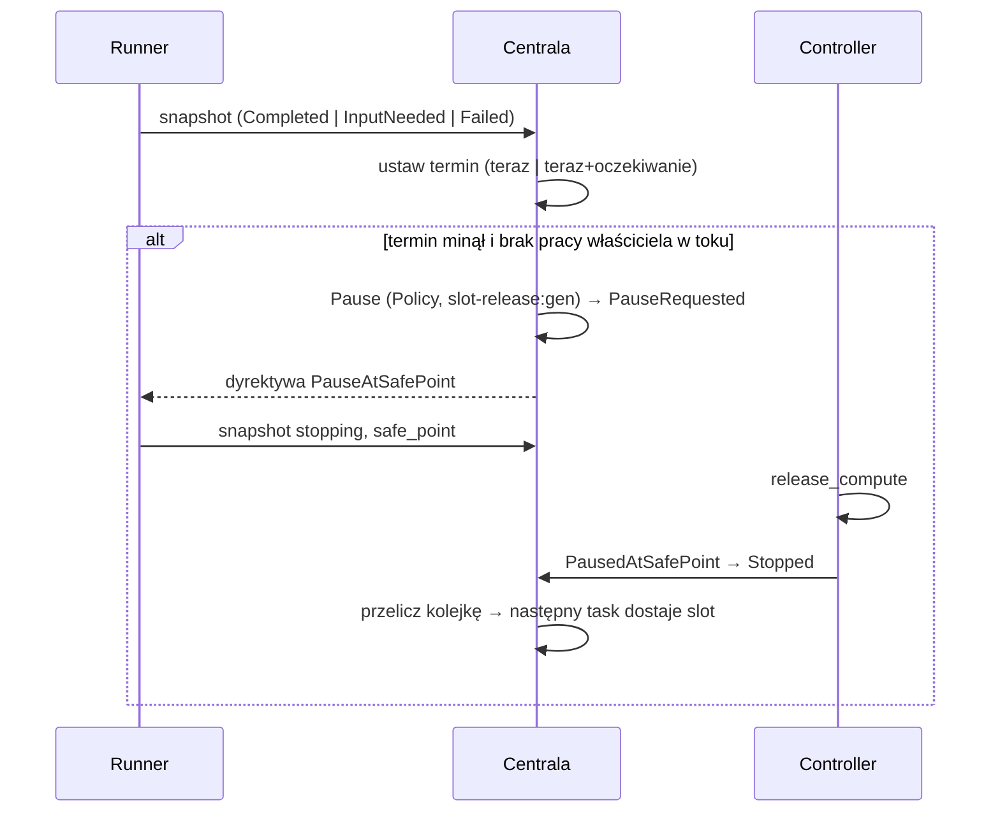
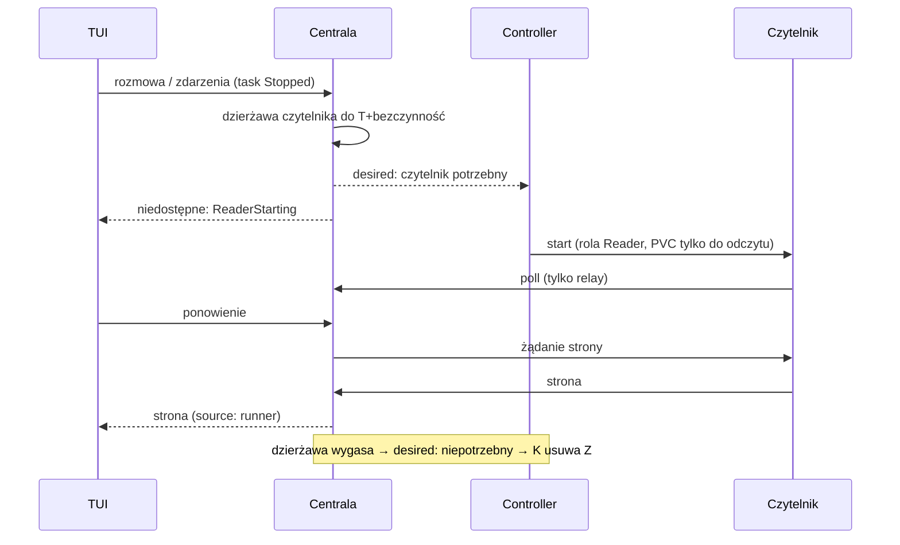
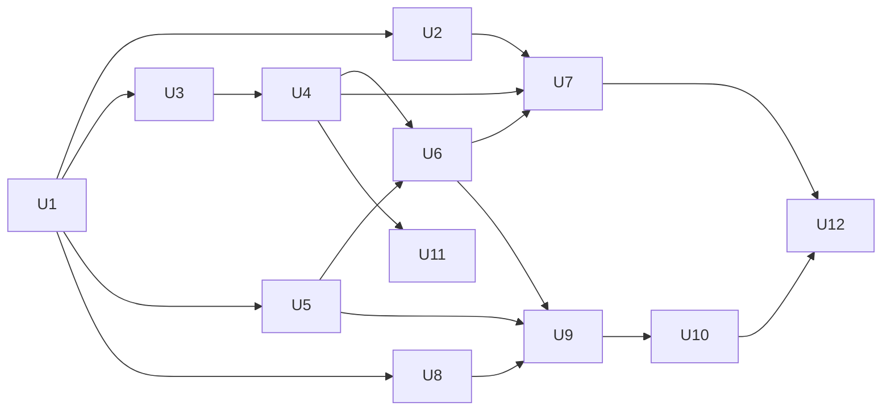

# feat: Zwalnianie slotów według stanu taska i runner tylko do odczytu

## Summary

Plan ma dwie fazy.

**Faza 1** usuwa blokadę kolejki:
- `TaskLifecycle` zmienia nazwę na `RunnerState`, a jego `Paused` na `Stopped`.
- Centrala liczy jeden `TaskState` dla właściciela i wysyła go razem z informacją o slocie. TUI i CLI używają tylko tych pól.
- Polityka centrali zatrzymuje runnera istniejącą ścieżką bezpiecznego punktu. Zakończony task jest zatrzymany od razu, a task w stanie chwilowym po upływie terminu, zapisanego w rekordzie jak w D58.
- Resume przy pełnym backendzie wstawia task na początek kolejki, zamiast zwracać błąd.
- Polecenie pracy dla zatrzymanego taska jest zapisane i powoduje resume.

**Faza 2** dodaje runnera tylko do odczytu, z własną rolą poświadczenia i osobnym workloadem w controllerze. Ta faza usuwa odczyt storage przez centralę (D59).

---

## Problem Frame

Zakończony task ma `lifecycle: running` i żywy proces runnera, więc `TaskRecord::holds_capacity` liczy go jako zajęty slot, a nowy task czeka bez końca (see origin). Ten sam problem mają taski czekające na człowieka.

TUI dziś samo składa stan wiersza z dwóch osi: `state_icon` i `label_of` w `src/tui/task_app/list.rs` łączą lifecycle ze stanem wykonania. Własna kopia reguły slotu (`holds_a_slot`) już różni się od `holds_capacity` dla `Archiving`.

Nazwa „lifecycle” nie mówi, że oś opisuje runnera i jego zasoby, a nie etap pracy. Przez to `Paused` w lifecycle myli się z decyzją właściciela.

---

## Requirements

Wymagania R1–R17 pochodzą z dokumentu źródłowego. Plan dodaje trzy własne wymagania z ustaleń w czasie planowania:

- R1–R7. Zwalnianie slotu: decyduje centrala, stany ostateczne od razu, stany chwilowe po okresie oczekiwania, zatrzymanie w bezpiecznym punkcie, natychmiastowe przeliczenie kolejki, ustawienia backendu, wydłużenie przy odczycie.
- R8–R12. Runner tylko do odczytu: jedna droga dla wszystkich backendów, brak slotu, brak zmian stanu pracy, zatrzymanie po bezczynności, widoczny start i błąd.
- R13–R15. Praca na zatrzymanym tasku: resume przez kolejkę, zapisane polecenie, nigdy dwa runnery na jednym storage.
- R16–R17. Widoczność: TUI pokazuje slot, a zwolnienie slotu zostawia zdarzenie.
- R18. `TaskLifecycle` zmienia nazwę na `RunnerState`, a `Paused` na `Stopped`. Zapisane rekordy, dziennik zdarzeń i protokół dalej przyjmują stare nazwy.
- R19. Centrala liczy jeden `TaskState` (`Queued`, `Running`, `HumanNeeded`, `Paused`, `Finished`, `Error`, `Archived`) i wysyła go w podsumowaniu taska. TUI i CLI nie wyprowadzają stanu same.
- R20. Resume zatrzymanego taska przy pełnym backendzie wstawia go na początek kolejki. Przy wolnym slocie resume działa jak dziś.

**Origin actors:** A1 (właściciel), A2 (centrala), A3 (controller), A4 (runner)
**Origin flows:** F1 (task kończy workflow), F2 (task czeka na człowieka), F3 (odczyt szczegółów zatrzymanego taska), F4 (praca zlecona zatrzymanemu taskowi)
**Origin acceptance examples:** AE1–AE4, AE8 (faza 1); AE5–AE7, AE9 (faza 2)

---

## Scope Boundaries

- Stan `New` (task nieskierowany do procesowania) nie wchodzi do `TaskState`. Takiego pojęcia dziś nie ma.
- Brak kopii rozmów, zdarzeń albo storage w centrali lub controllerze (see origin).
- Archiwizacja działa jak dziś. Faza 2 dodaje tylko zatrzymanie runnera do odczytu przed usunięciem storage.
- Brak wywłaszczania tasków w trakcie pracy.
- Brak runnera do odczytu dla `Unknown`: poprzedni runner może jeszcze żyć.
- Polityka D58 dla `Interrupted` się nie zmienia.

### Deferred to Follow-Up Work

- Task `Interrupted`, którego ostatni snapshot to `Completed`, jest wznawiany przez D58 i zwalnia slot dopiero po ponownym starcie. Można to skrócić osobną zmianą w polityce wznawiania.
- Pojęcie `New` i stan `TaskState::New`.

---

## Context & Research

### Relevant Code and Patterns

- Zliczanie slotów: `TaskRecord::holds_capacity` (`crates/narsor-engine/src/orchestration/model.rs`), `slots_in_use` i `ControlPlane::schedule` (`crates/narsor-engine/src/orchestration/scheduler.rs`).
- Ścieżka pauzy:
  - `command_with_capacity` → `ControlPlane::command` → `lifecycle::command_effect` (`crates/narsor-engine/src/orchestration/{scheduler,control_plane,lifecycle}.rs`);
  - `directive()` i `desired_command()` w `crates/narsor-engine/src/controller_protocol/service.rs`;
  - `Session::drive` / `finish_at_safe_point` w `crates/narsor-runner/src/runner/mod.rs`;
  - `Controller::pause_at_safe_point` w `crates/narsor-controller-runtime/src/controller.rs`;
  - `safe_point_acknowledged` w `ControlPlane::report`.
- Bez aktywnego przebiegu runner osiąga bezpieczny punkt od razu w stanach `Completed`, `Cancelled`, `InputNeeded` i `Failed`. Wyjątek: działający przebieg dyrygenta po `Failed` opóźnia bezpieczny punkt.
- Zapis snapshotu: `record_runner_snapshot` (`crates/narsor-engine/src/orchestration/runner_state.rs`). `ProtocolService::runner_snapshot` dziś tylko wywołuje `notify` i nie przelicza kolejki.
- Wzorzec terminu z D58:
  - `ResumeState` w rekordzie, predykat `TaskRecord::auto_resume_due(now)`;
  - przebieg `auto_resume_pass` (`crates/narsor-engine/src/controller_protocol/service/auto_resume.rs`);
  - polecenie polityki z kluczem zależnym od generacji, `CommandActor::Policy`, `StaleGeneration` traktowany jako „ktoś był pierwszy”;
  - przebieg okresowy `run_periodic_pass` (5 s) w `crates/narsor-server/src/runtime.rs`.
- Ustawienia backendu: `BackendLimits` (`crates/narsor-engine/src/environment/backend.rs`, `deny_unknown_fields`), czytane na świeżo przez `LaunchResolver::backend_limit`.
- Polecenia właściciela odrzucane bez runnera:
  - `ControlPlane::queue_input` (dopuszcza tylko `Provisioning|Running|PauseRequested`);
  - `TaskRecord::operator_command_refusal`, `ProtocolService::check_operator_command`;
  - `queue_operator_command` i `obsolete_reason` w `crates/narsor-engine/src/orchestration/operator_commands.rs` (polecenie jest związane z `launch_generation`).
- Odczyt bez runnera (do usunięcia w fazie 2):
  - `ProtocolService::with_local_storage`, pole `local_storage`, `LocalTaskStorage`;
  - `stored_events`, `stored_page`/`stored_conversation`/`StoredSummaries`, `stored_conductor`.
  
  Wszystkie trzy drogi przechodzą przez `live_read_blocker` (`service.rs`).
- Relay do runnera: `PageRelay`/`EventsRelay`/`ConductorRelay` (`service/relay.rs`); po stronie runnera `serve_page`/`serve_events`/`serve_conductor_read`.
- Uruchomienie workloadu:
  - `Controller::launch` (incarnation `{workload}-g{generation}-{uuid8}`, `issue_runner_credential`);
  - trait `ExecutionBackend` (`crates/narsor-controller-runtime/src/backend.rs`);
  - `LocalBackend` (`crates/narsor-engine/src/backends/local.rs`);
  - `KubernetesBackend` (`crates/narsor-controller/src/kubernetes/`);
  - `FakeBackend` (`crates/narsor-engine/src/backends/fake.rs`), `testkit::Probed`.
- Jedna sesja runnera na task: `CredentialStore::issue_runner_session` (`runner_session_file(task_id)`). Blokada storage: wyłączny `flock` w `TaskStorage::lock`.
- Start runnera zapisuje storage w krokach `prepare`, `secrets`, `init`, `profile`, `SessionRecord::open`, `ask_default_harness`, `report`. Trybu tylko do odczytu dziś nie ma.
- TUI i CLI:
  - `state_icon`, `label_of`, `holds_a_slot`, `TaskList::slots()` (`src/tui/task_app/list.rs`);
  - nagłówek `sloty N/M` (`src/tui/task_app/layout.rs`);
  - akcje według lifecycle (`src/tui/task_app/actions.rs`);
  - teksty `src/tui/task_app/detail.rs`, `src/tui/task_app/tabs/info.rs`, `src/cli/task_text.rs`.

### Institutional Learnings

- `docs/solutions/architecture-patterns/auto-resume-policy-for-lost-workloads-2026-10-11.md`:
  - utrata z `PauseRequested` nigdy nie powoduje automatycznego wznowienia;
  - każdy enum na drucie kończy się `#[serde(other)] Unrecognized`;
  - kolejność aktualizacji: centrala → controllery → klienci;
  - logikę przebiegu okresowego testuj bez daemona.
- `docs/follow-ups/2026-10-03-zdalne-backendy-pozostale-prace.md` i `docs/residual-review-findings/feat-remote-backends-review-needed.md` opisują trzymanie slotu jako celowe. Ten plan zmienia tę decyzję jawnie (D62).
- Pamięć projektu:
  - testy z daemonem są `#[ignore]` i sprzątają w `Drop`; Artur woli test biblioteczny od testu z `narsor-server`;
  - flake `a_paused_task_resumes_on_its_own_storage_without_recloning` (`runner_timeout`) istniał już wcześniej;
  - `recover_at_startup` trzeba testować przez prawdziwą ścieżkę startu.

### External References

Nie użyto. Repozytorium ma silne lokalne wzorce dla każdej części planu.

---

## Key Technical Decisions

- **Dwie osie, jawnie nazwane.** `RunnerState` (runner, slot i zasoby; zarządzany przez centralę i controller) oraz `TaskState` (etap pracy dla właściciela, liczony przez centralę). Protokół controllera zostaje na `RunnerState`, a klienci przechodzą na `TaskState`.
- **Zmiana nazwy jest kompatybilna wstecz w odczycie.** Typ i pola Rust zmieniają nazwy. Serde zapisuje nowe nazwy (`runner_state`, `stopped`), a przy odczycie przyjmuje stare (`lifecycle`, `paused`) przez aliasy. Rekordy, dziennik zdarzeń i odpowiedzi starszej centrali dalej się wczytują. Zapis starszym klientom nie jest potrzebny, bo obowiązuje kolejność aktualizacji z D58.
- **Zwolnienie slotu to zatrzymanie z polityki, a nie nowy stan.** Polityka wysyła `Pause` (`Running → PauseRequested → Stopped`) z `CommandActor::Policy` i kluczem `slot-release:<generation>`. W ten sposób działa cała ścieżka bezpiecznego punktu i usunięcia workloadu, a D58 już ignoruje utratę z `PauseRequested`. `holds_capacity` się nie zmienia.
- **Termin w rekordzie, nie w pamięci.** Rekord dostaje pole z terminem zwolnienia, ustawiane przy zapisie snapshotu. Stan ostateczny daje termin „teraz”. Stan chwilowy daje termin „teraz + okres oczekiwania”, jeśli termin jeszcze nie istnieje. Każdy inny stan czyści termin. Restart daemona nie zeruje i nie skraca terminu.
- **Dwa wyzwalacze, jeden predykat.** Zwolnienie po snapshocie wykonuje `runner_snapshot`, a przebieg okresowy wykonuje zwolnienie po upływie terminu i po restarcie. Oba używają tego samego predykatu `*_due(now)` i tego samego idempotentnego polecenia.
- **Nie zwalniaj slotu pod pracą właściciela.** Predykat jest fałszywy, gdy task ma wejście w stanie `Queued` albo `Delivered` albo nierozliczone polecenie operatora. Odpowiedź udzielona w ostatniej sekundzie nie powoduje zatrzymania runnera.
- **Wydłużenie przy odczycie ma próg.** Odczyt szczegółów przesuwa termin tylko wtedy, gdy nowy termin jest późniejszy o więcej niż ustalony próg. Tak częste odświeżanie TUI nie zapisuje rekordu przy każdym odczycie.
- **Resume przez kolejkę tylko przy pełnym backendzie.** Przy wolnym slocie resume działa jak dziś (`Stopped → Provisioning`). Przy pełnym backendzie task przechodzi do `Queued` bez rezerwacji, z rangą przed wszystkimi oczekującymi, a scheduler przyjmuje go jako pierwszego. Dzisiejszy błąd `BackendAtCapacity` dla resume znika. Zostaje tylko tam, gdzie kolejka nie ma sensu.
- **Polecenie pracy dla zatrzymanego taska.** Wejście i polecenia operatora są przyjmowane w `Stopped` i `Queued`. Wiążą się z „następnym uruchomieniem”, a nie z bieżącym `launch_generation`. Przyjęcie powoduje resume właściciela z kluczem wyprowadzonym z klucza polecenia, więc ponowienie nie daje drugiego resume. Wejście dalej musi pasować do `pending_input_id` z ostatniego snapshotu.
- **`TaskState` wyprowadza jedna czysta funkcja centrali** (tabela w High-Level Technical Design). Slot jest osobnym polem `holds_slot`, obliczonym przez `holds_capacity`, i zastępuje `holds_a_slot` w TUI.
- **Runner do odczytu to tryb tej samej binarki.** Ma osobną rolę poświadczenia (`Reader`), osobny plik sesji i osobny workload. Bierze tę samą wyłączną blokadę storage i pomija każdy krok startu, który zapisuje storage. Nie wysyła snapshotów ani raportów. Obsługuje tylko odczyty relay i kończy pracę na `Stop`.
- **O czytelniku decyduje centrala, nie controller.** Rekord dostaje dzierżawę czytelnika („potrzebny do T”). Każdy odczyt ją przedłuża, a przebieg okresowy usuwa przeterminowaną. `desired_command` przekazuje controllerowi „czytelnik potrzebny / niepotrzebny”, a controller go tworzy albo usuwa (R1).
- **Nigdy dwa runnery naraz (R15).** Controller przed `Start`/`Provision`/`Archive` usuwa czytelnika i czeka na potwierdzenie usunięcia. Centrala w tym samym poleceniu, które wznawia task, usuwa dzierżawę czytelnika. Blokada storage jest drugą zaporą: gdy czytelnik dostaje `StorageBusy`, kończy pracę i zgłasza niedostępność.
- **Odczyt nie czeka długo na start czytelnika.** Gdy czytelnik nie odpowiada w krótkim czasie, centrala zwraca niedostępność z nowym powodem `ReaderStarting`, a TUI pokazuje „wczytywanie…” i ponawia. Nowy wariant enumu korzysta z istniejącego `Unrecognized`.
- **Kubernetes: czytelnik montuje PVC tylko do odczytu.** Ta sama PVC (RWO) i osobny Pod z `readOnly: true`. Montowanie wymusza R10 niezależnie od kodu runnera.
- **Dwie decyzje w `ARCHITECTURE_DECISIONS.md`.** D62 (faza 1): zwalnianie slotu według stanu wykonania, model `RunnerState`/`TaskState`, resume przez kolejkę. D63 (faza 2): runner do odczytu. D63 zastępuje D59 i zmienia KTD4 w części „nie odtwarzać compute dla odczytu”.

---

## Open Questions

### Resolved During Planning

- Stan zwolnionego taska (pytanie z dokumentu źródłowego): `RunnerState::Stopped` z istniejącej ścieżki pauzy. Właściciel widzi `TaskState` z tabeli, bez pola powodu.
- Skąd runner wie, że ma tylko czytać: z flagi CLI w poleceniu uruchomienia od controllera i z roli poświadczenia. Centrala odrzuca każde wywołanie zapisu od roli `Reader`.
- Czy czytelnik przechodzi w tryb pracy: nie. Controller go zatrzymuje i uruchamia zwykłego runnera.
- Gdzie jest termin zwolnienia: w rekordzie taska (wzorzec D58).
- Czas startu poda do odczytu: odczyt nie czeka na pod. Zwraca `ReaderStarting`, a TUI ponawia.
- Autoryzacja uruchomienia po resume przez kolejkę: zostaje zachowana. Receipt `Resume` ma `generation_after` równe nowej generacji, `StartAccepted` (`Queued → Provisioning`) nie zmienia generacji, a `Controller::launch` używa `command.generation`. U5 dodaje tylko test regresji.

### Deferred to Implementation

- Dokładne nazwy pól (termin zwolnienia, dzierżawa czytelnika), flagi CLI i ustawień `BackendLimits`. Wartości domyślne: oczekiwanie 300 s, wydłużenie 180 s, bezczynność czytelnika 120 s. Implementacja może je zmienić.
- Czy nazwa modułu `orchestration/lifecycle.rs` i funkcji `command_effect` też się zmienia. Zmiana jest mechaniczna, a decyzja zależy od rozmiaru diffu.
- Czy `flock` działa na pliku blokady przy PVC zamontowanym tylko do odczytu. Jeśli nie, czytelnik na Kubernetes polega tylko na gwarancji controllera (R15) i montowaniu tylko do odczytu.
- Jak czytelnik na `local` traktuje grupę procesów martwego runnera `Interrupted` (`kill_marked_group`). Domyślnie: nie zabija, a przy `StorageBusy` zgłasza niedostępność.

---

## High-Level Technical Design

> *Ten szkic pokazuje zamierzone podejście i jest wskazówką kierunku do przeglądu, a nie specyfikacją implementacji. Implementujący agent traktuje go jako kontekst, a nie kod do przepisania.*

**`TaskState` z `RunnerState` i stanu wykonania.** Pierwsza pasująca reguła wygrywa:

| # | Warunek | `TaskState` |
|---|---|---|
| 1 | `Archived` | `Archived` |
| 2 | `Archiving` | `Finished` |
| 3 | `Queued` (także po resume przez kolejkę) | `Queued` |
| 4 | `Unknown`, albo `Interrupted` z wyczerpanym limitem D58 | `Error` |
| 5 | wykonanie `Completed` / `Cancelled` | `Finished` |
| 6 | wykonanie `Failed` | `Error` |
| 7 | wykonanie `InputNeeded` | `HumanNeeded` |
| 8 | `Stopped`, albo `PauseRequested` z polecenia właściciela | `Paused` |
| 9 | `Provisioning` bez snapshotu runnera | `Queued` |
| 10 | pozostałe (`Running`, `Provisioning` ze snapshotem, `Interrupted` czekający na D58) | `Running` |

Gdy reguła 5, 6 albo 7 trafia na task bez slotu, właściciel widzi ten sam stan, a `holds_slot = false` daje dopisek „bez slotu”.

**Zwolnienie slotu (faza 1):**

**Odczyt zatrzymanego taska (faza 2):**

---

## Implementation Units

Faza 1: U1–U7 i U11. Faza 2: U8–U10 i U12.

### U1. Zmiana nazwy `TaskLifecycle` → `RunnerState`, `Paused` → `Stopped`

**Goal:** Nazwy w kodzie mówią, że ta oś opisuje runnera i jego zasoby.

**Requirements:** R18

**Dependencies:** brak

**Files:**
- Modify: `crates/narsor-protocol/src/controller.rs` (enum, pola `lifecycle`, `lifecycle_after`)
- Modify: `crates/narsor-engine/src/orchestration/model.rs`, `lifecycle.rs`, `scheduler.rs`, `control_plane.rs`, `resume.rs`, `runner_state.rs`, `operator_commands.rs`
- Modify: `crates/narsor-engine/src/controller_protocol/service.rs` i `service/*`
- Modify: `crates/narsor-controller-runtime/src/controller.rs`, `src/tui/task_app/*`, `src/cli/*`. Razem około 29 plików i 450 wystąpień.
- Test: `tests/orchestration.rs`, `tests/controller_protocol.rs` (aktualizacja nazw), nowy test zgodności w `crates/narsor-protocol` lub `tests/orchestration.rs`

**Approach:**
- Mechaniczna zmiana nazwy typu, wariantu i pól. Serde zapisuje `runner_state` / `stopped`, a przy odczycie przyjmuje `lifecycle` / `paused` (aliasy na polu i wariancie).
- Teksty w TUI i CLI na razie bez zmian w treści, aby ten krok nie zmieniał zachowania.
- Komentarze w kodzie, które mówią „lifecycle”, aktualizuj tam, gdzie zmienia się nazwa.

**Execution note:** Czysty refaktor bez zmiany zachowania. Cały zestaw testów przechodzi przed i po zmianie.

**Patterns to follow:** aliasy serde dla zmienionych pól już używane w rekordach (`record_version`, `#[serde(default)]`).

**Test scenarios:**
- Happy path: rekord taska zapisany starą wersją (`"lifecycle": "paused"`) się wczytuje i ma `RunnerState::Stopped`.
- Happy path: nowy zapis rekordu zawiera `"runner_state": "stopped"`.
- Edge case: zdarzenie z dziennika z polem `lifecycle` się wczytuje (odtwarzanie rekordu z dziennika w `ControlPlane::recover`).
- Integration: odpowiedź `TaskSummary` ze starej centrali (`lifecycle`) wczytuje się w kliencie.

**Verification:** Cały zestaw testów przechodzi. W kodzie nie ma `TaskLifecycle` ani `TaskLifecycle::Paused`.

---

### U2. `TaskState` i `holds_slot` w podsumowaniu taska

**Goal:** Centrala wysyła jeden stan dla właściciela i informację o slocie.

**Requirements:** R16, R19

**Dependencies:** U1

**Files:**
- Modify: `crates/narsor-protocol/src/controller.rs` (enum `TaskState` z `Unrecognized`, pola `state` i `holds_slot` w `TaskSummary`)
- Modify: `crates/narsor-engine/src/orchestration/model.rs` (czysta funkcja wyprowadzenia stanu)
- Modify: `crates/narsor-engine/src/controller_protocol/service.rs` (`summarize_with`)
- Test: `tests/controller_protocol.rs`, testy jednostkowe w `model.rs`

**Approach:**
- Funkcja realizuje tabelę z High-Level Technical Design. Dane wejściowe to `RunnerState`, ostatni snapshot runnera i stan polityki D58.
- `holds_slot` pochodzi wprost z `holds_capacity`.
- Pola są addytywne z `#[serde(default)]`, więc stary klient je pomija.

**Test scenarios:**
- Happy path (Covers AE1): `Running` + wykonanie `Completed` → `Finished`, `holds_slot = true`. `Stopped` + `Completed` → `Finished`, `holds_slot = false`.
- Happy path: `Running` + `InputNeeded` → `HumanNeeded`. `Stopped` + `InputNeeded` → `HumanNeeded`.
- Happy path: `Stopped` + wykonanie `Running` → `Paused`. `PauseRequested` z polecenia właściciela → `Paused`.
- Edge case: `PauseRequested` z polityki zwolnienia + `Completed` → `Finished` (reguła 5 przed 8).
- Edge case: `Queued` z ostatnim snapshotem `InputNeeded` (po odpowiedzi, czeka na slot) → `Queued`.
- Edge case: `Provisioning` bez snapshotu → `Queued`. Z ostatnim snapshotem `Running` → `Running`.
- Error path: `Unknown` → `Error`. `Interrupted` z wyczerpanym limitem → `Error`. `Interrupted` czekający na D58 → `Running`. Wykonanie `Failed` → `Error`.
- Edge case: `Archiving` → `Finished`, `Archived` → `Archived`. `holds_slot` dla `Archiving` jest `true` (zgodnie z `holds_capacity`).

**Verification:** Każda kombinacja z tabeli ma test, a `summarize_with` wypełnia oba pola.

---

### U3. Ustawienia okresów w `BackendLimits`

**Goal:** Okres oczekiwania, wydłużenie przy odczycie i bezczynność czytelnika są ustawieniami backendu z wartościami domyślnymi.

**Requirements:** R6, R7, R11

**Dependencies:** U1

**Files:**
- Modify: `crates/narsor-engine/src/environment/backend.rs`
- Modify: `crates/narsor-engine/src/environment/resolver.rs` (świeży odczyt, jak `backend_limit`)
- Modify: dokumentacja konfiguracji backendu (plik wskazany w `docs/operations/remote-backends.md`)
- Test: testy jednostkowe w `backend.rs` / `resolver.rs`

**Approach:** Trzy pola z `#[serde(default)]`, bo struktura ma `deny_unknown_fields`. Odczyt przy każdej decyzji, bez cache, jak `ProtocolService::capacity`.

**Test scenarios:**
- Happy path: konfiguracja bez nowych pól → wartości domyślne.
- Happy path: konfiguracja z polami → wartości z konfiguracji.
- Error path: zła wartość (np. ujemna albo nie-liczba) → czytelny błąd konfiguracji.

**Verification:** Istniejące konfiguracje wczytują się bez zmian.

---

### U4. Polityka zwalniania slotu

**Goal:** Centrala zwalnia slot taska w stanie ostatecznym od razu, a w stanie chwilowym po upływie terminu. Odczyt szczegółów wydłuża termin.

**Requirements:** R1–R7, R17; F1, F2; AE1–AE4

**Dependencies:** U1, U3

**Files:**
- Modify: `crates/narsor-engine/src/orchestration/model.rs` (pole terminu, predykat `*_due(now)`, klasyfikacja stanu wykonania: ostateczny / chwilowy / inny)
- Modify: `crates/narsor-engine/src/orchestration/runner_state.rs` (ustawienie i czyszczenie terminu w `record_runner_snapshot`)
- Modify: `crates/narsor-engine/src/orchestration/control_plane.rs` (polecenie polityki z kluczem `slot-release:<generation>`, osobny warunek dopuszczenia `CommandActor::Policy` dla `Pause`, nowe zdarzenie)
- Create: `crates/narsor-engine/src/controller_protocol/service/slot_release.rs` (przebieg i wyzwalacz po snapshocie)
- Modify: `crates/narsor-engine/src/controller_protocol/service.rs` (`runner_snapshot` wywołuje wyzwalacz, ścieżki odczytu wydłużają termin)
- Modify: `crates/narsor-server/src/runtime.rs` (`run_periodic_pass` wywołuje przebieg)
- Test: `tests/orchestration.rs`, `tests/controller_protocol.rs`

**Approach:**
- Nie używaj `ExecutionStatus::is_terminal()`, bo uznaje `Failed` za stan ostateczny. Dodaj osobną klasyfikację.
- Termin ustawia tylko `Running` (nie `PauseRequested`, `Stopped` ani inne).
- Predykat jest fałszywy, gdy task ma wejście w stanie `Queued`/`Delivered` albo nierozliczone polecenie operatora.
- Polecenie polityki przechodzi przez `command_with_capacity`. `StaleGeneration`/`IllegalCommand` znaczy „ktoś był pierwszy” (wzorzec `auto_resume_pass`).
- Po zwolnieniu przebieg przelicza kolejkę dotkniętych backendów. Rzeczywiste zwolnienie slotu i tak następuje w `report` po `PausedAtSafePoint`, a ta funkcja już przelicza kolejkę.
- Wydłużenie przy odczycie: tylko gdy task ma termin chwilowy i nowy termin jest późniejszy o więcej niż próg.
- Zdarzenie w historii: zwolnienie slotu z powodem (ostateczny / termin minął).

**Execution note:** Najpierw test dla AE1 na poziomie `ControlPlane` z `with_clock`. Ma on najpierw nie przechodzić.

**Patterns to follow:** `ResumeState` + `auto_resume_due` + `auto_resume_pass` + `ControlPlane::auto_resume` (D58).

**Test scenarios:**
- Covers AE1. Limit 1, task A `Running`, task B `Queued`. Snapshot A `Completed` → A w `PauseRequested`. Controller zgłasza `PausedAtSafePoint` → A `Stopped`, B dostaje rezerwację w tym samym przeliczeniu.
- Covers AE2. Snapshot `InputNeeded` o czasie t. Przebieg w t+299 s nic nie robi. Przebieg w t+301 s → `PauseRequested` i zdarzenie zwolnienia slotu.
- Covers AE3. Snapshot `Failed`, a po 2 min snapshot `Running` (restart kroku) → termin wyczyszczony, przebieg w t+6 min nic nie robi.
- Covers AE4. `InputNeeded` od t, odczyt rozmowy w t+4 min → termin przesunięty. Przebieg w t+5 min 30 s nic nie robi.
- Edge case: odpowiedź właściciela w kolejce (`Queued`) w t+299 s → przebieg w t+301 s nic nie robi.
- Edge case: kilka snapshotów `InputNeeded` z rzędu nie przesuwa terminu.
- Edge case: termin przeżywa restart. Rekord z terminem w przeszłości → pierwszy przebieg po wczytaniu zwalnia slot.
- Edge case: `Completed` przy `PauseRequested` od właściciela → brak drugiego polecenia, task kończy jako `Stopped`.
- Error path: polecenie właściciela (`Archive`) między snapshotem a przebiegiem → polityka dostaje `StaleGeneration` i nic nie zmienia.
- Integration: utrata workloadu w `PauseRequested` z polityki nie uruchamia D58 (`count_loss` wraca wcześnie).
- Edge case: wiele odczytów w krótkim czasie zapisuje rekord najwyżej raz na próg.

**Verification:** AE1–AE4 przechodzą na `ControlPlane` i `ProtocolService` bez daemona. `run_periodic_pass` ma test bez daemona.

---

### U5. Resume przez kolejkę przy pełnym backendzie

**Goal:** Resume zatrzymanego taska przy braku wolnego slotu wstawia task na początek kolejki.

**Requirements:** R13, R20

**Dependencies:** U1

**Files:**
- Modify: `crates/narsor-engine/src/orchestration/scheduler.rs` (`command_with_capacity`)
- Modify: `crates/narsor-engine/src/orchestration/lifecycle.rs` (lub nowa nazwa z U1: przejście `Resume` z `Stopped` do `Queued` przy braku slotu)
- Modify: `crates/narsor-engine/src/orchestration/control_plane.rs` (ranga przed wszystkimi oczekującymi, jak `MoveTarget::Top`)
- Modify: `crates/narsor-engine/src/orchestration/error.rs` i `crates/narsor-protocol/src/controller.rs` (`BackendAtCapacity` przestaje dotyczyć resume)
- Test: `tests/orchestration.rs`, `tests/controller_protocol.rs`

**Approach:**
- Decyzja zapada pod blokadą schedulera. Wolny slot → dzisiejsza ścieżka. Brak slotu → `Queued` bez rezerwacji, z rangą na początku.
- Wynik polecenia mówi, że task czeka w kolejce, aby TUI mogło to pokazać.
- Po przydziale slotu controller używa `backend.resume`, bo storage istnieje. Ścieżka `Controller::launch` już wybiera `resume`.
- Test regresji: po przydziale slotu `launch_receipt` znajduje receipt `Resume` (Open Questions → Resolved).

**Test scenarios:**
- Happy path: wolny slot, resume `Stopped` → `Provisioning` (bez zmian).
- Happy path (Covers AE8, część kolejki): limit 1 zajęty, resume `Stopped` → `Queued` z rangą przed starszymi oczekującymi. Zwolnienie slotu → ten task dostaje rezerwację pierwszy.
- Edge case: dwa resume przez kolejkę z rzędu → drugi ląduje przed pierwszym (zasada „na początek”). Właściciel dalej może przesuwać taski.
- Integration: task z resume przez kolejkę dostaje rezerwację, controller wywołuje `backend.resume`, a runner kontynuuje na tym samym storage bez ponownego klonowania (test na `FakeBackend`/`Probed`).
- Error path: resume taska w złym stanie (np. `Archived`) dalej zwraca błąd przejścia.

**Verification:** Nie istnieje ścieżka, na której resume zwraca `BackendAtCapacity`.

---

### U6. Polecenia pracy dla zatrzymanego taska

**Goal:** Odpowiedź na input i polecenia operatora wysłane do zatrzymanego taska są zapisane, powodują resume i trafiają do runnera po starcie.

**Requirements:** R13, R14; F4; AE8

**Dependencies:** U4, U5

**Files:**
- Modify: `crates/narsor-engine/src/orchestration/runner_state.rs` (`queue_input` przyjmuje `Stopped` i `Queued`)
- Modify: `crates/narsor-engine/src/orchestration/model.rs` (`operator_command_refusal`)
- Modify: `crates/narsor-engine/src/orchestration/operator_commands.rs` (wiązanie z następnym uruchomieniem, `obsolete_reason`)
- Modify: `crates/narsor-engine/src/controller_protocol/service.rs` (`check_operator_command`, `submit_input`: resume po przyjęciu)
- Test: `tests/controller_protocol.rs`, `tests/orchestration.rs`, `tests/runner.rs`

**Approach:**
- Polecenie przyjęte dla `Stopped`/`Queued` nie ma jeszcze `launch_generation`. Przy przydziale nowego uruchomienia centrala wiąże je z tą generacją.
- `obsolete_reason` nie unieważnia polecenia czekającego na następne uruchomienie.
- Przyjęcie w `Stopped` wywołuje resume właściciela z kluczem wyprowadzonym z klucza polecenia. Przyjęcie w `Queued` niczego nie wznawia.
- Wejście dalej musi pasować do `pending_input_id` z ostatniego snapshotu. Dostarczenie po starcie idzie przez istniejące `deliver_inputs`.
- `Interrupt`, `ConfirmProposal` i `RejectProposal` wymagają żywego runnera. Dla zatrzymanego taska zostają odrzucone z czytelnym powodem.

**Test scenarios:**
- Covers AE8. Task `Stopped` z `InputNeeded`, wszystkie sloty zajęte. Odpowiedź → przyjęta, task `Queued`. Zwolnienie slotu → start, a runner dostaje odpowiedź (`Delivered` → `Consumed`).
- Happy path: wolny slot, wiadomość do dyrygenta dla `Stopped` z `Completed` → resume od razu, polecenie wykonane po starcie.
- Happy path: undo decyzji dyrygenta dla `Stopped` → resume i undo po starcie.
- Edge case: ponowienie tego samego polecenia (ten sam klucz) → jedno resume, jedno polecenie.
- Edge case: dwa różne polecenia przed startem → oba dostarczone w kolejności.
- Error path: odpowiedź z innym `pending_input_id` niż w ostatnim snapshocie → odrzucona jak dziś.
- Error path: `Interrupt` dla `Stopped` → odrzucone z powodem.
- Integration: task `Running` z `InputNeeded` w okresie oczekiwania. Odpowiedź → dostarczona bez resume. Termin wyczyszczony po snapshocie `Running`.

**Verification:** Żadne polecenie pracy nie startuje agenta bez slotu (AE8), a żadne polecenie nie przepada.

---

### U7. TUI i CLI na `TaskState` i `holds_slot`

**Goal:** Ikona, kolor i etykieta wiersza wynikają tylko z `TaskState`. Slot ma osobne oznaczenie, a odpowiedź na input działa także bez slotu.

**Requirements:** R16, R19; AE1

**Dependencies:** U2, U4, U6

**Files:**
- Modify: `src/tui/task_app/list.rs` (`state_icon`, `label_of`, usunięcie `holds_a_slot`, `TaskList::slots()`)
- Modify: `src/tui/task_app/layout.rs` (nagłówek `sloty N/M` z `holds_slot`)
- Modify: `src/tui/task_app/actions.rs` (dostępność akcji: odpowiedź, wiadomość do dyrygenta i resume dla zatrzymanych tasków)
- Modify: `src/tui/task_app/detail.rs`, `src/tui/task_app/tabs/info.rs` (stan, dopisek „bez slotu”, informacja „w kolejce po resume”)
- Modify: `src/cli/task_text.rs`
- Test: `tests/tui_state.rs`, `tests/tui_render.rs`, `tests/cli_task_text.rs`

**Approach:**
- Jedna mapa `TaskState` → ikona, kolor i etykieta. Krok workflow zostaje dodatkowym tekstem dla `Running`, a pozycja w kolejce dla `Queued`.
- Stan `Unrecognized` ma neutralną ikonę.
- Kolejność listy się nie zmienia: stan to atrybut wiersza, a nie klucz sortowania (pamięć projektu).

**Test scenarios:**
- Covers AE1: lista z A (`Finished`, bez slotu) i B (`Running`, slot) → nagłówek `sloty 1/1`, A ma ikonę zakończenia i dopisek „bez slotu”.
- Happy path: każdy `TaskState` ma ikonę i etykietę w teście renderu.
- Happy path: `HumanNeeded` bez slotu → pole odpowiedzi aktywne. Wysłanie pokazuje „w kolejce”, gdy backend jest pełny.
- Edge case: `TaskSummary` bez `state` (stara centrala) → wiersz renderuje się z neutralną ikoną i bez paniki.
- Happy path: CLI `narsor task` pokazuje stan i slot w tekście.

**Verification:** W `src/tui` i `src/cli` nie ma logiki, która wyprowadza stan albo slot z `RunnerState`.

---

### U11. Decyzja D62 i dokumentacja fazy 1

**Goal:** Zmiana celowego trzymania slotu i model dwóch osi są zapisane jako decyzja.

**Requirements:** R1–R7, R18–R20

**Dependencies:** U4

**Files:**
- Modify: `ARCHITECTURE_DECISIONS.md` (D62)
- Modify: `docs/operations/remote-backends.md` (§9–§10: kto trzyma slot, zwolnienie, resume przez kolejkę, ustawienia)
- Modify: `docs/follow-ups/2026-10-03-zdalne-backendy-pozostale-prace.md` (punkt „Zablokowany slot przez porzucony task”)

**Test expectation:** brak, to tylko dokumentacja.

**Verification:** D62 wskazuje dokument źródłowy, ten plan i zmienione zdania z follow-upu.

---

### U8. Tryb runnera tylko do odczytu

**Goal:** `narsor-runner` umie działać jako czytelnik: obsługuje odczyty relay i nie zmienia storage.

**Requirements:** R8, R10, R11; AE7

**Dependencies:** U1

**Files:**
- Modify: `crates/narsor-runner/src/runner/cli.rs` (flaga trybu)
- Modify: `crates/narsor-runner/src/runner/mod.rs` (osobna, krótka ścieżka `run` dla czytelnika)
- Modify: `crates/narsor-runner/src/runner/storage.rs` (blokada bez `prepare`; błąd, gdy storage nie jest zainicjowany)
- Modify: `crates/narsor-engine/src/controller_protocol/` (typy żądań pollingu czytelnika, jeśli potrzebne)
- Test: `tests/runner.rs`, testy jednostkowe w `crates/narsor-runner/src/runner/`

**Approach:**
- Ścieżka czytelnika: blokada storage → wczytanie specyfikacji ze storage → pętla pollingu tylko z `serve_page` / `serve_events` / `serve_conductor_read` / `fail_read` → wyjście na `Stop` albo przy błędzie poświadczenia.
- Czytelnik pomija `prepare`, `secrets`, `init`, `profile`, `SessionRecord`, `ask_default_harness`, start silnika, reconcile, snapshoty, wejścia, polecenia i materiały.
- `StorageBusy` → zgłoszenie niedostępności z powodem i wyjście.
- Cała ścieżka nie otwiera żadnego pliku do zapisu poza plikiem blokady.

**Execution note:** Najpierw test, który porównuje drzewo storage (ścieżki, rozmiary, czasy modyfikacji) przed i po pracy czytelnika. Ma najpierw nie przechodzić.

**Test scenarios:**
- Covers AE7. Storage taska z otwartym `SessionRecord` i akcją w toku → czytelnik oddaje rozmowę i zdarzenia, a drzewo storage jest identyczne przed i po.
- Happy path: czytelnik oddaje stronę rozmowy, zdarzenia i czat dyrygenta z tymi samymi numerami wpisów co żywy runner.
- Edge case: storage zablokowany przez innego runnera → czytelnik zgłasza niedostępność i kończy pracę bez czekania.
- Edge case: storage niezainicjowany (task nigdy nie wystartował) → czytelnik zgłasza niedostępność.
- Happy path: dyrektywa `Stop` → czytelnik kończy pracę i zwalnia blokadę.

**Verification:** Test drzewa storage przechodzi, a czytelnik nie wywołuje żadnej funkcji zapisu silnika.

---

### U9. Centrala: rola czytelnika, dzierżawa i jedna droga odczytu

**Goal:** Odczyt zatrzymanego taska na każdym backendzie idzie przez czytelnika. Centrala nie czyta storage.

**Requirements:** R8, R9, R11, R12; F3; AE5, AE6

**Dependencies:** U8, U5, U6

**Files:**
- Modify: `crates/narsor-engine/src/controller_protocol/service.rs` (`live_read_blocker`, `desired_command` z polem czytelnika, rola w `runner_poll`, odrzucanie zapisów od roli `Reader`)
- Modify: `crates/narsor-engine/src/controller_protocol/service/{events,conversation,conductor}.rs` (usunięcie odczytu storage, ścieżka czytelnika)
- Modify: `crates/narsor-engine/src/controller_protocol/service/relay.rs`
- Modify: `crates/narsor-engine/src/orchestration/model.rs` (dzierżawa czytelnika w rekordzie)
- Modify: magazyn poświadczeń (`CredentialStore::issue_runner_session`: osobny plik sesji i rola)
- Modify: `crates/narsor-protocol/src/controller.rs` (`ConversationUnavailableReason::ReaderStarting`, pole czytelnika w `DesiredCommand`)
- Modify: `crates/narsor-server/src/runtime.rs` (usunięcie `with_local_storage`, przebieg okresowy usuwa przeterminowane dzierżawy)
- Test: `tests/controller_protocol.rs` (zastąpienie testów odczytu storage), `tests/orchestration.rs`

**Approach:**
- `live_read_blocker` dla `Stopped` i `Interrupted` zwraca „potrzebny czytelnik”, a dla `Unknown` „niedostępne” jak dziś.
- Odczyt ustawia albo przedłuża dzierżawę i czeka na czytelnika krótko. Bez połączenia zwraca `ReaderStarting`.
- Poświadczenie czytelnika wydaje centrala dla `Stopped`/`Interrupted` i tylko wtedy, gdy dzierżawa jest aktywna. Nie zmienia `TaskRecord.runner` i nie unieważnia sesji runnera do pracy.
- Polecenie, które wznawia task albo go archiwizuje, usuwa dzierżawę w tej samej mutacji.
- Usuwany kod: `with_local_storage`, `LocalTaskStorage`, `stored_*`, `StoredSummaries`, `local_storage_of`.

**Test scenarios:**
- Covers AE6. Task `local` w `Stopped`, odczyt zdarzeń → `ReaderStarting` i dzierżawa ustawiona. Po połączeniu czytelnika ponowienie → zdarzenia z `source: runner`.
- Covers AE5 (część centrali). Licznik slotów się nie zmienia, gdy czytelnik działa. `holds_slot = false`.
- Happy path: dzierżawa wygasa po czasie bezczynności → `desired_command` mówi „czytelnik niepotrzebny”.
- Edge case: odczyt dla `Unknown` → niedostępne z dzisiejszym powodem, dzierżawa nieustawiona.
- Error path: czytelnik wywołuje snapshot, raport albo wejście → odmowa.
- Edge case: resume przy aktywnej dzierżawie → dzierżawa usunięta w tej samej mutacji.
- Integration: poświadczenie czytelnika nie unieważnia sesji runnera do pracy i odwrotnie.

**Verification:** W `crates/narsor-engine/src/controller_protocol` nie ma odczytu plików storage taska.

---

### U10. Controller i backendy: workload czytelnika

**Goal:** Controller tworzy i usuwa czytelnika na polecenie centrali i nigdy nie uruchamia go razem z runnerem do pracy.

**Requirements:** R8, R11, R15; AE5, AE9

**Dependencies:** U9

**Files:**
- Modify: `crates/narsor-controller-runtime/src/backend.rs` (trait: start, stop i obserwacja czytelnika; nazwa w `TaskResources`)
- Modify: `crates/narsor-controller-runtime/src/controller.rs` (reconcile czytelnika; usunięcie czytelnika przed `Start`/`Provision`/`Archive`)
- Modify: `crates/narsor-engine/src/backends/local.rs` (osobny katalog workloadu i grupa procesów, flaga trybu)
- Modify: `crates/narsor-controller/src/kubernetes/{mod,manifest,names}.rs` (osobny Pod, PVC `readOnly`, ten sam węzeł co PVC)
- Modify: `crates/narsor-engine/src/backends/fake.rs`, `crates/narsor-controller-runtime/src/testkit.rs`
- Test: `tests/backend_contract.rs` + `tests/backend_contract_support/`, testy jednostkowe w `controller.rs` i `local.rs`

**Approach:**
- Czytelnik ma deterministyczną nazwę różną od workloadu pracy. `keep_paused`/`keep_running` go nie usuwają i nie uznają za utratę.
- Kolejność w reconcile: gdy akcja to `Start`/`Provision`/`Archive` i czytelnik istnieje → usuń go, poczekaj na potwierdzenie usunięcia, dopiero potem wykonaj akcję.
- Bez dzierżawy w `desired_command` → usuń czytelnika.

**Test scenarios:**
- Covers AE5. Kontrakt backendu: start czytelnika na istniejącym storage → obserwacja „działa”. Stop → „brak”. Storage bez zmian.
- Covers AE9. Czytelnik działa, przychodzi `Start` po resume → controller usuwa czytelnika przed startem pracy. Na `Probed` nigdy nie widać dwóch workloadów naraz.
- Edge case: `Archive` przy działającym czytelniku → usunięcie czytelnika, potem usunięcie storage.
- Edge case: dzierżawa wygasła → czytelnik usunięty, task dalej `Stopped`.
- Error path: start czytelnika się nie udaje → odczyt zwraca niedostępność z powodem (R12), task bez zmian.
- Integration (local): proces czytelnika ma własną grupę procesów, a `kill_marked_group` runnera do pracy go nie zabija.

**Verification:** Kontrakt backendu przechodzi dla `local`, Fake i Kubernetes (test z mockiem API).

---

### U12. Decyzja D63, dokumentacja fazy 2 i TUI „wczytywanie”

**Goal:** Zmiana D59 i KTD4 jest zapisana. TUI obsługuje `ReaderStarting`.

**Requirements:** R12

**Dependencies:** U7, U10

**Files:**
- Modify: `ARCHITECTURE_DECISIONS.md` (D63, oznaczenie D59 jako zastąpionej)
- Modify: `docs/operations/remote-backends.md`
- Modify: `docs/brainstorms/2026-10-10-wznawianie-utraconych-zadan-requirements.md` (przypis przy R9–R11)
- Modify: `src/tui/task_app/` (rozmowa i zdarzenia: stan „wczytywanie…” i ponowienie przy `ReaderStarting`)
- Test: `tests/tui_state.rs`

**Test scenarios:**
- Happy path: odpowiedź `ReaderStarting` → TUI pokazuje „wczytywanie…” i ponawia. Następna odpowiedź ze stroną pokazuje treść.
- Error path: niedostępność z innym powodem → TUI pokazuje powód i ostatni snapshot (R12), bez ponawiania w pętli.

**Verification:** D63 wskazuje, które zdania D59 i KTD4 zastępuje.

---

## System-Wide Impact

- **Interaction graph:**
  - `runner_snapshot` dostaje wyzwalacz zwolnienia slotu, a `run_periodic_pass` dwa nowe przebiegi (zwolnienie slotu, dzierżawy czytelników).
  - `desired_command` dostaje pole czytelnika.
  - `live_read_blocker` zmienia znaczenie z „nie da się” na „potrzebny czytelnik”.
- **Error propagation:**
  - Polecenia polityki traktują `StaleGeneration` jako wynik, a nie błąd.
  - Start czytelnika, który się nie udał, daje niedostępność z powodem, a nie błąd 500.
- **State lifecycle risks:**
  - Zatrzymanie polityki w chwili, gdy właściciel odpowiada → strzeże tego predykat (brak pracy właściciela w toku) i fencing generacji.
  - Czytelnik i runner do pracy na jednym storage → strzegą tego kolejność w controllerze, usunięcie dzierżawy w mutacji resume i `flock`.
- **API surface parity:**
  - Protokół klienta: nowe pola `state`/`holds_slot`, nowe nazwy pól serializowanych.
  - Protokół controllera: pole czytelnika.
  - Protokół runnera: rola czytelnika.
  - Każdy nowy wariant ma `Unrecognized`.
- **Integration coverage:**
  - AE1 od snapshotu do startu taska B przez `ControlPlane` + `Probed`.
  - AE9 przez controller i backend testowy.
  - Test drzewa storage dla czytelnika.
- **Unchanged invariants:**
  - `holds_capacity` się nie zmienia.
  - D58 się nie zmienia.
  - Archiwizacja zawsze usuwa workload i storage.
  - Żaden workload pracy nie startuje bez polecenia z wyższą generacją (KTD2/D58).

---

## Risks & Dependencies

| Risk | Mitigation |
|------|------------|
| Duży diff zmiany nazwy w U1 utrudnia przegląd i konflikty z równoległą pracą | U1 jako osobny, czysto mechaniczny commit przed resztą zmian. Bez zmian zachowania. |
| Alias serde nie obejmie każdego miejsca zapisu (np. dziennik zdarzeń, odpowiedzi API w testach e2e) | Test zgodności w U1 dla rekordu, zdarzenia i `TaskSummary` zapisanych starą wersją. |
| Przebieg dyrygenta po `Failed` opóźnia bezpieczny punkt i slot dłużej zostaje zajęty | Akceptowane: slot zwalnia się po zakończeniu przebiegu. Zachowanie konserwatywne. |
| Resume przez kolejkę traci autoryzację uruchomienia | Sprawdzane w U5 (Deferred to Implementation). Test integracyjny na `Probed`. |
| `flock` na PVC tylko do odczytu albo na systemie plików sieciowym | Gwarancja kolejności w controllerze (R15) jest główną zaporą, a `flock` drugą. |
| Flake `runner_timeout` w `tests/runner.rs` utrudnia ocenę U8 | `--no-fail-fast` i ponowienie przed uznaniem regresji (pamięć projektu). |

---

## Phased Delivery

### Faza 1 (U1–U7, U11)

Usuwa blokadę kolejki na wszystkich backendach i porządkuje stan taska w TUI. Odczyt szczegółów zatrzymanego taska na `local` działa dalej przez D59. Na zdalnych backendach działa jak dziś (tylko snapshot).

### Faza 2 (U8–U10, U12)

Dodaje czytelnika, usuwa D59 i daje pełny odczyt na każdym backendzie.

---

## Documentation / Operational Notes

- Kolejność aktualizacji jak w D58: centrala, potem controllery, potem klienci. Lokalny daemon aktualizuje wszystkie trzy naraz.
- Nowe ustawienia `BackendLimits` są opisane w dokumentacji backendów (U3).
- Po wdrożeniu fazy 1 istniejące zakończone taski z żywym runnerem zwalniają slot w pierwszym przebiegu okresowym, bo ich ostatni snapshot to `Completed`.

---

## Sources & References

- **Origin document:** [docs/brainstorms/2026-10-18-zwalnianie-slotow-wg-stanu-wykonania-requirements.md](../brainstorms/2026-10-18-zwalnianie-slotow-wg-stanu-wykonania-requirements.md)
- Decyzje: `ARCHITECTURE_DECISIONS.md` (D58, D59), KTD2 i KTD4 w `docs/plans/2026-10-01-2329-feat-zdalne-backendy-wykonawcze-plan.md`
- Wzorzec D58: `docs/plans/2026-10-10-003-feat-automatyczne-wznawianie-utraconych-zadan-plan.md`, `docs/solutions/architecture-patterns/auto-resume-policy-for-lost-workloads-2026-10-11.md`
- Powiązany kod: `crates/narsor-engine/src/orchestration/`, `crates/narsor-engine/src/controller_protocol/service.rs`, `crates/narsor-controller-runtime/src/controller.rs`, `crates/narsor-runner/src/runner/mod.rs`, `src/tui/task_app/list.rs`
