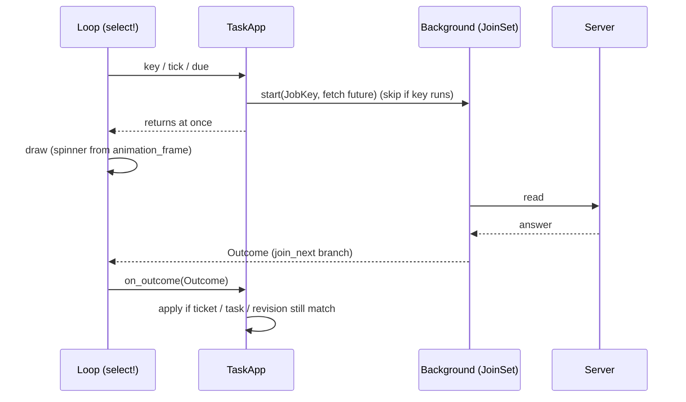
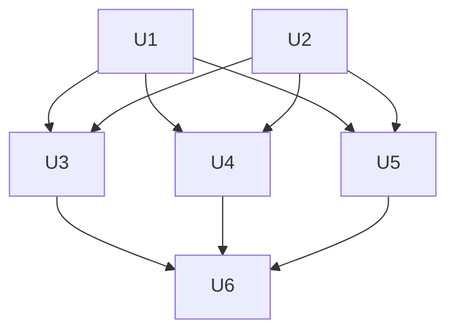

# feat: TUI reads run in the background, with one shared loading marker

## Summary

Every server read of the TUI moves out of the event loop into spawned tasks. Their results come
back to `TaskApp` through one background runner. A new shared spinner shows in the place of the data
while a read runs. Writes stay synchronous. The existing split between "fetch" (needs only an
`ApiClient`) and "apply" (needs `&mut TaskApp`) is already present in the detail and history code
(`DetailRead` / `on_detail_read`, `fetch_first` / `apply_fetched`). The plan extends that split to
the rest.

---

## Problem Frame

`src/tui/mod.rs` awaits `app.perform`, `app.refresh_if_due`, `app.sync_detail` and the first
`app.refresh` inside one `tokio::select!` branch. A slow server freezes drawing and keys, quit
included. The operator also cannot tell "waiting" from "empty". Only a few places have a marker
today (conductor `Standing::Loading`, conversation `loading`, plain "wczytuję…" texts), and none
animates. (see origin: `docs/brainstorms/2026-10-21-tui-asynchroniczne-operacje-i-wskaznik-ladowania-requirements.md`)

---

## Requirements

Carried from the origin document. IDs are the origin IDs.

- R1, R2. The loop never awaits a read. All reads move to the background. Writes stay awaited.
- R3. A result never overwrites a newer view. Details never show data of another task.
- R4, R4a. One run per operation at a time. A newer operation replaces an older one (abort, or discard the result). `r` after a failure may start a new run.
- R5, R6, R7, R8. One animated marker, in place of the data. It goes away on success and on error. It reads without colour and has an ASCII form. On data that is already shown, it is a small mark in the panel title.
- R10. Keys, layout and error texts do not change, except the marker.
- R11. Quit works while reads run.
- AE1–AE6 from the origin. Test scenarios below cite them.

---

## Scope Boundaries

- No change to the protocol or to the server.
- No new keys (no cancel key).
- Writes are not moved to the background. This covers the engine-run requests too: today they are control-plane writes through `ApiClient`, and `grep await src/tui` shows no `engine.run` call. U6 checks this again.
- No progress bar. No colour or layout change. No CLI change.

### Deferred to Follow-Up Work

- Smoother animation than the 250 ms tick.
- A key to cancel a running read.

---

## Context & Research

Relevant code (all repo-relative):

- `src/tui/mod.rs` — the loop (`run`), `TICK` = 250 ms, `wait_until_next_due`.
- `src/tui/task_app/mod.rs` — `TaskApp`, `Request`, `perform`, `refresh`, `refresh_if_due`, `load`, `on_read_failure`, `View`, `enter_view`, `leave_view`, `read_capabilities`.
- `src/tui/task_app/detail.rs` — `sync_detail`, `sync_attempt`, `sync_conversation`, `sync_events`, `on_detail_read`, `DetailRead`, `bounded_read`. Results are stored per task id and carry the row `revision`. This already stops a result of task A from showing in task B.
- `src/tui/task_app/tabs/conductor.rs` — `sync_conductor`, `Standing::Loading`.
- `src/tui/task_app/history.rs` — `read_and_open_history`, `reload_history`, `sync_history`, `plan_history_reads`, `fetch_first`, `fetch_tab`, `apply_fetched`.
- `src/tui/task_app/repositories.rs`, `new_task.rs`, `harness.rs` — `read_and_open_*`, `reload_repositories`, `read_harness_selection`.
- `src/tui/task_app/actions.rs`, `mod.rs::move_task` — writes that call `self.refresh().await` afterwards.
- Panel texts to replace: `tabs/progress.rs` ("wczytuję przebieg…"), `tabs/events.rs`, `tabs/conversation.rs` (`is_loading`), `tabs/conductor.rs`, `repositories.rs` ("✗ nie wczytano"), `layout.rs::render_empty`, `waiting.rs` ("czekam na dane zadania").
- Tests: `tests/tui_state.rs` and `tests/tui_render.rs` call `app.refresh().await`, `app.sync_detail().await` and `app.perform(..).await` against a stub server. `tests/task_app_support/mod.rs` builds tasks without a server. Look at how `tests/tui_render.rs` near the first `app.refresh().await` builds its stub, and reuse it with a delayed answer.
- Learning: `docs/solutions/design-patterns/tui-modal-confirmation-keyboard-contract.md` — a view that takes keys must render on every layout path (the too-small path too) and must show matching bar hints. This applies to the new "opening" view in U4.
- Prior plan `docs/plans/2026-09-26-001-fix-tui-background-engine-runs-plan.md` (completed) did the same for engine runs, in the engine layer. It is not repeated here.

External research: skipped. The code has strong local patterns, and `tokio` is already a dependency (`JoinSet` is in `tokio::task`).

---

## Key Technical Decisions

- **One background runner, `TaskApp::background`.** It holds a `tokio::task::JoinSet<Outcome>` and a map `JobKey → AbortHandle`. A `JobKey` names the operation and its scope, for example `(Refresh)`, `(Detail, task_id, Timeline)`, `(OpenView, History)`. Rationale: `JoinSet` aborts all tasks on drop, which gives R11 for free. The key map gives R4 (skip start if a key runs) and R4a (abort by key or by scope).
- **Fetch and apply are separate.** A job body owns an `ApiClient` clone and returns plain data in an `Outcome`. It never touches `TaskApp`. `TaskApp::on_outcome` applies it. This follows the `DetailRead` and `fetch_first` pattern already in the code.
- **Public async entry points stay.** `refresh()`, `sync_detail()` and the `perform` arms for reads keep their names. They become "start the job, then `drain_jobs()`" wrappers for tests. The loop uses new non-blocking entry points (`start_refresh_if_due`, `start_detail_reads`, `perform` for reads only starts a job). Rationale: the 100+ existing call sites in `tests/` keep working.
- **Stale results (R3).** Detail outcomes carry task id and row revision and are applied to that task's own `view_mut(id)`. That is allowed by R3. When the selection moves, `background.abort_scope(old_task_id)` aborts the old reads (R4a). Open-view outcomes carry a ticket from a counter in `TaskApp`. The counter grows on each view change. An outcome with an old ticket is dropped. List refresh outcomes need no ticket: one refresh runs at a time and `load` is idempotent.
- **Opening a view shows the marker at once.** `n`, `H`, `R`, `h` today read first and open after. Now they open a new `View::Opening(ViewKind)` that renders the spinner with "wczytuję …" text. On success the outcome replaces it with the real view. On error it returns to the previous view and the bar shows the error as today. `Esc` leaves it and bumps the ticket. Rationale: R5 wants the marker in the panel, and a view that opens only after the read would show nothing.
- **Chained reads after writes are started, not awaited.** `move_task`, `reload_history`, `reload_repositories` and the `refresh()` calls in `actions.rs` call a start function. The write itself stays awaited.
- **Spinner frame comes from `TaskApp`, not from a clock.** `TaskApp` has `animation_frame: usize` and `set_animation_frame(n)`. The loop increments it on each tick wake while any job runs. The renderer passes the frame to `Spinner::glyph(frame)`. Tests set the frame. Rationale: answers the origin question about test control, without waiting.
- **ASCII fallback (R7).** `Spinner` has two frame sets: braille (`⠋⠙⠹⠸⠼⠴⠦⠧⠇⠏`) and ASCII (`|/-\`). It picks ASCII when the locale (`LC_ALL`, `LC_CTYPE`, `LANG`, first non-empty) does not name UTF-8, or when `TERM` is `linux` or `dumb`. The choice is made once at start, like `Styles::from_env`. The marker is always glyph + text ("wczytuję…"), so it reads without colour.
- **R8 mark in the title.** When data is shown and a refresh runs, only the panel title gets a trailing glyph. The body is not replaced. A selection change (R3) is not a refresh: the body shows the marker.
- **Failed run and `r` (R4).** A failed job is removed from the map on completion. So a later `r` can start it. No extra flag is needed.

---

## Output Structure

    src/tui/spinner.rs                 (new)
    src/tui/task_app/background.rs     (new)

---

## High-Level Technical Design

This illustrates the intended approach and is directional guidance for review, not implementation specification.

Loop shape after the change: the `select!` has one more branch, `outcome = app.next_outcome()`, enabled only when jobs run. No branch awaits a read.

---

## Implementation Units

### U1. Shared loading marker

**Goal:** One spinner type with a settable frame and an ASCII form.

**Requirements:** R5, R7.

**Dependencies:** none.

**Files:**
- Create: `src/tui/spinner.rs`
- Modify: `src/tui/mod.rs` (declare module)
- Test: unit tests in `src/tui/spinner.rs`; render checks in `tests/tui_render.rs`

**Approach:**
- `Spinner` holds the chosen frame set. `glyph(frame)` returns the glyph for `frame % len`. `label(frame, text)` returns glyph + space + text.
- A pure function takes the env values as arguments (like `no_color_requested`) so a test needs no environment change.
- Store a `Spinner` in `TaskApp` (set from env in `run`, default in `new`).

**Patterns to follow:** `src/tui/style.rs` (`no_color_requested`, `Styles::from_env`).

**Test scenarios:**
- Happy path: frames 0..N give N different glyphs, and frame N equals frame 0.
- Edge: ASCII set has only ASCII chars. Braille set has none.
- Env choice: `LANG=pl_PL.UTF-8` → braille. `LANG=C` → ASCII. `LC_ALL` wins over `LANG`. `TERM=linux` → ASCII. Empty values are skipped.
- `label` output contains the text and the glyph, and has no colour dependence (plain string).

**Verification:** The spinner can be rendered at a chosen frame in a render test.

---

### U2. Background runner

**Goal:** Start, dedupe, abort and collect background jobs.

**Requirements:** R1, R3, R4, R4a, R11.

**Dependencies:** none (U1 is independent).

**Files:**
- Create: `src/tui/task_app/background.rs`
- Modify: `src/tui/task_app/mod.rs` (field, `pub mod`, `next_outcome`, `on_outcome` dispatch, `drain_jobs`, `has_running`, `animation_frame`)
- Test: `tests/tui_state.rs`

**Approach:**
- `JobKey` (enum with scope id where needed), `Outcome` (enum, one variant per job kind, each carrying its key), `Background` (`JoinSet`, `HashMap<JobKey, AbortHandle>`).
- `start(key, future) -> bool` returns false when the key already runs.
- `abort_scope(task_id)` aborts all detail jobs of that task. `abort_all()` for `Esc` of an opening view is not needed; the ticket handles it, and the job may finish and be dropped.
- `next_outcome()` awaits `join_next`, removes the key, skips `JoinError` from aborts. It must not be polled when the set is empty (the loop guards with `has_running`).
- `drain_jobs()` loops `next_outcome` + `on_outcome` until the set is empty. Used by the test wrappers only.
- Add `animation_frame` and `advance_animation()` (increments while `has_running`).

**Test scenarios:**
- Start the same key twice while the first runs: the second returns false, one request reaches the stub (R4).
- Start, finish, start again: runs twice.
- After a failed outcome, the key is free, so a new start works (R4 exception).
- `abort_scope("A")`: job for A never produces an outcome; job for B still does (R4a).
- Dropping `TaskApp` with a hanging job does not hang the test (R11).
- `advance_animation` does not move when no job runs.

**Verification:** A test drives start → drain_jobs → state changed, against a stub that delays.

---

### U3. Task list refresh in the background

**Goal:** `refresh`, first read and due refreshes never block the loop. The list and the header show the marker.

**Requirements:** R1, R2, R4, R5, R6, R8, AE1 (list case), AE3, AE4.

**Dependencies:** U1, U2.

**Files:**
- Modify: `src/tui/task_app/mod.rs` (split `refresh` into fetch of `(listing, harness)` and `on_refresh_outcome`; `refresh_if_due` → `start_refresh_if_due`; `read_capabilities`), `src/tui/task_app/layout.rs` (`render_empty`, header, list title), `src/tui/task_app/actions.rs`, `src/tui/task_app/mod.rs::move_task` (use `start_refresh`)
- Modify: `src/tui/mod.rs` (first read)
- Test: `tests/tui_state.rs`, `tests/tui_render.rs`

**Approach:**
- The fetch keeps the `tokio::join!` of listing and harness. The capabilities read joins the same job when `capabilities` is `None`, so one outcome carries all three.
- Apply: success → `load`, `set_harness_selection`, `set_capabilities`. Failure → `on_read_failure` (same schedule and connection behaviour as today).
- `schedule` must not mark a refresh due again while one runs. `refresh_if_due` checks `is_due` and the running key.
- Empty list and no data yet: `render_empty` shows the marker ("łączę z …" / "brak danych" becomes marker + text only while the refresh job runs and nothing was loaded). Data shown + job running: the list title gets the glyph (R8).
- Keep `refresh()` as `start_refresh` + `drain_jobs()`.

**Test scenarios:**
- Covers AE1. Stub answers the list after a delay. After `start_refresh`, a render shows the marker in the list body, a key (`j`) is handled before the answer, and two frames differ after `set_animation_frame`.
- Covers AE3. Stub fails the list. After `drain_jobs`, no marker, the existing error/connection text shows, the job key is free.
- Covers AE4. List loaded, then a due refresh starts. Render shows the same rows and a glyph in the title only.
- Second `refresh_if_due` while one runs sends no second request.
- `move_task` failing path starts a refresh and returns without waiting.

**Verification:** `app.refresh().await` in existing tests still passes unchanged.

---

### U4. Detail reads and history reads in the background

**Goal:** Timeline, conductor, events, attempts and history tab reads run as jobs. Tabs show the marker while their read runs.

**Requirements:** R1, R2, R3, R4, R4a, R5, R6, R8, AE1, AE2, AE5.

**Dependencies:** U1, U2.

**Files:**
- Modify: `src/tui/task_app/detail.rs` (`sync_detail` → `start_detail_reads` + wrapper; `sync_*` become job builders), `src/tui/task_app/tabs/conductor.rs` (`sync_conductor`), `src/tui/task_app/history.rs` (`sync_history`, `plan_history_reads`, `fetch_*`, `apply_fetched`), tabs `progress.rs`, `events.rs`, `conversation.rs`, `conductor.rs`, `waiting.rs` (marker texts)
- Modify: selection change code in `src/tui/task_app/list.rs` / `mod.rs` (call `abort_scope`)
- Test: `tests/tui_state.rs`, `tests/tui_render.rs`

**Approach:**
- Each job calls the existing client function (keep `bounded_read` and `RELAYED_READ_LIMIT` inside the job) and returns `DetailRead`. `on_outcome` calls the existing `on_detail_read(task_id, revision, read)`. The per-tab `apply(revision, …)` guards stay.
- A job is started only when `needs_read(revision)` says so and its key does not run. After a result arrives and changes the revision need (for example `has_more` events pages), the next `start_detail_reads` call on the next loop pass starts the next page. Replace the inner `for _ in 0..MAX_PAGES` loop with this re-start, and keep `MAX_PAGES` as a per-pass cap if `events` still needs it (decide when touching the code).
- `sync_conversation` rebuild after reads: move the rebuild into the outcome apply step.
- Loop calls `start_detail_reads` after each key, outcome and refresh (where `sync_detail().await` is today).
- Selection moves to another task: `abort_scope(previous_id)`. A read result of the previous task that already sits in the channel is applied to its own view (allowed by R3).
- Marker rule per tab: body shows glyph + text when the tab has no data for the current task and a job runs (or the tab says "not read"). If data is shown, the tab title gets the glyph (R8). Replace the "wczytuję …" static texts with `Spinner::label`. Keep the failure texts as they are (R6, R10).
- History: the plan/fetch split already exists. Wrap `fetch_first` and `fetch_tab` as jobs keyed by history entry key and round. Apply with `apply_fetched`. Guard with the history `revision` already in `Plan`.

**Execution note:** Add the AE2/AE5 tests before changing `sync_detail`. They fail only after the blocking is removed, so write them as state tests against a delayed stub.

**Test scenarios:**
- Covers AE2. Stub delays history of task A. Select A, start reads, select B, then release A. B's view shows B data or the marker, never A data. A's own view holds A data.
- Covers AE5. Select task 1, start its detail read, select task 2. Job of task 1 is aborted (stub sees the connection drop or the outcome is discarded). Detail shows the marker for task 2, not data of task 1.
- Covers AE1 (tab case). Events tab with a 5 s stub: marker shows in the tab body, frames advance, keys work.
- Failure: events read fails. Marker gone, "✗ nie udało się wczytać zdarzeń: …" shows as today (R6).
- Data shown, revision bump starts a re-read: body stays, title has the glyph (R8).
- Runner timeout (`bounded_read`) still gives the "runner nie odpowiada" note.
- Revision guard: an outcome whose revision is lower than the stored one is ignored by `apply`.
- History: opening an entry reads timeline and conductor in the background. Switching entries before the answer drops the old result.

**Verification:** Existing `app.sync_detail().await` tests pass unchanged.

---

### U5. Reads that open a view, and chained reloads

**Goal:** `n`, `H`, `R`, `h` and the reloads after writes do not block. The operator sees the marker at once.

**Requirements:** R1, R2, R3, R4, R5, R6, R10, R11.

**Dependencies:** U1, U2.

**Files:**
- Modify: `src/tui/task_app/mod.rs` (`View::Opening`, `ViewKind` use, `perform` read arms, `enter_view`/`leave_view`, `key_context`, ticket counter), `src/tui/task_app/new_task.rs`, `history.rs` (`read_and_open_history`, `reload_history`), `repositories.rs` (`read_and_open_repositories`, `reload_repositories`), `harness.rs` (`read_and_open_harness`), `layout.rs` (render the opening view on every layout path), `src/tui/keymap.rs` (context for the opening view: `Esc` leaves the view, `q` quits with its normal confirm flow, bar hint "Esc wróć · q wyjdź")
- Test: `tests/tui_state.rs`, `tests/tui_render.rs`

**Approach:**
- `perform(Request::OpenHistory)` and the others: bump the ticket, enter `View::Opening(kind)`, start the job keyed `(OpenView, kind)`. Return at once.
- `on_outcome`: if the ticket still matches and the view is still `Opening`, build the real view from the existing `open_history` / `open_repositories` / `show_new_task` / `open_harness`. On error: `leave_view`, then notify with the existing texts (`note_transport` included).
- `Esc` on `Opening`: `leave_view`, bump ticket. `q` follows the normal quit flow (R11). `Esc` leaves the view only; the read job is not aborted and its result is dropped by the ticket.
- Pressing the same open key again while the key runs does nothing (R4).
- `reload_history` and `reload_repositories` (after a write) start a job whose outcome refreshes the open view only if the ticket and view kind match.
- The `new_task` read keeps its partial-success rule: workflows fail → error; repositories fail → warning and a text field.

**Execution note:** Follow the keyboard contract in `docs/solutions/design-patterns/tui-modal-confirmation-keyboard-contract.md`: the opening view takes keys, shows its own bar hints and renders on the too-small path.

**Test scenarios:**
- Press `H` with a delayed stub: view is `Opening`, render shows marker, `q`/`Esc` work before the answer. After the answer the history view opens.
- `Esc` during opening, then the answer arrives: the history view does not open (stale ticket).
- Press `H`, `Esc`, `R`: only the repositories view opens.
- Error path: the read fails. The view returns to the previous one, the bar shows the same text as today, no marker is left.
- `n` with repositories failing: form opens, warning shows, as today.
- Too-small terminal while `Opening`: renders the too-small notice, keys still follow the opening contract.
- After `add_repository` (write, awaited): reload starts in the background, and the call returns before the reload answer.

**Verification:** Existing tests that call `perform(Request::OpenHistory).await` then inspect the view pass through the `drain_jobs` wrapper.

---

### U6. Loop wiring, quit, and final audit

**Goal:** The loop awaits no read. Quit works at any time.

**Requirements:** R1, R10, R11, AE6.

**Dependencies:** U3, U4, U5.

**Files:**
- Modify: `src/tui/mod.rs`, `src/tui/task_app/mod.rs` (module doc block "Keys → request → perform")
- Test: `tests/tui_state.rs`, `tests/tui_terminal_restore.rs`

**Approach:**
- First read: call `start_refresh` instead of `refresh().await`.
- Add the `select!` branch `outcome = app.next_outcome(), if app.has_running() => app.on_outcome(outcome)`. Add `app.advance_animation()` on the tick wake.
- Replace `refresh_if_due(..).await` and `sync_detail().await` with the start functions. `retry_outgoing_if_due` sends a write (`send_task`); keep it awaited (R2), but check that its read part, if any, uses the start functions.
- Quit: the loop leaves, `TaskApp` drops, `JoinSet` aborts the jobs. Do not `await` jobs on exit. The `TerminalGuard` restores the terminal as today.
- Audit: search `src/tui` for `.await` inside the loop path. Every remaining `.await` must be a write or a test wrapper. Search for `engine.run`/`resume`/`deliver_human_input`: expect none.
- Update the loop sketch in the `task_app/mod.rs` module doc and the "unreachable server" paragraph in `src/tui/mod.rs`.

**Test scenarios:**
- Covers AE6. A job hangs forever. `q` then confirm sets `should_quit`. Dropping the app finishes at once. Restore count rises as in `tui_terminal_restore.rs`.
- Loop pass with all stubs delayed returns without waiting for them (use a bounded `tokio::time::timeout` around one pass).
- `wait_until_next_due` still bounds the sleep by `TICK`, so frames advance while jobs run.

**Verification:** `cargo test` for `tui_state`, `tui_render`, `tui_terminal_restore` passes. A manual run against a slow stub server shows the marker and live keys (do this at implementation time; this plan does not run it).

---

## Dependency Graph

---

## System-Wide Impact

- Tests: many existing tests call async entry points. They keep working through the wrappers. New tests need a stub with a controllable delay.
- Connection state: `note_transport` and `on_read_failure` now run at apply time, not at call time. Order of notices on the bar can change slightly when two reads fail together. Keep the same texts.
- Header, list, tabs, history, repositories, form and harness window all change in render. Keys and layout do not change (R10).

---

## Risks & Dependencies

- **Apply order.** Two jobs of different kinds can finish in any order. Each outcome must be valid alone. Mitigation: per-task views, revision guards, tickets.
- **Busy loop.** `join_next` on an empty set returns `None` at once. Mitigation: the `if app.has_running()` guard, and a test.
- **Abort leaves half state.** Jobs only fetch, so an abort loses nothing. Keep all mutation in `on_outcome`.
- **Events paging** (`MAX_PAGES` loop) changes shape in U4. Check there is no regression in how many pages one pass reads.
- **Marker flicker.** A read that finishes in under one tick shows the marker for one frame. Accepted. Do not add a delay.

---

## Deferred to Implementation

- Exact names of `JobKey` and `Outcome` variants.
- Whether `MAX_PAGES` stays as a per-pass cap.
- Exact marker text per panel (keep the existing Polish words, add the glyph).
- Whether the list header also shows a glyph during the first read, or only the list body.
- Which stub helper in `tests/` to extend for delayed answers.

---

## Sources & References

- Origin: `docs/brainstorms/2026-10-21-tui-asynchroniczne-operacje-i-wskaznik-ladowania-requirements.md`
- Earlier brainstorm, covered by R2: `docs/brainstorms/2026-09-26-tui-nieblokujace-uruchomienia-requirements.md`
- Earlier plan: `docs/plans/2026-09-26-001-fix-tui-background-engine-runs-plan.md`
- Learning: `docs/solutions/design-patterns/tui-modal-confirmation-keyboard-contract.md`
