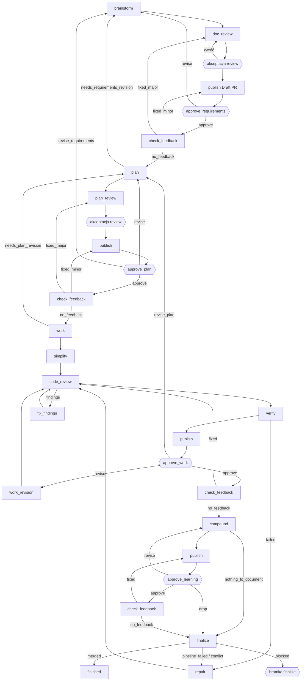
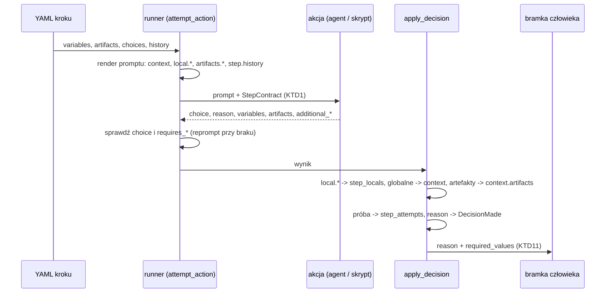
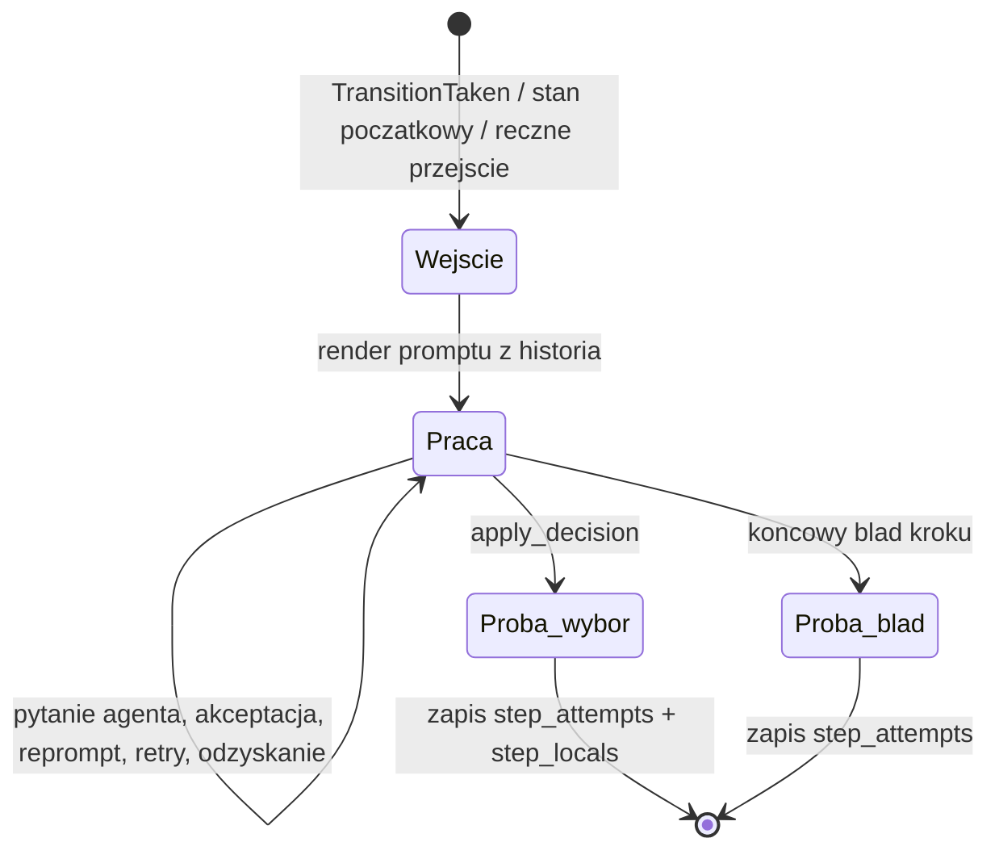
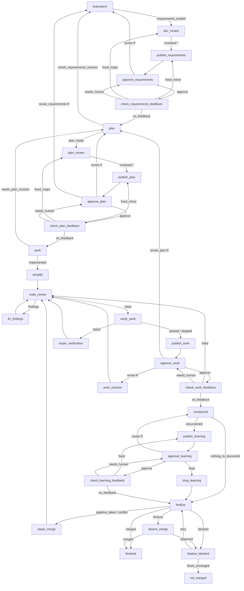

# Kontrakt agenta, historia ponownego wejścia i proces compound - Plan

## Goal Capsule

- **Objective:** proces compound prowadzi zgłoszenie od wymagań do scalonego PR bez obiegów, które powtarzają tę samą pracę. Agent, który wraca do kroku, wie, co już zrobił, a każde przejście wynika z logiki etapu.
- **Means:** nowy kontrakt odpowiedzi agenta (`choice`, `reason`, zdefiniowane zmienne i artefakty, `local.*`), automatyczna historia prób przy ponownym wejściu oraz przebudowany graf `workflows/compound-engineering.yaml`.
- **Product authority:** Artur (jedyny użytkownik). Decyzje z dialogu są w Key Decisions. Przy sprzeczności: R wygrywa w zachowaniu produktu, KTD wygrywa w mechanizmie.
- **Open blockers:** brak.
- **Execution profile:** Deep, dziewięć jednostek (U1–U9) w kolejności z sekcji Sequencing. Każda jednostka kończy się zielonym `cargo test --workspace`.
- **Stop conditions:** zatrzymaj pracę i zgłoś problem, gdy prawdziwy CLI Claude odrzuca nowy schemat odpowiedzi (KTD2) albo gdy decyzja z Key Decisions okazuje się niewykonalna.
- **Who finishes:** `ce-work` implementuje i weryfikuje lokalnie. Publikację i scalenie PR robi Artur albo orkiestrator, który go wywołał.

---

## Product Contract

### Summary

Silnik dostaje nowy kontrakt odpowiedzi agenta. Każdy krok ma jedną definicję swoich zmiennych i artefaktów, a każdy wybór wskazuje, które z nich są wymagane. Przy ponownym wejściu w krok agent dostaje w prompcie listę swoich poprzednich prób oraz własne zmienne lokalne. Workflow compound przechodzi na nowy format i dostaje nowy graf: pięć etapów z review, Draft PR, akceptacją człowieka i automatycznym scaleniem na końcu.

### Problem Frame

Task WRUW-6908 (`task-cffdeab2415749ca9e46d7e73857de91`) przeszedł 4 razy przez obieg `plan → approve_scope → confirm_scope_feedback → plan`, w sumie ok. 4 h. Za każdym razem `plan` startował w świeżej sesji z identycznym promptem. Agent nie wiedział, że już zgłaszał tę samą blokadę i że operator trzy razy odpowiedział `approved` bez notatki. Za każdym razem zwrócił ten sam wynik.

Za tym stoją dwa problemy. Pierwszy to kontrakt agenta. Pole `data` jest dowolne, a jedyna konwencja, którą silnik rozumie, to magiczna nazwa `data.question`. Ta sama ścieżka artefaktu musi być podana dwa razy (`variables.plan_doc` i `artifacts`). Opis zmiennej jest powtarzany przy każdym labelu. Agent nie ma też miejsca na informację dla siebie przy następnym wejściu. Drugi problem to graf compound, który nie odpowiada logice procesu. Nie ma review planu ani Draft PR, a końcowe zatwierdzenie i scalenie nie istnieją. Blokada planera wraca do bramki zakresu, gdzie zwykłe `approved` niczego nie zmienia. Poprawka wiedzy (`learning_review: revise`) wraca do kodu, a `nothing_to_document` kończy proces z pominięciem końcówki.

### Key Decisions

- **`output` zmienia się na `choice`, a `outputs` w YAML na `choices`.** Nazwa lepiej mówi, czym jest pole. (session-settled: user-directed — chosen over zostawienie `output`: bardziej znacząca nazwa pola) Governs R1, R9.
- **Jeden byt dla wyniku agenta: zmienne zdefiniowane na kroku.** Nie ma osobnej deklaracji `data`. Treść, którą silnik ma rozumieć, workflow deklaruje jako zmienne. (session-settled: user-directed — chosen over deklarowane pola `data`: nie mnożyć bytów, które agent musi rozumieć) Governs R2, R7, R8.
- **Wspólna definicja zmiennych i artefaktów na poziomie kroku, a przy wyborze tylko listy wymaganych.** Każda zmienna ma w kroku jedno znaczenie, a kontrakt ma jeden centralny opis. (session-settled: user-directed — chosen over deklaracja przy każdym wyborze: spójne znaczenie i brak powtórzeń opisu) Governs R7, R8, R9.
- **Dwie osobne listy wymagalności i rozdzielony kontrakt.** Agent wpisuje zmienne i artefakty w różne sekcje JSON-a, więc kontrakt mówi o nich osobno. (session-settled: user-directed — chosen over jedna lista `requires`: ten sam podział w YAML, kontrakcie i odpowiedzi) Governs R9, R10.
- **Pamięć kroku to ręcznie zadeklarowane zmienne `local.*`, podawane w prompcie szablonem.** Autor decyduje, gdzie notatka trafia w prompt. (session-settled: user-directed — chosen over automatyczne pole silnika i plik ze wskaźnikiem: kontrola autora, pewność, że agent zobaczy wartość, brak nowego mechanizmu) Governs R12–R15.
- **Historia prób jest automatyczna, ale autor może ją przenieść szablonem.** Chroni przed pętlą także tam, gdzie autor jej nie przewidział. (session-settled: user-approved — chosen over tylko ręczny szablon: tania i bezpieczna informacja) Governs R16–R19.
- **Historia zawiera tylko próby tego kroku.** Szersza historia (droga między wejściami, plik) czeka, aż okaże się potrzebna. (session-settled: user-directed — chosen over próby plus droga od ostatniego wejścia: obecne zmiany mogą wystarczyć) Governs R16.
- **`reason` jest wymagany w kontrakcie, ale tolerowany przy braku.** Brak `reason` nie zatrzymuje procesu. (session-settled: user-approved — chosen over ścisła wymagalność z repromptem: brak jednej linii nie jest powodem do dodatkowej sesji) Governs R3.
- **`description` przy wyborze zostaje opcjonalny.** (session-settled: user-directed — chosen over wymagany opis w krokach agentowych) Governs R9.
- **Twarde przejście na nowy format.** Jedynym użytkownikiem jest Artur, więc nie ma okresu przejściowego. (session-settled: user-directed — chosen over okres przejściowy i wersjonowanie schematu: jeden użytkownik, dwa workflow w repo) Governs R22–R24.
- **Przejścia w grafie compound wynikają z logiki etapu, a nie ze stałego zestawu wyborów bramki.** (session-settled: user-directed — chosen over wspólny zestaw approve/revise/back/skip w każdej bramce) Governs R25–R45.
- **Finalize scala PR automatycznie i czeka na wynik do 1 h.** (session-settled: user-directed — chosen over samo approve i samo zdjęcie Draft) Governs R43–R45.

### Requirements

**Odpowiedź agenta**

- R1. Agent kończy krok obiektem z polami `choice`, `reason`, `variables`, `artifacts`, `additional_data` i `additional_artifacts`.
- R2. `variables` przyjmuje zmienne zdefiniowane na kroku, globalne i `local.*`. Każda z nich ma znaczenie opisane w definicji kroku.
- R3. `reason` to jedna linia uzasadnienia wyboru. Kontrakt oznacza go jako wymagany, ale brak `reason` nie jest błędem akcji. Silnik zapisuje wtedy brak uzasadnienia i idzie dalej.
- R4. `artifacts` to mapa nazwa → ścieżka dla artefaktów zdefiniowanych na kroku. Nazwany artefakt nie powtarza się w `variables`.
- R5. `additional_data` (dowolny obiekt) i `additional_artifacts` (lista ścieżek) przyjmują treść spoza definicji kroku. Silnik ich nie interpretuje i nie przekazuje do kolejnych prób, ale zachowuje je w historii wykonania.
- R6. Pytanie w trakcie pracy (`awaiting_input`, przechwycone `AskUserQuestion`) działa bez zmian.

**Definicja kroku w YAML**

- R7. Krok agentowy definiuje swoje zmienne (globalne i `local.*`) z nazwą i opisem.
- R8. Krok agentowy definiuje swoje artefakty z nazwą i opisem. Kolejne kroki odwołują się do nich szablonem z własną przestrzenią nazw artefaktów.
- R9. Każdy wybór (`choices`) ma `label`, opcjonalny `description`, listę `requires_variables` i listę `requires_artifacts`. Listy zawierają tylko nazwy zdefiniowane na kroku.
- R10. Kontrakt w prompcie pokazuje zmienne i artefakty kroku z opisami oraz, przy każdym wyborze, osobno wymagane zmienne i osobno wymagane artefakty.
- R11. Walidator odrzuca odwołanie w `requires_*` do nazwy, której krok nie definiuje.

**Zmienne lokalne kroku**

- R12. Zmienna `local.*` jest widoczna tylko w swoim kroku i nie trafia do kontekstu globalnego.
- R13. Wartość `local.*` żyje w obrębie jednego wykonania. Przy kolejnym wejściu w ten sam krok jest dostępna w prompcie przez `{{ local.NAZWA }}`.
- R14. Przy pierwszym wejściu `{{ local.NAZWA }}` renderuje się jako pusty tekst, a nie jako błąd szablonu.
- R15. Gdy próba nie ustawi `local.*`, zostaje poprzednia wartość. Nowa wartość zastępuje starą w całości.

**Historia ponownego wejścia**

- R16. Przy drugim i każdym kolejnym wejściu w krok agentowy w tym samym wykonaniu silnik dokleja do promptu numer wejścia i listę poprzednich prób tego kroku, każdą jako `choice` + `reason`. Próba zakończona błędem jest pokazana jako błąd z jego rodzajem.
- R17. Przy pierwszym wejściu silnik nie dokleja niczego.
- R18. Gdy prompt kroku zawiera szablon historii, silnik wstawia historię w to miejsce i nie dokleja jej drugi raz.
- R19. Krok może wyłączyć automatyczną historię.

**Bramka człowieka po kroku agenta**

- R20. Bramka, do której prowadzi wybór agenta, pokazuje `reason` oraz wartości zmiennych wymaganych przez ten wybór. Silnik nie rozpoznaje już specjalnego klucza `question`.
- R21. Bramki człowieka używają `choices`, ale nie mają `reason`, `local.*` ani artefaktów.

**Przejście na nowy format**

- R22. Silnik przyjmuje tylko nowy format YAML i nowy format odpowiedzi agenta.
- R23. `workflows/open-mercato-sdlc.yaml` zostaje przepisany na nowy format bez zmiany logiki procesu.
- R24. `WORKFLOW_SCHEMA.md` i `DOMAIN_MODEL.md` opisują nowy kontrakt, a `ARCHITECTURE_DECISIONS.md` dostaje nową decyzję.

**Proces compound: zasady wspólne**

- R25. `workflows/compound-engineering.yaml` zostaje przebudowany na pięć etapów: wymagania, plan, implementacja, wiedza, zakończenie (R27–R45). Etapy używają nowego kontraktu.
- R26. `revise` w każdej bramce wymaga komentarza i wznawia sesję autora etapu. Pętle naprawcze mają `max_entries`.

**Etap 1: Wymagania**

- R27. Ścieżka: brainstorm → doc_review → akceptacja wyniku review przez człowieka → publish (tworzy PR jako Draft albo wypycha do istniejącego) → `approve_requirements` → check_feedback → plan.
- R28. Brainstorm pyta człowieka w trakcie sesji. Krok `clarify_direction` znika.
- R29. Akceptacja wyniku review: zatwierdź albo zwróć do review z komentarzem.
- R30. `approve_requirements`: `approve` → check_feedback; `revise` → brainstorm; `abandon` → koniec.
- R31. check_feedback (po bramce): `no_feedback` → plan; `fixed_minor` → publish → bramka; `fixed_major` → doc_review → … → bramka; `needs_human` → bramka. Agent ocenia skalę zmiany i uzasadnia ją w `reason`.

**Etap 2: Plan**

- R32. Ścieżka: plan → plan_review → akceptacja wyniku review → publish → `approve_plan` → check_feedback → work. Wzorzec review i check_feedback jest taki sam jak w R29 i R31, z plan_review w miejscu doc_review.
- R33. `plan: needs_requirements_revision` → brainstorm. Wymagania poprawia ich autor, a potem przechodzą przez ponowną akceptację wymagań.
- R34. `approve_plan`: `approve` → check_feedback; `revise` → plan; `revise_requirements` → brainstorm; `abandon` → koniec.

**Etap 3: Implementacja**

- R35. Ścieżka: work → simplify → code_review → verify (skrypt) → publish → `approve_work` → check_feedback → compound.
- R36. `work: needs_plan_revision` → plan.
- R37. `code_review: findings` → fix_findings → code_review.
- R38. `verify: failed` → repair → code_review → verify. `verify: skipped` → publish.
- R39. Każda zmiana kodu po bramce przechodzi przez code_review → verify → publish → `approve_work`, bez ponownego simplify.
- R40. `approve_work`: `approve` → check_feedback; `revise` → work_revision (→ R39); `revise_plan` → plan; `abandon` → koniec. check_feedback: `no_feedback` → compound; `fixed` → R39; `needs_human` → bramka.

**Etap 4: Wiedza**

- R41. Ścieżka: compound → publish → `approve_learning` → check_feedback → finalize. `compound: nothing_to_document` → finalize.
- R42. `approve_learning`: `approve` → check_feedback; `revise` → compound; `drop` → usunięcie dokumentu wiedzy → finalize. Bramka nie ma `abandon`. check_feedback: `no_feedback` → finalize; `fixed` → publish → bramka.

**Etap 5: Zakończenie**

- R43. finalize zdejmuje flagę Draft, zatwierdza PR i ustawia scalenie po udanym pipeline. Krok kończy się dopiero po faktycznym scaleniu albo po przeszkodzie.
- R44. finalize: `merged` → finished; `pipeline_failed` lub `conflict` → repair → code_review → verify → publish → `approve_work`; `blocked` → bramka człowieka z `reason` (ponów finalize albo zakończ bez scalenia).
- R45. finalize czeka na wynik najwyżej 1 h. Po tym czasie wybiera `blocked`.

### Key Flows

Diagram pomija `abandon` i `needs_human` (powrót do bramki etapu). Pełne przejścia są w R27–R45.

- F1. Ponowne wejście w krok z pamięcią
  - **Trigger:** proces wraca do kroku agentowego w tym samym wykonaniu.
  - **Steps:** silnik renderuje prompt z `{{ local.* }}` z poprzedniej próby; dokleja historię prób (R16), jeśli autor nie umieścił jej szablonem; dokleja kontrakt (R10).
  - **Outcome:** agent zna numer wejścia, swoje poprzednie wybory z uzasadnieniem i swoje notatki.
  - **Covered by:** R10, R12–R19

### Acceptance Examples

- AE1. **Covers R16, R17.** Given krok `plan` wchodzi pierwszy raz, when silnik buduje prompt, then prompt zawiera tylko prompt autora i kontrakt. Given to 4. wejście po trzech próbach `needs_requirements_revision`, when silnik buduje prompt, then prompt zawiera „4. wejście” i trzy linie `needs_requirements_revision — <reason>`.
- AE2. **Covers R13–R15.** Given próba 1 ustawiła `local.memory = "A"`, a próba 2 jej nie ustawiła, when następuje wejście 3, then `{{ local.memory }}` = „A”. Given próba 3 ustawi „B”, when następuje wejście 4, then wartość to „B”, a nie „A” + „B”.
- AE3. **Covers R14.** Given prompt zawiera `{{ local.memory }}`, when to pierwsze wejście, then szablon renderuje się pusto i akcja startuje.
- AE4. **Covers R3.** Given agent zwrócił poprawny `choice` bez `reason`, when silnik czyta odpowiedź, then przejście następuje bez repromptu, a historia pokazuje brak uzasadnienia.
- AE5. **Covers R18.** Given prompt kroku zawiera szablon historii, when następuje 2. wejście, then historia pojawia się raz, w miejscu szablonu.
- AE6. **Covers R20.** Given `plan` wybiera `needs_requirements_revision` z wymaganą zmienną opisującą blokadę, when wybór prowadzi do bramki, then bramka pokazuje `reason` i wartość tej zmiennej.
- AE7. **Covers R44, R45.** Given finalize ustawił scalenie po pipeline, when pipeline pada, then wybór to `pipeline_failed` i proces idzie do repair. When po 1 h nie ma scalenia ani porażki, then wybór to `blocked`.
- AE8. **Covers R41.** Given compound wybiera `nothing_to_document`, when następuje przejście, then proces idzie do finalize, a nie do finished.

### Scope Boundaries

- Plik z rozszerzoną historią (droga między wejściami, odpowiedzi z bramek, zmiany workspace'u) jest odłożony do czasu, aż okaże się potrzebny.
- Wspólny dziennik decyzji między krokami i dostęp agenta do transkryptów poprzednich sesji są poza zakresem.
- Automatyczne wykrywanie pętli przez silnik (porównywanie odpowiedzi, hash promptu, postęp w grafie) jest poza zakresem.
- `open-mercato-sdlc.yaml` zmienia tylko format, a nie logikę.
- `abandon` nie zamyka PR.
- Okres przejściowy i obsługa starego formatu nie istnieją. Trwające zadania ze starym formatem (w tym WRUW-6908) nie wznowią się po aktualizacji.

### Dependencies / Assumptions

- Ustawienia projektu GitLab pozwalają tożsamości, z której działa agent, zatwierdzić własny MR i ustawić scalenie po pipeline. Gdy nie pozwalają, finalize wybiera `blocked` (R44). Potwierdza to Artur, a nie silnik.
- Zatwierdzenie i scalenie robi agent narzędziem `glab`, zgodnie z konwencją repo.
- Scalenie to nieodwracalna operacja w zdalnym repo. Wszystkie wcześniejsze bramki człowieka są jedyną kontrolą przed nią.

### Outstanding Questions

Pytania odłożone do planowania mają odpowiedź w Planning Contract:

- Szablon historii i wyłącznik (R18, R19): KTD9.
- Odwołanie do nazwanych artefaktów (R8): KTD7.
- Limity `max_entries` i długość `reason` (R26, R3): KTD9, KTD15.
- `local.*` w `requires_variables` (R15): KTD10.
- Mapowanie `inputs` i `resume_comment_field` na `choices` (R21, R26): KTD12.
- `reason` w TUI i na osi czasu: KTD11, KTD13, U6.

### Sources / Research

- Pętla: zdarzenia wykonania `67d1fd36-a0c6-427a-983d-4740283ca425` (sekwencje 54–143) i adnotacja conductora `91a35678-…` w storage tasku `task-cffdeab2415749ca9e46d7e73857de91`.
- Kontrakt wyjścia i schemat JSON: `crates/narsor-engine/src/engine/actions/agent.rs` (`output_contract`, `output_schema`).
- Konwencja `data.question`: `crates/narsor-engine/src/engine/runner.rs` (`output_requirements`, `agent_answer`).
- Wznowienie sesji autora przy bramce: `crates/narsor-engine/src/engine/runner.rs` (`suspend_for_input`, `resume_comment_field`).
- Szablony, `max_entries`, `requires_variables`: `WORKFLOW_SCHEMA.md` (sekcje o zakresie szablonów i wyjściach).
- Dostęp harnessów do ścieżek tylko do odczytu: `crates/narsor-engine/src/engine/actions/harness/claude_code.rs`.
- Obecny graf: `workflows/compound-engineering.yaml`.

**Product Contract preservation:** Product Contract unchanged. Outstanding Questions are resolved in place by links to KTDs. AE6 is checked on a test workflow where `needs_requirements_revision` leads to a gate. In `compound-engineering.yaml` the same choice leads to brainstorm, as R33 says.

---

## Planning Contract

### Key Technical Decisions

- KTD1. **Krok niesie jeden kontrakt: definicje zmiennych, artefaktów i wyborów.** Stan w YAML dostaje pola `variables`, `artifacts` i `choices`. Silnik przekazuje do akcji cały kontrakt kroku, a nie tylko listę wyborów. Dzisiaj `ActionRequest` zna tylko `outputs` (`crates/narsor-engine/src/engine/actions/mod.rs`). Kontrakt w prompcie (R10) potrzebuje też opisów zmiennych i artefaktów. Definicje są dozwolone na krokach agentowych i skryptowych. Bramka człowieka ma tylko `choices` i `inputs` (R21). Instancjonuje Key Decisions o wspólnej definicji i dwóch listach (session-settled: user-directed — chosen over deklaracja przy każdym wyborze: spójne znaczenie i brak powtórzeń opisu). Governs R7–R11.
- KTD2. **Schemat JSON zostaje jednym płaskim obiektem i nie ma pól wymaganych.** API Claude odrzuca `anyOf`/`oneOf` na poziomie głównym (`docs/solutions/integration-issues/claude-code-json-schema-rejects-top-level-anyof-2026-10-17.md`). Wariant `awaiting_input` nie ma `choice`, więc schemat nie może wymagać `choice` ani `reason`. Wymagalność `reason` (R3) i list `requires_*` (R9) opisuje tekst kontraktu, a sprawdza silnik po odczycie. Właściwości: `choice` (enum), `reason`, `variables` (obiekt), `artifacts` (obiekt nazwa → ścieżka), `additional_data` (obiekt), `additional_artifacts` (tablica ścieżek) oraz bez zmian `status`, `question`, `options` (R6). Tekstowy fallback dla harnessów bez schematu zostaje.
- KTD3. **Skrypt używa tego samego kontraktu JSON co agent.** `parse_json_output` (`crates/narsor-engine/src/engine/actions/script.rs`) czyta dziś `output`, `data`, `artifacts`, `variables`. Po zmianie agent i skrypt mają jeden parser obiektu wyniku z kluczami z R1. Uzasadnienie: R22 przyjmuje tylko nowy format, a dwa kontrakty z kluczem `output` i `choice` rozjechałyby się w dokumentacji i fixture'ach. Skrypt może podać `reason`. Mapowanie `exit_codes` zostaje.
- KTD4. **`ActionResult` dostaje typowane pola zamiast worka `data`.** Nowe pola: `reason`, `artifacts` (mapa nazwa → ścieżka), `additional_data`, `additional_artifacts`. Pole `data` zostaje tylko dla zapisów silnika (`agent_session`, `timeout_secs`). Agent i skrypt nie piszą do niego. `ActionResult` dostaje konstruktor albo `Default`, bo dzisiaj 15 plików buduje go literałem.
- KTD5. **Zmienna spoza definicji kroku nie trafia do kontekstu i nie wywołuje repromptu.** Silnik przenosi ją do `additional_data` i zapisuje ostrzeżenie w historii wykonania. Wyjątek: `agent_session_id`, który zapisuje sam silnik (`SESSION_ID_VARIABLE` w `agent.rs`). Uzasadnienie: reprompt kosztuje dodatkową sesję, a R2 mówi tylko, co `variables` przyjmuje.
- KTD6. **Zadeklarowana zmienna bez wartości renderuje się pustym tekstem.** Dotyczy `{{ local.X }}` (R14), `{{ context.X }}`, gdy jakiś krok deklaruje `X` albo bramka ma pole `X` w `inputs`, oraz `{{ artifacts.X }}`, gdy jakiś krok definiuje artefakt `X`. Dzięki temu `plan` i `compound` mogą odwołać się do własnego dokumentu: przy pierwszym wejściu render jest pusty, a przy kolejnym krok poprawia istniejący dokument. Odwołanie do niezadeklarowanej i nieustawionej zmiennej jest nadal błędem (`TemplateError::UnknownVariable`). Bez tej reguły `plan: needs_requirements_revision` (R33) i `work: needs_plan_revision` (R36) nie przekażą opisu blokady do kroku docelowego, bo szablony są ścisłe, a historia (R16) pokazuje tylko próby tego samego kroku.
- KTD7. **Artefakty mają w szablonach własny korzeń `{{ artifacts.NAZWA }}`.** Wartość to ścieżka ostatniego zapisu artefaktu o tej nazwie w wykonaniu. Kilka kroków może definiować tę samą nazwę. Walidator sprawdza, że nazwa z szablonu jest zdefiniowana na którymś kroku. Silnik nadal zapisuje artefakt w `context.artifacts` i emituje `ArtifactCreated`.
- KTD8. **Wejście i próba mają własną definicję i własny zapis.** Wejście to przejście do kroku (`TransitionTaken`), stan początkowy, ręczne przejście operatora albo cofnięcie decyzji przez dyrygenta. Nowym wejściem nie jest: wznowienie po pytaniu agenta, powrót z akceptacji, reprompt, ponowienie z `retry_policy` i odzyskanie po awarii. Próba to wynik wejścia: wybór z `reason` albo błąd z jego rodzajem. Silnik zapisuje próby w `metadata.engine.step_attempts`, a `local.*` w `metadata.engine.step_locals`. Oba zapisy powstają w `apply_decision` (albo przy końcowym błędzie kroku) w tym samym `save_execution` co kontekst. Migawka decyzji dyrygenta zawiera oba zapisy, więc cofnięcie je przywraca. Licznik `state_entries` i `max_entries` zostają bez zmian. Reset limitu wejść nie zmienia numeracji historii.
- KTD9. **Historia ma szablon `{{ step.history }}` i wyłącznik `history: false` na akcji agenta.** Blok historii zawiera numer wejścia i listę prób `choice — reason`, a błąd jako `błąd: <rodzaj>`. Blok mówi wprost, że to dane, a nie polecenia. Limity: ostatnie 20 prób, `reason` do 300 znaków w bloku, cały blok do 4 KB. Silnik czyści tekst funkcjami `narsor_protocol::display::without_unsafe_chars*`. Wznowiona sesja (`continuation_config`) nie dostaje historii ani ponownego renderu `local.*`, bo jej prompt to tylko wiadomość operatora. Instancjonuje Key Decision o automatycznej historii (session-settled: user-approved — chosen over tylko ręczny szablon: tania i bezpieczna informacja). Governs R16–R19.
- KTD10. **Wymagana zmienna `local.*` jest spełniona przez wartość zachowaną z poprzedniej próby.** To wynika z R15. Wymaganie sprawdza wartość po scaleniu nowej odpowiedzi z zachowanym stanem.
- KTD11. **Bramka po kroku agenta albo skryptu dostaje `reason` i wartości wymaganych pól zamiast `question`.** Dzisiaj silnik zapisuje kontekst bramki tylko po kroku agentowym (`is_agent(state)` w `apply_decision` i `complete_step`). Po zmianie robi to też po kroku skryptowym, bo skrypt ma ten sam kontrakt (KTD3), a `finalize_blocked` musi pokazać powód (R44). Wybór `timeout` dostaje `reason` wygenerowany przez silnik z limitu czasu kroku. `HumanInputRequest.question` i `LastAgentStep.question` zmieniają się na `reason` oraz `required_values` (nazwa, rodzaj: zmienna albo artefakt, wartość do 2 KB). `OutputRequirement` ma listy `variables` i `artifacts`, bez `data`. Brak `reason` bramka pokazuje jako „brak uzasadnienia”. Wybór bez wymaganych pól pokazuje tylko `reason`. Zdarzenie `HumanInputRequested` dostaje te same pola z `#[serde(default)]`. CLI zamienia `--data` na `--artifact NAZWA=ŚCIEŻKA`.
- KTD12. **Bramka używa `choices`, a reguła mapowania pola wyboru zostaje.** Jedno pole `select` z opcjami równymi etykietom wyborów daje wybór. Bez pola wybór pochodzi z menu wyborów. `resume_comment_field` zostaje na wyborze. Pole komentarza może być opcjonalne w `inputs`. Silnik odrzuca wybór z `resume_comment_field`, gdy komentarz jest pusty (R26). Dzisiaj walidator wymaga, żeby to pole było wymagane zawsze, więc komentarz był obowiązkowy także przy `approve`.
- KTD13. **Nazwy pól w zdarzeniach zostają.** `output_label` w zdarzeniach to wewnętrzny protokół. Zmiana nazwy dotknęłaby TUI, runnera i testów bez zysku dla R22. Nowe pola: `ActionCompleted.reason`, `ActionFailed.error_type`, a `DecisionMade.reasoning` dostaje `reason` agenta. Każde nowe pole ma `#[serde(default)]` (`docs/solutions/architecture-patterns/auto-resume-policy-for-lost-workloads-2026-10-11.md`).
- KTD14. **`finalize` to krok skryptowy z `glab`, z wewnętrznym limitem 60 min.** Skrypt zdejmuje Draft, zatwierdza MR i ustawia scalenie po udanym pipeline. Potem sprawdza stan MR do scalenia, porażki pipeline, konfliktu albo upływu czasu. Przy każdym wyniku innym niż `merged` skrypt wyłącza scalenie automatyczne i przywraca Draft, żeby MR nie scalił się bez człowieka. Po wyłączeniu skrypt czyta stan MR jeszcze raz i wybiera `merged`, gdy pipeline zdążył scalić MR. Ponowiony `finalize` najpierw sprawdza, czy MR jest już scalony. Skrypt drukuje kontrakt JSON z `choice` i `reason` (KTD3). Krok ma `timeout: 70m` i wybór `timeout`. Silnik zabija proces po przekroczeniu czasu, więc sprzątanie w skrypcie nie działa. Dlatego `timeout` prowadzi do osobnego kroku skryptowego `disarm_merge`: wyłącza scalenie automatyczne, przywraca Draft i czyta stan MR (`merged` → `finished`, `disarmed` → `finalize_blocked`). To zmienia założenie z Dependencies / Assumptions, że scalenie robi agent: robi je skrypt pod tą samą tożsamością GitLab. Gałąź docelowa pochodzi z MR, a nie ze stałej `main` (`docs/solutions/logic-errors/workspace-ref-hardcoded-main-ignored-default-branch-2026-10-19.md`). Agent z pętlą odpytywania odpada: limit tur i czas narzędzi mogą go zatrzymać, a przekroczenie czasu nie daje `reason`.
- KTD15. **Graf compound ma osobne kroki naprawy i limity pętli.** `repair_verification` (z `verify_work`) i `repair_merge` (z `finalize`) są osobnymi krokami, bo dostają inny kontekst błędu. Oba prowadzą do `code_review` (R38, R44). `drop_learning` to krok agenta, bo bramka nie może usunąć pliku (R42). `disarm_merge` to krok skryptowy po `timeout` w `finalize` (KTD14). „Zakończ bez scalenia” prowadzi do stanu końcowego `not_merged`. Limity: `code_review` 10 (5 wyczerpuje się w zwykłym przebiegu z poprawkami po bramkach), `repair_verification` 5, `repair_merge` 3.
- KTD16. **Stare wykonania kończą się jawnym błędem odczytu.** `definition.yaml` wykonania jest parsowany z `deny_unknown_fields`, więc stary plik daje błąd „unknown field `outputs`”. Nie ma migracji. Twarde przejście dotyczy definicji workflow oraz odpowiedzi agenta i skryptu. Zapisane rekordy silnika (`pending_input.json`, zdarzenia) czytają się dalej przez `#[serde(default)]`, bo bez tego nie da się odczytać historii starych zadań. Takie zadanie nie wznowi się, bo jego `definition.yaml` się nie wczyta. Instancjonuje Key Decision o twardym przejściu (session-settled: user-directed — chosen over okres przejściowy i wersjonowanie schematu: jeden użytkownik, dwa workflow w repo). Governs R22.
- KTD17. **Odpowiedź kroku bez tekstu to `reason` i `additional_data`.** Commit 4261956 dodał `data_reply`: gdy agent nie napisał tekstu, `{{ steps.X.reply }}` pochodzi z `data`. Po zmianie źródłem jest `reason`, a pod nim niepuste `additional_data` jako JSON.

### High-Level Technical Design

Przepływ kontraktu przez silnik:

Cykl wejścia i próby (KTD8):

Graf `workflows/compound-engineering.yaml` z nazwami stanów. Gwiazdka oznacza `requires_human_approval` (R29). `(R)` oznacza wybór z `resume_comment_field` (R26).

`abandon` z `approve_requirements`, `approve_plan` i `approve_work` prowadzi do `cancelled`. Kontrakty kroków w nowym grafie:

| Krok | Wymagane przy wyborze |
|---|---|
| `brainstorm` | `requirements_drafted`: artefakt `requirements_doc` |
| `doc_review`, `plan_review` | `reviewed`: zmienna `review_summary` (liczba uwag według wagi, co poprawiono, co zostało) |
| `publish_*` | `published`: zmienna `pr_url` |
| `plan` | `plan_ready`: artefakt `plan_doc`; `needs_requirements_revision`: zmienna `requirements_blocker` |
| `work` | `implemented`: zmienna `test_baseline`; `needs_plan_revision`: zmienna `plan_blocker` |
| `compound` | `documented`: artefakt `learning_doc` |

### Assumptions

- `not_merged` ma status końcowy `cancelled`, bo praca nie trafiła do gałęzi docelowej.
- Pierwsze `approve_work: revise` uruchamia `work_revision` w nowej sesji z komentarzem jako wiadomością. Kolejne `revise` wznawiają sesję `work_revision`. R26 mówi o sesji autora etapu, a autorem poprawek w etapie 3 jest `work_revision` (R40).
- Środowisko runnera ma `glab` z uwierzytelnieniem do projektu GitLab. Bez tego `finalize` wybiera `blocked` z `reason`.
- Pierwsza publikacja tworzy Draft MR przez `ce-commit-push-pr` z poleceniem w prompcie. Kolejne publikacje wypychają do tego samego MR.
- Po `finalize → repair_merge` proces przechodzi ponownie przez `compound`. Krok widzi w historii swoją poprzednią próbę i aktualizuje istniejący dokument albo wybiera `nothing_to_document`.

### System-Wide Impact

- **Persystencja:** nowe rekordy `metadata.engine.step_attempts` i `step_locals` (KTD8). Stare `pending_input.json` nadal się wczytują, bo nowe pola mają `#[serde(default)]`. Stare `definition.yaml` dają jawny błąd (KTD16).
- **Protokół i klienci:** `PendingHumanInputView`, `OutputRequirementView`, `ConductorAnalysisView`, `ActionResultView`, `HumanInputDeliveryDto` zmieniają pola. Kolejność aktualizacji jak w `docs/operations/remote-backends.md`: control plane, kontrolery, klienci.
- **Dyrygent:** prompt i schemat odpowiedzi dyrygenta (`conductor/prompt.rs`, `conductor/response.rs`, `conductor/proposal.rs`) przechodzą z `data` na `artifacts`. Złoty plik `tests/fixtures/conductor/prompt_choose_output.txt` się zmienia.
- **Bezpieczeństwo treści:** `reason`, historia i wartości zmiennych to tekst agenta. Każde miejsce wyświetlenia i każdy prompt czyści go i ogranicza (KTD9, KTD11; `docs/solutions/security-issues/untrusted-agent-text-unclosed-brace-scan-quadratic-2026-10-18.md`). Limit `MAX_BRACE_CANDIDATES` zostaje.
- **Zdalne repo:** `finalize` scala MR. To nieodwracalna operacja. Kontrolą są bramki człowieka przed nią (Dependencies / Assumptions).

### Risks and Mitigation

| Ryzyko | Mitygacja |
|---|---|
| Prawdziwy CLI Claude odrzuca nowy schemat | Nagraj ponownie `tests/fixtures/claude-code/schema_*.ndjson` i uruchom test `the_real_claude_binary_answers_through_the_json_schema` z `--include-ignored` (U2). |
| Zmiana kontraktu jest szeroka: 68 fixture'ów YAML, 22 pliki testów z `outputs:` | U1 migruje wszystkie fixture'y w jednym commicie. Konstruktor `ActionResult` (KTD4) zmniejsza zmiany w U2. |
| Historia w prompcie to kanał prompt injection | Blok oznaczony jako dane, czyszczony i ograniczony do 4 KB (KTD9). |
| MR scala się po wyniku innym niż `merged` | `finalize` wyłącza scalenie automatyczne i przywraca Draft przed wyjściem. Po przekroczeniu czasu robi to `disarm_merge` (KTD14). |
| Zmiana ścisłości szablonów ukrywa literówki | Reguła pustej wartości dotyczy tylko nazw zadeklarowanych (KTD6). Walidator sprawdza odwołania `local.*` i `artifacts.*` statycznie (U1, U3). |

### Sequencing

U1 → U2 → U3 → U5 → U4 → U6 → U7 → U8 → U9. U5 (pamięć i historia) idzie przed U4 (bramka), bo oba zmieniają `apply_decision`, a U4 korzysta z odczytu wymaganych wartości z U3. U7 i U8 zależą od całego silnika. U9 opisuje stan końcowy.

---

## Implementation Units

### U1. Schemat YAML: `choices` i definicje kroku

- **Goal:** loader i walidator przyjmują nowy format kroku i tylko ten format.
- **Requirements:** R7, R8, R9, R11, R21, R22; KTD1, KTD12, KTD16.
- **Dependencies:** brak.
- **Files:**
  - `crates/narsor-engine/src/workflow/schema.rs`, `crates/narsor-engine/src/workflow/loader.rs`, `crates/narsor-engine/src/workflow/validator.rs`
  - `crates/narsor-engine/src/domain/workflow_definition.rs`
  - wszystkie pliki `tests/fixtures/**/*.yaml` z `outputs:`, wstawki YAML w `tests/*.rs`, `crates/narsor-runner/src/runner/snapshot.rs`
  - `workflows/compound-engineering.yaml`, `workflows/open-mercato-sdlc.yaml` (tylko zmiana nazw kluczy)
  - testy: `tests/schema_loading.rs`, `tests/validation.rs`, nowe `tests/fixtures/invalid/*.yaml`
- **Approach:**
  1. `StateSchema` dostaje `variables: [{name, description}]`, `artifacts: [{name, description}]` i `choices` w miejscu `outputs`. Wybór ma `label`, `description`, `requires_variables`, `requires_artifacts`, `requires_human_approval`, `resume_comment_field`. Forma wyboru jako sam tekst zostaje. Forma `{name, description}` w `requires_variables` znika.
  2. `AgentActionSchema` dostaje `history: bool` (domyślnie `true`).
  3. Domena: `State.outputs` zmienia się na `choices`, a `OutputDefinition` na definicję wyboru z dwiema listami nazw. Komunikaty `ValidationError` mówią o wyborach.
  4. Walidator: nazwy w `requires_*` muszą być zdefiniowane na kroku. Zmienna może mieć prefiks `local.`. `local.*` tylko na kroku agentowym. Bramka nie ma `variables` ani `artifacts`. `resume_comment_field` wskazuje pole tekstowe, które może być opcjonalne.
  5. Mechaniczna migracja fixture'ów i obu workflow: `outputs` → `choices`, opisy z `requires_variables` → `variables` kroku.
- **Patterns to follow:** własny `Deserialize` dla `OutputSchema` (forma tekst albo obiekt); wzorzec `ValidationError` i plików `tests/fixtures/invalid/`.
- **Test scenarios:**
  - Krok z `variables`, `artifacts` i `choices` z obiema listami ładuje się, a domena ma te same nazwy.
  - YAML z kluczem `outputs` daje błąd „unknown field”.
  - `requires_variables: [missing]`, gdy krok nie definiuje `missing`, daje błąd walidacji z nazwą kroku i zmiennej.
  - `requires_artifacts: [plan_doc]` bez definicji artefaktu daje błąd walidacji.
  - `local.memory` w `variables` kroku skryptowego daje błąd walidacji.
  - Bramka z `variables` daje błąd walidacji.
  - `resume_comment_field` wskazujący opcjonalne pole tekstowe przechodzi walidację.
  - Wbudowane workflow po migracji przechodzą walidację (istniejący test w `tests/builtin_workflows.rs`).
- **Verification:** `cargo test --workspace` zielony. W repo nie ma klucza `outputs:` w plikach YAML.

### U2. Kontrakt odpowiedzi agenta i skryptu

- **Goal:** agent i skrypt zwracają obiekt z R1, a silnik go czyta.
- **Requirements:** R1–R6, R10, R22; KTD2, KTD3, KTD4, KTD17.
- **Dependencies:** U1.
- **Files:**
  - `crates/narsor-engine/src/engine/actions/agent.rs`, `crates/narsor-engine/src/engine/actions/script.rs`, `crates/narsor-engine/src/engine/actions/mod.rs`
  - `crates/narsor-engine/src/engine/actions/harness/claude_code/tools.rs`
  - `crates/narsor-engine/src/domain/workflow_execution.rs`
  - `tests/fixtures/claude-code/*.ndjson` i README tam, `tests/fixtures/harness/fake_harness.sh`, `tests/fixtures/scripts/*.sh`, `tests/fixtures/cli/announce.sh`
  - testy: `tests/actions_agent.rs`, `tests/actions_script.rs`, `tests/claude_code_classification.rs`
- **Approach:**
  1. `ActionRequest` niesie `StepContract` (definicje i wybory) w miejscu `outputs` (KTD1).
  2. `output_contract` pokazuje zmienne i artefakty kroku z opisami, a przy każdym wyborze osobno wymagane zmienne i artefakty (R10). Tekst mówi, że `reason` jest wymagany. Instrukcje `awaiting_input` zostają (R6).
  3. `output_schema` według KTD2.
  4. Parser: `is_answer_object` rozpoznaje `choice`. `response_from_object` czyta pola R1. `artifacts` to mapa. `clean_reply` usuwa nowy obiekt z odpowiedzi.
  5. `ActionResult` według KTD4. `data_reply` zmienia źródło według KTD17.
  6. `parse_json_output` skryptu używa tego samego parsera (KTD3).
  7. `structured_output_summary` pokazuje `choice`.
- **Execution note:** zacznij od testu kontraktu na nagranym strumieniu Claude. Na koniec uruchom test z prawdziwym CLI, bo fałszywy harness przyjmuje każdy schemat.
- **Patterns to follow:** testy kontraktu w `tests/actions_agent.rs` (sekcje tekstu kontraktu i schematu); limit `MAX_BRACE_CANDIDATES`.
- **Test scenarios:**
  - Kontrakt kroku z dwiema zmiennymi, jednym artefaktem i dwoma wyborami pokazuje opisy raz, a przy wyborach osobne listy wymaganych zmiennych i artefaktów.
  - Schemat jest płaskim obiektem z `additionalProperties: false`, bez `anyOf`, `oneOf`, `allOf`, z `choice` jako enum etykiet.
  - Odpowiedź `{"choice":"done","reason":"ok","artifacts":{"plan_doc":"docs/p.md"}}` daje wynik z etykietą, `reason` i nazwanym artefaktem.
  - Odpowiedź z kluczem `output` zamiast `choice` daje błąd braku wyboru i reprompt.
  - Covers AE4. Odpowiedź bez `reason` daje wynik bez błędu, z pustym `reason`.
  - `additional_data` i `additional_artifacts` trafiają do wyniku bez interpretacji.
  - Odpowiedź `awaiting_input` z pytaniem nadal zawiesza krok (R6).
  - Agent bez tekstu z `reason` i `additional_data`: odpowiedź kroku to `reason` i JSON `additional_data`.
  - Skrypt drukuje `{"choice":"green","reason":"all checks"}`: wynik ma etykietę i `reason`.
  - Tekst z 10 000 niezamkniętych nawiasów kończy parsowanie w limicie czasu (istniejący test czasowy działa na nowym parserze).
- **Verification:** testy zielone. Test `the_real_claude_binary_answers_through_the_json_schema` przechodzi z prawdziwym CLI. Nagrane fixture'y mają klucz `choice`.

### U3. Odczyt wyniku w silniku: wymagania, artefakty, `reason`

- **Goal:** runner sprawdza obie listy wymagalności, zapisuje nazwane artefakty i `reason` oraz renderuje nowe korzenie szablonów.
- **Requirements:** R2–R5, R8, R9; KTD5, KTD6, KTD7, KTD13.
- **Dependencies:** U2.
- **Files:**
  - `crates/narsor-engine/src/engine/runner.rs` (`OutputRejection::from_result`, `record_result`, `register_artifacts`, `apply_decision`)
  - `crates/narsor-engine/src/workflow/template.rs`, `crates/narsor-engine/src/workflow/validator.rs`
  - `crates/narsor-engine/src/engine/decision.rs`, `crates/narsor-protocol/src/event.rs`
  - testy: `tests/engine_step_context.rs`, `tests/template.rs`, `tests/validation.rs`, `tests/engine_execution.rs`
- **Approach:**
  1. `OutputRejection::from_result` sprawdza `requires_artifacts` obok `requires_variables` i daje reprompt przy braku.
  2. Zmienne spoza definicji przechodzą do `additional_data` (KTD5).
  3. `register_artifacts` czyta mapę nazwa → ścieżka.
  4. `TemplateScope` dostaje korzeń `artifacts` (KTD7) i zbiór nazw zadeklarowanych dla reguły pustej wartości (KTD6). `check_syntax` i kolektory odwołań znają nowe korzenie. Walidator sprawdza statycznie odwołania `artifacts.*`.
  5. `reason` trafia do `ActionCompleted.reason` i `DecisionMade.reasoning`. `ActionFailed` dostaje `error_type` (KTD13).
- **Patterns to follow:** budowniczowie `TemplateScope::with_step_replies` / `with_step_streams`; pola `#[serde(default)]` z opisem zachowania starych rekordów w `event.rs`.
- **Test scenarios:**
  - Wybór wymaga artefaktu `plan_doc`, a odpowiedź go nie ma: reprompt z nazwą brakującego artefaktu.
  - Odpowiedź ustawia niezadeklarowaną zmienną `extra`: kontekst jej nie ma, a `additional_data` ją ma.
  - `{{ artifacts.plan_doc }}` w kolejnym kroku renderuje ścieżkę z odpowiedzi.
  - `{{ context.requirements_blocker }}` zadeklarowane na innym kroku i nieustawione renderuje się pustym tekstem.
  - `{{ context.typo }}` bez deklaracji nadal daje `UnknownVariable`.
  - `{{ artifacts.unknown }}` bez definicji na żadnym kroku daje błąd walidacji.
  - `{{ artifacts.plan_doc }}` zdefiniowany na kroku, ale bez zapisu w wykonaniu, renderuje się pustym tekstem.
  - Zdarzenie `ActionCompleted` bez pola `reason` w starym JSON deserializuje się.
- **Verification:** testy zielone. Oś czasu pokazuje `reason` w `DecisionMade`.

### U5. Pamięć kroku `local.*` i historia ponownego wejścia

- **Goal:** agent przy ponownym wejściu zna numer wejścia, swoje próby i swoje notatki.
- **Requirements:** R12–R19; KTD8, KTD9, KTD10.
- **Dependencies:** U3.
- **Files:**
  - `crates/narsor-engine/src/engine/runner.rs` (`attempt_action`, `apply_decision`, `fail_attempts` w `runner/failure.rs`, migawka w `runner/operations.rs`)
  - `crates/narsor-engine/src/workflow/template.rs`
  - testy: `tests/engine_step_context.rs`, `tests/engine_recovery.rs`, `tests/conductor_invoke.rs`
- **Approach:**
  1. `apply_decision` oddziela `local.*` od zmiennych globalnych przed `context.update_variables` i zapisuje je w `step_locals` (R12, R15). Nowa wartość zastępuje starą w całości.
  2. Ten sam zapis dodaje próbę do `step_attempts`. Końcowy błąd kroku dodaje próbę z `error_type`.
  3. Definicja wejścia według KTD8. Wznowienia, reprompty, ponowienia i odzyskanie nie dodają wejścia.
  4. `attempt_action` dodaje do `TemplateScope` wartości `local.*` kroku i blok `step.history`. Gdy prompt nie ma `{{ step.history }}`, a `history` nie jest wyłączone, silnik dokleja blok po prompcie autora, a przed kontraktem (F1). Pierwsze wejście nie dostaje bloku (R17).
  5. Migawka decyzji dyrygenta zawiera `step_attempts` i `step_locals`. Cofnięcie je przywraca.
- **Execution note:** zacznij od testów AE1 i AE2 na workflow testowym z pętlą dwóch kroków.
- **Patterns to follow:** `read_engine_record` / `write_engine_record`, `state_entries_value` / `restore_state_entries`.
- **Test scenarios:**
  - Covers AE1. Pierwsze wejście: prompt zawiera tylko prompt autora i kontrakt.
  - Covers AE1. Czwarte wejście po trzech wyborach `needs_requirements_revision`: prompt zawiera „4. wejście” i trzy linie `needs_requirements_revision — <reason>`.
  - Covers AE2. Próba 1 ustawia `local.memory = "A"`, próba 2 jej nie ustawia: wejście 3 renderuje „A”. Próba 3 ustawia „B”: wejście 4 renderuje „B”.
  - Covers AE3. Pierwsze wejście z `{{ local.memory }}`: render pusty, akcja startuje.
  - Covers AE5. Prompt z `{{ step.history }}` przy drugim wejściu: blok pojawia się raz, w miejscu szablonu.
  - `history: false`: drugie wejście bez bloku.
  - Próba zakończona błędem `timeout`: kolejne wejście pokazuje `błąd: timeout`.
  - Wznowienie po `awaiting_input` nie zwiększa numeru wejścia i nie dokleja historii.
  - Reprompt po braku wymaganej zmiennej nie dodaje próby.
  - `local.note` wymagane przy wyborze i nieustawione w tej próbie, ale zachowane z poprzedniej: wybór przechodzi (KTD10).
  - Zmienna `local.memory` nie występuje w `context.variables`.
  - Cofnięcie decyzji przez dyrygenta usuwa ostatnią próbę i przywraca poprzednie `local.*`.
  - Restart silnika w trakcie kroku: po odzyskaniu historia i `local.*` są te same.
  - `reason` z 2000 znaków i znakami sterującymi: blok ma `reason` do 300 znaków bez znaków sterujących, cały blok do 4 KB.
- **Verification:** testy zielone. Dokument `DOMAIN_MODEL.md` §6 opisuje nowe rekordy (U9).

### U4. Bramka po kroku agenta i wymagania dla operatora

- **Goal:** bramka pokazuje `reason` i wartości wymaganych pól. Silnik nie zna już `data.question`.
- **Requirements:** R20, R21, R26; KTD11, KTD12.
- **Dependencies:** U3, U5.
- **Files:**
  - `crates/narsor-engine/src/engine/runner.rs` (`LastAgentStep`, `agent_answer`, `output_requirements`, `complete_step`, `suspend_for_input`, `prepare_deliver_human_input`, `record_manual_transition`)
  - `crates/narsor-engine/src/engine/actions/human.rs`, `crates/narsor-engine/src/engine/actions/agent.rs` (konstruktory `HumanInputRequest`)
  - `crates/narsor-engine/src/conductor/chat.rs`, `conductor/prompt.rs`, `conductor/proposal.rs`, `conductor/response.rs`, `runner/rescue.rs`
  - `crates/narsor-protocol/src/api/human_input.rs`, `crates/narsor-protocol/src/event.rs`, `crates/narsor-server/src/api/routes.rs`
  - `tests/fixtures/conductor/prompt_choose_output.txt`
  - testy: `tests/engine_execution.rs`, `tests/actions_human.rs`, `tests/conductor_label.rs`, `tests/conductor_chat.rs`, `tests/api.rs`
- **Approach:**
  1. `agent_answer` zwraca `reason` i `required_values` wybranego wyboru zamiast `data.question`. `LastAgentStep` i `HumanInputRequest` mają te pola (KTD11).
  2. `output_requirements` nie dodaje `question`. Wymagania mają listy `variables` i `artifacts`. Odwołania szablonów kroku docelowego, które reguła pustej wartości (KTD6) pokrywa, nie są wymagane od operatora.
  3. Kontekst bramki (`LastAgentStep`, `reason` w `complete_step`) powstaje po kroku agentowym i skryptowym (KTD11). Wybór `timeout` dostaje `reason` z limitu czasu.
  4. `resolve_output` i dostawa od operatora przyjmują artefakty zamiast `data`.
  5. Wybór z `resume_comment_field` z pustym komentarzem jest odrzucany (KTD12).
  6. Dyrygent dostaje `reason` i wymagane wartości w podsumowaniu bramki. Jego propozycje mają `artifacts` zamiast `data`.
- **Patterns to follow:** istniejący przepływ `question` / `answer_tail` od `complete_step` do `HumanInputRequested`.
- **Test scenarios:**
  - Covers AE6. Wybór `needs_requirements_revision` z wymaganą zmienną `requirements_blocker` prowadzi do bramki: zdarzenie i widok bramki mają `reason` i wartość zmiennej.
  - Wybór bez wymaganych pól: bramka ma tylko `reason`.
  - Brak `reason`: bramka ma placeholder „brak uzasadnienia”.
  - Wartość zmiennej 10 KB: widok ma wartość do 2 KB.
  - Odpowiedź agenta z `additional_data.question` nie pokazuje pytania na bramce.
  - Wybór `revise` z `resume_comment_field` i pustym komentarzem: błąd walidacji dostawy. Z komentarzem: wznowienie sesji autora.
  - `approve` przy tym samym opcjonalnym polu komentarza bez komentarza: przejście następuje.
  - Problem wyjścia z brakującym artefaktem: operator dostarcza artefakt i krok przechodzi.
  - Stary `pending_input.json` z polem `question` wczytuje się.
  - Krok skryptowy wybiera `blocked` z `reason` i prowadzi do bramki: zdarzenie bramki ma ten `reason`.
  - Krok skryptowy przekracza czas i ma wybór `timeout`: bramka po nim ma `reason` z limitem czasu.
  - Problem wyjścia dla wyboru prowadzącego do kroku z `{{ context.plan_blocker }}` (zmienna zadeklarowana, bez wartości): operator nie musi podać `plan_blocker`.
- **Verification:** testy zielone. W silniku nie ma odczytu klucza `question` z `data`.

### U6. TUI i CLI: `reason`, wymagane wartości, artefakty

- **Goal:** operator widzi `reason` i wymagane wartości przy bramce oraz `reason` w rozmowie.
- **Requirements:** R20, R3; KTD11, KTD13.
- **Dependencies:** U4.
- **Files:**
  - `src/tui/input_form.rs` (kontekst bramki, formularz problemu, panel akceptacji, `InputClosure::from_event`)
  - `src/tui/task_app/tabs/conversation.rs` (`workflow_choice_entry`), `src/tui/conversation.rs`, `src/tui/event_text.rs`
  - `src/cli/commands.rs` (`pending_input_lines`, `narsor input`), `src/cli/mod.rs`, `src/cli/remote.rs`
  - testy: `tests/tui_state.rs`, `tests/tui_render.rs`, `tests/tui_conversation.rs`, `tests/cli_smoke.rs`, `tests/cli_control_text.rs`
- **Approach:**
  1. Kontekst bramki pokazuje `reason` i listę `nazwa: wartość` w miejscu cytatu pytania.
  2. Formularz problemu pokazuje wymagane zmienne i artefakty. Pole dodatkowych danych znika.
  3. Panel akceptacji pokazuje `choice`, `reason`, zmienne i artefakty zamiast surowego `data`.
  4. Wpis wyboru w rozmowie pokazuje `reasoning` z `DecisionMade`.
  5. CLI: `pending_input_lines` drukuje `reason` i wymagane wartości. `--data` zmienia się na `--artifact`.
  6. Gdy wybrana opcja ma `resume_comment_field`, formularz oznacza komentarz jako wymagany i blokuje wysłanie z komunikatem przy polu. Dla innych opcji pole jest opcjonalne. `narsor input` z pustym komentarzem przy takim wyborze kończy się błędem, a oczekujące wejście zostaje.
  7. Każdy tekst agenta przechodzi przez `without_unsafe_chars*`.
- **Patterns to follow:** fokus po odpowiedzi zostaje w szczegółach zadania (`docs/solutions/design-patterns/tui-focus-stays-in-details-after-confirmed-action-2026-10-20.md`).
- **Test scenarios:**
  - Bramka z `reason` i jedną wymaganą zmienną: render zawiera oba elementy.
  - Bramka bez `reason`: render zawiera „brak uzasadnienia”.
  - `reason` ze znakiem ESC: render nie zawiera znaku sterującego.
  - Rozmowa: wpis wyboru agenta zawiera `reason`.
  - `narsor input --artifact plan_doc=docs/p.md` rozwiązuje problem z brakującym artefaktem.
  - Wysłanie odpowiedzi na bramkę zostawia fokus w szczegółach zadania.
  - Wybór `revise` z pustym komentarzem: formularz nie wysyła odpowiedzi i pokazuje komunikat przy polu. Wybór `approve` z pustym komentarzem: odpowiedź idzie.
  - Panel akceptacji `doc_review` pokazuje `review_summary`.
- **Verification:** testy zielone. Ręczny podgląd bramki w TUI na workflow testowym.

### U7. `open-mercato-sdlc.yaml` w nowym formacie

- **Goal:** workflow open-mercato działa na nowym kontrakcie z tą samą logiką.
- **Requirements:** R23.
- **Dependencies:** U4.
- **Files:** `workflows/open-mercato-sdlc.yaml`, `tests/workflows.rs`, `tests/builtin_workflows.rs`.
- **Approach:**
  1. Usuń z 15 promptów ręczne instrukcje JSON z `output` i `data`. Kontrakt dokleja silnik.
  2. Pola, których używają kolejne kroki albo wyświetlanie, stają się zmiennymi kroku. `open_pr` definiuje `pr_number` i `pr_url` jako wymagane przy `pr_opened`.
  3. Pozostałe pola informacyjne prompt kieruje do `additional_data`. `assess_surface` przenosi `data.reason` do `reason`.
  4. Przejścia i bramki bez zmian.
- **Test scenarios:**
  - Przebieg open-mercato w `tests/workflows.rs` przechodzi z odpowiedziami w nowym formacie.
  - Graf open-mercato ma te same stany i przejścia co przed zmianą (porównanie listy krawędzi w teście).
  - `open_pr` bez `pr_url` daje reprompt.
- **Verification:** testy zielone. `workflows/open-mercato-sdlc.mmd` i `.html` bez zmian.

### U8. Przebudowa `compound-engineering.yaml`

- **Goal:** proces compound ma pięć etapów z grafu w High-Level Technical Design.
- **Requirements:** R25–R45; KTD14, KTD15.
- **Dependencies:** U4, U5.
- **Files:**
  - `workflows/compound-engineering.yaml`, `workflows/README.md`, `workflows/compound-engineering-flow.html`, `README.md` (opis procesu)
  - testy: `tests/builtin_workflows.rs`, `tests/workflows.rs`
- **Approach:**
  1. Stany i przejścia według grafu i tabeli kontraktów w High-Level Technical Design. `clarify_direction` i kroki `resolve_*_feedback` przed bramkami znikają (R27, R28).
  2. `doc_review` i `plan_review` mają `requires_human_approval` na `reviewed` (R29, R32).
  3. Wybory `revise` mają `resume_comment_field` z opcjonalnym polem komentarza (R26, KTD12).
  4. `brainstorm` renderuje `{{ context.requirements_blocker }}`, a `plan` renderuje `{{ context.plan_blocker }}` (KTD6). Krok, który czyta blokadę, sam też deklaruje tę zmienną. Prompt każe ustawić ją na pusty tekst przy wyborze naprzód (`requirements_drafted`, `plan_ready`), żeby stara blokada nie wróciła przy kolejnym wejściu. Kroki odwołują się do dokumentów przez `{{ artifacts.* }}`, także do własnego dokumentu (`plan` do `plan_doc`, `compound` do `learning_doc`).
  5. Pierwsza publikacja tworzy Draft MR (Assumptions).
  6. `finalize` to skrypt `bash -c` według KTD14, z `timeout: 70m`. `disarm_merge` to skrypt według KTD14. `finalize_blocked` to bramka z `retry` i `finish_unmerged`.
  7. Limity `max_entries` według KTD15.
  8. README opisuje nowy graf, a `compound-engineering-flow.html` dostaje nowy rysunek SVG pięciu etapów.
- **Patterns to follow:** skrypt `verify_work` (inline `bash -c`, `exit_codes`); `ref` repozytorium bez stałej `main`.
- **Test scenarios:**
  - Pełny przebieg w `tests/workflows.rs`: odpowiedzi agentów w kolejności nowego grafu, akceptacje review, `approve` na każdej bramce, `finalize` z fałszywym `glab` zwraca `merged`, wynik `finished`.
  - Covers AE8. `compound: nothing_to_document` prowadzi do `finalize`.
  - `plan: needs_requirements_revision` z `requirements_blocker`: następny prompt `brainstorm` zawiera tekst blokady.
  - `approve_plan: revise_requirements` z komentarzem wznawia sesję `brainstorm`.
  - `approve_learning: drop` prowadzi przez `drop_learning` do `finalize`.
  - Covers AE7. Fałszywy `glab` zgłasza porażkę pipeline: wybór `pipeline_failed`, następny krok `repair_merge`, a skrypt wywołał wyłączenie scalenia automatycznego.
  - Covers AE7. Fałszywy `glab` bez wyniku do limitu (w teście skrócony limit przez zmienną środowiskową): wybór `blocked`.
  - MR już scalony przy ponowionym `finalize`: wybór `merged` bez ponownego zatwierdzania.
  - Fałszywy `glab` zwraca stan „scalony” przy odczycie po wyłączeniu scalenia: wybór `merged`.
  - Fałszywy `glab` zawiesza się do limitu czasu kroku (w teście krótki `timeout`): następny krok to `disarm_merge`, który wywołuje wyłączenie scalenia i przywrócenie Draft, a potem prowadzi do `finalize_blocked`.
  - Ścieżka `work: needs_plan_revision` → `plan` → `brainstorm` → … → `plan`: trzecie wejście w `plan` nie zawiera starej blokady.
  - Bramka `finalize_blocked` pokazuje `reason` z `finalize`.
  - Testy struktury w `tests/builtin_workflows.rs`: limity `max_entries`, wymagane zmienne i artefakty z tabeli, `work` ma dwa wybory.
  - Każdy stan jest osiągalny, a z każdego stanu da się dojść do stanu końcowego (istniejące testy grafu).
  - Zignorowany test daemona przechodzi na nowy pierwszy krok bez `clarify_direction`.
- **Verification:** testy zielone. Graf w YAML odpowiada diagramowi w High-Level Technical Design.

### U9. Dokumentacja i decyzja architektoniczna

- **Goal:** dokumenty opisują nowy kontrakt.
- **Requirements:** R24; KTD16.
- **Dependencies:** U8.
- **Files:** `WORKFLOW_SCHEMA.md`, `DOMAIN_MODEL.md`, `ARCHITECTURE_DECISIONS.md`.
- **Approach:**
  1. `WORKFLOW_SCHEMA.md`: §1.1, §3.3 (wybory, definicje kroku, `history`), §3.3.A (kontrakt odpowiedzi, bez `data.question`), §3.3.B (kontrakt JSON skryptu), zakres szablonów (`local.*`, `artifacts.*`, `step.history`, wyjątek pustej wartości z KTD6), §5 (nowe reguły walidacji).
  2. `DOMAIN_MODEL.md`: §2.5 wynik akcji, §2.6 kontekst i `step_locals`, §2.10 `reason` w decyzji, §6 `step_attempts`.
  3. `ARCHITECTURE_DECISIONS.md`: wiersz D64. D64 zmienia D6 i uzupełnia D61. Zawiera uwagę, że trwające zadania ze starym formatem się nie wznowią.
- **Test expectation:** none -- zmiana tylko w dokumentacji.
- **Verification:** w dokumentach nie ma `data.question` ani `outputs:` jako aktualnego formatu.

---

## Verification Contract

| Zakres | Dowód |
|---|---|
| Formatowanie | `cargo fmt --all -- --check` |
| Lint | `cargo clippy --all-targets -- -D warnings` |
| Cały workspace | `cargo test --workspace --no-fail-fast` |
| Kontrakt z prawdziwym Claude (U2) | `cargo test --test actions_agent -- --include-ignored the_real_claude_binary_answers_through_the_json_schema` |
| Silnik (U3–U5) | `cargo test --test engine_step_context`, `--test engine_execution`, `--test engine_recovery`, `--test template`, `--test validation` |
| Workflow (U7, U8) | `cargo test --test workflows`, `--test builtin_workflows` |
| Klienci (U6) | `cargo test --test tui_state`, `--test tui_render`, `--test cli_smoke` |
| Białe znaki | `git diff --check` |

## Definition of Done

- Wszystkie komendy z Verification Contract przechodzą.
- W kodzie silnika, protokołu, TUI i CLI nie ma odczytu `data.question` ani klucza `output` jako kontraktu odpowiedzi.
- AE1–AE8 mają testy z prefiksem `Covers AE<N>`.
- Oba wbudowane workflow walidują się i przechodzą swoje testy przebiegu.
- Dokumenty z U9 opisują stan końcowy, a D64 jest w `ARCHITECTURE_DECISIONS.md`.
- Diff nie zawiera kodu z porzuconych prób ani nieużywanych pomocników.
