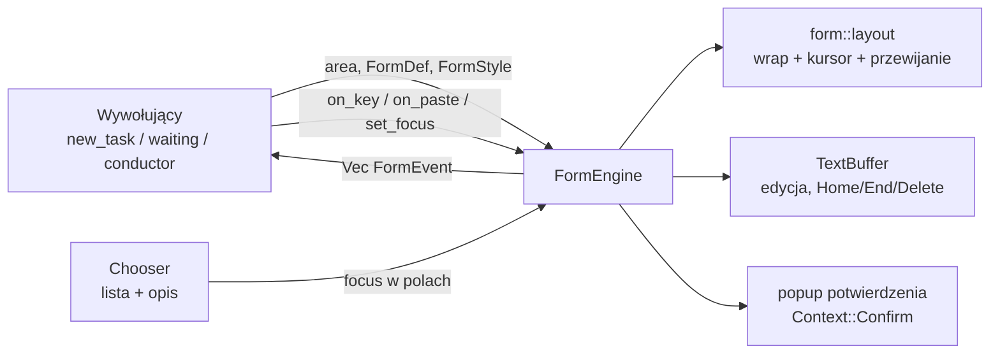
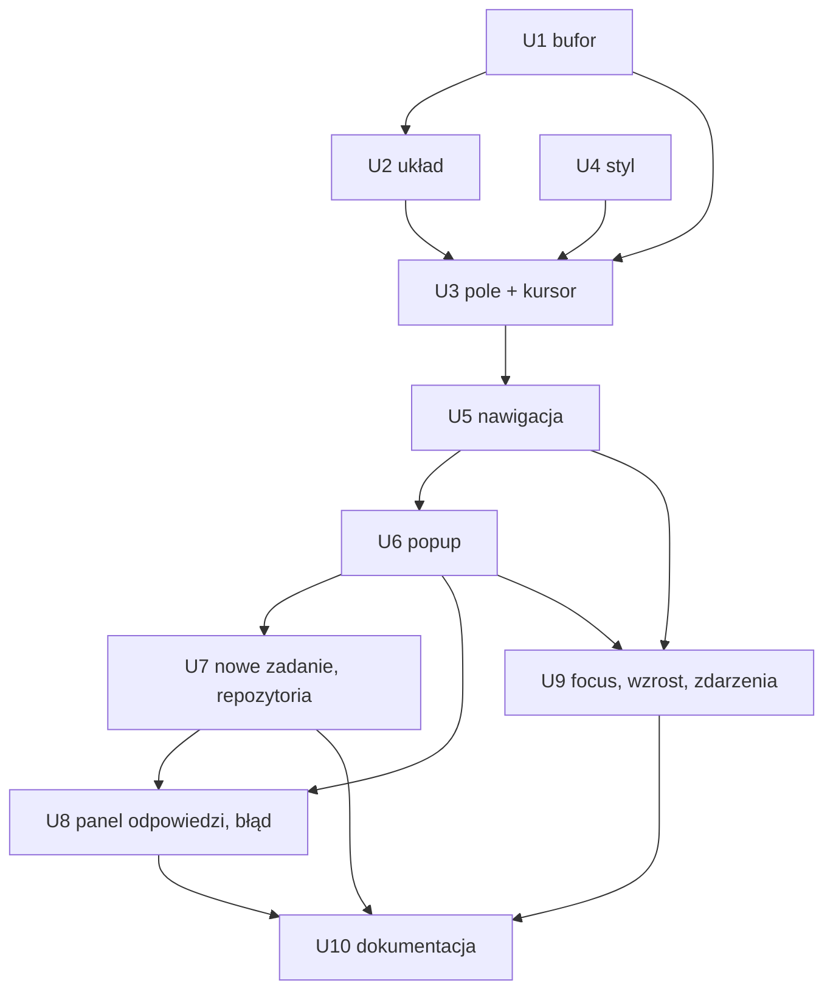

# feat: Generyczny silnik formularzy TUI

## Summary

Jeden silnik formularza w `src/tui/form/` przejmuje edycję tekstu, zawijanie, kursor, nawigację między polami, popup potwierdzenia, wzrost pola i zdarzenia do wywołującego. Wszystkie formularze TUI (nowe zadanie, panel odpowiedzi, formularz błędu, zakładka Dyrygent, repozytoria, nadpisanie przejścia) przechodzą na ten silnik. Praca idzie w kolejności: najpierw poprawne prymitywy (bufor tekstu, układ zawiniętych wierszy, kursor jako styl komórki), potem silnik, potem migracja wywołujących.

Plan nie zmienia treści formularzy, pól ani walidacji (see origin: `docs/brainstorms/2026-10-22-tui-edycja-formularzy-requirements.md`).

---

## Problem Frame

Dziś pole tekstowe jest częścią `ChooserField` w `src/tui/chooser.rs`. Kursor to znak `▏` wstawiany do tekstu (`field_value_rows`), więc szerokość znaku w terminalu przesuwa tekst za kursorem (Z1). Zawijanie jest w `src/tui/chooser/inputs.rs` (`wrapped`, twarde cięcie po znakach) tylko w układzie „inputs". Układ zwykły (`field_lines`) nie zawija wcale. Brak `Delete`, `Home`, `End` w `ChooserField::edit`. Nawigacja strzałkami jest w `Chooser::step_field_or_cursor` i w `waiting.rs` osobno. `Enter` na ostatnim polu wysyła od razu (`Chooser::advance_field_or_submit`).

---

## Requirements Trace

Wszystkie R1–R21, F1, F2, AE1–AE12 z origin obowiązują. Mapa do jednostek:

| Wymaganie | Jednostka |
|---|---|
| R1, R2, R3, R4 (edycja) | U1, U3 |
| R5, R6, R7 (zawijanie, układ) | U2, U4 |
| R8 (tło) | U4 |
| R9, R10, R11 (nawigacja) | U5 |
| R12–R15 (potwierdzenie) | U6 |
| R16, R17, R21 (silnik generyczny) | U3, U5, U7, U8 |
| R18, R19, R20 (focus, wzrost, zdarzenia) | U9 |

---

## Scope Boundaries

Bez zmian względem origin:

- Treści formularzy, pola i walidacja zostają (`ChooserField::problem`, `InputPanel::delivery`).
- Brak zaznaczania, kopiowania, `undo`, skoku po słowach.
- Wklejanie wieloliniowe i klawisze nowej linii zostają (`pasted_text`, `Action::Newline`).
- Ramki i kolory zostają. Zmienia się tylko tło pola w edycji.
- Pole rozmowy z agentem poza formularzami dostaje R1–R5 przez wspólne pole. R10–R14 go nie dotyczą.

### Deferred to Follow-Up Work

- Nowy formularz „dodaj komentarz" w oknie rozmowy. Dziś taki formularz nie istnieje. R18–R20 i AE11/AE12 sprawdzamy na istniejących kompozytorach (zakładka Dyrygent, panel odpowiedzi) i na hoście testowym. Podłączenie nowego formularza to osobna praca.
- Liczenie szerokości po `unicode-width` (CJK, emoji) zamiast po liczbie znaków. Silnik ma jeden punkt (`form/layout.rs::cell_width`), więc zmiana jest lokalna. `unicode-width 0.2.2` jest już w `Cargo.lock`.

---

## Context & Research

### Kod, który zostaje punktem wyjścia

- `src/tui/chooser.rs`: `Chooser` (lista + opis + pola), `ChooserField`, `ChooserAction`, `Submission`. Stan i rysowanie są rozdzielone. Ten wzorzec zostaje.
- `src/tui/chooser/inputs.rs`: układ „inputs" (pasek krótkich pól, pola wielolinijkowe na ekranie).
- `src/tui/input_form.rs`: prymitywy `text_insert`, `text_backspace`, `text_step`, `pasted_text`, `cycle_option`, `char_byte_index`. `InputPanel` buduje formularz odpowiedzi.
- `src/tui/failure_form.rs`: `OperatorPanel` buduje `ChooserItem`.
- `src/tui/task_app/waiting.rs`: `Entry` z `chooser` i `composer`. Własny routing klawiszy (Down na ostatniej akcji wchodzi do kompozytora).
- `src/tui/task_app/new_task.rs`, `repositories.rs`, `harness.rs`, `actions.rs` (nadpisanie przejścia, `Overlay`), `tabs/conductor.rs` (`composer`, `field_rows`, `render_fields`).
- `src/tui/style.rs`: `Styles`, `Role`. Są już `task_header_background` (`Rgb(34,48,72)`, granat), `answer_panel_background` (`Rgb(38,40,43)`), `selection_fill` (`Indexed(236)`), obsługa `no_color`.
- `src/tui/keymap.rs`: `Context::{Panel, Form, Confirm}`, `Action::{Submit, Cancel, Newline, Accept, NextField}`. Tabela jest testowana (każdy wiersz ma opis).
- `src/tui/scroll.rs`: `sanitize`, `one_line`, `wrap_visible`, `wrap_line`.
- Testy: `tests/tui_state.rs`, `tests/tui_render.rs` (są helpery `draw_chooser`, `press_chooser`, `review_chooser`).

### Wnioski z `docs/solutions/`

- `docs/solutions/design-patterns/tui-modal-confirmation-keyboard-contract.md`: popup ma wyłączność na klawisze, pasek skrótów pokazuje tylko jego klawisze, popup rysuje się też w małym terminalu, anulowanie nie traci stanu. To kontrakt R15.
- `docs/solutions/design-patterns/tui-bracketed-paste-into-text-fields-2026-10-18.md`: wklejanie to osobna ścieżka (`on_paste`), nigdy nie wysyła i nie zmienia focusu. Tab w wartości przesuwa narysowany kursor, bo rysowanie zamienia `\t` na spacje (`drawn_cursor`). Nowy układ wierszy musi to zachować.
- `docs/solutions/design-patterns/tui-reads-as-keyed-background-jobs-with-loading-marker-2026-10-22.md`: stan zmienia się tylko w pętli zdarzeń. Silnik nie robi wywołań sieciowych. Zdarzenia silnika są zwykłymi danymi.
- `docs/solutions/design-patterns/tui-focus-stays-in-details-after-confirmed-action-2026-10-20.md`: po zatwierdzonej akcji focus zostaje w szczegółach. Popup potwierdzenia formularza nie może tego zepsuć.

### Decyzje z fazy badań

- **Kursor (Z1, R1).** Kursor to styl komórki: znak pod kursorem dostaje `Modifier::REVERSED`. Na końcu tekstu kursor to jedna spacja z `REVERSED`. Do tekstu nie trafia żaden znak. Spacja końcowa zajmuje komórkę, ale nie przesuwa żadnego znaku, bo stoi za ostatnim. Przy pełnym wierszu kursor końcowy ląduje w nowym wierszu zawijania (reguła w U2).
- **Granat (R8, Z3).** Nowa rola `Styles::field_editing()` w `src/tui/style.rs`. Kolor `Rgb(24,36,64)` (ciemniejszy od `task_header_background`, żeby pole było widać na nagłówku). W `no_color` brak tła: pole w edycji wyróżnia `>` w roli `Focus`. W motywie jasnym tło granatowe też jest czytelne, bo tekst pola zostaje w domyślnym kolorze terminala. Test sprawdza kontrast względny (jasność tła < tła panelu odpowiedzi) a nie wartość. Odcień weryfikuje człowiek w terminalu (Open Question w sekcji Risks).
- **Zawijanie (R5, R6).** Twarde cięcie po komórkach, jak dziś w `wrapped`. Cięcie po słowach jest poza zakresem. Tekst bez edycji (opisy) używa tego samego `layout::wrap`.
- **Home/End (R3, Z2).** Działają na linii logicznej (między `\n`). Do klawiszy nie trzeba zmian w `keymap.rs`, bo pole w edycji dostaje klawisze przed tabelą (`on_fields_key`). Test pilnuje, że `Home`/`End` nie są przechwycone przez `Action::Top`/`Bottom`.
- **Popup (R12–R15, Z7).** Popup jest częścią silnika, ale jego klawisze idą przez istniejący `Context::Confirm` (`Action::Accept` = Enter, `Action::Cancel` = Esc), żeby pasek skrótów i pomoc brały je z `keymap.rs`. Rysowanie używa wzorca `render_confirmation` z `src/tui/task_app/actions.rs`.
- **Zdarzenia (R20).** Silnik zwraca `Vec<FormEvent>` z każdego wywołania `on_key`/`on_paste`/`set_focus`. Brak callbacków i brak odpytywania. Wywołujący odbiera zdarzenia i reaguje. Pasuje to do wzorca „stan zmienia pętla" i do Rust (bez `Rc<RefCell>`).
- **Granica `Chooser` a silnik.** `Chooser` zostaje jako kompozyt „lista akcji + opis + formularz". Pola, ich edycja, nawigacja, potwierdzenie i rysowanie pól przechodzą do `FormEngine`. `Chooser` trzyma `FormEngine` per wpis i deleguje do niego, gdy focus jest w polach. Lista i opis zostają w `Chooser`.

---

## Key Technical Decisions

1. **Nowy moduł `src/tui/form/`**, nie rozbudowa `chooser.rs`. `chooser.rs` ma już 1386 linii, `input_form.rs` 1570. Silnik ma własne testy jednostkowe bez terminala.
2. **Jeden bufor tekstu `TextBuffer`** (wartość + kursor + pamięć kolumny dla `↑`/`↓`). Zastępuje parę `value`/`cursor` w `ChooserField`. Prymitywy w `input_form.rs` (`text_insert` itd.) zostają jako cienkie funkcje na `TextBuffer` albo są usunięte po migracji. Wklejanie dalej przechodzi przez `pasted_text`.
3. **Układ wierszy (`form/layout.rs`) jest jedynym źródłem prawdy** dla zawijania, pozycji kursora, przewijania i ruchu `↑`/`↓` po wierszach widocznych. Rysowanie, kursor i nawigacja używają tego samego `Wrapped { rows, cursor_row, cursor_col }`.
4. **Strzałka na brzegu pola (R10, Z5, Z8)** to mały automat: `pending_edge: Option<Edge>` w stanie pola. Pierwsze `↑`/`↓` na brzegu ustawia kursor na początek/koniec i ustawia `pending_edge`. Drugie to samo naciśnięcie przechodzi do sąsiedniego pola. Każdy inny klawisz czyści `pending_edge`. Pole jednolinijkowe, `select` i `integer` nie używają automatu. Lista `↑`/`↓` zostaje w `Chooser` (nie opuszcza listy).
5. **Focus początkowy (R9)** to pierwsze pole od góry w kolejności rysowania. Obecny `Chooser::start_field` (pierwsze wymagane pole wielolinijkowe) zostaje wymianą na „pierwsze pole". Kolejność chodzenia (`focus_order_of`) w układzie „inputs" stawia krótkie pola przed długimi. Plan ustala: kolejność nawigacji = kolejność rysowania z góry na dół. Patrz Open Question 1.
6. **Potwierdzenie na poziomie formularza (R12).** `FormEngine::on_key` zwraca `FormEvent::ConfirmRequested` zamiast `Submit`, a po `Enter` w popupie `FormEvent::Submitted(values)`. Walidacja (`problem()`) działa przed popupem: błędne pole nie otwiera popupu (zachowuje obecne zachowanie `submit()`).
7. **Formularz bez pól tekstowych** (panel odpowiedzi z samym wyborem): lista akcji + `Enter` otwiera popup. To ścieżka `Chooser::activate` → `submit`. Popup wstawia się tam, gdzie `Chooser` dziś zwraca `ChooserAction::Submit` dla wpisów z `confirms_submit` (flaga ustawiana przez wywołującego tylko dla formularzy wysyłających, Z4). Listy bez wysyłania (repozytorium przy wyborze, harness) nie ustawiają flagi.

### Directional sketch

*Poniższy szkic ilustruje zamierzone podejście. To wskazówka do przeglądu, nie specyfikacja implementacji.*

Zdarzenia (kształt, nie sygnatury): `Resized{rows}`, `Submitted`, `ConfirmRequested`, `Cancelled`, `FocusChanged{gained}`, `Edited`.

---

## Implementation Units

### U1. Bufor tekstu: `Delete`, `Home`, `End`

**Goal:** Jeden `TextBuffer` z poprawną edycją. Spełnia R2, R3 i fundament R4.

**Requirements:** R2, R3, R4. Covers AE2, część AE3.

**Dependencies:** brak.

**Files:**
- Create: `src/tui/form/mod.rs`, `src/tui/form/buffer.rs`
- Modify: `src/tui/mod.rs` (deklaracja modułu `form`)
- Test: unit testy w `src/tui/form/buffer.rs` (`#[cfg(test)]`)

**Approach:**
- `TextBuffer { value, cursor }` (cursor = indeks znaku, jak dziś). Metody: `insert`, `insert_str`, `backspace`, `delete`, `left`, `right`, `home`, `end`, `line_bounds` (zakres linii logicznej wokół kursora).
- `home`/`end` używają granic `\n`, nie zawinięcia (Z2).
- Bez zależności od ratatui i crossterm.

**Patterns to follow:** `text_insert`, `text_backspace`, `text_step`, `char_byte_index` w `src/tui/input_form.rs` (indeks znaków, wstawianie po indeksie bajtu).

**Test scenarios:**
- Happy path: `Delete` przy `abc`, kursor po `a` → `ac`, kursor po `a`. Covers AE2.
- Edge: `Delete` na końcu tekstu nic nie zmienia. Covers AE2.
- Happy path: `Home`/`End` w tekście `ab\ncd` z kursorem w `cd` → początek/koniec drugiej linii logicznej.
- Edge: `Home` na pustym tekście, `End` na ostatniej linii bez `\n`, kursor na samym `\n`.
- Edge: tekst z wielobajtowymi znakami (`zażółć`) — `Delete`/`Home`/`End` nie łamią granic znaków.
- Edge: `Backspace` na początku nic nie robi (regresja).

**Verification:** `cargo test` dla modułu `form::buffer` zielony. `Home`/`End`/`Delete` zachowują granice UTF-8.

---

### U2. Układ wierszy: zawijanie, pozycja kursora, przewijanie

**Goal:** Jedna funkcja układu dla zawijania i pozycji kursora. Spełnia R5, R6, fundament R1, R7.

**Requirements:** R1, R5, R6, R7. Covers AE3, AE4, AE5.

**Dependencies:** U1.

**Files:**
- Create: `src/tui/form/layout.rs`
- Test: unit testy w `src/tui/form/layout.rs`

**Approach:**
- `wrap(text, width) -> Wrapped { rows: Vec<Row>, cursor: (row, col) }`. `Row` zna zakres znaków w wartości, żeby `↑`/`↓` i `Home`/`End` mapowały wiersz widoczny na pozycję w buforze.
- Szerokość = `width` komórek pola. Pole zaczyna się po `> ` (R7): szerokość zawijania = szerokość formularza − 1 (wcięcie) − szerokość promptu − 1 (margines prawy). Stała w jednym miejscu (`FIELD_INDENT`, `FIELD_RIGHT_MARGIN`).
- Kursor na końcu pełnego wiersza przechodzi do nowego, pustego wiersza zawijania (kursor musi mieć własną komórkę w polu). Dla pozycji kursora w środku tekstu żaden znak się nie przesuwa (R1).
- Tab: pozycja kursora liczy się po `sanitize` (jak `drawn_cursor`), czyli po tym, jak tekst rysuje się w komórkach.
- `visible_window(wrapped, height, scroll)` zwraca okno wierszy tak, że wiersz kursora jest w oknie.
- `cell_width(char)` jest jednym punktem liczenia szerokości (dziś 1 na znak).
- Ta sama funkcja zawija tekst bez edycji (opisy, R6). Zastępuje `wrap_line` w opisach formularzy.

**Patterns to follow:** `wrapped` w `src/tui/chooser/inputs.rs`, `drawn_cursor` w `src/tui/chooser.rs`, `wrap_line` w `src/tui/scroll.rs`.

**Test scenarios:**
- Happy path: tekst dłuższy niż szerokość zawija się na kolejne wiersze po `width` komórek. Covers AE4.
- Happy path: szerokość formularza 40 → tekst pola kończy się najpóźniej w komórce 39, wcięcie 1. Covers AE5.
- Edge: kursor na końcu wiersza o pełnej szerokości ląduje w nowym wierszu, a ostatni znak nie zmienia komórki.
- Edge: pusta linia logiczna daje jeden pusty wiersz. `\n` na końcu daje pusty wiersz z kursorem.
- Edge: tab w tekście przed kursorem przesuwa kolumnę kursora o 4 (zgodnie z `sanitize`).
- Edge: szerokość 1 i 0 nie zapętla się (`width.max(1)`).
- Happy path: `visible_window` trzyma wiersz kursora w oknie przy `height` mniejszym niż liczba wierszy.
- Integration: cursor (row, col) z `Wrapped` odpowiada pozycji w buforze po `Home`/`End` na linii logicznej z trzema wierszami widocznymi. Covers AE3.

**Verification:** Testy układu zielone. Żaden test nie zakłada stałego znaku kursora w tekście.

---

### U3. Pole formularza i kursor jako styl komórki

**Goal:** `FormField` (nazwa, typ, wymagane, opis, bufor, błąd, stan brzegu) i rysowanie bez wstawiania znaku kursora. Spełnia R1, R4, R6, R7, R8 (część).

**Requirements:** R1, R4, R6, R7, R8, Z6. Covers AE1, AE5.

**Dependencies:** U1, U2, U4.

**Files:**
- Create: `src/tui/form/field.rs`
- Modify: `src/tui/chooser.rs` (`ChooserField` deleguje do `FormField`; usunięte `CURSOR`, `field_value_rows` wstawiające znak)
- Modify: `src/tui/input_form.rs` (prymitywy tekstu na `TextBuffer`, `pasted_text` zostaje)
- Test: `src/tui/form/field.rs` (unit), `tests/tui_render.rs` (render)

**Approach:**
- `FormField` ma te same typy co dziś (`Text{multiline}`, `Select`, `Integer`). `ChooserField::text/multiline/select/integer/required/described/proposed/with_value` zostają jako publiczne API (wywołujący się nie zmieniają). Pola `value`/`cursor` przechodzą do bufora.
- `FormField::render_lines(width, focused, styles)` zwraca wiersze `Line` ze stylem. Kursor to `Span` z `Modifier::REVERSED` na jednej komórce. Pole w edycji dostaje `Styles::field_editing()` jako tło całego pola (R8). Pozostałe pola: tło standardowe.
- Pola `select` i `integer` używają tego samego układu i tła co tekst (Z6). `select` rysuje `‹ wartość ›` w tym samym wcięciu.
- Prefiks `> ` w kolumnie wcięcia. Za polem brak znaków (R7).
- Obecne ścieżki `field_lines` (chooser.rs) i `render_long_fields`/`render_bar` (inputs.rs) wołają `FormField::render_lines`, nie własny kod.

**Patterns to follow:** `Styles::of(Role::…)`, `answer_panel_background` (obsługa `no_color`), `field_lines` w `src/tui/chooser.rs`.

**Test scenarios:**
- Happy path: `abc`, kursor na końcu, `←` → bufor ma kursor 2, wiersz zawiera `abc` w komórkach 2–4 (po prefiksie) bez dodatkowego znaku, a komórka `c` ma modyfikator `REVERSED`. Covers AE1.
- Edge: kursor na końcu tekstu rysuje spację z `REVERSED` za ostatnim znakiem. Tekst przed nią nie zmienia komórek.
- Edge: pole puste w edycji rysuje jedną komórkę `REVERSED`.
- Happy path: pole w edycji ma tło `field_editing`. Pole poza edycją ma tło standardowe (R8).
- Edge: `no_color` → brak tła, `>` w roli `Focus`.
- Happy path: tekst bez zawinięcia w polu 40 komórek kończy się w komórce ≤ 39. Covers AE5.
- Happy path: `select` w edycji ma to samo wcięcie i tło co pole tekstowe (Z6).
- Regression: wklejony tekst z tabem — kursor stoi pod właściwą komórką (z `tui-bracketed-paste…`).

**Verification:** Żaden render nie zawiera znaku `▏`. `cargo test --test tui_render` zielony po przeniesieniu oczekiwań ze starego kursora.

---

### U4. Styl pola w edycji

**Goal:** Rola stylu dla tła pola w edycji. Spełnia R8, Z3.

**Requirements:** R8.

**Dependencies:** brak.

**Files:**
- Modify: `src/tui/style.rs`
- Test: unit test w `src/tui/style.rs` albo `tests/tui_render.rs`

**Approach:** `Styles::field_editing()` obok `task_header_background`. Wartość granatowa `Rgb(24,36,64)`. `no_color` → `Style::default()`. Bez zmiany koloru tekstu.

**Patterns to follow:** `task_header_background`, `answer_panel_background` w `src/tui/style.rs`.

**Test scenarios:**
- Happy path: kolor tła ma kanał niebieski większy niż czerwony i zielony (granat) i jest ciemniejszy niż `task_header_background`.
- Edge: `no_color` zwraca styl bez tła.
- Edge: styl nie ustawia koloru pierwszego planu.

**Verification:** Test stylu zielony. Człowiek ogląda odcień w obu motywach (patrz Risks).

---

### U5. Silnik: nawigacja, focus początkowy, `Enter`, strzałki

**Goal:** `FormEngine` jako stan formularza: lista pól, aktywne pole, nawigacja według R9–R11. Spełnia R9, R10, R11, R16, R17 (część), R21.

**Requirements:** R9, R10, R11, R16, R17, R21. Covers AE6, AE7, AE9, AE10.

**Dependencies:** U1, U2, U3.

**Files:**
- Create: `src/tui/form/engine.rs`
- Modify: `src/tui/chooser.rs` (`Chooser::on_fields_key`, `step_field_or_cursor`, `advance_field_or_submit`, `move_cursor_vertical` przechodzą do silnika; `start_field` zastąpiony „pierwszym polem")
- Modify: `src/tui/task_app/waiting.rs` (routing klawiszy do kompozytora)
- Test: `src/tui/form/engine.rs` (unit), `tests/tui_state.rs`

**Approach:**
- `FormDef { fields: Vec<FormField> }` i `FormEngine::new(def, style)`. Silnik trzyma aktywne pole, `pending_edge`, stan popupu (U6), stan wzrostu (U9).
- `on_key(KeyEvent) -> Vec<FormEvent>`:
  - znak, `Backspace`, `Delete`, `←`, `→`, `Home`, `End`, `Ctrl+J` (nowa linia) → bufor aktywnego pola.
  - `Enter` → następne pole albo, na ostatnim, `ConfirmRequested` (U6).
  - `↑`/`↓`: pole tekstowe wielolinijkowe — najpierw ruch po wierszach widocznych (układ z U2), na brzegu automat `pending_edge` (Z5). Pole jednolinijkowe, `select`, `integer` — jedna strzałka przenosi (R10). Brak sąsiedniego pola: zdarzenie `EdgeReached(Up|Down)` do wywołującego (wywołujący decyduje o oddaniu focusu, np. do listy akcji).
  - `Tab`/`BackTab` bez zmian względem dziś (`Context::Form`).
- Wpisana wartość i kursor zostają przy każdym przejściu.
- Focus początkowy: pierwsze pole w kolejności rysowania (R9). `Chooser::focus_fields` ustawia `engine.focus_first()`.
- `Chooser` w `focus == Actions` nie zmienia się: `↑`/`↓` po liście, `Enter` wchodzi do pól albo wysyła (przez U6, jeśli ustawiono `confirms_submit`).

**Execution note:** Test-first dla automatu `pending_edge` (Z5 jest łatwy do zepsucia: „dwa naciśnięcia zawsze", także gdy kursor już stoi na brzegu).

**Patterns to follow:** `Chooser::step_field_or_cursor`, `move_cursor_vertical`, `PanelEffect` w `src/tui/task_app/waiting.rs`.

**Test scenarios:**
- Covers AE6. Pole wielolinijkowe, kursor w pierwszym wierszu, nie na początku: `↑` → kursor na początku tekstu, focus bez zmiany. Drugie `↑` → focus na polu wyżej.
- Covers AE6. Symetrycznie `↓` w ostatnim wierszu.
- Edge (Z5): kursor już na początku, pierwsze `↑` nie przenosi, drugie przenosi.
- Edge: `↑`, potem litera, potem `↑` → licznik wyzerowany, przejście dopiero po drugim `↑` bez klawisza między.
- Happy path: pole jednolinijkowe — jedno `↓` przenosi na następne pole.
- Covers AE9. `select` — `↓` raz przenosi. `←`/`→` zmieniają wartość.
- Covers AE9. Lista akcji, `↓` na ostatniej pozycji → focus zostaje w liście. `Enter` przechodzi dalej.
- Covers AE7. Dla każdego typu formularza (nowe zadanie, panel odpowiedzi, błąd, Dyrygent, repozytoria) focus po otwarciu jest na pierwszym polu od góry, także dla formularza z listą wyboru.
- Edge: `↑` na pierwszym polu tekstowym jednolinijkowym zgłasza `EdgeReached(Up)` (wywołujący oddaje focus listy).
- Edge: `↓` w zawiniętym tekście idzie po wierszach widocznych, nie po liniach logicznych.
- Covers AE10. Dwa różne `FormDef` z różnymi obszarami dają te same reguły edycji i nawigacji (ten sam zestaw asercji wykonany dwa razy).
- Edge: `Home` nie jest przechwycone przez `Action::Top` gdy pole jest w edycji.

**Verification:** Testy silnika i `tests/tui_state.rs` zielone. Brak kopii logiki nawigacji w `chooser.rs`/`waiting.rs`.

---

### U6. Popup potwierdzenia w silniku

**Goal:** `Enter` na ostatnim polu otwiera popup. Spełnia R11–R15, Z4, Z7.

**Requirements:** R11, R12, R13, R14, R15. Covers AE8, F1, F2.

**Dependencies:** U5.

**Files:**
- Create: `src/tui/form/confirm.rs`
- Modify: `src/tui/form/engine.rs`
- Modify: `src/tui/keymap.rs` (bindy popupu formularza w `Context::Confirm`, jeśli obecne nie wystarczą; test tabeli wymaga opisu każdego wiersza)
- Modify: `src/tui/task_app/layout.rs` (rysowanie popupu także na ścieżce małego terminala; pasek skrótów)
- Modify: `src/tui/task_app/mod.rs`, `src/tui/task_app/new_task.rs`, `src/tui/task_app/waiting.rs`, `src/tui/task_app/tabs/conductor.rs`, `src/tui/task_app/repositories.rs` (routing: popup ma pierwszeństwo przed polem)
- Test: `src/tui/form/confirm.rs`, `tests/tui_state.rs`, `tests/tui_render.rs`

**Approach:**
- Stan `Confirming { return_field }`. `Enter` na ostatnim polu: walidacja (`problem()`); przy błędzie focus na polu z błędem i brak popupu. Bez błędu `Confirming` i `ConfirmRequested`.
- W popupie: `Enter` (`Action::Accept`) → `Submitted`. `Esc` (`Action::Cancel`) → powrót do `return_field`, wartości i kursor bez zmian (R14). Inne klawisze nic nie robią i nie zatwierdzają (R13).
- Tekst stały: „Zatwierdzić formularz?" + podpowiedź klawiszy. Bez wartości pól (Z7).
- Wysyłanie dokładnie raz: po `Submitted` silnik ma stan `Submitted` i ignoruje następny `Enter`, dopóki wywołujący nie wywoła `reset`/`rebuilt`.
- Panel odpowiedzi z samym wyborem (bez pól): `Chooser::activate` dla wpisu z `confirms_submit` otwiera popup zamiast `submit()`. Flagę ustawiają `InputPanel` i `OperatorPanel` dla wpisów wysyłających. `harness.rs` i wybór repozytorium jej nie ustawiają (Z4).
- Pasek skrótów i pomoc: podczas popupu `Context::Confirm`. Popup rysuje się przed wczesnym zwrotem „terminal za mały" (kontrakt modalny).
- Kolejność routingu klawiszy: popup quit → pomoc → popup formularza → nakładka → pole (rozszerzenie kolejności z `tui-bracketed-paste…`). Wklejanie podczas popupu nic nie robi.

**Execution note:** Test-first dla kontraktu klawiszy popupu (modyfikatory, nieznane klawisze, mały terminal), zgodnie z `tui-modal-confirmation-keyboard-contract.md`.

**Patterns to follow:** `Overlay::Confirm`, `on_confirm_key`, `render_confirmation`, `render_quit_confirmation` w `src/tui/task_app/actions.rs`. Klucze idempotencji w `waiting.rs`.

**Test scenarios:**
- Covers AE8. `Enter` na ostatnim polu → popup. `Esc` → focus na tym samym polu, tekst i kursor bez zmian. `Enter` na polu, `Enter` w popupie → jedno `Submitted`.
- Covers F1. Pełna ścieżka: wpis w polach, `Enter` przechodzi po polach, ostatni `Enter` otwiera popup, `Enter` wysyła.
- Edge (R13): `a`, `Tab`, `Ctrl+Enter`, `Enter` z modyfikatorem w popupie nie zatwierdzają.
- Edge: błąd walidacji (pole wymagane puste) → brak popupu, focus na polu z błędem.
- Edge: podwójne `Enter` w popupie wysyła raz.
- Covers R12. Panel odpowiedzi z samym wyborem: `Enter` na akcji otwiera popup. Wybór repozytorium i harnessu: jeden `Enter` wysyła bez popupu (Z4).
- Integration: popup widoczny w małym terminalu (TestBackend o małym rozmiarze), pasek skrótów pokazuje tylko `Enter`/`Esc`.
- Integration: wklejenie podczas popupu nie zmienia pola i nie zamyka popupu.
- Integration: przy otwartym popupie `q` nie otwiera okna wyjścia i nie trafia do pola.
- Integration: po zatwierdzonej akcji focus zostaje w szczegółach (regresja `tui-focus-stays-in-details…`).

**Verification:** Żadna ścieżka wysyłająca nie omija popupu. `rg "ChooserAction::Submit"` pokazuje wysyłanie tylko po `Submitted`.

---

### U7. Migracja nowego zadania, repozytoriów i nakładek

**Goal:** Formularze `new_task`, `repositories`, nadpisanie przejścia używają silnika bez własnej logiki pól. Spełnia R16, R21, R4, R6.

**Requirements:** R4, R6, R16, R21. Covers AE4, AE10.

**Dependencies:** U3, U5, U6.

**Files:**
- Modify: `src/tui/task_app/new_task.rs`, `src/tui/task_app/repositories.rs`, `src/tui/task_app/actions.rs`, `src/tui/task_app/harness.rs`, `src/tui/chooser.rs`, `src/tui/chooser/inputs.rs`
- Test: `tests/tui_state.rs`, `tests/tui_render.rs`

**Approach:**
- Opis workflow w formularzu nowego zadania rysuje się przez `layout::wrap` (R6). Dziś `render_description` / opis w `new_task.rs` obcina albo wychodzi poza ramkę.
- `inputs.rs::render_bar`, `render_status`, `render_long_fields` wołają kod pola z U3. Brak własnego `window_around_cursor`/`clip` dla pól w edycji (przeglądnąć: `clip` zostaje dla tekstów statusu).
- Wywołujący przekazują obszar (`Rect`) i definicję pól. Reguły edycji nie występują w tych plikach.
- Nakładki z polem (powód nadpisania w `Overlay::Transitions`): to formularz wysyłający, więc przechodzi przez popup (R12). Lista linków (`Overlay::Links`) i harness nie wysyłają.

**Patterns to follow:** `render` w `src/tui/task_app/new_task.rs`, `chooser::render`.

**Test scenarios:**
- Covers AE4. Workflow z opisem dłuższym niż szerokość panelu: opis zawija się w całości w ramce (TestBackend, kilka szerokości: 40, 64, 100).
- Happy path: nowe zadanie — edycja, `Home`/`End`/`Delete` działają w każdym polu tekstowym (R4).
- Covers AE10. Edycja w formularzu nowego zadania i w repozytoriach daje identyczne reguły.
- Integration: formularz nowego zadania po ostatnim `Enter` pokazuje popup, a `Esc` zachowuje szkic (`sync_new_task_draft` dalej działa).
- Regression: wklejenie wieloliniowe do pola nowego zadania nie wysyła i nie przenosi focusu.
- Edge: za wąski terminal — brak paniki przy szerokości < wcięcie + margines.

**Verification:** `rg "text_insert|text_backspace|text_step" src/tui` poza `form/` i `input_form.rs` nie trafia w kod wywołujących.

---

### U8. Migracja panelu odpowiedzi i formularza błędu

**Goal:** `waiting.rs` (`InputPanel`, `OperatorPanel`) używa silnika dla pól i kompozytora. Spełnia R10 (lista), R12, R16, R21.

**Requirements:** R9, R10, R12, R16, R21. Covers AE7, AE9, AE8.

**Dependencies:** U5, U6, U7.

**Files:**
- Modify: `src/tui/task_app/waiting.rs`, `src/tui/input_form.rs`, `src/tui/failure_form.rs`
- Test: `tests/tui_state.rs`, `tests/tui_render.rs`

**Approach:**
- Własny routing `Down` na ostatniej akcji → kompozytor (`waiting.rs` ok. linii 835) zamieniony na zdarzenia silnika: lista akcji zgłasza „koniec listy", `Enter` przechodzi do następnego pola (R10, Z8).
- `InputPanel` i `OperatorPanel` ustawiają `confirms_submit` na wpisach wysyłających.
- Klucz idempotencji (`entry.key`) i `submission_for_message` bez zmian. Zmienia się tylko moment: wysyłka po `Submitted`.
- Formularz błędu (`failure_form.rs`) nie zmienia treści pól (`NOTE_FIELD`).

**Patterns to follow:** `PanelEffect`, `Entry` w `src/tui/task_app/waiting.rs`.

**Test scenarios:**
- Covers AE9. Lista akcji w panelu odpowiedzi: `↓` na ostatniej pozycji zostaje w liście. `Enter` przechodzi do pola komentarza.
- Covers AE8. Panel odpowiedzi z samym wyborem: `Enter` → popup → `Enter` wysyła raz (jedna `Submission`, jeden klucz idempotencji).
- Covers AE7. Panel odpowiedzi i formularz błędu otwierają się na pierwszym polu od góry.
- Edge: `Esc` w popupie panelu odpowiedzi wraca do pola, a wpisany komentarz zostaje. Odpowiedź 409 dalej zachowuje wpisany tekst (regresja).
- Integration: formularz błędu — wybór „potwierdź" z notatką wysyła `OperatorCommand` dopiero po popupie.
- Edge: kompozytor z `Ctrl+J` dodaje linię, a `Enter` nie.

**Verification:** `waiting.rs` nie zawiera własnej logiki strzałek na brzegu pola. Testy panelu zielone.

---

### U9. Focus, wzrost pola i zdarzenia do wywołującego

**Goal:** Silnik oddaje i odzyskuje focus, rośnie w kierunku do limitu i zgłasza zmiany. Spełnia R17–R20.

**Requirements:** R17, R18, R19, R20. Covers AE11, AE12.

**Dependencies:** U5, U6.

**Files:**
- Modify: `src/tui/form/engine.rs`
- Create: `src/tui/form/events.rs` (typ `FormEvent`, `Growth { direction, limit }`)
- Modify: `src/tui/task_app/tabs/conductor.rs` (kompozytor na silniku; `box_rows` z `engine.preferred_rows()`, limit = połowa widoku)
- Modify: `src/tui/task_app/waiting.rs` (kompozytor odpowiedzi)
- Test: `src/tui/form/engine.rs`, `tests/tui_state.rs`, `tests/tui_render.rs`

**Approach:**
- `engine.set_focus(bool) -> Vec<FormEvent>`. Przy `false` silnik nie przetwarza klawiszy (`on_key` zwraca pusty wynik, a klawisz wraca do wywołującego jako „nieużyty") i zachowuje bufor, kursor, `pending_edge` wyzerowany. Przy `true` edycja trwa od tego samego miejsca.
- `Growth { direction: Up|Down, limit_rows }` podaje wywołujący. `engine.preferred_rows(width)` zwraca `min(wiersze treści, limit)`. Powyżej limitu pole przewija się (okno z U2).
- Zdarzenie `Resized { rows }` powstaje, gdy `preferred_rows` zmienia się po edycji. Wywołujący odbiera i przelicza układ. Brak odpytywania.
- Zakładka Dyrygent: dziś `box_rows = field_rows().min(area.height/2).max(2)`. Po zmianie ta sama liczba pochodzi ze zdarzenia/`preferred_rows`. Kierunek wzrostu podaje wywołujący (kompozytor Dyrygenta rośnie w górę nad linią skrótów, bo okno historii kurczy się od dołu).
- Silnik nie zna widoku rozmowy. Test hosta sprawdza AE11/AE12 na atrapie wywołującego (struktura z `Rect` i licznikiem zdarzeń).

**Execution note:** Test-first dla `Resized` i limitu. To jedyna część z logiką czasową między silnikiem a układem.

**Patterns to follow:** `conductor.composer.field_rows()`, `split(area, top_rows, box_rows, bottom_rows)` w `src/tui/task_app/tabs/conductor.rs`.

**Test scenarios:**
- Covers AE11. Focus oddany (`set_focus(false)`): klawisze nie zmieniają bufora. Wpisany tekst i kursor zostają. Po `set_focus(true)` wpisywanie trwa od tego samego miejsca.
- Covers AE12. Wzrost do góry z limitem 50% wysokości (host testowy o widoku 20 wierszy → limit 10): kolejne linie zwiększają `preferred_rows` do 10 i zgłaszają `Resized`. Powyżej 10 `Resized` nie powstaje, a pole przewija się.
- Edge: usunięcie linii zmniejsza `preferred_rows` i zgłasza `Resized`.
- Edge: limit mniejszy niż 2 wiersze nie daje paniki (minimum 1 wiersz).
- Edge: `FocusChanged` zgłaszane przy każdej zmianie, bez duplikatów przy powtórnym `set_focus` tą samą wartością.
- Integration: zakładka Dyrygent — wpisanie wielu linii powiększa pole do połowy zakładki, a historia kurczy się, bez migotania ramki (TestBackend, dwa rozmiary).
- Integration: wklejenie wieloliniowe powiększa pole i zgłasza `Resized`.

**Verification:** Wywołujący nie czytają `field_rows()` w pętli rysowania poza `preferred_rows`. Zdarzenia pokrywają zmianę rozmiaru, zatwierdzenie, anulowanie, focus.

---

### U10. Dokumentacja i czyszczenie

**Goal:** Moduł `chooser.rs` opisuje nowy podział. Notatka w `docs/solutions/` zapisuje wzorzec silnika. Spełnia R21.

**Requirements:** R16, R21.

**Dependencies:** U1–U9.

**Files:**
- Modify: `src/tui/chooser.rs` (nagłówek modułu: „lista + opis + formularz", odwołanie do `form`)
- Modify: `src/tui/keymap.rs` (opis klawiszy `Home`/`End`/`Delete` w pomocy, jeśli pomoc wylicza klawisze edycji)
- Create: `docs/solutions/design-patterns/tui-form-engine-events-and-cursor-style.md` (po wdrożeniu; przez `ce-compound`)
- Test: `tests/tui_state.rs` (test tabeli klawiszy: każdy wiersz ma opis)

**Approach:** Usunąć martwy kod po migracji (`CURSOR`, `window_around_cursor` jeśli niepotrzebny, stare prymitywy bez wywołań). Nowy formularz = definicja pól + obszar (R21), co opisuje nagłówek `src/tui/form/mod.rs`.

**Test expectation:** none dla notatki. Test tabeli klawiszy już istnieje i musi przejść po zmianach w `keymap.rs`.

**Verification:** `cargo clippy` bez ostrzeżeń o martwym kodzie. Dokumentacja zgadza się z kodem.

---

## Dependency Graph

Kolejność: U1, U4, U2, U3, U5, U6, U7, U8, U9, U10. U1 i U4 są niezależne. Po U3 aplikacja już ma poprawny kursor i zawijanie (R1–R8) nawet bez reszty. Każda jednostka kończy się zielonym `cargo test`.

---

## System-Wide Impact

- **Interakcje:** routing klawiszy w `src/tui/task_app/mod.rs` zyskuje popup formularza w kolejności (quit → pomoc → popup formularza → nakładka → widok). Wklejanie obchodzi popup.
- **Propagacja błędów:** walidacja pola przed popupem. Błąd serwera (409) dalej zachowuje wpisany tekst.
- **Niezmienniki:** `Submission`, `OperatorCommand`, `HumanInputDeliveryDto`, klucze idempotencji, `Request` zostają bez zmian. Zmienia się tylko moment wysyłki.
- **Pole rozmowy z agentem** poza formularzami: dostaje R1–R5 przez wspólne pole, R10–R14 go nie dotyczą. Sprawdzić w testach, że jego `Enter` dalej wysyła bez popupu, jeśli jest takie pole poza `Chooser` (patrz Open Question 2).
- **Dotknięci:** operatorzy TUI. Brak zmian w API serwera i w crate'ach `narsor-*`.

---

## Risks & Dependencies

| Ryzyko | Skutek | Łagodzenie |
|---|---|---|
| Duża migracja `Chooser`/`waiting.rs` (ponad 3000 linii z testami) | Regresje w nawigacji | Kolejność U1–U10, zielone testy po każdej jednostce, istniejące 18 tys. linii testów TUI jako siatka |
| Kursor jako `REVERSED` może być słabo widoczny w niektórych motywach | Operator nie widzi kursora | Dodatkowo kursor terminala (`frame.set_cursor_position`) jako opcja, ocena ręczna w terminalu |
| Odcień granatu w motywie jasnym | Zła czytelność | Człowiek ogląda w obu motywach przed scaleniem (wymaganie z origin: „Needs research") |
| `Home`/`End`/`Delete` nie dochodzą z terminala | Klawisze nie działają | Założenie z origin nieprzetestowane. Testy używają `KeyEvent`. Ręczna kontrola w terminalu operatora |
| Szerokość znaków CJK/emoji | Kursor przesunięty | `cell_width` jest jednym punktem. Zmiana odroczona (Scope Boundaries) |
| Zawijanie po znakach przecina słowa | Mniejsza czytelność | Zgodne z dzisiejszym `wrapped`. Zawijanie po słowach poza zakresem |

---

## Open Questions

Planowanie przyjęło odpowiedzi poniżej. Wdrożenie może je zmienić, jeśli kod pokaże coś innego.

1. **Kolejność nawigacji w układzie „inputs".** Dziś krótkie pola idą przed długimi (`focus_order_of`). R9 mówi „pierwsze pole od góry". Przyjęto: kolejność rysowania z góry na dół jest kolejnością nawigacji. Jeśli układ „inputs" rysuje pasek krótkich pól nad polem wielolinijkowym, obie kolejności są zgodne i nic się nie zmienia.
2. **Czy istnieje pole tekstowe poza `Chooser`** (pole rozmowy z agentem w widoku zadania)? Wdrożenie sprawdza `src/tui/conversation.rs` i `src/tui/chat.rs`. Jeśli używa wspólnego pola, dostaje R1–R5 z U1–U3. Jeśli ma własny kod, zostaje poza zakresem (zgodnie z origin).
3. **Zakładka Dyrygent i formularz błędu bez wyjątków?** Origin zaznacza, że nie sprawdzono. Wdrożenie U7/U8 potwierdza to na początku (przegląd użyć `Chooser::new` w `tabs/conductor.rs`, `failure_form.rs`).

---

## Assumptions

Sesja bez interakcji. Zamiast pytań przyjęto:

- Nowy formularz „dodaj komentarz" w oknie rozmowy jest poza tym planem (Deferred to Follow-Up Work). AE11 i AE12 sprawdza host testowy i istniejące kompozytory. Gdy operator chce ten formularz w tym samym PR, trzeba dodać jednostkę po U9 i potwierdzić, gdzie w widoku rozmowy ma stać.
- Granat to `Rgb(24,36,64)`. Operator może zmienić odcień jedną stałą w `src/tui/style.rs`.
- Silnik zwraca zdarzenia jako wartości (`Vec<FormEvent>`), nie wywołuje callbacków.

---

## Documentation / Operational Notes

- Po wdrożeniu: `ce-compound` zapisuje wzorzec w `docs/solutions/design-patterns/` (U10).
- Brak zmian w konfiguracji, migracjach danych i wdrożeniu.
- Wynik AI wymaga przeglądu człowieka przed scaleniem.

---

## Sources & References

- Origin: `docs/brainstorms/2026-10-22-tui-edycja-formularzy-requirements.md`
- `docs/solutions/design-patterns/tui-modal-confirmation-keyboard-contract.md`
- `docs/solutions/design-patterns/tui-bracketed-paste-into-text-fields-2026-10-18.md`
- `docs/solutions/design-patterns/tui-reads-as-keyed-background-jobs-with-loading-marker-2026-10-22.md`
- `docs/solutions/design-patterns/tui-focus-stays-in-details-after-confirmed-action-2026-10-20.md`
- `docs/plans/2026-10-09-002-feat-tui-formularz-nowego-zadania-plan.md`
- `docs/plans/2026-10-17-001-feat-tui-wklejanie-wieloliniowe-plan.md`
