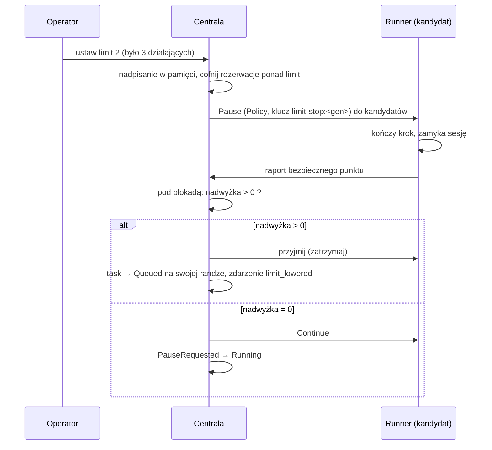
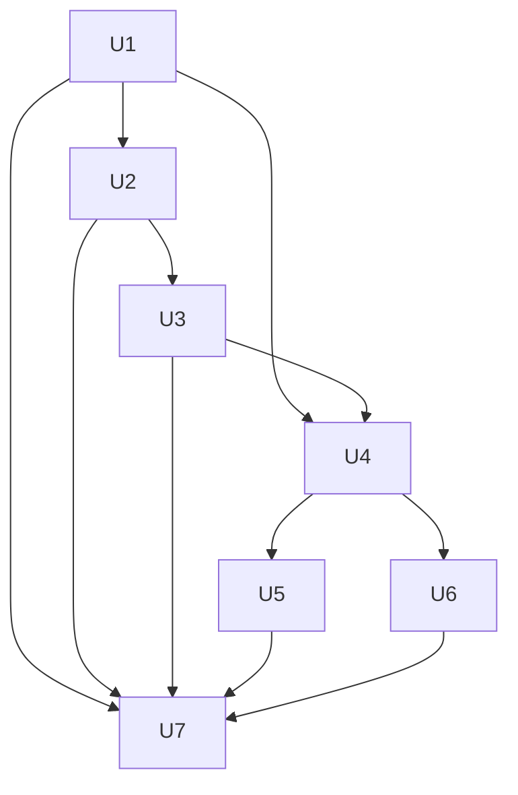

# feat: Zmiana limitu równoległych tasków w locie

## Summary

Operator zmienia limit slotów backendu w działającej centrali (TUI i CLI), bez restartu i bez edycji pliku. Nadpisanie leży tylko w pamięci centrali i ma pierwszeństwo przed `max_concurrent_tasks` z pliku backendu.

- Podniesienie limitu uruchamia kolejne taski od razu, bez czekania na takt 5 s.
- Obniżenie limitu używa istniejącego uzgodnienia „bezpiecznego punktu" (D62). Centrala prosi kandydatów o zatrzymanie. Runner zamyka sesję w bezpiecznym punkcie i raportuje go. Centrala przyjmuje tylko tyle raportów, ile wynosi nadwyżka. Na pozostałe odpowiada „kontynuuj". Pierwszy gotowy task jest zatrzymany, a centrala niczego nie wybiera z góry.
- Zatrzymany task wraca do kolejki na swoją dotychczasową rangę, bez rezerwacji i bez stanu `Paused`.

---

## Problem Frame

Dziś limit czyta się na świeżo z pliku backendu (`CatalogLaunchResolver::backend_limit`). Scheduler nigdy nie zabiera slotu działającemu taskowi. Po obniżeniu limitu liczba działających tasków zostaje wyższa od limitu, aż któryś task skończy się sam (see origin: Problem Frame). Operator nie widzi też, że limit „czeka na zbieżność".

---

## Requirements

Wymagania R1–R15 oraz AE1–AE9 pochodzą z dokumentu źródłowego. Plan nie zmienia ich znaczenia.

- R1, R4. Plik backendu i walidacja 1–1024 działają jak dziś. Walidacja dotyczy też wartości ad hoc. → U1
- R2, R3, R14. Nadpisanie ad hoc osobno dla backendu, widoczne źródło i wartość z pliku, usunięcie nadpisania, brak przetrwania restartu. → U1, U4
- R5, R6. Podniesienie limitu uruchamia taski od razu i nie rusza działających. → U1
- R7–R11, R10a. Obniżenie limitu: stop nowych startów, zatrzymanie nadwyżki po jednym tasku w bezpiecznym punkcie, powrót na rangę, pominięcie tasków czekających na właściciela. → U2, U3
- R12. Widoczność nadwyżki i zdarzenie w historii taska. → U3, U4, U5, U6
- R13. TUI i CLI pokazują stan z centrali. → U4, U5, U6
- R15. Spójność przy jednoczesnych zmianach. → U1

**Origin actors:** A1 (operator), A2 (centrala), A3 (runner)
**Origin flows:** F1 (podniesienie), F2 (obniżenie), F3 (wycofanie nadpisania)
**Origin acceptance examples:** AE1–AE9

---

## Scope Boundaries

Bez zmian względem dokumentu źródłowego (see origin: Scope Boundaries):

- Brak automatycznego doboru limitu, brak wymuszonego zatrzymania, brak wyboru taska przez operatora i brak wskazania następnego taska.
- Brak zmian w kolejności kolejki, priorytecie i regułach zwalniania slotów z D62 poza opisanymi tu.
- Brak limitu globalnego, brak osobnej opcji w ustawieniach ogólnych, brak zmiany zakresu 1–1024.

### Deferred to Follow-Up Work

- Zapis nadpisania na dysk (przetrwanie restartu). Wymaga innej decyzji niż R14.

---

## Context & Research

### Relevant Code and Patterns

- `crates/narsor-engine/src/orchestration/scheduler.rs`: `ControlPlane::schedule` liczy `slots_in_use` pod blokadą `lock_schedule(backend)` i przyjmuje `BackendCapacity` czytane przez wołającego przed blokadą. `put_first_in_queue` i `move_task` pokazują, jak zmieniać rangi pod tą blokadą.
- `crates/narsor-engine/src/controller_protocol/service.rs`: `capacity()` (jedyne miejsce, które czyta limit dla schedulera), `reschedule`, `reschedule_all`.
- `crates/narsor-engine/src/controller_protocol/service/slot_release.rs` i `ControlPlane::release_slot` (`orchestration/control_plane.rs`): wzorzec zatrzymania z aktorem `CommandActor::Policy`, kluczem `slot-release:<generation>` i `expected_generation`. `command_routed` dopuszcza polecenia polityki tylko, gdy `policy_may_act` (`record.slot_release_due`).
- `crates/narsor-runner/src/runner/mod.rs`, `finish_at_safe_point`: runner zamyka sesję, raportuje bezpieczny punkt i czeka na dyrektywę. `PauseAtSafePoint` lub `Stop` kończy pracę. `Continue` otwiera sesję ponownie i praca trwa. **To jest gotowe uzgodnienie „pierwszy gotowy task".**
- `crates/narsor-engine/src/orchestration/lifecycle.rs`: `Observation::PausedAtSafePoint` w `PauseRequested` daje `Stopped`.
- `TaskRecord::owner_work_pending` i `holds_capacity` (`orchestration/model.rs`): pomijanie tasków z pracą właściciela i liczenie slotów.
- `run_periodic_pass` (`crates/narsor-server/src/runtime.rs`): takt 5 s, obok `slot_release_pass`.
- Trasy właściciela: `owner_routes` w `crates/narsor-server/src/controller_protocol/http.rs` (`/control/v1/...`). Klient: `crates/narsor-api-client`. CLI: `src/cli/commands.rs`. TUI: `src/tui/task_app/`.
- Wzorzec dokumentu: D62 i D63 w `ARCHITECTURE_DECISIONS.md`. Plan `docs/plans/2026-10-18-002-feat-zwalnianie-slotow-i-runner-do-odczytu-plan.md` jest bezpośrednim poprzednikiem.

### Institutional Learnings

`docs/solutions/` nie wymaga osobnego przeglądu dla tej zmiany. Kolejność aktualizacji (najpierw centrala, potem controllery, na końcu klienci) obowiązuje jak w D62.

---

## Key Technical Decisions

- **Nadpisanie leży w pamięci `ProtocolService`.** Mapa `BackendId → u32` pod `Mutex`. Znika przy restarcie (R14), nie dotyka pliku i nie koliduje z odczytem pliku (see origin: Key Decisions). `capacity()` czyta najpierw nadpisanie, potem plik. Błąd odczytu pliku (`Unavailable`) dalej wygrywa: backend nieużywalny nie przyjmuje startów.
- **Limit jest czytany po zajęciu blokady schedulera (R15).** `schedule` przyjmuje funkcję dostarczającą `BackendCapacity` i woła ją już pod `lock_schedule`. Dzięki temu decyzja z przestarzałym, wyższym limitem nie uruchomi taska ponad nowy limit. Ta sama zasada obowiązuje `command_with_capacity`.
- **Zatrzymanie nadwyżki to uzgodnienie w bezpiecznym punkcie, nie wybór z góry.** Centrala wysyła zwykłe `Pause` z aktorem `Policy` do kandydatów (`Running`, bez pracy właściciela). Kandydaci zatrzymują się w swoim tempie. Przy raporcie bezpiecznego punktu centrala, pod blokadą schedulera, liczy nadwyżkę. Gdy nadwyżka jest dodatnia, przyjmuje punkt (task → zatrzymany). Gdy wynosi zero, odpowiada `Continue`, a task wraca z `PauseRequested` do `Running`. Pierwszy raport wygrywa. Za nadwyżkę liczy się też zatrzymania już przyjęte, więc dwa raporty naraz nie zatrzymają dwóch tasków przy nadwyżce jeden.
- **Wycofanie zbędnego `Pause` to nowe przejście `PauseRequested → Running`, tylko dla pauzy z polityki limitu.** Runner już obsługuje „zadanie opuściło pauzę" (`finish_at_safe_point` zwraca `None` i otwiera sesję). Trzeba dodać po stronie centrali ścieżkę, która przy raporcie bezpiecznego punktu zmienia dyrektywę na `Continue` i cofa stan. Pauza właściciela nie może być cofnięta tą ścieżką.
- **Zatrzymany task wraca do `Queued` na swoją rangę, bez rezerwacji.** Zatrzymanie z powodu limitu kończy się przejściem `PauseRequested → Queued` (nie `Stopped`). Ranga zostaje, bo kolejka trzyma rangi nieoczekujących tasków (`move_task`: „admitted and finished tasks keep their place"). Dzięki temu AE7 wynika z istniejącego `schedule`. `derive_task_state` daje wtedy `Queued`, a nie `Paused`, więc task nie jest „zatrzymany przez właściciela" (R9).
- **Rezerwacje tasków `Queued` ponad nowy limit są cofane od razu.** Task z rezerwacją nie ma compute'u i nie ma pracy w toku, więc cofnięcie nic nie kosztuje. Wymaga to wyjątku od zasady „rezerwacja nigdy nie jest cofana" z nagłówka `scheduler.rs`. Cofa się od najwyższej rangi. Ten wyjątek wchodzi do ADR razem z wyjątkiem dla działających tasków. `Provisioning` nie jest zatrzymywany. Task zostaje kandydatem po przejściu do `Running`.
- **Kandydat to tylko `Running` bez `owner_work_pending`.** `Interrupted` i `Unknown` są pomijane, aż centrala ustali ich stan (R10a, AE9). Po ustaleniu stan `Running` lub `Stopped` obsługuje się jak inne taski.
- **Wyzwalacze: zdarzenie plus takt.** Zmiana limitu woła od razu `reschedule` i przebieg zatrzymania. Takt 5 s w `run_periodic_pass` dodaje przebieg zatrzymania jako siatkę bezpieczeństwa (np. po zmianie pliku, gdy runner zgłosi się później). Zamyka to pytanie o ponowne planowanie (R5).
- **Plik zmienia limit tak samo jak nadpisanie.** Takt 5 s już czyta plik na świeżo (`reschedule_all`), więc zmiana pliku uruchamia F1 i F2 bez nowego kodu poza przebiegiem zatrzymania (R1). Przebieg zatrzymania ma działać dla każdego backendu z nadwyżką, nie tylko dla tych z kolejką.
- **Ścieżka bezpiecznego punktu z D62 spełnia pojęcie „bezpieczny punkt" (Z3).** Runner zatrzymuje się po kroku silnika (`engine.pause`) i zamyka sesję. Zakłada się to na podstawie kodu runnera. Weryfikuje to U3 testem integracyjnym z runnerem testowym (`backends/fake.rs`) i specjalista przed wdrożeniem.
- **Nowa przyczyna zdarzenia: `SlotReleaseReason::LimitLowered`.** Zdarzenie `SlotReleased { reason: limit_lowered }` zostaje w historii (R12). Starsi klienci czytają nieznaną wartość jako `Unrecognized` (wzorzec D62).

---

## High-Level Technical Design

> This illustrates the intended approach and is directional guidance for review, not implementation specification. The implementing agent should treat it as context, not code to reproduce.

---

## Implementation Units

### U1. Efektywny limit i nadpisanie ad hoc

**Goal:** Centrala zna jeden efektywny limit backendu: nadpisanie albo plik. Zmiana działa od razu, a podniesienie uruchamia taski z kolejki.

**Requirements:** R1, R2, R3, R4, R5, R6, R14, R15; F1, F3; AE1, AE5, AE6, AE8

**Dependencies:** brak

**Files:**
- Create: `crates/narsor-engine/src/controller_protocol/service/backend_limit.rs`
- Modify: `crates/narsor-engine/src/controller_protocol/service.rs` (`capacity()`, pole z nadpisaniami, `mod`)
- Modify: `crates/narsor-engine/src/orchestration/scheduler.rs` (`schedule` i `command_with_capacity` czytają pojemność pod blokadą)
- Modify: `crates/narsor-engine/src/environment/backend.rs` (publiczna walidacja zakresu 1–1024 do ponownego użycia)
- Test: `crates/narsor-engine/src/controller_protocol/service/backend_limit.rs` (testy w module), `crates/narsor-engine/src/orchestration/scheduler.rs` (testy w module), `tests/backend_limit.rs`

**Approach:**
- Struktura `BackendLimitStatus { effective, source (plik albo ad hoc), file_value, override }` budowana przez `ProtocolService`.
- Operacje: ustaw nadpisanie, usuń nadpisanie, odczytaj stan. Po każdej zmianie: `reschedule(backend)`, potem przebieg zatrzymania z U2, potem `notify` zadań, które się zmieniły.
- Walidacja używa tej samej reguły co plik. Błędna wartość zwraca błąd typowany z czytelnym komunikatem i nie zmienia stanu.
- Nadpisanie dla nieznanego lub nieużywalnego backendu jest odrzucane.
- `schedule` dostaje dostawcę pojemności zamiast gotowej wartości. Dostawca jest wołany po `lock_schedule`.

**Patterns to follow:** `reschedule`/`capacity` w `service.rs`; walidacja w `environment/backend.rs`.

**Test scenarios:**
- Covers AE1. Limit 2, dwa działające, trzy w kolejce; ustawienie 4 uruchamia dwa pierwsze według rangi, trzeci zostaje, działające bez zmian.
- Covers AE5. Plik 3, nadpisanie 5; usunięcie nadpisania daje efektywny limit 3 i źródło „plik".
- Covers AE6. Wartości 0 i 2000 są odrzucone z komunikatem; efektywny limit bez zmian.
- Covers AE8. Nowa instancja `ProtocolService` na tym samym stanie nie ma nadpisania; efektywny limit pochodzi z pliku.
- Podniesienie limitu uruchamia taski bez czekania na takt (test nie woła `run_periodic_pass`).
- Edge: wartość 1 i 1024 przyjęte. Wartość nie-liczbowa (jeśli dotyczy warstwy API) odrzucona.
- Edge: zmiana pliku backendu przy aktywnym nadpisaniu nie zmienia efektywnego limitu, ale zmienia `file_value`.
- Error: nadpisanie dla nieznanego backendu zwraca błąd i niczego nie zapisuje.
- Integration (R15): dwie równoległe zmiany (wątki) kończą się ostatnią zatwierdzoną wartością. Test obciążeniowy `schedule` z równoległym obniżeniem nie uruchamia taska ponad nowy limit.

**Verification:** Efektywny limit zmienia się bez restartu. Test równoległy nie pokazuje przekroczenia limitu. Restart zeruje nadpisanie.

---

### U2. Nadwyżka i żądanie zatrzymania kandydatów

**Goal:** Gdy trzymane sloty przekraczają limit, centrala przestaje uruchamiać nowe taski i prosi kandydatów o zatrzymanie w bezpiecznym punkcie.

**Requirements:** R7, R8, R10, R10a, R11; F2; AE3, AE4, AE9

**Dependencies:** U1

**Files:**
- Modify: `crates/narsor-engine/src/orchestration/scheduler.rs` (liczenie nadwyżki, cofnięcie rezerwacji ponad limit)
- Modify: `crates/narsor-engine/src/orchestration/control_plane.rs` (`request_limit_stop`, klucz `limit-stop:<generation>`)
- Modify: `crates/narsor-engine/src/orchestration/model.rs` (predykat `limit_stop_candidate`, rozszerzenie `policy_may_act` w `command_routed`)
- Modify: `crates/narsor-engine/src/controller_protocol/service/backend_limit.rs` (przebieg `limit_stop_pass`)
- Modify: `crates/narsor-server/src/runtime.rs` (`run_periodic_pass` woła przebieg)
- Modify: `crates/narsor-engine/src/controller_protocol/service.rs` (prefiks klucza `limit-stop:` zarezerwowany jak `slot-release:`; klucz właściciela z tym prefiksem → `400 reserved_idempotency_key`)
- Test: moduły testowe w `scheduler.rs`, `control_plane.rs`; `tests/backend_limit.rs`

**Approach:**
- Nadwyżka = `slots_in_use(backend)` − efektywny limit, liczona pod blokadą schedulera. Dla `Unavailable` nadwyżka nie jest liczona (nic nie zatrzymujemy, gdy limit jest nieznany).
- Kandydat: `Running`, `!owner_work_pending()`, bez trwającej pauzy. Kandydatom wysyłamy `Pause` z `CommandActor::Policy`. Liczba żądań może przekraczać nadwyżkę. Nadmiar jest wycofywany w U3.
- `policy_may_act` dla `Pause` rozpoznaje powód: termin slotu (`slot_release_due`) albo kandydat limitu (`limit_stop_candidate`). Przy `StaleGeneration` i `IllegalCommand` przebieg traktuje wynik jako „ktoś był pierwszy", jak `release_slot_if_due`.
- Zadania, które w tej chwili stają się `owner_work_pending`, nie dostają pauzy. Pauza już wysłana przed odpowiedzią właściciela jest wycofana w U3 (praca właściciela ma pierwszeństwo).
- `Interrupted`, `Unknown`, `Provisioning`, `Archiving`: tylko liczone jako sloty.
- Cofnięcie rezerwacji: dla tasków `Queued` z rezerwacją ponad limit, od najwyższej rangi.

**Patterns to follow:** `slot_release_pass`, `release_slot_if_due` (`service/slot_release.rs`); `release_slot` (`control_plane.rs`).

**Test scenarios:**
- Covers AE3. Limit 3, trzy działające; obniżenie do 2; jeden task kończy się sam; przebieg nie żąda zatrzymania żadnego innego.
- Covers AE4. Nadwyżka 1, jedyny kandydat ma nierozpatrzoną odpowiedź; brak żądania zatrzymania. Po rozpatrzeniu odpowiedzi następny przebieg żąda.
- Covers AE9. Nadwyżka 1, jedyny kandydat jest `Unknown`; brak żądania. Po ustaleniu stanu `Running` następny przebieg żąda.
- Obniżenie limitu: nowy task z kolejki nie dostaje rezerwacji (R7).
- Task `Queued` z rezerwacją ponad limit traci rezerwację i zostaje w kolejce na swojej randze.
- Edge: nadwyżka 0 i limit podniesiony nie wysyła żadnego `Pause`.
- Edge: `Provisioning` ponad limit nie dostaje `Pause`; po przejściu do `Running` dostaje.
- Error: `Unavailable` (limit nieznany) nie wysyła `Pause`.
- Error: klucz właściciela z prefiksem `limit-stop:` jest odrzucony.
- Integration: pauza polityki limitu nie wygląda dla właściciela jak `Paused` (`derive_task_state` daje `Running`, bo `pause_requested_by_policy`).

**Verification:** Przy nadwyżce centrala wysyła pauzy tylko do kandydatów, a nowe starty ustają natychmiast.

---

### U3. Decyzja w bezpiecznym punkcie i powrót do kolejki

**Goal:** Pierwsze `surplus` raportów bezpiecznego punktu kończy się zatrzymaniem i powrotem taska do kolejki na jego rangę. Pozostałe raporty kończą się wycofaniem pauzy.

**Requirements:** R8, R9, R10, R11, R12; F2; AE2, AE3, AE7

**Dependencies:** U2

**Files:**
- Modify: `crates/narsor-engine/src/orchestration/lifecycle.rs` (przejścia `PauseRequested → Queued` dla pauzy limitu, `PauseRequested → Running` przy wycofaniu)
- Modify: `crates/narsor-engine/src/orchestration/control_plane.rs` (obsługa obserwacji bezpiecznego punktu pod blokadą schedulera, zdarzenie `SlotReleased { reason: limit_lowered }`)
- Modify: `crates/narsor-engine/src/controller_protocol/service.rs` (dyrektywa odpowiedzi na raport: `PauseAtSafePoint` albo `Continue`; mapowanie `desired_action`)
- Modify: `crates/narsor-protocol/src/controller.rs` (`SlotReleaseReason::LimitLowered`, `Unrecognized` zostaje)
- Modify: `crates/narsor-engine/src/orchestration/model.rs` (`pause_requested_by_limit`, wzorzec `pause_requested_by_policy`)
- Modify: `crates/narsor-controller-runtime/src/controller.rs` (sprawdzić, że `pause_at_safe_point` nie usuwa compute'u przed przyjęciem punktu; zmiana tylko, jeśli test pokaże usunięcie)
- Test: `crates/narsor-engine/src/orchestration/lifecycle.rs`, `crates/narsor-engine/src/orchestration/control_plane.rs` (moduły testowe), `crates/narsor-engine/src/backends/fake.rs` (runner testowy), `tests/backend_limit.rs`

**Approach:**
- Przy raporcie bezpiecznego punktu dla pauzy limitu centrala bierze blokadę schedulera i liczy nadwyżkę. Nadwyżka liczy sloty trzymane przez tasks w `Running`/`PauseRequested`/itd. minus limit, **bez** tasków, których punkt już przyjęto w tej decyzji (taski przyjęte przechodzą do `Queued` i przestają trzymać slot w tej samej mutacji).
- Przyjęcie: task przechodzi do `Queued` z zachowaną rangą, bez rezerwacji, z `SlotReleased { limit_lowered }`. Controller dostaje `desired` zmieniony tak, że usuwa compute (jak przy `Stopped`), a storage zostaje. Po przejściu centrala odpala `reschedule` backendu.
- Wycofanie: dyrektywa `Continue`, stan `PauseRequested → Running`, bez zdarzenia zatrzymania. Wycofanie następuje też, gdy task dostał pracę właściciela po wysłaniu pauzy (R10), albo gdy nadwyżka zanikła z innego powodu (R11).
- Jeśli właściciel wysłał własne `Pause`, pauza jest pauzą właściciela i ta ścieżka jej nie rusza.
- Task wraca do kolejki ze stanem pracy bez zmian. Storage nie jest ruszany (R9).

**Execution note:** Zacznij od testu integracyjnego z runnerem testowym (`backends/fake.rs`): trzy działające taski, jeden raport punktu, dwa pozostałe odpowiadają `Continue`. To potwierdza założenie Z3 przed zmianą przejść stanów.

**Patterns to follow:** `pause_requested_by_policy`, obsługa `PausedAtSafePoint` w `lifecycle.rs`, `put_first_in_queue`/`set_rank` do operacji na rangach pod blokadą.

**Test scenarios:**
- Covers AE2. Limit 3, trzy działające (A w środku kroku); obniżenie do 2; B raportuje punkt pierwszy: B → `Queued` na swojej randze, stan pracy bez zmian; A działa dalej do końca kroku; A i C, które zgłoszą punkt później, dostają `Continue`.
- Covers AE7. Zatrzymany A (ranga 1) i B (ranga 3); wolny slot dostaje najpierw A według rangi. Gdy A nie ma szans (np. limit ponownie niski), B nie wyprzedza A, a jeśli slot pojawi się wcześniej dla B według rangi, B go zajmuje.
- Covers AE3. Nadwyżka znika, bo inny task kończy się sam; późniejszy raport punktu dostaje `Continue`, a task wraca do `Running`.
- Nadwyżka 2, dwa raporty naraz (wątki): oba przyjęte. Nadwyżka 1, dwa raporty naraz: dokładnie jeden przyjęty (R15).
- Edge: task dostaje odpowiedź właściciela po wysłaniu pauzy; raport punktu kończy się wycofaniem, a odpowiedź nie przepada.
- Edge: task zatrzymany z powodu limitu pokazuje `TaskState::Queued`, nie `Paused`, i ma `holds_slot = false`.
- Error: raport dla starej generacji (`StaleGeneration`) jest ignorowany bez zmiany stanu.
- Error: właściciel wysyła `Pause` w trakcie decyzji; pauza właściciela wygrywa i nie wraca do kolejki automatycznie.
- Integration: po przyjęciu punktu `reschedule` nie uruchamia innego taska ponad limit; po zwolnieniu slotu uruchamia pierwszy według rangi.
- Integration: zdarzenie `SlotReleased { reason: limit_lowered }` trafia do historii taska i do strumienia zdarzeń.

**Verification:** Przy nadwyżce n zatrzymuje się dokładnie n tasków, zawsze tych, które pierwsze dotarły do punktu. Żaden task nie traci pracy z kroku w toku.

---

### U4. Powierzchnia właściciela: API, DTO i klient

**Goal:** Owner API i klient udostępniają ustawienie, usunięcie i odczyt limitu oraz licznik nadwyżki. Klienci niczego nie liczą sami.

**Requirements:** R2, R3, R12, R13

**Dependencies:** U1, U3

**Files:**
- Modify: `crates/narsor-server/src/controller_protocol/http.rs` (trasy `GET`/`PUT`/`DELETE` `/control/v1/backends/{backend_id}/limit`)
- Modify: `crates/narsor-engine/src/controller_protocol/wire.rs` (DTO `BackendLimitStatus`: efektywny limit, źródło, wartość z pliku, nadpisanie, trzymane sloty, nadwyżka, liczba tasków czekających na zatrzymanie)
- Modify: `crates/narsor-engine/src/controller_protocol/service/backend_limit.rs` (odczyt statusu)
- Modify: `crates/narsor-api-client/src/api/client.rs`, `crates/narsor-api-client/src/api/dto.rs`
- Modify: `crates/narsor-shared/src/api_error.rs` (kod błędu walidacji limitu, jeśli brak pasującego)
- Test: `tests/api.rs` lub nowy `tests/backend_limit_api.rs`

**Approach:** Trasy chronione tak samo jak inne trasy właściciela (Z6: bez osobnego modelu uprawnień). Błąd walidacji zwraca czytelny komunikat z kodem. Odpowiedź `GET` jest tym samym stanem, który czytają CLI i TUI. Zmiana notyfikuje strumień zdarzeń, żeby klient odświeżył widok bez odpytywania. „Czekają na zatrzymanie" to liczba tasków z trwającą pauzą limitu.

**Patterns to follow:** `post_move` i `default-backend` w `http.rs`; DTO w `wire.rs`.

**Test scenarios:**
- `PUT` z wartością 4 zwraca status z źródłem „ad hoc" i wartością z pliku.
- `PUT` z 0 i 2000 zwraca błąd walidacji; kolejny `GET` pokazuje stary limit (AE6).
- `DELETE` usuwa nadpisanie; `GET` pokazuje źródło „plik" (AE5).
- Nadwyżka: po obniżeniu `GET` pokazuje trzymane sloty, limit i liczbę czekających na zatrzymanie (R12).
- Error: nieznany backend zwraca 404.
- Error: brak poświadczeń właściciela zwraca 401/403 jak inne trasy.
- Compat: starszy klient bez nowych pól w DTO nie psuje deserializacji listy tasków (nowe pola mają `#[serde(default)]`).

**Verification:** Stan limitu z API zgadza się z tym, co liczy scheduler, w tym samym momencie.

---

### U5. CLI

**Goal:** Operator zmienia i odczytuje limit z wiersza poleceń.

**Requirements:** R3, R12, R13

**Dependencies:** U4

**Files:**
- Modify: `src/cli/commands.rs` (podpolecenie dla limitu backendu: pokaż, ustaw, usuń nadpisanie)
- Modify: `src/cli/control_text.rs` (tekst statusu: limit, źródło, wartość z pliku, trzymane sloty, czekające na zatrzymanie)
- Modify: `src/cli/task_text.rs` (opis zdarzenia `limit_lowered` obok istniejącego `SlotReleased`)
- Test: `tests/` (nowy plik `tests/cli_backend_limit.rs` według wzorca istniejących testów CLI)

**Approach:** Dokładną nazwę polecenia ustala implementacja według konwencji `src/cli/commands.rs`. CLI tylko wysyła polecenie i drukuje status z centrali. Tekst używa krótkich zdań, bez skrótów. Wyjście ma stałą liczbę linii, żeby dało się je testować.

**Patterns to follow:** istniejące polecenia sterujące w `src/cli/commands.rs`; tekst zdarzenia w `src/cli/task_text.rs` (~linia 898).

**Test scenarios:**
- Ustawienie 4 drukuje nowy status i kończy kodem 0.
- Błędna wartość drukuje komunikat z centrali i kończy kodem niezerowym; limit bez zmian.
- Usunięcie nadpisania drukuje status ze źródłem „plik".
- Status przy nadwyżce pokazuje licznik czekających na zatrzymanie.
- Historia taska pokazuje zdarzenie `limit_lowered` z powodem.

**Verification:** CLI nie zawiera własnej logiki limitu ani nadwyżki.

---

### U6. TUI

**Goal:** Operator zmienia limit w TUI i widzi, że limit czeka na zbieżność.

**Requirements:** R3, R12, R13

**Dependencies:** U4

**Files:**
- Modify: `src/tui/task_app/mod.rs`, `src/tui/task_app/actions.rs` (akcja zmiany limitu i usunięcia nadpisania)
- Modify: `src/tui/task_app/list.rs` (znacznik nadwyżki w widoku listy: trzymane sloty, limit, czekające na zatrzymanie)
- Modify: `src/tui/event_text.rs` (opis zdarzenia `limit_lowered`)
- Modify lub Create: widok albo okno limitu w `src/tui/task_app/` (użyć silnika formularzy z planu `docs/plans/2026-10-22-001-feat-tui-silnik-formularzy-plan.md`, jeśli jest już w kodzie, inaczej istniejącego wzorca formularza w `src/tui/input_form.rs`)
- Test: `src/tui/task_app/` (moduły testowe obok kodu, według wzorca sąsiednich plików)

**Approach:** Wywołania sieciowe idą przez wzorzec operacji nieblokujących z planu `docs/plans/2026-10-21-001-feat-tui-asynchroniczne-operacje-i-wskaznik-ladowania-plan.md` (wskaźnik ładowania, brak blokowania pętli). TUI renderuje dokładnie pola z `BackendLimitStatus`. Źródło „ad hoc" jest wyraźnie oznaczone. Walidację robi centrala. TUI pokazuje jej komunikat w formularzu. Skrót klawiszowy ustala implementacja według `src/tui/keymap.rs`.

**Patterns to follow:** `src/tui/task_app/actions.rs`, `src/tui/input_form.rs`, `src/tui/keymap.rs`.

**Test scenarios:**
- Zatwierdzenie formularza z poprawną wartością wysyła `PUT` i odświeża status.
- Odpowiedź z błędem walidacji zostaje w formularzu z komunikatem; limit bez zmian.
- Widok listy przy nadwyżce pokazuje „trzymane / limit / czekają na zatrzymanie".
- Usunięcie nadpisania wysyła `DELETE`; widok wraca do źródła „plik".
- Zdarzenie `limit_lowered` jest czytelnie opisane w transkrypcie/historii.
- Operacja sieciowa nie blokuje pętli zdarzeń (wskaźnik ładowania widoczny).

**Verification:** TUI i CLI pokazują ten sam stan dla tego samego backendu.

---

### U7. Decyzja architektoniczna i dokumentacja

**Goal:** Wyjątek od zasady „nic działającego nie jest wywłaszczane" jest zapisany, a modele i dokumenty zgadzają się z kodem.

**Requirements:** zależności i założenia dokumentu źródłowego (wyjątek wymaga zapisu w `ARCHITECTURE_DECISIONS.md`)

**Dependencies:** U1–U6

**Files:**
- Modify: `ARCHITECTURE_DECISIONS.md` (nowa decyzja o następnym wolnym numerze po D63)
- Modify: `DOMAIN_MODEL.md` (limit efektywny, nadpisanie, nadwyżka, powrót do kolejki)
- Modify: `crates/narsor-engine/src/orchestration/scheduler.rs` (nagłówek modułu: nowe zdanie o wyjątkach od „non-preemption")
- Modify: `README.md` (polecenie CLI, jeśli README opisuje polecenia sterujące)

**Approach:** Decyzja zawiera: źródło limitu i pierwszeństwo, brak zapisu do pliku, wygasanie przy restarcie, uzgodnienie bezpiecznego punktu i zasadę „pierwszy gotowy", powrót na rangę, cofanie rezerwacji, pomijanie `Interrupted`/`Unknown`/pracy właściciela, nową przyczynę zdarzenia. Zapisuje też kolejność aktualizacji: najpierw centrala, potem controllery, na końcu klienci (starszy klient czyta `limit_lowered` jako `Unrecognized`). Tekst według ASD-STE100: krótkie zdania, jedno znaczenie słowa.

**Test expectation: none** — dokumentacja.

**Verification:** Każde zdanie decyzji ma pokrycie w teście z U1–U3.

---

## Dependency Graph

---

## System-Wide Impact

- **Scheduler:** zmienia się kontrakt `schedule` (pojemność czytana pod blokadą) i dochodzi wyjątek od niewywłaszczania. Wszyscy wołający `schedule` i `command_with_capacity` wymagają przeglądu.
- **Runner i controller:** brak zmiany protokołu runnera. Wykorzystują istniejące `PauseAtSafePoint` i `Continue`. Trzeba sprawdzić, że controller nie usuwa compute'u, zanim centrala przyjmie punkt (U3).
- **Protokół:** nowa wartość `SlotReleaseReason::LimitLowered` i nowe pola DTO. Starsi klienci czytają ją jako `Unrecognized`.
- **TUI i CLI:** nowa powierzchnia, bez własnej logiki.
- **Niezmienione:** format pliku backendu, zakres 1–1024, kolejność kolejki, zasady z D62 dla zwalniania slotu, archiwizacja.

---

## Risks & Dependencies

| Ryzyko | Skutek | Ograniczenie |
|---|---|---|
| Wiele pauz naraz (więcej kandydatów niż nadwyżka) zatrzymuje zbyt wiele tasków | Utrata przepustowości, sprzeczność z R11 | Decyzja przy raporcie pod blokadą; test z równoległymi raportami (U3) |
| Wycofanie pauzy (`PauseRequested → Running`) nie jest dziś przejściem w automacie stanów | Błędy stanu, task zawieszony w pauzie | Wąski warunek (tylko pauza polityki limitu), osobne testy przejść w `lifecycle.rs` |
| Controller usuwa compute po `PauseRequested`, zanim centrala przyjmie punkt | Wycofany task traci workload | Sprawdzić `pause_at_safe_point` w `narsor-controller-runtime`; test z runnerem testowym |
| Wyścig z pracą właściciela (odpowiedź, polecenie operatora) | Utrata pracy albo zatrzymanie w środku kroku | `owner_work_pending` przy wyborze i przy decyzji; wycofanie pauzy (U2, U3) |
| Cofanie rezerwacji łamie założenie „rezerwacja nigdy nie jest cofana" | Kontroler dostaje `Start` dla taska bez rezerwacji | Odmowa `StartAccepted` bez rezerwacji już istnieje; cofnięcie pod blokadą; zapis w ADR |
| Założenie Z3 (bezpieczny punkt = punkt D62) | Zatrzymanie w niewłaściwym miejscu | Weryfikacja testem z U3 i przeglądem specjalisty przed wdrożeniem |

---

## Deferred to Implementation

- [Affects R10a] Co oznacza zatrzymanie dla `Interrupted` bez żyjącego runnera. Domyślnie plan go pomija, aż stan się ustali. Jeśli centrala ma wiarygodny sygnał „brak compute'u", może od razu zwrócić taska do kolejki. Rozstrzyga implementacja po odczycie `resume.rs` i obserwacji controllera.
- Dokładna nazwa polecenia CLI, skrót klawiszowy TUI i układ widoku limitu.
- Dokładny kształt typu błędu walidacji i kod błędu API.
- Czy `Provisioning` ponad limit potrzebuje osobnego traktowania, gdy startuje długo. Domyślnie czeka na `Running`.

---

## Documentation / Operational Notes

- Kolejność wdrożenia: najpierw centrala, potem controllery, na końcu klienci (jak D62 i D63). Starszy klient nie zna przyczyny `limit_lowered`.
- Nadpisanie znika przy restarcie centrali. Operator, który chce trwałej zmiany, edytuje plik backendu.
- Wynik implementacji wymaga przeglądu człowieka przed wdrożeniem, w tym oceny założenia Z3 przez właściwego specjalistę.

---

## Sources & References

- **Origin document:** `docs/brainstorms/2026-10-22-zmiana-limitu-rownoleglych-taskow-requirements.md`
- Decyzje: D62, D63 w `ARCHITECTURE_DECISIONS.md`
- Poprzednik: `docs/plans/2026-10-18-002-feat-zwalnianie-slotow-i-runner-do-odczytu-plan.md`
- Kod: `crates/narsor-engine/src/orchestration/scheduler.rs`, `crates/narsor-engine/src/controller_protocol/service/slot_release.rs`, `crates/narsor-runner/src/runner/mod.rs`
