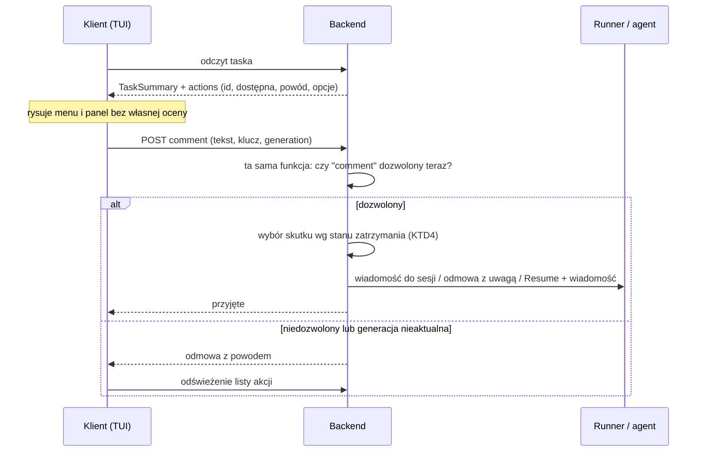

# feat: Akcje taska z backendu i komentarz w każdym stanie zatrzymania

## Summary

Backend dołącza do opisu taska (`TaskSummary`) listę akcji operatora z dostępnością, powodem i opcjami. TUI przestaje liczyć dostępność akcji z listy backendu; przesunięcie w kolejce i otwarcie linku zostają lokalne (decyzja P4). Nowa akcja „Dodaj komentarz" ma jeden punkt wejścia w backendzie. Backend sam wybiera skutek komentarza według stanu zatrzymania:

- pytanie agenta: wiadomość do agenta w tej samej sesji,
- zatwierdzenie i zgoda na uprawnienie: odmowa z uwagą (nigdy zgoda),
- pauza operatora: wznowienie sesji z komentarzem w jednym kroku.

Decyzje P1 i P3 z dokumentu źródłowego (założenia Z2 i Z6) są przyjęte jako ustalone. Ich zmiana na MR zmienia U4 i U5 oraz etykiety w U7 (see origin: Key Decisions).

---

## Problem Frame

Dziś `availability` w `src/tui/task_app/actions.rs` ocenia akcje ze stanu runnera, a `src/tui/task_app/waiting.rs` buduje panel odpowiedzi z `AttentionItem` i `PendingHumanInputView`. Reguły „co wolno" leżą w kliencie i mogą rozjechać się z walidacją backendu. Komentarz do sesji agenta zależy dziś od rodzaju oczekiwania, a w pauzie nie ma go wcale: task `Stopped` nie ma oczekującego wejścia, więc nie ma dokąd dostarczyć tekstu (see origin: Problem Frame).

---

## Requirements

Wymagania R1–R10, przepływy F1–F2 i AE1–AE6 pochodzą z dokumentu źródłowego. Plan nie zmienia ich znaczenia.

- R1, R2. Lista akcji w opisie taska: identyfikator, dostępność, powód, opcje. → U1, U2
- R3. Klient nie ocenia dostępności; brak danych to „niedostępne: brak danych". → U6
- R4. Backend odrzuca akcję niedozwoloną w chwili wysłania, z powodem. → U3
- R5, R6, R7, R8. Komentarz w czterech stanach zatrzymania, jednym krokiem, widoczny w rozmowie, obok opcji. → U2, U4, U5, U7
- R9. Komentarz w pauzie wznawia sesję. → U5
- R10. Komentarz przy zatwierdzeniu i uprawnieniu to odmowa z uwagą. → U4

**Origin actors:** A1–A4
**Origin flows:** F1 (U2, U6), F2 (U4, U5, U7)
**Origin acceptance examples:** AE1 (U2, U6), AE2 (U3), AE3 (U4), AE4 (U4), AE5 (U5), AE6 (U6)

---

## Scope Boundaries

Bez zmian względem dokumentu źródłowego (see origin: Scope Boundaries):

- Bez zmiany znaczenia akcji workflow (przejścia, `allow_manual_override`).
- Bez komentarza do taska bez sesji agenta (zakończony, zarchiwizowany, w kolejce).
- Bez nowych ról i uprawnień, bez wątków i edycji komentarza, bez załączników (Z3).
- Bez komentarza w stanach: nieudany krok, problem runnera, nieudany provisioning (Z1).

Decyzja planu dla P4: lista z backendu obejmuje akcje z R1. „Przesuń w kolejce" (`m`, `K`, `J`) i „otwórz link" (`o`) zostają lokalne w TUI. Pierwsza działa na liście, druga zależy od przeglądarki klienta.

### Deferred to Follow-Up Work

- Polecenie CLI `task comment`. Wymagania mówią o kliencie TUI; punkt wejścia z U4 pozwala dodać CLI bez zmian w backendzie.
- Przeniesienie „przesuń" i „otwórz link" do listy z backendu.

---

## Context & Research

### Stan kodu

- `crates/narsor-protocol/src/controller.rs`: `TaskSummary` ma już `manual_transitions: Option<TransitionOffer>` (serde `default`, `skip_serializing_if`). Ten sam wzorzec obsługuje zgodność ze starszymi klientami i starszym backendem (AE6).
- `crates/narsor-engine/src/controller_protocol/service.rs`: buduje `TaskSummary` (`manual_transitions(record)` ok. linii 2351) i przyjmuje polecenia (`submit_operator_command`, polecenia właściciela, `control_input`).
- `crates/narsor-protocol/src/api/human_input.rs`: `HumanInputDeliveryDto` ma `agent_message`, `comment`, `permission_decision`. `PermissionDecisionDto` ma `decision: Deny` i `message`. Odmowa z uwagą istnieje więc w kontrakcie. Dostarczenie `agent_message` silnik (`crates/narsor-engine/src/engine/actions/human.rs`) dopuszcza dla `ResolveOutput` i, gdy `allow_permission`, dla `ResolvePermission`.
- `InputContinuationView`: `CompleteStep`, `ResumeAgent`, `ResolveOutput`, `ApproveOutput`, `ResolvePermission`, `EntryLimit`. Od tego zależy, jak dostarczyć komentarz do danego pytania.
- Pauza: `RunnerState::Stopped` (`lifecycle.rs`: `Resume` z `Stopped`). Polecenie `Resume` (`OwnerCommandRequest`) nie niesie dziś tekstu, a rekord taska nie ma trwałego miejsca na wiadomość do wznowionej sesji. To jedyna nowa trwała struktura w planie (U5).
- Poprzedni plan `docs/plans/2026-10-05-0003-feat-kontynuacja-rozmowy-agenta-plan.md` (KTD1, KTD2) ustalił wzorzec: wiadomość agenta jest trwałym wariantem dostarczenia, runner zużywa ją raz i wznawia zapisaną sesję zapisanym harnessem. U5 używa tego samego wzorca.
- Klient: `availability`, `menu_items`, `invoke` w `src/tui/task_app/actions.rs`; `Model`, `composer_spec`, `submit_answer`, `answer` w `src/tui/task_app/waiting.rs`; klient HTTP w `crates/narsor-api-client/src/api/client.rs`.
- Testy: `tests/controller_protocol.rs`, `tests/tui_state.rs`, `tests/tui_render.rs`, `tests/task_app_support/mod.rs`, `tests/actions_human.rs`.

### Wnioski z `docs/solutions/`

- `docs/solutions/design-patterns/tui-modal-confirmation-keyboard-contract.md` i `tui-focus-stays-in-details-after-confirmed-action-2026-10-20.md`: po akcji fokus zostaje w szczegółach; okno `y`/`n` ma stały kontrakt klawiszy. Komentarz nie dodaje okna potwierdzenia (R6: jeden krok).
- `docs/solutions/design-patterns/tui-reads-as-keyed-background-jobs-with-loading-marker-2026-10-22.md`: odczyty i wysyłki idą jako zadania w tle z kluczem. Wysyłka komentarza używa tej ścieżki.

### Decyzja o badaniu zewnętrznym

Pominięte. Kod ma mocne lokalne wzorce (`manual_transitions`, `agent_message`, kontynuacja rozmowy). Różnice między harnessami (Claude Code, Codex, opencode) w przyjmowaniu wiadomości przy wznowieniu sprawdza U5 w kodzie adapterów (`crates/narsor-engine/src/engine/actions/harness/`), nie w dokumentacji zewnętrznej.

---

## Key Technical Decisions

- KTD1. **Lista akcji jest polem opcjonalnym `actions: Option<Vec<TaskActionOffer>>` w `TaskSummary`.** `None` znaczy „serwer nie podał". Dlaczego: ten sam wzorzec co `manual_transitions`; stary backend lub starszy klient działają bez zmiany wersji protokołu; AE6 wynika wprost. Identyfikator akcji ma wariant `Unrecognized` (`serde(other)`), jak `AttentionKind`. Dotyczy R1–R3.
- KTD2. **Jedna czysta funkcja backendu liczy ofertę i ta sama funkcja waliduje wysłanie.** Dlaczego: R4 mówi, że backend odrzuca to, co w chwili wysłania nie jest dozwolone. Jedna funkcja wyklucza rozjazd oferty i walidacji. Powody dostępności (polskie teksty z `state_phrase`, `not_running`) przenoszą się do niej. Dotyczy R1, R2, R4.
- KTD3. **Komentarz ma jeden punkt wejścia: `POST /control/v1/tasks/:task_id/comment`** z tekstem, kluczem idempotencji i `expected_generation`. Backend wybiera skutek według stanu zatrzymania. Dlaczego: dokument źródłowy oznaczył jako niezweryfikowane, że istnieje jedna ścieżka dostarczenia (`control_input`, `resolve_permission`, `control_operator_command`). Jeden punkt wejścia daje jedną regułę dla wszystkich klientów i klient nie wybiera semantyki (R6). Endpoint jest cienkim dyspozytorem nad istniejącymi ścieżkami z U4 i nową z U5. Dotyczy R5–R10.
- KTD4. **Reguła skutku komentarza** (decyzje Z2 i Z6 z dokumentu źródłowego):

  | Stan zatrzymania | Skutek komentarza | Istniejąca ścieżka |
  |---|---|---|
  | Pytanie agenta | wiadomość do agenta w tej samej sesji | `agent_message` w dostarczeniu wejścia |
  | Zatwierdzenie akcji | odrzucenie z uwagą, nigdy zatwierdzenie | wyjście odrzucające z komentarzem |
  | Zgoda na uprawnienie | `PermissionDecision::Deny` z `message` | `permission_decision` |
  | Pauza operatora (`Stopped`) | wznowienie sesji z komentarzem | nowa: wiadomość przy `Resume` (U5) |

  Komentarz nigdy nie wybiera `Allow`. Test tej własności jest obowiązkowy w U4.
- KTD5. **Wiadomość przy wznowieniu jest trwałym polem odbioru polecenia `Resume`, zużywanym przez runner raz.** Dlaczego: zapis w tym samym odbiorze co polecenie daje atomowość („zapisz i wznów" to jedno zdarzenie) i klucz idempotencji chroni przed podwójnym dostarczeniem. Wzorzec z poprzedniego planu kontynuacji (KTD1, KTD2). Dotyczy R6, R9.
- KTD6. **Klient zostawia lokalnie tylko to, co prezentacyjne.** Mapa „identyfikator akcji → skrót i etykieta" zostaje w TUI (Z5). `Move` i `OpenLink` nie są w liście z backendu (decyzja P4) i zachowują lokalne reguły. Dotyczy R3.
- KTD7. **Komentarz jest obok opcji, jako zawsze obecne pole w panelu odpowiedzi** (odpowiedź na P2). Dlaczego: R8 wymaga „obok, nie zamiast"; pole przy każdym oczekiwaniu z R5 daje jedną regułę wyświetlania, ustaloną przez dostępność z backendu. Dotyczy R8.

---

## Open Questions

### Resolved During Planning

- Gdzie leży źródło prawdy o dostępności? W backendzie, jedna funkcja (KTD2).
- Czy komentarz ma jeden punkt wejścia? Tak (KTD3). To rozstrzyga niezweryfikowane założenie z dokumentu źródłowego.
- Czy lista akcji wymaga osobnego zapytania na task (Z4)? Nie. Jest polem `TaskSummary`, a ten klient i tak czyta. Koszt to kilka krótkich pozycji na task; opcje przejść są już dziś w `manual_transitions`.
- P2 i P4: patrz KTD7 i Scope Boundaries.

### Deferred to Implementation

- Dla każdego `InputContinuation` w stanie „pytanie" lub „zatwierdzenie" wskazać, czy komentarz da się dostarczyć istniejącą ścieżką. `CompleteStep`, `EntryLimit` i pytania bez sesji agenta mogą jej nie mieć. Jeśli tak, U2 oznacza komentarz jako niedostępny z powodem. To nie jest cicha rezygnacja: wynik wraca do autora wymagań jako luka względem R5 (patrz Risks).
- Dokładna nazwa pól, wariantów i kodów błędów protokołu.
- Jak każdy z trzech harnessów przyjmuje wiadomość przy wznowieniu zapisanej sesji (U5).
- Czy wznowienie z komentarzem, gdy backend jest pełny, czeka w kolejce jak zwykłe `Resume` (`queued_for_slot`). Zakładany wynik: tak, wiadomość czeka razem z poleceniem.

---

## Output Structure

Jeden nowy plik backendu; pozostałe zmiany w istniejących plikach.

```text
crates/narsor-engine/src/controller_protocol/service/
└── actions.rs        # oferta akcji i jej walidacja (U2, U3)
```

---

## High-Level Technical Design

> To jest kierunek do przeglądu, nie specyfikacja implementacji. Implementujący traktuje to jako kontekst.



---

## Implementation Units

### U1. Kontrakt protokołu: lista akcji i komentarz

**Goal:** Typy protokołu dla listy akcji i dla komentarza oraz metoda klienta API. Bez zachowania po stronie backendu.

**Requirements:** R1, R2, R3

**Dependencies:** brak

**Files:**
- Modify: `crates/narsor-protocol/src/controller.rs` (typy `TaskActionOffer`, `TaskActionId`, opcje akcji; pole `actions` w `TaskSummary`; `SubmitCommentRequest`)
- Modify: `crates/narsor-api-client/src/api/client.rs` (metoda wysyłki komentarza)
- Modify: `crates/narsor-engine/src/controller_protocol/wire.rs`, `crates/narsor-engine/src/controller_protocol/client.rs` (jeśli powielają typy lub klienta)
- Test: `tests/controller_protocol.rs`

**Approach:**
- `actions` jest `Option` z `serde(default, skip_serializing_if)`, jak `manual_transitions` (KTD1).
- `TaskActionId` obejmuje akcje z R1: komentarz, odpowiedź, zatwierdzenie, odrzucenie, zezwolenie na uprawnienie, odmowa uprawnienia, wstrzymanie, wznowienie, przerwanie, przejście ręczne, restart, archiwizacja. Wariant `Unrecognized` przez `serde(other)`.
- Oferta niesie: identyfikator, dostępność, powód (tekst dla operatora, gdy niedostępna), opcje (lista etykiet z opisem; dla przejścia ręcznego wyjścia).
- Nowe struktury muszą dać się zdeserializować ze starych rekordów i z JSON-a bez pola.

**Patterns to follow:** `manual_transitions` i `TransitionOffer` w `crates/narsor-protocol/src/controller.rs`; `AttentionKind` z `serde(other)`.

**Test scenarios:**
- Happy path: `TaskSummary` z `actions` serializuje się i deserializuje bez zmian.
- Edge case: JSON bez pola `actions` daje `None`. Covers AE6.
- Edge case: nieznany identyfikator akcji daje `Unrecognized`, a reszta listy się czyta.
- Edge case: `SubmitCommentRequest` bez klucza idempotencji jest odrzucony przy deserializacji.

**Verification:** Stary JSON taska nadal się czyta; nowy zawiera listę; klient API ma metodę komentarza.

---

### U2. Oferta akcji w backendzie

**Goal:** Backend liczy listę akcji dla każdego taska jedną czystą funkcją i wypełnia `TaskSummary.actions`.

**Requirements:** R1, R2, R5, R8, F1, AE1, AE4, AE5

**Dependencies:** U1

**Files:**
- Create: `crates/narsor-engine/src/controller_protocol/service/actions.rs`
- Modify: `crates/narsor-engine/src/controller_protocol/service.rs` (budowa `TaskSummary`, obok `manual_transitions(record)`)
- Test: `tests/controller_protocol.rs`

**Approach:**
- Funkcja przyjmuje `TaskRecord` i stan oczekującego wejścia, zwraca pełną listę (też niedostępne pozycje z powodem).
- Przenosi reguły z `availability`, `not_running`, `runner_unreachable`, `provisioning_failed` i teksty powodów z `src/tui/task_app/actions.rs`, bez zmiany ich znaczenia (Scope Boundaries). Zachowuje obecne teksty, bo testy TUI na nie patrzą.
- Komentarz jest dostępny dokładnie w stanach z R5: pytanie, zatwierdzenie, uprawnienie, pauza (`RunnerState::Stopped`, runner zatrzymany przez operatora). W pozostałych niedostępny z powodem. Nie dotyczy to nieudanego kroku, problemu runnera i provisioningu (Z1).
- Opcje decyzji (odpowiedź, zatwierdzenie, uprawnienie) pochodzą z oczekującego wejścia, które backend już zna. Opcje przejść ręcznych z `manual_transitions`; to samo źródło, nie dwa.
- Dla `InputContinuation`, w którym komentarz nie ma ścieżki (patrz Deferred), pozycja jest niedostępna z jawnym powodem.

**Patterns to follow:** `manual_transitions(record)` w `crates/narsor-engine/src/controller_protocol/service.rs`.

**Test scenarios:**
- Happy path: task `Finished` ma `archive` dostępne, `interrupt` niedostępne z powodem.
- Covers AE1. Task uruchomiony: `archive` niedostępne z powodem „zadanie działa …".
- Happy path: task z pytaniem agenta ma dostępne `comment` i opcje odpowiedzi.
- Covers AE4. Task czekający na zgodę na uprawnienie: lista ma „Zezwól", „Odmów" i „Dodaj komentarz".
- Covers AE5. Task wstrzymany (`Stopped`): `comment` i `resume` dostępne.
- Edge case: task `Queued` bez sesji: `comment` niedostępny z powodem.
- Edge case: task z nieudanym krokiem, problemem runnera lub nieudanym provisioningiem: `comment` niedostępny (Z1).
- Edge case: runner nie odpowiada (`Freshness` nie `Live`): `interrupt` i przejście niedostępne z powodem, jak dziś.
- Edge case: task z `manual_transitions == None` (runner nie zgłoszony): przejście niedostępne z powodem.
- Integration: lista w odpowiedzi `GET /control/v1/tasks` jest tą samą, którą waliduje U3 (jedna funkcja).

**Verification:** Odpowiedź taska niesie `actions` we wszystkich stanach; teksty powodów zgadzają się z dotychczasowymi z TUI.

---

### U3. Egzekwowanie dostępności przy wysyłce (R4)

**Goal:** Polecenia właściciela, polecenia operatora i dostarczenie wejścia są odrzucane z powodem, gdy akcja nie jest dozwolona w chwili wysłania.

**Requirements:** R4, AE2

**Dependencies:** U2

**Files:**
- Modify: `crates/narsor-engine/src/controller_protocol/service.rs` (ścieżki `control_command`, `submit_operator_command`, `control_input`)
- Modify: `crates/narsor-engine/src/controller_protocol/error.rs` (kod błędu odrzucenia z powodem, jeśli brak odpowiedniego)
- Test: `tests/controller_protocol.rs`

**Approach:**
- Każda z istniejących ścieżek woła funkcję z U2 po sprawdzeniu `expected_generation` i odrzuca z powodem tej funkcji.
- Zachowuje dotychczasowe kody (`stale_generation`, `illegal_transition`, `backend_at_capacity` itd.), żeby nie psuć klientów i `refusal_reason` w TUI. Nowy kod dodaje tylko to, czego dziś nie wyłapuje nic.
- Idempotentny powtórzony klucz nie podlega nowej walidacji (odpowiedź jak dziś).
- Runner dalej odrzuca polecenia operatora po swojej stronie (`OperatorCommandStatus::Rejected`); ta walidacja jest wcześniejsza i tańsza, nie zamiennik.

**Patterns to follow:** istniejące wczesne odrzucenia `submit_operator_command` (`override_not_allowed`, `illegal_transition`).

**Test scenarios:**
- Covers AE2. Archiwizacja zlecona, gdy task w międzyczasie ruszył: odrzucona z powodem z oferty, task bez zmian.
- Error path: przerwanie taska, który stoi: odrzucone z powodem.
- Error path: stara generacja: odrzucona kodem `stale_generation`, jak dziś.
- Edge case: powtórzenie tego samego klucza po sukcesie zwraca pierwotny wynik, nie błąd dostępności.
- Edge case: wznowienie taska już uruchomionego: odrzucone z powodem.
- Integration: odrzucenie niesie ten sam powód, który oferta pokazywała chwilę wcześniej.

**Verification:** Żadna akcja z oferty jako niedostępna nie przechodzi przez żadną ścieżkę wysyłki.

---

### U4. Komentarz do pytania, zatwierdzenia i uprawnienia

**Goal:** Punkt wejścia komentarza i dostarczenie w trzech stanach z oczekującym wejściem.

**Requirements:** R5, R6, R7, R8, R10, AE3, AE4

**Dependencies:** U1, U2, U3

**Execution note:** Zacznij od testu, że komentarz do uprawnienia lub zatwierdzenia nigdy nie daje zgody.

**Files:**
- Modify: `crates/narsor-engine/src/controller_protocol/service.rs` (metoda komentarza)
- Modify: `crates/narsor-engine/src/controller_protocol/http.rs` (trasa `POST …/comment`)
- Modify: `crates/narsor-engine/src/engine/actions/human.rs` (jeśli dostarczenie wymaga nowego przypadku)
- Test: `tests/controller_protocol.rs`, `tests/actions_human.rs`

**Approach:**
- Metoda sprawdza ofertę (U2) i wybiera skutek według KTD4, budując `HumanInputDeliveryDto` i wołając istniejące dostarczenie wejścia. Nie duplikuje walidacji silnika.
- Pytanie: `agent_message`; wejście kończy się przez istniejącą kontynuację agenta.
- Uprawnienie: `permission_decision` z `Deny` i `message` dla wszystkich odmów naraz (`denial_index: None`); `Allow` nie jest możliwe z tej ścieżki.
- Zatwierdzenie: wyjście odrzucające z komentarzem w polu, które silnik już zna (`resume_comment_field`). Jeśli workflow nie ma wyjścia odrzucającego z polem komentarza, oferta z U2 oznacza komentarz jako niedostępny z powodem (patrz Risks).
- Komentarz trafia do rozmowy jako wypowiedź operatora tą samą ścieżką co odpowiedź na pytanie (R7); nie ma osobnego zapisu.
- Pusty lub biały tekst jest odrzucony.

**Patterns to follow:** `engine_delivery` i `protocol_delivery` w `crates/narsor-engine/src/controller_protocol/service.rs`; walidacja dostarczenia w `crates/narsor-engine/src/engine/actions/human.rs`.

**Test scenarios:**
- Covers AE3. Pytanie agenta: komentarz dociera do agenta jako odpowiedź w tej samej sesji; rozmowa pokazuje wypowiedź operatora.
- Covers AE4. Uprawnienie: komentarz daje odmowę z tekstem; zgoda nie jest udzielona; task nie czeka już na tę zgodę; rozmowa pokazuje wypowiedź.
- Covers AE4. Uprawnienie: akcja „Zezwól" bez komentarza nadal działa i niczego więcej nie wymaga.
- Happy path: zatwierdzenie akcji: komentarz odrzuca z uwagą, zatwierdzenie nie następuje.
- Error path: pusty komentarz odrzucony.
- Error path: komentarz do taska bez oczekiwania odrzucony z powodem z oferty.
- Edge case: komentarz do uprawnienia z kilkoma odmowami obejmuje wszystkie.
- Edge case: stara generacja odrzucona.
- Edge case: powtórzony klucz nie dostarcza komentarza dwa razy.
- Integration: po komentarzu do uprawnienia oferta nie zawiera już akcji uprawnienia (wejście rozwiązane).

**Verification:** Komentarz w trzech stanach wraca do agenta; żaden komentarz nie udziela zgody.

---

### U5. Komentarz w pauzie: wznowienie z wiadomością

**Goal:** Komentarz do taska wstrzymanego przez operatora wznawia sesję agenta z tekstem w jednym kroku.

**Requirements:** R6, R9, AE5

**Dependencies:** U3, U4 (punkt wejścia)

**Files:**
- Modify: `crates/narsor-protocol/src/controller.rs` (pole wiadomości w odbiorze polecenia `Resume`, jeśli nie wystarcza istniejące)
- Modify: `crates/narsor-engine/src/orchestration/model.rs` (`CommandReceipt` lub równoważne trwałe miejsce na wiadomość; zgodna deserializacja starych rekordów)
- Modify: `crates/narsor-engine/src/orchestration/lifecycle.rs`, `crates/narsor-engine/src/orchestration/control_plane.rs` (przyjęcie `Resume` z wiadomością)
- Modify: `crates/narsor-engine/src/engine/runner.rs`, `crates/narsor-runner/src/runner/snapshot.rs` (zużycie wiadomości przy starcie)
- Modify: `crates/narsor-engine/src/engine/actions/agent.rs` oraz adaptery w `crates/narsor-engine/src/engine/actions/harness/` (claude_code, codex, opencode)
- Modify: `crates/narsor-engine/src/controller_protocol/service.rs` (dyspozytor komentarza z U4)
- Test: `tests/runner.rs`, `tests/controller_protocol.rs`, `tests/actions_agent.rs`, `tests/engine_recovery.rs`

**Approach:**
- Wiadomość jest trwałym polem w odbiorze `Resume` (KTD5): przyjęcie polecenia, zmiana stanu i zapis tekstu to jedno zdarzenie. Klucz idempotencji chroni przed podwójnym zapisem.
- Runner po starcie czyta wiadomość, dostarcza ją raz jako pierwszą kontynuację zapisanej sesji tym samym harnessem, którym ją utworzono, i oznacza jako zużytą. Wzorzec: kontynuacja rozmowy z planu `2026-10-05-0003`.
- Gdy adapter odrzuci wznowienie sesji, zachowanie z tamtego planu: wiadomość zostaje zachowana i wraca do operatora (bez cichej utraty i bez automatycznej nowej sesji).
- Wznowienie bez tekstu (akcja „wznów") działa jak dziś.
- Gdy backend jest pełny, polecenie czeka w kolejce razem z wiadomością (`queued_for_slot`).
- Różnice trzech harnessów w przyjmowaniu wiadomości przy wznowieniu: sprawdzić w adapterach; jeśli któryś nie obsługuje, oferta z U2 oznacza komentarz w pauzie jako niedostępny dla tego harnessu z powodem i zgłasza lukę (patrz Risks).

**Patterns to follow:** plan `docs/plans/2026-10-05-0003-feat-kontynuacja-rozmowy-agenta-plan.md` (U1, U2); auto-wznawianie w `crates/narsor-engine/src/controller_protocol/service/auto_resume.rs` jako przykład wznowienia bez wejścia operatora.

**Test scenarios:**
- Covers AE5. Task wstrzymany: komentarz wznawia sesję z tekstem; stan przestaje być wstrzymany; rozmowa pokazuje wypowiedź.
- Happy path: „wznów" bez tekstu działa jak dziś i nic nie dostarcza.
- Edge case: wiadomość jest dostarczona dokładnie raz, także po restarcie runnera zaraz po wznowieniu.
- Edge case: backend pełny: task czeka w kolejce z wiadomością; po zwolnieniu slotu agent dostaje tekst.
- Edge case: stary rekord taska (bez pola wiadomości) wczytuje się bez błędu.
- Error path: adapter odrzuca wznowienie sesji: wiadomość zachowana, operator widzi odmowę z powodem.
- Error path: ponowny komentarz tym samym kluczem nie wznawia drugi raz.
- Error path: stara generacja odrzucona.
- Integration: wiadomość dociera do agenta przez adapter każdego z obsługiwanych harnessów (test per harness lub jawne „niedostępne" w ofercie).

**Verification:** Komentarz w pauzie rusza agenta z tekstem w jednym kroku; wiadomość nie ginie i nie dubluje się.

---

### U6. TUI: dostępność akcji tylko z backendu

**Goal:** Menu i skróty rysują `task.actions`; klient nie liczy dostępności.

**Requirements:** R3, F1, AE1, AE6

**Dependencies:** U2

**Files:**
- Modify: `src/tui/task_app/actions.rs` (`availability`, `menu_items`, `invoke`, `verb`)
- Modify: `src/tui/task_app/list.rs` (jeśli ocena akcji jest też w wierszach)
- Test: `tests/tui_state.rs`, `tests/tui_render.rs`, `tests/task_app_support/mod.rs`

**Approach:**
- `availability` dla akcji z backendu tylko odwzorowuje ofertę: brak oferty lub `actions == None` daje „niedostępne: brak danych" (R3, AE6). Klient nie sięga do `state_phrase` ani `not_running`; te funkcje znikają razem z pozostałą lokalną oceną.
- `Move` i `OpenLink` zachowują lokalne reguły (KTD6, P4).
- Mapa akcja → skrót, etykieta, opis i potwierdzenie `y`/`n` (Interrupt, Archive) zostaje w TUI (Z5).
- Odrzucenie z backendu (R4) pokazuje powód na pasku i odświeża listę; ta ścieżka (`notify_after_refresh`) już istnieje i działa dla `Refused`.
- Opcje przejść ręcznych klient bierze z oferty; `manual_transitions` w `TaskSummary` zostaje dla zgodności, ale `transition_list` czyta jedno źródło.

**Patterns to follow:** obecny `menu_items` i `notify_after_refresh` w `src/tui/task_app/actions.rs`.

**Test scenarios:**
- Covers AE1. Backend oznacza archiwizację niedostępną z powodem „zadanie działa": pozycja wyszarzona z tym powodem; żadna lokalna reguła tego nie zmienia (test z oferta sprzeczną z lokalną regułą).
- Covers AE6. Opis taska bez `actions`: wszystkie akcje z backendu niedostępne z powodem „brak danych".
- Edge case: skrót klawiszowy na niedostępnej akcji mówi powód na pasku.
- Edge case: `Move` i `OpenLink` działają jak dotąd bez `actions`.
- Edge case: oferta z nieznanym identyfikatorem jest pomijana, reszta menu działa.
- Integration: odrzucenie z U3 pokazuje powód i odświeża menu (menu otwarte w trakcie zmiany stanu przebudowuje się, `sync_overlay`).

**Verification:** `grep` po `src/tui` nie znajduje już lokalnej oceny dostępności akcji z R1.

---

### U7. TUI: akcja „Dodaj komentarz" i dokumentacja

**Goal:** Operator wpisuje komentarz w każdym stanie zatrzymania i wysyła go jednym krokiem.

**Requirements:** R5, R6, R7, R8, R9, R10, F2, AE3, AE4, AE5

**Dependencies:** U4, U5, U6

**Files:**
- Modify: `src/tui/task_app/waiting.rs` (pole komentarza obok opcji w `Model`; `composer_spec`; `submit_answer`; `answer`)
- Modify: `src/tui/task_app/actions.rs` (pozycja „Dodaj komentarz" w menu dla pauzy)
- Modify: `src/tui/keymap.rs` (skrót, jeśli wymagany)
- Modify: `ARCHITECTURE_DECISIONS.md`, `README.md` (opis akcji i komentarza)
- Test: `tests/tui_state.rs`, `tests/tui_render.rs`, `tests/task_app_support/mod.rs`

**Approach:**
- Pole komentarza jest obok opcji, nie zamiast (R8, KTD7): operator nadal zatwierdza, odrzuca lub zezwala bez tekstu. Widoczność pola wynika wyłącznie z dostępności akcji „comment" w ofercie (R3).
- Wysyłka komentarza woła jedną metodę klienta API z U1 i jest jednym krokiem: bez okna potwierdzenia, bez wyboru przejścia (R6).
- W pauzie „Dodaj komentarz" jest pozycją menu i skrótem; „wznów" zostaje osobno dla wznowienia bez tekstu (R9).
- Etykiety mówią skutek, żeby operator nie zgadywał: przy uprawnieniu i zatwierdzeniu komentarz jest opisany jako „odmów z uwagą" (R10), w pauzie jako „wyślij i wznów". To tekst prezentacyjny; semantykę ustala backend (KTD3).
- Szkic komentarza zachowuje się po odświeżeniu jak szkice odpowiedzi (wpisy `Entry` żyją tak długo jak oczekiwanie) i znika z komunikatem po zakończeniu stanu (istniejący mechanizm `Released`).
- Po wysyłce fokus zostaje w szczegółach (`tui-focus-stays-in-details-after-confirmed-action-2026-10-20.md`).
- Aktualizacja `ARCHITECTURE_DECISIONS.md` o decyzję: źródło prawdy o akcjach (KTD1, KTD2) i reguła komentarza (KTD4); `README.md` o skrót i zachowanie komentarza.

**Patterns to follow:** `submit_answer` i `answer` w `src/tui/task_app/waiting.rs`; `composer_item` i `composer_submission`.

**Test scenarios:**
- Covers AE3. Pytanie agenta: wybór „Dodaj komentarz", wpisanie tekstu i wysłanie wysyła komentarz; panel zamyka się; rozmowa pokazuje wypowiedź.
- Covers AE4. Zgoda na uprawnienie: lista ma „Zezwól", „Odmów", „Dodaj komentarz". „Zezwól" wysyła zgodę bez dopytywania. Komentarz wysyła odmowę z tekstem.
- Covers AE5. Task wstrzymany: „Dodaj komentarz" wysyła komentarz, a stan wiersza przestaje być „wstrzymany".
- Happy path: „wznów" w pauzie bez tekstu działa jak dziś.
- Edge case: pole komentarza nie pojawia się, gdy oferta go nie zawiera (stary backend, `actions == None`).
- Edge case: szkic komentarza przeżywa odświeżenie listy.
- Edge case: pusty komentarz nie jest wysłany; pasek mówi dlaczego.
- Error path: odrzucenie z backendu zostawia panel otwarty ze szkicem i odświeża ofertę.
- Error path: brak połączenia blokuje wysyłkę jak inne akcje zmieniające stan (`mutation_allowed`).
- Integration: wklejanie wieloliniowe do pola komentarza działa jak w innych polach tekstowych.

**Verification:** W każdym z czterech stanów zatrzymania operator widzi „Dodaj komentarz" i wraca do agenta własnym tekstem bez wyboru akcji workflow.

---

## System-Wide Impact

- **Interakcje:** Zmieniają się dwa miejsca: budowa `TaskSummary` (każdy odczyt listy i strumień zdarzeń niosą teraz `actions`) i wszystkie ścieżki wysyłki poleceń (U3). Zmiana generacji lub stanu taska musi unieważniać ofertę tak jak dziś unieważnia `manual_transitions`.
- **Propagacja błędów:** Odrzucenie z U3 wraca jako `ClientError::Refused` i trafia do istniejącego `refusal_notice` w TUI. Nowych ścieżek błędu klient nie dostaje.
- **Zgodność:** Stary klient ignoruje `actions` (nieznane pole). Nowy klient ze starym backendem pokazuje „brak danych" (AE6) zamiast zgadywać; to świadomy kompromis: nowy klient nie działa w pełni ze starym backendem, dopóki ten się nie zaktualizuje.
- **Trwałe dane:** Nowe trwałe pole wiadomości przy `Resume` (U5). Starsze rekordy muszą się wczytywać; test w U5.
- **Koszt odczytu:** Oferta rośnie o kilka krótkich pozycji na task; przy dużej liście wiersze listy nie muszą nieść opcji, tylko dostępność (decyzja implementacyjna przy U2, ocenić po pomiarze rozmiaru odpowiedzi).
- **Parytet interfejsów:** CLI nie dostaje poleceń komentarza w tym planie (Deferred). Zdalne TUI korzysta z tego samego protokołu, więc dostaje zmianę razem z lokalnym.
- **Niezmienione niezmienniki:** Workflow, `allow_manual_override`, role i autoryzacja, kolejka i scheduler (D62) bez zmian.

---

## Risks & Dependencies

| Ryzyko | Skutek | Ograniczenie |
|---|---|---|
| Nie każdy `InputContinuation` lub workflow ma ścieżkę dostarczenia komentarza (np. zatwierdzenie bez wyjścia odrzucającego z polem komentarza) | R5 („zawsze dostępna") nie jest spełnione dla tego przypadku | U2 oznacza komentarz jako niedostępny z jawnym powodem. Implementujący zgłasza każdy taki przypadek jako lukę względem R5 w opisie MR, nie ukrywa go. Decyzję o zmianie wymagań podejmuje autor |
| Harness nie przyjmuje wiadomości przy wznowieniu sesji | Komentarz w pauzie niedostępny dla tego harnessu | U5 sprawdza wszystkie trzy adaptery; różnica jest jawna w ofercie, nie cicha |
| Jedna funkcja oferty i walidacji zmienia zachowanie istniejących odrzuceń | Regresja kodów błędów, które klient zna | U3 zachowuje dotychczasowe kody i testuje je bez zmian |
| Zmiana Z2 lub Z6 na MR | Zmiana semantyki w U4 i U5 | Reguła w jednej tabeli (KTD4) i jednym dyspozytorze (KTD3); zmiana lokalna |
| Wiadomość przy `Resume` dostarczona dwa razy lub utracona przy restarcie runnera | Agent dostaje komentarz podwójnie albo wcale | Atomowy zapis z poleceniem, znacznik „zużyta", klucz idempotencji; testy restartu w U5 |

Zależności: brak zewnętrznych. U1 jest pierwsza; U2 po U1; U6 po U2 (wymaga danych z U2); U7 na końcu.

---

## Documentation / Operational Notes

- `ARCHITECTURE_DECISIONS.md` i `README.md` w U7.
- Wdrożenie: backend przed klientem. Klient ze starszym backendem pokazuje „brak danych" (AE6).
- Nie ma migracji danych poza zgodną deserializacją pola z U5.

---

## Sources & References

- **Origin document:** `docs/brainstorms/2026-10-22-akcje-taska-z-backendu-i-komentarz-w-pauzie-requirements.md`
- Plan wzorcowy kontynuacji: `docs/plans/2026-10-05-0003-feat-kontynuacja-rozmowy-agenta-plan.md`
- Plan z podobnym przepływem klient–backend: `docs/plans/2026-10-22-002-feat-zmiana-limitu-rownoleglych-taskow-plan.md`
- Wnioski: `docs/solutions/design-patterns/tui-modal-confirmation-keyboard-contract.md`, `docs/solutions/design-patterns/tui-focus-stays-in-details-after-confirmed-action-2026-10-20.md`, `docs/solutions/design-patterns/tui-reads-as-keyed-background-jobs-with-loading-marker-2026-10-22.md`
