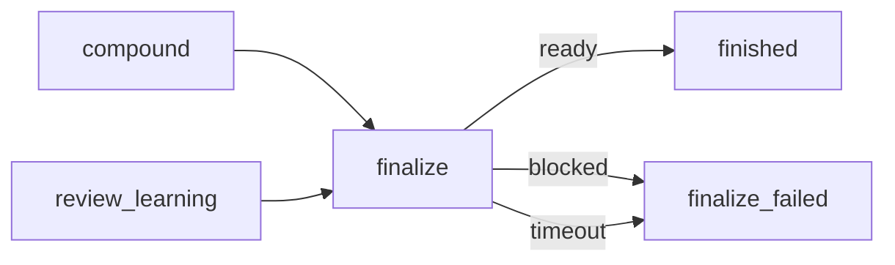

# fix: Niezawodne zdjęcie Draft w compound finalize i usunięcie finalize_blocked

## Summary

Krok `finalize` w `workflows/compound-engineering.yaml` dostaje twardą weryfikację końcową (odczyt stanu z hosta po zdjęciu Draft), poprawny odczyt pola Draft dla GitHub i GitLab oraz ograniczoną pętlę powtórzeń w prompcie. Bramka `finalize_blocked` i stan `left_as_draft` znikają. Powód nienaprawialny kończy proces w nowym stanie `finalize_failed` ze statusem `failed`. Plan zaczyna się od zebrania dowodów (R1–R3). Zmiany w prompcie są poprawne przy hipotezach (a)–(d) z R2. Przy hipotezie (e) zakres wraca do Artura przed implementacją.

---

## Problem Frame

Zob. origin: Problem Frame. Przyczyna porażki zdjęcia Draft jest nieznana (origin: Założenie 3). Plan nie zakłada, że winna jest kolejność operacji.

---

## Requirements

Numeracja R1–R10 i AE1–AE5 jak w origin (see origin: `docs/brainstorms/2026-10-24-compound-finalize-zdjecie-draft-requirements.md`).

---

## Założenia przyjęte w planie

Origin zostawia dwa pytania „Resolve Before Planning". Plan przyjmuje odpowiedzi z Key Decisions i Założeń 4–5 origin. Artur potwierdza je przy przeglądzie planu.

- Z1 (pyt. 2 origin): powód nienaprawialny kończy proces porażką z powodem. Bramki nie ma.
- Z2 (pyt. 3 origin): `left_as_draft` znika. Zastępuje go `finalize_failed` (status `failed`, Założenie 5 origin).
- Z3 (pyt. 1 origin): brak logu nie blokuje planu. U1 zbiera dowody. U2 i U3 obejmują hipotezy (a)–(d) z R2. Hipoteza (e) wymaga decyzji Artura po U1.

---

## Scope Boundaries

- Poza zakresem: zatwierdzanie, auto-merge, merge, inne bramki (`review_*`, `check_*_feedback`), uprawnienia kont `gh`/`glab` (origin: Scope Boundaries).
- Poza zakresem: komentarz na PR w stanie zatrzymania. `finalize` ma `workspace_access: read-only` i wolno mu tylko czytać PR i zdjąć Draft (R6). Powód widzi człowiek w stanie końcowym (R9, pierwsza część).

### Deferred to Follow-Up Work

- Komentarz z powodem w TUI w każdym stanie zatrzymania: zadanie #22 (`docs/plans/2026-10-22-003-feat-akcje-taska-z-backendu-i-komentarz-w-pauzie-plan.md`). To jest komentarz operatora w sesji, nie komentarz na PR. Nie jest to warunek tego planu.

---

## Context & Research

- `workflows/compound-engineering.yaml`, krok `finalize`: agent `read-only`, `timeout: 10m`, odpowiedzi `ready` / `blocked` / `timeout`. `blocked` i `timeout` prowadzą do `finalize_blocked`.
- `WORKFLOW_SCHEMA.md` (sekcja o historii wejść i `retry_policy`): `retry_policy` ponawia akcje, które zakończyły się błędem. Nie ponawia odpowiedzi `blocked`. Błąd harnessu, sandboxa lub narzędzia kończy execution jako `failed` bez przejścia. To rozstrzyga pytanie „retry_policy czy pętla w prompcie" (origin: Deferred to Planning, R8).
- `max_entries` ogranicza liczbę wejść w krok (użyte w `code_review`, `repair_verification`). Kroki `agent` dostają w promptcie blok historii od drugiego wejścia.
- Prompt `finalize` podaje `isDraft` dla `gh`, a dla `glab mr view -F json` nie podaje pola. To jest luka z R5.
- Read-only runner (`narsor-runner --read-only`, `crates/narsor-engine/src/backends/local.rs`) jest hipotezą (e) z R2. Czy blokuje sieć, ustala U1.
- Testy: `tests/workflows.rs` (ścieżki `finalize`, `COMPOUND_STATES`, `COMPOUND_EDGES`), `tests/builtin_workflows.rs`, fixture `tests/fixtures/engine/script_gate.yaml` (osobny fixture, nie zależy od zmiany).

---

## Key Technical Decisions

- **Pętla w prompcie, nie `retry_policy`.** `retry_policy` nie widzi odpowiedzi `blocked`. Pętla w prompcie ma stały limit (3 próby zdjęcia + odczytu) i jawne odczekanie między próbami. Limit czasu kroku `timeout: 10m` zostaje jako górna granica (R8).
- **Potwierdzenie tylko z odczytu hosta.** `ready` wolno odpowiedzieć tylko po odczycie stanu z hosta, który pokazuje PR poza Draft lub zmergowany (R4, AE2).
- **Pole Draft per host.** GitHub: `isDraft`. GitLab: pole zwracane przez `glab mr view -F json` (nazwa do potwierdzenia w U1, bo origin jej nie podaje). Prompt zakazuje wnioskowania ze stanu z tytułu (AE3).
- **`blocked` i `timeout` → `finalize_failed`.** Terminal `failed`. Powód z `reason` kroku jest w historii taska. Bez bramki (R7, R9).
- **`left_as_draft` usunięty, nie przeniesiony.** `finalize_failed` pełni jego rolę, ale z prawdziwym statusem porażki.

---

## High-Level Technical Design

> Ilustruje zamierzony kształt. To wskazówka do przeglądu, nie specyfikacja implementacji.

Pętla wewnątrz kroku `finalize` (opis w prompcie): odczyt → (Draft?) zdjęcie → odczyt → jeśli nadal Draft, odczekaj i powtórz do 3 prób → po wyczerpaniu `blocked` z przyczyną.

---

## Implementation Units

### U1. Ustalenie przyczyny porażki zdjęcia Draft

**Goal:** Zebrać dowody dla R1–R3 przed zmianą promptu.

**Requirements:** R1, R2, R3

**Dependencies:** brak

**Files:**
- `docs/solutions/` (opcjonalnie: wpis z wynikiem, jeśli przyczyna jest nieoczywista)
- Opis zmiany (PR): sekcja „Przyczyna / dowód / poprawka"

**Approach:**
- Zdobyć log kroku `finalize` z nieudanego taska i `reason` z historii kroku. Jeśli Artur go nie poda, przejść do kroków poniżej bez niego.
- Dla każdej hipotezy z R2 zapisać werdykt z dowodem: (a) czas odczytu względem ostatniego pushu; (b) czy krok po `publish_*` przywraca Draft (przejrzeć prompty `ce-commit-push-pr` i `publish_*`); (c) rzeczywisty JSON z `glab mr view -F json` i `gh pr view --json` na PR testowym (nazwa pola Draft); (d) logowanie `gh`/`glab` w miejscu pracy kroku; (e) czy read-only runner lub sieć blokuje wywołania hosta (`crates/narsor-engine/src/backends/local.rs`, `--read-only`).
- Dane testowe tylko z PR testowego. Nie wklejać danych klientów ani tokenów do opisu zmiany.
- Jeśli (e) jest prawdziwa, zakres zmiany rośnie (zmiana `workspace_access` lub runnera). To zmienia U2 i wraca do Artura przed implementacją.

**Test expectation: none -- badanie, bez zmiany zachowania.**

**Verification:** Opis zmiany zawiera dla R2 (a)–(e) werdykt i dowód, a dla przyczyny rzeczywistej: przyczynę, dowód, poprawkę.

---

### U2. Prompt `finalize`: weryfikacja, pole Draft per host, ograniczona pętla

**Goal:** Zmienić prompt i przejścia `finalize` tak, aby `ready` wymagało odczytu z hosta.

**Requirements:** R4, R5, R6, R7, R8, AE1, AE2, AE3, AE4, AE5

**Dependencies:** U1

**Files:**
- `workflows/compound-engineering.yaml` (krok `finalize`)
- `tests/builtin_workflows.rs`
- `tests/workflows.rs`

**Approach:**
- Zachować: walidację `pr_url`, listę dozwolonych operacji (czytaj, zdejmij Draft), zakazy (approve, auto-merge, merge, wait na checki, push, zmiana plików).
- Kroki w prompcie: odczyt; zmergowany lub już poza Draft → `ready`; zamknięty bez merge → `blocked`; otwarty w Draft → zdjęcie, odczyt, i jeśli nadal Draft, odczekanie i ponowienie. Maksymalnie 3 próby. Po 3 próbach `blocked` z przyczyną.
- Odczyt stanu: `gh pr view <url> --json state,isDraft`; dla GitLab pole z U1 (oczekiwane `draft`; do potwierdzenia, nie przyjmować z pamięci). Zakaz wnioskowania z tytułu `Draft:`.
- `ready` zawiera w `reason` stan odczytany z hosta.
- Przejścia: `blocked: finalize_failed`, `timeout: finalize_failed`.
- Jeśli U1 wskaże inną przyczynę (np. kolejność względem pushu), dodać tę korektę w tym samym kroku.

**Patterns to follow:** istniejący prompt `finalize` (struktura, walidacja URL); `max_entries`/`retry_policy` w `code_review` jako wzór zapisu limitów.

**Test scenarios:**
- Happy path. Covers AE1. `finalize` odpowiada `ready` → `finished`, status `Completed`.
- Happy path. Covers AE5. Zmergowany PR → `ready`, brak operacji zdejmowania Draft w prompcie dla tej gałęzi (test na treść promptu).
- Edge. Covers AE2. Odpowiedź `blocked` po wyczerpaniu prób → `finalize_failed`, status `Failed`.
- Error. Covers AE4. Brak logowania `glab`: `blocked` z `reason` → `finalize_failed`, w zdarzeniu widoczny `reason`, brak oczekującej bramki.
- Error. `timeout` kroku → `finalize_failed` (nie bramka).
- Contract (treść promptu). Prompt zawiera pole Draft dla GitHub i GitLab (AE3, R5), limit prób i zakaz wnioskowania z tytułu.
- Contract. Prompt zachowuje zakazy: approve, auto-merge, merge, push, wait na checki (R6).

**Verification:** Testy `finalize` przechodzą. Prompt nie zawiera dopisku, który pozwala na `ready` bez odczytu z hosta.

---

### U3. Usunięcie `finalize_blocked` i `left_as_draft`, nowy terminal `finalize_failed`

**Goal:** Usunąć bramkę i stan, dodać terminal porażki.

**Requirements:** R7, R9, R10

**Dependencies:** U2

**Files:**
- `workflows/compound-engineering.yaml` (stany, `terminal_states`, nagłówek pliku jeśli wspomina bramkę)
- `tests/workflows.rs` (`COMPOUND_STATES`, `COMPOUND_EDGES` — liczba krawędzi spada z 62; testy ścieżek bramki: `covers_ae5_a_blocked_finalize...`, `covers_ae5_a_retried_finalize...`, `finishing_as_draft_...`, `a_finalize_stopped_by_its_time_limit...`)
- `tests/builtin_workflows.rs` (`compound_engineering_finalize_is_a_read_only_agent_with_a_timeout_choice`: asercja `transitions["timeout"]`)
- `workflows/README.md` (tabela bramek, opis `finalize`, terminale, akapit o `gh`/`glab` bez logowania)
- `workflows/compound-engineering-flow.html` (węzły „Finalizacja zablokowana" i `left_as_draft`; dodać `finalize_failed`)

**Approach:**
- Usunąć stany `finalize_blocked` i `left_as_draft`. Dodać `finalize_failed` z opisem „finalize nie potwierdził, że PR jest poza Draft; powód w historii kroku". `terminal_states: finalize_failed: failed`.
- Przepisać testy ścieżek: zamiast bramki, `blocked` i `timeout` kończą w `finalize_failed` ze statusem `Failed`. Usunąć testy `retry` i `finish_as_draft`.
- Zaktualizować `COMPOUND_STATES`/`COMPOUND_EDGES` (usunięte 2 stany i 4 krawędzie, dodany 1 stan, 2 krawędzie; stałą długości tablicy poprawić).
- README: napisać, że brak narzędzia lub logowania kończy proces w `finalize_failed`; człowiek poprawia środowisko i uruchamia nowe zadanie.
- Dodać do README uwagę zgodną z istniejącą: taski w toku na starej wersji mogą nie wznowić się po aktualizacji (stan `finalize_blocked` zniknął).
- Diagram HTML: usunąć dwa węzły i połączenia, dodać węzeł `finalize_failed`; zachować styl istniejących węzłów terminalnych.

**Patterns to follow:** inne terminale w pliku (`cancelled`); format `terminal_states` mapujący (`WORKFLOW_SCHEMA.md`, sekcja o terminalach); testy `COMPOUND_*` w `tests/workflows.rs`.

**Test scenarios:**
- Integration. Graf: `the_compound_graph_is_the_one_the_plan_draws` przechodzi z nową listą stanów i krawędzi.
- Integration. `blocked` → `finalize_failed`, `ExecutionStatus::Failed`, bez oczekującej bramki.
- Integration. `timeout` (z `with_finalize_timeout`) → `finalize_failed`.
- Edge. Wszystkie stany osiągalne; brak stanu bez wejścia (istniejący test osiągalności, jeśli jest).
- Contract. Ładowanie definicji: `terminal_states` zawiera `finalize_failed: failed` i nie zawiera `left_as_draft`.
- Regression. `tests/engine_execution.rs` i fixture `script_gate.yaml` nie zależą od zmiany i przechodzą bez edycji.

**Verification:** Żadne wystąpienie `finalize_blocked` ani `left_as_draft` nie zostaje w `workflows/`, `tests/workflows.rs`, `tests/builtin_workflows.rs` (poza fixture `script_gate.yaml`, który jest osobnym przykładem). Pełny przebieg testów workspace jest zielony.

---

## System-Wide Impact

- Taski w toku, które stoją w `finalize_blocked`, nie wznowią się. Opisane w README (U3).
- TUI i backend nie znają nazw tych stanów na stałe: sprawdzić w U3 `grep` po `crates/` i `src/` (stan na dziś: brak trafień poza testami i workflow).
- Status `failed` zamiast `cancelled` zmienia, jak TUI pokazuje taski, które nie dokończyły `finalize`. Wymaga weryfikacji przez Artura, czy ten widok wystarcza (origin: Założenie 5).

---

## Risks

- **Przyczyna to (e): read-only runner blokuje hosta.** Wtedy sam prompt nie pomoże. Mitygacja: U1 sprawdza to pierwsze; zmiana zakresu wraca do Artura.
- **Nazwa pola Draft w `glab` błędna.** Mitygacja: U1 potwierdza na rzeczywistym JSON. Prompt nie opiera się na pamięci.
- **Agent przedwcześnie odpowiada `ready`.** Mitygacja: prompt wymaga stanu z odczytu w `reason`. Pełnej gwarancji nie daje test (prompt nie jest barierą techniczną, zob. `workflows/README.md`).
- **Pętla w prompcie nie jest egzekwowana przez silnik.** Granicą twardą jest `timeout: 10m`.

---

## Deferred to Implementation

- Dokładne słowa promptu i czas odczekania między próbami.
- Dokładna liczba krawędzi po zmianie (liczy implementator z `COMPOUND_EDGES`).
- Czy diagram HTML wymaga przesunięcia współrzędnych po usunięciu węzłów.

---

## Origin coverage

R1–R3 → U1. R4–R6, R7 (część w prompcie), R8, AE1–AE5 → U2. R7, R9, R10 → U3 (R8 przez limit prób i `timeout` w U2; R9 przez `finalize_failed` i `reason`; część R9 o komentarzu odroczona, zob. Scope Boundaries). Założenia i pytania otwarte origin → sekcja „Założenia przyjęte w planie".
