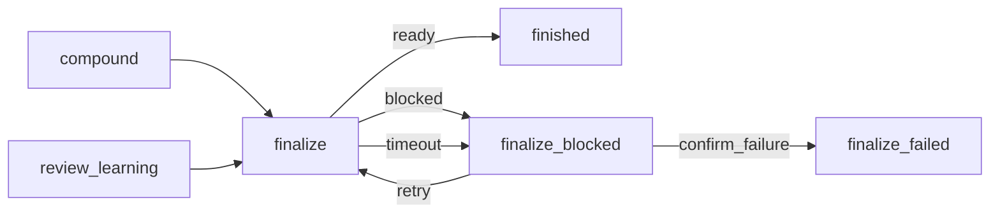

# fix: Niezawodne zdjęcie Draft w compound finalize i bramka finalize_blocked

## Summary

Krok `finalize` w `workflows/compound-engineering.yaml` zdejmuje Draft i potwierdza to odczytem z hosta. Ta część jest już w kodzie (commit `0da020f`). Brakuje bramki `finalize_blocked`: dziś `blocked` i `timeout` idą wprost do `finalize_failed`. Wymaganie z PR #25 mówi, że przejście do porażki wymaga decyzji człowieka. Plan dodaje bramkę z wyborami `retry` i `confirm_failure`. `retry` wraca do `finalize`. `confirm_failure` kończy w `finalize_failed` (status `failed`). Plan zaczyna się od dowodów przyczyny (R1–R3).

---

## Problem Frame

Zob. origin: Problem Frame. Przyczyna porażki zdjęcia Draft jest nieznana (origin: Założenie 3). Plan nie zakłada, że winna jest kolejność operacji.

Stan kodu (sprawdzony w tym planie):

- Prompt `finalize` ma już pętlę 3 prób, odczyt z hosta po zdjęciu Draft, pola Draft dla GitHub i GitLab, zakaz wnioskowania z tytułu (R4–R7, R12 część automatyczna).
- Przejścia `blocked` i `timeout` idą do `finalize_failed`. Bramki nie ma (origin: Problem Frame).
- Testy, `workflows/README.md` i `workflows/compound-engineering-flow.html` opisują przepływ bez bramki.

---

## Requirements

R1–R13 i AE1–AE6 jak w origin (see origin: `docs/brainstorms/2026-10-24-compound-finalize-zdjecie-draft-requirements.md`).

---

## Założenia przyjęte w planie

Origin ma sekcję „Pytania otwarte dla użytkownika" z dwoma pytaniami. Żadne nie zmienia zachowania produktu, więc plan je zamyka jawnie. Artur potwierdza odpowiedzi przy przeglądzie.

- Z1. Pytanie origin 1: „Jak dokładnie `finalize` zawodzi? Jaki jest log lub komunikat (GitHub czy GitLab; błąd narzędzia, czy PR zostaje w Draft mimo sukcesu)?" Odpowiedź planu: brak logu nie blokuje planu. U1 zbiera dowody. Hipoteza (e) z R2 wymaga decyzji Artura po U1.
- Z2. Pytanie origin 2: „Czy bramka ma mieć limit ręcznych `retry`, czy bez limitu?" Odpowiedź planu: bez limitu (origin: Założenie 6, R12). Człowiek kontroluje pętlę. Nie dodajemy `max_entries` do `finalize`.

---

## Scope Boundaries

- Poza zakresem: zatwierdzanie, auto-merge, merge, inne bramki (`review_*`, `check_*_feedback`), uprawnienia kont `gh`/`glab` (origin: Scope Boundaries).
- Poza zakresem: zadanie #22.

### Deferred to Follow-Up Work

- Komentarz w każdym stanie zatrzymania: zadanie #22 (`docs/plans/2026-10-22-003-feat-akcje-taska-z-backendu-i-komentarz-w-pauzie-plan.md`). Ten plan go nie wymaga.

---

## Context & Research

- `workflows/compound-engineering.yaml`, krok `finalize` (agent, `read-only`, `timeout: 10m`, wybory `ready` / `blocked` / `timeout`).
- Wzorzec bramki: `review_learning` w tym samym pliku (`type: human`, `message`, `inputs` typu `select`, `choices`, `transitions`). Poprzednia wersja bramki `finalize_blocked` jest w `git show 0da020f^:workflows/compound-engineering.yaml` (wybory `retry` i `finish_as_draft`). Nowa wersja zmienia tylko drugi wybór na `confirm_failure` i jego cel na `finalize_failed`.
- Powód w bramce (R10, rozstrzygnięte): silnik pokazuje `reason` wyboru agenta w widoku oczekującej bramki. Dowód: `tests/engine_execution.rs`, test `a_script_choosing_blocked_leads_to_a_gate_with_its_reason` (`pending_view`, `view.reason`). Plan nie potrzebuje szablonu ani zadania #22. Przy `timeout` silnik nie ma powodu od agenta. Opis bramki mówi o tym w jednym zdaniu.
- `WORKFLOW_SCHEMA.md`: `retry_policy` nie ponawia odpowiedzi `blocked`. Dlatego pętla jest w prompcie, a ręczne ponowienie w bramce. Historia kroku (`{{ step.history }}`) pokazuje agentowi powód poprzedniej próby po `retry`, bez zmiany promptu.
- Hipoteza (e) z R2: read-only runner (`crates/narsor-engine/src/backends/local.rs`, `--read-only`). Czy blokuje hosta, ustala U1.
- Testy do zmiany: `tests/workflows.rs` (`COMPOUND_STATES`, `COMPOUND_EDGES`, testy `finalize`, linie około 1170–1210 i 1280–1380), `tests/builtin_workflows.rs` (około linii 483). `tests/fixtures/engine/script_gate.yaml` ma własny `finalize_blocked` i nie zależy od zmiany.

---

## Key Technical Decisions

- **Bramka zostaje (decyzja Artura, PR #25).** `blocked` i `timeout` idą do `finalize_blocked`. Porażka wymaga decyzji człowieka (R8, R9).
- **Dwa wybory: `retry` i `confirm_failure`.** `retry` → `finalize`. `confirm_failure` → `finalize_failed` (R9, R11).
- **Brak `left_as_draft`.** Jeden stan porażki. Kto woli zostawić Draft, wybiera `confirm_failure` (R11).
- **Pętla automatyczna w prompcie, ręczna w bramce.** Limit 3 prób zostaje. `timeout: 10m` zostaje jako górna granica (R12).
- **Prompt `finalize` bez zmian, poza opisami wyborów.** Opisy `blocked` i `timeout` w `choices` mówią dziś „the run fails". Mają mówić „a person decides at the gate".

---

## High-Level Technical Design

> To wskazówka do przeglądu, nie specyfikacja implementacji.

---

## Implementation Units

### U1. Ustalenie przyczyny porażki zdjęcia Draft

**Goal:** Zebrać dowody dla R1–R3 przed dalszą zmianą promptu.

**Requirements:** R1, R2, R3

**Dependencies:** brak

**Files:**
- Opis zmiany (PR): sekcja „Przyczyna / dowód / poprawka"
- `docs/solutions/` (opcjonalnie, gdy przyczyna jest nieoczywista)

**Approach:**
- Zdobyć log kroku `finalize` i `reason` z historii nieudanego taska. Bez logu od Artura: kontynuować bez niego.
- Dla każdej hipotezy z R2 zapisać werdykt z dowodem: (a) czas odczytu względem ostatniego pushu; (b) czy krok po `publish_*` przywraca Draft (prompty `ce-commit-push-pr` w `workflows/compound-engineering.yaml`); (c) rzeczywisty JSON z `glab mr view -F json` i `gh pr view --json state,isDraft` na PR testowym (nazwa pola Draft); (d) logowanie `gh`/`glab` w miejscu pracy kroku; (e) czy read-only runner lub sieć blokuje wywołania hosta.
- Dane tylko z PR testowego. Nie wklejać danych klientów ani tokenów do opisu zmiany. Jeśli log zawiera takie dane, zamaskować je przed wklejeniem.
- Jeśli (e) jest prawdziwa, zakres rośnie (zmiana `workspace_access` lub runnera). To wraca do Artura przed dalszą implementacją.
- Jeśli wynik wskazuje błąd w prompcie `finalize` (kolejność, pole Draft), poprawić prompt w U2.

**Test expectation: none -- badanie, bez zmiany zachowania.**

**Verification:** Opis zmiany zawiera dla R2 (a)–(e) werdykt i dowód oraz przyczynę, dowód i poprawkę.

---

### U2. Opisy wyborów `finalize` i korekta promptu z wyniku U1

**Goal:** Dopasować opisy wyborów `finalize` do bramki. Wprowadzić korektę promptu tylko wtedy, gdy U1 ją wskaże.

**Requirements:** R4, R5, R6, R7, R8, AE1, AE2, AE3, AE6

**Dependencies:** U1

**Files:**
- `workflows/compound-engineering.yaml` (krok `finalize`: `choices`, ewentualnie prompt)
- `tests/builtin_workflows.rs`

**Approach:**
- Prompt (pętla 3 prób, odczyt z hosta, pola Draft, zakazy) już spełnia R4–R7. Nie przepisywać go bez dowodu z U1.
- Zmienić opisy `blocked` i `timeout`: człowiek decyduje na bramce `finalize_blocked`.
- Jeśli U1 wskaże inną przyczynę, dodać korektę w tym kroku.

**Patterns to follow:** istniejący prompt `finalize`; opisy wyborów w `review_learning`.

**Test scenarios:**
- Contract. Covers AE6. Prompt zawiera `draft` dla GitLab, `isDraft` dla GitHub i wymóg wskazania w `reason` pola użytego jako rezerwa.
- Contract. Covers AE3. Prompt daje `ready` dla PR zmergowanego po pierwszym odczycie.
- Contract. Prompt zachowuje zakazy: approve, auto-merge, merge, push, wait na checki, walidacja `pr_url` (R7).
- Contract. Covers AE2. Prompt ma limit 3 prób i `blocked` po ich wyczerpaniu.

**Verification:** Testy treści promptu w `tests/builtin_workflows.rs` przechodzą.

---

### U3. Przywrócenie bramki `finalize_blocked`

**Goal:** `blocked` i `timeout` kroku `finalize` prowadzą do bramki. `confirm_failure` prowadzi do `finalize_failed`.

**Requirements:** R8, R9, R10, R11, R12, R13, AE2, AE4, AE5

**Dependencies:** U2

**Files:**
- `workflows/compound-engineering.yaml` (nowy stan `finalize_blocked`, przejścia `finalize`, opis `finalize_failed`)
- `tests/workflows.rs` (`COMPOUND_STATES`, `COMPOUND_EDGES`, testy `finalize`)
- `tests/builtin_workflows.rs` (asercje przejść `finalize`, nowy test bramki)
- `workflows/README.md` (akapit o `finalize`, tabela bramek, terminale, uwaga o taskach w toku)
- `workflows/compound-engineering-flow.html` (węzeł bramki i cztery połączenia; opis `finalize_failed`)

**Approach:**
- Dodać stan `finalize_blocked` typu `human`: `message` mówi, że `finalize` nie zdjął Draft, że powód jest w widoku bramki (przy `timeout` powodu od agenta nie ma), że `retry` uruchamia `finalize` po naprawie przyczyny, a `confirm_failure` kończy proces porażką. `inputs`: pole `select` (`retry`, `confirm_failure`), `required: true`. Wzór: `review_learning` i wersja bramki z `0da020f^`.
- Przejścia `finalize`: `blocked` i `timeout` → `finalize_blocked`. Przejścia bramki: `retry: finalize`, `confirm_failure: finalize_failed`.
- Opis `finalize_failed`: człowiek potwierdził porażkę na bramce; powód jest w historii kroku `finalize`. `terminal_states` bez zmian (`finalize_failed: failed`).
- Nie dodawać `max_entries` do `finalize` (Z2).
- Nie wracać do nazwy `finish_as_draft` ani stanu `left_as_draft` (R11).
- README: wpisać bramkę w opis `finalize` i tabelę bramek; zmienić uwagę o taskach w toku tak, aby nie mówiła o „usuniętej" bramce. Zachować akapit o `gh`/`glab` bez logowania: dziś mówi o porażce, ma mówić o bramce.
- Diagram HTML: dodać węzeł bramki w stylu istniejących bramek i krawędzie `blocked`, `timeout`, `retry`, `confirm_failure`. Poprawić tekst notatki „Wiedza i zakończenie".

**Patterns to follow:** bramka `review_learning`; style węzłów bramek w `compound-engineering-flow.html`; stałe `COMPOUND_*` w `tests/workflows.rs`.

**Test scenarios:**
- Integration. Graf: test zgodności z `COMPOUND_STATES` i `COMPOUND_EDGES` przechodzi po dodaniu 1 stanu (`COMPOUND_STATES` 29 → 30) i 2 nowych krawędzi bramki (`COMPOUND_EDGES` 60 → 62). Dwie istniejące krawędzie `finalize` (`blocked`, `timeout`) zmieniają tylko cel z `finalize_failed` na `finalize_blocked`.
- Error. Covers AE2. `finalize` odpowiada `blocked` → bieżący stan `finalize_blocked`, status wykonania nie jest `Failed`, bramka oczekuje.
- Error. Covers AE4. `blocked` z `reason` „glab is not signed in..." → widok bramki pokazuje ten `reason`. Wybór `retry` → `finalize` uruchamia się ponownie; druga odpowiedź `ready` → `finished`.
- Error. `timeout` kroku (`with_finalize_timeout`) → `finalize_blocked`, nie `finalize_failed`.
- Happy path. Covers AE5. `confirm_failure` → `finalize_failed`, `ExecutionStatus::Failed`.
- Edge. `retry` dwa razy z rzędu po `blocked` nie kończy wykonania ani nie zgłasza błędu limitu (R12, Z2).
- Contract. Definicja zawiera bramkę z dokładnie wyborami `retry` i `confirm_failure`. Nie zawiera `left_as_draft` ani `finish_as_draft`.
- Regression. `tests/engine_execution.rs` i fixture `script_gate.yaml` przechodzą bez edycji.

**Verification:** Testy `finalize` i graf przechodzą. Pełny przebieg testów workspace jest zielony. Nie ma `left_as_draft` ani `finish_as_draft` w `workflows/` i w testach. Nazwa `finalize_blocked` w `workflows/` odnosi się tylko do nowej bramki.

---

## System-Wide Impact

- Taski w toku na wersji z `finalize_failed` bez bramki są zgodne: stan końcowy zostaje. Taski, które w poprzednich wersjach czekały na bramce z `finish_as_draft`, mogą nie wznowić się (wybór zmienił nazwę). README to mówi.
- Status `failed` po `confirm_failure` zmienia widok w TUI względem `left_as_draft` (`cancelled`?). Artur potwierdza (origin: Założenie 5). TUI i backend nie znają nazw stanów na stałe: sprawdzić `grep` po `crates/` i `src/` w U3.

---

## Risks

- **Przyczyna to (e): read-only runner blokuje hosta.** Sam prompt nie pomoże. U1 sprawdza to pierwsze. Zmiana zakresu wraca do Artura.
- **Nazwa pola Draft w `glab` błędna.** U1 potwierdza na rzeczywistym JSON.
- **`retry` w pętli bez końca.** Zamierzone (Z2): pętla jest ręczna. Człowiek może wybrać `confirm_failure`.
- **Agent odpowiada `ready` bez odczytu.** Prompt nie jest barierą techniczną (`workflows/README.md`). Twarda granica to `timeout: 10m`.

---

## Deferred to Implementation

- Dokładne słowa `message` bramki i opisów wyborów.
- Dokładna liczba krawędzi w `COMPOUND_EDGES`.
- Współrzędne węzła bramki w diagramie HTML.

---

## Origin coverage

R1–R3 → U1. R4–R7, AE1, AE3, AE6 → U2 (prompt już w kodzie). R8–R13, AE2, AE4, AE5 → U3. Założenia i pytania otwarte origin → „Założenia przyjęte w planie". Poza zakresem origin → Scope Boundaries.
