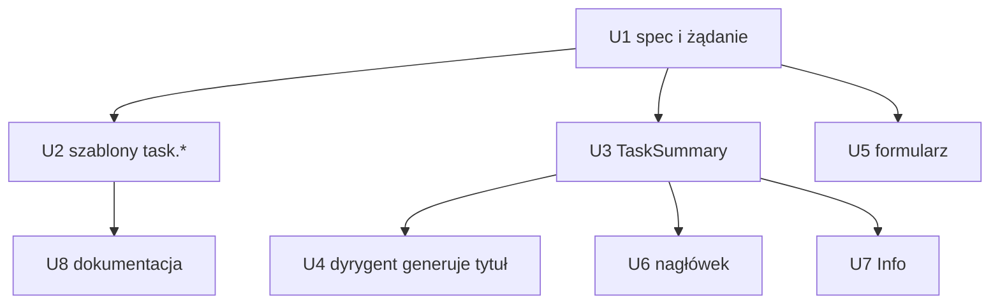

# feat: Ticket i tytuł zadania

## Summary

Zadanie dostaje dwa wbudowane, opcjonalne pola: `ticket` i `title`. Operator wpisuje je w formularzu nowego zadania. Backend przycina i waliduje je, zapisuje w zapieczętowanym `TaskLaunchSpec` i udostępnia w szablonach jako `{{ task.ticket }}` i `{{ task.title }}`. Gdy tytułu brak, dyrygent w runnerze generuje go z opisu zadania. Runner raportuje wygenerowany tytuł w migawce, a serwer pokazuje go w `TaskSummary`. Nagłówek szczegółów w TUI pokazuje ticket i tytuł po lewej, a 8 znaków `TaskId` po prawej, każde w ramce.

Głębokość: Standard. Zmiana przechodzi przez protokół, silnik, runner i TUI.

---

## Problem Frame

Dziś ticket i tytuł istnieją tylko, gdy autor workflow zadeklaruje własne wejście i użyje go w `display`. Operator nie widzi ticketu w szczegółach zadania, a prompt nie może się do niego odwołać (see origin: `docs/brainstorms/2026-10-24-task-ticket-i-tytul-requirements.md`).

---

## Requirements

Numeracja R-ID jak w dokumencie źródłowym.

- R1–R4. Dwa opcjonalne, jednoliniowe pola w formularzu dla każdego workflow. Wartość jest przycinana. Pusta wartość znaczy „brak". Brak edycji po utworzeniu (wyjątek: R15).
- R5. Pola są zapisane razem z zadaniem. Wznowienie, restart i inny runner widzą te same wartości.
- R6–R8. `{{ task.ticket }}` i `{{ task.title }}` działają w każdym kroku. Pusta wartość daje pusty tekst. Brak kolizji z `inputs.*`.
- R15–R17. Dyrygent generuje tytuł (≤ 50 znaków, jedna linia, język opisu) tylko gdy operator go nie podał. Nagłówek i Info pokazują go po zapisie.
- R18. Cała logika pól jest w backendzie. TUI tylko przekazuje wartości.
- R9–R14. Nowy nagłówek: ticket i tytuł po lewej, 8 znaków `TaskId` po prawej, każde w ramce. Długi tytuł jest zawijany. Numer wewnętrzny jest zawsze cały. Zakładka Info pokazuje ticket i tytuł.
- AE1–AE8 z dokumentu źródłowego pokrywają testy poniżej.

---

## Scope Boundaries

- Brak walidacji formatu ticketu, brak połączenia z Jirą, brak linku.
- Brak edycji ticketu i tytułu po utworzeniu (poza tytułem z dyrygenta).
- Brak filtrowania i wyszukiwania listy zadań po tych polach.
- Lista zadań nadal pokazuje tytuł z `display` (`title_of` w `src/tui/task_app/list.rs` bez zmian).

### Deferred to Follow-Up Work

- Pokazanie ticketu i tytułu na liście zadań i w CLI (`src/cli/task_text.rs`).
- Ręczna zmiana wygenerowanego tytułu przez operatora.

---

## Context & Research

### Wzorce i punkty styku w kodzie

- `crates/narsor-engine/src/domain/task.rs` — `TaskLaunchSpec`, `TaskLaunchSpecFields`, `compute_digest`, `TASK_LAUNCH_SPEC_VERSION = 3`. Deserializacja odrzuca każdą inną wersję.
- `crates/narsor-protocol/src/controller.rs` — `LaunchRequest` (`deny_unknown_fields`), `CreateTaskRequest`, `TaskSummary` (pole `display`).
- `crates/narsor-engine/src/workflow/template.rs` — `TemplateScope::lookup` rozpoznaje korzenie `inputs`, `context`, `artifacts`, `steps`, `local`, `step`. Konstruktory: `new`, `from_parts`, `from_execution` oraz buildery `with_*`.
- Miejsca budujące `TemplateScope`: `crates/narsor-engine/src/engine/runner.rs` (~2331), `crates/narsor-engine/src/tasks/mod.rs` (~344), `crates/narsor-engine/src/environment/resolver.rs` (~641), `crates/narsor-engine/src/controller_protocol/service.rs` (~2486, `task_display`), `crates/narsor-runner/src/runner/snapshot.rs` (~228, `render_display`).
- `crates/narsor-engine/src/orchestration/model.rs` — `RunnerSnapshot` (pole `display: Option<TaskDisplay>`, zasada „ostatni raport, który ją ma, wygrywa"). To gotowy kanał runner → serwer → `TaskSummary`.
- `crates/narsor-engine/src/conductor/chat.rs` — `SummarizeGate` jest wzorcem wywołania dyrygenta, które nic nie zmienia w wykonaniu i zapisuje wynik w `ConductorStore`. Powiązane: `conductor/prompt.rs`, `conductor/response.rs` (`allowed_decisions`), `crates/narsor-protocol/src/event.rs` (`ConductorPurpose`, `name`) i jego DTO w `crates/narsor-protocol/src/api`.
- `crates/narsor-runner/src/runner/conductor.rs` — `ConductorHost` składa dyrygenta w runnerze i zgłasza `conductor_available`.
- TUI: `src/tui/task_app/new_task.rs` i `src/tui/chooser/inputs.rs` (formularz), `src/tui/task_app/detail.rs` (`header`, `HEADER_LINES`, `areas`, `link_spots`), `src/tui/task_app/layout.rs`, `src/tui/task_app/tabs/info.rs`.
- Poprzedni plan nagłówka: `docs/plans/2026-10-14-1823-feat-task-detail-header-plan.md` (zakłada 3 wiersze nagłówka, minimum 60×20, limit 1 wiersza treści). Ramki: `docs/plans/2026-10-20-001-feat-tui-zaokraglone-ramki-plan.md`.

### Decyzje z badań

- Dokument źródłowy nie wymaga zewnętrznych badań. Wszystkie wzorce są w repozytorium.

---

## Key Technical Decisions

- **KTD1. Pola żyją w `TaskLaunchSpec`, a wersja zostaje 3.** Nowe pola `ticket` i `title` są `Option<String>` z `#[serde(default)]`. Stare zapisy czytają się jako puste (R5, zgodność wsteczna). Digest wlicza pola tylko gdy są ustawione, więc digest starych zadań dalej się zgadza. Podniesienie wersji odrzuciłoby wszystkie zapisane zadania (spec odrzuca nieznane wersje), co łami kryterium „zapisane zadania działają bez zmian".
- **KTD2. `LaunchRequest` dostaje opcjonalne `ticket` i `title`** z `skip_serializing_if = "Option::is_none"`. Żądanie bez nich serializuje się jak dziś, więc digest żądania (idempotencja po `task_id`) się nie zmienia. Nowy klient z ustawionym polem wobec starego serwera dostaje błąd `deny_unknown_fields` — to akceptowalne (klient i serwer wdrażane razem).
- **KTD3. Normalizacja w jednej funkcji w `narsor-protocol`/domenie**: przytnij, zwiń na jedną linię (odrzuć znaki sterujące i nowe linie z błędem walidacji), pusty tekst → `None`, limity ticket 64 i tytuł 200 znaków (liczone w znakach). Przekroczenie limitu daje czytelny błąd walidacji żądania, nie ciche obcięcie. Używa jej serwer przy tworzeniu zadania (R18). TUI nie waliduje.
- **KTD4. Szablon: korzeń `task`.** `TemplateScope` dostaje `with_task_fields(ticket, title)`. `lookup` obsługuje `task.ticket` i `task.title`. Brak wartości daje pusty tekst (R7). Inna nazwa po `task.` pozostaje `UnknownVariable`. Scope bez `with_task_fields` (np. istniejące testy) traktuje `task.ticket` i `task.title` jako puste, a nie jako błąd. Wartości biorą się ze `TaskLaunchSpec` w runnerze i na serwerze, a nie z `inputs`, więc nie kolidują z wejściami workflow (R8, AE6). Walidacja szablonów przy ładowaniu workflow (`check_syntax` i pokrewne) musi przepuszczać korzeń `task`.
- **KTD5. Efektywny tytuł = tytuł operatora, a gdy go brak — tytuł wygenerowany.** Operator ma pierwszeństwo bez dodatkowej logiki: tytuł operatora siedzi w zapieczętowanym specu, którego nic nie zapisuje (AE8). Wygenerowany tytuł jest osobną wartością, a rozstrzygnięcie robi jedna funkcja `effective_title(spec, generated)`. Dzięki temu dyrygent nie może nadpisać tytułu operatora z konstrukcji.
- **KTD6. Wygenerowany tytuł płynie kanałem migawki runnera.** Nowe pole `RunnerSnapshot.generated_title: Option<String>` (`#[serde(default)]`). Runner trzyma wartość na swoim storage (obok magazynu dyrygenta), więc wznowienie i inny runner na tym samym storage ją czytają (R5, R17). Serwer przy odczycie `TaskSummary` składa: `title = spec.title` albo ostatni niepusty `generated_title`. Zasada „ostatni raport, który ją ma, wygrywa" jak dla `display`. Serwer sanityzuje wartość od runnera tak jak `TaskDisplay::sanitized` i ponownie stosuje limit 50 znaków oraz jedną linię, bo słowa zdalnego runnera nie ufamy.
- **KTD7. Generowanie to nowy cel dyrygenta `GenerateTitle`** wzorowany na `SummarizeGate`. Uruchamia go runner raz, po złożeniu dyrygenta, gdy spec nie ma tytułu i storage nie ma jeszcze wygenerowanego tytułu. Nie wstrzymuje wykonania i nie zmienia go. Błąd lub brak dyrygenta (`conductor_available = false`) zostawia pusty tytuł bez problemu zadania i bez ponawiania w pętli. Zapis jest atomowy i idempotentny: wznowiony runner nie generuje drugi raz.
- **KTD8. „Opis zadania" dla dyrygenta = pełny wyrenderowany `display.title` workflow.** Gdy workflow nie ma `display.title`, dyrygent dostaje wejścia tekstowe zadania (typ `text`/`string`) w kolejności deklaracji. Reguła jest ustalona w planie, bo wymagania nie wskazują jednego pola, a workflow mają różne wejścia. Brak jakiegokolwiek tekstu oznacza brak generowania (tytuł zostaje pusty). Opis idzie do promptu jako dane zadania, a nie jako instrukcje. Prompt każe odpowiedzieć jedną linią do 50 znaków w języku opisu.
- **KTD9. Nagłówek: nowy blok nad zakładkami, w trzech grupach.** Lewa strona (ticket, tytuł) i prawa strona (8 znaków `TaskId`) mają osobne ramki w stylu zaokrąglonych paneli. Dotychczasowe wiersze nagłówka (status, linki, workflow/wersja) zostają pod nowym blokiem. Gdy tytuł jest ustawiony, zastępuje on tytuł z `display` w pierwszym wierszu. Gdy brak ticketu i tytułu, nowy blok się nie rysuje i nagłówek wygląda jak dziś (AE1, R10).
- **KTD10. Wysokość nowego bloku jest liczona, nie stała.** Blok ma co najmniej 3 wiersze (ramka + 1 linia). Tytuł zawija się do kolejnych wierszy (R13) w granicach limitu wysokości. Limit chroni minimum 60×20: `areas` odejmuje wysokość bloku od przestrzeni zakładek i treści, a gdy brakuje miejsca, najpierw przycina liczbę wierszy tytułu (z oznaczeniem `…` na ostatnim widocznym wierszu), nigdy numeru wewnętrznego. Decyzja o twardym limicie wierszy (propozycja: 4 wiersze zawiniętego tytułu, więcej tylko gdy terminal ma zapas) jest szczegółem implementacji do potwierdzenia testami 60×20. R13 mówi „widać go w całości", więc przycięcie jest wyjątkiem tylko na ekranach, na których inaczej zniknęłaby treść. Jest to napięcie z R13 opisane w Risks.

---

## Implementation Units

### U1. Pola w specu i w żądaniu tworzenia

**Goal:** Zadanie niesie `ticket` i `title` od żądania do zapieczętowanego specu, zgodnie wstecz.

**Requirements:** R1, R2, R4, R5, R8, R18.

**Dependencies:** brak.

**Files:**
- `crates/narsor-engine/src/domain/task.rs`
- `crates/narsor-protocol/src/controller.rs`
- `crates/narsor-engine/src/controller_protocol/service.rs` (tworzenie zadania z `LaunchRequest`)
- `crates/narsor-engine/src/environment/resolver.rs` (budowa specu)
- `crates/narsor-engine/src/backends/local.rs` (budowa specu)
- Testy: `tests/persistence.rs`, `tests/controller_protocol.rs`, `tests/environment.rs`

**Approach:** Dodaj pola do `TaskLaunchSpec` i `TaskLaunchSpecFields` oraz builder `with_labels(ticket, title)` (analogicznie do `with_definition`, który przelicza digest). `compute_digest` dodaje klucze `ticket`/`title` tylko dla wartości `Some`. Dodaj funkcję normalizacji z KTD3 i użyj jej przy tworzeniu zadania na serwerze. Dodaj pola do `LaunchRequest` zgodnie z KTD2. Przekaż je przez ścieżkę, która dziś buduje `TaskLaunchSpec` z `LaunchRequest`.

**Patterns to follow:** `with_definition` i obsługa `definition: Option<Value>` w `task.rs`.

**Test scenarios:**
- Happy path: żądanie z ticketem `NAR-12` i tytułem „Zmiana API zamówień" daje spec z tymi wartościami. Digest się zgadza (`digest_is_valid`).
- Normalizacja: `"  NAR-12 \n"` → błąd walidacji (nowa linia); `"  NAR-12  "` → `NAR-12`; `""` i `"   "` → `None`.
- Limity: ticket 64 znaki przechodzi, 65 daje błąd walidacji; tytuł 200 przechodzi, 201 daje błąd. Wielobajtowe znaki liczą się jako znaki. Covers R2, R18.
- Zgodność wsteczna: JSON specu wersji 3 zapisany bez nowych pól deserializuje się, pola są `None`, a digest zapisany przed zmianą nadal jest ważny. Covers R5.
- Zgodność żądania: `LaunchRequest` bez nowych pól serializuje się bez kluczy `ticket`/`title`, a digest żądania jest taki sam jak przed zmianą.
- Idempotencja: powtórzone identyczne żądanie z tym samym `task_id` i polami jest bezpieczne. To samo `task_id` z innym ticketem to konflikt jak dla innych różnic w żądaniu.
- AE1: zadanie bez pól powstaje i ma spec bez ticketu i tytułu.

**Verification:** Istniejące testy trwałości i protokołu przechodzą bez zmian. Nowe testy potwierdzają ważny digest starego specu.

### U2. Przestrzeń `task` w szablonach

**Goal:** Każdy szablon każdego kroku odczytuje `{{ task.ticket }}` i `{{ task.title }}`.

**Requirements:** R6, R7, R8.

**Dependencies:** U1.

**Files:**
- `crates/narsor-engine/src/workflow/template.rs`
- `crates/narsor-engine/src/engine/runner.rs`
- `crates/narsor-engine/src/tasks/mod.rs`
- `crates/narsor-engine/src/environment/resolver.rs`
- `crates/narsor-engine/src/controller_protocol/service.rs` (`task_display`)
- `crates/narsor-runner/src/runner/snapshot.rs` (`render_display`)
- Walidacja workflow: miejsce, w którym `check_syntax`/walidator odrzuca nieznane korzenie (do ustalenia przy implementacji).
- `WORKFLOW_SCHEMA.md` (opis przestrzeni `task`)
- Testy: moduł testów `template.rs`, `tests/orchestration.rs`

**Approach:** Dodaj `with_task_fields` i obsługę korzenia `task` w `lookup` (KTD4). W każdym miejscu budowy scope przekaż pola ze specu. Runner czyta spec ze swojego storage (R5), więc wznowienie widzi te same wartości. Efektywny tytuł w `task.title` to `effective_title` z KTD5, żeby szablon po wygenerowaniu tytułu widział ten sam tytuł co nagłówek (sam moment, od którego szablon go widzi, zależy od kolejnych renderów; prompt już wyrenderowany się nie zmienia).

**Patterns to follow:** istniejące `with_*` w `TemplateScope`, obsługa `local` w `lookup`.

**Test scenarios:**
- AE2: spec z ticketem `NAR-12`, prompt `"Ticket {{ task.ticket }}"` renderuje się do `Ticket NAR-12` w kroku agenta.
- AE3: spec bez ticketu, prompt z `{{ task.ticket }}` renderuje się do pustego tekstu i nie kończy się błędem. Covers R7.
- AE6: workflow z wejściem `ticket_id`; spec z ticketem `A` w polu zadania i `B` w wejściu. `{{ task.ticket }}` = `A`, `{{ inputs.ticket_id }}` = `B`. Covers R8.
- Nieznane pole: `{{ task.foo }}` daje `UnknownVariable` (nie pusty tekst).
- Filtr: `{{ task.ticket | upper }}` nadal daje `FilterUnsupported`.
- Walidacja workflow: definicja używająca `{{ task.ticket }}` w prompcie, skrypcie, `display` i `globals.workspace` przechodzi walidację.
- Integracja: ten sam zapis działa w kroku skryptu, agenta, w `display` i po wznowieniu runnera z tego samego storage.
- Istniejące workflow (`workflows/compound-engineering.yaml`, `workflows/open-mercato-sdlc.yaml`) ładują się i renderują bez zmian.

**Verification:** Pełny zestaw testów szablonów i orkiestracji przechodzi. Dokumentacja schematu opisuje `task.*`.

### U3. Odczyt pól w `TaskSummary` i tytuł efektywny

**Goal:** Klient dostaje `ticket`, `title` i efektywny tytuł bez własnej logiki.

**Requirements:** R5, R17, R18.

**Dependencies:** U1.

**Files:**
- `crates/narsor-protocol/src/controller.rs` (`TaskSummary`: pola `ticket`, `title`, oba `#[serde(default)]`)
- `crates/narsor-engine/src/controller_protocol/service.rs` (budowa `TaskSummary`)
- `crates/narsor-engine/src/orchestration/model.rs` (`RunnerSnapshot.generated_title`)
- `crates/narsor-api-client/src/api/dto.rs` (jeśli klient ma własne DTO tasku)
- Testy: `tests/controller_protocol.rs`

**Approach:** W `TaskSummary` `ticket` pochodzi ze specu, a `title` to `effective_title(spec.title, snapshot.generated_title)` (KTD5, KTD6), sanityzowany i ograniczony do jednej linii. `RunnerSnapshot.generated_title` ma `#[serde(default)]`, więc stary runner i stare zapisy działają. Zasada „ostatni niepusty wygrywa" jak dla `display`: serwer nie kasuje tytułu, gdy późniejsza migawka go nie ma.

**Test scenarios:**
- Spec z tytułem operatora i migawka z `generated_title`: `TaskSummary.title` to tytuł operatora (AE8).
- Spec bez tytułu, migawka bez `generated_title`: `title` puste.
- Spec bez tytułu, migawka z `generated_title`: `title` to wygenerowany tytuł. Covers R17.
- Kolejna migawka bez `generated_title` po migawce z nim: tytuł zostaje.
- Sanityzacja: `generated_title` z nową linią, znakami sterującymi i 80 znakami jest pokazany jako jedna linia ≤ 50 znaków.
- Stary JSON `TaskSummary` bez nowych pól deserializuje się (pola puste).

**Verification:** Test kontraktu protokołu i serializacji przechodzi dla starych i nowych ładunków.

### U4. Dyrygent generuje tytuł

**Goal:** Zadanie bez tytułu dostaje tytuł z opisu zadania, bez wpływu na wykonanie.

**Requirements:** R15, R16, R17.

**Dependencies:** U1, U3.

**Files:**
- `crates/narsor-protocol/src/event.rs` (`ConductorPurpose::GenerateTitle`, `name`) i DTO celu w `crates/narsor-protocol/src/api.rs` (`ConductorPurposeDto` i mapowanie `From`)
- `src/tui/task_app/tabs/conductor.rs` (`purpose_word`, polska etykieta np. „nadaje tytuł zadaniu")
- `crates/narsor-engine/src/conductor/prompt.rs`, `response.rs`, `store.rs`, `chat.rs` lub nowy plik `conductor/title.rs`, `view.rs` (widok celu)
- `crates/narsor-runner/src/runner/conductor.rs`, `snapshot.rs`, `storage.rs`
- Testy: moduły testów dyrygenta, `tests/runner.rs`

**Approach:** Dodaj cel `GenerateTitle` z decyzją `Annotate`-podobną, ale zwracającą pojedynczy tekst (nowy wariant decyzji `Title` w `allowed_decisions`, bez propozycji akcji). Prompt zawiera opis zadania z KTD8 i regułę odpowiedzi (jedna linia, ≤ 50 znaków, język opisu, bez cudzysłowów i kropki końcowej). Odpowiedź przechodzi przez wspólną normalizację: przytnij, jedna linia, obetnij do 50 znaków na granicy znaku. Pusta lub nieużyteczna odpowiedź nie zapisuje nic. `ConductorHost` po złożeniu dyrygenta zleca generowanie raz (KTD7), gdy spec nie ma tytułu i storage nie ma wygenerowanego. Wynik zapisuje się na storage runnera, a `snapshot.rs` dopisuje go do `RunnerSnapshot.generated_title`. Wszystkie `match` po `ConductorPurpose` (prompt, response, view, DTO, `routes.rs`) dostają nowy wariant.

**Execution note:** Zacznij od testu z podstawionym `ConductorInvoker`, bez prawdziwego harnessu.

**Patterns to follow:** `ConductorRegistry::gate_suspended` i `conclude_annotation` w `chat.rs`.

**Test scenarios:**
- AE7: runner startuje ze specem bez tytułu i z opisem. Podstawiony dyrygent odpowiada „Zmiana API zamówień". Migawka niesie `generated_title`, a `TaskSummary.title` je pokazuje. Przed zapisem tytuł jest pusty, a zadanie działa.
- AE8: spec z tytułem operatora. Dyrygent nie jest wywołany w celu tytułu, a tytuł się nie zmienia.
- Limit: odpowiedź 120 znaków wielowierszowa zapisuje się jako jedna linia ≤ 50 znaków.
- Język: prompt zawiera polecenie odpowiedzi w języku opisu (test na treści promptu).
- Brak dyrygenta (`conductor_available = false`): zadanie startuje i działa, tytuł zostaje pusty, brak problemu runnera, brak pętli ponowień.
- Błąd lub przerwanie wywołania: nic nie jest zapisane, zadanie działa.
- Wznowienie: runner wznowiony na storage z zapisanym tytułem nie wywołuje dyrygenta drugi raz i raportuje ten sam tytuł. Covers R5, R17.
- Brak tekstu opisu (workflow bez `display.title` i bez wejść tekstowych): generowanie się nie odbywa.
- Wywołanie nie blokuje kroku: krok agenta startuje bez czekania na tytuł i nie liczy się jako zajęty slot pracy dyrygenta dla przerwań (por. `RunnerPasses`).
- Istniejące cele dyrygenta nadal przechodzą (`match` bez luk).

**Verification:** Testy dyrygenta i runnera przechodzą. Dziennik zdarzeń zapisuje wywołanie celu `generate_title` tak jak inne cele.

### U5. Pola w formularzu nowego zadania

**Goal:** Formularz każdego workflow ma pola „Ticket" i „Tytuł" i przekazuje je do backendu bez logiki.

**Requirements:** R1, R2, R3, R18.

**Dependencies:** U1.

**Files:**
- `src/tui/task_app/new_task.rs`
- `src/tui/chooser/inputs.rs` (jeśli tu powstają pola)
- `crates/narsor-api-client/src/api/launch.rs`, `client.rs` (żądanie tworzenia)
- Testy: `tests/tui_state.rs`, `tests/tui_render.rs`

**Approach:** Pola dodawane na początku listy pól każdego wpisu formularza (workflow i ścieżka), jako zwykłe jednoliniowe pola tekstowe silnika formularzy. Nie pojawiają się jako wejścia workflow. Wartości trafiają do `LaunchRequest.ticket`/`title` w tej postaci, w jakiej je wpisano (przycinanie robi backend). Wartość pusta jest pomijana w żądaniu. Błąd walidacji z serwera (limit, nowa linia) wraca tym samym kanałem co inne błędy formularza i jest pokazany przy polu lub w komunikacie formularza. Zapamiętany szkic (`draft_text`) obejmuje nowe pola. Pola nie kolidują z polem wejścia o nazwie `ticket`/`title` w workflow, bo klucze formularza są oddzielone (AE6).

**Patterns to follow:** istniejące pola w `src/tui/chooser/inputs.rs`; `docs/plans/2026-10-22-001-feat-tui-silnik-formularzy-plan.md`.

**Test scenarios:**
- Formularz dowolnego workflow pokazuje „Ticket" i „Tytuł" jako opcjonalne. Zatwierdzenie z pustymi polami tworzy zadanie jak dziś (AE1).
- Wpisane `NAR-12` i tytuł trafiają do żądania tworzenia w `ticket` i `title`.
- Pola spacji nie trafiają do żądania (klient niczego nie przycina i nie waliduje poza przekazaniem; test sprawdza, że TUI nie zmienia wartości, a pusty ciąg jest pomijany).
- Workflow z wejściem `ticket_id`: formularz ma i pole „Ticket", i pole `ticket_id`, a wartości są osobne (AE6).
- Wklejanie i edycja w nowych polach działają jak w innych polach (kursor, fokus). Covers R3.
- Odpowiedź serwera z błędem walidacji pola jest widoczna, a formularz zachowuje wpisane wartości.
- Szkic: po przerwanym formularzu `n` przywraca ticket i tytuł.

**Verification:** Testy formularza przechodzą. Żadnej reguły walidacji pól nie ma w kodzie TUI.

### U6. Nagłówek szczegółów z ramkami

**Goal:** Szczegóły zadania pokazują ticket i tytuł po lewej oraz 8 znaków `TaskId` po prawej, każde w ramce, bez łamania układu w małym terminalu.

**Requirements:** R9, R10, R11, R12, R13.

**Dependencies:** U3.

**Files:**
- `src/tui/task_app/detail.rs` (`header`, `HEADER_LINES`, `areas`, `link_spots`, `render_view`)
- `src/tui/task_app/layout.rs`
- `src/tui/style.rs` (jeśli potrzebna rola obramowania; w przeciwnym razie istniejące role)
- Testy: `tests/tui_render.rs`, `tests/tui_state.rs`

**Approach:** Nowa funkcja budująca blok nad wierszami nagłówka: dwie ramki w jednym rzędzie — lewa z ticketem i tytułem (ticket w osobnej grupie z własną ramką, gdy są oba), prawa z 8 pierwszymi znakami `TaskId`. Prawa ramka ma stałą szerokość (8 znaków + ramka + odstęp), a lewa dostaje resztę i zawija tytuł (zawijanie po szerokości komórek, jak `fit_cells` liczy szerokość). Gdy brak ticketu i tytułu (z `TaskSummary`), blok się nie rysuje, a pierwszy wiersz nagłówka zostaje jak dziś (R10). Gdy tytuł jest ustawiony, pierwszy wiersz używa go zamiast `title_of`/`display.title` (KTD9); identyfikator zadania z drugiego członu pierwszego wiersza (`identity_suffix`) przejmuje prawa ramka, więc w tym trybie wiersz nie powiela `TaskId`. `areas` dostaje dodatkowy parametr wysokości bloku (liczony z szerokości i długości tekstu, z limitem z KTD10) i odejmuje go przed zakładkami. Pozycje `link_spots` przesuwają się o wysokość bloku. Minimum 60×20: blok i dotychczasowe wiersze nie wypychają treści poniżej 1 wiersza.

**Execution note:** Zacznij od testów układu `areas` dla 60×20, potem render.

**Patterns to follow:** `docs/plans/2026-10-14-1823-feat-task-detail-header-plan.md` (obsługa szerokości komórek, `fit_cells`, hit spoty linków) i `docs/plans/2026-10-20-001-feat-tui-zaokraglone-ramki-plan.md` (styl ramek).

**Test scenarios:**
- AE4: ticket `NAR-12`, tytuł „Zmiana API zamówień", `TaskId` zaczyna się od `6a7ceacf` — po lewej `NAR-12` i tytuł, po prawej `6a7ceacf`.
- Samo ticket: widać tylko ticket. Sam tytuł: widać tylko tytuł. Covers R10.
- Brak obu: render identyczny jak przed zmianą (test porównawczy), bez pustych ramek (AE1).
- Tytuł ustawiony zastępuje `display.title` w pierwszym wierszu. Linki z `display` zostają i są klikalne w poprawnych komórkach po przesunięciu.
- AE5: bardzo długi tytuł i terminal 60 kolumn — tytuł zawinięty do kolejnych wierszy, numer wewnętrzny w pełni widoczny.
- Szerokie znaki (CJK, emoji) w tytule: zawijanie i ramki nie rozjeżdżają się, hit spoty linków zgadzają się z widocznym tekstem.
- 60×20 z ticketem, długim tytułem, notatką i panelem oczekiwania: co najmniej 1 wiersz treści, brak nakładania obszarów; numer wewnętrzny nadal pełny.
- Stan nieaktualny (`stale`) i `NO_COLOR`: ramki są rozróżnialne bez koloru (jak w poprzednim planie nagłówka).
- Widok historii używa tego samego rendera i pokazuje ten sam nagłówek.

**Verification:** Testy `tests/tui_render.rs` i `tests/tui_state.rs` przechodzą. Ręczny przegląd 60×20 potwierdza brak nakładania.

### U7. Zakładka Info

**Goal:** Info pokazuje ticket i tytuł, gdy są ustawione.

**Requirements:** R14.

**Dependencies:** U3.

**Files:**
- `src/tui/task_app/tabs/info.rs`
- Testy: `tests/tui_render.rs`

**Approach:** W `lines` dodaj do pierwszej sekcji wiersze „Ticket" i „Tytuł" przez istniejący `Sheet::row`, tylko dla niepustych wartości. Wartość w jednej linii (`one_line`), zgodnie z działaniem innych wierszy.

**Test scenarios:**
- Zadanie z ticketem i tytułem: Info ma oba wiersze.
- Zadanie bez nich: Info bez tych wierszy i bez pustych etykiet.
- Tytuł wygenerowany po fakcie: po odświeżeniu `TaskSummary` Info go pokazuje bez ponownego tworzenia zadania. Covers R17.

**Verification:** Testy renderu Info przechodzą.

### U8. Dokumentacja

**Goal:** Autor workflow wie, że `task.ticket` i `task.title` istnieją.

**Requirements:** R6, R8.

**Dependencies:** U2.

**Files:** `WORKFLOW_SCHEMA.md`, `README.md` (jeśli opisuje formularz), `DOMAIN_MODEL.md` (pola zadania).

**Test expectation:** none -- zmiana dokumentacji bez zachowania.

**Verification:** Dokumenty opisują przestrzeń `task`, regułę pustej wartości i fakt, że `task.title` zawiera tytuł wygenerowany po jego zapisie.

---

## Dependency Graph

Kolejność: U1 → (U2, U3, U5 równolegle) → (U4, U6, U7) → U8.

---

## System-Wide Impact

- **Protokół:** nowe opcjonalne pola w `LaunchRequest`, `TaskSummary`, `RunnerSnapshot`. Wszystkie `#[serde(default)]`, więc stare zapisy i stare migawki działają.
- **Runner:** nowy cel dyrygenta zwiększa liczbę wywołań harnessu na zadanie o jedno (tylko gdy brak tytułu). Koszt i czas dochodzą do kosztu zadania, a nie blokują kroków.
- **Zdalne backendy:** runner może działać na starszym buildzie niż serwer; brak `generated_title` w migawce to zwykły brak tytułu.
- **Bezpieczeństwo:** ticket i tytuł to tekst od operatora. Serwer sanityzuje także tytuł od runnera, bo zdalny runner nie jest zaufany z terminalem. Dokumentacja przypomina, żeby nie wpisywać danych osobowych klientów ani tajemnic (pola ich nie maskują). Opis zadania trafia do promptu dyrygenta jako dane, nie instrukcje.
- **Lista zadań i CLI:** bez zmian (poza tym, co wynika z innych wymagań).

---

## Risks & Dependencies

| Ryzyko | Skutek | Ograniczenie |
|---|---|---|
| Digest specu zmienia się dla starych zadań | Stare zadania odrzucone przy wznowieniu | KTD1: klucze w digeście tylko dla ustawionych pól. Test zgodności digestu starego specu (U1). |
| Napięcie R13 („w całości") z minimum 60×20 | Zawinięty tytuł wypycha treść | KTD10: limit wysokości z `…`. Przy rozbieżności z R13 oznaczyć jako decyzję do potwierdzenia przez autora wymagań. |
| Wiele miejsc buduje `TemplateScope` | Pominięte miejsce cicho daje pusty tekst dla `task.*` | KTD4: brak `with_task_fields` = pusty tekst. Lista miejsc w U2 i test dla każdego. |
| Dyrygent niedostępny lub zawodzi | Brak tytułu | Zamierzone: zadanie działa z pustym tytułem (R16, R7). Brak ponowień w pętli. |
| Opis zadania różni się między workflow | Słaby tytuł | KTD8 ustala regułę. Wynik jest materiałem pomocniczym, który operator widzi i weryfikuje. |
| Stary klient wobec nowego serwera i odwrotnie | Błąd `deny_unknown_fields` przy ustawionym polu | KTD2: wdrażać klient i serwer razem. |

---

## Deferred / Open Questions

### Deferred to Implementation

- Dokładny kształt decyzji `Title` w odpowiedzi dyrygenta i jej schemat JSON.
- Gdzie na storage runnera zapisać wygenerowany tytuł (obok magazynu dyrygenta w `storage.rs`).
- Gdzie dokładnie walidator workflow odrzuca nieznane korzenie szablonów.
- Dokładny limit wierszy zawiniętego tytułu (KTD10), po testach 60×20.

### Do potwierdzenia przez autora wymagań (nieblokujące)

- Reguła „opis zadania" z KTD8 (pełny wyrenderowany `display.title`, a następnie wejścia tekstowe).
- Potwierdzone przez autora wymagań: dopuszczalne przycięcie tytułu z `…` w skrajnie małym terminalu, wobec brzmienia R13.

---

## Sources

- Origin: `docs/brainstorms/2026-10-24-task-ticket-i-tytul-requirements.md`
- Kod: pliki wymienione w sekcji Context & Research.
- Poprzednie plany: `docs/plans/2026-10-14-1823-feat-task-detail-header-plan.md`, `docs/plans/2026-10-20-001-feat-tui-zaokraglone-ramki-plan.md`, `docs/plans/2026-10-22-001-feat-tui-silnik-formularzy-plan.md`.
