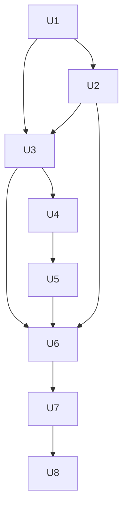

# feat: Panel rozmowy z formularzami wybieranymi przez backend

## Summary

Backend dołącza do `TaskSummary` listę formularzy panelu (rodzaj, pola, wartości wstępne, wskazanie domyślnego). TUI wyświetla jeden formularz naraz i przełącza je klawiszem `Esc`. Panel dostaje nowy katalog `src/tui/task_app/panel/`: wspólny kod w katalogu, jeden podkatalog na każdy rodzaj formularza. Plan działa w trzech krokach: kontrakt i reguły w backendzie (U1–U2), nowy panel w TUI (U3–U7), przeniesienie plików i sprzątanie (U8).

Plan wzoruje się na `docs/plans/2026-10-22-003-feat-akcje-taska-z-backendu-i-komentarz-w-pauzie-plan.md`. Tam backend już oblicza `TaskSummary.actions` (`crates/narsor-engine/src/controller_protocol/service/actions.rs`). Ten plan używa tego samego wzorca: czysta funkcja nad `TaskSummary`, pole opcjonalne z `serde(default)`.

---

## Problem Frame

Panel „Czeka na Ciebie" (`src/tui/task_app/waiting.rs`, 1842 linie) składa formularz z `Model` (`Input`, `Operator`, `Owner`, `Missing`), `InputKind` (`src/tui/input_form.rs`) i pola `composer`. Dostępność akcji i komentarza wynika z rodzaju oczekiwania liczonego w TUI. Rozmowa z agentem jest dodatkiem (akcja 0), a nie osobnym formularzem (see origin: Problem Frame).

---

## Requirements

Wymagania R1–R22, przepływy F1–F3, przykłady AE1–AE4 i założenia Z1–Z5 pochodzą z dokumentu źródłowego. Plan nie zmienia ich znaczenia.

- R1–R4. Kontrakt formularzy, brak liczenia w TUI, pusta lista, te same ścieżki wysyłania. → U1, U2, U4
- R5–R9, R21, R22. Reguły dostępności i domyślny formularz. → U2
- R10–R15. Jeden formularz, `Esc`, nagłówek `n/m`, szkice, zmiana domyślnego, `Tab`. → U3, U6
- R16–R17. Formularz rozmowy: pole rosnące do 50% wysokości. → U5
- R18–R20. Katalogi, brak zmiany zachowania, reguły tylko w backendzie. → U2, U7, U8

**Actors:** A1 (TUI: U3–U6), A2 (agent: stany w U2), A3 (backend: U1–U2).
**Flows:** F1 (U2, U4, U6), F2 (U2, U4), F3 (U2, U3).
**Acceptance examples:** AE1 (U6), AE2 (U2, U3), AE3 (U2, U6), AE4 (U6).

---

## Scope Boundaries

Jak w dokumencie źródłowym (see origin: Scope Boundaries):

- Bez zmiany formatu rozmowy w zakładkach i osi czasu.
- Bez zmiany ścieżek wysyłania ani walidacji serwera (R4).
- Panele operatora (propozycje dyrygenta, nieudany krok, nieudany provisioning, problem runnera: `AttentionKind::ConductorProposal`, `FailedStep`, `ProvisioningFailed` i `OwnerPanel`) zostają poza nowym modelem. Decyzja planu: opisana w KTD5.

### Deferred to Follow-Up Work

- Przeniesienie paneli operatora do listy formularzy z backendu.
- Polecenie CLI korzystające z listy formularzy.

---

## Context & Research

### Stan kodu

- `crates/narsor-protocol/src/controller.rs`: `TaskSummary` (z `actions: Option<Vec<TaskActionOffer>>`, `attention`, `runner.pending_input`), `AttentionKind`, `RunnerState`, `TaskState`.
- `crates/narsor-protocol/src/api/human_input.rs`: `PendingHumanInputView` (pola, opcje wyjść, `continuation`, `permission`), `InputContinuationView` (`CompleteStep`, `ResumeAgent`, `ResolveOutput`, `ApproveOutput`, `ResolvePermission`, `EntryLimit`).
- `crates/narsor-engine/src/controller_protocol/service/actions.rs`: `offer`, `comment_reason`, `comment_effect`, `decision_reason`. Te funkcje już rozstrzygają, kiedy komentarz jest możliwy. Nowa logika formularzy musi je ponownie użyć, a nie kopiować.
- `crates/narsor-engine/src/controller_protocol/service.rs`: `task_attention`, miejsce składania `TaskSummary`.
- Klient: `src/tui/task_app/waiting.rs` (`WaitingPanel`, `Entry`, `Model`, `Submit`, `AnswerRequest`), `src/tui/input_form.rs` (`InputKind`, `InputPanel`), `src/tui/chooser.rs` (`Chooser`, `ChooserField`, `set_growth`), `src/tui/form/` (silnik formularza, `Growth` w `events.rs`), `src/tui/keymap.rs` (`Context::Panel`, `Action::Cancel`, `PrevPending`, `NextPending`), `src/tui/task_app/tabs/conductor.rs` (wzór pola rosnącego: `composer.set_growth(Growth {..})`), `src/tui/task_app/limit.rs` (nie dotyczy: limit backendu, nie limit wejść w krok).
- Testy: `tests/tui_state.rs`, `tests/tui_render.rs`, `tests/tui_form.rs`, `tests/controller_protocol.rs`, `tests/actions_human.rs`, `tests/task_app_support/mod.rs`.

### Wnioski z `docs/solutions/`

- `docs/solutions/design-patterns/tui-form-engine-events-and-cursor-style.md`: formularze używają silnika `form`; nowe formularze nie mają własnej edycji.
- `docs/solutions/design-patterns/tui-modal-confirmation-keyboard-contract.md`, `tui-focus-stays-in-details-after-confirmed-action-2026-10-20.md`: kontrakt okna `y`/`n` i fokusu po akcji zostaje.
- `docs/solutions/design-patterns/tui-reads-as-keyed-background-jobs-with-loading-marker-2026-10-22.md`: wysyłka idzie jako zadanie w tle z kluczem (bez zmian).
- `docs/solutions/ui-bugs/tui-active-field-fill-only-under-text-2026-10-24.md`: tło pola aktywnego tylko pod tekstem; dotyczy pola rozmowy.

### Badania zewnętrzne

Pominięte. Kod ma silne lokalne wzorce (kontrakt `actions`, silnik formularzy, pole rosnące w zakładce Dyrygent).

---

## Key Technical Decisions

- **KTD1. Pole `panel` w `TaskSummary`.** Nowy typ w `crates/narsor-protocol/src/controller.rs`: `PanelOffer { forms: Vec<PanelForm>, default: Option<usize> }`. Pole `Option<PanelOffer>` z `serde(default, skip_serializing_if)`, jak `actions`. `None` oznacza serwer sprzed zmiany. Wtedy TUI używa dotychczasowego panelu (KTD6).
- **KTD2. Kształt `PanelForm`.** `kind` (`Action`, `Answer`, `Chat`, `EntryLimit`, `Permission`), `waiting_id: Option<String>` (powiązanie z oczekiwaniem, dla `Chat` puste albo bieżące), `fields: Vec<PanelField>` (nazwa, etykieta, opis, typ `text`/`multiline`/`select`/`integer`, wymagalność, opcje, wartość wstępna) oraz `choices: Vec<PanelChoice>` dla formularzy z listą akcji (`Action`: wyjścia kroku, restart, itp.; `Answer`: opcje agenta). Pola formularza `Answer`, `Permission` i `EntryLimit` backend kopiuje z `PendingHumanInputView`; to już są opisy po stronie backendu, TUI tylko mapuje je na `ChooserField`. Nowy rodzaj `PanelFieldKind` pokrywa się z `FieldKind` w `src/tui/chooser.rs`.
- **KTD3. Reguły w jednym nowym module backendu.** Nowy plik `crates/narsor-engine/src/controller_protocol/service/panel.rs` z czystą funkcją `offer_forms(task: &TaskSummary) -> PanelOffer`. Używa `comment_reason` i `actions::offer` z `actions.rs`, żeby panel i `actions` nie mogły się rozjechać. Wywołanie obok budowy `actions` w `service.rs`.
- **KTD4. Kolejność domyślnego formularza (R9, Z2, Z5).** Pierwszy pasujący: `EntryLimit` (R22), `Permission` (R21), `Answer` (R6), `Action` tylko gdy agent albo krok skończył pracę (R9), w przeciwnym razie `Chat`. Kolejność między `EntryLimit` i `Permission` jest bez znaczenia, bo oba odpowiadają jednemu oczekiwaniu i nie występują razem dla jednego kroku. Kolejność listy (`Esc` cyklicznie): `Answer`/`Permission`/`EntryLimit`, `Chat`, `Action`. Dzięki temu pierwszy `Esc` z odpowiedzi na pytanie agenta pokazuje rozmowę (AE1, F1).
- **KTD5. Panele operatora poza modelem.** Dla `ConductorProposal`, `FailedStep`, `ProvisioningFailed` i problemu runnera TUI zostawia istniejące `Model::Operator` i `Model::Owner` oraz `Entry`. Gdy zadanie ma takie oczekiwanie, panel pokazuje je jak dziś (bez `Esc` jako przełącznika). Brak formularzy z backendu przy takim oczekiwaniu to nie błąd. Skutek: `WaitingPanel` obsługuje dwa tryby (formularze backendu; wpisy dotychczasowe). Ten podział znika w osobnym planie (Deferred).
- **KTD6. Zgodność ze starym serwerem.** Gdy `panel` jest `None`, TUI nie zgaduje formularzy. Pokazuje dotychczasowy panel bez przełączania (zachowanie sprzed zmiany) do czasu usunięcia tej ścieżki. Wersje klienta i serwera wychodzą razem, ale odczyt z demona sprzed zmiany jest możliwy.
- **KTD7. Szkice w panelu, nie w formularzu.** Panel trzyma mapę `(kind, waiting_id) -> Chooser` (szkic każdego formularza, jak dziś `Entry`). Formularz o tym samym kluczu po nowym odczycie dostaje dotychczasowy szkic (R13). Szkic formularza, który zniknął, trafia do `released` (istniejący mechanizm).
- **KTD8. `Esc` i klawisze oczekiwań.** `Esc` w kontekście `Panel` zawsze przełącza formularz (R11), także w polach. Dotychczasowe `Esc` w polach (wyjście z pól na listę akcji) i zwijanie panelu przez `Esc` znikają dla trybu formularzy. `PrevPending`/`NextPending` znikają w trybie formularzy, bo formularze różnych oczekiwań są na jednej liście przełączanej przez `Esc`. Panel bez formularzy zwija się jak dziś (Z1). Ruch `Tab` bez zmian (R15).
- **KTD9. Nagłówek.** `n/m` i podpowiedź `Esc` w pierwszej linii panelu (R12). Nazwa rodzaju nie jest wymagana, ale etykiety pól i przycisków mają polskie teksty.
- **KTD10. Wysyłanie bez zmian.** Formularz tworzy ten sam `Submit` co dziś (`Input`, `Operator`, `Owner`, `Comment`). `PanelForm.kind` wybiera, który. Test porównuje `Submit` przed i po przeniesieniu (R19).

### Wyjaśnienia dla założeń z dokumentu

- Z1: panel bez formularza ukrywa się jak dziś.
- Z4: problem wyniku (`ResolveOutput`) to formularz `Action` (wybór wyniku kroku). Zatwierdzenie wyniku (`ApproveOutput`) to formularz `Answer` z opcjami zatwierdź/odrzuć. Przy zgodzie na uprawnienie: `Permission`.
- Z5: patrz KTD4.

---

## Implementation Units

### U1. Kontrakt formularzy w protokole

**Goal:** Typy `PanelOffer`, `PanelForm`, `PanelField`, `PanelChoice`, `PanelFormKind`, `PanelFieldKind` i pole `TaskSummary.panel`.
**Requirements:** R1, R3.
**Dependencies:** brak.
**Files:** `crates/narsor-protocol/src/controller.rs` (modyfikacja, w sekcji obok `TaskActionOffer`), `crates/narsor-protocol/src/lib.rs` (eksport, jeśli potrzebny), `tests/controller_protocol.rs` (test serializacji).
**Approach:** Pola jak w KTD1–KTD2. Wzór: `TaskActionOffer` (`serde(default)`, `skip_serializing_if`). `PanelFormKind` ma `#[serde(other)] Unrecognized`, żeby starszy klient nie padał na nowym rodzaju. Konstruktory `TaskSummary` w testach i w kodzie (wszystkie miejsca budowy struktury) dostają `panel: None`.
**Patterns to follow:** `TaskActionOffer`, `TaskActionId` (`serde(other)`).
**Test scenarios:**
- Happy path: `TaskSummary` z `panel` serializuje się i deserializuje do tej samej wartości.
- Zgodność: JSON bez pola `panel` deserializuje się do `panel: None`.
- Zgodność: nieznany rodzaj formularza daje `Unrecognized`, bez błędu.
- Edge: `PanelOffer` z pustą listą i `default: None` przechodzi w obie strony.
**Verification:** Workspace się kompiluje; stare odpowiedzi JSON z fixture'ów nadal się czytają.

### U2. Reguły dostępności w backendzie

**Goal:** `offer_forms` liczy listę formularzy i domyślny według R5–R9, R21, R22 i wypełnia `TaskSummary.panel`.
**Requirements:** R2, R5, R6, R7, R8, R9, R20, R21, R22; F1, F2, F3; AE2, AE3.
**Dependencies:** U1.
**Files:** `crates/narsor-engine/src/controller_protocol/service/panel.rs` (nowy), `crates/narsor-engine/src/controller_protocol/service.rs` (wywołanie przy składaniu `TaskSummary`, deklaracja modułu), `crates/narsor-engine/src/controller_protocol/service/actions.rs` (udostępnienie potrzebnych funkcji w obrębie modułu), `crates/narsor-protocol/src/controller.rs` (warunkowo: znacznik rodzaju kroku, jeśli sprawdzenie w U2 wykaże brak danych w summary), `tests/controller_protocol.rs`.
**Approach:**
- Wejście: `TaskSummary` (stan runnera, `attention`, `runner.pending_input.form` z `continuation`, `state`). Wyjście wg KTD4.
- „Krok agentowy" i „agent pracuje": ustalić z danych, które summary już niesie (stan `Running` bez oczekiwania, `continuation`, `agent_harness` w `PendingHumanInputView`). Jeśli to nie wystarcza do odróżnienia kroku agentowego od skryptu w stanie `Running`, dodać do `TaskSummary` niewielki znacznik rodzaju bieżącego kroku (pytanie otwarte do implementacji, patrz Deferred).
- `Chat` używa `comment_reason == None` jako warunku dostępności. Dzięki temu rozmowa i `actions` mają jedną regułę (R5).
- `Action` używa `actions::offer` (`Transition`, `Restart` i pokrewne) oraz wynik kroku z `ResolveOutput`.
- Pola z `PendingHumanInputView` kopiowane do `PanelField` w jednej funkcji pomocniczej.
**Patterns to follow:** `actions.rs` (`offer`, `unavailable_reason`), `task_attention` w `service.rs`.
**Test scenarios:**
- Covers AE2. Agent pracuje (krok agentowy, brak oczekiwania): `forms` pusta, `default: None` (R8).
- Covers AE2. Agent skończył krok: jest `Action` jako domyślny i `Chat` (R5, R7, R9).
- Agent zadał pytanie: `Answer` domyślny, `Chat` i `Action` dostępne (R6). Opcje agenta są w `choices`.
- Agent czeka na komentarz (np. pauza): domyślny `Chat`, `Action` dostępny, ale nie domyślny (R9).
- Agent czeka na uprawnienia: `Permission` domyślny, `Chat` dostępny (R21).
- Limit wejść w krok osiągnięty: `EntryLimit` domyślny (R22). `Chat` niedostępny (zgodnie z `comment_reason`: brak sesji agenta).
- Covers AE3. Krok nieagentowy skończył: tylko `Action`, `default` wskazuje go (R7).
- Krok nieagentowy w trakcie przetwarzania: brak formularzy.
- Zadanie w kolejce, zarchiwizowane: brak formularzy.
- Edge: kilka oczekiwań naraz (np. pytanie i zatwierdzenie): jeden formularz na oczekiwanie, `waiting_id` poprawne, domyślny najstarszy.
- Spójność: dla każdego stanu z testów `actions` `Chat` jest dostępny wtedy i tylko wtedy, gdy `TaskActionId::Comment` jest `available`.
**Verification:** Tabela stanów w testach pokrywa wszystkie wiersze R5–R9, R21–R22; dostępność rozmowy zgadza się z `actions`.

### U3. Model panelu w TUI: lista formularzy, przełączanie, szkice

**Goal:** Nowy `Panel` (w `panel/mod.rs`) trzyma listę formularzy z backendu, indeks aktywnego, szkice i obsługuje `Esc`, zmianę domyślnego i znikanie formularzy.
**Requirements:** R3, R10, R11, R13, R14, R15; F3; AE2, AE4.
**Dependencies:** U1 (typy), U2 (dane w testach integracyjnych).
**Files:** `src/tui/task_app/panel/mod.rs` (nowy), `src/tui/task_app/panel/switcher.rs` (nowy: indeks, `Esc`, reguły R13/R14), `src/tui/task_app/panel/drafts.rs` (nowy: mapa szkiców, `released`), `src/tui/keymap.rs` (zmiana `Esc` w `Context::Panel`, usunięcie `PrevPending`/`NextPending` z kontekstu panelu), `tests/tui_state.rs`.
**Approach:**
- `Panel::sync(task)` bierze `task.panel` i: zachowuje aktywny formularz, jeśli nadal jest na liście i `default` się nie zmienił (R13); przechodzi na nowy domyślny, gdy backend wskaże inny niż poprzednio (R14: porównanie z poprzednim `default`, nie z aktywnym); przy zniknięciu aktywnego przechodzi na domyślny.
- `Esc`: następny indeks cyklicznie; przy jednym formularzu nic (R11). Działa także w polu tekstowym: `Esc` w silniku formularza nie może być wcześniej konsumowany (sprawdzić `Context::Form` i `src/tui/form/engine.rs`).
- Szkice wg KTD7. Dotychczasowy `released` zostaje.
- Tryb zgodności (KTD5, KTD6): `Panel` zawiera dotychczasowe `WaitingPanel` jako wariant dla wpisów operatora i dla `panel: None`. Nowy kod nie dotyka jego logiki w tym kroku.
**Patterns to follow:** `WaitingPanel::sync`, `Released` w `waiting.rs`.
**Execution note:** Zacząć od testów reguł przełączania (R11, R13, R14), bo to najbardziej zmienne zachowanie.
**Test scenarios:**
- `Esc` przy trzech formularzach: 1→2→3→1.
- `Esc` przy jednym formularzu: aktywny się nie zmienia.
- `Esc` w polu tekstowym przełącza formularz, a szkic zostaje.
- Nowy odczyt, aktywny nadal dostępny, `default` bez zmian: aktywny bez zmian (R13).
- Aktywny zniknął: panel przechodzi na `default`.
- Covers AE4. Operator pisze w `Chat`, nowy odczyt wskazuje `Answer` jako domyślny: panel pokazuje `Answer`; po `Esc` w `Chat` szkic jest w polu (R13, R14).
- Covers AE2. Pusta lista: panel nie przyjmuje danych; `Esc` zwija panel (Z1).
- Szkic formularza, który zniknął, trafia do `released`; po powrocie tego samego klucza wraca do formularza.
- `Tab` opuszcza panel, a panel się nie zwija, gdy jest formularz (R15).
**Verification:** Stan panelu po każdej sekwencji odczytów i klawiszy zgadza się z R11–R15.

### U4. Mapowanie formularza na pola i wysyłkę

**Goal:** Wspólny kod buduje `Chooser` z `PanelForm` (pola, wartości wstępne, opcje) i tworzy `Submit` dla każdego rodzaju bez zmiany ścieżek API.
**Requirements:** R1, R4, R12; F1.
**Dependencies:** U1, U3.
**Files:** `src/tui/task_app/panel/form.rs` (nowy: `PanelForm` → `Chooser`, etykiety, nagłówek `n/m`), `src/tui/task_app/panel/submit.rs` (nowy: `Submit` z formularza), `src/tui/input_form.rs` (źródło logiki do przeniesienia, w tym kroku bez usuwania), `src/tui/task_app/waiting.rs` (`Submit`, `AnswerRequest` przenoszone w U8), `tests/tui_state.rs`.
**Approach:** Logika zamiany pól wartości na `HumanInputDeliveryDto` z `input_form.rs` (`InputPanel::composer_submission` i pokrewne) jest ponownie użyta przez funkcje wspólne, a nie przepisana. Nagłówek: `n/m` i „Esc przełącza" (R12). Polskie etykiety: każdy formularz ma tytuł pola lub przycisku mówiący, co zrobi.
**Patterns to follow:** `Entry::build`, `InputPanel`.
**Test scenarios:**
- Każdy rodzaj formularza: pole wymagane bez wartości blokuje wysyłkę z komunikatem.
- `Answer`: wybrana opcja + komentarz dają ten sam `HumanInputDeliveryDto` co dziś (porównanie z oczekiwaną wartością z istniejących testów).
- `Action` z wyjściem kroku daje `Submit::Operator(Transition)` jak dziś.
- `Permission` daje `Submit::Input` z decyzją uprawnienia jak dziś.
- `Chat` daje `Submit::Comment(text)`.
- Wartość wstępna z backendu trafia do pola; po edycji nowy odczyt jej nie nadpisuje (szkic, R13).
- Nagłówek pokazuje `1/3` i podpowiedź `Esc`.
**Verification:** Te same dane wejściowe dają te same `Submit` co przed zmianą.

### U5. Formularz swobodnej rozmowy

**Goal:** Pole wielolinijkowe rosnące od jednej linii do 50% wysokości szczegółów, potem przewijane.
**Requirements:** R16, R17; AE1.
**Dependencies:** U3, U4.
**Files:** `src/tui/task_app/panel/chat/mod.rs` (nowy), `src/tui/task_app/panel/chat/view.rs` (nowy), `src/tui/task_app/panel/chat/keys.rs` (nowy), `src/tui/task_app/panel/chat/tests.rs` albo `tests/tui_render.rs`.
**Approach:** Użyć `Chooser::set_growth` i `Growth` z `src/tui/form/events.rs` jak w `tabs/conductor.rs`. Limit 50% liczony z wysokości obszaru szczegółów, którą panel dostaje w `preferred_height`. Reguły edycji z silnika `form` (R17). Tło aktywnego pola zgodnie z `docs/solutions/ui-bugs/tui-active-field-fill-only-under-text-2026-10-24.md`. `preferred_height` panelu dla `Chat` zależy od liczby linii pola.
**Patterns to follow:** `src/tui/task_app/tabs/conductor.rs` (pole rosnące), `src/tui/form/layout.rs`.
**Test scenarios:**
- Pusty tekst: pole ma jedną linię.
- Tekst o pięciu liniach, mała wysokość szczegółów: pole rośnie do pięciu linii.
- Tekst dłuższy niż 50% wysokości: pole ma wysokość równą limitowi i przewija się, kursor widoczny.
- Zmiana wysokości terminala zmienia limit.
- `Ctrl+J` wstawia nową linię; `Enter` pokazuje potwierdzenie przed wysłaniem (R17).
- Wklejenie wielolinijkowe (`paste`) działa jak w innych formularzach.
**Verification:** Zrzuty `tests/tui_render.rs` dla 1 linii, wzrostu i limitu.

### U6. Widok panelu i obsługa klawiszy

**Goal:** Panel rysuje aktywny formularz w dotychczasowym miejscu z nagłówkiem `n/m`, a klawisze działają według KTD8.
**Requirements:** R10, R11, R12, R15; AE1, AE3, AE4.
**Dependencies:** U3, U4, U5.
**Files:** `src/tui/task_app/panel/view.rs` (nowy), `src/tui/task_app/panel/keys.rs` (nowy), `src/tui/task_app/mod.rs` i `src/tui/task_app/detail.rs` (podpięcie: `selected_panel`, `panel_focused`, wysokość), `src/tui/keymap.rs`, `tests/tui_render.rs`, `tests/tui_state.rs`.
**Approach:** `preferred_height` i `render` wywołują widok aktywnego formularza. `TaskApp::sync_waiting` woła `Panel::sync`. Efekty panelu (`PanelEffect`) zostają tym samym typem, żeby `TaskApp::perform` się nie zmieniło (R4). Dopisać pomoc (`?`) dla `Esc`.
**Patterns to follow:** `WaitingPanel::render`, `paint_waiting_panel`, `PanelEffect`.
**Test scenarios:**
- Covers AE1. Pytanie agenta: panel pokazuje odpowiedź, `Esc` pokazuje rozmowę, drugi `Esc` wraca.
- Covers AE3. Krok nieagentowy skończył: tylko akcja, `Esc` nic nie zmienia.
- Covers AE4. Pełny przebieg: wpisany szkic rozmowy, zmiana domyślnego, powrót.
- Zrzut renderu: nagłówek `1/3` i podpowiedź `Esc` dla każdego rodzaju formularza.
- Panel z formularzami nie zwija się na `Esc`; `Tab` oddaje fokus.
- Wysłanie formularza: ten sam `AnswerRequest` i ta sama notyfikacja co dziś.
- Panel operatora (KTD5): zachowuje dotychczasowe klawisze (`Esc` zwija jak dziś).
**Verification:** Zrzuty i testy stanu dla czterech przykładów AE; brak regresji testów panelu operatora.

### U7. Podkatalogi rodzajów formularzy

**Goal:** Każdy rodzaj ma podkatalog ze stanem, widokiem, klawiszami i testami.
**Requirements:** R18, R19.
**Dependencies:** U3–U6.
**Files:** `src/tui/task_app/panel/action/`, `panel/answer/`, `panel/chat/` (z U5), `panel/entry_limit/`, `panel/permission/` (każdy z `mod.rs`, `view.rs`, `keys.rs` i testami jednostkowymi w module), `src/tui/input_form.rs` (rozbijany).
**Approach:** Rozcięcie `input_form.rs` (1533 linie) według `InputKind`: `Gate`/`Problem` → `action/`, `AgentQuestion`/`Approval` → `answer/`, `Permission` → `permission/`, `EntryLimit` → `entry_limit/`. Każdy podkatalog wystawia tę samą małą cechę (`budowa Chooser`, `Submit`). Wspólny kod zostaje w `panel/`. Dotychczasowe testy `tests/tui_state.rs` i `tests/tui_render.rs` są wskazówką zachowania i muszą przechodzić bez zmian oczekiwań.
**Execution note:** Charakteryzacja przed ruchem: uruchomić istniejące testy panelu i trzymać je zielone po każdym przeniesionym rodzaju.
**Test scenarios:**
- Test expectation: brak nowych zachowań; istniejące testy `tests/tui_state.rs`, `tests/tui_render.rs`, `tests/tui_form.rs` przechodzą po każdym przeniesionym rodzaju (R19).
**Verification:** Żaden rodzaj nie ma kodu w płaskim `src/tui/input_form.rs`; testy zielone.

### U8. Przeniesienie wspólnego kodu i sprzątanie

**Goal:** `waiting.rs` znika; typy `Submit`, `AnswerRequest`, `PanelEffect` żyją w `panel/`. Reguły dostępności nie istnieją w TUI.
**Requirements:** R18, R19, R20.
**Dependencies:** U7.
**Files:** `src/tui/task_app/waiting.rs` (usunięcie lub cienki re-eksport), `src/tui/task_app/mod.rs` (`pub mod panel`), `src/tui/input_form.rs` (usunięcie), `src/tui/mod.rs`, odwołania w `src/tui/task_app/actions.rs`, `detail.rs`, `tests/task_app_support/mod.rs`.
**Approach:** Przenieść pozostałe elementy (`OwnerPanel`, `OperatorPanel`, `Released`, `SyncEffect`) do `panel/legacy.rs` (KTD5, jawnie oznaczone jako tymczasowe). Wyszukać w TUI pozostałe miejsca liczące dostępność z `InputKind`/`attention` i usunąć je lub zastąpić odczytem `panel`. Zaktualizować `ARCHITECTURE_DECISIONS.md` jednym wpisem o decyzji (reguły tylko w backendzie).
**Test scenarios:**
- Test expectation: brak nowych zachowań; cała paczka testów TUI i protokołu przechodzi (R19).
- Test usunięcia logiki: TUI zbudowane z `TaskSummary` bez `panel` nie wylicza formularzy (KTD6).
**Verification:** `rg "InputKind::"` w `src/tui` poza `panel/` nie zwraca decyzji o dostępności; build i testy zielone.

---

## Dependency Graph

---

## System-Wide Impact

- **Klient–serwer:** nowe pole opcjonalne; stary klient je ignoruje, nowy klient ze starym serwerem działa w trybie zgodności (KTD6).
- **Klawisze:** `Esc` w panelu zmienia znaczenie (przełącza zamiast zwijać). Zmienia się pomoc `?` i opisy w `src/tui/keymap.rs`.
- **Inne ekrany:** powiadomienia i lista zadań używają `attention`, a nie `panel`; bez zmian.
- **Dokumentacja:** `ARCHITECTURE_DECISIONS.md`, `README.md` (opis klawiszy, jeśli istnieje).

---

## Risks & Dependencies

| Ryzyko | Skutek | Środek |
|---|---|---|
| Summary nie niesie rodzaju bieżącego kroku (agentowy / skrypt), więc R5/R8 nie da się rozstrzygnąć | Błędna dostępność | U2: dodać znacznik do `TaskSummary`; sprawdzić na początku U2 |
| `Esc` w silniku formularza jest dziś konsumowany przez pole | R11 („zawsze, też w polach") nie działa | U3: sprawdzić `form/engine.rs` i keymap przed zmianą; test w polu |
| Rozcięcie `input_form.rs` i `waiting.rs` zmienia zachowanie | Regresja | Charakteryzacja w U7; testy bez zmiany oczekiwań (R19) |
| Dwa tryby panelu (formularze i wpisy operatora) komplikują kod | Dług | KTD5 jawnie tymczasowe; osobny plan w Deferred |
| Duży zakres jednego MR | Trudny przegląd | Kolejność U1→U8, każdy krok osobnym commitem; U7–U8 bez nowych zachowań |

---

## Deferred to Implementation

- Dokładny sposób rozpoznania „krok agentowy" i „agent pracuje" w `offer_forms` (dane summary albo nowy znacznik, patrz Risks).
- Dokładne nazwy pól i typów `PanelForm` oraz podział plików w podkatalogach.
- Czy `PrevPending`/`NextPending` mają zostać dla wpisów operatora (KTD5), po sprawdzeniu testów.
- Dokładna liczba wierszy pola rozmowy przy bardzo małych terminalach (sprawdza render).

---

## Outstanding Questions

Żadne pytanie nie blokuje planu. Założenia Z1–Z5 z dokumentu źródłowego są przyjęte według sekcji „Wyjaśnienia dla założeń".
