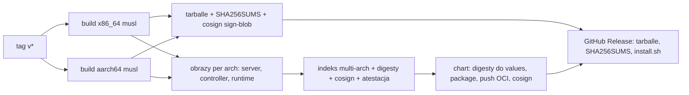
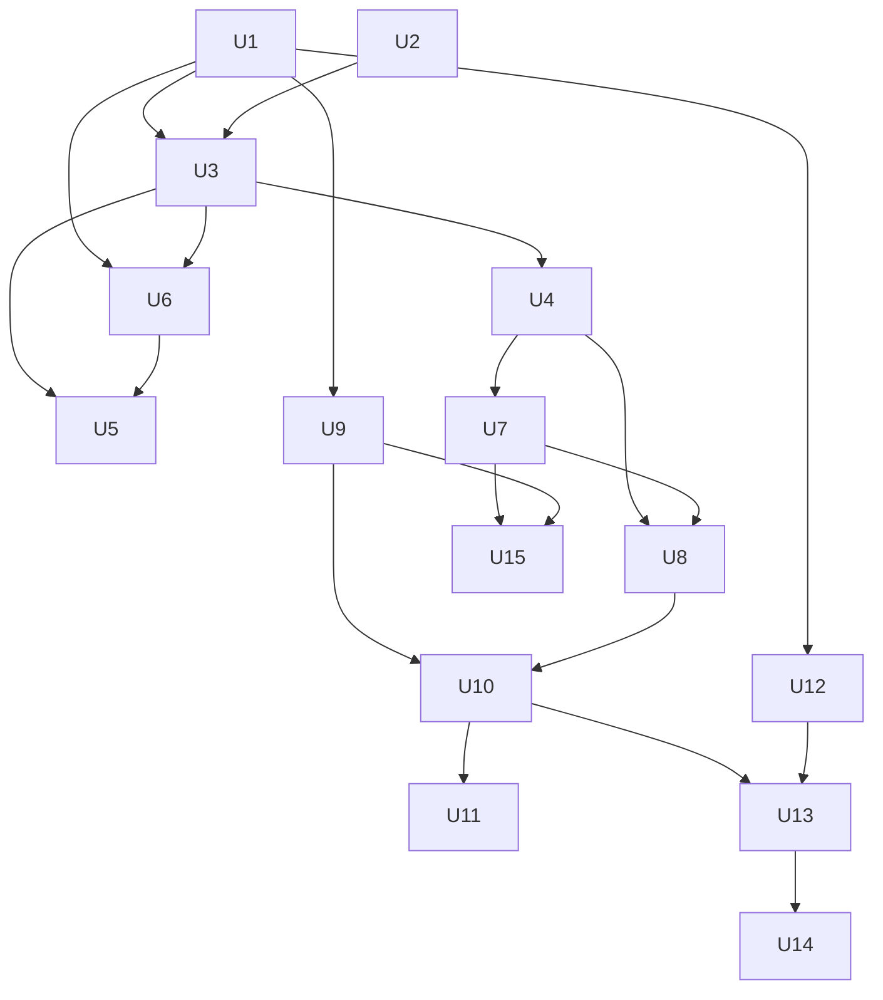

# feat: Dystrybucja, instalacja i aktualizacja Narsora

## Summary

Narsor dostaje publiczny proces wydań. Tag w gicie uruchamia GitHub Actions. CI buduje statyczne binarki (Linux x86_64 i aarch64), obrazy OCI (serwer, controller, runtime bundle) i Helm chart, podpisuje je i publikuje w GitHub Releases oraz w `ghcr.io/glakartur/`. User instaluje CLI/TUI skryptem i aktualizuje je poleceniem `narsor-cli self-update`. Admin instaluje serwer i controller w klastrze przez Helm. Runtime bundle zawiera tylko `narsor-runner` i statyczny `busybox` do kopiowania. Harnessy instaluje skrypt init usera z katalogu, w init containerze na obrazie repo, z cache na PVC zadania. Edycja profilu Claude Code działa w efemerycznym Podzie sesji, a terminal jest przekazywany przez control plane do CLI. Katalog można zmieniać przez API z CLI i TUI. Zgodność części sprawdzamy przez wersję protokołu.

---

## Problem Frame

Dziś Narsor można zainstalować tylko ze źródeł (`install.sh` uruchamia `cargo install`). Nie ma CI, Dockerfile, obrazów ani chartu. Manifest controllera ma digest z zer (`deploy/kubernetes/controller.yaml`). Runtime bundle jest opisany w kontrakcie (`docs/operations/remote-backends.md`, sekcja 8), ale nikt go nie buduje. Edycja profilu Claude Code wymaga `kubectl exec` do Poda controllera. Ten Pod musi mieć `claude` w obrazie, a sesja ma dostęp do tokenu ServiceAccount i do poświadczenia `nsk.` (luka R15, `docs/follow-ups/2026-10-18-odroczone-uprawnienia-harnessu-pozostale-prace.md`). Katalog (profile, `runtime.yaml`, backendy) to pliki na dysku serwera. Gdy serwer działa w klastrze, user nie ma do nich dostępu. Części Narsora nie sprawdzają wzajemnie wersji. `PROTOCOL_VERSION` jest tylko w `EnrollResponse`, a `LaunchSpecEnvelope` ma `deny_unknown_fields`, więc starszy runner odrzuca nowszy launch spec bez czytelnego komunikatu.

Plan powstał z rozmowy z Arturem 2026-10-25, bez osobnego dokumentu wymagań. Decyzje z tej rozmowy są w sekcji Requirements i Key Technical Decisions.

---

## Requirements

**Wydania**
- R1. Tag `v<semver>` w repo `glakartur/narsor` tworzy wydanie automatycznie, bez ręcznych kroków poza utworzeniem tagu.
- R2. Wydanie zawiera binarki dla Linux x86_64 i aarch64, statycznie linkowane (musl), które działają na Debianie, Alpine i obrazach .NET SDK.
- R3. Wydanie publikuje obrazy `ghcr.io/glakartur/narsor-server`, `narsor-controller` i `narsor-runtime` (multi-arch) oraz chart `oci://ghcr.io/glakartur/charts/narsor`.
- R4. Każdy artefakt ma sumę SHA-256. Obrazy, chart i plik `SHA256SUMS` mają podpis cosign keyless (OIDC GitHub) i atestację pochodzenia. Wydanie powstaje tylko z commita na `main`.

**Klient na komputerze usera**
- R5. Jeden skrypt instaluje klienta (`narsor`, `narsor-cli`) albo komplet (dodatkowo `narsor-server`, `narsor-runner`, `narsor-controller`) z GitHub Releases, bez toolchaina Rust.
- R6. `narsor-cli self-update` aktualizuje zainstalowane binarki atomowo i sprawdza sumę SHA-256 przed podmianą.
- R7. Pakiety dystrybucji (AUR, .deb, .rpm) są poza zakresem tego planu (patrz Scope Boundaries).

**Klaster**
- R8. Admin instaluje i aktualizuje serwer i controller jednym chartem Helm. `helm upgrade` zmienia digesty obrazów.
- R9. Aktualizacja serwera nie zmienia środowiska działających ani wstrzymanych zadań. Nowy bundle dotyczy tylko nowych zadań (zasada R42 z planu zdalnych backendów).

**Zgodność**
- R10. Każda część ogłasza wersję protokołu i zakres obsługiwanych wersji. Część spoza zakresu dostaje czytelny błąd z poleceniem, co zaktualizować. Zadania utworzone przed zmianą wersji launch spec dają się wczytać i wznowić po aktualizacji serwera.
- R11. Każda binarka ma `--version`.

**Init container usera**
- R12. Runtime bundle zawiera tylko `narsor-runner` i statyczny `busybox` do `cp -a`. Harnessy instalują skrypty init usera. Obrazy narzędzi (`runtime.yaml` → `tools`) działają dalej bez zmian i są drugą drogą dla harnessu przypiętego digestem.
- R13. Skrypty init są w katalogu Narsora (w profilu) i wchodzą do `ResolvedEnvironment`.
- R14. Skrypty init działają w init containerze na obrazie repo usera, jako non-root, przed głównym kontenerem.
- R15. Wynik instalacji jest zapisywany na PVC zadania. Klucz cache to hash. Wznowienie zadania z tym samym kluczem nie instaluje ponownie.
- R16. Narsor dostarcza przykładowe skrypty init (Claude Code, Codex) z przypiętymi wersjami.

**Edycja profilu**
- R17. User edytuje profil Claude Code z `narsor-cli profile edit`, bez `kubectl` i bez dostępu do klastra.
- R18. Sesja edycji działa w efemerycznym Podzie bez tokenu ServiceAccount i bez stanu controllera. Claude Code instalują w nim te same skrypty init.
- R19. Terminal sesji jest przekazywany przez control plane. Wszystkie połączenia są wychodzące (Pod → control plane, CLI → control plane).
- R20. Controller jest jedynym zapisującym Secret profilu. Przed zapisem user widzi diff i ostrzeżenia, a potem potwierdza.

**Katalog przez API**
- R21. Profile (z skryptami init), `runtime.yaml` i backendy można odczytać i zmienić przez API z `narsor-cli` i z TUI.
- R22. Serwer jest jedynym zapisującym katalog. Zapis jest atomowy, a `version` profilu rośnie przy każdej zmianie.

---

## Scope Boundaries

- Brak buildów dla macOS i Windows.
- Brak operatora Kubernetes i CRD.
- Brak web terminala w przeglądarce (kanał z U12 na to pozwala, ale nie budujemy frontendu).
- Brak cache init współdzielonego między zadaniami. Cache jest tylko na PVC danego zadania (polityka admission nie dopuszcza obcego PVC, a wspólny cache pozwala jednemu zadaniu zatruć drugie).
- Brak automatycznej zmiany bundle'a w istniejących zadaniach.
- Brak sprawdzania podpisu cosign w kliencie (`self-update` sprawdza tylko sumę przez HTTPS).
- Brak HA serwera, zewnętrznej bazy i kolejki (bez zmian względem `docs/operations/remote-backends.md`, sekcja 13).

### Deferred to Follow-Up Work

- Pakiety dystrybucji (AUR, .deb, .rpm, ewentualnie Homebrew): osobny plan po pierwszym publicznym wydaniu.
- Synchronizacja katalogu z repozytorium git (GitOps): osobny plan po U15.
- Web terminal dla sesji profilu: osobny plan, ten sam kanał co U12.
- Szyfrowanie end-to-end pakietu plików profilu do jednorazowego klucza controllera (z uwierzytelnieniem nadawcy): wycięte z tego planu decyzją Artura 2026-10-25; wraca, gdy serwer przestanie być zaufany dla treści sesji.
- Jawne „przeniesienie zadania na nowy bundle” przez właściciela, gdy runner zadania wyjdzie poza okno protokołu: osobny plan. Ten plan daje tylko czytelny problem (U1).
- Automatyczna rejestracja controllera przy instalacji chartu w tym samym klastrze co serwer.
- Kubernetes ImageVolume zamiast kopiowania bundle'a przez init container, gdy będzie GA w typowych klastrach.
- Organizacja `narsor` na GitHubie i przeniesienie obrazów pod `ghcr.io/narsor/`: decyzja Artura poza kodem.

---

## Context & Research

### Relevant Code and Patterns

- Binarki: `Cargo.toml` (root: `narsor` z `src/bin/narsor.rs`, `narsor-cli` z `src/main.rs`), `crates/narsor-server`, `crates/narsor-runner`, `crates/narsor-controller` (każdy `src/main.rs`). Wszystkie mają wersję 0.1.0 bez wspólnej wersji workspace. Tylko `narsor-cli` ma `#[command(version)]` (`src/cli/mod.rs`).
- Szukanie binarek obok siebie: `crates/narsor-api-client/src/api/launch.rs` (`resolve_exe`, `current_exe().with_file_name(...)`), `crates/narsor-engine/src/backends/local.rs` (`LocalBackendConfig::new` szuka `narsor-runner` obok serwera). Instalacja musi trzymać wszystkie binarki w jednym katalogu.
- Wersje protokołu: `crates/narsor-engine/src/controller_protocol/wire.rs` (`PROTOCOL_VERSION = 1`), `crates/narsor-protocol/src/controller.rs` (`EnrollResponse`, `CapabilitiesView`), `crates/narsor-protocol/src/launch.rs` (`TASK_LAUNCH_SPEC_VERSION = 3`, `LaunchSpecEnvelope` z `deny_unknown_fields`).
- Konwencja zgodności: nowe wartości enum przechodzą do `Unrecognized` w starszym kliencie (`crates/narsor-protocol/src/chat.rs`, D60, D63, D66, D67).
- Pod zadania: `crates/narsor-controller/src/kubernetes/manifest.rs` (`plan()`, `pod()` z init containerem `runtime-bundle` i init containerami narzędzi, `runner_path()`, `reader_pod()`, `check_pod_shape()`), wywołania w `crates/narsor-controller/src/kubernetes/mod.rs`.
- Polityka admission: `deploy/kubernetes/admission-policy.yaml` (`variables.containers` obejmuje `initContainers`).
- Środowisko zadania: `crates/narsor-engine/src/domain/environment.rs`, `crates/narsor-engine/src/environment/resolver.rs` (bundle i narzędzia przypięte digestem).
- Katalog: `crates/narsor-engine/src/environment/catalog.rs` (`profile`/`save_profile`, `runtime`/`save_runtime`, `backend`/`save_backend`), `crates/narsor-engine/src/environment/profile.rs`, `crates/narsor-engine/src/registry/store.rs`. Trasy: `crates/narsor-server/src/api/routes/control.rs` (repozytoria i workflow; brak tras profili, runtime i backendów).
- Edycja profilu: `crates/narsor-controller/src/profile_edit.rs` (rdzeń niezależny od transportu), `crates/narsor-controller/src/controller.rs` (`EditProfileArgs`), `crates/narsor-controller/src/main.rs` (ręczne `edit-claude-profile`).
- Relay: `crates/narsor-engine/src/controller_protocol/service/relay.rs` (relay w pamięci przez long-poll `/runner/v1/poll`). Strumień jest tylko jako SSE (`crates/narsor-server/src/api/routes.rs`). Brak WebSocket.
- CLI: `src/cli/mod.rs` (`Command`, `run()`), `src/cli/remote.rs`. TUI: `src/tui/mod.rs`, `src/tui/task_app/`.
- Konfiguracja serwera: `crates/narsor-shared/src/config/settings.rs` (prefiks `NARSOR_`), `crates/narsor-shared/src/config/cascade.rs` (pierwszy znaleziony plik wygrywa, `/etc/narsor/`).
- Zależności natywne: brak OpenSSL, SQLite i libgit2. `reqwest` z `rustls` używa `aws-lc-rs`/`aws-lc-sys` (wymaga cmake i kompilatora C dla musl). `zstd-sys` kompiluje się na musl.
- Testy: `tests/*.rs` z helperami `tests/*_support/mod.rs`. Testy z daemonem są `#[ignore]`. Test na żywym klastrze: `tests/kubernetes_adapter.rs` (`live_cluster_smoke`). Skrypt kind: `deploy/kind/setup.sh` (nowy, jeszcze bez commita).

### Institutional Learnings

- `docs/solutions/integration-issues/runner-private-home-hides-harness-login-2026-10-10.md`, D57: prywatny `HOME` ukrywa login harnessu. Każda zmiana ścieżki startu wymaga testu end-to-end z prawdziwym harnessem. Ustawienie wybierane przy starcie (np. tryb HOME) jest poza `environment_identity`.
- D47: jeden plik konfiguracji, bez scalania. Helm montuje jeden plik.
- D48: zadanie niesie przypiętą definicję i nie czyta żywego katalogu. Zmiany katalogu przez API są bezpieczne dla istniejących zadań.
- D53: jeden proces jest jedynym zapisującym stan. Ta zasada dotyczy też katalogu.
- Pamięć projektu: controller jest jedynym zapisującym Secret profilu, a runner tylko go czyta i scala. Ostatni zapis wygrywa.
- Pamięć projektu: `git`/`gh` przez CLI, nie libgit2. Testy z daemonem są `#[ignore]` i sprzątają w `Drop`.
- `docs/follow-ups/2026-10-03-zdalne-backendy-pozostale-prace.md`: brak pipeline'u dla bundle'a i obrazów narzędzi, digest controllera z zer, polityka admission nie była sprawdzona na żywym API serverze.

### External References

- GitHub: runnery `ubuntu-24.04-arm` są GA i bezpłatne dla repozytoriów publicznych (2025-08).
- `dist` (cargo-dist) 0.33 nie buduje obrazów OCI ani chartów. `release-plz` nie buduje binarek.
- Obrazy: `gcr.io/distroless/static-debian12` (CA, użytkownik `nonroot`). Multi-arch bez QEMU: dwa natywne buildy, potem `docker buildx imagetools create`.
- Atestacja: `actions/attest-build-provenance` (SLSA L2), `cosign sign --yes img@digest`.
- Helm OCI: `helm push oci://ghcr.io/<owner>/charts`, podpis cosign digestu chartu.
- Zgodność: polityka version skew Kubernetes (serwer jest najnowszy, reszta może być starsza o jedną wersję).
- musl: `mimalloc` jako `#[global_allocator]` usuwa spadek wydajności alokatora musl.
- Terminal: framing kanałów `v5.channel.k8s.io` (stdin, stdout, stderr, status, resize, close), ping co 20–30 s (proxy zamykają bezczynne połączenia po 60–100 s). ingress-nginx jest wycofany od 2026-03, więc dokumentacja ma opisać Gateway API.
- Bezpieczeństwo terminala: OSC 52 (zapis schowka) z niezaufanego wyjścia to wektor ataku (CVE z 2026). CLI filtruje OSC 52.
- PTY: `pty-process` (async, tokio).
- Init: Claude Code ma natywny instalator (`~/.local/bin/claude`); instalacja przez npm jest przestarzała. Publikacja cache: katalog tymczasowy, znacznik `COMPLETE`, `rename()`.

---

## Key Technical Decisions

- **KTD1. Własny workflow GitHub Actions zamiast `dist`.** Cztery z pięciu rodzajów artefaktów to obrazy i chart, których `dist` nie buduje. Potrzebujemy też jednego katalogu z pięcioma binarkami i własnego `self-update`. Workflow jest jeden i ma ścisłą kolejność: binarki → obrazy → digesty → chart → Release.
- **KTD2. Natywne buildy na runnerach x86_64 i arm64, target `*-unknown-linux-musl`.** Bez QEMU i bez `cross`. Gdy `aws-lc-sys` nie zbuduje się na musl, przechodzimy na provider `ring` (decyzja w U2).
- **KTD3. Jeden tarball na architekturę z pięcioma binarkami i plikiem manifestu.** Instalacja w katalogu wersji z dowiązaniem `current` przełączanym przez `rename()`. Dowiązania w `~/.local/bin`. Plik `install-receipt` leży w katalogu głównym instalacji, obok `current`, i mówi, że `self-update` może zarządzać instalacją. Układ katalogów ma jedną implementację w Rust (`narsor-cli self-update --install-from <katalog>`): skrypt tylko pobiera, sprawdza sumę, rozpakowuje do katalogu tymczasowego i wywołuje tę komendę z rozpakowanej binarki. Uzasadnienie: binarki szukają się obok siebie (`resolve_exe`), a podmiana pojedynczych plików w trakcie działania daje `ETXTBSY` i stany pośrednie.
- **KTD4. `self-update` sprawdza sumę SHA-256 z `SHA256SUMS` przez HTTPS.** Podpis cosign sprawdzają ludzie i CI (`cosign verify-blob`). Bez drugiego klucza do podpisów w binarce.
- **KTD5. Wersja protokołu dla każdego kanału osobno (owner, controller, runner), jako liczba niezależna od SemVer.** Każda strona wysyła nagłówek `Narsor-Protocol` z wersją. Serwer zwraca w `GET /control/v1/capabilities` wersję serwera, wersje protokołów i okna. Okno `[current - 1, current]` dotyczy tylko kanałów runnera i controllera, bo tylko one żyją dłużej niż jedna aktualizacja (wstrzymane zadania, controllery w innych klastrach). Kanał owner ma tylko wersję i błąd. Zmiana, która łamie launch spec, podnosi wersję protokołu runnera i controllera naraz, bo oba czytają launch spec. Serwer daje zadanie z nową funkcją (np. skrypty init, sesja profilu) tylko controllerowi, który ją obsługuje; w przeciwnym razie zadanie ma czytelny problem. Strona spoza okna dostaje błąd `protocol_unsupported` z poleceniem (np. „uruchom `narsor-cli self-update`”). Prefiksy `/v1` w ścieżkach zostają.
- **KTD5a. Czytelnicy launch spec przyjmują okno wersji, nie jedną wersję.** Dziś `TaskLaunchSpec::deserialize` (`crates/narsor-engine/src/domain/task.rs`), `validate_launch_input` (`crates/narsor-controller-runtime/src/backend.rs`) i runner wymagają dokładnie wersji 3. Po U1 przyjmują `[current - 1, current]`, a starszą wersję czytają z wartościami domyślnymi nowych pól. Każde nowe pole `ResolvedEnvironment` i `ResolvedProfile` ma `serde(default, skip_serializing_if = …)`, więc pusta wartość nie zmienia hasha `environment_identity` (`compute_identity` hashuje serializację całej struktury). Controller sprawdza tożsamość na surowym JSON, a nie na ponownie zserializowanej strukturze, więc nieznane mu pola nie zmieniają wyniku. Podniesienie wersji launch spec jest dozwolone dopiero wtedy, gdy czytelnicy przyjmują okno.
- **KTD6. Runtime bundle zawiera tylko `narsor-runner` i statyczny `busybox` do `cp -a`.** Bundle ma plik `/narsor/manifest.json` z wersją protokołu runnera. Serwer nie czyta plików z obrazu, więc tę wersję deklaruje też `runtime.yaml` obok digestu (`bundle.runner_protocol`). Dla domyślnego bundle'a (KTD7) wartość podaje chart z manifestu wydania. `ResolvedEnvironment` zapisuje ją przy tworzeniu zadania. Runner przy starcie porównuje deklarację z własnym manifestem i zgłasza niezgodność jako problem zadania. `ResolvedEnvironment` bez tego pola (zadania sprzed U1) oznacza wersję 1. To zmienia R20 i kontrakt R22 z planu zdalnych backendów. Nowa decyzja w `ARCHITECTURE_DECISIONS.md` (D68).
- **KTD7. Domyślny bundle pochodzi z wydania serwera.** Chart przekazuje serwerowi digest bundle'a z tego samego wydania. Gdy `runtime.yaml` nie ustawia `bundle`, resolver bierze ten digest. `helm upgrade` zmienia więc bundle tylko dla nowych zadań (R9), a user nie musi edytować katalogu przy każdym wydaniu.
- **KTD8. Init usera to init container `user-init` na obrazie repo (ten sam digest), uruchamiający `/opt/narsor/bin/narsor-runner run-init`.** Init container `runtime-bundle` działa wcześniej, więc runner jest już w `/opt/narsor`. Runner odpowiada za hash, cache, limit czasu, atomową publikację i log. Nie zakładamy, że obraz usera ma `timeout` lub `bash`. Kontrakt obrazu bazowego (`/bin/sh`, non-root) się nie zmienia.
- **KTD9. Klucz cache init to hash z: treści i `env` skryptów, ustawień proxy i CA przekazanych do `user-init`, digestu obrazu bazowego (manifest dla architektury węzła, odczytany przez `run-init` na węźle), architektury, uid/gid, prefiksu instalacji i wersji schematu cache.** Cache jest w `narsor/init/<klucz>` na PVC zadania. Klucz liczy tylko `run-init` na węźle, bo controller nie zna architektury przed planowaniem Poda. `run-init` ustawia stałe dowiązanie `narsor/init/active` na katalog klucza. Główny kontener ma w `PATH` stałą ścieżkę `<PVC>/narsor/init/active/bin`, przed katalogami systemowymi i za katalogami bundle'a i narzędzi.
- **KTD9a. Instalacja idzie od razu do katalogu docelowego `narsor/init/<klucz>`, a nie do katalogu tymczasowego.** Instalatory wpisują ścieżki absolutne w shebangi i dowiązania (np. natywny instalator Claude Code tworzy dowiązanie do `versions/`). Zmiana nazwy katalogu po instalacji zepsułaby te ścieżki. Atomowy jest tylko znacznik `COMPLETE`: zapis do pliku tymczasowego, `fsync`, `rename()`. Katalog bez `COMPLETE` jest usuwany i instalowany od nowa. Jednocześnie instaluje tylko jeden Pod, bo PVC zadania jest RWO, a zadanie ma jeden Pod. Dla pewności `run-init` tworzy plik blokady z `O_EXCL`.
- **KTD10. Skrypty init są częścią profilu w katalogu.** Digest ich treści wchodzi do `ResolvedEnvironment` i do `environment_identity`. Zmiana skryptu dotyczy tylko nowych zadań (D48).
- **KTD10a. Skrypty init i obrazy narzędzi to dwie drogi dla harnessu.** Skrypty init są domyślne: user nie musi budować obrazów, a nowa wersja Claude Code nie wymaga nowego wydania. Ich koszt: każde nowe zadanie pobiera harness z sieci (cache jest tylko na PVC zadania), Pod potrzebuje egress do dostawcy, a wersja zależy od skryptu, nie od digestu. Gdy user potrzebuje środowiska bez sieci albo pełnej powtarzalności, pakuje harness w obraz narzędzia (`runtime.yaml` → `tools`), który już dziś jest przypięty digestem i kopiowany przez init container. Dokumentacja (U11) opisuje obie drogi.
- **KTD11. Sesja profilu to nowy kształt Poda (`narsor.dev/component: profile-session`).** Pod nie ma tokenu ServiceAccount ani wolumenu stanu controllera. Montuje Secret profilu tylko do odczytu. Obraz sesji jest w konfiguracji backendu (`profile_session.image`), a skrypty init pochodzą z profilu wskazanego w tej konfiguracji (`profile_session.profile`). Główny kontener uruchamia `narsor-runner profile-session`. Polityka admission i `check_pod_shape` dostają regułę dla tego kształtu. Controller nie dostaje `pods/exec`.
- **KTD12. Terminal przez WebSocket na obu odcinkach (Pod → serwer i CLI → serwer), z framingiem kanałów jak `v5.channel.k8s.io` i podprotokołem `narsor.pty.v1`.** Serwer przekazuje ramki w pamięci i ich nie zapisuje. Ping co 20 s, limit bezczynności, limit czasu podłączenia i limit życia sesji. Pod uwierzytelnia się krótkim tokenem sesji z launch Secret. CLI używa zwykłego tokenu właściciela. Tokeny są tylko w nagłówku `Authorization`, nigdy w URL. Token Poda wygasa z limitem życia sesji i jest unieważniany po jej końcu.
- **KTD13. Pliki profilu po sesji przechodzą przez serwer bez szyfrowania aplikacyjnego, tak jak strumień terminala: przez TLS i tylko w pamięci.** Runner sesji wysyła zebrane pliki jako jeden pakiet tokenem sesji. Serwer trzyma pakiet w pamięci, aż controller go pobierze, a potem go usuwa. Nie zapisuje go na dysk ani do dziennika zdarzeń. Controller liczy diff (rdzeń `profile_edit.rs`), wysyła do CLI zredagowany diff z digestem pakietu, czeka na potwierdzenie z tym samym digestem i zapisuje Secret. Zasada „control plane nie przechowuje wartości sekretów” zostaje w wersji „nie utrwala”: wartości sekretów przechodzą przez pamięć serwera w trakcie sesji. Szyfrowanie end-to-end do klucza controllera jest odłożone (Deferred). Uzasadnienie: terminal z kodem logowania i tak przechodzi przez serwer jawnie, więc szyfrowanie samego pakietu daje mały zysk za nowy kod kryptograficzny.
- **KTD14. `edit-claude-profile` przez `kubectl exec` znika, gdy działa U13.** Obraz controllera nie zawiera `claude`. To zamyka lukę R15.
- **KTD15. Chart: `version` == `appVersion` == tag wydania.** Chart jest jedynym źródłem manifestów Kubernetes. `deploy/kubernetes/*.yaml` są usuwane w U7, a `deploy/kind/setup.sh` instaluje chart. Polityki admission, StorageClass i NetworkPolicy są opcjonalne w wartościach (`admission.install`, `storageClass.create`, `networkPolicy.enabled`), bo wymagają admina klastra. Templates renderują `repo@digest`. Konfiguracja serwera to jeden plik w ConfigMap (D47), bez wartości sekretów. Chart nie przyjmuje sekretów jako wartości: przyjmuje tylko nazwy istniejących Secretów (`existingSecret` dla kodu rejestracji controllera i ustawień OIDC), które serwer i controller czytają z montowanych plików.
- **KTD16. Katalog przez API: serwer jest jedynym zapisującym.** Zapis przez plik tymczasowy i `rename()`. `version` profilu nadaje serwer. Walidacja jest ta sama co przy odczycie z pliku. Do czasu U15 katalog w klastrze ustawiają wartości Helma. Seed zapisuje obok każdego pliku sumę ostatnio zapisanej treści. Przy `helm upgrade` nadpisuje plik tylko wtedy, gdy treść na dysku jest równa tej sumie (nikt go nie zmienił przez API). W przeciwnym razie zostawia plik i zapisuje ostrzeżenie w logu.
- **KTD17. Alokator `mimalloc` tylko po pomiarze.** U2 mierzy serwer i runner na musl z alokatorem systemowym. `mimalloc` wchodzi tylko wtedy, gdy pomiar pokaże wyraźny spadek względem glibc.

---

## Open Questions

### Resolved During Planning

- Gdzie działa control plane przy zadaniach na k8s: w klastrze, instalowany przez Helm.
- Kanał klienta: skrypt i `self-update` teraz, pakiety później.
- Zgodność: przez wersję protokołu, nie przez numer wydania.
- Źródło harnessu w Podzie: skrypty init usera z katalogu; bundle tylko z runnerem.
- Kiedy działa init: przy każdym starcie Poda, ale wynik jest w cache na PVC wg hasha.
- Edycja profilu: Pod sesji z terminalem w CLI przez control plane.
- Edycja katalogu: API z CLI i TUI, później git.
- Platformy: Linux x86_64 i aarch64, musl. Obrazy w `ghcr.io/glakartur/`.
- Wspólny cache init między zadaniami: nie (admission i bezpieczeństwo).
- Format manifestu bundle'a: plik `/narsor/manifest.json`; serwer zna wersję protokołu runnera z `runtime.yaml` lub z chartu (KTD6).
- Źródło manifestów k8s: tylko chart (KTD15).

### Deferred to Implementation

- `aws-lc-rs` czy `ring` na musl: zależy od tego, czy `aws-lc-sys` zbuduje się na natywnych runnerach z `musl-tools` i cmake.
- Dokładna nazwa zmiennej wyłączającej automatyczną aktualizację Claude Code w przykładowym skrypcie: sprawdzić w aktualnej dokumentacji Claude Code.
- Limity sesji terminala (bezczynność, życie sesji, rozmiar ramki): ustalić po pierwszym teście na kind; wartości domyślne w konfiguracji serwera.
- Sprzątanie starych wpisów cache init na PVC: wpisy giną z PVC przy archiwizacji. Czy w długich zadaniach potrzebne jest sprzątanie, okaże się po pomiarach.
- Czy TUI zmienia katalog przez wbudowany formularz, czy przez `$EDITOR`: zacząć od `$EDITOR` (mniej kodu), formularz później.

---

## High-Level Technical Design

> *This illustrates the intended approach and is directional guidance for review, not implementation specification. The implementing agent should treat it as context, not code to reproduce.*

**Pipeline wydania**



**Pod zadania po zmianie**

```text
initContainers:
  1. runtime-bundle  (obraz narsor-runtime@digest)  cp -a /narsor/. /opt/narsor/
  2. tool-*          (obrazy narzędzi, bez zmian)
  3. user-init       (obraz repo usera@digest)       /opt/narsor/bin/narsor-runner run-init
       └─ klucz = hash(skrypty+env, proxy/CA, digest obrazu dla arch węzła, arch, uid, prefiks, schemat)
       └─ PVC: narsor/init/<klucz>/COMPLETE ? active -> <klucz> : instaluj w <klucz>, zapisz COMPLETE, active -> <klucz>
containers:
  runner             (obraz repo usera@digest)       /opt/narsor/bin/narsor-runner
       PATH = /opt/narsor/bin : narzędzia : <PVC>/narsor/init/active/bin : system
```

**Sesja edycji profilu**

```mermaid
sequenceDiagram
    participant CLI as narsor-cli profile edit
    participant S as narsor-server
    participant C as narsor-controller
    participant P as Pod sesji
    CLI->>S: POST /control/v1/profile-sessions
    C->>S: GET /controller/v1/commands (StartProfileSession)
    C->>C: para kluczy sesji
    C->>P: utwórz Pod (init: bundle + user-init; Secret profilu RO; klucz publiczny)
    P->>S: WS /runner/v1/profile-sessions/{id}/pty
    CLI->>S: WS /control/v1/profile-sessions/{id}/attach
    Note over CLI,P: terminal Claude Code, ramki tylko w pamięci serwera
    P->>S: pakiet plików profilu (tylko w pamięci)
    C->>S: pobiera pakiet, liczy diff
    S->>CLI: zredagowany diff i ostrzeżenia
    CLI->>S: potwierdzenie
    C->>C: zapis Secretu, usunięcie Poda
```

---

## Output Structure

    .github/workflows/
      ci.yml
      release.yml
    dist/
      install.sh
      docker/
        server.Dockerfile
        controller.Dockerfile
        runtime.Dockerfile
    charts/narsor/
      Chart.yaml
      values.yaml
      templates/   (namespace, server, controller, rbac, admission, storageclass, configmaps)
      tests/
    catalog-examples/
      init/
        claude-code.sh
        codex.sh
    docs/operations/
      installation.md

---

## Implementation Units

### Faza A. Fundamenty

### U1. Wersje binarek i protokołu

**Goal:** Każda binarka ma `--version`. Każdy kanał ma wersję protokołu i okno zgodności. Strona spoza okna dostaje czytelny błąd.

**Requirements:** R10, R11, R9

**Dependencies:** None

**Files:**
- Modify: `Cargo.toml` (wspólna `version` w `[workspace.package]`, crate'y dziedziczą)
- Modify: `crates/narsor-protocol/src/lib.rs` (moduł z wersjami protokołów i oknami)
- Modify: `crates/narsor-protocol/src/controller.rs` (`CapabilitiesView`: wersja serwera, protokoły)
- Modify: `crates/narsor-engine/src/controller_protocol/wire.rs` (`PROTOCOL_VERSION` przenosi się do `narsor-protocol`)
- Modify: `crates/narsor-server/src/api/` (warstwa sprawdzająca nagłówek `Narsor-Protocol` na trasach `/control`, `/controller`, `/runner`)
- Modify: `crates/narsor-api-client/src/api/` (nagłówek w każdym żądaniu, obsługa `protocol_unsupported`)
- Modify: `crates/narsor-runner/src/main.rs`, `crates/narsor-controller/src/main.rs`, `crates/narsor-server/src/main.rs`, `src/bin/narsor.rs` (`--version`)
- Modify: `crates/narsor-engine/src/environment/resolver.rs`, `crates/narsor-engine/src/domain/environment.rs`, `crates/narsor-engine/src/environment/profile.rs` (`bundle.runner_protocol` w `runtime.yaml`, pole w `ResolvedEnvironment` z `serde(default)`)
- Modify: `crates/narsor-engine/src/domain/task.rs` (`TaskLaunchSpec::deserialize`: okno wersji zamiast równości)
- Modify: `crates/narsor-controller-runtime/src/backend.rs` (`validate_launch_input`: okno wersji)
- Modify: `crates/narsor-controller/src/kubernetes/manifest.rs` (`plan()`: sprawdzenie tożsamości na surowym JSON)
- Test: `tests/protocol_versions.rs`, `tests/bin_targets.rs`, `tests/environment_resolver.rs`

**Approach:**
- Wersja protokołu to liczba dla każdego kanału. Okno `[current - 1, current]` tylko dla runnera i controllera (KTD5).
- Czytelnicy launch spec przyjmują okno wersji, a nowe pola nie zmieniają tożsamości, gdy są puste (KTD5a). Ta zmiana musi być w U1, przed pierwszym podniesieniem wersji w U9.
- Brak nagłówka oznacza wersję 1 (dzisiejsze binarki), więc pierwsze wydanie nie łamie lokalnych instalacji.
- Przy starcie zadania serwer sprawdza wersję protokołu runnera z `ResolvedEnvironment`. Runner spoza okna daje problem zadania `runner_protocol_unsupported` z opisem, a nie pętlę `Fenced`.
- Klient przy połączeniu czyta `capabilities` i pokazuje w TUI i CLI komunikat „serwer nowszy, zaktualizuj klienta” albo „serwer starszy”.

**Patterns to follow:**
- Konwencja `Unrecognized` w `crates/narsor-protocol/src/chat.rs`.
- Koperta i jedna stała w `crates/narsor-protocol/src/launch.rs` (plan `docs/plans/2026-10-24-004-refactor-wspolna-koperta-launch-spec-plan.md`).

**Test scenarios:**
- Happy path: klient z bieżącą wersją wywołuje `/control/v1/capabilities` → odpowiedź zawiera wersję serwera i okna dla trzech kanałów.
- Happy path: każda z pięciu binarek z `--version` wypisuje wersję workspace i wersje protokołów, kod 0.
- Edge case: żądanie bez nagłówka `Narsor-Protocol` → serwer traktuje je jako wersję 1 i obsługuje, gdy 1 jest w oknie.
- Edge case: runner z wersją `current - 1` łączy się z serwerem → obsłużony.
- Error path: klient z wersją poniżej `min` → `409`/`426` z kodem `protocol_unsupported`, wersją serwera i poleceniem aktualizacji; CLI pokazuje to jako jeden czytelny komunikat.
- Error path: zadanie, którego bundle ma protokół runnera poniżej okna → problem `runner_protocol_unsupported`, zadanie nie wchodzi w pętlę ponownego pobierania.
- Integration: controller z protokołem `current - 1` rejestruje się i pobiera polecenia.
- Integration: launch spec w wersji 3 zapisany na dysku przed U1 → nowy serwer go wczytuje, a wstrzymane zadanie się wznawia. Covers R9, R10.
- Edge case: `ResolvedEnvironment` bez pola wersji protokołu runnera → odczyt jako wersja 1, ta sama `environment_identity` co przed U1.
- Integration: controller z typami w wersji `current - 1` sprawdza tożsamość launch spec wygenerowanego przez nowy serwer → tożsamość zgodna.
- Error path: `runtime.yaml` deklaruje protokół runnera inny niż manifest w bundle'u → runner zgłasza problem zadania z obiema wartościami.

**Verification:**
- Stara binarka bez nagłówka działa z nowym serwerem. Binarka spoza okna dostaje błąd z poleceniem. Zadania sprzed aktualizacji wznawiają się.

---

### U2. Statyczne buildy musl

**Goal:** Wszystkie binarki budują się statycznie dla `x86_64-unknown-linux-musl` i `aarch64-unknown-linux-musl` i działają w obrazach Debian, Alpine i .NET SDK.

**Requirements:** R2

**Dependencies:** None

**Files:**
- Modify: `Cargo.toml` (profil `release`: `lto`, `codegen-units`, `strip`; ewentualna zmiana providera rustls)
- Modify (tylko gdy pomiar to uzasadni, KTD17): `crates/narsor-server/src/main.rs`, `crates/narsor-runner/src/main.rs` (`mimalloc`)
- Create: `dist/build-musl.sh` (lokalny build tych samych targetów co CI)
- Test: `tests/bin_targets.rs`

**Approach:**
- Najpierw próba z `aws-lc-rs` i `musl-tools` + cmake. Gdy build lub linkowanie się nie uda, zmiana providera na `ring` w `reqwest`/`rustls` we wszystkich crate'ach naraz.
- Weryfikacja CA: `rustls-platform-verifier` czyta `/etc/ssl`. Kontrakt obrazu bazowego już wymaga bundle'a CA. Obrazy serwera i controllera mają CA z distroless.

**Test scenarios:**
- Integration: zbudowany `narsor-runner` (musl) uruchamia `--version` w kontenerach `debian:stable-slim`, `alpine:3`, `mcr.microsoft.com/dotnet/sdk` → kod 0. Test ręczny lub w CI (U3), nie w `cargo test`.
- Integration: `ldd` na binarce zwraca „not a dynamic executable” / „statically linked”.
- Pomiar: czas typowego przebiegu serwera i runnera (musl vs glibc) zapisany w opisie PR; na jego podstawie decyzja o `mimalloc`.

**Verification:**
- `dist/build-musl.sh` buduje pięć binarek dla obu architektur. Runner działa w trzech obrazach referencyjnych.

---

### Faza B. Wydania

### U3. CI i workflow wydania na GitHub Actions

**Goal:** PR uruchamia testy. Tag `v*` tworzy wydanie z tarballami, `SHA256SUMS`, podpisem i skryptem instalacyjnym.

**Requirements:** R1, R2, R4

**Dependencies:** U1, U2

**Files:**
- Create: `.github/workflows/ci.yml` (fmt, clippy, `cargo test` bez `--ignored`)
- Create: `.github/workflows/release.yml`
- Create: `dist/package.sh` (tarball: pięć binarek, `manifest.json` z wersją, architekturą, wersjami protokołów, sumami plików)
- Create: `docs/operations/releasing.md` (wersja, tag, ochrona tagów, środowisko `release`, sprawdzenie draftu, jednorazowe ustawienie pakietów ghcr jako publiczne)
- Create: `.github/dependabot.yml` (akcje i obrazy bazowe)

**Approach:**
- Ochrona łańcucha dostaw: reguła ochrony tagów `v*` w GitHub; pierwszy krok workflow sprawdza, że commit tagu jest na `main`; wszystkie akcje przypięte do SHA; joby podpisu i publikacji w `environment: release` z wymaganą akceptacją Artura.
- Macierz: `ubuntu-24.04` i `ubuntu-24.04-arm`, natywnie (KTD2).
- Nazwa tarballa: `narsor-<wersja>-<arch>-linux-musl.tar.gz`.
- `SHA256SUMS` obejmuje tarballe i `install.sh`. `cosign sign-blob` (keyless) podpisuje `SHA256SUMS`. `actions/attest-build-provenance` dla tarballi i dla `SHA256SUMS`. Dokumentacja weryfikacji podaje pełną tożsamość certyfikatu (workflow i ref `refs/tags/v*`).
- Wydanie jest tworzone jako draft i publikowane dopiero po sukcesie jobów obrazów i chartu (U4, U7), żeby nie było wydania bez obrazów.
- Wersja z tagu musi być równa wersji workspace. W przeciwnym razie workflow kończy się błędem.
- Uprawnienia jobów: `contents: write`, `packages: write`, `id-token: write`, `attestations: write` tylko tam, gdzie są potrzebne.

**Test scenarios:**
- Integration: tag `v0.2.0-rc.1` na forku lub w gałęzi testowej → draft release z dwoma tarballami, `SHA256SUMS`, `SHA256SUMS.sig`/`.pem`, `install.sh`.
- Error path: tag `v0.2.0`, a `Cargo.toml` ma `0.1.0` → workflow kończy się błędem przed buildem.
- Error path: tag na commicie spoza `main` → workflow kończy się błędem przed buildem.
- Integration: `cosign verify-blob` z tożsamością workflow `glakartur/narsor` przechodzi dla `SHA256SUMS`.

**Verification:**
- Wydanie RC ma komplet artefaktów i przechodzi weryfikację sum i podpisu.

---

### U4. Obrazy OCI: serwer, controller, runtime bundle

**Goal:** Wydanie publikuje trzy obrazy multi-arch przypięte digestem, podpisane, z atestacją. Bundle zawiera tylko runner i statyczny `busybox`.

**Requirements:** R3, R4, R12

**Dependencies:** U3

**Files:**
- Create: `dist/docker/server.Dockerfile`, `dist/docker/controller.Dockerfile` (distroless static, `nonroot`)
- Create: `dist/docker/runtime.Dockerfile` (`/narsor/bin/narsor-runner`, `/narsor/manifest.json`, statyczny `busybox` dla `cp`)
- Modify: `.github/workflows/release.yml` (job obrazów)
- Modify: `crates/narsor-controller/src/kubernetes/manifest.rs` (dokumentacja modułu: kontrakt bundle'a bez harnessów)
- Modify: `deploy/kubernetes/controller.yaml`, `deploy/kubernetes/admission-policy.yaml` (`ghcr.io/narsor/` → `ghcr.io/glakartur/`; pliki znikają w U7)
- Create: `dist/docker/build-local.sh` (build trzech obrazów z bieżącego commita, używany też przez job kind w U8)
- Test: `tests/kubernetes_adapter.rs` (kontrakt bundle'a)

**Approach:**
- Obraz per architektura na natywnym runnerze, potem `docker buildx imagetools create` dla indeksu. Digest indeksu jest wyjściem joba dla U7.
- `cosign sign --yes <obraz>@<digest>` i atestacja pochodzenia z `push-to-registry`.
- Obraz bazowy busybox i distroless przypięte digestem. Ich aktualizację robi Dependabot.
- Pakiety ghcr trzeba raz ustawić jako publiczne (krok ręczny, opisany w `docs/operations/releasing.md`).

**Test scenarios:**
- Happy path: kontrakt bundle'a w teście adaptera: init container `runtime-bundle` kopiuje `/narsor/.` i główny kontener uruchamia `/opt/narsor/bin/narsor-runner` (bez zmian).
- Integration: `docker run --rm <runtime>@digest /narsor/bin/narsor-runner --version` na amd64 i arm64.
- Integration: `cosign verify` dla trzech obrazów z tożsamością workflow.

**Verification:**
- Trzy obrazy w ghcr, z indeksem dla dwóch architektur, podpisem i atestacją.

---

### U5. Skrypt instalacyjny klienta

**Goal:** Jedno polecenie instaluje klienta albo komplet z GitHub Releases i sprawdza sumę.

**Requirements:** R5, R6

**Dependencies:** U3, U6 (komenda `self-update --install-from`)

**Files:**
- Create: `dist/install.sh`
- Modify: `install.sh` (zostaje jako instalacja ze źródeł; nagłówek wskazuje `dist/install.sh` dla userów)
- Create: `docs/operations/installation.md`
- Modify: `README.md` (sekcja instalacji)
- Test: `tests/fixtures/install/` + `tests/install_script.rs` (`#[ignore]`, lokalny serwer HTTP z fałszywym wydaniem)

**Approach:**
- Opcje: `--version <v>` (domyślnie najnowsze), `--components client|full`, `--prefix` (domyślnie `~/.local/share/narsor`, dowiązania w `~/.local/bin`).
- Skrypt pobiera z `https://github.com/glakartur/narsor/releases/latest/download/…` (albo `download/v<v>/…`), a nie z API GitHub (limit 60 żądań na godzinę dla adresu IP). Wersja z `--version` musi pasować do wzorca SemVer.
- Suma z `SHA256SUMS` musi się zgadzać przed rozpakowaniem. Rozpakowanie do katalogu tymczasowego, potem `<tmp>/narsor-cli self-update --install-from <tmp> --components …`. Układ katalogów, receipt i przełączenie `current` robi tylko Rust (KTD3).
- Dokumentacja podaje dla ostrożnych userów weryfikację `install.sh` przez `cosign verify-blob` przed uruchomieniem.
- Logika konfiguracji i kopiowania workflow z obecnego `install.sh` zostaje dostępna dla kompletu (wspólna funkcja albo wywołanie `narsor-cli config init`, do decyzji w implementacji).
- Brak `curl` → próba `wget`. Inna architektura niż x86_64/aarch64 → czytelny błąd.

**Test scenarios:**
- Happy path: `--components client` → w `versions/<v>/bin` są `narsor` i `narsor-cli`, dowiązania w `bin`, receipt zapisany.
- Happy path: `--components full` → pięć binarek w jednym katalogu; `narsor` znajduje `narsor-server` obok siebie.
- Edge case: ponowna instalacja tej samej wersji → bez błędu, `current` bez zmian.
- Error path: zła suma w `SHA256SUMS` → skrypt kończy się błędem, `current` bez zmian, brak częściowego katalogu wersji.
- Error path: architektura `riscv64` → komunikat o braku buildu.

**Verification:**
- Na czystym kontenerze Debian i Arch instalacja z wydania RC daje działające `narsor-cli --version`.

---

### U6. `narsor-cli self-update`

**Goal:** User aktualizuje zainstalowane binarki jednym poleceniem, atomowo i ze sprawdzeniem sumy.

**Requirements:** R6, R10

**Dependencies:** U1, U3

**Files:**
- Create: `src/cli/self_update.rs`
- Modify: `src/cli/mod.rs` (`Command::SelfUpdate`)
- Modify: `src/tui/` (informacja o nowej wersji i o niezgodności protokołu z serwerem, bez automatycznej aktualizacji)
- Test: `tests/self_update.rs` (fałszywe wydanie z lokalnego serwera HTTP)

**Approach:**
- Czyta `install-receipt` z katalogu głównego instalacji (obok `current`, KTD3). Brak receiptu (instalacja z `cargo install` lub z pakietu) → komunikat, jak zaktualizować, bez zmian na dysku.
- Pobiera tarball dla architektury i komponentów z receiptu, sprawdza `SHA256SUMS`, rozpakowuje do `versions/<v>/`, przełącza `current` przez `rename()`. Zostawia poprzednią wersję (rollback: `self-update --version <stara>`).
- Rozpakowanie odrzuca ścieżki absolutne, `..` i dowiązania poza katalogiem wersji. Wersja musi pasować do SemVer, zanim trafi do ścieżki. Pobieranie tylko z hosta `github.com` i repo `glakartur/narsor`.
- `--install-from <katalog>` to ta sama logika układu dla `dist/install.sh` (pierwsza instalacja bez receiptu).
- Opcje: `--check` (tylko informacja), `--version <v>`.
- Ostrzeżenie, gdy działa lokalny daemon z poprzedniej wersji: po aktualizacji trzeba go zrestartować. `self-update` go nie zatrzymuje sam.
- Pobieranie przez HTTPS z API GitHub Releases (`reqwest` z rustls).

**Test scenarios:**
- Happy path: receipt z 0.2.0, wydanie 0.3.0 → `current` wskazuje 0.3.0, katalog 0.2.0 zostaje.
- Happy path: `--check` przy aktualnej wersji → „masz najnowszą wersję”, brak zmian.
- Edge case: działający proces z 0.2.0 w trakcie aktualizacji → proces działa dalej (stary inode), brak `ETXTBSY`.
- Error path: zła suma → błąd, `current` bez zmian, katalog tymczasowy usunięty.
- Error path: brak receiptu → komunikat, kod różny od 0, brak zmian.
- Error path: katalog bez prawa zapisu → komunikat z poleceniem.
- Error path: tarball z wpisem `../evil` albo dowiązaniem do `/etc` → odrzucony, brak zmian.
- Error path: `--version ../../x` → błąd walidacji przed pobraniem.
- Happy path: `--install-from` bez receiptu → układ `versions/<v>`, `current`, receipt w katalogu głównym.

**Verification:**
- Aktualizacja z RC1 do RC2 na komputerze testowym działa, a `narsor-cli --version` pokazuje nową wersję.

---

### Faza C. Klaster

### U7. Helm chart

**Goal:** Jeden chart instaluje serwer i controller w klastrze. `helm upgrade` zmienia digesty.

**Requirements:** R3, R8, R9

**Dependencies:** U4

**Files:**
- Create: `charts/narsor/Chart.yaml`, `charts/narsor/values.yaml`, `charts/narsor/values.schema.json`
- Create: `charts/narsor/templates/` (namespace z etykietami PSA, Deployment + PVC + Service serwera, ConfigMap konfiguracji serwera, controller z `deploy/kubernetes/controller.yaml`, RBAC, ServiceAccount zadań, polityki admission i bindingi, StorageClass, opcjonalna NetworkPolicy, seed katalogu)
- Delete: `deploy/kubernetes/*.yaml` (chart jest jedynym źródłem, KTD15)
- Modify: `.github/workflows/release.yml` (job chartu: digesty i `runner_protocol` do `values.yaml`, `helm package`, `helm push`, `cosign sign`, atestacja digestu chartu)
- Modify: `crates/narsor-shared/src/config/settings.rs`, `crates/narsor-engine/src/environment/resolver.rs` (domyślny bundle z wydania, KTD7)
- Modify: `crates/narsor-engine/src/environment/profile.rs` (`RuntimeConfig.bundle` opcjonalny)
- Modify: `deploy/kind/setup.sh` (instalacja przez chart)
- Test: `charts/narsor/tests/` (testy `helm template` / `helm unittest`), `tests/environment_resolver.rs` (domyślny bundle)

**Approach:**
- Zamiana `narsor-user` w nazwach bindingów na wartość z namespace (dziś robi to ręcznie `sed`).
- Wartości: `controlPlane.url`, `runnerControlPlane.url`, `server.mode=network`, OIDC, `trustedProxies`, `allowedRegistries`, `allowedSecrets`, `profileSecret`, `storageClass.name`, `admission.install`, `storageClass.create`, `images.*.digest`.
- Serwer: jeden plik konfiguracji z ConfigMap w `/etc/narsor/config.yaml` (D47). PVC stanu wymaga `ReadWriteOnce` i `flock` (opis w README chartu).
- Seed katalogu: init container serwera kopiuje pliki z ConfigMap do `catalog_dir` wg reguły sum z KTD16.
- Sekrety tylko przez `existingSecret` (KTD15). `values.schema.json` nie ma pól na wartości sekretów.
- Rejestracja controllera zostaje ręczna: kod z `narsor-cli backend enroll` do Secretu tworzonego przez admina, a chart wskazuje go przez `controller.enrollment.existingSecret`. Opis w `docs/operations/installation.md`.
- NetworkPolicy (opcjonalna) dla Podów zadań i sesji: blokada zakresów klastra i adresu metadanych chmury (`169.254.169.254`), dozwolony serwer i lista zewnętrznych hostów.
- Brak przykładów Ingress dla ingress-nginx. Przykład dla Gateway API (HTTPRoute) z długimi timeoutami dla SSE i WebSocket.

**Test scenarios:**
- Happy path: `helm template` z domyślnymi wartościami → obrazy jako `repo@sha256:…`, namespace z PSA `restricted`, bindingi z nazwą namespace.
- Edge case: `admission.install=false` → brak polityk i bindingów w wyniku.
- Error path: brak `controlPlane.url` → `values.schema.json` odrzuca instalację.
- Happy path (resolver): `runtime.yaml` bez `bundle`, serwer z domyślnym digestem → `ResolvedEnvironment` zawiera ten digest.
- Edge case (resolver): `runtime.yaml` z `bundle` → wygrywa wartość z katalogu.
- Edge case (resolver): brak pliku `runtime.yaml` i domyślny digest serwera → domyślny bundle; brak obu → `missing_runtime_bundle`.
- Edge case (seed): plik zmieniony przez API, potem `helm upgrade` z inną wartością → plik bez zmian, ostrzeżenie w logu; plik niezmieniony → nadpisany nową wartością.
- Error path: wartość z jawnym sekretem w `values.yaml` → schemat odrzuca instalację.
- Integration: istniejące zadanie z bundlem A, `helm upgrade` na bundle B → wznowione zadanie dalej ma A, nowe zadanie ma B. Covers R9.

**Verification:**
- `helm install` z wydania RC na kind daje działający serwer i controller po ręcznej rejestracji.

---

### U8. Test chartu i polityki admission na kind w CI

**Goal:** CI instaluje chart na kind, sprawdza odrzucanie wrogich specyfikacji i uruchamia smoke test.

**Requirements:** R8, R3

**Dependencies:** U4 (build obrazów z commita), U7

**Files:**
- Modify: `.github/workflows/ci.yml` (job kind dla zmian w `charts/`, `deploy/` i `crates/narsor-controller/`)
- Modify: `deploy/kind/setup.sh` (commit skryptu, tryb nieinteraktywny dla CI)
- Create: `tests/fixtures/admission/` (wrogie Pody i PVC)
- Test: `tests/kubernetes_admission.rs` (`#[ignore = "needs a live cluster"]`)

**Approach:**
- Job buduje trzy obrazy z commita PR (`dist/docker/build-local.sh`), wgrywa je do lokalnego rejestru obok kind i przekazuje ich digesty do `helm install` przez `images.*.digest`. Polityka admission wymaga digestu, a `kind load` nie daje digestu z rejestru, dlatego lokalny rejestr (dozwolony w `allowedRegistries` tylko w tym teście).
- Kind z obrazem węzła, który dostarcza zainstalowana wersja kind (≥ 1.30).
- Wrogie specyfikacje są tworzone tokenem `narsor-controller`, bo polityki dotyczą tylko jego żądań.
- `live_cluster_smoke` uruchamia się z plikami z `deploy/kind/setup.sh`.

**Test scenarios:**
- Error path: Pod z obrazem z niedozwolonego rejestru → odrzucony z komunikatem polityki.
- Error path: Pod z tagiem zamiast digestu, z `hostPath`, z `privileged`, z `env.valueFrom`, z obcym PVC → każdy odrzucony.
- Error path: usunięcie PVC stanu controllera tokenem controllera → odrzucone.
- Happy path: Pod o kształcie z `manifest.rs` (wygenerowany przez test) → przyjęty.
- Integration: `live_cluster_smoke` przechodzi.

**Verification:**
- Job kind jest zielony. Każda reguła polityki ma co najmniej jeden test odrzucenia.

---

### Faza D. Init container usera

### U9. Skrypty init w profilu i w `ResolvedEnvironment`

**Goal:** Profil może zawierać skrypty init. Ich digest wchodzi do środowiska zadania i do `environment_identity`.

**Requirements:** R13, R12

**Dependencies:** U1

**Files:**
- Modify: `crates/narsor-engine/src/environment/profile.rs` (lista `init`: nazwa, skrypt w treści albo plik w `profiles/<id>/init/`, `timeout_secs`, `env` bez sekretów)
- Modify: `crates/narsor-engine/src/environment/catalog.rs` (odczyt plików skryptów)
- Modify: `crates/narsor-engine/src/domain/environment.rs`, `crates/narsor-engine/src/environment/resolver.rs`
- Modify: `crates/narsor-protocol/src/launch.rs` (pole skryptów w launch spec; podniesienie wersji protokołu runnera i controllera z U1)
- Modify: `crates/narsor-engine/src/controller_protocol/` (zadanie ze skryptami trafia tylko do controllera z nową wersją protokołu)
- Test: `tests/environment_resolver.rs`, `tests/environment_catalog.rs`, `tests/controller_protocol.rs`

**Approach:**
- Treść skryptów trafia do launch Secret zadania (jak dziś launch spec), a nie do ConfigMap. Skrypt może zawierać adresy prywatnych mirrorów.
- `environment_identity` obejmuje digest treści i kolejność skryptów.
- Walidacja: unikalne nazwy, limit rozmiaru (Secret ma limit 1 MiB razem z launch spec), `timeout_secs` w zakresie.
- Pole skryptów ma `serde(default, skip_serializing_if = …)` (KTD5a).

**Execution note:** Podniesienie wersji launch spec dopiero po tym, jak U1 wprowadził okno wersji u wszystkich czytelników.

**Test scenarios:**
- Happy path: profil z dwoma skryptami → `ResolvedEnvironment` ma oba w kolejności i ich digest.
- Edge case: zmiana jednego znaku w skrypcie → inna `environment_identity`; profil bez skryptów → tożsamość bez zmian względem dzisiejszej.
- Error path: dwa skrypty o tej samej nazwie albo plik skryptu poza `profiles/<id>/init/` → błąd walidacji z nazwą pola.
- Error path: skrypty powyżej limitu rozmiaru → błąd przed kolejką zadania.
- Error path: zadanie ze skryptami, a jedyny controller backendu ma protokół `current - 1` → problem zadania „controller nie obsługuje skryptów init, zaktualizuj controller”, bez Poda bez harnessu.

**Verification:**
- Zadanie z profilem ze skryptami ma je w launch spec, a zadanie bez nich działa jak dziś.

---

### U10. Init container `user-init` i `narsor-runner run-init`

**Goal:** Pod zadania uruchamia skrypty usera na obrazie repo i zapisuje wynik w cache na PVC. Główny kontener widzi zainstalowane binarki w `PATH`.

**Requirements:** R14, R15

**Dependencies:** U9, U8 (polityka admission sprawdzona na żywym klastrze przed nowym kształtem Poda)

**Files:**
- Modify: `crates/narsor-controller/src/kubernetes/manifest.rs` (`pod()`: trzeci init container, `runner_path()`, `check_pod_shape()`)
- Modify: `crates/narsor-controller/src/kubernetes/mod.rs` (raport problemu `init_script_failed` z ostatnimi liniami logu z `terminationMessage`)
- Create: `crates/narsor-runner/src/init.rs` (`run-init`: klucz, cache, limit czasu, publikacja, log)
- Modify: `crates/narsor-runner/src/main.rs`
- Modify: `deploy/kubernetes/admission-policy.yaml` (bez zmian w regułach wolumenów; sprawdzić, że init container z PVC zadania przechodzi)
- Test: `tests/kubernetes_adapter.rs`, `tests/runner_init.rs`

**Approach:**
- Kolejność init containerów: `runtime-bundle`, narzędzia, `user-init` (KTD8). `user-init` ma ten sam `securityContext` co główny kontener.
- `run-init` liczy klucz na węźle (KTD9). Gdy `narsor/init/<klucz>/COMPLETE` istnieje, ustawia `narsor/init/active` na ten katalog i kończy. W przeciwnym razie bierze blokadę, usuwa katalog klucza bez `COMPLETE` (jeśli jest), tworzy `narsor/init/<klucz>`, ustawia `HOME`, `PREFIX`, `XDG_*`, `TMPDIR`, `NPM_CONFIG_PREFIX` na ten katalog, uruchamia każdy skrypt przez `/bin/sh` z limitem czasu i zapisuje log. Po sukcesie zapisuje `COMPLETE` z manifestem (nazwy, kody wyjścia, czas) przez plik tymczasowy, `fsync` i `rename()` samego znacznika (KTD9a). Na końcu przełącza `active` przez nowe dowiązanie i `rename()`.
- Katalog instalacji jest od początku katalogiem docelowym. Shebangi i dowiązania zawierają ścieżkę absolutną, więc główny kontener montuje PVC pod tą samą ścieżką co `user-init`.
- `user-init` dostaje tylko skrypty (z launch Secret), PVC zadania i zmienne proxy/CA. Nie dostaje Secretu profilu, tokenu runnera ani sekretów zadania.
- Błąd skryptu: log do PVC i ostatnie linie do `terminationMessagePath`. Controller pokazuje problem zadania z nazwą skryptu. Brak automatycznego ponawiania w pętli (Pod ma `restartPolicy: Never`).
- Zmienne proxy (`HTTPS_PROXY`, `NO_PROXY`) i CA z konfiguracji backendu przechodzą do `user-init`.

**Execution note:** Najpierw test kształtu Poda w `tests/kubernetes_adapter.rs` (nowy init container, `PATH`, `check_pod_shape`), potem implementacja.

**Test scenarios:**
- Happy path: profil ze skryptem → Pod ma trzy rodzaje init containerów w kolejności, `user-init` na obrazie repo z digestem, `PATH` głównego kontenera ma stałą ścieżkę `narsor/init/active/bin` po bundle'u i narzędziach.
- Happy path (`run-init`): pusty cache → skrypt uruchomiony raz, `COMPLETE` istnieje, `active` wskazuje katalog klucza.
- Integration (`run-init`): skrypt tworzy dowiązanie absolutne do pliku w prefiksie (jak natywny instalator Claude Code) → po zakończeniu dowiązanie działa w głównym kontenerze.
- Edge case: ten sam launch spec na węźle amd64, potem arm64 → różne klucze, `active` wskazuje katalog właściwej architektury.
- Error path: `user-init` nie widzi Secretu profilu ani tokenu runnera (test kształtu Poda).
- Edge case: drugi start z tym samym kluczem → skrypt nie uruchomiony, czas krótki.
- Edge case: zmiana digestu obrazu bazowego → nowy klucz, instalacja od nowa, stary wpis zostaje.
- Edge case: przerwany poprzedni start (katalog klucza bez `COMPLETE`) → katalog usunięty, instalacja od nowa.
- Error path: skrypt z kodem 1 → brak `COMPLETE`, problem `init_script_failed` z nazwą skryptu i końcem logu.
- Error path: skrypt przekracza `timeout_secs` → proces zatrzymany, ten sam problem z powodem „limit czasu”.
- Edge case: profil bez skryptów → Pod bez `user-init`, kształt jak dziś.
- Integration: `check_pod_shape` przyjmuje nowy kształt; polityka admission na kind (U8) też.

**Verification:**
- Na kind zadanie z przykładowym skryptem Claude Code (U11) ma `claude` w `PATH`. Wznowienie nie instaluje ponownie.

---

### U11. Przykładowe skrypty init i zmiana kontraktu bundle'a

**Goal:** User dostaje gotowe skrypty dla Claude Code i Codex. Dokumentacja opisuje nowy kontrakt bundle'a.

**Requirements:** R12, R16

**Dependencies:** U10

**Files:**
- Create: `catalog-examples/init/claude-code.sh`, `catalog-examples/init/codex.sh`
- Create: `catalog-examples/profiles/claude-code.yaml`
- Modify: `docs/operations/remote-backends.md` (sekcja 3 i 8: bundle bez harnessów, skrypty init, cache, ograniczenia non-root)
- Modify: `ARCHITECTURE_DECISIONS.md` (D68: bundle tylko z runnerem, harness ze skryptów init; zmienia R20/R22)
- Modify: `docs/follow-ups/2026-10-03-zdalne-backendy-pozostale-prace.md` (zamknięte punkty: bundle, obrazy, digest controllera)

**Approach:**
- Skrypty: przypięta wersja, natywny instalator Claude Code do prefiksu z `run-init`, wyłączona automatyczna aktualizacja, `set -eu`.
- Dokumentacja mówi wprost: skrypty działają jako non-root, bez `apt`/`dnf`/`sudo`, z dostępem do sieci wymaganym przez instalator.

**Test scenarios:**
- Integration: na kind zadanie z profilem `claude-code.yaml` uruchamia krok z Claude Code na loginie z `CLAUDE_CODE_OAUTH_TOKEN` (wymóg D57: test z prawdziwym harnessem). Test ręczny, opisany w `docs/operations/remote-backends.md`, sekcja 12.
- Test expectation dla dokumentacji: none — brak zmiany zachowania.

**Verification:**
- Osoba spoza projektu uruchamia zadanie z Claude Code na kind tylko z dokumentacją i przykładami.

---

### Faza E. Sesja edycji profilu

### U12. Kanał terminala przez control plane

**Goal:** Serwer przekazuje interaktywny terminal między Podem a CLI przez WebSocket, tylko w pamięci.

**Requirements:** R19

**Dependencies:** U1

**Files:**
- Create: `crates/narsor-protocol/src/pty.rs` (kanały ramek, komunikaty resize, status i close)
- Create: `crates/narsor-server/src/api/routes/pty.rs` (WS `/runner/v1/profile-sessions/{id}/pty`, WS `/control/v1/profile-sessions/{id}/attach`)
- Create: `crates/narsor-engine/src/controller_protocol/service/pty_relay.rs` (sesje w pamięci, kolejki z limitem, limity czasu)
- Modify: `crates/narsor-server/Cargo.toml` (`axum` z `ws`)
- Modify: `crates/narsor-api-client/Cargo.toml` (`tokio-tungstenite` z rustls)
- Test: `tests/pty_relay.rs`

**Approach:**
- Podprotokół `narsor.pty.v1`, ramki binarne z bajtem kanału (KTD12).
- Pod: krótki token sesji, ważny dla jednego `id`. Klient: token właściciela i sprawdzenie, że sesja należy do niego.
- Jeden piszący (CLI właściciela). Brak nagrywania. Brak bufora do ponownego podłączenia (bufor zawierałby kod logowania OAuth); rozłączenie klienta kończy sesję.
- Limit równoległych sesji na właściciela i limit tempa tworzenia sesji.
- Limit czasu podłączenia klienta liczy się od chwili, gdy Pod połączy PTY, a nie od utworzenia Poda (instalacja Claude Code w sesji trwa). Do tego czasu CLI pokazuje postęp startu Poda.
- Wolny klient nie blokuje Poda: kolejka z limitem, po przepełnieniu klient jest rozłączany.
- Ping co 20 s. Limity: brak podłączenia klienta, bezczynność, maksymalny czas sesji. Po przekroczeniu sesja się kończy, a controller usuwa Pod.

**Test scenarios:**
- Happy path: fałszywy Pod i fałszywy klient → bajty stdin docierają do Poda, stdout do klienta, w kolejności.
- Happy path: ramka resize od klienta → Pod dostaje komunikat resize z rozmiarem.
- Edge case: klient się rozłącza → sesja kończy się ze statusem `client_gone`, Pod usunięty.
- Error path: token sesji innej sesji → `403`; klient innego właściciela → `404`; token Poda po końcu sesji → `403`.
- Error path: token w query string zamiast w nagłówku → `401`.
- Error path: klient nie podłącza się w limicie liczonym od połączenia PTY → sesja zakończona ze statusem `attach_timeout`.
- Error path: właściciel otwiera więcej sesji niż limit → `429`.
- Error path: ramka powyżej limitu rozmiaru → połączenie zamknięte z błędem.
- Edge case: wolny klient przy dużym wyjściu → klient rozłączony, Pod działa dalej.

**Verification:**
- Test relay przechodzi. Ramki nie trafiają do logu zdarzeń ani na dysk.

---

### U13. Pod sesji profilu w controllerze

**Goal:** Controller tworzy Pod sesji z init skryptami, odbiera pakiet plików profilu, liczy diff, czeka na potwierdzenie i zapisuje Secret.

**Requirements:** R17, R18, R20

**Dependencies:** U10, U12

**Files:**
- Modify: `crates/narsor-controller/src/kubernetes/manifest.rs` (`profile_session_pod()`, reguła w `check_pod_shape()`)
- Modify: `crates/narsor-controller/src/controller.rs` (obsługa poleceń sesji, para kluczy, zapis Secretu; usunięcie ścieżki `kubectl exec`)
- Modify: `crates/narsor-controller/src/main.rs` (usunięcie `edit-claude-profile`)
- Modify: `crates/narsor-controller/src/profile_edit.rs` (rdzeń zbierania plików i diffu wspólny dla controllera i runnera; przeniesienie zbierania do crate'u używanego przez runner)
- Create: `crates/narsor-runner/src/profile_session.rs` (PTY z `pty-process`, Claude Code w katalogu prywatnym, połączenie WS, wysyłka pakietu plików)
- Modify: `crates/narsor-runner/Cargo.toml` (`pty-process`, `tokio-tungstenite` z rustls)
- Modify: `crates/narsor-engine/src/` (nowy moduł ze zbieraniem plików profilu, przeniesiony z `profile_edit.rs`; engine jest już zależnością runnera i controllera)
- Modify: `crates/narsor-engine/src/controller_protocol/` (polecenie `StartProfileSession`, stany sesji, trasy pakietu i potwierdzenia; pakiet tylko w pamięci, usuwany po pobraniu lub z końcem sesji)
- Modify: `deploy/kubernetes/admission-policy.yaml`, `charts/narsor/templates/` (reguła kształtu sesji, delete guard dla `profile-session`)
- Modify: `deploy/kubernetes/controller.yaml` (usunięcie instrukcji `kubectl exec`)
- Test: `tests/kubernetes_adapter.rs`, `tests/profile_session.rs`

**Approach:**
- Kształt Poda (KTD11): `automountServiceAccountToken: false`, ServiceAccount zadań, Secret profilu tylko do odczytu, launch Secret sesji (token sesji, klucz publiczny controllera, skrypty init profilu), `emptyDir` na katalog roboczy, brak PVC. Cache init w `emptyDir` (sesja jest krótka).
- Obraz sesji i profil skryptów init są w konfiguracji backendu (`profile_session.image`, `profile_session.profile`).
- Diff i ostrzeżenia liczy controller tą samą logiką co dziś (ukryta treść loginu, ostrzeżenia dla hooków, MCP, pluginów). Zapis tylko po potwierdzeniu z CLI. Brak potwierdzenia w limicie → zmiany odrzucone, Pod usunięty.
- Ostatni zapis wygrywa (bez zmian).

**Execution note:** Rdzeń `profile_edit.rs` ma testy. Przed przeniesieniem zbierania plików dodać test charakteryzujący obecną listę zbieranych i pomijanych plików.

**Test scenarios:**
- Happy path: polecenie sesji → Pod o kształcie sesji, bez tokenu SA, z Secretem profilu RO; `check_pod_shape` go przyjmuje.
- Happy path: fałszywy runner sesji wysyła pakiet plików → controller go pobiera, diff zawiera zmieniony `settings.json`, login ukryty; po pobraniu serwer nie ma już pakietu w pamięci.
- Happy path: potwierdzenie → Secret zaktualizowany, tylko zmienione klucze, Pod usunięty.
- Error path: odrzucenie albo brak potwierdzenia w limicie → Secret bez zmian, Pod usunięty.
- Error path: pakiet wysłany tokenem innej sesji albo po końcu sesji → `403`, Secret bez zmian.
- Error path: potwierdzenie z CLI z innym digestem pakietu niż wysłany diff → Secret bez zmian.
- Edge case: pakiet nie trafia na dysk serwera ani do dziennika zdarzeń (test sprawdza katalog stanu po sesji).
- Error path: polecenie sesji, a controller ma protokół `current - 1` → serwer go nie wysyła, CLI dostaje „zaktualizuj controller”.
- Error path: Pod sesji z montowanym tokenem SA albo z PVC → `check_pod_shape` i polityka odrzucają.
- Error path: plik spoza mapowania `claude_profile_files` → raport „nie zapisano” (jak dziś).
- Integration: na kind pełna sesja z przykładowym skryptem Claude Code i prawdziwym logowaniem OAuth (test ręczny).

**Verification:**
- Sesja na kind zmienia Secret po potwierdzeniu. Obraz controllera nie ma `claude`. Luka R15 jest zamknięta w `docs/follow-ups/2026-10-18-odroczone-uprawnienia-harnessu-pozostale-prace.md`.

---

### U14. `narsor-cli profile edit` i wejście z TUI

**Goal:** User otwiera sesję profilu z CLI albo z TUI, pracuje w terminalu i potwierdza zmiany.

**Requirements:** R17, R19, R20

**Dependencies:** U13

**Files:**
- Create: `src/cli/profile.rs`
- Modify: `src/cli/mod.rs` (`Command::Profile { Edit }`)
- Modify: `src/tui/` (akcja „edytuj profil”: TUI zawiesza rysowanie i oddaje terminal sesji, potem wraca; ten sam filtr co CLI)
- Create: `src/cli/terminal_filter.rs` (stanowy parser strumienia z listą dozwolonych sekwencji)
- Test: `tests/cli_profile_edit.rs`, testy jednostkowe filtra

**Approach:**
- Tryb raw i ekran alternatywny przez crossterm. Przywrócenie terminala w `Drop` i w hooku paniki.
- Pierwsza ramka to rozmiar terminala. `Event::Resize` → ramka resize (z krótkim opóźnieniem).
- Klawisz odłączenia obsługiwany lokalnie (np. `Ctrl-]`), z opisem w pierwszej linii.
- Po zamknięciu Claude Code CLI pokazuje diff i ostrzeżenia, a potem pyta o zapis. `--yes` działa tylko wtedy, gdy nie ma ostrzeżeń (jak dziś).
- Filtr to stanowy parser strumienia, odporny na sekwencję rozciętą na granicy ramek. Przepuszcza listę dozwolonych sekwencji (SGR, ruch kursora, czyszczenie, ekran alternatywny, tryby potrzebne Claude Code) i usuwa resztę OSC, DCS i APC, w tym OSC 52. Filtr jest domyślnie włączony, z flagą do wyłączenia.

**Test scenarios:**
- Happy path: fałszywa sesja → CLI wysyła rozmiar, przekazuje wejście, pokazuje wyjście, po końcu pokazuje diff i wysyła potwierdzenie.
- Edge case: panika w trakcie sesji → terminal wraca do trybu normalnego.
- Edge case: wyjście z `ESC ] 52 ; c ; …` → sekwencja usunięta, reszta wyjścia bez zmian.
- Edge case: ta sama sekwencja rozcięta na dwie ramki → usunięta.
- Happy path: sekwencje kolorów i ruchu kursora → przepuszczone bez zmian.
- Error path: serwer bez obsługi sesji (starszy protokół) → komunikat „serwer nie obsługuje edycji profilu, zaktualizuj serwer”.
- Error path: `--yes` przy zmianie hooka → pytanie mimo flagi.

**Verification:**
- User bez `kubectl` zmienia profil z laptopa na serwerze w kind.

---

### Faza F. Katalog przez API

### U15. API katalogu, CLI i TUI

**Goal:** Profile (ze skryptami init), `runtime.yaml` i backendy można czytać i zmieniać przez API z CLI i TUI.

**Requirements:** R21, R22

**Dependencies:** U9, U7 (reguła seedu z Helma)

**Files:**
- Create: `crates/narsor-server/src/api/routes/catalog.rs` (`GET/PUT/DELETE /control/v1/profiles/{id}`, `GET/PUT /control/v1/runtime`, `GET/PUT/DELETE /control/v1/backends/{id}`)
- Modify: `crates/narsor-engine/src/environment/catalog.rs` (zapis atomowy, nadawanie `version` profilu, blokada jednego zapisującego)
- Create: `src/cli/catalog.rs` (`narsor-cli profile get|apply -f|delete`, `runtime get|apply -f`, `backend get|apply -f`)
- Modify: `src/tui/` (lista profili; edycja w `$EDITOR`, wysyłka i pokazanie błędów walidacji)
- Modify: `crates/narsor-api-client/src/api/`
- Test: `tests/catalog_api.rs`, `tests/cli_catalog.rs`

**Approach:**
- Tylko właściciel. Instalacja ma jednego właściciela (`docs/operations/remote-backends.md`, sekcja 13), więc katalog jest jego. Zmiana skryptu init to wykonanie kodu w Podach, dlatego każdy zapis trafia do dziennika zdarzeń serwera (kto, kiedy, zasób, hash treści, bez treści). Ta sama walidacja co przy odczycie z pliku. Błąd walidacji wraca z nazwą pola.
- `PUT` z `If-Match` (wersja albo hash treści) chroni przed nadpisaniem cudzej zmiany. Brak `If-Match` → ostatni zapis wygrywa, jak w pliku.
- Usunięcie profilu lub backendu, którego używa zadanie w toku, jest dozwolone (zadanie ma przypiętą definicję, D48). Odpowiedź ostrzega.
- Seed z Helma (U7) nie nadpisuje plików zmienionych przez API.

**Test scenarios:**
- Happy path: `profile apply -f` z nowym skryptem init → `GET` zwraca profil z wyższą `version`, plik na dysku zmieniony atomowo.
- Happy path: `runtime apply -f` z nowym digestem narzędzia → nowe zadanie ma ten digest, istniejące nie.
- Edge case: `PUT` z nieaktualnym `If-Match` → `412`, plik bez zmian.
- Error path: profil z błędem walidacji → `400` z nazwą pola, plik bez zmian.
- Error path: id z `../` → `400` (`is_safe_id`).
- Error path: żądanie bez tokenu właściciela w trybie network → `401`.
- Happy path: zmiana skryptu init → wpis w dzienniku zdarzeń z hashem treści, bez treści.
- Integration: restart serwera po `PUT` → zmiana zachowana; seed z Helma nie nadpisuje jej przy `helm upgrade`.

**Verification:**
- User z laptopa zmienia skrypt init profilu na serwerze w kind, a nowe zadanie go używa.

---

### U16. Dokumentacja i decyzje

**Goal:** Dokumentacja opisuje instalację, aktualizację, zgodność i nowe kształty Podów. Decyzje są w rejestrze.

**Requirements:** R1–R22 (opis)

**Dependencies:** None (aktualizacja na końcu każdej fazy)

**Files:**
- Modify: `docs/operations/installation.md` (klient, komplet, Helm, `existingSecret`, rejestracja controllera, weryfikacja `cosign`, Gateway API, NetworkPolicy)
- Modify: `docs/operations/releasing.md` (z U3)
- Modify: `docs/operations/remote-backends.md` (sekcje 5, 7, 8, 12, 13)
- Modify: `ARCHITECTURE_DECISIONS.md` (D68 bundle i init, D69 wersje protokołu i okno, D70 sesja profilu w Podzie i terminal przez control plane, D71 katalog przez API)
- Modify: `README.md`

**Approach:**
- Kolejność aktualizacji w dokumentacji jak w D62/D65: najpierw serwer, potem controllery, na końcu klienci. Runner zadań nie zmienia się sam.

**Test expectation:** none — dokumentacja.

**Verification:**
- Każda faza kończy się zaktualizowaną dokumentacją. `docs/operations/releasing.md` wystarcza do wydania RC bez pomocy autora.

---

## System-Wide Impact

- **Interaction graph:** nagłówek protokołu dotyczy wszystkich tras `/control`, `/controller` i `/runner` oraz klienta API. Kształt Poda zmienia się w `manifest.rs`, `check_pod_shape` i w polityce admission jednocześnie. Te trzy miejsca muszą zostać zgodne.
- **Error propagation:** błędy wersji, init i sesji idą jako problemy zadania lub sesji z kodem i opisem, a nie jako `Fenced` i ponowne pobieranie.
- **State lifecycle risks:** cache init może zostać w połowie zapisany → publikacja przez `rename()` i znacznik `COMPLETE`. `self-update` może zostać przerwany → `current` zmienia się dopiero na końcu. Katalog przez API → zapis atomowy i jeden zapisujący.
- **API surface parity:** CLI i TUI dostają te same operacje (self-update tylko w CLI; TUI pokazuje informację). Tryb lokalny (komplet) dostaje ten sam katalog przez API.
- **Integration coverage:** kind w CI (U8) sprawdza chart, politykę i kształty Podów. Testu z prawdziwym harnessem i loginem nie da się zrobić w CI. Zostaje test ręczny (D57).
- **Unchanged invariants:** połączenia tylko wychodzące; controller bez `pods/exec`; control plane nie przechowuje wartości sekretów; zadanie ma przypięte środowisko; ostatni zapis Secretu profilu wygrywa; prefiksy `/v1` w ścieżkach.

---

## Risks & Dependencies

| Risk | Mitigation |
|------|------------|
| `aws-lc-sys` nie buduje się na musl | Przejście na `ring` (U2); decyzja przed U3. |
| Strumień terminala z kodem logowania OAuth przechodzi przez serwer jawnie | Tylko w pamięci, bez logów i nagrań; TLS na proxy wymagany w trybie network; przegląd specjalisty od bezpieczeństwa przed wydaniem U12–U14. |
| Skrypt init pobiera „najnowszą” wersję, więc ta sama tożsamość daje różne środowiska | Przykłady z przypiętą wersją; dokumentacja ostrzega; klucz cache zawiera treść skryptu, nie wersję pobraną. |
| Egress z Podów blokuje instalatory (NetworkPolicy, proxy) | Zmienne proxy i CA z konfiguracji backendu; opis w dokumentacji; błąd `init_script_failed` z końcem logu. |
| Okno N-1 jest za krótkie dla długo wstrzymanych zadań | Czytelny problem `runner_protocol_unsupported`; jawne przeniesienie na nowy bundle jako osobna praca (Deferred). |
| Polityka admission nigdy nie działała na żywym API serverze | U8 przed U10 i U13. |
| Pliki profilu z loginem przechodzą przez pamięć serwera jawnie (KTD13) | TLS wymagany w trybie network; pakiet tylko w pamięci, usuwany po pobraniu; brak logów treści; szyfrowanie end-to-end w Deferred. |
| Proxy zamyka WebSocket po bezczynności | Ping co 20 s; przykład Gateway API z długim timeoutem; ponowne podłączenie z buforem. |
| Pakiety w ghcr są domyślnie prywatne | Krok ręczny w `docs/operations/releasing.md` (U3). |
| Konto z prawem zapisu albo przejęta akcja publikuje podpisane wydanie | Ochrona tagów, tag tylko z `main`, akcje przypięte do SHA, środowisko `release` z akceptacją (U3). |
| Przejęcie wydania na GitHub podmienia tarball i sumę naraz | Akceptowane w KTD4; ostrożni userzy sprawdzają `cosign verify-blob`; atestacja pochodzenia. |
| Dwa podniesienia protokołu runnera (U9 to pierwsze) blokują wznowienie bardzo długo wstrzymanych zadań | Czytelny problem; „przeniesienie na nowy bundle” w Deferred. |

---

## Phased Delivery

| Faza | Jednostki | Wynik, który można wydać |
|------|-----------|--------------------------|
| A | U1, U2 | Wersje i zgodność; statyczne buildy lokalnie |
| B | U3, U4, U5, U6 | Pierwsze publiczne wydanie: tarballe, obrazy, instalacja i `self-update` klienta, tryb lokalny |
| C | U7, U8 | Serwer i controller przez Helm, test na kind w CI |
| D | U9, U10, U11 | Harnessy ze skryptów init; zadania z Claude Code na k8s |
| E | U12, U13, U14 | Edycja profilu z CLI bez `kubectl`; zamknięcie R15 |
| F | U15 | Katalog przez API z CLI i TUI |
| — | U16 | Dokumentacja po każdej fazie |

Kolejność E po D jest konieczna: Pod sesji instaluje Claude Code skryptami z U10. U15 zależy od U9 i U7, więc można go zrobić równolegle z fazą E. Do czasu U15 katalog w klastrze ustawiają wartości Helma.



---

## Sources & References

- Rozmowa z Arturem 2026-10-25 (decyzje w Requirements i Key Technical Decisions).
- `docs/operations/remote-backends.md`
- `docs/plans/2026-10-01-2329-feat-zdalne-backendy-wykonawcze-plan.md` (R20, R22, R42)
- `docs/plans/2026-10-17-1520-feat-deferred-harness-permissions-plan.md`
- `docs/follow-ups/2026-10-03-zdalne-backendy-pozostale-prace.md`
- `docs/follow-ups/2026-10-18-odroczone-uprawnienia-harnessu-pozostale-prace.md`
- `docs/plans/2026-10-24-004-refactor-wspolna-koperta-launch-spec-plan.md`
- `ARCHITECTURE_DECISIONS.md` (D47, D48, D53, D57, D60, D62, D65–D67)
- GitHub arm64 runners GA: https://github.blog/changelog/2025-08-07-arm64-hosted-runners-for-public-repositories-are-now-generally-available/
- cargo-dist config: https://axodotdev.github.io/cargo-dist/book/reference/config.html
- GitHub artifact attestations: https://docs.github.com/en/actions/how-tos/secure-your-work/use-artifact-attestations/use-artifact-attestations
- Helm OCI registries: https://helm.sh/docs/topics/registries/
- Kubernetes version skew policy: https://kubernetes.io/releases/version-skew-policy/
- Kubernetes WebSocket streaming (v5 channels): https://kubernetes.io/blog/2024/08/20/websockets-transition
- ingress-nginx retirement: https://kubernetes.io/blog/2025/11/11/ingress-Nginx-retirement/
- pty-process: https://docs.rs/pty-process
- musl + mimalloc: https://blog.tweag.io/blog/2023-08-10-rust-static-link-with-mimalloc/
