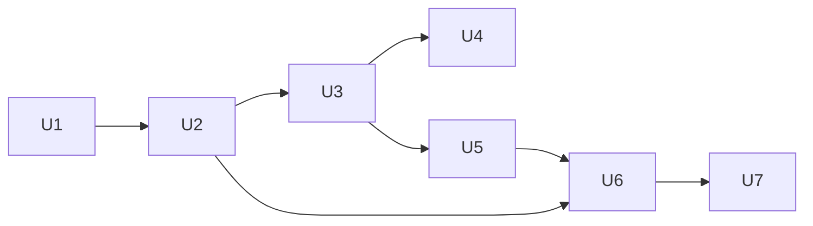

# refactor: Lokalny controller jako osobny proces narsor-controller

## Summary

Controller backendu `local` przestaje być zadaniem w procesie `narsor-server`. Staje się podkomendą `narsor-controller local`, obok `narsor-controller kubernetes`. W trybie `trusted` daemon uruchamia go jako proces potomny, sam go rejestruje i nadzoruje, więc dla usera nic się nie zmienia (faza A). Każdy backend działa wtedy tak samo: osobny proces controllera, rejestracja i protokół `/controller/v1` przez HTTP. W fazie B ten sam `narsor-controller local` może działać na laptopie jako backend zdalnego serwera w trybie `network`, tylko z jawną zgodą właściciela.

---

## Problem Frame

Dziś `run_daemon` (`crates/narsor-server/src/runtime.rs`) uruchamia w swoim procesie wbudowany controller (`start_local_controller`). Ten controller rejestruje się z pominięciem HTTP (`ProtocolService::create_enrollment` wywołane bezpośrednio) i łączy się z API pod adresem nasłuchu, z pominięciem bramki proxy. W trybie `network` jego rejestracja dostawała `403`, a serwer kończył pracę. Commit `83fbb68` wyłączył go w trybie `network` (`ServerSecurity::runs_local_controller` w `crates/narsor-server/src/api.rs`). Backend `local` jest więc wyjątkiem: inny cykl życia, inna rejestracja i niedostępny dla serwera sieciowego. Nie da się też użyć laptopa jako backendu serwera w k8s, choć protokół na to pozwala (controller otwiera tylko połączenia wychodzące). `narsor-controller` ma flagę `--backend` z jedną wartością i ręcznie rozpoznaje `edit-claude-profile` w `main.rs` (see origin: `docs/brainstorms/2026-10-25-lokalny-controller-osobny-proces-requirements.md`).

Ta wersja planu zastępuje wersję napisaną przed dokumentem wymagań. Numeracja R, A, F i AE jest z dokumentu wymagań.

---

## Requirements

Pełne brzmienie jest w dokumencie wymagań. Tu jest skrót i przypisanie do jednostek.

**Faza A: komenda `narsor-controller`**
- R1. Podkomendy `kubernetes` i `local`; `edit-claude-profile` pod `kubernetes`; osobne `--help`. (U1, U2)
- R2. Wspólne argumenty połączenia, te same zmienne `NARSOR_*`; manifesty zmieniają tylko komendę. (U1)
- R3. Bez podkomendy: błąd użycia z podpowiedzią; bez okresu przejściowego; `deploy/kubernetes/controller.yaml` i dokumentacja w tej samej zmianie. (U1, U4)
- R4. Własne logi na stderr (`RUST_LOG`); w trybie `trusted` widoczne w logu daemona. (U1, U3)

**Faza A: `narsor-controller local` uruchamiany przez daemon**
- R5. Ten sam adapter `LocalBackend`, storage, `HOME`, profil harnessu, `narsor-runner` obok binarki. (U2)
- R6. Daemon uruchamia, rejestruje i przekazuje rozwiązane ustawienia; dziecko nie czyta pliku konfiguracji ani obcych `NARSOR_*`. (U3)
- R7. Discovery dopiero po **nowym** lease; błąd startu z końcem stderr dziecka, gdy dziecko kończy się, brak binarki albo mija limit. (U3)
- R8. Kolejność zatrzymania; dziecko kończy się po `kill -9` daemona; nigdy dwa controllery; wyłączna blokada pliku z oczekiwaniem do limitu z R7 i PID właściciela w logu. (U2, U3)
- R9. Ponowny start z rosnącym opóźnieniem, bez nowej rejestracji; runnery żyją dalej. (U3)
- R10. Ta sama tożsamość i storage; bez migracji. (U2, U3)
- R11. `narsor-server` bez kodu pętli controllera; tryb `network` bez lokalnego controllera. (U3)

**Ochrona sekretów**
- R12. Kod rejestracji nigdy w argumentach procesu; tylko zmienna albo plik; runnery bez kodu i bez `NARSOR_*` controllera. (U1, U2, U3)

**Faza B: laptop jako backend zdalnego serwera**
- R13. Backend `kind: local` o id innym niż `local` w trybie `network`; id `local` zarezerwowane (odrzucenie przy starcie i przy tworzeniu zadania). (U5)
- R14. Taki backend wymaga `trust_scope: workstation`; błąd z nazwą pola. (U5)
- R15. Kod rejestracji wymaga jawnej zgody sprawdzanej przez serwer po `kind` i `trust_scope`; wyjątek dla wbudowanego `local` w `trusted`; flaga i ostrzeżenie w CLI. (U5)
- R16. Spoza loopback tylko `https://` ze sprawdzeniem certyfikatu; `http://` tylko w debug; ścisła definicja loopback; bez DNS i bez przekierowań na inny host. (U6)
- R17. Polecenia serwera spoza loopback są niezaufane: `--home private` domyślnie, `--home host` z potwierdzeniem, ścieżki tylko w storage, stały runner, lista dozwolonych pól i zmiennych, `0600`, ostrzeżenie przy starcie. (U7)
- R18. Ręczny `narsor-controller` czyta plik konfiguracji dla `HOME`; kolejność flagi > env > plik; R17 obowiązuje dla wartości z pliku; dziecko daemona nie czyta pliku. (U7)

**Actors:** A1 (user `trusted`: U2–U4), A2 (właściciel serwera `network`: U5), A3 (user laptopa: U6, U7), A4 (operator klastra: U1).

**Key Flows:** F1 (start daemona: U3), F2 (zatrzymanie i awaria: U2, U3), F3 (laptop jako backend: U5–U7).

---

## Scope Boundaries

- Brak przeniesienia silnika `/executions` na drogę zadań (controller + runner).
- Brak izolacji runnera na laptopie (kontener, sandbox). Backend `local` nadal uruchamia runner jako proces usera.
- Brak autostartu `narsor-controller local` na laptopie (np. usługa systemd). W fazie B user uruchamia go sam.
- Brak zmian w adapterze Kubernetes poza przeniesieniem jego argumentów do podkomendy.
- Brak osobnej autoryzacji per backend. Instalacja ma jednego właściciela (`docs/operations/remote-backends.md`, sekcja 13).
- Brak zmian w TUI. TUI nie tworzy kodów rejestracji.
- Brak nowych plików w `deploy/kind/`. Ten katalog nie istnieje w repo; zmiana składni dotyczy tylko `deploy/kubernetes/` i dokumentacji (see origin: Założenia do potwierdzenia).

### Deferred to Follow-Up Work

- Aktualizacja planu dystrybucji (`docs/plans/2026-10-25-003-feat-dystrybucja-instalacja-aktualizacja-plan.md`) po fazie A: U1 tamtego planu (wersje protokołu) obejmuje też lokalny controller.
- Autostart `narsor-controller local` na laptopie: po fazie B, gdy wzorzec użycia będzie jasny.
- Przeniesienie `/executions` na drogę zadań: osobny plan.

---

## Context & Research

### Relevant Code and Patterns

- Wbudowany controller: `crates/narsor-server/src/runtime.rs` (`run_daemon`, `start_local_controller`, `ensure_local_backend`, kolejność zamykania).
- Bramka trybu: `crates/narsor-server/src/api.rs` (`ServerSecurity::runs_local_controller`).
- Binarka controllera: `crates/narsor-controller/src/main.rs` (ręczne rozpoznanie `edit-claude-profile`, komentarz o „osobnym parserze”), `crates/narsor-controller/src/controller.rs` (`ControllerArgs` z `--backend` = `ControllerBackend::Kubernetes`, `--enrollment-code` przyjmowany dziś także z argv, `ClusterArgs`, `EditProfileArgs`, `run_command`, `edit_profile_command`, `HARNESS_ENVS` jako wzorzec listy dozwolonych zmiennych).
- Rejestracja: `load_or_enroll_with` w `crates/narsor-controller-runtime/src/lib.rs`; wiązanie z protokołem w `crates/narsor-engine/src/controller_runtime/mod.rs`.
- Pętla i nadzór: `crates/narsor-controller-runtime/src/controller.rs` (`ControllerConfig`, `lease_ttl` domyślnie 60 s), `crates/narsor-controller-runtime/src/lib.rs` (`Supervision`: `restart_after` 1 s, `stop_timeout` 10 s).
- Klient protokołu: `crates/narsor-engine/src/controller_protocol/client.rs` (`reqwest::Client::new()` z domyślnymi przekierowaniami; limity ustawiane na żądaniu: `REQUEST_TIMEOUT` = 10 s, long-poll `REQUEST_TIMEOUT + wait`, materiały `MATERIAL_TRANSFER_TIMEOUT`).
- Lease i fencing: `crates/narsor-engine/src/controller_protocol/service.rs` (`acquire_lease` daje nowy `epoch`; raporty z innym `epoch` są odrzucane; `create_enrollment`). To potwierdza założenie z wymagań: większy `epoch` rozpoznaje lease nowej inkarnacji.
- Żądanie kodu: `CreateEnrollmentRequest` w `crates/narsor-protocol/src/controller.rs` (pola `name`, `ttl_secs` z `serde(default)`).
- Adapter lokalny: `crates/narsor-engine/src/backends/local.rs` (`LocalBackendConfig::new` szuka `narsor-runner` obok `current_exe`; `spawn` zapisuje `launch-spec.json` i dziedziczy całe środowisko controllera plus `config.env`; grupy procesów).
- Launch spec: `crates/narsor-protocol/src/launch.rs` (`LaunchSpecEnvelope` z `deny_unknown_fields`; pola `workspace`, `environment` jako `Value`). Nazwy zmiennych środowiskowych mogą przyjść z serwera przez `secrets[].delivery.env` (`crates/narsor-engine/src/environment/backend.rs`), a runner je ustawia (`crates/narsor-runner/src/runner/secrets.rs`).
- Reguła loopback: `is_loopback_host` w `crates/narsor-shared/src/config/security_validation.rs` (IP loopback albo dokładnie `localhost`, bez DNS). Ta reguła odpowiada R16.
- Ustawienia `HOME`: `crates/narsor-shared/src/config/resolve.rs` (`local_harness_home`), `crates/narsor-shared/src/config/harness_home.rs` (`HarnessHome::runner_args`).
- Szukanie binarki obok siebie, z fallbackiem testowym: `crates/narsor-api-client/src/api/launch.rs` (`resolve_exe`).
- Discovery: `crates/narsor-api-client/src/api/discovery.rs` (`DISCOVERY_TIMEOUT` = 15 s, `DiscoveryError::Timeout`, log daemona w `{state}/narsor.log`).
- Katalog i backend: `crates/narsor-engine/src/environment/backend.rs` (`BackendRecord::LOCAL_ID`, `builtin_local`, `TrustScope`, `problems()`), `crates/narsor-engine/src/environment/catalog.rs`.
- CLI operatora: `src/cli/remote.rs` (`ControllerAdminCommand::EnrollCode`, `revoke`).
- Manifest: `deploy/kubernetes/controller.yaml` (`command: ["/opt/narsor/bin/narsor-controller"]`, kod z Secret przez env).
- Testy: `tests/daemon_lifecycle.rs`, `tests/config_startup.rs` (testy z daemonem `#[ignore]`), `tests/backend_contract.rs`, `tests/controller_protocol.rs`, `tests/controller_supervision.rs`, `tests/kubernetes_adapter.rs`, `tests/auth.rs`, `tests/environment.rs`, `tests/bin_targets.rs`, `tests/launch_spec_contract.rs`.

### Institutional Learnings

- Testy z daemonem są `#[ignore]` i sprzątają w `Drop`; testy wyciekały procesy daemonów. Nowy proces potomny zwiększa to ryzyko.
- Losowy `ETXTBSY` w testach agenta istniał wcześniej. Testy, które kopiują binarki w trakcie działania procesów, mogą go wywołać.
- D53 (jeden zapisujący stan): lokalny controller zapisuje tylko storage zadań, więc zasada zostaje.
- D63 (runner do odczytu startuje controller): przenosi się razem z adapterem.
- Wersja nie jest wydana: kontrakt CLI i manifestów zmienia się bez okresu przejściowego.

### External References

- Brak. Wzorce są w repo. `PR_SET_PDEATHSIG` jest związany z wątkiem, który utworzył proces (man `prctl(2)`); KTD6 to uwzględnia.

---

## Key Technical Decisions

- **KTD1. Podkomendy zamiast `--backend`.** Clap wymusza poprawny zestaw argumentów, każdy backend ma własne `--help`. `kubernetes` ma opcjonalną podkomendę `edit-claude-profile` z `subcommand_negates_reqs`, więc edycja profilu nie żąda argumentów połączenia (AE2). `--kubernetes-config` i `ClusterArgs` są na poziomie `kubernetes`. Przy `subcommand_negates_reqs` clap_derive zwraca błąd dla brakującego pola, które nie jest `Option`, więc pola `ConnectionArgs` i `--kubernetes-config` na poziomie `kubernetes` są typu `Option<…>` (z `env`). Gdy podkomendy nie ma, kod sprawdza je po parsowaniu i zwraca kod 2 z nazwą brakującego argumentu. `edit-claude-profile` zachowuje własne `--kubernetes-config` i `ClusterArgs` (jak dziś `EditProfileArgs`). Wspólne `ConnectionArgs` (`--control-plane`, `--runner-control-plane`, `--credential-file`, `--enrollment-code-file`, `--lease-ttl-secs`) są dołączane przez `flatten` i czytają te same zmienne `NARSOR_*` co dziś. Ręczne parsowanie `argv[1]` i komentarz o „osobnym parserze” znikają. Bez podkomendy: kod 2 i komunikat z `kubernetes` i `local` (AE1).
- **KTD1a. Kod rejestracji bez wartości w argv dla obu podkomend.** R12 mówi „nigdy w argumentach procesu”. Pole kodu czyta tylko `NARSOR_ENROLLMENT_CODE` (bez flagi z wartością) albo `--enrollment-code-file`. Manifest k8s już podaje kod przez env z Secret, więc R2 zostaje spełnione. Użycie dawnej flagi `--enrollment-code` daje kod 2 z podpowiedzią zmiennej albo pliku; komunikat nie powtarza wartości. Pole kodu ma `hide_env_values(true)`, więc `--help` nie pokazuje wartości zmiennej. Kod nie trafia do `tracing` ani do komunikatów błędów (stderr dziecka idzie do logu daemona, KTD1b).
- **KTD1b. Własne logi.** Binarka inicjuje subskrybenta `tracing` (EnvFilter z `RUST_LOG`, stderr), tak jak `narsor-server`. Daemon przekazuje dziecku `RUST_LOG` ze swojego poziomu logów i przepisuje stderr dziecka do swojego logu z prefiksem (R4).
- **KTD2. Bez okresu przejściowego.** `deploy/kubernetes/controller.yaml` i `docs/operations/remote-backends.md` dostają nową składnię w tej samej zmianie (R3).
- **KTD3. Daemon przekazuje rozwiązane ustawienia, dziecko nie czyta konfiguracji.** Daemon przekazuje jako flagi: katalog storage (`{work}/local-controller`), plik poświadczenia (`{state}/local-controller/credential`), adres API (`http://127.0.0.1:<port>`), argumenty `HOME`/profilu z `local_harness_home`, `--lease-ttl-secs` równy domyślnemu `ControllerConfig`, limit gotowości (KTD5) i `--no-config`. Daemon usuwa ze środowiska dziecka wszystkie zmienne `NARSOR_*` i ustawia tylko swoje (`NARSOR_ENROLLMENT_CODE`, gdy jest kod). Reszta środowiska (np. `PATH`, `HOME`) zostaje, bo harness jej potrzebuje (R6, AE8).
- **KTD4. Kod rejestracji przez env, runnery bez `NARSOR_*`.** Daemon tworzy kod w procesie tylko wtedy, gdy plik poświadczenia nie istnieje (R10). `LocalBackend::spawn` usuwa ze środowiska runnera wszystkie zmienne `NARSOR_*` odziedziczone po controllerze. Zmienne, które adapter ustawia jawnie (`WORKLOAD_MARK_ENV`, `config.env`), zostają. Controller nie używa `remove_var` (niebezpieczne przy wątkach); izolację daje `spawn` (R12).
- **KTD5. Gotowość = nowy lease, limity czasu.** Przed uruchomieniem dziecka daemon zapamiętuje `epoch` obecnego lease backendu `local` (albo jego brak) z `ProtocolService`. Potem czeka, aż lease ma większy `epoch`, i dopiero wtedy zapisuje plik discovery (R7, AE4). Wartości:
  - Limit gotowości: 10 s. To mniej niż `DISCOVERY_TIMEOUT` (15 s), więc tego limitu nie zmieniamy. Lokalna rejestracja i lease trwają zwykle poniżej 1 s. Limit jest liczony od spawnu i obejmuje czekanie na blokadę (KTD7: 7 s).
  - Komunikat `DiscoveryError::Timeout` w kliencie wskazuje `{state}/narsor.log`, bo tam CLI/TUI kieruje log daemona z błędem z R7.
  - Stderr dziecka idzie przez potok, który daemon czyta cały czas: prefiks w logu i bufor ostatnich 20 linii do komunikatu błędu startu. Dziecko nie blokuje się na pełnym potoku.
- **KTD6. Nadzór procesu.** Daemon uruchamia dziecko z jednego wątku systemowego, który żyje przez cały czas działania daemona (nie z puli `spawn_blocking`, bo jej wątki kończą się po bezczynności, a `PR_SET_PDEATHSIG` jest związany z wątkiem). Dziecko dostaje nową grupę procesów i `PR_SET_PDEATHSIG = SIGTERM`. Jako drugie zabezpieczenie dziecko uruchomione z `--parent-pid <pid>` (ukryta flaga) co sekundę sprawdza `getppid()` i kończy się łagodnie, gdy rodzic zniknie. Ponowny start po nieoczekiwanym końcu: opóźnienie od 1 s (`Supervision::restart_after`), podwajane do 30 s, zerowane po 60 s z ważnym lease. Restart nie tworzy kodu, gdy poświadczenie istnieje (R9, AE6). Zatrzymanie: `SIGTERM` dziecka, czekanie do `Supervision::stop_timeout` (10 s), potem `SIGKILL`, potem zamknięcie API (R8).
- **KTD7. Blokada pliku w katalogu poświadczenia.** Przy starcie `narsor-controller local` bierze `flock` (`LOCK_EX`) na `controller.lock` obok pliku poświadczenia i zapisuje w nim swój PID. Gdy blokada jest zajęta, proces co 100 ms próbuje ponownie do limitu `--lock-timeout-secs` (daemon podaje 7 s, krócej niż limit gotowości z KTD5, żeby po wzięciu blokady został czas na rejestrację i lease; ręcznie domyślnie 10 s) i loguje PID z pliku. Po limicie: kod 1 z tym PID. Blokada jest zwalniana przez jądro przy końcu procesu, także po `SIGKILL` (R8, AE4).
- **KTD8. Krótki limit czasu `release_lease` w `local`.** Limit na żądaniu w `reqwest` ma pierwszeństwo przed limitem klienta, więc zmiana jest w żądaniu, nie w `Client`. `ControllerClient::release_lease` dostaje opcjonalny limit czasu. `narsor-controller` tworzy klienta przez `controller_runtime::load_or_enroll`, który nie przyjmuje opcji, więc `controller_runtime` dostaje wariant z opcjami klienta (limit `release_lease`, w fazie B brak przekierowań, KTD13). `narsor-controller local` po sygnale zatrzymania ustawia 5 s, żeby przy martwym API zwolnienie lease zmieściło się w `stop_timeout` (10 s). Inne limity żądań (long-poll, materiały) zostają bez zmian. `kubernetes` zostaje bez zmian (scope).
- **KTD9. Binarka controllera obok serwera.** Daemon szuka `narsor-controller` tylko obok `narsor-server`, nigdy w `PATH`. Fallback na katalog profilu cargo tylko w buildach debug (jak `resolve_exe`). Brak binarki: kod 1 i nazwa brakującego pliku (AE5).
- **KTD10. Serwer bez pętli controllera.** `start_local_controller` i zależności `narsor-server` od pętli (`Controller`, `supervise`) i od `LocalBackend` znikają. `ensure_local_backend` i `ServerSecurity::runs_local_controller` zostają (R11, AE9).
- **KTD11. Faza B egzekwuje istniejące `trust_scope: workstation`.**
  - `BackendRecord::problems()`: `kind: local` o id innym niż `local` wymaga `trust_scope: workstation`; błąd z nazwą pola (R14, AE11).
  - `CreateEnrollmentRequest` dostaje pole `accept_workstation_risk: bool` (`serde(default)`). Ścieżka HTTP `create_enrollment` dla backendu `kind: local` z `trust_scope: workstation` bez tego pola zwraca `400` z kodem błędu `workstation_risk_not_accepted` i opisem ryzyka. Sprawdzenie czyta `kind` i `trust_scope`, nie id (R15, AE10). `ProtocolService` nie czyta dziś katalogu, więc `LaunchResolver` dostaje metodę, która zwraca `BackendRecord` dla id; dla id spoza katalogu ścieżka HTTP zwraca `404`.
  - Wyjątek dla wbudowanego `local` w `trusted`: daemon wywołuje wewnętrzną metodę `ProtocolService`, której nie ma w routingu HTTP. Ta metoda nie wymaga pola zgody. Żądanie przez HTTP o kod dla `local` podlega tej samej regule co każdy backend `workstation`.
  - `narsor-cli controller enroll-code <backend> --accept-workstation-risk` ustawia pole i wypisuje ostrzeżenie z R15.
  - Unieważnienie: istniejące `narsor-cli controller revoke <id>`.
- **KTD12. Id `local` zarezerwowane w trybie `network`.** `run_daemon` w trybie `network` sprawdza katalog `backends/` i odrzuca `local.yaml` przy starcie z podpowiedzią innego id (AE12). `EnvironmentCatalog` dostaje tryb przez konstruktor `CatalogLaunchResolver::new`, który `run_daemon` wywołuje z trybem serwera; w trybie `network` nie podstawia `builtin_local`, więc zadanie na `local` jest odrzucane przy tworzeniu z czytelnym błędem (R13). Domyślne `default_backend` to `local`, więc w trybie `network` z tą wartością daemon zapisuje przy starcie ostrzeżenie w logu, a błąd przy tworzeniu zadania wskazuje ustawienie `default_backend`.
- **KTD13. Transport w fazie B.** `narsor-controller local` sprawdza adres przez wspólną funkcję loopback (wydzieloną z `security_validation.rs` do publicznej funkcji w `narsor-shared`). Spoza loopback: tylko `https://`; `http://` jest dozwolony spoza loopback tylko z `cfg(debug_assertions)`. Klient `reqwest` ma `redirect::Policy::none()` i domyślne sprawdzenie certyfikatu; nie ma flagi, która je wyłącza (R16, AE13). Adres dla runnerów (`--runner-control-plane`) przechodzi tę samą kontrolę.
- **KTD14. Polecenia niezaufanego serwera (spoza loopback).** Kontrole są w `narsor-controller local` przed zapisem `launch-spec.json` i przed startem runnera (R17):
  - `--home`: domyślnie `private`; `host` wymaga `--accept-host-home` i wypisuje ostrzeżenie (klucze SSH, tokeny, konfiguracje harnessów).
  - Ścieżki z launch spec (workspace, katalogi lokalnych repozytoriów) po kanonizacji (dowiązania, `..`) muszą być wewnątrz katalogu storage. Inaczej: zadanie odrzucone z problemem, nic nie powstaje poza storage.
  - `secrets[].delivery.file`: runner już odrzuca ścieżki z `..` i ścieżki bezwzględne (`SecretDelivery::problem()` z `crates/narsor-engine/src/domain/environment.rs`, wywołane w `crates/narsor-runner/src/runner/secrets.rs`), więc ta kontrola działa także przy niezaufanym serwerze. U7 dodaje test regresji.
  - Granica kontroli: KTD14 chroni przed wstrzyknięciem przez launch spec. KTD14 nie chroni przed kodem, który harness uruchamia w zadaniu: ten kod ma dostęp do plików usera (brak izolacji, Scope Boundaries). Ostrzeżenie R15 i przegląd bezpieczeństwa fazy B muszą to uwzględnić.
  - Program runnera jest stały (`narsor-runner` obok binarki); launch spec go nie zmienia.
  - Lista dozwolonych pól: `LaunchSpecEnvelope` już ma `deny_unknown_fields`. Lista dozwolonych nazw zmiennych środowiskowych (`secrets[].delivery.env`): wbudowana lista nazw tokenów narzędzi, które obsługuje runner, plus powtarzalna flaga `--allow-env <NAME>`. Nazwy spoza listy (np. `PATH`, `LD_PRELOAD`) odrzucają zadanie z problemem.
  - Plik poświadczenia `0600` (już tak jest); domyślnie w `$XDG_STATE_HOME/narsor/workstation-controller/`.
  - Przy starcie: adres serwera, id backendu i ostrzeżenie z R15 na stderr.
  - Kontrole działają tylko dla serwera spoza loopback (R17). Dla serwera na loopback (np. dziecko daemona) zachowanie adaptera zostaje jak dziś (R5): workspace z `local_workspace_roots` poza storage i własne nazwy zmiennych sekretów są nadal przyjmowane, a `home` zostaje z ustawień daemona.
- **KTD15. Plik konfiguracji przy ręcznym uruchomieniu.** `narsor-controller local` bez `--no-config` czyta plik konfiguracji Narsora (`--config` albo ścieżka domyślna) tylko dla ustawień `HOME` (`local_harness_home`). Kolejność: flagi, zmienne, plik. Reguła z KTD14 obowiązuje dla wyniku: `local_home: host` z pliku przy serwerze spoza loopback wymaga `--accept-host-home` (R18, AE14). Domyślna wartość `local_home` to `host` (`DEFAULT_LOCAL_HOME`), a `local_harness_home` nie odróżnia jej od wartości ustawionej. Dlatego controller czyta źródło (`Resolved::source(SettingKey::LocalHome)`): gdy źródłem jest wartość domyślna, przy serwerze spoza loopback tryb to `private`; tylko `host` z env albo z pliku wymaga `--accept-host-home`.

---

## Open Questions

### Resolved During Planning

- Limit gotowości i parametry restartu: KTD5, KTD6 (10 s; 1 s → 30 s; `DISCOVERY_TIMEOUT` bez zmian; komunikat timeoutu wskazuje `narsor.log`).
- `PR_SET_PDEATHSIG` przy wątkach tokio: spawn z wątku żyjącego przez cały proces plus kontrola `getppid()` w dziecku (KTD6).
- Krótki limit `release_lease`: 5 s tylko w `local` (KTD8).
- Odczyt `epoch` dla KTD5: `ProtocolService::control_plane()` jest publiczne i daje lease backendu z `epoch`; nowa metoda nie jest potrzebna.
- Fencing `epoch`: potwierdzony w `service.rs` (`acquire_lease` daje nowy `epoch`, raporty z innym `epoch` są odrzucane).
- Kod rejestracji w argv dla `kubernetes`: też usunięty (KTD1a), bo R12 dotyczy każdego procesu, a manifest używa env.
- Wyjątek zgody dla wbudowanego `local`: wewnętrzna metoda bez routingu HTTP (KTD11).
- `deploy/kind/`: poza zakresem, katalog nie istnieje.

### Deferred to Implementation

- Dokładna wbudowana lista nazw zmiennych z KTD14: wziąć z obsługi narzędzi w `crates/narsor-runner/src/runner/secrets.rs`.
- Które pola `workspace` i `environment` w launch spec niosą ścieżki: ustalić przy czytaniu `crates/narsor-runner/src/runner/storage.rs` i `materials.rs`.

---

## High-Level Technical Design

> *This illustrates the intended approach and is directional guidance for review, not implementation specification. The implementing agent should treat it as context, not code to reproduce.*

```mermaid
sequenceDiagram
    participant D as narsor-server (daemon, trusted)
    participant C as narsor-controller local (dziecko)
    participant R as narsor-runner (proces na zadanie)
    D->>D: API nasłuchuje na 127.0.0.1
    alt brak {state}/local-controller/credential
        D->>D: wewnętrzne create_enrollment(local) → kod
    end
    D->>D: zapamiętaj epoch obecnego lease
    D->>C: spawn z wątku nadzoru (flagi, --no-config, --parent-pid; env bez obcych NARSOR_*, NARSOR_ENROLLMENT_CODE gdy kod)
    C->>C: flock controller.lock (czekanie ≤ 7 s)
    C->>D: POST /controller/v1/enroll (gdy kod) albo podpisane żądania
    C->>D: acquire lease (nowy epoch)
    D->>D: epoch > zapamiętany → zapis daemon.json
    C->>R: start runnera (env bez NARSOR_* controllera)
    R->>D: /runner/v1
    Note over D,C: stop: SIGTERM dziecka → release lease (≤ 10 s) → zamknięcie API
    Note over D,C: kill -9 daemona: PDEATHSIG / getppid → dziecko kończy się
```

Faza B: ten sam proces uruchomiony ręcznie na laptopie: `narsor-controller local --control-plane https://… ` z kodem z `narsor-cli controller enroll-code <id> --accept-workstation-risk` (env albo plik).



---

## Implementation Units

### Faza A. Wydzielenie

### U1. Podkomendy `narsor-controller`

**Goal:** `narsor-controller kubernetes …` i `narsor-controller kubernetes edit-claude-profile …` zastępują komendę z `--backend` i ręcznym parsowaniem. Wspólne argumenty połączenia są w jednej strukturze. Binarka ma własne logi.

**Requirements:** R1, R2, R3, R4, R12; A4; AE1, AE2

**Dependencies:** None

**Files:**
- Modify: `crates/narsor-controller/src/main.rs`
- Modify: `crates/narsor-controller/src/controller.rs` (podział na `ConnectionArgs` i argumenty Kubernetes; usunięcie `ControllerBackend`; kod rejestracji z env albo pliku; opis modułu)
- Modify: `crates/narsor-controller/Cargo.toml` (`tracing-subscriber`)
- Modify: `deploy/kubernetes/controller.yaml` (komenda z `kubernetes`; instrukcja `edit-claude-profile`)
- Modify: `docs/operations/remote-backends.md` (sekcje z komendą controllera i edycją profilu)
- Modify: `tests/kubernetes_adapter.rs`, `tests/bin_targets.rs` (nowa składnia wywołania binarki)
- Test: `tests/controller_cli.rs`

**Approach:**
- Nazwy zmiennych `NARSOR_*` bez zmian, żeby manifest zmieniał tylko komendę.
- `--help` głównej komendy wymienia oba backendy.

**Patterns to follow:**
- `ClusterArgs` w `crates/narsor-controller/src/controller.rs` (struktura dołączana do dwóch komend).
- Podkomendy w `src/cli/mod.rs` (`Command`, `ControllerAdminCommand`).

**Test scenarios:**
- Covers AE1. `narsor-controller` bez podkomendy → kod 2, komunikat wymienia `kubernetes` i `local`.
- Covers AE2. `narsor-controller kubernetes edit-claude-profile --help` oraz uruchomienie bez `NARSOR_CONTROL_PLANE` i bez pliku poświadczenia → nie żąda argumentów połączenia.
- Happy path: `narsor-controller kubernetes --help` wypisuje `--kubernetes-config` i argumenty połączenia, bez argumentów `local`.
- Happy path: `NARSOR_CONTROL_PLANE`, `NARSOR_CONTROLLER_CREDENTIAL_FILE`, `NARSOR_ENROLLMENT_CODE` z env są przyjmowane przez `kubernetes` bez flag.
- Error path: `narsor-controller kubernetes` bez `--kubernetes-config` → kod 2 z nazwą argumentu.
- Error path: `narsor-controller kubernetes` bez `NARSOR_CONTROL_PLANE` i bez `--control-plane` → kod 2 z nazwą argumentu; ta sama wartość tylko w env jest przyjmowana.
- Error path: `--enrollment-code abc` w argv → kod 2 z podpowiedzią `NARSOR_ENROLLMENT_CODE` albo `--enrollment-code-file`; stderr nie zawiera `abc`.
- Error path: `NARSOR_ENROLLMENT_CODE=sekret` w env → wyjście `--help` i stderr przy błędzie połączenia nie zawierają `sekret`.
- Happy path: `--enrollment-code-file <plik>` → kod czytany z pliku (bez końcowego znaku nowej linii).
- Happy path: `RUST_LOG=narsor=info narsor-controller kubernetes …` z błędnym adresem serwera → log `tracing` na stderr.
- Integration: testy w `tests/kubernetes_adapter.rs` i `tests/bin_targets.rs`, które uruchamiają binarkę, przechodzą z nową składnią.

**Verification:**
- `deploy/kubernetes/controller.yaml` używa `kubernetes`. Test ręczny z `docs/operations/remote-backends.md`, sekcja 12, przechodzi z nowym manifestem.

---

### U2. `narsor-controller local`

**Goal:** Binarka controllera steruje adapterem `LocalBackend` tak samo jak dziś wbudowany controller, z blokadą pliku i czystym środowiskiem runnera.

**Requirements:** R1, R5, R8, R10, R12; F2; AE7

**Dependencies:** U1

**Files:**
- Create: `crates/narsor-controller/src/local.rs` (argumenty, blokada, uruchomienie backendu lokalnego)
- Modify: `crates/narsor-controller/src/main.rs`, `crates/narsor-controller/src/controller.rs`
- Modify: `crates/narsor-engine/src/backends/local.rs` (usunięcie `NARSOR_*` controllera ze środowiska runnera w `spawn`)
- Modify: `crates/narsor-engine/src/controller_protocol/client.rs` (opcjonalny limit czasu `release_lease`, KTD8)
- Modify: `crates/narsor-engine/src/controller_runtime/mod.rs` (wariant `load_or_enroll` z opcjami klienta, KTD8)
- Test: `tests/controller_local.rs` (`#[ignore]`: uruchamia procesy)

**Approach:**
- Argumenty `local`: `--storage <dir>` (wymagany), `--home private|host`, `--codex-home`, `--claude-config-dir`, `--claude-profile-source` (te same, co `HarnessHome::runner_args`), `--lock-timeout-secs`, ukryte `--parent-pid`, `--no-config`, plus `ConnectionArgs`. Faza B dodaje flagi w U6 i U7.
- Start: blokada (KTD7) → `LocalBackendConfig::new(storage)` → `runner_args` → `load_or_enroll` → pętla `Controller` z `shutdown_signal` (i z sygnałem od kontroli `getppid()`, KTD6).
- Układ katalogów i plik poświadczenia są te same co dziś (R10), bo daemon przekaże te same ścieżki (U3).

**Patterns to follow:**
- `start_local_controller` w `crates/narsor-server/src/runtime.rs` (kolejność konfiguracji).
- `run_command` w `crates/narsor-controller/src/controller.rs`.

**Test scenarios:**
- Happy path: serwer testowy `trusted` w procesie testu, kod w `NARSOR_ENROLLMENT_CODE`, `narsor-controller local` jako proces → rejestracja, lease backendu `local`, plik poświadczenia `0600`.
- Happy path: zadanie na `local` dochodzi do końca (fake harness z `tests/fixtures/harness/`).
- Covers AE7. Drugi start z istniejącym poświadczeniem i bez kodu → ta sama tożsamość, bez rejestracji, zadania w tym samym storage.
- Edge case: `--home host` → runner dostaje `--home host` (argumenty procesu runnera).
- Edge case: druga instancja na tym samym katalogu poświadczenia, gdy pierwsza działa → czeka, loguje PID pierwszej, po `--lock-timeout-secs 1` kończy się kodem 1 z tym PID.
- Edge case: pierwsza instancja dostaje `SIGKILL` w czasie oczekiwania drugiej → druga bierze blokadę i startuje.
- Edge case: proces rodzica podany w `--parent-pid` kończy się → controller zwalnia lease i kończy się.
- Error path: brak `narsor-runner` obok binarki → zadanie zgłasza problem startu z nazwą pliku, controller działa dalej.
- Error path: brak poświadczenia i brak kodu → kod 2 z komunikatem jak dziś.
- Error path: środowisko runnera (`/proc/<pid>/environ`) nie zawiera `NARSOR_ENROLLMENT_CODE` ani innych `NARSOR_*` controllera; zawiera `WORKLOAD_MARK_ENV`.
- Integration: `SIGTERM` controllera → lease zwolniony od razu (widoczny w `ProtocolService`), runner działa dalej we własnej grupie.
- Integration: `SIGTERM` przy zatrzymanym serwerze → proces kończy się w czasie bliskim limitowi klienta (≤ ~5 s), nie wisi.

**Verification:**
- Scenariusze `tests/controller_local.rs` przechodzą. `tests/backend_contract.rs` przechodzi bez zmian jako test regresji adaptera.

---

### U3. Daemon uruchamia lokalny controller jako proces potomny

**Goal:** W trybie `trusted` daemon uruchamia, rejestruje i nadzoruje `narsor-controller local`. Kod wbudowanego controllera znika z serwera.

**Requirements:** R4, R6, R7, R8, R9, R10, R11, R12; A1; F1, F2; AE3, AE4, AE5, AE6, AE8, AE9

**Dependencies:** U2

**Files:**
- Create: `crates/narsor-server/src/local_controller.rs` (wątek nadzoru, spawn, gotowość po `epoch`, restart, zatrzymanie, potok stderr)
- Modify: `crates/narsor-server/src/runtime.rs` (usunięcie `start_local_controller`; nowa kolejność w `run_daemon`)
- Modify: `crates/narsor-server/Cargo.toml` (usunięcie zbędnych zależności)
- Modify: `crates/narsor-engine/src/controller_protocol/service.rs` (wewnętrzne tworzenie kodu dla wbudowanego `local`, KTD11)
- Modify: `crates/narsor-api-client/src/api/discovery.rs` (komunikat `Timeout` wskazuje `narsor.log`)
- Test: `tests/daemon_lifecycle.rs`, `tests/config_startup.rs`, `tests/api_discovery.rs`

**Approach:**
- Kolejność w `run_daemon`: API → (gdy brak poświadczenia) kod → zapamiętanie `epoch` → spawn → czekanie na większy `epoch` do 10 s (KTD5) → plik discovery. Zamknięcie: `SIGTERM` dziecka → czekanie do 10 s → `SIGKILL` → `stop_accepting` API → drenaż jak dziś.
- Środowisko i flagi dziecka: KTD3. Nadzór: KTD6. Binarka: KTD9.
- Błąd przed gotowością (koniec dziecka, brak binarki, limit) → kod 1, komunikat z ostatnimi liniami stderr dziecka, brak `daemon.json`.
- Tryb `network`: dziecka nie ma, log jak po `83fbb68`.

**Execution note:** Najpierw test charakteryzujący obecne zachowanie: poświadczenie istnieje przed `daemon.json`, lease `local` pojawia się po starcie, zadanie `local` startuje, restart daemona nie rejestruje controllera ponownie. Test musi przejść przed i po zmianie. Asercję „lease przed discovery” dodać razem ze zmianą, bo dziś nie jest prawdziwa.

**Patterns to follow:**
- `resolve_exe` i uruchomienie procesu w `crates/narsor-api-client/src/api/launch.rs`.
- Grupy procesów w `crates/narsor-engine/src/backends/local.rs`.
- Kolejność zamykania w `run_daemon`.

**Test scenarios:**
- Covers AE3. Czysty stan, start daemona → istnieje proces `narsor-controller local` (dziecko daemona), `daemon.json` pojawia się po lease, zadanie `local` dochodzi do końca.
- Covers AE4. `kill -9` daemona i natychmiastowy restart (stary lease ważny) → `daemon.json` pojawia się dopiero po lease z większym `epoch`; w każdej chwili działa najwyżej jeden proces `narsor-controller local` z tym katalogiem stanu.
- Covers AE5. Brak binarki `narsor-controller` obok `narsor-server` → kod 1, komunikat z nazwą pliku, brak `daemon.json`.
- Covers AE6. `kill -9` dziecka → daemon uruchamia je ponownie, lease wraca, nowe zadanie startuje, liczba kodów rejestracji się nie zmienia; w przerwie zadanie `local` pokazuje `controller_offline`, a runner działającego zadania żyje.
- Covers AE8. `NARSOR_RUNNER_CONTROL_PLANE=http://example` w środowisku daemona → środowisko dziecka (`/proc/<pid>/environ`) go nie ma, runner dostaje adres daemona i nie ma kodu rejestracji.
- Covers AE9. Tryb `network` → brak dziecka; `a_network_daemon_starts_without_the_built_in_local_controller` przechodzi bez zmian.
- Happy path: `narsor-server stop` → dziecko kończy się, lease zwolniony przed zamknięciem API, brak procesów `narsor-controller` z katalogu testowego.
- Happy path: `RUST_LOG` daemona na `info` → linie logu dziecka są w logu daemona z prefiksem.
- Edge case: `kill -9` daemona bez restartu → dziecko kończy się w ciągu kilku sekund (PDEATHSIG albo `getppid()`).
- Edge case: drugi start daemona na tym samym stanie → bez nowego kodu (R10).
- Error path: uszkodzony plik poświadczenia → dziecko kończy się przed lease, daemon kończy start kodem 1 z końcem stderr dziecka.
- Error path: dziecko nie bierze lease w 10 s (np. zatrzymane `SIGSTOP`) → kod 1 z komunikatem o limicie.
- Happy path: `DiscoveryError::Timeout` w `Display` zawiera ścieżkę `narsor.log`.

**Verification:**
- `crates/narsor-server/src/runtime.rs` nie zawiera pętli controllera. Testy daemona przechodzą, a po nich nie zostają procesy `narsor-controller`.

---

### U4. Dokumentacja i decyzja fazy A

**Goal:** Dokumentacja opisuje lokalny controller jako osobny proces. Decyzja jest w rejestrze.

**Requirements:** R1–R12

**Dependencies:** U3

**Files:**
- Modify: `ARCHITECTURE_DECISIONS.md` (nowa decyzja z kolejnym wolnym numerem: lokalny controller jako proces potomny, podkomendy, gotowość po lease)
- Modify: `docs/operations/remote-backends.md` (sekcja 1: architektura; tryb lokalny)
- Modify: `README.md` (procesy w trybie lokalnym, jeśli są opisane)
- Modify: `run.sh`, `install.sh` (tylko gdy opis albo lista binarek się zmienia)

**Approach:**
- Opis: w trybie `trusted` daemon uruchamia `narsor-controller local`; logi controllera są w logu daemona; trzy binarki muszą być w jednym katalogu.

**Test expectation:** none — dokumentacja.

**Verification:**
- Komendy w dokumentacji odpowiadają U1–U3.

---

### Faza B. Laptop jako backend zdalnego serwera

Faza B może trafić do osobnego merge requesta. Faza A może wyjść bez fazy B. Przegląd specjalisty od bezpieczeństwa jest warunkiem wydania fazy B, nie jej implementacji (see origin: Założenia do potwierdzenia).

### U5. Backend `kind: local` w trybie `network`, `trust_scope` i zgoda

**Goal:** Serwer sieciowy obsługuje backend `kind: local` o własnym id, tylko z `trust_scope: workstation` i z jawną zgodą przy tworzeniu kodu.

**Requirements:** R13, R14, R15; A2; F3; AE10, AE11, AE12

**Dependencies:** U3

**Files:**
- Modify: `crates/narsor-engine/src/environment/backend.rs` (`problems()`, KTD11)
- Modify: `crates/narsor-engine/src/environment/catalog.rs` (tryb; bez `builtin_local` w `network`, KTD12)
- Modify: `crates/narsor-engine/src/environment/resolver.rs` (tryb w `CatalogLaunchResolver::new`; `BackendRecord` dla id, KTD11)
- Modify: `crates/narsor-engine/src/controller_protocol/service.rs` (zgoda w ścieżce HTTP; wewnętrzną metodę dla wbudowanego `local` dodaje U3, U5 jej nie zmienia)
- Modify: `crates/narsor-server/src/controller_protocol/http.rs` (`post_enrollment`: mapowanie błędu na `400`)
- Modify: `crates/narsor-server/src/runtime.rs` (tryb `network`: odrzucenie `backends/local.yaml`; tryb przekazany do katalogu)
- Modify: `crates/narsor-protocol/src/controller.rs` (`accept_workstation_risk` w `CreateEnrollmentRequest`)
- Modify: `src/cli/remote.rs` (`--accept-workstation-risk`, ostrzeżenie)
- Test: `tests/controller_protocol.rs`, `tests/environment.rs`, `tests/auth.rs`, `tests/config_startup.rs`

**Approach:**
- Zgoda jest sprawdzana przez serwer, nie tylko przez CLI.
- Ostrzeżenie w CLI: przejęty serwer może uruchamiać dowolny kod na tym komputerze jako jego user, bez izolacji kontenera.

**Test scenarios:**
- Covers AE10. Backend `laptop` (`kind: local`, `trust_scope: workstation`), żądanie API bez pola zgody → `400`, kod `workstation_risk_not_accepted`, opis ryzyka; `narsor-cli controller enroll-code laptop --accept-workstation-risk` → kod i ostrzeżenie na stderr.
- Covers AE11. `backends/workstation.yaml` z `kind: local`, `trust_scope: dedicated` → błąd katalogu z nazwą pola `trust_scope`.
- Covers AE12. Tryb `network` i `backends/local.yaml` → błąd startu z podpowiedzią innego id.
- Happy path: tryb `network`, `backends/laptop.yaml` poprawny → serwer startuje, backend widoczny w `capabilities`.
- Edge case: tryb `trusted`, daemon tworzy kod dla wbudowanego `local` wewnętrznie → bez pola zgody, start bez zmian (regresja U3).
- Edge case: tryb `trusted`, `enroll-code local` przez HTTP bez zgody → `400` (ta sama reguła po `kind`/`trust_scope`).
- Error path: tryb `network`, zadanie z `--backend local` → odrzucone przy tworzeniu z czytelnym błędem.
- Error path: tryb `network`, `default_backend: local`, zadanie bez `--backend` → ostrzeżenie w logu przy starcie; błąd przy tworzeniu wskazuje `default_backend`.
- Error path: żądanie kodu przez HTTP dla id spoza katalogu → `404`.
- Edge case: backend `kubernetes` z `trust_scope: workstation` → kod bez zgody (reguła tylko dla `kind: local`).
- Integration: `controller revoke <id>` dla controllera laptopa → kolejne podpisane żądania odrzucone, nowa rejestracja możliwa.

**Verification:**
- Laptopa nie da się zarejestrować jako backendu serwera sieciowego bez jawnej zgody.

---

### U6. Transport `narsor-controller local` do zdalnego serwera

**Goal:** User uruchamia `narsor-controller local` na laptopie i łączy go ze zdalnym serwerem tylko przez bezpieczny transport.

**Requirements:** R16; A3; F3; AE13 (część `https://`)

**Dependencies:** U2, U5

**Files:**
- Modify: `crates/narsor-shared/src/config/security_validation.rs` (publiczna funkcja loopback, KTD13)
- Modify: `crates/narsor-controller/src/local.rs` (walidacja adresów, domyślny plik poświadczenia w `$XDG_STATE_HOME/narsor/workstation-controller/`)
- Modify: `crates/narsor-engine/src/controller_protocol/client.rs` (opcja bez przekierowań)
- Modify: `crates/narsor-engine/src/controller_runtime/mod.rs` (opcja bez przekierowań w wariancie z KTD8)
- Modify: `crates/narsor-controller/Cargo.toml` (`narsor-shared` dla funkcji loopback i pliku konfiguracji)
- Modify: `docs/operations/remote-backends.md` (nowa sekcja „komputer jako backend”; test ręczny z serwerem `network`; zaufanie do CA serwera przez systemowy magazyn certyfikatów; `revoke` po utracie laptopa)
- Test: `tests/controller_local.rs`

**Approach:**
- Reguły KTD13. Komunikaty błędów wskazują `https://` i powód.

**Test scenarios:**
- Covers AE13. `--control-plane http://10.0.0.5:8443` w buildzie wydania → kod 2 z komunikatem o `https://`. (W teście: funkcja walidacji z parametrem „wydanie”, bo testy budują debug.)
- Edge case: `http://127.0.0.1:…`, `http://127.1.2.3:…`, `http://[::1]:…`, `http://localhost:…` → przyjęte jako loopback.
- Edge case: `http://localhost.example.com`, `http://127.0.0.1.nip.io`, `http://0.0.0.0` → spoza loopback, odrzucone w wydaniu.
- Error path: `--runner-control-plane http://10.0.0.5` → ta sama reguła.
- Error path: serwer testowy `https` zwraca przekierowanie na inny host → controller nie idzie za nim i kończy żądanie błędem.
- Error path: serwer `https` z certyfikatem spoza zaufanych CA → błąd TLS, brak flagi obejścia w `--help`.
- Happy path (ręczny, opisany w dokumentacji): serwer w trybie `network`, backend `laptop`, `narsor-controller local` z laptopa → rejestracja, lease, zadanie z TUI widoczne obok zadań `k8s`.

**Verification:**
- Wydanie nie łączy się z serwerem spoza loopback bez `https://` i bez poprawnego certyfikatu.

---

### U7. Niezaufany serwer i plik konfiguracji przy ręcznym uruchomieniu

**Goal:** `narsor-controller local` przy serwerze spoza loopback nie pozwala serwerowi wyjść poza storage, zmienić programu runnera ani wstrzyknąć zmiennych. Ręczne uruchomienie czyta ustawienia `HOME` z pliku konfiguracji.

**Requirements:** R17, R18; A3; F3; AE13 (część `--home host`), AE14

**Dependencies:** U6

**Files:**
- Modify: `crates/narsor-controller/src/local.rs` (`--accept-host-home`, `--allow-env`, `--config`, ostrzeżenie przy starcie, kolejność źródeł `HOME`)
- Create: `crates/narsor-controller/src/local/untrusted.rs` (kontrole launch spec: ścieżki, nazwy zmiennych)
- Modify: `crates/narsor-engine/src/backends/local.rs` (punkt zaczepienia na kontrolę launch spec przed zapisem, jeśli adapter nie daje go dziś)
- Test: `tests/controller_local.rs`, testy jednostkowe w `crates/narsor-controller/src/local/untrusted.rs`

**Approach:**
- Reguły KTD14 i KTD15. Dziecko daemona dostaje `--no-config` (U3), więc R6 zostaje spełnione.

**Test scenarios:**
- Covers AE13. Serwer spoza loopback i `--home host` bez `--accept-host-home` → kod 2 z opisem ryzyka.
- Covers AE14. Serwer spoza loopback, plik konfiguracji z `local_home: host`, bez `--accept-host-home` → kod 2 z opisem ryzyka; ten sam plik i `--home private` → controller używa `private`.
- Happy path: serwer spoza loopback, brak `--home` i brak pliku → `private`; przy starcie stderr zawiera adres serwera, id backendu i ostrzeżenie.
- Happy path: `--home host --accept-host-home` → `host` i ostrzeżenie.
- Edge case: kolejność źródeł: flaga > `NARSOR_*` env > plik (trzy przypadki).
- Edge case: `--no-config` z plikiem `local_home: host` → plik pominięty.
- Edge case: serwer spoza loopback, plik bez `local_home` → `private` (wartość domyślna `host` nie jest używana).
- Error path: launch spec ze ścieżką `../poza` albo dowiązaniem do `/etc` w storage → zadanie odrzucone z problemem, nic nie powstaje poza storage.
- Error path: `secrets[].delivery.env: LD_PRELOAD` albo `PATH` → zadanie odrzucone z problemem; nazwa z wbudowanej listy → przyjęta; nazwa dodana `--allow-env` → przyjęta.
- Error path: launch spec z nieznanym polem → odrzucone (regresja `deny_unknown_fields`).
- Error path: `secrets[].delivery.file: ../../.ssh/authorized_keys` albo ścieżka bezwzględna → zadanie odrzucone z problemem, nic nie powstaje poza prywatnym HOME (regresja `SecretDelivery::problem()`).
- Edge case: serwer na loopback (dziecko daemona `trusted`), zadanie `local` z workspace z `local_workspace_roots` poza storage i z nazwą zmiennej sekretu spoza wbudowanej listy → przyjęte jak dziś (regresja R5).
- Integration: plik poświadczenia po rejestracji ma prawa `0600`.

**Verification:**
- Scenariusze AE13 i AE14 przechodzą. Przegląd bezpieczeństwa fazy B ma komplet kontroli R16–R17 do oceny.

---

## System-Wide Impact

- **Interaction graph:** `run_daemon` (start, gotowość, zamknięcie), binarka controllera (CLI), klient protokołu (limit czasu, przekierowania), adapter `LocalBackend` (środowisko runnera, kontrole), katalog (walidacja, tryb), API rejestracji (zgoda), CLI operatora, klient discovery (komunikat), manifest k8s.
- **Error propagation:** błędy dziecka trafiają do logu daemona, a przed gotowością do błędu startu daemona i do `narsor.log`. Po starcie daemon restartuje dziecko; w przerwie zadania `local` pokazują `controller_offline`.
- **State lifecycle risks:** dwa controllery z jednym poświadczeniem → blokada pliku (KTD7) plus fencing `epoch`; przerwana rejestracja → plik poświadczenia zapisywany atomowo (bez zmian).
- **API surface parity:** nowe pole `accept_workstation_risk` z `serde(default)`; stary klient bez pola dostaje `400` tylko dla backendów `kind: local` + `workstation`. TUI bez zmian.
- **Integration coverage:** kolejność lease → discovery, brak procesów po `stop`, restart po `kill -9` i ponowne użycie poświadczenia wymagają testów z prawdziwymi procesami (`#[ignore]`).
- **Unchanged invariants:** storage zadań lokalnych; tożsamość lokalnego controllera; kontrakt `LocalBackend` (`tests/backend_contract.rs`); tryb `network` bez wbudowanego `local`; runnery w osobnych grupach przeżywają controller; adapter Kubernetes.

---

## Risks & Dependencies

| Risk | Mitigation |
|------|------------|
| Wyciek procesów `narsor-controller` w testach i po awarii daemona | PDEATHSIG z wątku nadzoru, kontrola `getppid()`, nowa grupa procesów, sprzątanie w `Drop` testów, test braku procesów po `stop`. |
| Dłuższy start daemona | Limit gotowości 10 s < 15 s discovery; czytelny błąd z końcem stderr; komunikat timeoutu wskazuje `narsor.log`. |
| Zmiana komendy controllera łamie manifesty | Ta sama zmiana aktualizuje `deploy/kubernetes/controller.yaml` i dokumentację; błąd użycia podpowiada nową składnię. |
| Usunięcie `--enrollment-code` z argv łamie skrypty | Wersja nie jest wydana; manifest używa env; błąd podpowiada zmienną albo plik. |
| Faza B otwiera wykonanie kodu na laptopie dla przejętego serwera | Egzekwowany `trust_scope: workstation`, zgoda sprawdzana przez serwer, `https://` bez obejścia, kontrole KTD14, ostrzeżenia. Przegląd specjalisty od bezpieczeństwa przed wydaniem fazy B. |
| Lista dozwolonych zmiennych za wąska dla nowego narzędzia | `--allow-env` na laptopie; lista wbudowana z obsługi runnera. |

---

## Sources & References

- **Origin document:** `docs/brainstorms/2026-10-25-lokalny-controller-osobny-proces-requirements.md`
- Commit `83fbb68` (tryb `network` startuje bez wbudowanego controllera `local`).
- `docs/plans/2026-10-01-2329-feat-zdalne-backendy-wykonawcze-plan.md`.
- `docs/plans/2026-10-25-003-feat-dystrybucja-instalacja-aktualizacja-plan.md`.
- `docs/operations/remote-backends.md`.
