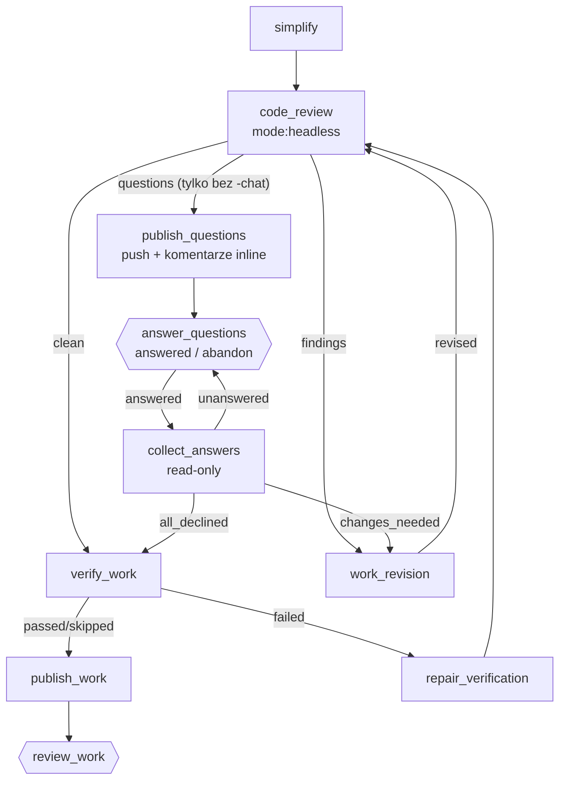

# Pętla code review z decyzjami człowieka - Plan

## Goal Capsule

- **Objective:** pętla `code_review` w procesach compound kończy się także wtedy, gdy review zgłasza finding, o którym musi zdecydować człowiek. Człowiek dostaje każde pytanie jeden raz. Review nie zgłasza ponownie findingu, o którym człowiek już zdecydował.
- **Means:** `code_review` w `mode:headless`, usunięcie `fix_findings`, pamięć decyzji w zmiennej `review_decisions`, pytania w PR (wariant bez `-chat`) albo w sesji przez `awaiting_input` (warianty `-chat` i `-debug`) oraz notka adaptera harnessu w kontrakcie wyjścia.
- **Product authority:** Artur. Decyzje z rozmowy są w Key Decisions i nie są do zmiany w trakcie implementacji.
- **Open blockers:** brak.
- **Execution profile:** Standard, pięć jednostek (U1–U5). Każda jednostka kończy się zielonym `cargo test --workspace`.
- **Stop conditions:** zatrzymaj pracę i zgłoś problem, gdy walidator workflow odrzuca kształt grafu z tego planu albo gdy prawdziwy CLI Claude nie przyjmuje `awaiting_input` przez `StructuredOutput` po notce z U1.

---

## Product Contract

### Summary

Każdy z trzech procesów compound dostaje nową pętlę code review. Review sam stosuje bezpieczne poprawki i dzieli resztę findingów na dwie grupy: do poprawy przez agenta i do decyzji człowieka. Findingi do poprawy zawsze idą pierwsze. Pytania do człowieka padają dopiero wtedy, gdy zostały tylko findingi do decyzji. Decyzje są zapisane w narsorze, a nie w PR. Silnik mówi agentowi, jak w danym harnessie dostarczyć odpowiedź i pytanie.

### Problem Frame

Dziś `code_review` uruchamia `ce-code-review` z tokenem `mode:agent`. Skill w wersji 3.8.2 nie zna tego tokenu i działa w trybie interaktywnym. Próbuje pytać o findingi `gated_auto` i `manual`, ale w `--print` nie ma `AskUserQuestion`. Model pyta zwykłym tekstem, a CLI odpowiada komunikatem `[structured-output-enforce]`. Model odbiera to jako polecenie zakończenia i wybiera `findings`. `fix_findings` ma tylko wybór `fixed`, więc nie może zgłosić, że problem wymaga decyzji. Review w nowej sesji zgłasza ten sam finding. Pętla trwa do limitu `max_entries: 10`, czyli do 9 zbędnych rund review i poprawek.

Kontrakt wyjścia (`crates/narsor-engine/src/engine/actions/agent.rs`, `output_contract`) opisuje `awaiting_input`, ale mówi „end your reply with a single JSON object”. Nie mówi, że w `claude-code` odpowiedź i pytanie muszą przejść przez narzędzie `StructuredOutput`. Ta luka dotyczy wszystkich kroków agenta, nie tylko review. Zachowanie CLI opisuje `docs/solutions/integration-issues/claude-code-json-schema-rejects-top-level-anyof-2026-10-17.md`.

### Key Decisions

- **`code_review` działa w `mode:headless`.** Skill sam stosuje poprawki `safe_auto` i zwraca resztę w strukturze z polami `autofix_class`, `owner` i `suggested_fix`. Skill w tym trybie nigdy nie pyta. Poprawki `safe_auto` przy wyniku `clean` idą do `verify_work` bez ponownego review. To akceptowalne, bo te poprawki są lokalne, a `verify_work` uruchamia testy. (session-settled: user-directed)
- **`fix_findings` znika.** Każda zmiana kodu po implementacji przechodzi przez krok autora implementacji: `work_revision` (w `-debug`: `fix_revision`). Ten krok czyta uwagi z bramki (`work_feedback`) i z review (`review_findings`). Nie `work`, bo `work` mierzy `test_baseline` od nowa, a jego wybór `implemented` prowadzi do `simplify`, który ma działać tylko raz. (session-settled: user-directed)
- **Findingi do poprawy wygrywają z pytaniami.** Gdy review ma oba rodzaje, wybiera `findings`. Pytania padają dopiero wtedy, gdy zostały tylko findingi do decyzji. Agent pracuje, a człowiek zajmuje się czymś innym. Potem człowiek decyduje raz, na kodzie bez znanych drobnych problemów. (session-settled: user-directed)
- **Pamięć decyzji jest w narsorze.** Zmienna `review_decisions` zawiera każdą decyzję: finding, decyzję i krótki powód. `code_review` czyta tylko tę zmienną. PR jest tylko interfejsem komunikacji. (session-settled: user-directed)
- **Wariant bez `-chat` pyta w PR.** Kod i pytania trafiają do PR zaraz po review, jako komentarze inline przy liniach findingów. Bramka `answer_questions` nie ma `accept`, bo kod nie przeszedł jeszcze `verify_work`. Krok `collect_answers` czyta odpowiedzi tylko z wątków zapisanych w `review_questions`. (session-settled: user-directed)
- **Warianty `-chat` i `-debug` pytają w sesji.** `code_review` po zakończeniu skilla zadaje pytania przez `awaiting_input`, po jednym findingu, z rekomendowaną opcją jako pierwszą. Dopytanie nie jest wyborem wyjścia. (session-settled: user-directed)
- **Workflow nie wspomina `StructuredOutput`.** Workflow używa słownika kontraktu narsora (`awaiting_input`). Adapter harnessu dopisuje do kontraktu sposób dostarczenia odpowiedzi. Robi to tylko `claude-code`. `codex` i `opencode` nie dopisują nic. (session-settled: user-directed)

### Requirements

- R1. `code_review` we wszystkich trzech workflow uruchamia `ce-code-review` z `mode:headless`.
- R2. W żadnym z trzech workflow nie ma stanu `fix_findings`.
- R3. `code_review` wybiera `findings`, gdy jest co najmniej jeden finding, który agent może poprawić bez decyzji człowieka. Wtedy przekazuje go w `review_findings` do kroku autora implementacji.
- R4. `code_review` nie zgłasza ponownie findingu, który jest w `review_decisions`.
- R5. Wariant bez `-chat`: gdy zostały tylko findingi do decyzji, `code_review` wybiera `questions`. Kod i pytania trafiają do PR, a proces czeka na bramce `answer_questions` z wyborami `answered` i `abandon`.
- R6. Wariant bez `-chat`: `collect_answers` dopisuje odpowiedzi do `review_decisions`. Gdy któraś decyzja wymaga zmiany kodu, wybiera `changes_needed` i prowadzi do `work_revision`. Gdy człowiek odrzucił wszystkie, wybiera `all_declined` i prowadzi do `verify_work`. Gdy brakuje odpowiedzi, wybiera `unanswered` i wraca do `answer_questions`.
- R7. Warianty `-chat` i `-debug`: `code_review` pyta w sesji przez `awaiting_input`, dopisuje decyzje do `review_decisions` i wybiera `findings` (są zmiany do zrobienia) albo `clean` (człowiek odrzucił wszystko).
- R8. Krok autora implementacji czyta `work_feedback` i `review_findings` i czyści oba w swojej odpowiedzi. `work` czyści `review_findings` i `review_decisions`, gdy wraca do implementacji po rewizji planu.
- R9. Kontrakt wyjścia w `claude-code` mówi, że odpowiedź i pytanie `awaiting_input` przechodzą przez `StructuredOutput`, a pytanie zadane zwykłym tekstem nie dociera do człowieka. Kontrakt w innych harnessach się nie zmienia.
- R10. Kontrakt wyjścia mówi, że decyzja, której agent nie może podjąć sam, jest pytaniem do człowieka.

### Key Flows

- F1. **Bez `-chat`, findingi i pytania.** `code_review` zgłasza 2 findingi do poprawy i 1 do decyzji → `findings` → `work_revision` → `code_review` zgłasza tylko 1 do decyzji → `questions` → `publish_questions` (push, komentarz inline) → `answer_questions` → człowiek odpowiada w wątku i wybiera `answered` → `collect_answers` → `changes_needed` → `work_revision` → `code_review` (finding jest w `review_decisions`, nie wraca) → `clean` → `verify_work` → `publish_work` → `review_work`.
- F2. **Bez `-chat`, wszystko odrzucone.** … → `collect_answers` → `all_declined` → `verify_work` → `publish_work` → `review_work`.
- F3. **`-chat`, pytanie w sesji.** `code_review` kończy skill, ma 1 finding do decyzji → `awaiting_input` → człowiek odpowiada w oknie rozmowy → ta sama sesja dopisuje decyzję → `findings` (gdy człowiek chce zmiany) albo `clean`.

### Acceptance Examples

- AE1. **Covers R4.** Człowiek odrzucił finding A. Następny `code_review` dostaje `review_decisions` z A i nie wybiera `questions` z powodu A.
- AE2. **Covers R3, R5.** Review ma finding do poprawy i finding do decyzji. Wybór to `findings`, nie `questions`.
- AE3. **Covers R6.** `collect_answers` z wyborem `all_declined` prowadzi do `verify_work`, a nie do `code_review`.
- AE4. **Covers R9.** Prompt kroku w `claude-code` zawiera notkę o `StructuredOutput`. Prompt tego samego kroku w `codex` jej nie zawiera.

### Scope Boundaries

- Tylko trzy workflow compound: `compound-engineering.yaml`, `compound-engineering-chat.yaml`, `compound-engineering-debug.yaml`. Inne workflow (np. `open-mercato-sdlc.yaml`) się nie zmieniają.
- Silnik nie dostaje nowych mechanizmów grafu (np. kontynuacji sesji przy przejściu agent → agent). Zmiana silnika to tylko notka adaptera.
- Nie zmieniamy skilli compound-engineering.

### Deferred to Follow-Up Work

- **Sygnał diagnostyczny „pytanie poza kontraktem”.** Silnik dodaje element techniczny do rozmowy, gdy po `[structured-output-enforce]` przyszła zwykła etykieta, a ostatni tekst agenta kończył się pytajnikiem. To heurystyka. Ma pokazać, czy notka z U1 wystarcza.
- **Obniżenie `max_entries` w `code_review`.** Po tej zmianie długie pętle powinny zniknąć. Limit 10 zostaje, dopóki nie ma danych z prawdziwych zadań.
- **Token `mode:pipeline` w `ce-resolve-pr-feedback`.** Workflow go używa, a w skillu 3.8.2 nie znalazłem tego tokenu w sekcji Mode Detection. Do sprawdzenia osobno.

### Dependencies / Assumptions

- `ce-code-review` 3.8.2 w `mode:headless` zwraca findingi z polami `autofix_class` i `owner` (`SKILL.md`, sekcja Headless mode rules).
- `ExecutionContext::update_variables` nadpisuje cały klucz (`crates/narsor-engine/src/domain/context.rs`). Krok, który dopisuje decyzje, dostaje w prompcie poprzednią wartość i zwraca całą listę.
- Zmienne trafiają do kontekstu dopiero po odpowiedzi końcowej, nie po `awaiting_input`. W trakcie sesji agent pamięta odpowiedzi sam.
- Reprompt (`reprompt_config`, `OUTPUT_REPROMPT`) przechodzi przez `AgentExecutor::run`, który skleja prompt z `output_contract`. Notka z U1 trafi więc też do repromptu.
- `finalize` działa z `workspace_access: read-only` i używa `gh`/`glab`. `collect_answers` może użyć tego samego wzorca.

---

## Planning Contract

### Key Technical Decisions

- **KTD1. Notka jako metoda traitu `HarnessAdapter` z domyślnym `None`.** `AgentExecutor::run` zna adapter przed złożeniem promptu (`crates/narsor-engine/src/engine/actions/agent.rs`, `run`). `output_contract` dostaje notkę jako dodatkowy argument i dopisuje ją na końcu. Wiedza o `StructuredOutput` zostaje w adapterze `claude-code`, obok `--json-schema`.
- **KTD2. Zdanie o decyzjach w kontrakcie jest wspólne dla wszystkich harnessów (R10).** To reguła kontraktu narsora, a nie sposób dostarczenia. Kontrakt ma zostać krótki (komentarz nad `output_contract`), więc dodajemy jedno zdanie.
- **KTD3. Zmienne czyści krok, który je czyta.** To ten sam wzorzec co `plan_blocker` i `requirements_blocker` (`workflows/README.md`). `work_revision` deklaruje `work_feedback` i `review_findings` i zwraca je puste.
- **KTD4. `publish_questions` to osobny krok, a nie wariant `publish_work`.** `publish_work` prowadzi do `review_work`, gdzie `accept` przechodzi do `compound`. Kod z pytaniami nie przeszedł `verify_work`, więc nie może trafić na tę bramkę. Komentarze inline trzeba publikować po pushu, bo muszą wskazywać commit na serwerze.
- **KTD5. Pytania w PR mają znacznik.** Komentarz zaczyna się od `[narsor:decyzja]`. `collect_answers` czyta wątki po identyfikatorach z `review_questions`, a znacznik pomaga człowiekowi odróżnić pytanie procesu od zwykłego komentarza.

### High-Level Technical Design

Ten szkic pokazuje kierunek i służy do review. Nie jest specyfikacją implementacji.

W wariantach `-chat` i `-debug` nie ma gałęzi `questions`. `code_review` pyta w sesji przez `awaiting_input`, a potem wybiera `findings` albo `clean`. W `-debug` krok autora to `fix_revision`, a bramka to `review_fix`.

### System-Wide Impact

- **Wszystkie kroki agenta w `claude-code`** dostają notkę o `StructuredOutput`. To zmienia prompt każdego kroku, także w workflow spoza compound. Ma to poprawić dopytanie w `work`, `plan` i krokach `check_*_feedback`.
- **Zadania w toku.** Zadanie, które stoi w `fix_findings` albo ma go w historii, może się nie wznowić po aktualizacji workflow. README już ma ostrzeżenie dla takich zmian; trzeba je rozszerzyć.

### Risks and Mitigation

- **Model nadal pyta tekstem mimo notki.** Instrukcje skilla konkurują z kontraktem. Mitygacja: `mode:headless` usuwa pytania ze skilla, prompt `code_review` mówi jawnie, że pyta się przez `awaiting_input`. Sygnał diagnostyczny jest w Deferred.
- **Komentarz inline nie trafia w linię.** Linia z findingu może nie należeć do diffu PR. Mitygacja: `publish_questions` publikuje wtedy komentarz ogólny w PR ze znacznikiem, `file:line` i tym samym zapisem w `review_questions`.
- **GitHub i GitLab mają różne API komentarzy.** Mitygacja: prompt mówi, którego narzędzia użyć dla którego hosta, tak jak `finalize`.
- **Człowiek odpowiada tylko na część pytań.** `collect_answers` wybiera `unanswered` i podaje w `reason`, których odpowiedzi brakuje. Bramka pokazuje ten powód.

### Sequencing

U1 jest niezależne od reszty. U2, U3 i U4 dotyczą osobnych plików i mogą iść w dowolnej kolejności. U5 jest ostatnie.

---

## Implementation Units

### U1. Notka adaptera o dostarczaniu kontraktu

**Goal:** kontrakt wyjścia w `claude-code` mówi, że odpowiedź i pytanie przechodzą przez `StructuredOutput`. Kontrakt we wszystkich harnessach mówi, że decyzja, której agent nie może podjąć sam, jest pytaniem.

**Requirements:** R9, R10. Covers AE4.

**Dependencies:** brak.

**Files:**
- `crates/narsor-engine/src/engine/actions/harness/mod.rs` (trait `HarnessAdapter`)
- `crates/narsor-engine/src/engine/actions/harness/claude_code.rs`
- `crates/narsor-engine/src/engine/actions/agent.rs` (`output_contract`, `AgentExecutor::run`)
- testy w `crates/narsor-engine/src/engine/actions/agent.rs` i `crates/narsor-engine/src/engine/actions/harness/claude_code.rs`
- `docs/solutions/integration-issues/claude-code-json-schema-rejects-top-level-anyof-2026-10-17.md` (jedno zdanie o nowej notce)

**Approach:**
- Trait dostaje metodę z domyślną implementacją, która zwraca brak notki. `claude-code` zwraca notkę: odpowiedź i każde pytanie `awaiting_input` przechodzą przez narzędzie `StructuredOutput`; pytanie zadane zwykłym tekstem nie dociera do człowieka.
- `output_contract` przyjmuje opcjonalną notkę i dopisuje ją po zdaniu o `awaiting_input`.
- Zdanie o decyzjach (R10) jest częścią wspólnego tekstu: kompromis, zmiana zachowania albo pytanie, które skill zadałby narzędziem do pytań, to pytanie do człowieka; nie używaj narzędzia do pytań.
- Wszystkie miejsca, które wołają `output_contract`, przekazują notkę adaptera. Dyrygent (`crates/narsor-engine/src/conductor/prompt.rs`) też składa prompt dla harnessu ze schematem; sprawdzić, czy używa tego samego kontraktu.

**Patterns to follow:** `stream_parser` i `invocation` w `HarnessAdapter`; testy tekstu kontraktu w `agent.rs`.

**Test scenarios:**
- Happy path: kontrakt z notką `claude-code` zawiera nazwę `StructuredOutput` i zdanie o pytaniu tekstem.
- Happy path: adapter `codex` i `opencode` zwraca brak notki, a kontrakt nie zawiera `StructuredOutput`.
- Happy path: kontrakt bez notki zawiera zdanie o decyzjach (R10).
- Integration: `AgentExecutor::run` z adapterem testowym, który zwraca notkę, przekazuje harnessowi prompt z tą notką. Reprompt tego samego kroku też ją zawiera.

**Verification:** prompt kroku w nagraniu lub w teście `claude-code` ma notkę, a w `codex` nie ma.

### U2. `compound-engineering.yaml`: pętla review z pytaniami w PR

**Goal:** wariant bez `-chat` ma nową pętlę review zgodną z F1 i F2.

**Requirements:** R1–R6, R8. Covers AE1, AE2, AE3.

**Dependencies:** brak (U1 poprawia skuteczność, ale nie blokuje).

**Files:**
- `workflows/compound-engineering.yaml`
- `tests/workflows.rs`

**Approach:**
- `code_review`: `mode:headless plan:…`. Prompt mówi, jak podzielić findingi: `safe_auto` stosuje skill; `manual` z `suggested_fix` i `owner: downstream-resolver` to `review_findings`; `gated_auto`, `owner: human` i kompromisy to pytania; `advisory` tylko w raporcie. Prompt podaje `{{ context.review_decisions }}` i zakazuje zgłaszać ponownie te findingi. Kolejność wyboru: `findings` (wymaga `review_findings`) przed `questions` (wymaga `pending_questions`: finding, `file:line`, pytanie, opcje z rekomendacją jako pierwszą; `publish_questions` czyta tę zmienną) przed `clean`. `max_entries: 10` zostaje.
- `publish_questions` (nowy, agent): push przez `ce-commit-push-pr mode:pipeline babysit:off`, jak `publish_work`; potem po jednym komentarzu inline na pytanie, ze znacznikiem `[narsor:decyzja]`, opcjami i rekomendacją; notka w opisie PR, że kod czeka na decyzje. Zwraca `pr_url` i `review_questions` (identyfikator wątku, finding, `file:line`, pytanie). Wybór `published` → `answer_questions`.
- `answer_questions` (nowa bramka `human`): select `answered` / `abandon`. Bez `accept`.
- `collect_answers` (nowy, agent, `workspace_access: read-only`): czyta wątki z `review_questions`, dopisuje decyzje do `review_decisions` (dostaje poprzednią wartość w prompcie, zwraca całą listę), dla decyzji „popraw” składa `review_findings`. Wybory `changes_needed` → `work_revision`, `all_declined` → `verify_work`, `unanswered` → `answer_questions`.
- `work_revision`: czyta `work_feedback` i `review_findings`, deklaruje oba jako swoje zmienne i zwraca je puste (KTD3).
- `work`: deklaruje `review_findings` i `review_decisions` i zwraca je puste.
- Usunąć `fix_findings`.

**Patterns to follow:** `publish_work` (push), `finalize` (GitHub i GitLab, read-only), `plan_blocker` (czyszczenie zmiennej), `review_work` (bramka z select).

**Test scenarios:**
- Happy path: lista krawędzi grafu w `tests/workflows.rs` (stała z krawędziami `compound-engineering.yaml`) zawiera nowe krawędzie i nie zawiera `fix_findings`.
- Covers AE2. Przebieg `run_to_terminal`: `code_review` wybiera `findings` → `work_revision` → `code_review` wybiera `clean` → dalej do `review_work`.
- Covers F1. Przebieg: `code_review` `questions` → `publish_questions` → bramka `answered` → `collect_answers` `changes_needed` → `work_revision` → `code_review` `clean`.
- Covers AE3. Przebieg: `collect_answers` `all_declined` → następny krok to `verify_work`.
- Edge: `collect_answers` `unanswered` wraca do `answer_questions`.
- Edge: `abandon` na `answer_questions` kończy w `cancelled`.
- Covers AE1. Prompt `code_review` zbudowany po `collect_answers` zawiera wartość `review_decisions`.
- Integration: `work_revision` po `revise` na `review_work` nie dostaje starych `review_findings` (zostały wyczyszczone przy poprzednim przejściu).
- Istniejące testy grafu (`a_terminal_is_reachable_from_every_state`, `every_human_gate_offers_a_select_over_exactly_its_outputs`, `every_agent_state_has_a_time_limit`) przechodzą bez zmian w testach.

**Verification:** walidator przyjmuje workflow bez naruszeń, a przebiegi F1 i F2 kończą się w oczekiwanych krokach.

### U3. `compound-engineering-chat.yaml`: pytania w sesji

**Goal:** wariant `-chat` pyta o decyzje w sesji `code_review`, zgodnie z F3.

**Requirements:** R1–R4, R7, R8.

**Dependencies:** brak.

**Files:**
- `workflows/compound-engineering-chat.yaml`
- `tests/workflows.rs`

**Approach:**
- `code_review`: `mode:headless plan:…`, ten sam podział findingów co w U2. Po skillu, gdy nie ma findingów do poprawy, a są findingi do decyzji: pytania przez `awaiting_input`, jedno na finding, rekomendowana opcja jako pierwsza. Gdy są findingi do poprawy, pytania czekają na następną rundę (Key Decisions). Decyzje trafiają do `review_decisions`; decyzje „popraw” do `review_findings`. Wybory: `findings` → `work_revision`, `clean` → `verify_work`.
- Słownik pytań taki jak w `brainstorm` i `plan` tego pliku. Bez nazwy `StructuredOutput`.
- `work_revision` i `work` jak w U2. Usunąć `fix_findings`.

**Patterns to follow:** prompty `brainstorm` i `plan` w tym pliku (kontrakt rozmowy).

**Test scenarios:**
- Happy path: przebieg z odpowiedzią `awaiting_input` w `code_review`, potem odpowiedź człowieka i wybór `findings` → `work_revision`.
- Edge: po odpowiedzi „zostaw” na jedyne pytanie `code_review` wybiera `clean` → `verify_work`.
- Happy path: graf nie zawiera `fix_findings` ani `questions`.

**Verification:** walidator przyjmuje workflow, a przebieg z pytaniem wznawia ten sam krok `code_review`.

### U4. `compound-engineering-debug.yaml`: pytania w sesji

**Goal:** wariant `-debug` dostaje tę samą pętlę co `-chat`, z `fix_revision` jako krokiem autora.

**Requirements:** R1–R4, R7, R8.

**Dependencies:** U3 (ten sam prompt `code_review`, inne nazwy kroków).

**Files:**
- `workflows/compound-engineering-debug.yaml`
- `tests/workflows.rs`

**Approach:**
- `code_review`: `mode:headless` z `{{ context.diagnosis }}`, jak dziś; reszta jak w U3. `findings` → `fix_revision`.
- `fix_revision`: czyta `fix_feedback` i `review_findings`, czyści oba.
- Krok `fix` czyści `review_findings` i `review_decisions`.
- Usunąć `fix_findings`.

**Test scenarios:**
- Happy path: `code_review` `findings` → `fix_revision` → `code_review`.
- Edge: `fix_revision` po `revise` na `review_fix` nie dostaje starych `review_findings`.

**Verification:** walidator przyjmuje workflow, a test przebiegu przechodzi.

### U5. Dokumentacja i diagram

**Goal:** README i diagram opisują nową pętlę.

**Requirements:** wszystkie, opis.

**Dependencies:** U1–U4.

**Files:**
- `workflows/README.md`
- `workflows/compound-engineering-flow.html`

**Approach:**
- README, sekcja Implementation: nowa pętla, kolejność findingów przed pytaniami, `review_decisions`, pytania w PR (bez `-chat`) i w sesji (`-chat`, `-debug`), bramka `answer_questions` bez `accept`. Usunąć zdanie o `fix_findings` i `{{ steps.code_review.reply }}`.
- README, sekcja Chat variants: notka adaptera i to, że workflow używa tylko `awaiting_input`.
- README: ostrzeżenie o zadaniach w toku rozszerzone o `fix_findings`.
- Diagram: usunąć węzeł „Poprawki z review”, dodać `publish_questions`, `answer_questions`, `collect_answers` i krawędzie z U2.

**Test expectation:** none — dokumentacja.

**Verification:** README nie wspomina `fix_findings` ani `mode:agent`; diagram ma węzły i krawędzie z U2.

---

## Verification Contract

- `cargo test --workspace` jest zielony po każdej jednostce.
- `grep` po `workflows/` nie znajduje `fix_findings` ani `mode:agent`.
- Prompt kroku agenta w `claude-code` zawiera notkę o `StructuredOutput`, a w `codex` nie zawiera.

## Definition of Done

- U1–U5 wdrożone, testy zielone.
- Trzy workflow walidują się bez naruszeń.
- README i diagram opisują nową pętlę.
