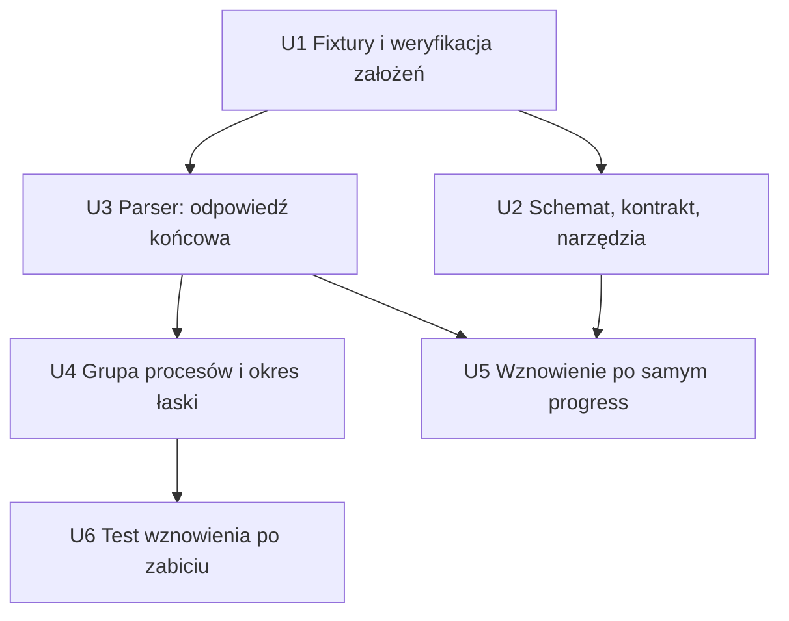

# feat: Zamykanie kroku agenta po odpowiedzi końcowej i odpowiedź `progress`

## Summary

Krok `agent` ma kończyć się zaraz po odpowiedzi końcowej, a nie dopiero po wyjściu procesu `claude`. Runner uruchamia proces we własnej grupie procesów i zabija całą grupę po okresie łaski. Agent dostaje niefinalną odpowiedź `progress`. Lista zablokowanych narzędzi obejmuje `Monitor`. (see origin: `docs/brainstorms/2026-10-26-zamykanie-kroku-agenta-i-odpowiedz-progress-requirements.md`)

Głębokość planu: Standard. Badania lokalne wystarczyły: kod ma jasne wzorce (parser strumienia, `spawn_and_wait`, fake harness w testach). Badania zewnętrzne pominięto.

---

## Problem Frame

Proces `claude` żyje po odpowiedzi końcowej, gdy agent zostawi w nim zadanie w tle (pętla `until … sleep` w `Bash`, `Monitor`). `spawn_and_wait` w `crates/narsor-engine/src/engine/actions/agent.rs` czeka na `tokio::join!(stdout, stderr, child.wait())`. Nic nie kończy procesu po odpowiedzi końcowej. Dodatkowo agent nie ma legalnego sposobu, by powiedzieć „jeszcze nie skończyłem” przez `StructuredOutput`. (see origin: sekcja Problem Frame)

---

## Requirements

Wszystkie R1–R10 z dokumentu źródłowego obowiązują bez zmian. Mapowanie na jednostki:

- R1, R8 → U3
- R2, R3, R4 → U4
- R5, R6, R7, R10 → U2
- R9 → U5
- Założenia do potwierdzenia (zachowanie `claude` 2.1.x, schemat z `progress`, wznowienie po zabiciu) → U1, U6

Aktorzy A1–A3 i przepływy F1–F3 (z dokumentu źródłowego) są ograniczeniami dla jednostek: F1 → U3+U4, F2 → U2+U3, F3 → U5.

---

## Scope Boundaries

Bez zmian względem źródła (see origin):

- Nie zmieniamy `workflows/` ani promptów workflow poza wspólnym kontraktem (R6).
- Nie limitujemy liczby `progress`.
- Nie zmieniamy `timeout_secs`.
- Nie blokujemy `Bash` i nie wykrywamy pętli w poleceniach.
- Zmiana TUI jest poza zakresem. `progress` jest zwykłym wpisem agenta.
- Zabijanie grup procesów działa tylko na Linux i macOS.

### Deferred to Follow-Up Work

- Zabijanie po odpowiedzi `awaiting_input` (patrz KTD3 i U6). Włączamy je osobną zmianą, gdy test na żywym `claude` potwierdzi `--resume` po zabiciu.
- Dłuższy podgląd `message` niż 200 znaków w rozmowie (limit `SUMMARY_MAX_CHARS`). Wymaga zmiany TUI/protokołu.
- Sprzątanie osieroconych procesów po zwykłym wyjściu `claude` bez odpowiedzi końcowej (stan dzisiejszy, bez zmian).

---

## Context & Research

### Relevant Code and Patterns

- `crates/narsor-engine/src/engine/actions/agent.rs`: `output_contract` (l. 100), `output_schema` (201), `AWAITING_INPUT` (230), `reprompt_config` (256), `spawn_and_wait` (1055), `read_response` (1430), `structured_response` (1445), `is_answer_object` (1512), `question_from_object` (1534), `SpawnEnding`, `FinishedRun`.
- `crates/narsor-engine/src/engine/actions/harness/mod.rs`: trait `HarnessStreamParser` (l. 132), `HarnessRun` (l. 82).
- `crates/narsor-engine/src/engine/actions/harness/claude_code.rs`: `DEFERRING_TOOLS` (91), `CONTRACT_NOTE` (225), `ClaudeCodeStreamParser::accumulate` (269) — dziś zapamiętuje każdy `structured_output`, także niefinalny.
- `crates/narsor-engine/src/engine/actions/harness/claude_code/tools.rs`: `structured_output_summary` (50).
- Konwencja kolejki: `kill_on_drop(true)` zabija tylko `claude`; `child.kill()` przy limicie czasu też tylko `claude`.
- `libc = "0.2"` jest już w `crates/narsor-engine/Cargo.toml`. Wzorzec użycia `unsafe { libc::… }`: `crates/narsor-api-client/src/api/discovery.rs`. Crate nie zabrania `unsafe`.
- Testy: `tests/actions_agent.rs` używa `tests/fixtures/harness/fake_harness.sh` (skrypt zamiast `claude`) i pomocnika `claude_stream`. `tests/claude_code_classification.rs` testuje klasyfikację na nagraniach z `tests/fixtures/claude-code/`.
- Istniejące wznowienie: `OutputRejection::from_error` (`crates/narsor-engine/src/engine/runner.rs` ~l. 355) reaguje na `error_type == missing_output_label`; `Engine::reprompt` używa `agent::reprompt_config`. Jedno ponowienie, potem dyrygent (`rescue_output`).

### Institutional Learnings

`docs/solutions/` nie zawiera wpisów o procesach agenta. Nie ma wpisu do uwzględnienia.

### Ustalenia z badania, ważne dla planu

1. Dla `progress` jako ostatniego `structured_output` wznowienie (R9) już prawie działa. Gdy parser nie zapamięta `progress` jako odpowiedzi, `read_response` czyta tekst `result` (obiekt `progress`). Ten obiekt nie ma `choice`, więc wychodzi `missing_output_label` i runner robi `reprompt`. U5 to potwierdza testem i poprawia komunikat przyczyny.
2. Rozpoznawanie odpowiedzi końcowej ma jedno źródło: `structured_response(value).is_ok()` w `agent.rs`. Parser i `read_response` używają tej samej reguły, więc nie rozjeżdżają się. Etykieta spoza deklaracji nadal jest odpowiedzią końcową (jak dziś, odrzuca ją silnik).
3. Osierocony `bash` z pętlą trzyma otwarty koniec potoku stdout. Nawet gdy `claude` wyjdzie sam, `stdout_task` nie widzi EOF. Dlatego po odpowiedzi końcowej sprzątanie grupy jest potrzebne zawsze, nie tylko po upływie okresu łaski.
4. Kod wyjścia po zabiciu to `None` (sygnał). Dziś to błąd `killed_by_signal`. Po wymuszonym zakończeniu trzeba przekazać `exit_code = 0` do `parser.finish`.
5. `spawn_and_wait` obsługuje także dyrygenta (`run_harness_process`). Dyrygent dostaje to samo zachowanie. U4 sprawdza, że dyrygent czyta `structured_output` tą samą ścieżką i że testy dyrygenta przechodzą.

---

## Key Technical Decisions

- **KTD1. Sygnał „odpowiedź końcowa” idzie z parsera do `spawn_and_wait` przez nową metodę traitu.** `HarnessStreamParser::final_answer(&self) -> Option<FinalAnswer>` z domyślną wartością `None`. Tylko parser `claude-code` ją nadpisuje. `FinalAnswer` ma dwa warianty: `Choice` i `AwaitingInput`. Uzasadnienie: inne harnessy nie zmieniają zachowania (zakres źródła), a `spawn_and_wait` nie zna formatu strumienia. Odrzucona alternatywa: wykrywanie w `spawn_and_wait` przez własny parsing JSON — duplikuje parser.
- **KTD2. Parser zapamiętuje `structured_output` tylko gdy to odpowiedź końcowa i linia `result` nie jest błędem.** Reguła: `structured_response(value).is_ok()` oraz `!is_error`. `progress` i inne obiekty nie zastępują poprzedniej odpowiedzi końcowej (R8). Linia `result` z błędem nie zamyka kroku: ścieżka błędu (`failure`) zostaje bez zmian. To decyzja planu, źródło jej nie rozstrzyga; skutek: odpowiedź API z błędem nie jest „odpowiedzią końcową”.
- **KTD3. Zabijanie obejmuje tylko `Choice`, dopóki test wznowienia nie potwierdzi `--resume` po zabiciu.** Źródło mówi to wprost (sekcja „Założenia do potwierdzenia”). Dla `AwaitingInput` stała `KILL_AFTER_QUESTION: bool = false` w `agent.rs` wyłącza zabijanie. U6 daje test na żywym `claude`; po jego zaliczeniu stałą można przestawić osobną zmianą. Kod (`final_answer` zwraca oba warianty) jest gotowy na to.
- **KTD4. Okres łaski i czas SIGTERM→SIGKILL są stałymi w kodzie.** `FINAL_ANSWER_GRACE = 15 s` (decyzja źródła), `TERM_TO_KILL = 3 s`, `DRAIN_AFTER_KILL = 2 s` (czas na odczyt reszty potoków). Parametr workflow: nie (źródło).
- **KTD5. Grupa procesów przez `Command::process_group(0)`, zabijanie przez `libc::killpg`.** Pgid to pid dziecka (`child.id()`), zapamiętany zaraz po spawn. Zabijanie jest numeryczne, bo `wait` pożycza `child`. Sprzątanie `killpg` działa także po wyjściu lidera, bo grupa żyje, póki ma członka; `ESRCH` znaczy „nic do zabicia”. Ryzyko ponownego użycia pgid po śmierci całej grupy jest pomijalne i opisane w komentarzu.
- **KTD6. Wpis narsora (R4) powstaje tylko, gdy `killpg` coś zabił** (zwrot `0`), z numerem grupy. Gdy `claude` wyszedł sam i nic nie zostało, wpisu nie ma. Wpis przez `ConversationSink::append_outcome`, jak inne wpisy zakończenia.
- **KTD7. Ten sam `killpg` obsługuje limit czasu i anulowanie.** Przy limicie czasu zabijamy grupę, nie tylko `claude` (dziś `child.kill()`). Strażnik na `Drop` (anulowanie przyszłości `run`) zabija grupę, bo `kill_on_drop` zabija tylko lidera. Uzasadnienie: własna grupa oznacza, że Ctrl-C z terminala już nie dociera do dzieci; bez strażnika powstaje nowy wyciek.
- **KTD8. Opis `progress` w kontrakcie: pełny tekst w `CONTRACT_NOTE` (tylko `claude-code`), w `output_contract` tylko zdanie wspólne dla harnessów.** Źródło (R6) wymienia oba miejsca. Tylko `claude-code` ma `StructuredOutput`; `codex` i `opencode` czytają kontrakt tekstowy i `progress` nic by im nie dał. Wspólne zdanie w `output_contract`: odpowiedź z `choice` wysyłasz dokładnie raz, gdy wszystkie subagenty oddały wyniki. Pełna specyfikacja obiektu `progress` jest w `CONTRACT_NOTE`. Jeśli autor wymagań chce pełnego opisu także w `output_contract`, zmiana jest mała; decyzja czeka na jego potwierdzenie przy recenzji planu.

---

## Open Questions

### Resolved During Planning

- Czy inne harnessy dostają `progress`? Nie (KTD8, KTD1). `codex` i `opencode` nie zmieniają zachowania.
- Gdzie kończy się „odpowiedź końcowa”? Jedna reguła, `structured_response(..).is_ok()` (ustalenie 2, KTD2).
- Czy R9 wymaga nowego kodu wznowienia? Nie, wystarczy test i lepszy komunikat (ustalenie 1, U5).

### Deferred to Implementation

- Dokładny kształt linii `result` z `progress` w `claude` 2.1.x. U1 nagrywa fixturę; jeśli kształt różni się od założeń (np. `result` ma `structured_output` z `progress`, ale tekst jest inny), U3 i U5 dostosują testy.
- Czy API przyjmuje schemat z `status: progress` i `message`. U1 sprawdza na żywo, jeśli `claude` jest dostępny.
- Czy `--resume` działa po zabiciu grupy (U6). Wynik decyduje o `KILL_AFTER_QUESTION`.
- Nazwy pomocników i dokładny podział funkcji w `spawn_and_wait` (np. wydzielenie `terminate_group`).

---

## Implementation Units

### U1. Fixtury `claude` i weryfikacja założeń

**Goal:** Potwierdzić założenia z dokumentu źródłowego i dać testom nagrania.

**Requirements:** Założenia: zachowanie `claude` 2.1.x, schemat z `progress`.

**Dependencies:** brak

**Files:**
- Create: `tests/fixtures/claude-code/schema_progress.ndjson` (sesja: `StructuredOutput` z `progress`, potem z `choice`; kilka linii `result`)
- Create: `tests/fixtures/claude-code/schema_progress_only.ndjson` (sesja kończy się samym `progress`)
- Modify: `tests/fixtures/claude-code/README.md` (nowe wiersze tabeli scenariuszy i odpowiedzi na pytania: czy API przyjmuje `progress`, ile linii `result`)
- Test: `tests/claude_code_classification.rs`

**Approach:**
- Nagrać na żywym `claude`, jeśli dostępny, ze schematem z U2 (`status` ma `progress`, jest pole `message`). Gdy `claude` nie jest dostępny, zbudować fixtury ręcznie z kształtu `schema_done.ndjson` i zaznaczyć to w README jako „syntetyczne”.
- Zapisać w README: czy `StructuredOutput` nie kończy sesji i czy po turze tekstowej pojawia się `[structured-output-enforce]` (założenie ze źródła).

**Patterns to follow:** istniejące wpisy README (tabela scenariuszy, sekcja odpowiedzi).

**Test scenarios:**
- Happy path: fixtura `schema_progress.ndjson` jest klasyfikowana bez `Unclassified` (wywołanie `StructuredOutput` z `progress` daje element `ToolCall`).
- Edge case: fixtura ma więcej niż jedną linię `result`; test sprawdza ich liczbę (dokumentuje założenie R1).

**Verification:** Fixtury istnieją, README opisuje je i stan założeń; testy klasyfikacji przechodzą.

### U2. Schemat `progress`, kontrakt w prompcie, podsumowanie wywołania, `Monitor`

**Goal:** Agent może wysłać `progress`; rozmowa pokazuje jego `message`; `Monitor` jest zablokowany.

**Requirements:** R5, R6, R7, R10. Przepływ F2.

**Dependencies:** U1 (kształt fixtur do testów)

**Files:**
- Modify: `crates/narsor-engine/src/engine/actions/agent.rs` (`output_schema`, `output_contract`, stała `PROGRESS`, komentarze)
- Modify: `crates/narsor-engine/src/engine/actions/harness/claude_code.rs` (`CONTRACT_NOTE`, `DEFERRING_TOOLS`, komentarz „Why that shape”)
- Modify: `crates/narsor-engine/src/engine/actions/harness/claude_code/tools.rs` (`structured_output_summary`)
- Test: `tests/actions_agent.rs`, `tests/claude_code_classification.rs`, testy jednostkowe w `agent.rs`

**Approach:**
- `output_schema`: `status.enum` = `[awaiting_input, progress]`; nowe pole `message: string`. Schemat zostaje płaskim obiektem, bez `anyOf`/`oneOf`. Zaktualizować komentarz nad funkcją.
- `DEFERRING_TOOLS` rośnie do trzech: `ScheduleWakeup`, `CronCreate`, `Monitor`. Zmienić typ tablicy. Zaktualizować doc modułu (`--disallowedTools`) i sekcję „Why that shape”: zadania w tle z `Bash` i `Monitor` są zabezpieczone przez zabijanie grupy po odpowiedzi końcowej (U4).
- `CONTRACT_NOTE`: opis `{"status":"progress","message":"…"}` — komentarze, informacja o czekaniu, wyniki częściowe; nie kończy kroku; bez limitu liczby; odpowiedź z `choice` dokładnie raz, gdy wszystkie subagenty oddały wyniki.
- `output_contract`: jedno zdanie wspólne (KTD8). Używać krótkich zdań w stylu ASD-STE100 jak reszta kontraktu.
- `structured_output_summary`: dla `status: progress` zwraca `progress: <message>`; bez `message` samo `progress`. `awaiting_input` i `choice` bez zmian.
- `is_answer_object` zostaje bez zmian: `progress` nie jest odpowiedzią.

**Patterns to follow:** istniejący `AWAITING_INPUT` jako stała statusu; test `structured_output_calls_summarise_the_answer` w `tests/claude_code_classification.rs`.

**Test scenarios:**
- Happy path: `output_schema` zawiera `progress` w `status.enum` i pole `message`; nadal nie ma `anyOf`/`oneOf`/`allOf` ani `required`.
- Happy path: `structured_output_summary` dla `{"status":"progress","message":"czekam na subagenta"}` daje `progress: czekam na subagenta`.
- Edge case: `progress` bez `message` daje `progress`; `message` dłuższy niż 200 znaków jest skracany przez `summary_line`.
- Happy path: `invocation` zawiera `Monitor` po `--disallowedTools` obok dwóch poprzednich.
- Happy path: tekst promptu (`output_contract` + notka claude) zawiera opis `progress` i zdanie „dokładnie raz”; prompt dla harnessu bez notki (`codex`) nie zawiera obiektu `progress`.
- Integration: `is_answer_object` odrzuca obiekt `progress` (nie jest odpowiedzią); `extract_response` na tekście z samym `progress` daje `missing_output_label`.

**Verification:** Testy powyżej przechodzą; istniejące testy promptu i klasyfikacji przechodzą po aktualizacji oczekiwanych tekstów.

### U3. Parser: rozpoznawanie odpowiedzi końcowej i pamięć ostatniej

**Goal:** Parser zapamiętuje tylko odpowiedź końcową i zgłasza jej wystąpienie.

**Requirements:** R1, R8. Przepływy F1, F2.

**Dependencies:** U1

**Files:**
- Modify: `crates/narsor-engine/src/engine/actions/harness/mod.rs` (trait: `final_answer`, enum `FinalAnswer`)
- Modify: `crates/narsor-engine/src/engine/actions/harness/claude_code.rs` (`ClaudeCodeStreamParser::accumulate`, nadpisanie `final_answer`)
- Modify: `crates/narsor-engine/src/engine/actions/agent.rs` (`pub(crate) fn final_answer_kind(value: &Value) -> Option<FinalAnswer>` na bazie `structured_response`)
- Test: `tests/claude_code_classification.rs` lub testy jednostkowe `claude_code.rs`

**Approach:**
- W `accumulate`: zapis `structured_output` tylko gdy `final_answer_kind(..)` zwraca `Some` i `!result.is_error` (KTD2). Wcześniejsza odpowiedź końcowa zostaje, gdy późniejsza linia ma `progress` lub nic.
- `final_answer()` zwraca rodzaj zapamiętanej odpowiedzi: `Choice` dla `choice`, `AwaitingInput` dla kompletnego pytania.
- `HarnessRun.structured_output` zostaje tym samym polem, ale dostaje wyłącznie odpowiedź końcową lub `None`. Doc pola: zaktualizować.
- Pozostałe parsery (`codex`, `opencode`) bez zmian dzięki domyślnej implementacji.

**Test scenarios:**
- Covers F1/R1. Linia `result` z `structured_output` `{choice: "done", …}` → `final_answer() == Some(Choice)`.
- Covers R1. Linia `result` z `awaiting_input` i niepustym `question` → `Some(AwaitingInput)`; z pustym `question` → `None`.
- Covers R1. Linia `result` bez `structured_output` (prose-only) → `None`, parser nie zgłasza końca.
- Covers R8 / F2. Sekwencja: `result` z `choice`, potem `result` z `progress` → `structured_output` nadal `choice`.
- Covers R8. Sekwencja: `result` z `progress`, potem `result` z `choice` → `structured_output` to `choice`.
- Error path: `result` z `is_error: true` i `structured_output` z `choice` → `final_answer() == None`; `finish` zwraca `failure` jak dziś.
- Edge case: `choice` spoza deklarowanych etykiet nadal jest odpowiedzią końcową (odrzuci ją silnik).
- Integration: `finish` na fixturze `schema_progress_only.ndjson` zwraca `structured_output == None`, a `text` zawiera obiekt `progress`.

**Verification:** Testy przechodzą; testy `harness` dla `codex` i `opencode` bez zmian.

### U4. Własna grupa procesów, okres łaski i zabijanie grupy

**Goal:** Krok kończy się najwyżej po okresie łaski i czasie zabicia; po kroku nie zostaje proces z grupy.

**Requirements:** R2, R3, R4. Przepływ F1.

**Dependencies:** U3

**Files:**
- Modify: `crates/narsor-engine/src/engine/actions/agent.rs` (`spawn_and_wait`, `SpawnEnding`/`FinishedRun`, `run`, stałe)
- Modify: `tests/fixtures/harness/fake_harness.sh` (tryb: odpowiedź końcowa + zadanie w tle)
- Test: `tests/actions_agent.rs`

**Approach:**
- `command.process_group(0)`; po spawn zapamiętać `pgid = child.id()`.
- Sygnał: w zamknięciu stdout po każdej linii sprawdzić `parser.final_answer()` i wysłać zmianę przez `tokio::sync::watch` (tylko pierwszy raz). Sygnał uwzględnia `KILL_AFTER_QUESTION` (KTD3): `AwaitingInput` nie uruchamia okresu łaski.
- Pętla główna: `select!` między przyszłością `wait` (przypiętą) a sygnałem. Po sygnale: `timeout(FINAL_ANSWER_GRACE, &mut wait)`. Potem zawsze `terminate_group(pgid)`: `killpg(SIGTERM)`, czekanie do `TERM_TO_KILL` na zniknięcie grupy, `killpg(SIGKILL)`. Potem `timeout(DRAIN_AFTER_KILL, &mut wait)`, aby odczytać resztę potoków i zebrać status.
- Limit czasu (`limit`) nadal obejmuje całość. Przy limicie zabić grupę zamiast `child.kill()` (KTD7), potem `child.kill()` dla pewności.
- Strażnik `Drop` z `pgid` wykonuje `killpg(SIGKILL)` przy anulowaniu; rozbrajany po normalnym zakończeniu.
- Po wymuszonym zakończeniu: `exit_code = 0` w `parser.finish` (status sygnałowy nie zmienia wyniku, R4). Jeśli `claude` wyszedł sam w okresie łaski, zostaje jego prawdziwy kod.
- `FinishedRun` dostaje pole `terminated_group: Option<i32>` (pgid, gdy `killpg` zabił coś). `run` dopisuje wpis przez `conversation.append_outcome` z tekstem „agent process group N terminated after the final answer” i danymi `{ "process_group": N, "reason": "final_answer" }` (KTD6). Wpis nie powoduje błędu kroku.
- `run_harness_process` (dyrygent) dostaje to samo zachowanie bez zmian sygnatury; wpis do rozmowy pomijany (`ConversationSink::none()`).
- Komentarze: wyjaśnić dlaczego sprzątanie jest potrzebne także po samodzielnym wyjściu `claude` (osierocony `bash` trzyma potok) i uwaga o pgid (KTD5). Tylko Linux/macOS (`#[cfg(unix)]`).

**Execution note:** Zacząć od testu padającego z fake harnessem zostawiającym `sleep` w tle (powtarza obserwację z tasku).

**Patterns to follow:** `ConversationSink::append_outcome` jak dla „harness timed out”; fake harness w `tests/actions_agent.rs` (`answers`, `sleeps`, `pid`).

**Test scenarios:**
- Covers F1. Fake harness wypisuje `result` z `choice`, uruchamia w tle `sleep 600` w tej samej grupie i sam nie wychodzi. Krok kończy się z `choice` w czasie ≈ okres łaski + zabicie, nie po limicie. Do testu okres łaski da się skrócić przez stałą `#[cfg(test)]` lub parametr wewnętrzny (nie parametr workflow).
- Covers F1/R3. Po kroku proces `sleep` z grupy nie żyje (sprawdzić `kill(pid, 0)` → `ESRCH`).
- Covers R4. Rozmowa zawiera wpis narsora o zakończeniu po odpowiedzi końcowej z numerem grupy; wynik kroku to `Completed`, nie błąd; kod wyjścia wymuszonego zakończenia nie zmienia wyniku.
- Happy path. `claude` kończy się sam w okresie łaski i nic nie zostaje: brak wpisu o zabiciu, kod wyjścia prawdziwy.
- Edge case. `claude` kończy się sam, ale osierocony `bash` trzyma potok: krok kończy się po sprzątaniu, nie wisi do limitu czasu.
- Edge case. `result` z `progress` (bez odpowiedzi końcowej) i proces żywy: nic nie jest zabijane przed limitem czasu (dowód, że `progress` nie zamyka kroku).
- Edge case. Odpowiedź `awaiting_input` (KTD3): okresu łaski i zabijania nie ma, zachowanie jak dziś.
- Error path. `result` z `is_error: true`: krok nie jest zamykany przez ten mechanizm i kończy się błędem jak dziś.
- Error path. Limit czasu: zabita jest cała grupa, nie tylko `claude` (test z `sleep` w tle).
- Integration. Anulowanie przyszłości `run` (drop) zabija grupę.

**Verification:** Testy przechodzą; testy dyrygenta (`tests/conductor_invoke.rs` i pokrewne) przechodzą bez zmian; `cargo test -p narsor-engine` na Linux bez wycieku procesów w testach.

### U5. Wznowienie po sesji zakończonej samym `progress`

**Goal:** Sesja, której ostatni `StructuredOutput` to `progress`, trafia do istniejącego wznowienia i liczy się do jego limitu.

**Requirements:** R9. Przepływ F3.

**Dependencies:** U2, U3

**Files:**
- Modify: `crates/narsor-engine/src/engine/actions/agent.rs` (`read_response`, komunikat przyczyny)
- Modify: `crates/narsor-engine/src/engine/actions/harness/mod.rs` lub `claude_code.rs` (jeśli potrzebna flaga „ostatnia odpowiedź to progress” w `HarnessRun`; decyzja przy implementacji)
- Test: `tests/actions_agent.rs`, `crates/narsor-runner/src/runner/session_tests.rs` (wzorzec `MISSING_OUTPUT_LABEL`)

**Approach:**
- Sprawdzić testem, że `read_response` na `HarnessRun` z `structured_output == None` i tekstem z `progress` zwraca `missing_output_label` z `harness` i `harness_session_id` w `details` (ustalenie 1).
- Poprawić przyczynę: gdy ostatni obiekt w tekście ma `status: progress`, komunikat mówi „the last answer was a progress note, not a final answer”. Dzięki temu `reprompt_config` cytuje właściwy powód.
- Nie dodawać nowej ścieżki wznowienia ani nowego licznika: `OutputRejection::from_error` i `Engine::reprompt` zostają bez zmian (R9: „istniejący limit ponowień”).

**Test scenarios:**
- Covers F3/R9. Fake harness kończy sesję samym `progress`; wynik to błąd `missing_output_label` z identyfikatorem sesji w `details`.
- Covers R9. Test silnika (wzorzec `session_tests.rs`): po takim wyniku runner robi jeden `reprompt` w tej samej sesji, a drugi nieużyteczny wynik przekazuje dyrygentowi (ten sam limit co dla innych błędów formatu).
- Edge case. Sesja z `progress`, potem `choice`: wynik poprawny, bez wznowienia (F2).
- Error path. Tekst bez żadnego obiektu JSON dalej daje dotychczasowy komunikat (brak regresji).

**Verification:** Testy przechodzą; liczba wznowień w teście równa istniejącemu limitowi.

### U6. Test na żywym `claude`: wznowienie po zabiciu grupy

**Goal:** Zebrać dowód potrzebny do decyzji o `KILL_AFTER_QUESTION` (KTD3).

**Requirements:** Założenia do potwierdzenia (wznowienie po zabiciu).

**Dependencies:** U4

**Files:**
- Modify: `tests/actions_agent.rs` (test `#[ignore]` obok istniejącego testu na żywym `claude`, pomija się sam, gdy `claude` jest niedostępny)
- Modify: `docs/plans/2026-10-26-001-feat-zamykanie-kroku-agenta-i-progress-plan.md` (zapis wyniku w sekcji „Deferred to Implementation” po wykonaniu) — opcjonalnie

**Approach:**
- Test: krok z `awaiting_input`, zabicie grupy po 15 s od odpowiedzi, potem `--resume` tej sesji z odpowiedzią operatora; sprawdza, że agent kontynuuje w tej samej rozmowie.
- Wynik pozytywny: osobna zmiana ustawia `KILL_AFTER_QUESTION = true`. Wynik negatywny: stała zostaje `false`, a w ADR/komentarzu zapisujemy powód.
- To jednostka weryfikacyjna. Nie wchodzi do CI.

**Test scenarios:**
- Happy path. Wznowienie po zabiciu grupy przechodzi, a odpowiedź agenta nawiązuje do pytania.
- Error path. `--resume` odrzucone (`resume_session_rejected`): wynik opisany w komentarzu przy stałej.

**Verification:** Wynik testu zapisany w komentarzu przy `KILL_AFTER_QUESTION`; decyzja o stałej podjęta jawnie.

---

## System-Wide Impact

- **Interaction graph:** `spawn_and_wait` obsługuje krok `agent` i dyrygenta. Obie ścieżki dostają zamykanie po odpowiedzi końcowej i zabijanie grupy. Zmiana nie wpływa na `Engine::reprompt`/`rescue_output`.
- **Error propagation:** wymuszone zakończenie nie jest błędem (R4). Błędem jest nadal: wyjście z kodem ≠ 0 bez odpowiedzi końcowej, brak linii `result`, `is_error`.
- **State lifecycle:** sesja musi zdążyć zapisać się na dysk przed zabiciem (okres łaski 15 s). U6 sprawdza `--resume` po zabiciu.
- **API surface parity:** `codex` i `opencode` bez zmian. Dyrygent: do sprawdzenia w U4 (testy przechodzą).
- **Integration coverage:** test z fake harnessem i prawdziwym procesem w tle (U4) dowodzi zachowania, którego same mocki nie pokażą.
- **Unchanged invariants:** definicje workflow, `timeout_secs`, TUI, format rozmowy (nowy wpis narsora używa istniejącego mechanizmu), `Bash` nie jest blokowany.

## Risks & Dependencies

| Ryzyko | Mitygacja |
|--------|-----------|
| Proces potomny wywołuje `setsid` i wychodzi z grupy (np. Playwright MCP) | U4 test z `npm exec`/`node` nie jest możliwy bez sieci; w U1/U4 sprawdzić ręcznie na żywym `claude` i zapisać wynik. Ryzyko resztkowe opisane w komentarzu. |
| Zachowanie `claude` 2.1.x różni się od założeń | U1 fixtury i README; kod zależy tylko od linii `result` z `structured_output`. |
| API odrzuca schemat z `progress` | U1 sprawdza; schemat dodaje tylko wartość enum i pole string, tak jak dziś `awaiting_input`. |
| Zabicie przed zapisem sesji psuje `--resume` | Okres łaski 15 s; KTD3 wyłącza zabijanie dla `awaiting_input`; U6. |
| Własna grupa procesów zmienia obsługę Ctrl-C/anulowania | Strażnik `Drop` i zabijanie przy limicie (KTD7), test anulowania w U4. |
| Wspólny `spawn_and_wait` zmienia zachowanie dyrygenta | Testy dyrygenta w U4; zmiana jest korzystna (ten sam problem wiszącego procesu). |

## Documentation / Operational Notes

- Zaktualizować komentarz w `claude_code.rs` (sekcja „Why that shape”) i README fixtur (U1, U2).
- Sprawdzić `WORKFLOW_SCHEMA.md` i `DOMAIN_MODEL.md` pod kątem opisu kontraktu wyjścia agenta (`awaiting_input`); dopisać `progress`, jeśli kontrakt jest tam opisany. Nie zmieniać opisów workflow.
- Wersja `claude` w README fixtur: odnotować, jeśli nagranie z U1 powstało na nowszej wersji.

## Sources & References

- **Origin document:** `docs/brainstorms/2026-10-26-zamykanie-kroku-agenta-i-odpowiedz-progress-requirements.md`
- Powiązany kod: `crates/narsor-engine/src/engine/actions/agent.rs`, `crates/narsor-engine/src/engine/actions/harness/claude_code.rs`, `crates/narsor-engine/src/engine/actions/harness/claude_code/tools.rs`, `crates/narsor-engine/src/engine/runner.rs`
- Powiązane plany: `docs/plans/2026-10-05-2103-feat-approval-and-agent-resume-plan.md`, `docs/plans/2026-10-17-1520-feat-deferred-harness-permissions-plan.md`
- Fixtury: `tests/fixtures/claude-code/README.md`
