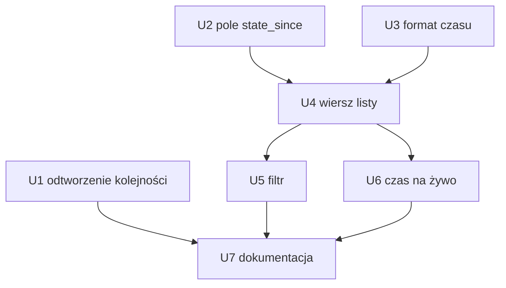

# feat: Lista zadań w TUI — ticket, tytuł, status z czasem, stała kolejność

## Summary

Wiersz listy zadań pokazuje ticket (albo skrócony `task_id`), tytuł oraz status z czasem aktywności w układzie trzy-liniowym. `/` otwiera filtr listy. Czas liczy się na żywo w kliencie. Plan naprawia też zmianę kolejności po zatwierdzeniu pracy. Naprawa zaczyna się od odtworzenia błędu, bo przyczyna nie jest zweryfikowana (see origin: A5).

Zmiany dotyczą głównie klienta TUI. Wyjątki: nowe, opcjonalne pole w `TaskSummary` (U2) oraz poprawka po stronie serwera, jeśli U1 wykaże, że przyczyna zmiany kolejności leży po stronie serwera.

---

## Problem Frame

Dziś wiersz ma dwie linie (znaczniki + tytuł, etykieta). Brak w nim ticketu i czasu w statusie. Operator zgłasza, że po zatwierdzeniu zadanie „ucieka" z miejsca na liście (see origin: Problem Frame).

Fakty z kodu (sprawdzone podczas planowania):

- `src/tui/task_app/list.rs`: klient nie sortuje. `TaskList::replace` przyjmuje kolejność serwera. Tylko `Moved` zmienia kolejność w `apply_event`.
- Serwer sortuje w `crates/narsor-engine/src/orchestration/store.rs` (`queue_order`: `rank`, potem `queue_sequence`). Lista jest grupowana po backendzie.
- `TaskSummary` (`crates/narsor-protocol/src/controller.rs`) ma `ticket`, `title`, `display.title`, `created_at`, `state`, `rank`, `queue: Option<QueueView>` (z `since`), `attention: Vec<AttentionItem>` (z `since`). **Nie ma** ogólnego pola „od kiedy w tym stanie".
- `short_age(seconds)` w `src/cli/task_text.rs` daje `45s`/`4m`/`3h`/`2d`. Format w R7 (`2h 10m`) jest inny — patrz U3.
- Skrót `task_id` do 8 znaków już istnieje: `SHORT_ID_CHARS` w `src/tui/task_app/detail.rs`.
- Pętla TUI budzi się co `TICK` (`src/tui/mod.rs`, `wait_until_next_due`). Rysowanie wynika z tego ticka.
- Lista nie ma obecnie filtra tekstowego; `/` doda otwieranie filtra.

---

## Requirements

Przeniesione z origin: R1–R11, AE1–AE5. R12 (filtr otwierany przez `/`) oraz decyzje operatora z Q1–Q4 są uwzględnione poniżej.

---

## Scope Boundaries

- Poza zakresem: nowe sortowanie lub grupowanie listy; zmiana zasady, że kolejność wyznacza serwer; zmiana szerokości lub minimalnej szerokości listy; edycja ticketu z listy; zmiany panelu szczegółów poza wspólnymi funkcjami (see origin: Scope Boundaries).

### Deferred to Follow-Up Work

- Pokazywanie czasu od zakończenia dla zadań w stanie końcowym (A4: dziś „nic").
- Wariant „czas od utworzenia" lub „łączny czas pracy agenta" (A1).

---

## Key Technical Decisions

- **Decyzje operatora.** Q1: czas w bieżącym statusie. Q2: zadanie zostaje na miejscu także po zmianie na końcowy; ukrywanie zakończonych (`z`) działa jak dziś, jako filtr. Q3: skrót `task_id` ma 8 znaków (`SHORT_ID_CHARS`), pokazuje się tylko bez ticketu i ma tekstowy prefiks `id:` (czytelny także przy `NO_COLOR`). Q4: szerokość i minimalna szerokość listy bez zmian; ticket dostaje osobną linię i jest przycinany do bieżącej szerokości.
- **Źródło czasu aktywności.** `Queued` używa `queue.since`; `HumanNeeded` używa `attention.since` właściwego elementu uwagi; `Provisioning` używa czasu wejścia w ten stan. Dla pozostałych stanów `state_since` oznacza moment wejścia w bieżący `TaskState`. U2 ma ustalić i zapisać ten moment przy przejściu stanu (również dla pochodnego `Provisioning`), zamiast wyliczać go na nowo przy odczycie. Dodać do `TaskSummary` opcjonalne `state_since: Option<DateTime<Utc>>`; starszy serwer bez tego pola nie wyświetla czasu, a starszy klient ignoruje pole. Brak danych nie może być zastępowany `created_at`.
- **Czas na żywo bez serwera.** Klient liczy wiek przy każdym rysowaniu. `DateTime<Utc>` jest zegarem do obliczenia czasu aktywności, osobnym od `Instant` używanego do sterowania pętlą. Dla stanów końcowych (`Finished`, `Error`, `Archived`) czas się nie pokazuje.
- **Układ wiersza.** Trzy linie: (1) znaczniki i ticket albo `id:<8 znaków>`, (2) tytuł, (3) status · czas · dotychczasowa etykieta. Dostępna szerokość pozostaje taka jak obecnie; każda linia jest przycinana niezależnie, a ticket nie wymusza zwiększenia szerokości panelu. Brak czasu pomija segment czasu; dla 0–59 s format to `<1m`, a dla okresów ponad 24 h używa się dni (`1d`, `3d`).
- **Filtr listy.** `/` otwiera pole filtra. Dopasowanie obejmuje ticket, tytuł i pełny `task_id`; filtrowanie zachowuje względną kolejność, a wyczyszczenie filtra przywraca pełną listę i zaznaczenie po `task_id`.
- **Przyczyna zmiany kolejności: najpierw ustalić.** U1 odtwarza błąd testem. Plan nie zakłada rozwiązania. Kandydaci z origin: `replace` po odświeżeniu, zmiana `rank` po stronie serwera, zdarzenie `Moved`.

---

## Implementation Units

### U1. Odtworzyć zmianę kolejności po zatwierdzeniu

**Goal:** Ustalić przyczynę zmiany kolejności i opisać ją w plan-notatce przed naprawą.

**Requirements:** R9, R10, R11; AE4, AE5.

**Dependencies:** brak.

**Files:**
- `tests/tui_state.rs` (nowe testy odtwarzające)
- `src/tui/task_app/list.rs` (tylko po ustaleniu przyczyny)
- `crates/narsor-engine/src/orchestration/store.rs`, `crates/narsor-engine/src/controller_protocol/service/reader.rs` (jeśli przyczyna jest po stronie serwera)

**Approach:**
- Napisać test klienta: lista A, B, C; zdarzenia i odświeżenie, jakie powstają po odpowiedzi, zatwierdzeniu akcji i zatwierdzeniu kroku w B. Sprawdzić `visible_ids()` i `selected_id()`.
- Jeśli test klienta przechodzi, sprawdzić serwer: czy zatwierdzenie zmienia `rank` lub `queue_sequence`, albo czy lista jest sortowana inaczej niż `queue_order` (np. po stanie, w czytniku `reader.rs`).
- Naprawić w miejscu przyczyny. Klient nadal nie sortuje. Jeśli zatwierdzenie zmienia `rank` lub `queue_sequence` bez jawnego przeniesienia, nie utrwalać tej zmiany; serwer nadal wyznacza kolejność, a `Moved` pozostaje jawnym przeniesieniem.

**Execution note:** Zacząć od testu, który nie przechodzi (test-first dla błędu).

**Patterns to follow:** `docs/solutions/ui-bugs/tui-confirmation-popup-closed-by-background-refresh-2026-10-26.md`, `docs/solutions/logic-errors/tui-list-read-on-every-runner-report-2026-10-22.md`.

**Test scenarios:**
- Covers AE4. Lista A, B, C. Zatwierdzenie w B (odpowiedź agentowi) → po zdarzeniu i po `replace` kolejność A, B, C, wybrane B.
- Zatwierdzenie akcji zmienia stan B na `Running`: kolejność bez zmian.
- Zatwierdzenie kroku, po którym B przechodzi w stan końcowy: B zostaje na miejscu (Q2, domyślnie); przy `z` znika jako filtr, bez regrupowania.
- Covers AE5. `Moved` przenosi C przed A: kolejność C, A, B.
- Zadanie dodane lub usunięte w kolejce zmienia kolejność tylko o ten wiersz (R10).

**Verification:** Test odtwarzający nie przechodzi przed naprawą i przechodzi po niej. Przyczyna jest opisana w komentarzu testu i w opisie zmiany.

### U2. Pole `state_since` w protokole i na serwerze

**Goal:** Klient dostaje czas wejścia w bieżący `TaskState`.

**Requirements:** R3, R7; A7.

**Dependencies:** brak (równolegle z U1).

**Files:**
- `crates/narsor-protocol/src/controller.rs`
- `crates/narsor-engine/src/controller_protocol/service.rs`
- `crates/narsor-engine/src/orchestration/store.rs` (jeśli rekord musi trzymać czas)
- `src/tui/task_app/history.rs` (`legacy_summary`)
- testy protokołu obok istniejących w `crates/narsor-protocol/src/controller.rs` i `tests/api.rs`

**Approach:** Opcjonalne pole z `#[serde(default, skip_serializing_if = "Option::is_none")]`: starszy JSON wczytuje się bez pola, a `None` nie dodaje klucza przy serializacji. Brak zmiany wersji protokołu. Ustalić źródło czasu dla stanów pochodnych: `HumanNeeded` korzysta z `attention.since`, `Queued` z `queue.since`, a `Provisioning` z utrwalonego czasu wejścia w ten stan. Dla każdego przejścia utrwalić czas wejścia do stanu, zamiast wyliczać go podczas odczytu. Aktualizować literały `TaskSummary` w testach i w `legacy_summary` (`src/tui/task_app/history.rs`) na `None`.

**Patterns to follow:** pole `ticket` w `TaskSummary`.

**Test scenarios:**
- Odczyt JSON bez pola daje `None`.
- Zapis z `None` nie dodaje klucza.
- Zmiana `TaskState` zadania aktualizuje `state_since`; zmiana, która nie zmienia `TaskState` — nie.
- `HumanNeeded` korzysta z `attention.since`; `Provisioning` ma stabilny czas wejścia w stan także po ponownym odczycie summary.
- Stary rekord bez czasu daje `None`, nie błąd.

**Verification:** Serwer wysyła pole; stary JSON nadal się wczytuje.

### U3. Format czasu aktywności

**Goal:** Jedna funkcja formatuje czas jak w R7.

**Requirements:** R7, R8.

**Dependencies:** brak.

**Files:** `src/cli/task_text.rs` (lub moduł TUI obok listy), `tests/cli_task_text.rs`.

**Approach:** `short_age` daje jedną jednostkę (`4m`, `3h`). R7 podaje przykład `2h 10m`. Dodać osobną funkcję formatu dla listy (dwie jednostki: `5m`, `2h 10m`, `3d`) zamiast zmieniać `short_age`, bo używają go CLI i inne widoki. Dla `3d` wystarczy jedna jednostka.

**Test scenarios:**
- 0 s → `<1m`; 59 s → `<1m`.
- 12 min → `12m`; 130 min → `2h 10m`; ponad 24 h i 3 dni → `1d` i `3d`.
- Wartość ujemna (zegar się cofnął) → jak zero.

**Verification:** Testy formatu przechodzą; `short_age` bez zmian.

### U4. Wiersz listy: ticket, tytuł, status i czas

**Goal:** Wiersz pokazuje dane z R1–R6.

**Requirements:** R1–R6, R7, R8; AE1, AE2, AE3.

**Dependencies:** U2, U3.

**Files:**
- `src/tui/task_app/list.rs` (`RowText`, `title_of`, `label_of`, `row_text`, `render`)
- `src/tui/task_app/style.rs` / `src/tui/style.rs` (rola dla skrótu `task_id`, jeśli trzeba)
- `tests/tui_render.rs`, `tests/tui_state.rs`

**Approach:**
- Układ trzy-liniowy (A3). Linia 1: znaczniki i ticket albo `id:<8 znaków>`. Linia 2: tytuł. Linia 3: status, czas i dotychczasowa etykieta (krok, `#n`, `offline`, `bez slotu`).
- `RowText` dostaje pola `ticket: Option<String>` (albo skrót id + flaga) oraz `since: Option<DateTime<Utc>>`. Czas formatuje się przy rysowaniu, nie w `RowText` (żeby test nie zależał od zegara).
- Ticket, tytuł i status przechodzą przez odpowiednie formatowanie jednoliniowe. Każda linia mieści się w obecnej szerokości listy; nie zmienia się jej szerokości minimalnej. Ticket nie konkuruje o miejsce z tytułem, bo ma własną linię.
- Brak ticketu: skrót `task_id` (8 znaków) z tekstowym prefiksem `id:`; rozróżnienie nie zależy od koloru.
- Funkcje wspólne z panelem szczegółów (`title_of`) nie zmieniają zachowania.

**Patterns to follow:** `edge_layout` (cięcie ticketu i tytułu), `row_text` w `list.rs`, `render_barred_list`.

**Test scenarios:**
- Covers AE1. Ticket `NAR-42` jest na linii 1, tytuł „Refaktor parsera” na linii 2.
- Covers AE2. Brak ticketu → `id:` i 8 znaków; nigdy nie wygląda jak ticket, także przy `NO_COLOR`.
- Covers AE3. `HumanNeeded` od 12 min → linia 3 ma status i `12m`, używając `attention.since`.
- Wąska lista: długi ticket i tytuł → każda linia mieści się w obecnej szerokości listy; szerokość minimalna pozostaje bez zmian.
- Znaki sterujące w tickecie/tytule → `one_line` je usuwa.
- `state_since = None` → brak czasu, brak błędu.
- `Queued` używa `queue.since`; `Provisioning` używa utrwalonego czasu wejścia w stan.
- Stan końcowy (`Finished`, `Error`, `Archived`) → brak czasu (A4).
- Znaczniki `?`/`!` i ikona stanu bez zmian (R4).
- Wiersz tworzony lokalnie (`PendingRow`) nadal działa bez ticketu i czasu.

**Verification:** Zrzuty/testy renderowania zgodne z AE1–AE3; istniejące testy listy przechodzą.

### U5. Filtrowanie listy klawiszem `/`

**Goal:** Operator może szybko ograniczyć listę bez zmiany kolejności jej elementów.

**Requirements:** R12.

**Dependencies:** brak.

**Files:** `src/tui/task_app/list.rs`, obsługa klawiszy w `src/tui/task_app/`, `tests/tui_state.rs`.

**Approach:** `/` otwiera pole filtra w kontekście listy. Dopasowanie bez rozróżniania wielkości liter obejmuje ticket, tytuł i `task_id`. Filtr jest widokiem na istniejącą kolejność, nie sortowaniem. Escape anuluje edycję, a wyczyszczenie filtra przywraca pełną listę; zaznaczenie pozostaje przypięte do `task_id`, jeśli zadanie nadal jest widoczne.

**Test scenarios:**
- `/` otwiera filtr i dopasowuje po ticket, tytule oraz `task_id`.
- Wyniki zachowują kolejność wejściową; filtrowanie i czyszczenie nie zmieniają kolejności źródłowej.
- Zmiana filtra zachowuje zaznaczenie, jeśli zaznaczone zadanie nadal jest widoczne.

### U6. Czas rośnie na żywo

**Goal:** Czas w wierszu odświeża się bez odczytu z serwera.

**Requirements:** R8; AE3.

**Dependencies:** U4.

**Files:** `src/tui/task_app/mod.rs`, `src/tui/task_app/list.rs`, `tests/tui_state.rs`.

**Approach:** Pętla już rysuje po istniejącym `TICK`; nie dodawać osobnego budzenia ani odczytu serwera. Podawać `now_utc` do renderowania z zewnątrz dla deterministycznych testów; `Instant` pozostaje zegarem harmonogramu.

**Test scenarios:**
- Covers AE3. Ten sam stan, `now` +1 min → `12m` zmienia się na `13m`, bez `replace` i bez zdarzenia.
- Zadanie w stanie końcowym: czas się nie pokazuje przy żadnym `now`.

**Verification:** Test z `now_utc` pokazuje wzrost czasu; brak dodatkowych odczytów listy ani nowego budzenia pętli.

### U7. Dokumentacja i komentarze modułu

**Goal:** Opis wiersza w dokumentacji modułu i README zgadza się z kodem.

**Requirements:** R1–R12.

**Dependencies:** U1–U6.

**Files:** `src/tui/task_app/list.rs` (doc modułu), `README.md` (jeśli opisuje listę), `docs/solutions/` (notatka o przyczynie z U1).

**Test expectation:** none — tylko dokumentacja.

**Verification:** Dokumentacja opisuje trzy linie wiersza, ticket/skrót id, czas, filtr `/` i przyczynę z U1.

---

## Dependencies and Sequencing

---

## Risks

- **Przyczyna kolejności nieznana.** Jeśli leży po stronie serwera (np. zmiana `rank` przy zatwierdzeniu), naprawa wychodzi poza klienta. Granica zakresu: nie zmieniać zasady „kolejność wyznacza serwer", tylko usunąć błąd. Jeśli naprawa wymaga zmiany tej zasady, wrócić do wymagań.
- **Stary rekord bez czasu stanu.** Wiersz bez czasu jest poprawny (A7). Nie zgadywać wartości z `created_at`.
- **Szerokość listy.** Panel zachowuje obecną szerokość minimalną; testy U4 pilnują niezależnego przycinania trzech linii.
- **Czas stanów pochodnych.** `HumanNeeded` korzysta z `attention.since`, a `Provisioning` z utrwalonego czasu wejścia w stan; testy U2 chronią te reguły.

---

## Deferred to Implementation

- Czy rekord zadania już trzyma czas ostatniej zmiany `TaskState` (U2).
- Czas już istniejących rekordów/stanu `Provisioning` (U2); brak wiarygodnej historii oznacza brak czasu, nie szacowanie z `created_at`.
