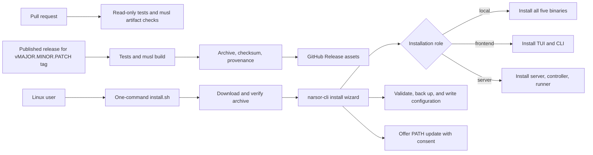
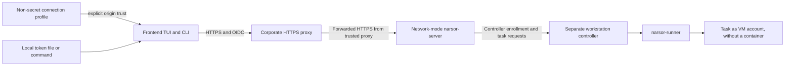

# Linux Release and Role Installer - Plan

## Goal Capsule

- **Objective:** Linux users can install and run Narsor in local, frontend, or server roles without building it from source or hand-assembling its configuration.
- **Means:** Publish static Linux x86_64 binaries and a role-aware installer through GitHub Releases (KTD1, KTD2, KTD5).
- **Authority:** The Product Contract requirements and session-settled decisions govern behavior. Existing server authentication and workstation-backend safeguards remain in force.
- **Stop conditions:** Stop for user input if the chosen same-VM worker model cannot work without bypassing the existing network authentication boundary or removing its explicit workstation-risk consent.
- **Execution profile:** `ce-work` implements and locally verifies the units; repository maintainers own release publication and deployment configuration.

---

## Product Contract

### Summary

GitHub Actions will test changes and attach Linux x86_64 release assets when a maintainer publishes a GitHub Release for a version tag. A one-command installer will configure Narsor for local, frontend, or server use, while preserving existing configuration and the server's authentication boundaries.

### Problem Frame

Narsor currently installs from source, which requires a Rust toolchain on each target system. Different usage roles also require different binaries and configuration, and an incorrect server bind or incomplete client setup can prevent remote use or expose the control plane.

### Requirements

**Release and distribution**

- R1. GitHub Actions runs the workspace tests for pull requests and again before attaching assets to a published version-tag release.
- R2. Publishing a GitHub Release for a `vMAJOR.MINOR.PATCH` tag produces a distribution-independent Linux x86_64 release containing the required Narsor binaries and installer.
- R3. The release carries downloadable GitHub Release assets and includes a SHA-256 manifest and GitHub build provenance attestation.
- R4. A Linux user can download and start the installer with one command, without installing Rust or GitHub CLI.

**Role-aware installation**

- R5. The interactive installer offers local, frontend, and server modes; explicit options also allow non-interactive use in container builds.
- R6. Local mode installs the TUI, CLI, server, controller, and runner together; frontend mode installs only the TUI and CLI; server mode installs the server, controller, and runner, with TUI and CLI optional.
- R7. The installer checks the effective Narsor configuration against the selected role, asks for missing settings, and refuses to rewrite malformed or unsupported settings.
- R8. Before changing an existing configuration file, the installer creates a recoverable backup and writes the replacement atomically.
- R9. The installer lets the operator browse directories to choose installation and configuration paths instead of requiring manual path entry.
- R10. If the binary directory is not on `PATH`, the installer offers a `PATH` update and an optional `.bashrc` change; it does not edit shell startup files without consent.

**Frontend and server**

- R11. The backend can produce a non-secret connection profile containing its HTTPS URL that the frontend installer can import instead of requiring the user to type the backend URL.
- R12. Importing a connection profile configures the frontend endpoint without exporting credentials or replacing the user's locally configured token source.
- R13. Server mode rejects loopback-only binds and configures network mode for the existing trusted HTTPS proxy; network policy must restrict access to the corporate network.
- R14. Server mode runs the controller as a separate workstation backend on the same dedicated VM; it does not add a systemd unit or deploy Kubernetes resources.
- R15. The installer explains that workstation tasks run as the VM account without a container and prints an enrollment command that retains the existing `--accept-workstation-risk` consent.

### Key Decisions

- **Linux x86_64 is the only release target** (session-settled: user-directed — chosen over adding ARM64: ARM64 is outside the requested rollout). Governs R2.
- **The server is reachable from the corporate network, not the public internet** (session-settled: user-directed — chosen over public exposure: the frontend is used from the corporate network). Governs R13.
- **Server installation does not register a systemd service** (session-settled: user-directed — chosen over a systemd unit: the target environment does not provide systemd). Governs R6 and R14.

### Actors

- A1. Release maintainer — publishes a GitHub Release for a version tag and reviews the attached assets.
- A2. Installer operator — chooses the installation role and paths, and supplies role-specific configuration.
- A3. Frontend user — imports the backend connection profile and supplies a local OIDC token source.
- A4. Server operator — configures the corporate HTTPS proxy and OIDC identity settings, then starts the server and controller through the existing runtime.
- A5. Workstation controller — connects outbound to the network server and executes tasks under its VM account.

### Key Flows

- F1. Release: a pull request runs tests; publishing a release runs tests and the Linux build; the release job uploads verified assets to that release.
- F2. Frontend setup: the backend operator exports a connection profile; the frontend installer imports it and separately configures the user's token file or command.
- F3. Server setup: the installer writes network-server and workstation-backend configuration; the external runtime starts the server and the separately enrolled controller.

### Acceptance Examples

- AE1. Given a published release for a valid `vMAJOR.MINOR.PATCH` tag, when the release workflow succeeds, the GitHub Release contains the x86_64 archive, installer, checksums, and provenance; a failed test prevents the upload.
- AE2. Given an existing configuration, when an operator selects a different install role, the installer creates a backup before updating the configuration and leaves unrelated values intact.
- AE3. Given a malformed or contradictory configuration, when the installer validates it, the installer explains the conflict and does not replace the file.
- AE4. Given a server and frontend on different hosts, when the frontend imports the backend-generated profile, the client uses its HTTPS endpoint and locally configured token source without receiving a credential in the profile.
- AE5. Given the server and controller on the dedicated VM, when a workstation task is enrolled and started, the controller connects through the corporate HTTPS endpoint and the installer has shown the no-container host-access risk before enrollment.

### Success Criteria

- A release-triggered workflow attaches an installable Linux x86_64 asset set without manual upload of assets.
- The same binary runs in representative Ubuntu, Debian, Arch, Alpine, and other supported Linux container images without a Rust runtime.
- The installer selects the correct binaries and configuration for all three roles and does not silently discard existing configuration.
- Frontend traffic reaches the server through the corporate HTTPS path, while the public internet cannot reach the API.

### Scope Boundaries

- No ARM64, macOS, or Windows release.
- No OCI image publication, Helm chart, Kubernetes resource deployment, or cluster installation.
- No systemd service installation or process supervisor; the existing runtime is responsible for starting server-mode processes.
- No AUR, `.deb`, or `.rpm` packages and no automatic self-update command.
- No public-internet access to the backend and no built-in OIDC device-code login.
- GitHub Releases remain the installer source; an internal artifact mirror is deferred unless corporate clients cannot access GitHub.

### Assumptions

- The corporate environment already provides an HTTPS-terminating proxy, an OIDC issuer, and network policy restricting the backend to the corporate network.
- The server and controller run on a dedicated VM under an account whose accessible files and credentials are appropriate for workstation tasks.
- Installer hosts can reach GitHub Releases over HTTPS; the installer does not require `gh`.
- GitHub protects the default branch and restricts creation of `v*` tags and releases to trusted maintainers.

### Sources & Research

- `docs/operations/remote-backends.md`, sections 2 and 14: network mode requires OIDC and a trusted TLS-terminating proxy; it does not run the built-in local controller. A separate workstation controller can connect outbound under a backend ID other than `local`, but executes tasks as its host user without a container.
- `crates/narsor-shared/src/config/settings.rs` and `crates/narsor-server/src/api.rs`: trusted mode is loopback-only; network mode accepts a configured bind but requires trusted proxies and HTTPS forwarding.
- `README.md` and `Cargo.toml`: the existing installer builds from source; the workspace defines separate TUI, CLI, server, controller, and runner binaries. The project already uses `ratatui` and `crossterm`.
- `docs/solutions/security-issues/untrusted-control-plane-reaches-user-git-and-harness-logins-2026-10-25.md`: remote execution must isolate credentials and preserve explicit trust boundaries.
- `docs/solutions/integration-issues/runner-private-home-hides-harness-login-2026-10-10.md`: validate local harness behavior when changing process homes or inherited credential configuration.
- [GitHub workflow events](https://docs.github.com/en/actions/reference/workflows-and-actions/events-that-trigger-workflows), [token permissions](https://docs.github.com/en/actions/tutorials/authenticate-with-github_token), and [workflow dependency lockfiles](https://docs.github.com/en/actions/concepts/security/workflow-dependency-lockfiles): separate read-only test jobs from the release job, limit release write permissions, and pin or lock action dependencies.
- [GitHub immutable releases](https://docs.github.com/en/code-security/concepts/supply-chain-security/immutable-releases) and [artifact attestations](https://docs.github.com/en/actions/how-tos/secure-your-work/use-artifact-attestations/use-artifact-attestations): make release assets and their build provenance auditable.
- [Rust platform support](https://doc.rust-lang.org/rustc/platform-support.html), [rustup cross-compilation](https://rust-lang.github.io/rustup/cross-compilation.html), and [AWS-LC platform support](https://aws.github.io/aws-lc-rs/platform_support.html): `x86_64-unknown-linux-musl` is supported, but the actual dependency graph and final binary linkage must be proven in CI.

---

## Planning Contract

### Key Technical Decisions

- KTD1. Build the Linux artifact for `x86_64-unknown-linux-musl` and test the final executable in representative distributions. A target name alone does not prove that the linked executable is static or portable; `aws-lc-sys` also needs a suitable C/C++ toolchain.
- KTD2. Add `dist/install.sh` as the release HTTPS bootstrapper and implement the interactive installer in `narsor-cli`; retain the repository-root `install.sh` source-install workflow. The Rust installer can browse directories using existing terminal dependencies and share the application's configuration validation instead of relying on shell parsing or external dialog utilities.
- KTD3. Use the existing network-server model and run `narsor-controller local` separately on the same VM as a workstation backend registered under a unique ID other than `local`, with `kind: local` and `trust_scope: workstation` (session-settled: user-directed — chosen over containerized execution or a server-only install: the user selected the existing same-VM worker pattern for a dedicated VM). For R14–R15, the installer prints the owner enrollment command with its required `--accept-workstation-risk` flag and does not substitute its own prompt for that consent.
- KTD4. Generate and import a connection profile containing only the HTTPS server URL, stored at `$XDG_CONFIG_HOME/narsor/connection.yaml` (default `~/.config/narsor/connection.yaml`). Resolve endpoint precedence as `--server`, then `NARSOR_SERVER`, then the imported profile, then the existing local-daemon discovery; TUI and CLI share the resolver. Display the normalized origin and require explicit trust before saving it; non-interactive import requires an explicit trust option. The frontend continues to obtain its token through its own file or command source.
- KTD5. Run pull-request tests without secrets or write permissions. Grant `contents: write` and the additional attestation permissions only to the release-gated job, require a valid version tag whose commit is reachable from the protected default branch, and pin GitHub Actions to full commit SHAs.
- KTD6. Publish an archive checksum and GitHub build provenance. The installer verifies the archive checksum before installation; checksum verification alone is not represented as publisher authentication.

### High-Level Technical Design





The diagrams describe the boundaries that implementation must preserve. The proxy and OIDC issuer are existing infrastructure; this plan configures Narsor for them but does not deploy them.

### Output Structure

```text
.github/
  workflows/
    ci.yml
    release.yml
dist/
  install.sh
  package-linux.sh
src/cli/
  install.rs
tests/
  connection_profile.rs
  installer.rs
  release_artifacts.rs
```

GitHub Releases publish `dist/install.sh` as the one-command bootstrap asset; root `install.sh` remains the source-checkout installer.

### Implementation Units

#### U1. Build static Linux x86_64 artifacts

**Goal:** Build every required binary for Linux x86_64 and package them for installation without a Rust toolchain on the target.

**Requirements:** R2, R3. Implements KTD1.

**Dependencies:** None.

**Files:**
- `Cargo.toml`
- `Cargo.lock`
- `.cargo/config.toml`
- `dist/package-linux.sh`
- `tests/bin_targets.rs`
- `tests/release_artifacts.rs`

**Approach:**
- Build `narsor`, `narsor-cli`, `narsor-server`, `narsor-controller`, and `narsor-runner` for the musl target, controlling native dependency discovery and linker settings.
- Package binaries in one archive so sibling-binary discovery remains valid.
- Include a manifest with target and binary names plus the archive checksum; fail packaging if any required executable is absent.

**Execution note:** Start by proving the exact locked dependency graph builds for the target; do not silently fall back to a glibc-linked binary.

**Patterns to follow:** `Cargo.toml` workspace binary declarations; `tests/bin_targets.rs` binary-boundary assertions.

**Test scenarios:**
- A successful target build packages all five executable names and records the Linux x86_64 target.
- The final executable has no ELF interpreter or dynamic `NEEDED` libraries.
- The archive's TUI and CLI binaries run `--version`, and the CLI validates a workflow fixture in Ubuntu, Debian, Arch, and Alpine containers.
- The packaged CLI passes the same smoke check in Ubuntu WSL where that environment is available.
- A missing binary or target mismatch causes packaging to fail before creating a release archive.

**Verification:** CI builds the target from the committed lockfile, inspects the final ELF linkage, and runs the archive smoke checks in the supported Linux image matrix.

#### U2. Export and import frontend connection profiles

**Goal:** Let a server operator provide a non-secret connection profile that configures a persistent frontend endpoint without retyping the backend URL.

**Requirements:** R11–R12. Implements KTD4.

**Dependencies:** None.

**Files:**
- `crates/narsor-shared/src/config/`
- `crates/narsor-server/src/`
- `crates/narsor-api-client/src/api/connect.rs`
- `src/cli/mod.rs`
- `src/cli/remote.rs`
- `src/tui/`
- `tests/auth.rs`
- `tests/connection_profile.rs`

**Approach:**
- Generate a profile containing the explicitly supplied HTTPS endpoint.
- Persist an imported endpoint in the per-user connection file; resolve explicit CLI and environment endpoints ahead of this default for both TUI and CLI, retaining local-daemon discovery when no remote endpoint is configured.
- Display the normalized HTTPS origin and require explicit confirmation before saving an imported endpoint; non-interactive import requires an explicit trust option.
- Reject invalid or non-HTTPS remote endpoints and never export an access token, claim code, or controller enrollment credential.

**Patterns to follow:** `crates/narsor-shared/src/config/` for validated settings; `src/cli/remote.rs` and `tests/auth.rs` for remote client and authentication behavior.

**Test scenarios:**
- Exporting a valid endpoint produces an importable profile containing no credentials or OIDC token configuration.
- Importing a profile shows the normalized HTTPS origin, requires confirmation, persists the endpoint, and retains a pre-existing local token source.
- Without an explicit server flag or environment value, TUI and CLI use the imported endpoint; either explicit value takes precedence.
- Non-interactive import without explicit origin trust fails before changing the profile.
- Importing a changed or attacker-controlled HTTPS origin does not activate it or send the local token before explicit trust.
- Importing malformed profile data or an insecure non-loopback HTTP endpoint fails without changing client configuration.

**Verification:** A round-trip test exports a profile, imports it into a clean frontend configuration, and proves that token material is neither required in nor emitted by the profile.

#### U3. Add the role-aware installer

**Goal:** Install the correct binaries and validated configuration through one interactive, directory-browsable installer, with explicit arguments for non-interactive container use.

**Requirements:** R4–R10, R12–R15. Implements KTD2, KTD3, and KTD4.

**Dependencies:** U1 and U2.

**Files:**
- `dist/install.sh`
- `src/cli/mod.rs`
- `src/cli/install.rs`
- `crates/narsor-shared/src/config/`
- `crates/narsor-shared/src/config/cascade.rs`
- `crates/narsor-shared/src/config/file.rs`
- `tests/installer.rs`
- `tests/config_file.rs`
- `tests/config_startup.rs`

**Approach:**
- Keep the root `install.sh` source installer unchanged. Make `dist/install.sh` the GitHub Release bootstrap asset; it downloads the selected archive over HTTPS, verifies its SHA-256, and launches the bundled installer without requiring `gh` or Rust.
- Default to a user-writable binary directory; let the installer browse for binary and data directories and accept explicit role/path options for container builds.
- In non-interactive mode, never prompt; if configuration and explicit options omit a required value, exit with the missing-setting list before writing.
- Install only the binaries for the selected role. Keep binaries that discover sibling processes in one directory.
- Reuse Narsor's configuration parser and validation. Find and update the effective configuration file rather than silently creating a higher-precedence file; if parsing fails or unknown settings prevent safe editing, leave the original unchanged and explain why.
- Ask only for missing values, report contradictory values, back up an existing file before an atomic write, and preserve other supported settings outside the selected role's managed settings.
- In server mode, write the network server and workstation backend entry (`kind: local`, `trust_scope: workstation`, unique ID) for the existing corporate proxy and OIDC provider. Print commands to start the server and controller separately, including the existing owner enrollment flag `--accept-workstation-risk`.
- Offer a `.bashrc` update only when the chosen binary directory is missing from `PATH`, and modify it only after confirmation.

**Patterns to follow:** Configuration precedence and validation in `crates/narsor-shared/src/config/`; terminal interaction dependencies already used by the TUI; one-directory process discovery described in `README.md`.

**Test scenarios:**
- Local, frontend, and server selections install exactly their required binary sets; server mode allows optional TUI/CLI installation.
- A missing configuration value opens the relevant input or directory browser and writes a valid role-specific configuration.
- Non-interactive mode never prompts; if a required setting is missing from configuration and explicit options, it exits with the missing-setting list before writing.
- A contradictory, malformed, or unsupported configuration produces a specific error and leaves the original byte-for-byte unchanged.
- Updating an existing valid configuration creates a byte-preserving backup and preserves unmanaged settings.
- Declining the `.bashrc` prompt leaves it unchanged; accepting adds one non-duplicated path entry.
- Non-interactive mode with explicit role and destination installs in a container without waiting for terminal input.
- Server mode emits the separate workstation backend entry and owner enrollment command with `--accept-workstation-risk`; network mode does not start that controller as its trusted local controller.
- Server mode displays the no-container, VM-account filesystem-access risk before presenting the enrollment command.
- When a system-wide configuration is effective, the installer updates that file or asks for an explicit target; it never creates a user config that silently shadows it.
- Release installation uses `dist/install.sh` and leaves the source-checkout workflow in root `install.sh` available.

**Verification:** Installer tests cover all role selections, configuration preservation, path selection, and non-interactive use; a clean Linux container completes an install from the release archive without Cargo or `gh`.

#### U4. Add GitHub CI and release-triggered asset upload

**Goal:** Run tests on pull requests and attach verified Linux assets to a published release for a version tag.

**Requirements:** R1–R4. Implements KTD5 and KTD6.

**Dependencies:** U1 and U3.

**Files:**
- `.github/workflows/ci.yml`
- `.github/workflows/release.yml`
- `dist/package-linux.sh`
- `dist/install.sh`
- `tests/release_artifacts.rs`

**Approach:**
- Run `cargo test --workspace`, the musl target build, and packaged-artifact checks for pull requests with read-only permissions and no release secrets.
- Trigger the release workflow on `release: published`. The maintainer creates the release and its tag; the workflow does not create releases.
- Run the tests before the musl build and upload; a failed test blocks the upload.
- Reject malformed version tags and tags whose commit is not reachable from the protected default branch.
- Pin third-party actions to verified full-length commit SHAs.
- Give asset upload `contents: write` only in the publishing job; scope attestation permissions to the same job.
- Upload `dist/install.sh`, the archive, SHA-256 manifest, and build provenance to the existing release with `gh release upload --clobber`; retain the root source installer as a separate development path.

**Patterns to follow:** Cargo workspace tests in `README.md`; GitHub Actions least-privilege permissions and immutable action references documented in the linked official guidance.

**Test scenarios:**
- A pull-request event runs tests without write permissions or secrets.
- A pull-request event also builds and inspects the musl archive; a packaging or smoke-test failure blocks the pull-request check.
- A release event for a valid tag on the protected default-branch history runs tests before the upload; malformed, untrusted, or failing events leave the release without assets.
- The successful workflow uploads assets whose checksums match the uploaded archive and whose attestation identifies this repository and workflow.
- A release for a malformed `v*` tag may reach the release guard but cannot receive assets; a valid tag outside the protected default-branch history also cannot.

**Verification:** Pull-request and version-tag runs both validate the packaged artifact; a test-release run uploads the complete asset set and verifies uploaded checksum and provenance before reporting success.

#### U5. Document installation and server operation

**Goal:** Give operators accurate installation and configuration instructions for all supported roles.

**Requirements:** R4–R15.

**Dependencies:** U1–U4.

**Files:**
- `README.md`
- `docs/operations/installation.md`
- `docs/operations/remote-backends.md`

**Approach:**
- Document the one-command Release installer, role contents, directory selection, PATH consent, configuration backup, and non-interactive container options; distinguish it from the retained source-checkout installer.
- Explain the required corporate HTTPS proxy and OIDC settings, the separate same-VM workstation controller, and its host-account access risk.
- Explain that the connection profile carries no token and the frontend still needs a local token file or command.

**Patterns to follow:** Existing setup and remote-backend guidance in `README.md` and `docs/operations/remote-backends.md`.

**Test expectation:** None — documentation-only; validate links and ensure examples match the implemented flags and configuration.

**Verification:** A new operator can follow the documentation from release download through frontend connection or server/controller startup without relying on undocumented configuration.

---

### System-Wide Impact

- The release bootstrap is separate from the root source-checkout installer, which remains available for source-based installation.
- All five binaries must remain co-located because the server, controller, and runner discover sibling executables.
- Remote client setup, server configuration, and controller enrollment share one security boundary; exported profiles cannot contain credentials.
- The server's existing trusted mode stays loopback-only. Corporate access uses network mode behind the existing TLS proxy and OIDC validation.
- The workstation controller executes tasks with the VM account's filesystem permissions. Its storage and account must not contain credentials or files outside the intended task scope.
- Release publishing becomes a supply-chain boundary; pull-request code receives no release write permission.

### Risks & Dependencies

- **Static build risk:** Rust's musl target does not prove the final dependency graph is static. `aws-lc-sys` needs a compatible C/C++ toolchain. CI must inspect and execute the exact release artifact; if this fails, do not label a glibc build distribution-independent.
- **Network dependency:** Server mode requires an existing OIDC issuer and HTTPS-terminating proxy whose network policy restricts access to the corporate network. The installer cannot enforce that external network policy.
- **Workstation execution risk:** The network server can direct work to the same-VM controller; tasks run as that VM account without a container. Keep the VM dedicated and its controller account minimally privileged.
- **Bootstrap trust:** The installer verifies the archive checksum, but a checksum from the same release is not independent publisher authentication. GitHub provenance supports audit and verification; the one-command bootstrap does not require additional verification tools.
- **Availability:** The one-command installer requires outbound HTTPS access to GitHub. If corporate network policy blocks GitHub, an internal mirror is separate follow-up work.

### Deferred to Implementation

- Choose the concrete CLI surface for export/import while preserving the connection-file path and endpoint precedence in KTD4.
- Confirm the exact Rust/C toolchain and linker settings needed by the locked `aws-lc-sys` dependency for `x86_64-unknown-linux-musl`.
- Confirm which external process runner starts the server and controller in the user's Kubernetes-hosted VM; this plan does not install a supervisor.

---

## Verification Contract

| Area | Verification | Done when |
|---|---|---|
| Workspace behavior | `cargo test --workspace` | All non-ignored workspace tests pass; the existing documented ignored-test failures are not treated as this plan's baseline. |
| Native binary compatibility | `cargo build --workspace --bins --release` | Existing native release build continues to work. |
| Linux distribution independence | Build all binary targets for `x86_64-unknown-linux-musl`; inspect ELF linkage and run smoke checks in Ubuntu, Debian, Arch, and Alpine containers, plus an Ubuntu WSL smoke check. | The final binaries have no dynamic loader dependency and pass version and workflow-validation smoke checks. |
| Installer behavior | Installer and config integration tests | Role selection, profile import, backups, conflict handling, PATH consent, and non-interactive installation pass. |
| Release workflow | Pull-request run and a published-release run | Pull requests cannot publish; a passing release run uploads all assets and verified provenance; a failing test uploads nothing. |
| Operator documentation | Review examples against the implemented CLI and configuration | A clean installation can be completed using only documented steps and required external OIDC/proxy setup. |

---

## Definition of Done

- The Product Contract requirements R1–R15 are implemented and covered by their unit scenarios.
- Linux x86_64 release binaries run in the stated distribution/container matrix without requiring Rust or a dynamic system loader.
- The GitHub Release receives its assets only after tests pass and contains the installer, binary archive, checksum manifest, and provenance.
- Local, frontend, and server installations select the expected binaries and preserve or back up configuration before changes.
- Frontend connection profiles contain no tokens; server access remains behind corporate HTTPS proxy and OIDC authentication.
- The same-VM controller remains a separate workstation backend and retains explicit risk acknowledgement.
- No systemd unit, public-internet server exposure, or Kubernetes deployment is introduced.
- Tests, docs, and release artifacts contain no abandoned implementation attempts or stale instructions.

## Update: installer responsibilities and uninstall

- `dist/install.sh` owns the binaries: download, verification, copying, the
  `~/.bashrc` entry, and `--uninstall` (`--purge` also removes configuration
  and data).
- `narsor-cli init` (formerly `install`) only creates or updates the
  configuration; `narsor-cli purge` removes configuration, its backups, and the
  data directory. Neither touches binaries.
- Prompts read from `/dev/tty`, so the installer works through `curl | bash`.
