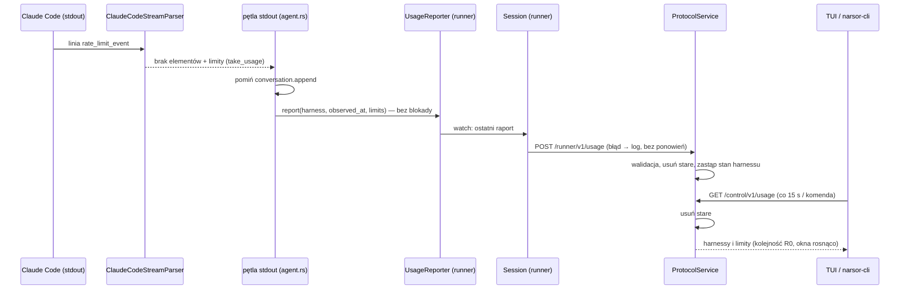
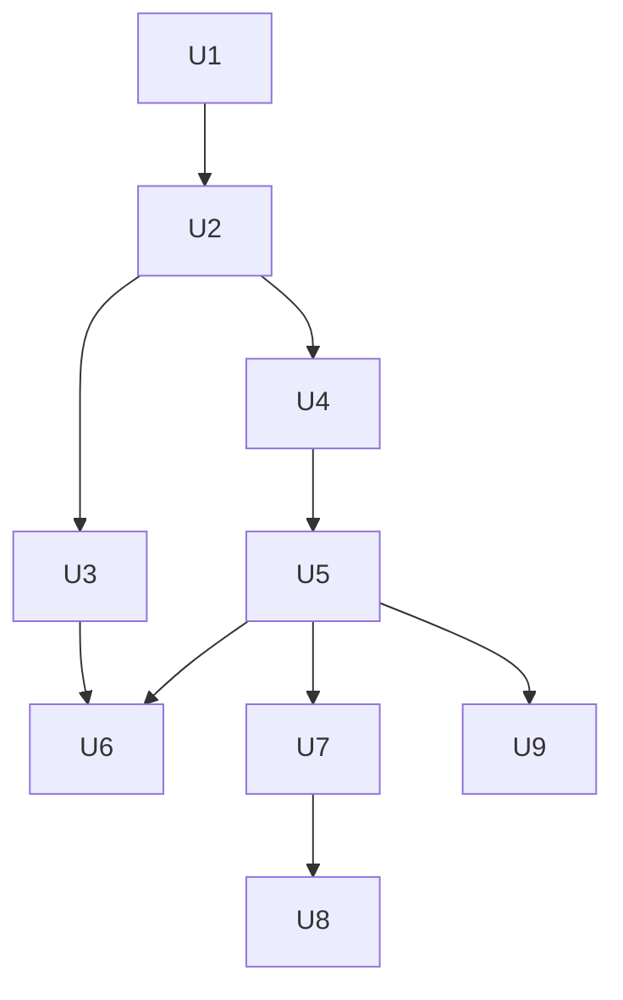

# feat: Limity abonamentu harnessów w TUI i CLI

## Summary

Nowy moduł `narsor-protocol::harness` ma jedną listę harnessów (identyfikator, krótka nazwa, pełna nazwa). Parser Claude Code nie zamienia już `rate_limit_event` na wpis rozmowy. Parser oddaje limity przez nową metodę cechy `HarnessStreamParser`. Wspólna pętla stdout w `agent.rs` pomija zapis tej linii i przekazuje raport do opcjonalnego `UsageReporter`. Runner wysyła raport `POST /runner/v1/usage` bez ponawiania. `ProtocolService` trzyma ostatni stan każdego harnessu w pamięci i usuwa nieaktualne dane przy każdym zapisie i odczycie. `GET /control/v1/usage` zwraca stan. TUI czyta stan zadaniem w tle co 15 s i rysuje go po prawej stronie dolnego wiersza. Nowa komenda `narsor-cli usage` wypisuje ten sam stan (see origin: `docs/brainstorms/2026-10-31-limity-abonamentu-harnessow-requirements.md`).

---

## Problem Frame

Dziś `classify.rs` (funkcja `rate_limit`) robi z `rate_limit_event` wpis `TechnicalCategory::RateLimit`. Wpis zostaje w logu na stałe i po kilku minutach jest nieaktualny. Operator nie ma jednego miejsca, w którym widzi stan limitów (see origin).

Fakty z kodu, które kształtują plan:

- `HarnessStreamParser::on_stdout_line` zwraca tylko `Vec<ChatElement>`. Nie ma kanału bocznego z parsera do wykonawcy (`crates/narsor-engine/src/engine/actions/harness/mod.rs`).
- Pętla stdout to synchroniczne zamknięcie w `spawn_and_wait` (`crates/narsor-engine/src/engine/actions/agent.rs`). Pętla zawsze woła `conversation.append(Stdout, line, &elements)`. Drugie miejsce z tym samym wzorcem to `feed_copilot_sdk_record`.
- Silnik nie ma dziś drogi do serwera. `RunnerClient` (`crates/narsor-engine/src/controller_protocol/client.rs`) używa tylko pętla `Session` w `crates/narsor-runner/src/runner/mod.rs` (`Link::client`). Runner buduje `Engine::new(store)` bez żadnego obserwatora.
- Demon (`crates/narsor-server/src/runtime.rs`) ma też własny silnik w procesie dla starych endpointów `/executions`. Ten silnik nie ma runnera.
- `ProtocolService` (`crates/narsor-engine/src/controller_protocol/service.rs`) ma już stan tylko w pamięci: `limit_overrides` (D65, `service/backend_limit.rs`). Zegar to `self.control.now()`, w testach `ManualClock`.
- Demon lokalny ustawia `control: Some(..)` (`crates/narsor-server/src/runtime.rs`), więc trasy `/runner/v1` i `/control/v1` są także w trybie lokalnym.
- Binarny plik `narsor` to tylko TUI. Komendy CLI są w `narsor-cli` (`src/cli/mod.rs`, `Command::Workflow`, `Command::Backend`, `Command::Harness`).
- Ekran TUI mniejszy niż 60×20 to `Screen::TooSmall` i nie ma dolnego wiersza.

---

## Assumptions

*Plan powstał bez potwierdzenia przez użytkownika na bieżąco. Poniższe punkty to wnioski agenta. Przed implementacją człowiek musi je sprawdzić.*

- **Komenda CLI to `narsor-cli usage`.** Origin mówi „`narsor usage` w grupie komend zdalnych, obok `workflows`”. Binarny `narsor` nie ma podkomend (to tylko TUI). Plan dodaje komendę najwyższego poziomu `Usage` w `narsor-cli`, obok `Workflow`, `Backend` i `Harness`.
- **Tekst CLI jest po angielsku.** Każdy tekst `narsor-cli` jest dziś po angielsku. Komunikat braku danych to `No usage limit data.` (sens „brak danych o limitach” z AE7 i AE8). TUI zostaje po polsku, ale format limitów (R11) nie ma słów.
- **Krótkie nazwy harnessów spoza Claude Code:** `codex` → `codex` / `Codex`, `opencode` → `opencode` / `OpenCode`, `github-copilot` → `copilot` / `GitHub Copilot`. Origin podaje tylko przykład dla Claude Code.
- **Znak `!` bez koloru stoi przed typem limitu:** `claude 5h 1% ↻4h10m · !7d 90% ↻2d3h`. Znak na początku segmentu nie znika przy obcinaniu końca tekstu.
- **Czas odnowienia krótszy niż 1 h ma postać `Ym`** (np. `↻45m`, `↻0m`). Origin daje `XhYm` dla < 24 h i `↻0m` dla czasu, który minął. Plan łączy te dwa zapisy.
- **Runner pomija nieznane okna i nieznane statusy.** Okno inne niż `five_hour` i `seven_day` nie trafia do raportu. Status spoza `allowed`, `allowed_warning`, `rejected` daje limit bez statusu. Okno bez `utilization` lub `resetsAt` nie trafia do raportu. Raport bez limitów nie jest wysyłany.
- **Odczyt limitów w TUI nie włącza spinnera ładowania** i nie zmienia stanu połączenia w nagłówku. To mały odczyt w tle co 15 s.
- **Okno R13 sprawdzamy przy szerokości ≥ 60.** AE5 mówi o 50 kolumnach, ale poniżej 60 kolumn TUI nie rysuje dolnego wiersza (`Screen::TooSmall`). Test AE5 używa szerokości, przy której tekst limitów nie zostawia miejsca na żadną podpowiedź.

---

## Requirements

Plan realizuje R0–R19, R5a, R6a i R8a z origin. Tabela łączy wymagania z jednostkami.

| Wymaganie | Jednostka |
|---|---|
| R0 (wspólna lista harnessów) | U1 |
| R1–R4, R6a (kontrakt i walidacja) | U2, U4 |
| R5, R5a (ostatni stan w pamięci, wygasanie) | U4 |
| R6 (endpointy i autoryzacja) | U5 |
| R7 (mapowanie Claude Code) | U3 |
| R8, R8a (wysłanie bez logu, usunięcie `RateLimit`) | U3, U6 |
| R9 (odczyt co 15 s, bez blokady) | U7 |
| R10–R16 (dolny wiersz TUI) | U8 |
| R17–R19 (CLI) | U9 |

**Origin actors:** A1 (operator), A2 (harness), A3 (`narsor-runner`), A4 (`narsor-server`)
**Origin flows:** F1 (raport limitów: U3, U4, U5, U6), F2 (odczyt w TUI: U7, U8), F3 (odczyt w CLI: U9)
**Origin acceptance examples:** AE1 (U3, U6), AE2 (U4), AE3 (U6), AE4 (U8), AE5 (U8), AE6 (U8), AE7 (U4, U8, U9), AE8 (U4, U7, U9), AE9 (U4)

---

## Scope Boundaries

Carried from origin:

- Brak trwałego zapisu i historii limitów na serwerze.
- Brak alarmów i blokowania nowych zadań przy wysokim wykorzystaniu.
- Brak parserów limitów dla `codex`, `opencode` i `github_copilot`. Cecha parsera ma domyślną implementację „brak limitów”.
- Brak migracji starych wpisów `rate_limit`. Stare rozmowy pokazują je jako `Unrecognized`.
- Brak pól `overage*` w kontrakcie, w TUI i w CLI.
- Brak konfiguracji interwału 15 s.
- Brak rozróżnienia kont harnessu.

Plan-local:

- Silnik demona w procesie (stare `/executions`) nie raportuje limitów. Linia limitów też nie trafia tam do logu (R8a), ale raport przepada, bo ten silnik nie ma `UsageReporter`.
- Dyrygent (`run_harness_process` w `conductor/invoke.rs`) nie raportuje limitów. Dyrygent już dziś nie zapisuje rozmowy.
- Literały `"claude-code"` w kodzie testów zostają. R0 dotyczy kodu produkcyjnego. Testy, które sprawdzają wartość na drucie, mogą mieć literał.
- Nagłówek TUI `harness claude-code` (`src/tui/task_app/harness.rs`) dalej pokazuje identyfikator. To identyfikator, nie nazwa.

### Deferred to Follow-Up Work

- Raportowanie limitów z silnika demona w procesie i z dyrygenta: osobna zmiana, gdy będzie potrzeba.

---

## Context & Research

### Relevant Code and Patterns

- Stan tylko w pamięci w `ProtocolService`: `crates/narsor-engine/src/controller_protocol/service/backend_limit.rs` (`LimitOverrides = Mutex<HashMap<..>>`, pole w `service.rs`, inicjalizacja w `with_config`).
- Usuwanie starych wpisów przy dostępie: `ReplayGuard` w `crates/narsor-engine/src/auth/pop.rs` (`retain` przy każdym wywołaniu, górna granica liczby wpisów).
- Trasy runnera: `runner_routes` i `require_runner` w `crates/narsor-server/src/controller_protocol/http.rs`. Wzór handlera: `post_snapshot`. Wzór zapisu: `Self::require_worker(identity)?` w `service.rs`.
- Trasy właściciela z `Arc<ProtocolService>`: `owner_routes` w tym samym pliku (`/control/v1/backends/{id}/limit`).
- Błędy: `ProtocolError::bad_request(code, message)` w `crates/narsor-engine/src/controller_protocol/error.rs`.
- Typy na drucie: `crates/narsor-protocol/src/controller.rs` (`*Request`, `*View`, `*Response`, `#[serde(other)] Unrecognized`, `DateTime<Utc>`). Jawna lista eksportów: `crates/narsor-engine/src/controller_protocol/wire.rs`.
- Klient runnera: `RunnerClient::snapshot` (`transport.post(path, &body)`).
- Klient właściciela: `ApiClient::control_workflows`, `control_backend_limit` w `crates/narsor-api-client/src/api/client.rs`.
- Odczyt TUI w tle: `start_limit_read` w `src/tui/task_app/limit.rs`, `JobKey` i `Outcome` w `src/tui/task_app/background.rs`, pętla w `src/tui/mod.rs::run` (`start_refresh_if_due`, `wait_until_next_due`).
- Dolny wiersz: `render_bar` w `src/tui/task_app/layout.rs`, `hint_line` i `hint_line_from` w `src/tui/keymap.rs`, `Notifier::span` i `current` w `src/tui/task_app/notify.rs`.
- Dopasowanie tekstu w nagłówku: `Fit` i `header_lines` w `layout.rs`, `fit_text` w `src/tui/task_app/list.rs`.
- Style: `Styles` w `src/tui/style.rs` (`Role::Attention`, `Role::Problem`, gałąź `no_color`).
- CLI: `Command` i `runs_on_broken_config` w `src/cli/mod.rs`, `workflows` w `src/cli/task_registry.rs`, `json_output` i `failure` w `src/cli/remote.rs`, czyste funkcje tekstu w `src/cli/control_text.rs`.
- Stałe harnessów dziś: `CLAUDE_CODE`, `CODEX`, `OPENCODE`, `GITHUB_COPILOT` w adapterach `crates/narsor-engine/src/engine/actions/harness/`. Kopie: `crates/narsor-shared/src/config/file.rs` (lista `supported`), `crates/narsor-shared/src/config/settings.rs` (domyślna wartość), `crates/narsor-engine/src/engine/actions/human.rs`, `crates/narsor-engine/src/engine/decision.rs`, `crates/narsor-engine/src/conductor/invoke.rs` (`SANDBOXED_HARNESSES`), `agent.rs` (`BUILT_IN_HARNESS`). Nazwa „Claude Code” w tekstach: `agent.rs`, `crates/narsor-protocol/src/panel/permission.rs`, `crates/narsor-controller/src/controller.rs`, `crates/narsor-controller/src/profile_edit.rs`, `src/cli/remote.rs`.

### Institutional Learnings

- `docs/solutions/architecture-patterns/auto-resume-policy-for-lost-workloads-2026-10-11.md`: każdy enum na drucie ma `#[serde(other)] Unrecognized`. Serwer odrzuca `Unrecognized` w raporcie runnera. Test z surowym JSON pilnuje każdego enuma. Kolejność wdrożenia: serwer, potem runnery, potem klienci.
- `ARCHITECTURE_DECISIONS.md` D65: stan tylko w pamięci `ProtocolService`, jawny zapis „stan znika po restarcie”, trójka API/TUI/CLI. D60: tylko adapter zna format harnessu.
- `docs/solutions/design-patterns/tui-reads-as-keyed-background-jobs-with-loading-marker-2026-10-22.md`: każdy odczyt TUI to zadanie `JobKey`, nigdy `await` w pętli zdarzeń.
- `docs/solutions/logic-errors/tui-list-read-on-every-runner-report-2026-10-22.md`: zegar 15 s nie może zależeć od harmonogramu listy.
- `docs/solutions/ui-bugs/tui-confirmation-popup-closed-by-background-refresh-2026-10-26.md`: wynik odczytu w tle nie zamyka dialogów.
- `docs/solutions/design-patterns/tui-row-background-from-semantic-flag-after-render-2026-10-30.md`: kolory tylko w `Styles`, testy z przesuniętym `Rect` i bardzo małą szerokością.
- `docs/solutions/security-issues/untrusted-agent-text-unclosed-brace-scan-quadratic-2026-10-18.md`: dane od runnera są niezaufane. Czyścić tekst przy każdym nowym wyjściu (`narsor_protocol::display`).

### External References

- Nie było potrzeby. Repozytorium ma wzorce dla każdej warstwy.

---

## Key Technical Decisions

- **Lista harnessów w `narsor-protocol`** (nowy moduł `harness.rs`): każdy konsument (silnik, runner, serwer, `narsor-shared`, TUI, CLI) zależy od `narsor-protocol`. Runner nie zależy wprost od `narsor-shared`. Moduł daje stałe identyfikatorów, tablicę wpisów `{ id, short_name, display_name }` i wyszukiwanie po identyfikatorze. Stałe w adapterach silnika stają się re-eksportem tych stałych.
- **Kanał boczny parsera to nowa metoda cechy z domyślną implementacją** (np. `take_usage`). Metoda zwraca `Option<Vec<UsageLimit>>` z ostatniej linii i ma trzy stany:
  - `None`: linia nie jest raportem limitów. Pętla zapisuje linię jak dziś. Domyślna implementacja zawsze zwraca `None`.
  - `Some(pusta lista)`: linia to `rate_limit_event` bez znanych okien. Pętla nie woła `conversation.append` i nie wysyła raportu.
  - `Some(niepusta lista)`: pętla nie woła `conversation.append` i przekazuje raport dalej.

  Ten kształt nie zmienia sygnatury `on_stdout_line` i testów, które ją wołają. Inne adaptery nie zmieniają się.
- **Parser zwraca limity, wykonawca składa raport:** identyfikator harnessu pochodzi z `HarnessAdapter::name()`, czas odbioru (R4) to czas zegara w chwili odczytu linii. Parser zostaje czysty i łatwy w testach.
- **`UsageReporter` to opcjonalna cecha w silniku**, wstrzyknięta przez nowy builder `Engine` → `AgentExecutor`. Wywołanie `report` nie blokuje i nie zwraca błędu. Bez reportera raport przepada. Tak działa silnik demona w procesie.
- **Stan limitów jest wspólny dla całej instalacji.** Klucz to tylko identyfikator harnessu (R2). Każda tożsamość `Worker` może zastąpić stan każdego harnessu. Każdy właściciel po bramce `require_owner` czyta cały stan. Ta decyzja jest poprawna dla instalacji z jednym użytkownikiem (D35). Przy wielu właścicielach stan trzeba podzielić wg właściciela. To jest poza zakresem tej zmiany.
- **Runner przekazuje raport do pętli `Session` kanałem „tylko ostatnia wartość”** (np. `tokio::sync::watch`). Pętla bierze klienta z `Link::client()` i wysyła raport w osobnym zadaniu. Błąd ląduje w logu `debug` i nic więcej. Brak ponawiania (R8). Kanał z ostatnią wartością sam usuwa starsze raporty.
- **Stan na serwerze w `ProtocolService`**, nowy podmoduł `service/harness_usage.rs`, wzór `backend_limit.rs`. Jedno miejsce dla trasy runnera i trasy właściciela. Zegar to `self.control.now()`, więc `ManualClock` w testach steruje wygasaniem.
- **Wygasanie przy dostępie, bez zadania okresowego:** każdy zapis i odczyt usuwa limity z `resets_at <= now`, harnessy z `received_at + 15 min <= now` i harnessy bez limitów. Endpoint odczytu nigdy nie zwraca usuniętego stanu (R5a), a kod nie potrzebuje `run_periodic_pass`.
- **Kontrakt na drucie** (w `crates/narsor-protocol/src/controller.rs`):
  - `POST /runner/v1/usage`, ciało `HarnessUsageReport { harness, observed_at, limits: [UsageLimit] }`, odpowiedź `204`.
  - `UsageLimit { window, utilization, resets_at, status? }`. `window` to tekst wg wzorca `^[1-9][0-9]{0,3}[mhd]$` (np. `5h`, `7d`). `utilization` to `f64` 0–1. `resets_at` to `DateTime<Utc>`. `status` to `UsageStatus { Allowed, AllowedWarning, Rejected, Unrecognized }` w `snake_case`.
  - `GET /control/v1/usage`, odpowiedź `HarnessUsageResponse { harnesses: [HarnessUsageView] }`. `HarnessUsageView { harness, observed_at, received_at, limits }`.
  - Serwer sortuje harnessy w kolejności listy R0, a limity rosnąco po długości okna. TUI i CLI rysują w kolejności odpowiedzi.
- **Walidacja raportu (R6a)** w `ProtocolService`, kod błędu `invalid_usage_report` (400 z JSON):
  - harness spoza listy R0;
  - status `Unrecognized`;
  - `window` poza wzorcem;
  - `utilization` poza 0–1 albo nie jest liczbą skończoną;
  - `resets_at` dalej niż 7 dni od czasu serwera;
  - więcej niż 8 limitów albo dwa limity z tym samym `window`;
  - tylko rola `Worker` (`require_worker`).
  - Trasa ma `DefaultBodyLimit` 16 KiB.
- **Osobny zegar 15 s w TUI**, prosty `next_usage_at: Instant` w stanie aplikacji, bez `RefreshSchedule` (ten ma backoff, a R9 chce stały interwał). Po błędzie TUI czyści stan i czeka 15 s.
- **Nowy kod TUI w `src/tui/task_app/usage.rs`.** Nazwy `limit`, `Limit`, `LimitList` są zajęte przez limit zadań backendu.
- **Nowy wiersz ADR w `ARCHITECTURE_DECISIONS.md`** (D70): stan tylko w pamięci, znika po restarcie, reguły wygasania, klucz to tylko identyfikator harnessu (stan wspólny dla instalacji, założenie D35), kolejność wdrożenia.

---

## Open Questions

### Resolved During Planning

- Kształt JSON i ścieżki: patrz Key Technical Decisions (`/runner/v1/usage`, `/control/v1/usage`).
- Gdzie runner przechwytuje komunikat: parser silnika rozpoznaje linię, pętla silnika pomija zapis, runner wysyła przez `UsageReporter`.
- Czy TUI używa `src/tui/refresh.rs`: nie. Osobny `next_usage_at` i `JobKey::Usage`.
- Gdzie jest lista harnessów: `narsor-protocol`.
- Jak połączyć limity, powiadomienie i podpowiedzi: patrz U8.
- Stare rozmowy z `rate_limit`: `TechnicalCategory` ma już `#[serde(other)] Unrecognized`.

### Deferred to Implementation

- Dokładne nazwy metod cechy i buildera (`take_usage`, `with_usage_reporter`): zależą od kodu w chwili zmiany.
- Miejsce, w którym pętla `Session` sprawdza kanał raportu (gałąź `select!` lub krok `drive`): zależy od obecnej struktury pętli w `crates/narsor-runner/src/runner/mod.rs`.
- Czy `feed_copilot_sdk_record` potrzebuje wspólnej funkcji pomocniczej z `spawn_and_wait`, czy wystarczy ten sam warunek w dwóch miejscach.

---

## High-Level Technical Design

> *Ten szkic pokazuje kierunek i jest pomocą do przeglądu, nie specyfikacją implementacji. Implementujący traktuje go jako kontekst, nie kod do przepisania.*

Dolny wiersz TUI (U8):

| Powiadomienie widoczne | Tekst limitów | Prawa strona | Podpowiedzi dostają |
|---|---|---|---|
| tak | dowolny | powiadomienie (pełna szerokość, gdy trzeba) | resztę szerokości minus 1, albo nic |
| nie | jest | limity (najpierw usuń ostatni harness, potem obetnij z `…`) | resztę szerokości minus 1, albo nic |
| nie | brak | nic | całą szerokość (jak dziś) |

---

## Implementation Units

### U1. Wspólna lista harnessów

**Goal:** Jedna lista harnessów w `narsor-protocol`. Kod produkcyjny nie ma własnych kopii identyfikatorów i nazw.

**Requirements:** R0

**Dependencies:** None

**Files:**
- Create: `crates/narsor-protocol/src/harness.rs`
- Modify: `crates/narsor-protocol/src/lib.rs`
- Modify: `crates/narsor-engine/src/engine/actions/harness/claude_code.rs`, `codex.rs`, `opencode.rs`, `github_copilot.rs`, `crates/narsor-engine/src/engine/actions/harness/mod.rs`
- Modify: `crates/narsor-engine/src/engine/actions/agent.rs` (`BUILT_IN_HARNESS`, tekst z „Claude Code”)
- Modify: `crates/narsor-engine/src/conductor/invoke.rs`, `crates/narsor-engine/src/engine/actions/human.rs`, `crates/narsor-engine/src/engine/decision.rs`
- Modify: `crates/narsor-shared/src/config/file.rs`, `crates/narsor-shared/src/config/settings.rs`
- Modify: `crates/narsor-protocol/src/panel/permission.rs`, `crates/narsor-controller/src/controller.rs`, `crates/narsor-controller/src/profile_edit.rs`, `src/cli/remote.rs` (tylko miejsca, gdzie tekst to nazwa harnessu)
- Test: `crates/narsor-protocol/src/harness.rs` (testy w module)

**Approach:**
- Moduł daje stałe identyfikatorów (`CLAUDE_CODE = "claude-code"` itd.), statyczną tablicę wpisów w ustalonej kolejności (Claude Code, Codex, OpenCode, GitHub Copilot) i funkcję wyszukania wpisu po identyfikatorze.
- Adaptery re-eksportują stałe z protokołu. Publiczne ścieżki `harness::CLAUDE_CODE` w silniku zostają.
- Lista `supported` w `file.rs` powstaje z tablicy. Domyślna wartość w `settings.rs` używa stałej.
- Teksty z „Claude Code”: zamienić na pełną nazwę z listy tam, gdzie tekst mówi o harnessie. Teksty, które mówią o produkcie w innym sensie (np. instrukcja logowania), implementujący ocenia osobno.

**Patterns to follow:**
- Moduły i testy w `crates/narsor-protocol/src/display.rs`.

**Test scenarios:**
- Happy path: wyszukanie `claude-code` daje krótką nazwę `claude` i pełną nazwę `Claude Code`.
- Edge case: wyszukanie `unknown-harness` daje brak wpisu.
- Edge case: identyfikatory i krótkie nazwy w tablicy są unikalne.
- Integration: walidacja ustawienia `AgentHarness` w `narsor-shared` dalej przyjmuje cztery identyfikatory i odrzuca inny (istniejące testy konfiguracji przechodzą).

**Verification:**
- Wyszukiwanie literału `"claude-code"` w kodzie produkcyjnym (poza testami i `harness.rs`) nic nie znajduje.

---

### U2. Kontrakt limitów na drucie

**Goal:** Typy raportu i odpowiedzi w `narsor-protocol`, wspólne dla wszystkich harnessów.

**Requirements:** R1, R2, R3, R4

**Dependencies:** U1

**Files:**
- Modify: `crates/narsor-protocol/src/controller.rs`
- Modify: `crates/narsor-engine/src/controller_protocol/wire.rs`
- Test: `crates/narsor-protocol/src/controller.rs` (moduł testów)

**Approach:**
- `HarnessUsageReport`, `UsageLimit`, `UsageStatus`, `HarnessUsageView`, `HarnessUsageResponse` (kształt w Key Technical Decisions).
- Stałe granic w protokole: liczba limitów (8), wzorzec okna, horyzont odnowienia (7 dni), czas życia stanu (15 min). Funkcja pomocnicza, która zamienia `window` na długość (do sortowania w U4).
- Dodać nowe typy do jawnej listy w `wire.rs`.

**Patterns to follow:**
- `BackendLimitView`, `BackendLimitSource` z `Unrecognized` w `controller.rs`.

**Test scenarios:**
- Happy path: `HarnessUsageReport` z dwoma limitami przechodzi serializację i deserializację bez zmian.
- Edge case: `status` pominięty w JSON daje `None`. `status` `None` nie trafia do JSON.
- Edge case: surowy JSON z `"status": "something_new"` daje `UsageStatus::Unrecognized`.
- Happy path: `"allowed_warning"` daje `UsageStatus::AllowedWarning`.
- Edge case: długość okna: `5h` < `7d`, `90m` < `5h`.

**Verification:**
- Typy są dostępne przez `narsor_protocol::controller` i przez `narsor_engine::controller_protocol::wire`.

---

### U3. Parser Claude Code: limity zamiast wpisu rozmowy

**Goal:** Parser rozpoznaje `rate_limit_event`, mapuje okna wg R7 i oddaje limity przez nową metodę cechy. Klasyfikator nie tworzy wpisu `RateLimit`.

**Requirements:** R7, R8a, AE1 (część parsera)

**Dependencies:** U2

**Files:**
- Modify: `crates/narsor-engine/src/engine/actions/harness/mod.rs` (nowa metoda cechy `HarnessStreamParser` z domyślnym „brak limitów”)
- Modify: `crates/narsor-engine/src/engine/actions/harness/claude_code.rs` (`ClaudeCodeStreamParser`, komentarz o `rate_limit_event`)
- Modify: `crates/narsor-engine/src/engine/actions/harness/claude_code/classify.rs` (usunąć gałąź i funkcję `rate_limit`)
- Create (opcjonalnie): `crates/narsor-engine/src/engine/actions/harness/claude_code/usage.rs` (mapowanie `rate_limit_info`)
- Modify: `tests/claude_code_classification.rs`
- Modify: `tests/fixtures/claude-code/README.md`

**Approach:**
- `on_stdout_line` dla `rate_limit_event` zwraca pustą listę elementów i zapamiętuje limity. Nowa metoda oddaje je raz (`Some`) i czyści. Dla innych linii metoda zwraca `None` (trzy stany w Key Technical Decisions).
- Mapowanie R7: z `unifiedWindows` okna `five_hour` → `5h`, `seven_day` → `7d`. Gdy `unifiedWindows` nie ma, jedno okno z `rateLimitType`, `utilization`, `resetsAt`, `status` poziomu `rate_limit_info`.
- Status: najpierw pole `status` okna. Gdy okno odpowiada `rateLimitType` i nie ma `status`, wziąć `status` z `rate_limit_info`. W innym przypadku brak statusu.
- `resetsAt` to sekundy Unix → `DateTime<Utc>`.
- Pominąć okna nieznane, bez `utilization` lub bez `resetsAt` (Assumptions). Status spoza zbioru → brak statusu.
- Linia `rate_limit_event`, która po mapowaniu nie ma żadnego limitu, też nie daje wpisu rozmowy. Parser oddaje wtedy `Some(pusta lista)`, a pętla nie zapisuje linii i nie wysyła raportu (U6).

**Execution note:** Zacznij od testów na nagraniach z `tests/fixtures/claude-code`.

**Patterns to follow:**
- Odczyt pól `Map<String, Value>` w `classify.rs`.

**Test scenarios:**
- Covers AE1. Happy path: linia z `unifiedWindows` (5h 0.01 `allowed`, 7d 0.9 `allowed_warning`) → dwa limity `5h` 0.01 `Allowed` i `7d` 0.9 `AllowedWarning`, brak elementów rozmowy.
- Happy path: linia z `ask_user_question.ndjson` (okna bez `status`, `rateLimitType` `five_hour`, `status` `allowed`) → `5h` ze statusem `Allowed`, `7d` bez statusu.
- Happy path: linia z `noschema_background.ndjson` (okna ze statusem) → oba limity ze statusem okna.
- Edge case: brak `unifiedWindows`, `rateLimitType` `seven_day` → jeden limit `7d` z `utilization`, `resetsAt` i `status` z `rate_limit_info`.
- Edge case: okno `opus_weekly` w `unifiedWindows` → pominięte.
- Edge case: status `something_new` → limit bez statusu.
- Edge case: okno bez `resetsAt` → pominięte.
- Edge case: linia `rate_limit_event` tylko z oknem `opus_weekly` → `Some(pusta lista)`.
- Edge case: metoda oddaje limity tylko raz. Drugie wywołanie po tej samej linii daje `None`. Następna zwykła linia daje `None`.
- Integration: cały plik `tools.ndjson` przez parser → żaden element nie ma kategorii technicznej `rate_limit`. Zmienić test `init_starts_the_session_and_rate_limits_are_technical`.
- Edge case: parser `codex` (lub inny) → metoda daje zawsze `None` (domyślna implementacja).

**Verification:**
- Funkcja `rate_limit` i gałąź `"rate_limit_event"` w `classify.rs` nie istnieją.

---

### U4. Stan limitów w `ProtocolService`

**Goal:** Walidacja raportu, ostatni stan każdego harnessu w pamięci, wygasanie, odczyt w ustalonej kolejności.

**Requirements:** R2, R5, R5a, R6a, AE2, AE7, AE8, AE9

**Dependencies:** U2

**Files:**
- Create: `crates/narsor-engine/src/controller_protocol/service/harness_usage.rs`
- Modify: `crates/narsor-engine/src/controller_protocol/service.rs` (pole, inicjalizacja, deklaracja modułu)
- Test: `tests/controller_protocol.rs`

**Approach:**
- Pole `Mutex<HashMap<harness id, stan>>`. Stan = raport po walidacji + `received_at` (czas serwera).
- Zapis: `require_worker`, walidacja (lista w Key Technical Decisions), usunięcie starych wpisów, zastąpienie stanu harnessu. Limity z `resets_at <= now` usunięte już przy zapisie. Raport, który po tym nie ma limitów, usuwa stan harnessu.
- Odczyt: usunięcie starych wpisów, potem lista w kolejności R0, limity rosnąco po długości okna.
- Granica 15 min liczona od `received_at`, nie od `observed_at`.
- Wszystkie czasy z `self.control.now()`.

**Patterns to follow:**
- `service/backend_limit.rs` (pole, `lock_*`, metody w `impl ProtocolService`).
- `ReplayGuard::retain` w `crates/narsor-engine/src/auth/pop.rs`.

**Test scenarios:**
- Covers AE2. Happy path: dwa raporty `claude-code` w odstępie minuty → odczyt zwraca tylko drugi.
- Covers AE7. Edge case: nowy serwis bez raportów → odczyt zwraca pustą listę.
- Covers AE8. Edge case: raport, potem `ManualClock` +16 min → odczyt nie zwraca `claude-code`.
- Edge case: raport, potem +14 min 59 s → odczyt zwraca `claude-code`.
- Covers AE9. Edge case: raport, `ManualClock` +5 min, `resets_at` limitu `5h` minął minutę temu → odczyt zwraca tylko `7d`.
- Edge case: oba limity mają `resets_at` w przeszłości → harness nie jest w odpowiedzi.
- Edge case: `observed_at` sprzed godziny, `received_at` teraz → harness jest w odpowiedzi (liczy się `received_at`).
- Error path: harness `unknown` → 400 `invalid_usage_report`, stan bez zmian.
- Error path: status `Unrecognized` → 400.
- Error path: `utilization` 1.5, -0.1, NaN → 400.
- Error path: `resets_at` = teraz + 7 dni + 1 s → 400. Teraz + 7 dni → przyjęty.
- Error path: `window` `5x`, `0h`, `12345h`, tekst ze znakiem sterującym → 400.
- Error path: 9 limitów → 400. Dwa limity `5h` → 400.
- Error path: tożsamość `Reader` → `Forbidden`.
- Happy path: kolejność: raporty `codex` i `claude-code` → odpowiedź ma `claude-code` przed `codex`. Limity raportu w kolejności `7d`, `5h` → odpowiedź `5h`, `7d`.

**Verification:**
- Testy z `ManualClock` pokazują każdą regułę wygasania bez demona.

---

### U5. Endpointy HTTP i klienci

**Goal:** `POST /runner/v1/usage` z autoryzacją runnera i `GET /control/v1/usage` z autoryzacją właściciela. Metody w `RunnerClient` i `ApiClient`.

**Requirements:** R6, R6a (granica rozmiaru żądania)

**Dependencies:** U4

**Files:**
- Modify: `crates/narsor-server/src/controller_protocol/http.rs` (`runner_routes`, `owner_routes`, handlery)
- Modify: `crates/narsor-engine/src/controller_protocol/client.rs` (`RunnerClient`)
- Modify: `crates/narsor-api-client/src/api/client.rs` (`ApiClient`)
- Test: `tests/controller_protocol.rs`

**Approach:**
- Trasa runnera za `require_runner`, z `DefaultBodyLimit` 16 KiB tylko na tej trasie. Odpowiedź `204`.
- `RunnerClient` dostaje metodę POST, dla której `204` to sukces z wynikiem `()`. Dziś `handle_json_response` (`crates/narsor-shared/src/api_error.rs`) przyjmuje tylko 200, 201 i 202, a dla 204 zwraca błąd. Inne statusy nowa metoda mapuje przez `handle_json_response`.
- Testy, w których raport trafia do serwera, używają syntetycznej linii `rate_limit_event`. Jej `resetsAt` liczy się od czasu `ManualClock` serwera testowego (np. +4h10m i +2d3h). Nagrania z `tests/fixtures/claude-code` mają `resetsAt` 14–27 dni po starcie `ManualClock`, więc serwer odrzuci je (granica 7 dni). Nagrania zostają w testach parsera i w testach z testowym reporterem.
- Trasa odczytu w `owner_routes` (stan `Arc<ProtocolService>`), więc dostaje bramkę `require_owner` jak `/control/v1/backends/{id}/limit`.
- Nie edytować nieskompilowanej kopii `crates/narsor-engine/src/controller_protocol/http.rs`.

**Patterns to follow:**
- `post_snapshot`, `/control/v1/backends/{id}/limit` w `crates/narsor-server/src/controller_protocol/http.rs`.
- `ApiClient::control_backend_limit`, `RunnerClient::snapshot`.

**Test scenarios:**
- Integration: runner (`Harness::start_runner`) wysyła raport, właściciel czyta `GET /control/v1/usage` → ten sam stan.
- Happy path: odpowiedź `204` na `POST /runner/v1/usage` → klient runnera zwraca `Ok(())`.
- Error path: `POST /runner/v1/usage` bez tokenu → goły 401 (dodać ścieżkę do listy w `unauthenticated_requests_get_bare_status_codes`).
- Error path: `GET /control/v1/usage` bez tokenu → 401.
- Error path: ciało większe niż 16 KiB → odrzucone (413), stan bez zmian.
- Error path: niepoprawny raport → 400 z JSON `code` `invalid_usage_report`.

**Verification:**
- Oba endpointy działają w testowym serwerze z `ApiServices { control: Some(..) }`, tak jak w demonie lokalnym.

---

### U6. Pętla stdout, `UsageReporter` i wysyłka z runnera

**Goal:** Linia limitów nie trafia do logu rozmowy. Raport idzie do serwera bez blokady kroku i bez ponawiania. Wariant `TechnicalCategory::RateLimit` jest usunięty.

**Requirements:** R8, R8a, AE1, AE3

**Dependencies:** U3, U5

**Files:**
- Modify: `crates/narsor-engine/src/engine/actions/agent.rs` (cecha `UsageReporter`, pole i builder `AgentExecutor`, `spawn_and_wait`, `feed_copilot_sdk_record`)
- Modify: `crates/narsor-engine/src/engine/runner.rs` (builder `Engine`, przekazanie do `agent_executor`)
- Create: `crates/narsor-runner/src/runner/usage.rs`
- Modify: `crates/narsor-runner/src/runner/mod.rs` (wstrzyknięcie reportera, wysyłka w pętli `Session`)
- Modify: `crates/narsor-protocol/src/chat.rs` (usunąć `RateLimit`, `label`, `every_variant`)
- Modify: `src/tui/conversation.rs` (dopasowanie kategorii technicznych)
- Test: `crates/narsor-runner/src/runner/session_tests.rs`, `crates/narsor-protocol/src/chat.rs` (moduł testów), testy agenta w `crates/narsor-engine/src/engine/actions/agent.rs` lub istniejący plik testów wykonawcy

**Approach:**
- Cecha `UsageReporter: Send + Sync + Debug` z jedną metodą bez wyniku. Komentarz: wywołanie nie może blokować ani oblać kroku (jak `AgentEventSink`).
- W pętli: po `on_stdout_line` zapytać parser o limity. Gdy wynik to `Some` (także pusta lista): pominąć `conversation.append`. Gdy wynik to `None`: zapisać linię jak dziś. Gdy lista nie jest pusta i reporter jest: zbudować `HarnessUsageReport` (identyfikator z adaptera, `observed_at` = teraz) i wywołać reporter. Ten sam warunek w `feed_copilot_sdk_record`.
- Builder: `Engine::new` od razu wstawia `AgentExecutor` do mapy wykonawców. Dlatego `Engine` trzyma opcjonalny reporter, a `with_usage_reporter` buduje od nowa tylko domyślnego wykonawcę agenta (`agent_executor(...).with_usage_reporter(..)`). Testy z własnym `AgentExecutor` (`with_executor(ActionKind::Agent, ..)`) wołają `AgentExecutor::with_usage_reporter` same. Test sesji runnera przekazuje do swojego wykonawcy ten sam reporter, którego używa `Session`.
- Runner: reporter zapisuje raport do kanału „ostatnia wartość”. Pętla `Session` widzi nową wartość, bierze klienta z `Link::client()` i wysyła raport w osobnym zadaniu `tokio`. Błąd → `tracing::debug`, raport zapomniany. Brak klienta → raport zapomniany. Błąd raportu nie zmienia stanu `Link` (backoff snapshotów zostaje bez zmian).
- Usunąć `TechnicalCategory::RateLimit`. Stare `"rate_limit"` czyta się jako `Unrecognized` przez istniejące `#[serde(other)]`.

**Patterns to follow:**
- `AgentEventSink` i `with_event_sink` w `agent.rs`.
- `Engine::with_default_harness_source` w `crates/narsor-engine/src/engine/runner.rs`.

**Test scenarios:**
- Covers AE1. Integration: krok agenta z nagraniem z `rate_limit_event` i testowym reporterem → reporter dostał jeden raport `claude-code` z dwoma limitami. Zapisana rozmowa nie ma linii `rate_limit_event` (ani surowej, ani elementu).
- Edge case: ten sam krok bez reportera → krok kończy się normalnie, rozmowa nie ma linii limitów.
- Edge case: `rate_limit_event` bez znanych okien → brak raportu, brak linii w rozmowie.
- Edge case: krok `codex` → wszystkie linie stdout są w rozmowie jak dziś.
- Covers AE3. Error path: runner z serwerem, który odrzuca `/runner/v1/usage` (lub nie odpowiada) → krok kończy się sukcesem, brak ponowienia raportu.
- Integration (runner): po kroku z limitami serwer testowy ma stan `claude-code` z `GET /control/v1/usage`.
- Happy path: surowy JSON technicznego elementu z `"category": "rate_limit"` → `TechnicalCategory::Unrecognized`.
- Happy path: `every_variant_round_trips_unchanged` przechodzi bez `RateLimit`.

**Verification:**
- Rozmowa kroku Claude Code nie rośnie o wpisy limitów. Krok z niedostępnym serwerem kończy się tak samo jak dziś.

---

### U7. Odczyt limitów w TUI co 15 s

**Goal:** TUI czyta stan przy starcie i co 15 s w tle. TUI trzyma tylko ostatnią udaną odpowiedź.

**Requirements:** R9, R15, AE8

**Dependencies:** U5

**Files:**
- Create: `src/tui/task_app/usage.rs`
- Modify: `src/tui/task_app/background.rs` (`JobKey::Usage`, wyłączenie z `is_loading`)
- Modify: `src/tui/task_app/mod.rs` (stan, `next_usage_at`, setter dla testów)
- Modify: `src/tui/mod.rs` (start przy pierwszym odczycie, `start_usage_if_due`, czas w `wait_until_next_due`)
- Test: `tests/tui_background.rs`, testy jednostkowe w `src/tui/task_app/usage.rs`

**Approach:**
- Stan: ostatnia odpowiedź (`Option<HarnessUsageResponse>`) i `next_usage_at`. Udany odczyt zastępuje stan. Błąd czyści stan. Następny odczyt 15 s po zakończeniu poprzedniego.
- Błąd odczytu nie woła `mark_failure` i nie zmienia nagłówka połączenia.
- Wynik nie zamyka nakładek i nie zmienia fokusu.
- Publiczny setter stanu (jak `set_harness_selection`) dla testów rysowania.

**Patterns to follow:**
- `start_limit_read` w `src/tui/task_app/limit.rs`.
- `harness.rs` (setter i odczyt nagłówka).

**Test scenarios:**
- Happy path: start TUI → jeden odczyt `/control/v1/usage`. Po 15 s → drugi odczyt (stub z licznikiem w `tests/tui_background.rs`).
- Edge case: odczyt wisi (bramka stuba) → pętla zdarzeń dalej obsługuje klawisze, drugi odczyt nie startuje, dopóki pierwszy działa.
- Error path: udany odczyt, potem błąd 500 → stan pusty. Nagłówek połączenia bez zmian.
- Covers AE8. Edge case: serwer zwraca pustą listę → stan pusty (TUI nie pamięta poprzedniego `claude`).
- Edge case: zadanie limitów działa → `is_loading()` jest `false`.
- Integration: dialog otwarty, przychodzi wynik → dialog dalej otwarty.

**Verification:**
- Odczyt limitów nie zależy od `tui_refresh_interval` (`NARSOR_TUI_REFRESH_INTERVAL=none` nie wyłącza limitów).

---

### U8. Dolny wiersz TUI: tekst limitów, kolory, brak miejsca

**Goal:** Tekst limitów po prawej stronie dolnego wiersza, z priorytetami R13 i R14.

**Requirements:** R10, R11, R12, R13, R14, R15, R16, AE4, AE5, AE6, AE7

**Dependencies:** U7

**Files:**
- Modify: `src/tui/task_app/usage.rs` (czyste funkcje: segmenty, czas do odnowienia, dopasowanie do szerokości)
- Modify: `src/tui/task_app/layout.rs` (`render_bar`, przekazanie `now_utc` z `render_at`)
- Modify: `src/tui/keymap.rs` (tylko jeśli `hint_line` potrzebuje szerokości 0 bez wyjątku)
- Modify: `src/tui/style.rs` (role lub dostęp do trybu bez koloru dla znaku `!`)
- Test: `tests/tui_render.rs`, testy jednostkowe w `src/tui/task_app/usage.rs`

**Approach:**
- Segment harnessu: krótka nazwa z listy R0 (nieznany identyfikator → identyfikator po `one_line`), potem limity rozdzielone ` · `. Harnessy rozdzielone ` | `.
- Limit: `[!]typ procent% ↻czas`. Procent = zaokrąglone `utilization × 100`. Czas: ≥ 24 h → `XdYh`, ≥ 1 h → `XhYm`, inaczej `Ym`, czas miniony → `0m`.
- Styl: `AllowedWarning` → `Role::Attention`, `Rejected` → `Role::Problem`. Znak `!` tylko bez koloru (Assumptions).
- Dopasowanie: najpierw całe segmenty harnessów od końca. Gdy jeden harness nadal się nie mieści, obciąć koniec i dodać `…` (`fit_text`).
- `render_bar`:
  - Gałęzie ze stałym tekstem (`quit_confirm`, `View::Opening`) zostają bez zmian i bez limitów (R16).
  - Prawa strona: widoczne powiadomienie (`notifier.current(now)`), inaczej tekst limitów, inaczej nic. Prawa strona dostaje całą szerokość, jakiej potrzebuje (bez dzisiejszej granicy połowy szerokości), ale nie więcej niż szerokość wiersza. Dłuższe powiadomienie `fit_text` obcina na końcu i dodaje `…`. Wtedy podpowiedzi mają szerokość 0. Dziś `area.x + area.width - note_width` daje przepełnienie, gdy `note_width` > `area.width`.
  - Podpowiedzi dostają szerokość minus prawa strona minus 1. `hint_line_from` usuwa podpowiedzi od końca. Przy szerokości 0 nie ma podpowiedzi.
- Tekst z serwera przechodzi przez `one_line` (R6a, ostatnia linia: znaki sterujące).

**Patterns to follow:**
- `Fit` i `header_lines` w `layout.rs`, `fit_text` w `list.rs`.
- Test `the_notification_sits_on_the_bar` w `tests/tui_render.rs`.

**Test scenarios:**
- Covers AE4. Happy path: 160 kolumn, stan z AE1, `now_utc` ustalony → ostatni wiersz ma podpowiedzi po lewej i `claude 5h 1% ↻4h10m · 7d 90% ↻2d3h` przy prawej krawędzi. Komórki segmentu `7d` mają kolor `Role::Attention`.
- Happy path: `Rejected` → kolor `Role::Problem`.
- Happy path: `Styles::new(true)` → `· !7d 90%`, brak znaku `!` przy `5h`.
- Covers AE5. Edge case: szerokość ≥ 60, tekst limitów zostawia mniej miejsca niż najkrótsza podpowiedź → wiersz ma tylko limity.
- Edge case: dwa harnessy, miejsce tylko na pierwszy → drugi segment usunięty cały, brak ` | `.
- Edge case: jeden harness dłuższy niż wiersz → koniec obcięty, ostatni znak `…`.
- Covers AE6. Integration: powiadomienie widoczne → prawa strona to powiadomienie. Render z `now + LIFETIME` → prawa strona to limity.
- Edge case: długie powiadomienie przy limitach → podpowiedzi ukryte, powiadomienie całe.
- Edge case: powiadomienie dłuższe niż wiersz, szerokości od 1 do 80, przesunięty `Rect` → brak paniki, koniec obcięty, ostatni znak `…`.
- Covers AE7. Edge case: stan pusty → wiersz wygląda jak dziś (sama lista podpowiedzi).
- Edge case: `resets_at` minął przed `now_utc` → `↻0m`.
- Edge case: czasy: 4 h 10 min → `4h10m`, 45 min → `45m`, 2 d 3 h → `2d3h`, dokładnie 24 h → `1d0h`.
- Edge case: zaokrąglenie: 0.005 → `1%`, 0.004 → `0%`, 1.0 → `100%`.
- Edge case: `quit_confirm` i ekran otwierania z niepustym stanem → brak tekstu limitów.
- Edge case: lista zadań, szczegóły zadania, Historia, otwarta nakładka (np. menu akcji) → tekst limitów widoczny.
- Edge case: przesunięty `Rect` i szerokości od 1 do 80 → brak paniki.

**Verification:**
- Zrzuty `TestBackend` pokazują AE4–AE7. Kod nie ma koloru poza `Styles`.

---

### U9. Komenda `narsor-cli usage`

**Goal:** Komenda CLI wypisuje stan limitów, tekst i `--json`.

**Requirements:** R17, R18, R19, AE7, AE8

**Dependencies:** U5

**Files:**
- Modify: `src/cli/mod.rs` (`Command::Usage { json }`, `runs_on_broken_config`, `run`)
- Modify: `src/cli/remote.rs` (funkcja `usage`, połączenie przez `client(...)`)
- Modify: `src/cli/control_text.rs` (czyste funkcje tekstu)
- Test: `tests/cli_control_text.rs`, `tests/cli_smoke.rs`

**Approach:**
- Tekst: jeden blok na harness. Nagłówek: pełna nazwa z listy R0 i identyfikator, czas raportu (`observed_at`, czas lokalny). Wiersz na limit: typ, procent, status (`allowed`, `warning`, `rejected`, `-`), czas odnowienia (lokalny) i czas do odnowienia (ta sama funkcja formatu co TUI albo jej kopia w CLI).
- Pusty stan: `No usage limit data.` na stdout, kod 0.
- `--json`: `json_output` z całej odpowiedzi.
- Błąd połączenia lub autoryzacji: `failure("Could not read the usage limits", error)`, stderr, kod 1.
- Tekst z serwera przechodzi przez `ToneLine` / `safe_json`.

**Patterns to follow:**
- `workflows` w `src/cli/task_registry.rs`, `task list --json` w `src/cli/remote.rs`.

**Test scenarios:**
- Happy path: odpowiedź z `claude-code` (5h 0.01 allowed, 7d 0.9 allowed_warning) → linie zawierają `Claude Code`, `5h`, `1%`, `allowed`, `7d`, `90%`, `warning` i czasy.
- Covers AE7 / AE8. Edge case: pusta odpowiedź → `No usage limit data.`, kod 0 (`tests/cli_smoke.rs` z `RemoteHarness`).
- Happy path: `--json` → poprawny JSON z polem `harnesses`.
- Error path: serwer niedostępny → komunikat na stderr, kod różny od 0.
- Error path: zły token → komunikat na stderr, kod różny od 0.
- Edge case: znak sterujący w danych (wstrzyknięty przez test funkcji tekstu) → brak znaku w wyniku.

**Verification:**
- `narsor-cli usage` i TUI pokazują ten sam stan dla tego samego serwera.

---

## System-Wide Impact

- **Interaction graph:** cecha `HarnessStreamParser` (wszystkie adaptery dostają domyślną metodę), `AgentExecutor`, `Engine`, pętla `Session` runnera, `ProtocolService`, router serwera, `ApiClient`, `RunnerClient`, pętla zdarzeń TUI, `render_bar`, `Command` CLI.
- **Error propagation:** błąd wysłania raportu kończy się w runnerze (log `debug`). Błąd odczytu w TUI czyści tylko stan limitów. Błąd w CLI daje kod 1.
- **State lifecycle risks:** stan tylko w pamięci, znika po restarcie (R5). Dwa runnery z różnymi kontami tego samego harnessu nadpisują stan (R2, decyzja z origin).
- **API surface parity:** TUI i CLI czytają ten sam endpoint. Kontrakt jest gotowy na inne harnessy bez zmian na serwerze.
- **Integration coverage:** runner → serwer → TUI/CLI w testach z `RemoteHarness` i `tests/controller_protocol.rs`.
- **Unchanged invariants:** `on_stdout_line` ma tę samą sygnaturę. Zapis innych linii rozmowy bez zmian. Backoff `Link` dla snapshotów bez zmian. Gałęzie dolnego wiersza ze stałym tekstem bez zmian.
- **Kolejność wdrożenia:** serwer, potem runnery, potem klienci.
  - Stary runner na nowym serwerze: brak raportów, TUI nic nie pokazuje.
  - Nowy runner na starym serwerze: 404, raport przepada, krok działa.
  - Nowy TUI na starym serwerze: błąd odczytu, puste miejsce limitów.
  - Nowy CLI na starym serwerze: błąd, kod 1.

---

## Risks & Dependencies

| Ryzyko | Jak plan je obsługuje |
|---|---|
| Wysłanie raportu blokuje pętlę stdout lub krok | Reporter tylko zapisuje do kanału. Wysłanie w osobnym zadaniu. Test AE3. |
| Linia limitów dalej trafia do logu przez drugą ścieżkę (Copilot SDK) | Ten sam warunek w `feed_copilot_sdk_record`. Test integracyjny rozmowy. |
| Stary klient czyta rozmowę z `rate_limit` | `#[serde(other)] Unrecognized` już jest. Test z surowym JSON. |
| Złośliwy runner wysyła duże lub dziwne dane | Walidacja R6a, `DefaultBodyLimit`, tylko rola `Worker`, czyszczenie tekstu w TUI i CLI. |
| Nowy priorytet prawej strony psuje istniejące testy dolnego wiersza | Bez stanu limitów zachowanie podpowiedzi jest jak dziś. Zmiana dotyczy tylko granicy połowy szerokości dla powiadomień: sprawdzić testy `the_notification_sits_on_the_bar`. |
| Zegar demona i runnera się różnią | Wygasanie liczy serwer od `received_at` swoim zegarem. `observed_at` służy tylko do wyświetlenia. |

---

## Documentation / Operational Notes

- Nowy wiersz D70 w `ARCHITECTURE_DECISIONS.md` (decyzje z Key Technical Decisions, „stan znika po restarcie”, kolejność wdrożenia).
- `README.md`: krótki opis `narsor-cli usage` w sekcji komend CLI i opis limitów w dolnym wierszu TUI.
- `tests/fixtures/claude-code/README.md`: `rate_limit_event` nie tworzy już wpisu rozmowy.

---

## Sources & References

- **Origin document:** [docs/brainstorms/2026-10-31-limity-abonamentu-harnessow-requirements.md](../brainstorms/2026-10-31-limity-abonamentu-harnessow-requirements.md)
- Related code: `crates/narsor-engine/src/engine/actions/harness/claude_code/classify.rs`, `crates/narsor-engine/src/engine/actions/agent.rs`, `crates/narsor-engine/src/controller_protocol/service/backend_limit.rs`, `crates/narsor-server/src/controller_protocol/http.rs`, `src/tui/task_app/layout.rs`, `src/cli/mod.rs`
- Related decisions: `ARCHITECTURE_DECISIONS.md` D54, D60, D65
