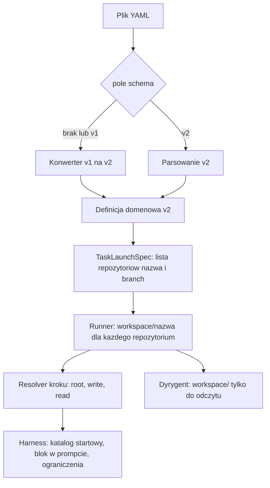

# Workflow multirepo i schemat v2 - Plan

## Goal Capsule

- **Objective:** Jeden workflow może pracować na wielu repozytoriach: każdy krok wie, w którym pisze, a które tylko czyta, a dyrygent widzi wszystkie repozytoria workflow, gdy decyduje za użytkownika.
- **Means:** Repozytoria zadania leżą obok siebie w jednym katalogu zadania, a krok dostaje z niego widok zawężony do swoich repozytoriów (KTD3, KTD5).
- **Product authority:** Decyzje użytkownika z dialogu brainstormu; ten plik jest ich zapisem. Product Contract pozostaje nadrzędny nad Planning Contract, a KTD rozstrzyga tylko mechanizm.
- **Execution profile:** Kod Rust w workspace Cargo; jedna gałąź, jednostki U1-U7 w kolejności zależności.
- **Stop conditions:** Zatrzymaj, gdy realizacja wymagałaby zmiany znaczenia któregoś R (na przykład zmiany `v1` na dysku) albo gdy backend zdalny nie może odtworzyć układu katalogów z KTD3.
- **Open blockers:** Brak.

## Product Contract

### Summary

Nowy standard definicji workflow, `schema: v2`, deklaruje listę nazwanych repozytoriów, a każdy krok wskazuje, które z nich są w zapisie, a które tylko do odczytu. Dyrygent widzi wszystkie repozytoria tylko do odczytu. Stan zadania zapamiętuje dla każdego repozytorium nazwę i branch. Definicje bez `schema` są wersją `v1` i są przy wczytaniu w locie konwertowane na `v2`.

### Problem Frame

Workflow ma dziś jedno repozytorium (`globals.workspace`, `crates/narsor-engine/src/workflow/schema.rs:256`). Agent w kroku brainstorm nie widzi dokumentacji, a krok aktualizujący dokumentację nie widzi zmian w kodzie, bo dokumentacja i kod to różne repozytoria. Dyrygent otwiera tylko workspace zadania w trybie tylko do odczytu (`crates/narsor-engine/src/conductor/invoke.rs:245`), więc decyzje w imieniu użytkownika podejmuje bez wiedzy z pozostałych repozytoriów.

### Requirements

**Definicja workflow i wersjonowanie**

- R1. Definicja workflow ma pole `schema` o wartości `v1` albo `v2`. Brak pola oznacza `v1`. Pole `version`, czyli wersja samego workflow (`schema.rs:28`), pozostaje bez zmian.
- R2. Wersja `v2` nie przyjmuje konstrukcji `v1`, w tym `globals.workspace`. Użycie ich w definicji `v2` jest błędem walidacji.
- R3. Definicja `v1` jest przy wczytaniu w pamięci konwertowana na równoważną definicję `v2`, a reszta systemu zna tylko `v2`. Plik `v1` na dysku nie jest zmieniany.
- R4. Błędy walidacji definicji `v1` odnoszą się do jej oryginalnych pól, nie do pól `v2` po konwersji.

**Repozytoria w definicji**

- R5. Definicja `v2` deklaruje listę nazwanych repozytoriów. Nazwa jest zarazem nazwą folderu repozytorium. Dokładnie jedno repozytorium jest oznaczone jako główne.
- R6. Każde repozytorium w definicji ma domyślny branch. Repozytorium można związać z rejestrem repozytoriów na stałe albo z inputem typu `repository`.

**Repozytoria w kroku**

- R7. Krok może mieć sekcję `workspace` z polami `root`, `write` i `read`. `write` i `read` to listy nazw repozytoriów, a `write` może zawierać więcej niż jedno.
- R8. `root` wskazuje katalog, w którym startuje agent: nazwę repozytorium albo `.`. `.` oznacza katalog nadrzędny zawierający foldery wszystkich repozytoriów workflow.
- R9. Krok bez sekcji `workspace` dostaje wszystkie repozytoria workflow: główne w zapisie, pozostałe tylko do odczytu.
- R10. Krok z sekcją `workspace` dostaje wyłącznie repozytoria w niej wymienione.
- R11. Repozytorium tylko do odczytu pokazuje aktualny stan zadania, łącznie ze zmianami wprowadzonymi we wcześniejszych krokach, także niezacommitowanymi i niewypchniętymi.
- R12. Krok może mieć repozytorium dokumentacji w zapisie, a repozytorium kodu tylko do odczytu, i widzi w nim zmiany kodu z wcześniejszych kroków workflow.

**Tryb tylko do odczytu**

- R13. Prompt kroku informuje agenta, jakie repozytoria są dostępne, gdzie leżą i które są tylko do odczytu.
- R14. Tam, gdzie harness ma uprawnienia pozwalające ograniczyć zapis, repozytoria tylko do odczytu są nimi chronione. Poza tym ochroną jest sama informacja w prompcie.

**Stan zadania i dyrygent**

- R15. Stan zadania zapamiętuje dla każdego repozytorium obiekt z nazwą i branchem. Na start branch to domyślny branch z definicji (R6).
- R16. Dyrygent ma dostęp do wszystkich repozytoriów workflow w trybie tylko do odczytu.

**Backendy**

- R17. Workflow multirepo działa tak samo na backendzie lokalnym i zdalnym.

**Dokumentacja**

- R18. `docs/dev/workflow-schema.md` opisuje `v2`, a konwersja `v1` na `v2` ma osobny krótki opis.

### Key Flows

- F1. Aktualizacja dokumentacji po zmianach w kodzie
  - **Trigger:** Wcześniejsze kroki zmieniły repozytorium kodu, a kolejny krok ma zaktualizować dokumentację.
  - **Steps:** Krok deklaruje repozytorium dokumentacji w `write` i repozytorium kodu w `read`. Agent startuje w repozytorium dokumentacji i czyta kod w stanie z zadania. Zmiany zapisuje tylko w dokumentacji.
  - **Covered by:** R7, R10, R11, R12, R13
- F2. Brainstorm z dostępem do dokumentacji
  - **Trigger:** Krok brainstorm w workflow z repozytoriami `code` (główne) i `docs`.
  - **Steps:** Krok nie ma sekcji `workspace` (R9), więc agent pracuje w `code` i dostaje `docs` tylko do odczytu.
  - **Covered by:** R9, R13, R14
- F3. Wczytanie istniejącej definicji
  - **Trigger:** Workflow bez pola `schema` z `globals.workspace`.
  - **Steps:** Wczytanie konwertuje go na `v2` z jednym repozytorium głównym. Workflow działa jak dotąd.
  - **Covered by:** R1, R3, R4

### Acceptance Examples

- AE1. **Covers R3.** Workflow `v1` z jednym `globals.workspace` uruchamia się bez zmiany pliku i zachowuje się jak przed zmianą.
- AE2. **Covers R2.** Definicja `schema: v2` z `globals.workspace` jest odrzucona przy walidacji.
- AE3. **Covers R8, R10.** Krok z `root: .`, `read: [a, b, c]` i `write: [d]` startuje w katalogu nadrzędnym i widzi cztery repozytoria. Inne repozytoria workflow nie są mu udostępnione.
- AE4. **Covers R9.** Krok bez sekcji `workspace` w workflow z repozytoriami `code` (główne) i `docs` ma `code` w zapisie, a `docs` tylko do odczytu.
- AE5. **Covers R11, R12.** Krok dokumentacji widzi w repozytorium kodu plik zmieniony i niezacommitowany przez wcześniejszy krok.
- AE6. **Covers R16.** Dyrygent wywołany w zadaniu z dwoma repozytoriami może przeczytać oba.

### Key Decisions

- **Wersja standardu to pole `schema`, a nie `version`.** `version` już oznacza wersję workflow, więc użycie go zmieniłoby jego znaczenie. Governs R1.
- **`v1` jest konwertowany przy wczytaniu, a nie utrzymywany w kodzie.** `v2` potrafi wyrazić wszystko, co `v1`, więc kod zna jedną wersję. Governs R2, R3.
- **Repozytorium tylko do odczytu pokazuje stan zadania, a nie stan z remote.** Krok dokumentacji ma opisywać zmiany z tego samego zadania. Governs R11, R12.
- **Krok bez deklaracji dostaje wszystkie repozytoria; deklaracja zawęża zakres do wskazanych.** Istniejące kroki nie wymagają zmian. Governs R9, R10.
- **Nie ma montowania read-only.** Montowanie dzieje się raz na workflow, a dostępy różnią się między krokami. Governs R14.
- **Naruszenia read-only nie są wykrywane.** Na start wystarcza ostrzeżenie w prompcie. Governs R14.
- **Multirepo działa na obu backendach od razu.** Workflow nie może zależeć od backendu. Governs R17.

### Scope Boundaries

**Deferred for later**

- Zmiana brancha repozytorium przy tworzeniu zadania (TUI, CLI, API). Stan zadania ma na to miejsce (R15), ale na start obowiązuje domyślny branch.
- Wykrywanie i cofanie zmian w repozytoriach tylko do odczytu.

**Poza zakresem**

- Zmiana `v1` na dysku (R3).
- Utrzymywanie kodu zdolnego działać bezpośrednio na definicji `v1`.

### Dependencies / Assumptions

- Definicja ma dziś jedno `globals.workspace` (`crates/narsor-engine/src/workflow/schema.rs:256`) i inputy typu `repository` (`docs/dev/workflow-schema.md`, sekcja inputów), które pozostają sposobem wyboru konkretnego repozytorium.
- Krok ma dziś `workspace_access` dla całego workspace (`schema.rs:541`). Sekcja `workspace` kroku zastępuje to w `v2` (KTD6).
- Zakładam, że nazwa repozytorium w definicji jest etykietą i nazwą folderu, a konkretne repozytorium i branch wiąże się z nią osobno (R6).
- Zakładam, że `root: .` ma sens także dla jednego repozytorium (KTD7).

---

## Planning Contract

**Product Contract preservation:** Product Contract unchanged. Pytania odroczone do planowania są rozstrzygnięte w KTD poniżej, a sekcja Outstanding Questions usunięta.

### Key Technical Decisions

- KTD1. **Składnia `v2` deklaruje repozytoria w `globals.repositories`, a `v1` konwerter tworzy z `globals.workspace` jedno repozytorium główne.** Każdy wpis ma `name`, `primary` (dokładnie jeden, R5), `default_branch` (R6) oraz źródło: `repository` (id z rejestru lub szablon `{{ inputs.x }}`, jak dziś w `WorkspaceSpec::Git`) albo `path` (jak `WorkspaceSpec::Local`), z `preserve_paths` per repozytorium. Konwerter nadaje repozytorium nazwę z id rejestru, a dla `local` z ostatniego członu ścieżki. Governs R3, R5, R6.
- KTD2. **Typy domenowe znają tylko `v2`; konwersja dzieje się raz w loaderze, a `schema.rs` trzyma dwa kształty YAML.** `WorkflowFile` rozpoznaje `schema` przed pełnym deserializowaniem i wybiera `v1` albo `v2` jako osobny kształt `serde` z `deny_unknown_fields`. Dzięki temu `v2` odrzuca `globals.workspace` już przy parsowaniu (R2). Governs R1-R4.
- KTD3. **Wszystkie repozytoria zadania leżą w katalogu zadania jako `workspace/<name>`; `root: .` to `workspace/`.** To jeden układ na obu backendach, bo katalog zadania i tak odtwarza runner (`crates/narsor-runner/src/runner/init.rs`), a nie kontroler. Repozytorium tylko do odczytu nie jest kopią, więc widzi bieżący stan zadania razem z zmianami niezacommitowanymi (R11, R12), a R17 wynika z tego, że backend zdalny uruchamia ten sam runner. Wynika z decyzji produktowej o braku montowania read-only. Governs R8, R11, R12, R17.
- KTD4. **Stan zadania trzyma listę repozytoriów w `TaskLaunchSpec`, a nie pojedynczy `TaskWorkspace`.** Wpis ma `name`, `branch` i tożsamość źródła (dotychczasowe `GitIdentity` albo ścieżka lokalna). Zmiana kształtu podnosi `TASK_LAUNCH_SPEC_VERSION` (`crates/narsor-protocol/src/launch.rs:19`) z 3 na 4. Starsze rekordy są odrzucane z jasnym komunikatem, zgodnie z istniejącą polityką `TaskLaunchSpec` (`crates/narsor-engine/src/domain/task.rs:107-125`), bo nie ma wierności, z jaką można je podnieść. Governs R15.
- KTD5. **Zakres kroku wylicza jeden resolver w engine: z definicji kroku daje `root`, listę zapisu i listę odczytu.** Brak sekcji `workspace` daje wszystkie repozytoria (główne w zapisie, reszta odczyt, R9), a sekcja zawęża do wymienionych (R10). Pominięty `root` oznacza repozytorium główne w kroku bez sekcji i pierwsze repozytorium z `write` w kroku z sekcją. Governs R7-R10.
- KTD6. **Sekcja `workspace` kroku zastępuje `workspace_access` w `v2`; konwerter mapuje `workspace_access: read_only` na `workspace: { read: [główne] }`, a `read_write` i brak pola na brak sekcji.** `v2` z `workspace_access` jest błędem walidacji (R2). Istniejący `read_only_paths` agenta zostaje i jest nadal rozwiązywany względem katalogu startowego (`crates/narsor-engine/src/engine/actions/harness/mod.rs:453`). Governs R2, R3.
- KTD7. **Reguły walidacji `v2`:** nazwy repozytoriów to poprawne, unikalne nazwy folderów (`is_usable_directory_name`); `root`, `write`, `read` odwołują się tylko do zadeklarowanych nazw; to samo repozytorium nie może być w `write` i `read`; `root` wskazuje repozytorium z `write` lub `read` albo `.`; `root: .` jest dozwolone także przy jednym repozytorium; sekcja `workspace` musi wymieniać co najmniej jedno repozytorium. Błędy `v1` zachowują oryginalne nazwy pól dzięki temu, że konwerter przenosi ścieżkę pola źródłowego razem z konwertowaną wartością (R4). Governs R2, R4, R5, R7, R8.
- KTD8. **Prompt kroku dostaje blok z listą repozytoriów (nazwa, ścieżka, tryb); ograniczenie zapisu stosują harnessy, które to potrafią.** Adapter dostaje listę katalogów zapisywalnych i tylko do odczytu zamiast jednej flagi `WorkspaceAccess`; adaptery bez mechanizmu ograniczenia polegają na bloku w prompcie (R14). Naruszenia nie są wykrywane (decyzja produktowa, bez zmian). Governs R13, R14.
- KTD9. **Dyrygent dostaje katalog `workspace/` z wszystkimi repozytoriami w trybie `ReadOnly`, a jego prompt zawiera ten sam blok z listą (KTD8).** Zmiana ogranicza się do ścieżki, którą `invoke.rs` już otwiera tylko do odczytu (`crates/narsor-engine/src/conductor/invoke.rs:245-275`). Governs R16.
- KTD10. **Checkpointy są liczone per repozytorium.** `capture` i `materialise` dostają dziś jeden `work_tree` (`crates/narsor-engine/src/workspace/checkpoint.rs:52-66`), więc runner wywołuje je w pętli po repozytoriach, a paczka checkpointu niesie nazwę repozytorium. Governs R11.

### High-Level Technical Design

Kierunek, nie specyfikacja.

### Assumptions

- Kod zakłada, że prowizjoner `crates/narsor-engine/src/workspace/provisioner.rs` (wiele repozytoriów, `primary` plus `secondary`) jest użyteczny jako wzór walidacji i układu katalogów, ale ścieżka runnera (`init.rs`) go nie używa; U4 rozszerza runner, nie przywraca prowizjonera.
- Skrypty (`script.rs`) z `working_dir` względnym nadal rozwiązują ścieżkę względem katalogu startowego kroku (KTD5); w konwertowanym `v1` jest nim repozytorium główne, więc zachowanie nie zmienia się (AE1).
- Szczegóły adaptacji poszczególnych harnessów do KTD8 (które potrafią ograniczyć zapis do podzbioru katalogów) ustala się przy implementacji U5.

### System-Wide Impact

- Podniesienie wersji `TaskLaunchSpec` odrzuca zadania zapisane w wersji 3, w tym wznawiane. Należy to wpisać w notatkę wydania (U7).
- Ścieżka workspace w zadaniu zmienia się z `workspace/` na `workspace/<name>/`; kod czytający `storage.workspace_dir()` jako korzeń repozytorium (`crates/narsor-runner/src/runner/mod.rs:1754`, `crates/narsor-engine/src/conductor/snapshot.rs:580`) wymaga przeglądu w U4 i U6.
- Manifest Kubernetes zna dziś jedno repozytorium (`crates/narsor-controller/src/kubernetes/manifest.rs:485`).

---

## Implementation Units

### U1. Schemat `v2`, loader i konwerter `v1`

- **Goal:** Wczytać oba schematy do jednej definicji domenowej `v2`.
- **Requirements:** R1, R2, R3, R4, R5, R6, R7; KTD1, KTD2, KTD6.
- **Dependencies:** Brak.
- **Files:** `crates/narsor-engine/src/workflow/schema.rs`, `crates/narsor-engine/src/workflow/loader.rs`, `crates/narsor-engine/src/domain/workflow_definition.rs`; testy w `crates/narsor-engine/src/workflow/loader.rs` (moduł testów) i fixtury w `tests/fixtures/`.
- **Approach:** Dodać `schema` do `WorkflowFile`, kształt `v2` z `globals.repositories` i `workspace` kroku, oraz zastąpić `WorkflowDefinition.workspace` listą repozytoriów i `workspace_access` sekcją kroku w typach domenowych. Konwerter zachowuje ścieżki pól źródłowych dla walidatora (KTD7). Wzorzec błędów: istniejące `LoadError` z kontekstem pliku (`loader.rs:50-78`).
- **Test scenarios:**
  - AE1: `v1` z jednym `globals.workspace` typu `git` i typu `local` (z `preserve_paths`) daje definicję `v2` z jednym repozytorium głównym i niezmienionym plikiem.
  - AE2: `schema: v2` z `globals.workspace` oraz z `workspace_access` w kroku jest odrzucone.
  - Brak `schema` jest `v1`; `schema: v3` i nieznane pole są błędem; `version` zachowuje znaczenie.
  - `workspace_access: read_only` w `v1` daje `workspace: { read: [główne] }` (KTD6).
  - Dwa repozytoria główne lub żadne w `v2` jest błędem (R5).
- **Verification:** `cargo test -p narsor-engine workflow::`.

### U2. Walidacja `v2` z odwołaniami do pól źródłowych

- **Goal:** Zastosować reguły KTD7 i zachować pola `v1` w komunikatach.
- **Requirements:** R2, R4, R5, R7, R8; KTD7.
- **Dependencies:** U1.
- **Files:** `crates/narsor-engine/src/workflow/validator.rs` (obecna walidacja `globals.workspace` przy `validator.rs:680-699`), `crates/narsor-engine/src/domain/workflow_definition.rs`; testy w `validator.rs`.
- **Approach:** Rozszerzyć walidator o reguły KTD7 i zbierać wszystkie naruszenia jak dziś. Szablony w polach źródła repozytorium walidować jak obecne `globals.workspace.repository`.
- **Test scenarios:**
  - Nieznana nazwa w `root`, `write` albo `read` daje błąd z nazwą kroku i pola.
  - To samo repozytorium w `write` i `read`; `root` spoza wymienionych; pusta sekcja `workspace`.
  - `root: .` przy jednym repozytorium przechodzi.
  - Błąd w `v1` (zły szablon w `globals.workspace.repository`) wskazuje `globals.workspace.repository`, nie pole `v2` (R4).
  - Nazwa niebędąca poprawną nazwą folderu lub zduplikowana jest błędem.
- **Verification:** `cargo test -p narsor-engine workflow::validator`.

### U3. Stan zadania: lista repozytoriów z nazwą i branchem

- **Goal:** Zapamiętać dla każdego repozytorium nazwę, branch i tożsamość źródła.
- **Requirements:** R6, R15, R17; KTD4.
- **Dependencies:** U1.
- **Files:** `crates/narsor-engine/src/domain/environment.rs` (`TaskWorkspace`, `:737`), `crates/narsor-engine/src/domain/task.rs`, `crates/narsor-protocol/src/launch.rs`, `crates/narsor-engine/src/tasks/mod.rs`, `crates/narsor-engine/src/registry/store.rs` (rozstrzyganie brancha, `:267-285`), `crates/narsor-controller-runtime/src/backend.rs:171`; testy przy tych plikach.
- **Approach:** Zastąpić `TaskWorkspace` kolekcją wpisów; tworzenie zadania rozwiązuje dla każdego repozytorium rejestr, input `repository` i domyślny branch (R6), ustawiając `branch` na domyślny (R15). Podnieść `TASK_LAUNCH_SPEC_VERSION` do 4 i zachować komunikat o starszych wersjach. `TaskWorkspace::Local` pozostaje niedozwolone dla backendów obrazowych.
- **Test scenarios:**
  - Zadanie z dwoma repozytoriami (jedno stałe z rejestru, drugie z inputu `repository`) zapisuje oba wpisy z domyślnymi branchami.
  - Rekord wersji 3 jest odrzucony komunikatem z obiema wersjami.
  - Digest rekordu zmienia się, gdy zmienia się branch repozytorium.
  - Zadanie `v1` konwertowane do jednego repozytorium daje listę jednoelementową o tej samej tożsamości źródła co dziś.
- **Verification:** `cargo test -p narsor-engine domain::task`, `cargo test -p narsor-protocol`.

### U4. Runner: układ `workspace/<name>` i checkpointy per repozytorium

- **Goal:** Zainicjować wszystkie repozytoria zadania na obu backendach i przenosić ich stan między krokami.
- **Requirements:** R8, R11, R12, R17; KTD3, KTD10.
- **Dependencies:** U3.
- **Files:** `crates/narsor-runner/src/runner/init.rs`, `crates/narsor-runner/src/runner/storage.rs`, `crates/narsor-runner/src/runner/mod.rs` (`workspace()` przy `:1754`), `crates/narsor-engine/src/engine/runner.rs` (`:3509`), `crates/narsor-engine/src/tasks/mod.rs` (`:724`), `crates/narsor-engine/src/workspace/checkpoint.rs`, `crates/narsor-controller/src/kubernetes/manifest.rs` (`:485`), `crates/narsor-controller/src/local/untrusted.rs`; testy w `init.rs` i `checkpoint.rs`.
- **Approach:** Pętla po wpisach `TaskLaunchSpec` z istniejącą logiką klonowania pinned commit i wznowienia częściowego klona, każdy do `workspace/<name>`. Checkpoint i materializacja per repozytorium (KTD10). Zbadać, czy poświadczenia i sekrety w manifeście Kubernetes dotyczą jednego repozytorium, i rozszerzyć na wszystkie.
- **Test scenarios:**
  - Inicjalizacja dwóch repozytoriów daje `workspace/code` i `workspace/docs`; wznowienie po przerwanym klonie drugiego odzyskuje oba.
  - AE5: zmiana niezacommitowana w `code` przeżywa checkpoint i materializację i jest widoczna po wznowieniu.
  - Starsze jednorepozytoriowe zadanie `v1` działa z jednym `workspace/<name>`.
- **Verification:** `cargo test -p narsor-runner`, `cargo test -p narsor-engine workspace::`, `cargo test -p narsor-controller`.

### U5. Zakres kroku: resolver, prompt i ograniczenia harnessów

- **Goal:** Dać każdemu krokowi właściwy katalog startowy, listę repozytoriów w prompcie i ochronę tylko do odczytu tam, gdzie harness ją wspiera.
- **Requirements:** R7, R8, R9, R10, R12, R13, R14; KTD5, KTD6, KTD8.
- **Dependencies:** U1, U4.
- **Files:** nowy moduł resolvera w `crates/narsor-engine/src/engine/actions/` (obok `agent.rs`), `crates/narsor-engine/src/engine/actions/agent.rs` (`:286-296`), `crates/narsor-engine/src/engine/actions/script.rs` (`:80-154`), `crates/narsor-engine/src/engine/actions/harness/mod.rs`, adaptery `claude_code.rs`, `codex.rs`, `github_copilot.rs`, `opencode.rs`, `crates/narsor-engine/src/engine/actions/agent/contract.rs` (`:197`); testy przy tych plikach.
- **Approach:** Resolver zwraca katalog startowy, zapis i odczyt (KTD5). Żądanie harnessu dostaje listy katalogów zamiast jednej flagi; adaptery mapują je na natywne mechanizmy, a pozostałe polegają na bloku promptu. Ponowienie kontraktu wymuszające `ReadOnly` ma obejmować wszystkie katalogi.
- **Test scenarios:**
  - AE3: `root: .`, `read: [a, b, c]`, `write: [d]` daje katalog `workspace/` i cztery repozytoria; piąte nie jest wymienione.
  - AE4: brak sekcji `workspace` daje główne w zapisie i resztę tylko do odczytu.
  - F1/AE5: krok z `write: [docs]`, `read: [code]` startuje w `docs`, a prompt wymienia `code` jako tylko do odczytu.
  - Prompt zawiera nazwę, ścieżkę i tryb każdego repozytorium (R13).
  - Adapter bez wsparcia ograniczeń nie zgłasza błędu i polega na prompcie.
  - Skrypt z `working_dir` w konwertowanym `v1` działa jak przed zmianą.
- **Verification:** `cargo test -p narsor-engine engine::actions`.

### U6. Dyrygent z wszystkimi repozytoriami

- **Goal:** Dyrygent czyta wszystkie repozytoria workflow tylko do odczytu.
- **Requirements:** R16; KTD9.
- **Dependencies:** U4, U5.
- **Files:** `crates/narsor-engine/src/conductor/invoke.rs` (`:245-275`), `crates/narsor-engine/src/conductor/prompt.rs` (`:20-50`), `crates/narsor-engine/src/conductor/snapshot.rs` (`:580-606`); testy przy tych plikach.
- **Approach:** Otworzyć `workspace/` jako katalog startowy dyrygenta, wstawić blok z listą repozytoriów (wspólny z U5), a czytanie artefaktów w `snapshot.rs` oprzeć o repozytorium główne.
- **Test scenarios:**
  - AE6: dyrygent w zadaniu z dwoma repozytoriami dostaje oba w katalogu startowym i w prompcie jako tylko do odczytu.
  - Zadanie z jednym repozytorium zachowuje dotychczasowy snapshot artefaktów.
- **Verification:** `cargo test -p narsor-engine conductor::`.

### U7. Dokumentacja i fixtury

- **Goal:** Opisać `v2` i konwersję `v1`.
- **Requirements:** R18.
- **Dependencies:** U1-U6.
- **Files:** `docs/dev/workflow-schema.md`, `README.md` (przykład, jeśli odwołuje się do `globals.workspace`), nowe fixtury `v2` w `tests/fixtures/`, `tests/integration/`.
- **Approach:** Opisać pola `schema`, `globals.repositories`, `workspace` kroku, reguły walidacji (KTD7) i krótką sekcję konwersji `v1` (KTD1, KTD6). Dodać notatkę o odrzuceniu zadań zapisanych w wersji 3 (KTD4). Jeśli istnieje tabela użytkowa workflow w `docs/user`, zaktualizować ją.
- **Test scenarios:** Test integracyjny ładujący fixturę `v2` z dwoma repozytoriami i walidujący ją poleceniem `narsor-cli validate`.
- **Verification:** `cargo test --workspace`.

---

## Verification Contract

| Zakres | Polecenie | Dowodzi |
|---|---|---|
| Schemat i walidacja | `cargo test -p narsor-engine workflow::` | AE1, AE2, R1-R8 |
| Stan zadania | `cargo test -p narsor-engine domain::task` i `cargo test -p narsor-protocol` | R15 |
| Runner i checkpointy | `cargo test -p narsor-runner` | AE5, R11, R17 |
| Kroki i dyrygent | `cargo test -p narsor-engine engine::actions` i `cargo test -p narsor-engine conductor::` | AE3, AE4, AE6 |
| Całość | `cargo test --workspace` oraz `cargo test --workspace -- --include-ignored` (`CONTRIBUTING.md:17-18`) | brak regresji |

## Definition of Done

- Wszystkie R1-R18 i AE1-AE6 mają test, który padałby bez zmiany.
- `cargo test --workspace` przechodzi; testy ignorowane przechodzą, gdy środowisko je uruchamia.
- Plik `v1` z fixtur nie jest zmieniany przez wczytanie, a zadanie `v1` zachowuje dotychczasowe zachowanie.
- `docs/dev/workflow-schema.md` opisuje `v2` i konwersję.
- Kod porzuconych podejść i tymczasowe ścieżki usunięte z diffu.
