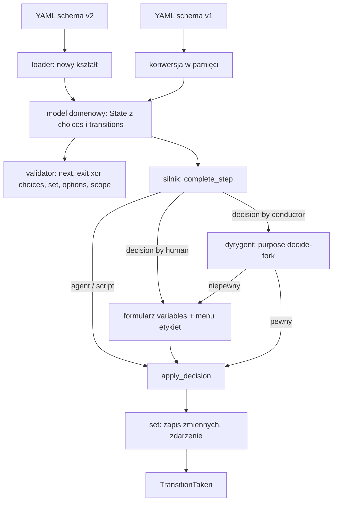
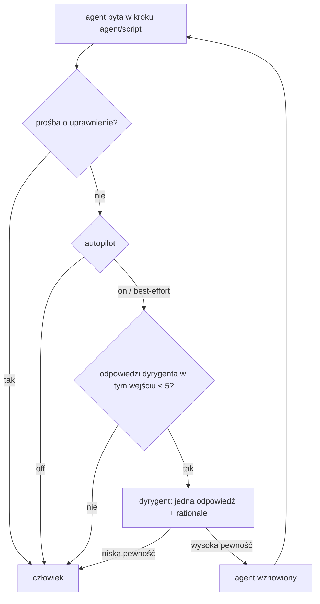

# Przebudowa schematu workflow v2 - Plan

## Goal Capsule

- **Objective:** Autor workflow opisuje rozwidlenia, zmienne i pytania do człowieka w jednej formie zapisu. Walidator nie pilnuje już zgodności dwóch list z tymi samymi etykietami.
- **Means:** Nowy kształt YAML `schema: v2` kompilowany do istniejącego modelu domenowego (KTD1). Stary kształt `schema: v1` działa dalej przez konwersję w pamięci.
- **Authority:** Dokument pomysłu (`origin`) wyznacza kierunek. Gdy kod zaprzecza dokumentowi, wygrywa kod, a różnica trafia do Open Questions.
- **Execution profile:** 4 PR-y (PR1-PR4), każdy bezpieczny po scaleniu. Kolejność: PR1, PR2, PR3, PR4 (każdy czeka na poprzedni).
- **Stop conditions:** Zatrzymaj pracę, gdy zmiana wymaga zerwania zgodności z zapisanymi zadaniami (`launch_spec`, pinned YAML, `pending_input.json`) bez decyzji właściciela. Wyjątki ustalone w planie: R14 (`autopilot`) i R17 (przeskoki w v2).
- **Who ships:** Wykonawca planu (`ce-work`). Scalenie PR zostaje przy właścicielu.

---

## Product Contract

### Summary

Schemat v2 dostaje jedną formę zapisu: `choices` jako mapa obiektów wyjścia z `next`, `exit` dla kroku liniowego, krok `decision` z polem `by` (`human` albo `conductor`), jedną sekcję `variables` z polami `scope`, `source`, `type`, `options`, parametr `set` na wyjściu oraz części promptu z warunkiem `when`. `autopilot` ma trzy wartości. Pole `allow_manual_override` znika z definicji.

### Problem Frame

Dziś `choices` i `transitions` powtarzają etykiety. Gate `human` zachowuje się inaczej zależnie od liczby pól `select`. `inputs` znaczy dwie rzeczy. Zakres zmiennej jest ukryty w nazwie (`local.`). Provider `agent` w bloku `decision` jest martwy. Schemat v2 (wieloreposytoryjny) nie jest jeszcze nigdzie używany, więc przebudowa kosztuje mniej niż wprowadzenie v3 (patrz `origin`).

### Requirements

**Kształt schematu**

- R1. `choices` to mapa etykieta → obiekt wyjścia (`description`, `requires_variables`, `requires_artifacts`, `set`, `next`). Nie ma osobnych `transitions`.
- R2. Krok liniowy ma `exit` (obiekt wyjścia bez etykiety). Krok ma `exit` albo `choices`, nigdy obu. Stan końcowy nie ma żadnego. `next` występuje tylko w obiekcie wyjścia. Przy `exit` agent nie zwraca `choice`.
- R3. Krok `decision` (typ akcji) ma pole `by: conductor | human` i jedno pole `message`. Provider `agent` znika z v2. `prompt` zostaje tylko dla agenta.
- R4. Jedna sekcja `variables` na krokach agent, script i decision (`name`, `description` opcjonalny, `type`, `options`). `inputs` zostaje tylko na poziomie workflow.
- R5. Jedna forma zapisu `terminal_states` (mapa id → status) i jedna forma etykiety w `choices`.
- R6. `failure` i `timeout` to zwykłe etykiety w `choices` kroku akcji.

**Zmienne i szablony**

- R7. `scope: global | local` (domyślnie `global`). Zmienna lokalna to prywatny stan kroku, trwały między wejściami w ten sam krok w jednym execution. Nowa wartość zastępuje starą. Brak wartości zostawia starą. Odczyt tylko przez `{{ local.NAME }}` w `prompt` lub `message`. Nazwa jest unikalna w kroku.
- R8. Wartość spoza `options` odrzuca silnik i robi reprompt. Kontrakt odpowiedzi agenta wylicza dozwolone wartości z góry.
- R9. `set` jest parametrem wyjścia (`choices` albo `exit`). Wykonuje się przy przejściu, po wyniku kroku, przed zmianą kroku. Dotyczy tylko zmiennych zadeklarowanych w opuszczanym kroku. Nazwa spoza listy to błąd walidacji. Wartość to literał albo szablon. `set.local` jest dostępne tylko przy `scope: local`. Zdarzenie "zmienna ustawiona przez workflow" trafia do audytu. Ręczne przełączenie i wymuszone przejście nie wykonują `set`.
- R10. `source: step | workflow` w deklaracji zmiennej (domyślnie `step`). Zmienna `workflow` nie jest w kontrakcie agenta ani w formularzu. Gdy agent ją zwróci, trafia do `additional_data` z ostrzeżeniem. Walidator wymaga spójnych `type` i `options` w krokach.
- R11. `prompt` i `message` to string albo lista części. Część to string albo `{text, when}`. `when` to referencja lub lista referencji, wszystkie muszą być niepuste. Puste: brak wartości, `null`, `""`, same białe znaki. `false` i `0` nie są puste. Części łączy pusta linia. Błędy wskazują część ("prompt, część 2"). Bez filtrów, wyrażeń i pętli.
- R12. Wynik poprzedniego kroku wraz z etykietą jest zwykłym kontekstem `steps.X.*` (nowe: `steps.X.label`).

**Człowiek i dyrygent**

- R13. Decision `by: human` pokazuje formularz z `variables` i menu etykiet. Wymagania etykiety (`requires_variables`) obowiązują per etykieta. Operator widzi wartości lokalne w podglądzie kroku. Dyrygent widzi je w swoim kontekście.
- R14. `autopilot` ma wartości `off | on | best-effort` (domyślnie `off`, bez zgodności wstecznej z `true`/bool). Dotyczy tylko kroków automatycznych (agent, script). `on`: dyrygent odpowiada tylko z wysoką pewnością i konserwatywną instrukcją. `best-effort`: ten sam próg, instrukcja zachęca do rozsądnej odpowiedzi, założenia trafiają do uzasadnienia. Limit: 5 odpowiedzi dyrygenta na jedno wejście w krok, potem pytanie idzie do człowieka. Rationale jest zapisany w zdarzeniu i widoczny w *Rozmowie*. Prośby o uprawnienia zawsze idą do człowieka.
- R15. `by: conductor` zawsze decyduje dyrygent. Niepewny dyrygent przekazuje sprawę operatorowi niezależnie od `autopilot`.
- R16. Koszt dyrygenta jest doliczany do kroku, w którym decydował, w osobnym polu `timeline.json` obok kosztów subagentów. Sumy (agent, dyrygent, łącznie) liczy klient.
- R17. `allow_manual_override` nie jest częścią definicji v2. W workflow v2 operator może przełączyć krok ręcznie i wymusić przeskok. Wymuszenie wymaga podania powodu i jest audytowane. Definicje w starym kształcie (v1 i stary v2) dalej respektują to pole.

**Zgodność**

- R18. Workflow `schema: v1` i workflow `schema: v2` w starym kształcie (`choices` + `transitions`) ładują się i działają jak dziś (konwersja w pamięci do tego samego modelu). Zapisane zadania (`launch_spec`, pinned YAML, `pending_input.json`) działają dalej. Jedyny wyjątek to `autopilot` (R14).
- R19. `workflows/template.yaml` i dokumentacja (`docs/dev/workflow-schema.md`, `docs/user/*`) opisują nowy kształt.

### Key Decisions

- **Jedna forma zamiast skrótów.** `exit` zamiast `next: x` na poziomie kroku. Wrócić do tematu, gdy workflow wyjdą zbyt rozwlekłe. Governs R1, R2, R5.
- **`by: switch` poza zakresem v2.** Brak workflow, które go potrzebuje. Governs R3.
- **`set` tylko na etykiecie, tylko przypisanie.** Bez wyrażeń (D6 z `origin`). Governs R9.
- **`autopilot` zmienia instrukcję, nie próg.** Przy pewności `high|low` niższy próg oznaczałby strzelanie. Governs R14.
- **`context.X` i `context.variables.X` zostają obie.** Governs R12 (bez zmiany).

### Scope Boundaries

**Deferred for later**

- `by: switch` (szkic w `origin`).
- Wspólna deklaracja zmiennych w `globals` (gdy deklaracje per krok się rozrosną).
- Skrót `set` na poziomie kroku (gdy powtórzenia na etykietach się rozrosną).
- Usunięcie ścieżek v1 z silnika (gate `inputs`, blok `decision`). Zostają dla zapisanych zadań (KTD2).

**Deferred to Follow-Up Work**

- Zdublowane wymaganie komentarza (`resume_comment_field` obok `requires_variables`): patrz Open Questions.
- Przepisanie `wruw-change-2` (plik nie istnieje w repo, patrz Open Questions).

**Considered and not built** (zasada 3.8)

- Licznik kosztów dyrygenta poza tabelą Przebieg i sumami klienta. Powód: wymóg dotyczy `timeline.json` i sum.
- Etykiety poprzednich kroków jako osobne pole snapshotu dyrygenta. Powód: autor przekazuje je przez `{{ steps.X.label }}` w `message`, jak człowiekowi (`origin`, punkt 3).
- Ustawienie instancji lub kontrolera wyłączające wymuszone przeskoki w v2 oraz rozszerzony audyt (kto wymusił, jakie wymagania ominięto). Powód: przeskok wymaga powodu i jest audytowany, a właścicielem zadania jest ten, kto je uruchomił. Zmieni decyzję: wdrożenie współdzielone, w którym operator nie jest właścicielem zadania.
- Migrator plików ze starego kształtu v2 do nowego. Powód: stary kształt dalej się ładuje (KTD3). Zmieni decyzję: decyzja o usunięciu starego kształtu.

### Open Questions

**Blokujące:** brak.

**Odroczone do wykonania**

- `resume_comment_field`: plan zachowuje pole na obiekcie wyjścia i każe mu wskazywać zmienną typu `text` z `variables` (KTD7). Zdublowane wymaganie komentarza zostaje do osobnego follow-upu.
- `requires_human_approval`: plan zostawia flagę na obiekcie wyjścia agenta bez zmiany semantyki (KTD7). `origin` nie mówi, gdzie ma żyć.
- `timeout` jako etykieta: plan zostawia magię po nazwie (`TIMEOUT_LABEL`) i opisuje ją w schemacie oraz walidatorze (KTD8).
- `base_branch: main`: walidator dziś wymaga `base_branch` dla każdego repozytorium z rejestru, a v1 `ref` jest opcjonalny. Plan zostawia wymóg. Przykłady v2 piszą `main`. Zmiana walidatora, by dopuścić brak (domyślny branch z rejestru), wymaga decyzji właściciela.
- Pliki `workflows/wruw-change-2.yaml` i `docs/brainstorms/2026-11-05-wruw-change-2-propozycja.yaml` nie istnieją w repo ani w historii git. Sekcja "Wnioski z przepisania" w `origin` jest niesprawdzalna. Potrzebny właściciel dokumentu, by dostarczyć pliki.
- Czy zmiana wersji `TASK_LAUNCH_SPEC_VERSION` (obecnie 4) jest potrzebna: rozstrzyga U1 po sprawdzeniu, czy zmiany domeny są wyłącznie addytywne (`serde(default)`).

### Sources

- `origin`: `docs/brainstorms/2026-11-05-przebudowa-schematu-workflow-v2-idea.md` (wszystkie sekcje, w tym "Rozstrzygnięte").
- Kod: `crates/narsor-engine/src/workflow/{schema,loader,validator,template}.rs`, `crates/narsor-engine/src/domain/workflow_definition.rs`, `crates/narsor-engine/src/engine/runner.rs` (`apply_decision`, `complete_step`), `engine/runner/{step_memory,rescue,operations}.rs`, `engine/actions/{human,agent/contract,answer}.rs`, `conductor/*`, `engine/timeline_file.rs`, `narsor-protocol/src/{panel,api/human_input,api/timeline,event}.rs`.
- Wnioski z researchu, które zmieniają założenia `origin` (zweryfikowane w kodzie):
  - `local.*` już istnieje (prefiks nazwy, tylko agent, magazyn `metadata.engine.step_locals`). Punkt 6 to migracja mechanizmu, nie nowy magazyn.
  - Dziś limit "2" to `MAX_AUTOMATIC_ATTEMPTS` (próby wywołania po błędzie), nie limit odpowiedzi. Limit 5 wymaga nowego licznika.
  - Dziś `autopilot` działa tylko dla pytania zadanego po reprompcie (2 miejsca wywołania). Pierwsze pytanie agenta zawsze idzie do człowieka.
  - `by: conductor` nie istnieje. `DecisionProviderType::Conductor` jest tylko wartością w zapisie zdarzeń.
  - `steps.X` ma tylko `reply`, `stdout`, `stderr`. Etykieta wymaga nowego pola.
  - Rationale odpowiedzi w `autopilot` nie jest dziś nigdzie zapisany.
  - Dyrygent nie raportuje kosztu (`HarnessRun` nie ma pola użycia).
  - `allow_manual_override` jest w `schema.rs`. Brakuje go tylko w `docs/dev/workflow-schema.md`.
  - `docs/dev/workflow-schema.md` (okolice "Reserved variable autopilot") wspomina `default` zmiennej kroku. Takie pole nie istnieje.
- Poprzednie plany tego obszaru: `docs/plans/2026-10-18-001-feat-przekaz-kontekstu-miedzy-krokami-plan.md`, `docs/plans/2026-09-29-001-feat-dyrygent-i-obsluga-input-needed-plan.md`.
- Learning: `docs/solutions/logic-errors/workspace-ref-hardcoded-main-ignored-default-branch-2026-10-19.md` (ryzyko twardego `main`).

---

## Planning Contract

### Key Technical Decisions

- KTD1. **Loader kompiluje nowy kształt do istniejącego modelu domenowego.** `State.choices` i `State.transitions` zostają. `ChoiceDefinition` dostaje pola addytywne (`set`), a `exit` kompiluje się do jednej etykiety o zarezerwowanej nazwie (stała w domenie). Dzięki temu konsumenci (`decision::check_label`, `operations.rs`, `service.rs`, `conductor`) nie zmieniają się. Powód: `transitions` czyta ~6 modułów, a model domenowy jest zapisany w `launch_spec` i `pending_input.json`.
- KTD2. **Ścieżki v1 zostają w silniku.** Gate `type: human` z `inputs`, blok `decision` i wnioskowanie etykiety z jednego `select` działają dla v1 bez zmian. Nowy kod dla v2 jest równoległy (akcja `decision`). Powód: zapisane zadania i pinned YAML muszą działać (R18). Usunięcie ścieżek v1 to osobny, odroczony krok.
- KTD3. **Kształt rozpoznawany po zawartości stanów.** Workflow v1 (brak pola `schema:` lub `v1`) używa starego kształtu. Workflow `schema: v2` z kluczem `transitions` w którymkolwiek stanie ładuje się przez dotychczasową ścieżkę (stary kształt + reguły v2 dla `workspaces`), z diagnostyką o przestarzałym kształcie. Pozostałe `schema: v2` używają nowego kształtu. Powód: wykonania uruchomione na obecnym wydaniu mają w pinned YAML stary v2, a wznowienie ładuje ten plik ponownie (R18). Ścieżka starego kształtu już istnieje, więc koszt jest mały.
- KTD4. **Zakres zmiennej przez deklarację, magazyn bez zmian.** `metadata.engine.step_locals` zostaje. Zmienna jest lokalna, gdy deklaracja ma `scope: local` albo (stary kształt) gdy nazwa zaczyna się od `local.`. Model domenowy zachowuje nazwy z prefiksem bez zmian. Jeden pomocnik rozstrzyga zakres i obsługuje `keep_locals`, `shared_variables` i `unmet_requirements`. Powód: semantyka zastąp/zachowaj już zgadza się z R7, a zapisane definicje v1 mają prefiks bez `scope`.
- KTD5. **`set` w jednym miejscu: `apply_decision`.** Po zapisie zmiennych wyniku i `keep_locals`, przed `TransitionTaken`. Wszystkie ścieżki (agent, script, decision human i conductor, rescue) przechodzą przez `apply_decision`. `apply_manual_transition` nie dotyka zmiennych, więc R9 (wyłączenie ręcznego przełączenia) dzieje się samo.
- KTD6. **Akcja `decision` to nowy typ akcji w domenie** (`ActionConfig::Decision`, pola `by`, `message`). Dla `by: human` silnik buduje pola formularza ze `state.variables` (dziś pola są puste). Dla `by: conductor` nowy `ConductorPurpose` (decide-fork) i asynchroniczna gałąź w `complete_step`.
- KTD7. **`resume_comment_field` i `requires_human_approval` zostają na obiekcie wyjścia** z tą samą semantyką. `resume_comment_field` wskazuje zmienną `text` z `variables` kroku (zamiast pola `inputs`). Zdublowanie z `requires_variables` odroczone.
- KTD8. **`timeout` zostaje etykietą po nazwie.** Walidator dopuszcza etykietę `timeout` tylko na krokach agent i script. Schemat i docs opisują to wprost.
- KTD9. **`autopilot` jako enum z parsowaniem ścisłym** w jednym miejscu (zastępuje `autopilot_is_on`). Wartość nieznana liczy się jako `off`. Wybór instrukcji dla dyrygenta po wariancie, próg `high` bez zmian.
- KTD10. **Koszt dyrygenta przez nowe pole czytania użycia**, osobne od kosztu agenta (`UsageReading` i `PositionUsage` dostają pola addytywne z `serde(default)`). `timeline.json` zostaje w wersji 1, bo zmiana jest addytywna.
- KTD11. **Zgoda na ręczne przeskoki w v2: zawsze dozwolone dla operatora z powodem.** Definicje w starym kształcie nadal respektują `allow_manual_override` (pole zostaje w domenie). `TransitionOffer.override_allowed` zostaje w API. Jedna funkcja silnika rozstrzyga zgodę i obsługuje serwer (`manual_transitions`, `check_operator_command`) oraz runner (`plan_operator_transition`). Powód: workflow v2 nie ma pola, a v1 i zapisane zadania nie mogą zmienić zachowania (R18). Alternatywa odrzucona: ustawienie instancji (patrz Scope Boundaries).

### Assumptions

- Tryb autonomiczny: nikt nie potwierdził zakresu. Plan obejmuje całość `origin` (punkty 1-11, "Rozstrzygnięte").
- Punkt 8 `origin` ("agent poddał się w kroku automatycznym") obejmuje także pierwsze pytanie agenta w danej próbie, nie tylko pytanie po reprompcie. To rozszerzenie dzisiejszych dwóch miejsc wywołania (patrz U10).
- `description` zmiennej jest opcjonalny w v2 (przykład w `origin` pomija go dla `autopilot`). W v1 zostaje wymagany.
- Pole `type` zmiennej przyjmuje te same wartości co pola formularza (`text`, `select`) plus `string`, `integer`, `boolean`. Pełną listę ustala U2 na podstawie `InputSchema`.
- Wartości `set` w szablonach renderują się w zakresie opuszczanego kroku z dostępem do `context`, `steps`, `local`.

### High-Level Technical Design

Przepływ kompilacji i wykonania (kierunek, nie specyfikacja):

Stany `autopilot` przy pytaniu agenta w kroku automatycznym:

### System-Wide Impact

- **Zapisane dane:** `launch_spec.definition`, pinned YAML na execution, `pending_input.json`. Zmiany domeny są addytywne (`serde(default)`), by stare dane się wczytywały (U1 weryfikuje).
- **Kontrakty zewnętrzne:** `TransitionOffer` w API (`override_allowed`), DTO `OutputDefinitionView` (dodaj wymagane zmienne), `ConductorPurposeDto`/`ConductorTriggerDto`, `EventData` (nowe zdarzenia), `timeline.json`.
- **Dyrygent:** snapshot pokazuje pinned definicję przez `serde_yaml`. Zmiana kształtu domeny przesuwa złote pliki `tests/fixtures/conductor/prompt_*.txt`.
- **Operator (TUI/CLI):** formularz decision, wartości lokalne w podglądzie, jednolinijkowy opis nowych zdarzeń w `src/tui/event_text.rs`, rozmowa dyrygenta w `src/tui/task_app/tabs/conductor.rs`.
- **Dokumentacja:** `tests/integration/docs_links.rs` sprawdza linki i kotwice w utrzymywanych docs. Zmiana nagłówków w `workflow-schema.md` może je złamać.

### Risks

- **Duży zakres fixtur:** 83 pliki YAML z `transitions:` i ok. 20 plików Rust z YAML w treści. Fixtury v1 i fixtury starego v2 zostają bez zmian (testują ścieżkę starego kształtu). Dodajemy fixtury nowego kształtu i przepisujemy `template.yaml`. Ryzyko: pomyłka, że stary kształt zniknął. Test: dotychczasowy zestaw pozostaje zielony.
- **Rozjazd docs i fixtury:** `tests/fixtures/implement_feature.yaml` jest kopią sekcji 4 `workflow-schema.md`. Zmieniać razem.
- **Asynchroniczność `complete_step`:** gałąź `by: conductor` wymaga restrukturyzacji synchronicznej funkcji. Ryzyko regresji w rescue. Test: istniejące `conductor_label` i `engine_recovery` zostają zielone.
- **Zmiana zachowania przeskoków w v2:** wymuszenie przeskoku jest dozwolone domyślnie (KTD11). Opisać w docs i w opisie PR. Serwer i runner z różnych wydań mogą się różnić, więc PR4 zmienia obie strony razem.

---

## Implementation Units

| U | Tytuł | Główne pliki | Zależy od |
|---|---|---|---|
| U1 | Model domenowy: zmienne, `set`, akcja decision | `domain/workflow_definition.rs` | - |
| U2 | Schemat YAML v2 i loader | `workflow/{schema,loader}.rs` | U1 |
| U3 | Walidator dla v2 | `workflow/validator.rs` | U2 |
| U4 | Fixtury nowego kształtu, testy ładowania | `tests/fixtures/v2/**`, `tests/integration/{schema_loading,validation}.rs` | U3 |
| U5 | Zakres zmiennych przez deklarację i `options` | `engine/runner/step_memory.rs`, `engine/actions/agent/contract.rs` | U1, U3 |
| U6 | Kroki `exit` (etykieta domyślna) | `engine/actions/{answer,agent}`, `runner.rs` | U5 |
| U7 | `set`, zdarzenie, `steps.X.label` | `runner.rs`, `template.rs`, `event.rs` | U5 |
| U8 | Części promptu z `when` | `workflow/template.rs` | U2 |
| U9 | Decision `by: human`: formularz, wartości lokalne, `template.yaml` | `actions/human.rs`, `narsor-protocol/src/panel`, `workflows/template.yaml` | U5, U7 |
| U10 | `autopilot` trójwartościowy, limit 5, rationale | `runner/rescue.rs`, `conductor/prompt.rs` | U5 |
| U11 | Decision `by: conductor` | `conductor/*`, `runner.rs` | U9, U10 |
| U12 | Koszt dyrygenta w `timeline.json` | `engine/timeline_file.rs`, `conductor/invoke.rs` | U11 |
| U13 | Koniec `allow_manual_override` w definicji v2 | `operations.rs`, `service.rs`, `schema.rs` | U3 |
| U14 | Dokumentacja i zgodność | `docs/dev/workflow-schema.md`, `docs/user/*` | U1-U13 |

### PR1: Schemat, loader i walidator (U1-U4)

Waits on: brak.

### U1. Model domenowy: zmienne, `set`, akcja decision

- **Goal:** Dodać do domeny pola potrzebne nowemu kształtowi bez zmiany istniejących konsumentów.
- **Requirements:** R1, R2, R4, R7, R9, R10, R18.
- **Dependencies:** brak.
- **Files:** `crates/narsor-engine/src/domain/workflow_definition.rs`, `crates/narsor-protocol/src/launch.rs`, testy jednostkowe w tym samym pliku.
- **Approach:**
  - Rozszerzyć `VariableDefinition` o `scope`, `source`, `type`, `options`. `description` staje się opcjonalny.
  - Dodać `set` do `ChoiceDefinition` (mapa nazwa → wartość, osobny klucz dla zmiennych lokalnych).
  - Dodać `ActionConfig::Decision` (`by`, `message`) i zarezerwowaną etykietę wyjścia `exit` (stała).
  - Wszystkie pola addytywne z `serde(default)`. Sprawdzić, czy stary `launch_spec` i `pending_input.json` nadal się wczytują. Bump `TASK_LAUNCH_SPEC_VERSION` tylko gdy test wczytania zawiedzie.
  - Literały `State {..}` w testach (`engine/decision.rs`, `engine/retry.rs`, `tests/integration/validation.rs`) zaktualizować tak, by kompilowały się nadal.
- **Patterns to follow:** poprzednia zmiana modelu w #72 (`TASK_LAUNCH_SPEC_VERSION` 3→4, testy odrzucenia starej wersji).
- **Test scenarios:**
  - Stary JSON `WorkflowDefinition` (bez nowych pól) deserializuje się i daje domyślne wartości (`scope` globalny, `source` krokowy).
  - Round-trip nowego `WorkflowDefinition` przez JSON zachowuje `set`, `options`, `scope`.
  - Stary `pending_input.json` z `outputs` bez `set` wczytuje się.
- **Verification:** Istniejące testy domeny i `launch_spec` przechodzą. Decyzja o bumpie wersji jest zapisana w opisie PR.

### U2. Schemat YAML v2 i loader

- **Goal:** Przyjąć nowy kształt w `schema: v2` i skompilować go do modelu z U1. Zachować konwersję v1.
- **Requirements:** R1-R6, R9, R10, R18.
- **Dependencies:** U1.
- **Files:** `crates/narsor-engine/src/workflow/schema.rs`, `crates/narsor-engine/src/workflow/loader.rs`, `tests/integration/schema_loading.rs`.
- **Approach:**
  - Dla `schema: v2` użyć nowych struktur (`deny_unknown_fields`): `choices` jako mapa zachowująca kolejność (wzorzec `deserialize_ordered_states`), `exit`, akcja `decision`, `variables` z nowymi polami, `terminal_states` jako mapa.
  - Loader kompiluje `choices[label].next` do `State.transitions`, a `exit` do jednej etykiety zarezerwowanej (KTD1).
  - Stary kształt (v1) zostaje tak, jak jest. Dotychczasowa konwersja workspace zostaje.
  - Rozpoznać stary kształt `schema: v2` (klucz `transitions`) i załadować go dotychczasową ścieżką z diagnostyką o przestarzałym kształcie (KTD3).
  - Błąd, gdy krok ma jednocześnie `exit` i `choices`, lub stan końcowy ma któreś z nich.
  - Błąd, gdy etykieta w `choices` ma nazwę zarezerwowaną dla `exit`.
- **Patterns to follow:** `deserialize_ordered_states`, `compile_choice` w `loader.rs`.
- **Test scenarios:**
  - Covers R1. Workflow v2 z mapą `choices` ładuje się, a `State.transitions` zawiera cele z `next`.
  - Covers R2. Krok z `exit` daje jedną etykietę zarezerwowaną i jedną przejściową.
  - Krok z `exit` i `choices` zwraca błąd ładowania.
  - Stan końcowy z `exit` zwraca błąd.
  - Kolejność `choices` w YAML zostaje zachowana w `State.choices`.
  - Workflow v1 (istniejące fixtury) ładuje się bez zmian.
  - Stary kształt pod `schema: v2` (z `transitions`) ładuje się jak dziś i zwraca diagnostykę o przestarzałym kształcie.
  - Etykieta w `choices` o nazwie zarezerwowanej dla `exit` daje błąd ładowania.
  - Pinned YAML w starym kształcie v2 ładuje się przy wznowieniu wykonania.
- **Verification:** `schema_loading` zielone dla fixtur v1, starego v2 i nowych v2.

### U3. Walidator dla v2

- **Goal:** Zastąpić pary reguł `ChoiceWithoutTransition`/`TransitionWithoutChoice` regułami dla `next`, `exit`, `set`, `options`, `scope`.
- **Requirements:** R1, R2, R4, R6, R7, R9, R10.
- **Dependencies:** U2.
- **Files:** `crates/narsor-engine/src/workflow/validator.rs`, `crates/narsor-engine/src/domain/workflow_definition.rs` (warianty `ValidationError`), `tests/integration/validation.rs`.
- **Approach:**
  - Zachować `NoPathToTerminal`, `UnreachableState`, `TransitionToUnknownState`.
  - Dodać reguły: `exit` xor `choices`; `set` tylko ze zmiennych zadeklarowanych w opuszczanym kroku; `set.local` tylko przy `scope: local`; wartość `set` zgodna z `type` i `options`; spójne `type` i `options` tej samej zmiennej w różnych krokach; unikalna nazwa zmiennej w kroku; `source: workflow` nie występuje w `requires_variables` jako wymaganie od agenta.
  - Zezwolić na `variables` i `scope: local` na krokach agent, script i decision (dziś `DefinitionsNotAllowed`, `LocalVariableOutsideAgent`).
  - Walidować `message` kroku decision jako pole zezwalające na `steps.*` (dziś tylko `action.prompt` i `action.message`, KTD6).
  - Etykieta `timeout` tylko na krokach agent i script (KTD8).
  - `exit_codes` razem z `exit` to błąd (U6 zakłada tę regułę).
  - `steps.X.label` to poprawne odwołanie szablonu, tak jak `steps.X.reply` (U7).
  - `resume_comment_field` musi wskazywać zmienną `text` kroku (U9, KTD7).
- **Test scenarios:**
  - `exit_codes` w kroku z `exit` daje błąd walidacji.
  - `{{ steps.X.label }}` w `message` kroku decision jest dozwolone.
  - `resume_comment_field` wskazujące zmienną innego typu niż `text` daje błąd.
  - `set` z nazwą spoza `variables` opuszczanego kroku daje błąd walidacji.
  - `set.local` przy zmiennej globalnej daje błąd.
  - `set` z wartością spoza `options` daje błąd.
  - Ta sama zmienna z różnymi `options` w dwóch krokach daje błąd.
  - Decision `by: human` z `variables` waliduje się poprawnie.
  - `{{ steps.X.stdout }}` w `message` decision po kroku script jest dozwolone.
  - Krok `exit` prowadzący do nieistniejącego stanu daje `TransitionToUnknownState`.
  - Pętla bez ścieżki do stanu końcowego daje `NoPathToTerminal`.
- **Verification:** `validation.rs` zielone. Każdy nowy wariant `ValidationError` ma test.

### U4. Fixtury nowego kształtu i testy ładowania

- **Goal:** Dać nowemu kształtowi fixtury i pokryć zgodność starego kształtu.
- **Requirements:** R18, R19.
- **Dependencies:** U3.
- **Files:** `tests/fixtures/v2/*.yaml` (nowe), `tests/integration/{schema_loading,validation}.rs`.
- **Approach:**
  - Dodać po jednej fixturze nowego kształtu na każdą możliwość (`exit`, `set`, `scope`, `decision`, `when`). Fixtury wykonywalne (z `exit` i decision) dodaje PR2 razem z silnikiem. PR1 dodaje fixtury, które tylko się ładują i walidują.
  - Fixtury v1 i starego v2 (w tym `tests/fixtures/multirepo/code_and_docs.yaml`) nie ruszać. `workflows/template.yaml` zostaje bez zmian w PR1 i ładuje się starą ścieżką.
- **Execution note:** Testy workflow sprawdzają wyłącznie strukturę (graf, wymagane zmienne, zachowanie silnika), nigdy treść promptów (zasada zapisana w pamięci projektu).
- **Test scenarios:**
  - Każda nowa fixtura ładuje się i przechodzi walidację.
  - Fixtury v1 i starego v2 ładują się bez zmian.
  - Zestaw `invalid/*.yaml` dalej zwraca te same błędy walidacji.
- **Verification:** `cargo test --locked --workspace` zielone po PR1.

### PR2: Semantyka silnika (U5-U9)

Waits on: PR1 (merge order, potrzebny jego kod do budowy).

### U5. Zakres zmiennych przez deklarację i `options`

- **Goal:** Zmienne lokalne działają przez `scope` na krokach agent, script i decision. Wartość spoza `options` wywołuje reprompt.
- **Requirements:** R7, R8, R10.
- **Dependencies:** U1, U3.
- **Files:** `crates/narsor-engine/src/engine/runner/step_memory.rs`, `crates/narsor-engine/src/engine/runner.rs` (`shared_variables`, `unmet_requirements`, `set_aside_undeclared_variables`), `crates/narsor-engine/src/engine/actions/agent/contract.rs`, `crates/narsor-engine/src/workflow/template.rs` (`StepMemory`, `DeclaredNames`), `tests/integration/{actions_agent,engine_step_context}.rs`.
- **Approach:**
  - Podzielić zmienne wyniku na lokalne i globalne jednym pomocnikiem: `scope` z deklaracji kroku albo prefiks `local.` w starym kształcie (KTD4). Pomocnik obsługuje `keep_locals`, `shared_variables` i `unmet_requirements`.
  - Kontrakt odpowiedzi agenta wylicza wartości `options` każdej zmiennej i pomija `source: workflow`.
  - Dodać sprawdzenie `options` do `unmet_requirements`/`OutputRejection::from_result`, by zwrócić reprompt tak jak przy brakującej zmiennej.
  - Dla kroku script: wartość spoza `options` kończy krok błędem akcji (script nie ma reprompta).
  - Zmienna `source: workflow` zwrócona przez agenta trafia do `additional_data` z ostrzeżeniem (rozszerzenie istniejącego mechanizmu dla zmiennych niezadeklarowanych).
- **Patterns to follow:** istniejący `keep_locals` (zastąp/zachowaj), `unmet_requirements` (wartość z wcześniejszej próby spełnia wymaganie lokalnej).
- **Test scenarios:**
  - Covers R7. Zmienna lokalna z poprzedniego wejścia pozostaje, gdy nowa odpowiedź jej nie zawiera.
  - Nowa wartość lokalna zastępuje starą.
  - Zmienna lokalna nie trafia do `context.variables`.
  - Wymaganie `requires_variables` lokalnej zmiennej spełnia wartość z wcześniejszej próby.
  - Covers R8. Agent zwraca wartość spoza `options`: silnik robi reprompt z listą dozwolonych wartości.
  - Script zwraca wartość spoza `options`: krok kończy się błędem akcji.
  - Agent zwraca nazwę `source: workflow`: wartość trafia do `additional_data` i nie nadpisuje zmiennej.
  - Fixtura v1 z `local.` działa jak dotąd.
- **Verification:** `step_history` i `artifact_contract` zielone. Kontrakt pokazuje `options`.

### U6. Kroki `exit`

- **Goal:** Agent w kroku z `exit` nie zwraca `choice`. Silnik zna jedyne wyjście.
- **Requirements:** R2.
- **Dependencies:** U5.
- **Files:** `crates/narsor-engine/src/engine/actions/answer.rs`, `crates/narsor-engine/src/engine/actions/agent/response.rs`, `crates/narsor-engine/src/engine/actions/agent/contract.rs`, `crates/narsor-engine/src/engine/runner.rs` (`record_result`), `tests/integration/actions_agent.rs`.
- **Approach:**
  - Odpowiedź jest obiektem, gdy ma `choice` lub gdy krok ma `exit` (dziś reguła: obiekt z `choice`). W kroku `exit` brakującą etykietę uzupełnia silnik etykietą zarezerwowaną.
  - Kontrakt odpowiedzi nie wymaga `choice` w kroku `exit`.
  - Script z `exit`: kod wyjścia 0 daje etykietę zarezerwowaną. Mapowanie `exit_codes` bez zmian dla `choices`. Walidator (U3) odrzuca `exit_codes` razem z `exit`, by nie rozstrzygać nakładania się.
- **Test scenarios:**
  - Agent w kroku `exit` zwraca zmienne bez `choice`: krok przechodzi do `next`.
  - Agent w kroku `exit` bez wymaganej zmiennej dostaje reprompt.
  - Agent w kroku `choices` bez `choice` dalej dostaje reprompt (bez regresji).
  - Script z `exit` kończy się kodem 0: przejście do `next`.
- **Verification:** `actions_agent` i `actions_script` zielone.

### U7. `set`, zdarzenie i `steps.X.label`

- **Goal:** Silnik wykonuje `set` przy przejściu i zapisuje zdarzenie. Szablony widzą etykietę poprzedniego kroku.
- **Requirements:** R9, R12.
- **Dependencies:** U5.
- **Files:** `crates/narsor-engine/src/engine/runner.rs` (`apply_decision`), `crates/narsor-engine/src/workflow/template.rs`, `crates/narsor-protocol/src/event.rs`, `src/tui/event_text.rs`, `tests/integration/engine_step_context.rs`.
- **Approach:**
  - W `apply_decision`, po `keep_locals` i przed `TransitionTaken`, zastosować `set` etykiety (KTD5). Renderować wartość jako szablon w zakresie opuszczanego kroku. Najpierw wyrenderować i sprawdzić wszystkie wartości etykiety względem `type` i `options`, dopiero potem zapisać. Przy błędzie nic nie jest zapisane, a krok kończy się błędem akcji. Ostatni zapis wygrywa nad wynikiem kroku. `set.local` pisze do magazynu lokalnego opuszczanego kroku.
  - Nowe zdarzenie `EventData` (nazwa, wartość, krok, etykieta). Dodać jednolinijkowy opis w `src/tui/event_text.rs`.
  - Dodać `steps.X.label` w `TemplateScope`. Źródło: `step_attempts` (`StepAttempt::Choice`). Rozszerzyć `workflow_step_reply_sources` o wykrywanie użycia etykiety.
  - Walidator (U3) pozwala na `steps.X.label` tak jak na `steps.X.reply`.
- **Test scenarios:**
  - Covers R9. `set` ustawia zmienną globalną przy wybranej etykiecie i nie przy innej.
  - `set` nadpisuje wartość zwróconą przez krok.
  - `set.local` zapisuje zmienną lokalną opuszczanego kroku.
  - `set` z szablonem renderuje wartość z kontekstu opuszczanego kroku.
  - Ręczne przełączenie kroku (`apply_manual_transition`) nie wykonuje `set`.
  - Wymuszone przejście operatora nie wykonuje `set`.
  - Zdarzenie "zmienna ustawiona" zawiera nazwę, wartość, krok i etykietę.
  - `set` z szablonem, który renderuje wartość spoza `options`: żadna wartość z `set` nie jest zapisana, `TransitionTaken` się nie pojawia, a krok kończy się błędem akcji.
  - Covers R12. `{{ steps.X.label }}` renderuje etykietę wybraną w kroku X.
- **Verification:** `engine_step_context` i `timeline` zielone.

### U8. Części promptu z `when`

- **Goal:** `prompt` i `message` przyjmują listę części z warunkiem "niepuste".
- **Requirements:** R11.
- **Dependencies:** U2.
- **Files:** `crates/narsor-engine/src/workflow/schema.rs`, `crates/narsor-engine/src/workflow/template.rs` (`render_action`), `crates/narsor-engine/src/workflow/validator.rs`, `tests/integration/template.rs`.
- **Approach:**
  - Schemat: pole to string albo lista; element to string albo `{text, when}`; `when` to referencja albo lista referencji.
  - Domena przechowuje części. `render_action` renderuje każdą część osobno, odrzuca część z pustym `when`, łączy pozostałe pustą linią. Błędy szablonu wskazują numer części.
  - Zachować pomocniki działające dziś na jednym stringu (`places_step_history`, `embeds_user_content`, `add_history`): wywoływać je na złączonym tekście lub na wszystkich częściach.
  - Typ `prompt`/`message` w domenie deserializuje zarówno zwykły string (zapisane definicje), jak i listę części.
  - `when` na nieistniejącym wyniku `steps.*` pomija część. Odwołanie do brakującego wyniku w samym tekście zostaje błędem szablonu.
  - Walidator sprawdza referencje `when` tak jak referencje szablonu (nieznana zmienna, nieznane wejście).
- **Test scenarios:**
  - Część z `when` na pustej zmiennej jest pominięta.
  - Część z `when` na `false` i `0` jest obecna.
  - Lista referencji w `when`: wszystkie muszą być niepuste.
  - Same białe znaki liczą się jako puste.
  - Części łączone są pustą linią.
  - Błąd szablonu w drugiej części wskazuje "część 2".
  - `when` na nieistniejącym `steps.X` pomija część bez błędu.
  - Prompt jako zwykły string działa bez zmian.
  - Zapisany `launch_spec` z promptem jako stringiem wczytuje się po zmianie typu.
- **Verification:** `template.rs` zielone. Test nie sprawdza treści promptów (zasada pamięci projektu).

### U9. Decision `by: human`: formularz i wartości lokalne

- **Goal:** Człowiek dostaje formularz ze `variables` i menu etykiet. Operator widzi wartości lokalne.
- **Requirements:** R13.
- **Dependencies:** U5, U7.
- **Files:** `workflows/template.yaml`, `tests/integration/{builtin_workflows,workflows}.rs`, `crates/narsor-engine/src/engine/actions/human.rs` (`resume_inner`, `validate_values`), `crates/narsor-engine/src/engine/runner.rs` (gałąź `AwaitHuman`, ok. `complete_step`), `crates/narsor-engine/src/engine/gate_context.rs`, `crates/narsor-protocol/src/panel/{mod,action}.rs`, `crates/narsor-protocol/src/api/human_input.rs`, `src/tui/task_app/panel/state.rs`, `crates/narsor-protocol/src/panel/tests.rs`, `tests/integration/{actions_human,tui_panel,tui_form}.rs`.
- **Approach:**
  - Pola formularza budować ze `state.variables` (bez `source: workflow`). Etykiety zawsze wybiera menu. Brak wnioskowania etykiety z jednego `select` w ścieżce v2 (ścieżka v1 bez zmian, KTD2).
  - Egzekwować `requires_variables` per etykieta przy dostarczeniu odpowiedzi człowieka. Dodać `requires_variables` do `OutputDefinitionView`, by panel oznaczał pola wymagane per etykieta.
  - Wartość spoza `options` odrzucana (istniejąca walidacja `select` rozszerzona na `options` zmiennej).
  - Dodać do widoku oczekującego wejścia (`PendingHumanInputView`) wartości lokalne kroku i pokazać je jako linie kontekstu panelu.
  - `resume_comment_field` wskazuje zmienną `text` (KTD7). Walidator (U3) sprawdza typ zmiennej.
  - Po działającym silniku przepisać `workflows/template.yaml` na nowy kształt (gate `review` staje się decision `by: human`). Zachować strukturę, którą sprawdzają `builtin_workflows.rs` i `workflows.rs`. Dodać wykonywalne fixtury nowego kształtu (`exit`, `set`, `scope`, `decision`, `when`) i rozszerzyć o nie testy silnika.
- **Test scenarios:**
  - `template.yaml` ładuje się jako v2 i przechodzi walidację.
  - Przebieg `template.yaml` kończy się na stanie końcowym po wyborze `finish` (jak dziś).
  - Decision `by: human` z dwiema zmiennymi i dwiema etykietami: panel ma pola i dwie pozycje menu.
  - Etykieta z `requires_variables: [comment]` bez komentarza: odpowiedź odrzucona.
  - Etykieta bez wymagań przyjmuje pustą odpowiedź.
  - Wartość spoza `options` odrzucona z komunikatem.
  - Wartości lokalne kroku pojawiają się w liniach kontekstu panelu.
  - `resume_comment_field` na zmiennej `text`: komentarz trafia do sesji agenta docelowego (jak dziś).
  - Gate v1 z jednym `select` nadal wybiera etykietę wartością pola.
- **Verification:** `actions_human`, `tui_panel`, `panel/tests.rs` zielone.

### PR3: Dyrygent (U10-U12)

Waits on: PR2 (merge order; U10 i U11 używają zakresu zmiennych z U5 i formularza z U9).

### U10. `autopilot` trójwartościowy, limit 5, rationale

- **Goal:** Dyrygent odpowiada na pytania agenta według trybu, w limicie, z zapisanym uzasadnieniem.
- **Requirements:** R14.
- **Dependencies:** U5.
- **Files:** `crates/narsor-engine/src/engine/runner/rescue.rs` (`autopilot_is_on`, `route_agent_question`), `crates/narsor-engine/src/engine/runner.rs` (miejsca wywołania i `AttemptOutcome::AwaitingAgentInput`), `crates/narsor-engine/src/conductor/prompt.rs`, `crates/narsor-engine/src/conductor/rescue.rs`, `crates/narsor-protocol/src/event.rs`, `src/tui/event_text.rs`, `tests/integration/conductor_label.rs`.
- **Approach:**
  - Zamienić `autopilot_is_on` na parser enumu `off|on|best-effort` (KTD9). Wartość inna niż trzy to `off`. `true` i bool przestają działać.
  - Wariant instrukcji w `prompt.rs` (`task(AnswerAgentQuestion)`): `on` zachowuje dzisiejszą instrukcję zachowawczą, `best-effort` zachęca do rozsądnej odpowiedzi i każe wpisać założenia do uzasadnienia. Próg `High` bez zmian.
  - Licznik odpowiedzi dyrygenta na wejście w krok, w `metadata.engine`, zerowany przy wejściu w krok (`count_step_entry`). Po 5 odpowiedziach pytanie idzie do człowieka.
  - Podpiąć trasowanie także pod pierwsze pytanie agenta w kroku automatycznym (założenie z Assumptions). Prośby o uprawnienia zostają u człowieka.
  - Zapisać rationale: zdarzenie wzorowane na `ConductorDecision` i wpis w rozmowie przez `note_decision`.
  - Zaktualizować docs (`docs/user/agents.md`, `docs/dev/workflow-schema.md`).
- **Patterns to follow:** `conductor/rescue.rs` (`note_decision`, `decision_event`), `count_step_entry`.
- **Test scenarios:**
  - `off` (i brak zmiennej): pytanie agenta idzie do człowieka.
  - `on` z wysoką pewnością: dyrygent odpowiada, agent jest wznowiony.
  - `on` z niską pewnością: pytanie idzie do człowieka.
  - `best-effort` zmienia instrukcję dla dyrygenta, próg pozostaje (test sprawdza strukturę żądania, nie treść promptu).
  - Wartość `true` albo bool nie włącza autopilota.
  - Szóste pytanie agenta w jednym wejściu w krok idzie do człowieka.
  - Licznik zeruje się przy ponownym wejściu w krok.
  - Prośba o uprawnienie zawsze idzie do człowieka.
  - Pierwsze pytanie agenta (bez reprompta) w trybie `on` trafia do dyrygenta.
  - Odpowiedź dyrygenta zapisuje zdarzenie z rationale widoczne w rozmowie.
- **Verification:** `conductor_label` i `autopilot_tests` zaktualizowane i zielone.

### U11. Decision `by: conductor`

- **Goal:** Krok `decision` z `by: conductor` wybiera etykietę przez dyrygenta. Niepewny dyrygent przekazuje sprawę operatorowi.
- **Requirements:** R3, R13, R15.
- **Dependencies:** U9, U10.
- **Files:** `crates/narsor-engine/src/engine/runner.rs` (`complete_step`, `apply_decision`), `crates/narsor-engine/src/engine/decision.rs`, `crates/narsor-engine/src/conductor/{response,prompt,snapshot,rescue}.rs`, `crates/narsor-protocol/src/event.rs`, `crates/narsor-protocol/src/api.rs` (`ConductorPurposeDto`, `ConductorTriggerDto`), `src/tui/task_app/tabs/conductor.rs` (`purpose_word`), `tests/integration/{conductor_label,conductor_invoke}.rs`.
- **Approach:**
  - Dodać `ConductorPurpose` (rozstrzygnięcie rozwidlenia) i odpowiadający trigger. Dozwolone decyzje: wybór etykiety lub eskalacja.
  - W `complete_step` dodać asynchroniczną gałąź dla akcji `decision` `by: conductor` (funkcja jest dziś synchroniczna, więc wydzielić wywołanie dyrygenta jak w `rescue_output`).
  - Sprawdzenie odpowiedzi: etykieta zadeklarowana, pewność `High`, wymagania etykiety spełnione (jak `check_choice`). W przeciwnym razie krok przechodzi do operatora z podpowiedzią dyrygenta (jak `escalate_output`), niezależnie od `autopilot`.
  - Wynik przechodzi przez `apply_decision` z providerem `Conductor`, więc `set` działa tak samo (KTD5).
  - Snapshot dyrygenta dodaje wartości lokalne kroku. Dla `message` dyrygent dostaje wyrenderowany tekst.
  - Undo (`conductor/undo.rs`) działa na zapisanym stanie i nie wymaga zmian. Test potwierdza przywrócenie po decyzji `by: conductor`.
- **Test scenarios:**
  - Dyrygent z wysoką pewnością wybiera etykietę: execution przechodzi do `next`.
  - Dyrygent z niską pewnością: krok czeka na operatora z podpowiedzią.
  - Dyrygent wybiera niezadeklarowaną etykietę: krok czeka na operatora.
  - Etykieta z `requires_variables`, brak wartości: krok czeka na operatora.
  - `by: conductor` pyta dyrygenta niezależnie od `autopilot: off`.
  - Brak podłączonego dyrygenta: krok czeka na operatora.
  - `set` wybranej etykiety wykonuje się po decyzji dyrygenta.
  - Snapshot dyrygenta zawiera wartości lokalne kroku.
  - Undo decyzji `by: conductor` przywraca stan sprzed decyzji.
- **Verification:** Złote pliki `tests/fixtures/conductor/prompt_*.txt` zaktualizowane świadomie (diff przejrzany). `conductor_*` zielone.

### U12. Koszt dyrygenta w `timeline.json`

- **Goal:** Koszt wywołań dyrygenta trafia do kroku, w którym decydował, w osobnym polu.
- **Requirements:** R16.
- **Dependencies:** U11.
- **Files:** `crates/narsor-engine/src/conductor/invoke.rs`, `crates/narsor-engine/src/engine/timeline_file.rs`, `crates/narsor-protocol/src/api/timeline.rs`, `src/client/task_usage_text.rs`, `src/tui/task_app/tabs/progress.rs`, `tests/integration/timeline.rs`.
- **Approach:**
  - Przekazać użycie z odpowiedzi harnessu dyrygenta (dziś `HarnessRun` nie ma pola użycia): rozszerzyć wynik parsera lub `HarnessRun` i podać `ReadingSink` do `HarnessInvoker`.
  - Dodać osobne pola dyrygenta do `UsageReading` i `PositionUsage` (addytywnie, `serde(default)`, KTD10). `apply_usage` sumuje je do kroku, w którego zakresie dyrygent decydował (klucz: epizod, dla `by: conductor` pozycja kroku decision).
  - Klient liczy sumy: agent, dyrygent, łącznie (`task_usage_text.rs`). Tabela Przebieg pokazuje koszt dyrygenta osobno.
  - Sprawdzić, czy krok decision ma `Position` w `build_timeline`. Jeśli nie, dodać go.
- **Test scenarios:**
  - Odczyt użycia dyrygenta trafia do pozycji kroku, w którym decydował.
  - Koszt dyrygenta nie zwiększa kosztu agenta kroku.
  - Stary `timeline.json` bez nowych pól wczytuje się.
  - Sumy klienta: agent + dyrygent = łącznie.
  - Wywołanie dyrygenta bez raportu użycia nie psuje osi czasu.
- **Verification:** `timeline` zielone. Format `timeline.json` bez zmiany wersji.

### PR4: Ręczne przeskoki i dokumentacja (U13-U14)

Waits on: PR3 (merge order). U14 opisuje U1-U13. U13 sam wymaga tylko PR1.

### U13. Koniec `allow_manual_override` w definicji v2

- **Goal:** Definicja v2 nie ma pola. W v2 operator może przełączyć krok i wymusić przeskok z powodem. Stary kształt zachowuje dzisiejsze zachowanie.
- **Requirements:** R17.
- **Dependencies:** U3.
- **Files:** `crates/narsor-engine/src/workflow/schema.rs`, `crates/narsor-engine/src/workflow/loader.rs`, `crates/narsor-engine/src/engine/runner/operations.rs` (`plan_operator_transition`), `crates/narsor-engine/src/controller_protocol/service.rs` (`manual_transitions`, `check_operator_command`), `crates/narsor-server/src/api/routes.rs`, `src/cli/remote.rs`, `src/tui/task_app/actions.rs`, fixtury `tests/fixtures/tui/{gate,pipeline}.yaml`, `crates/narsor-runner/src/runner/session_tests.rs`, `tests/integration/validation.rs`.
- **Approach:**
  - Nowy kształt v2 nie ma pola (`deny_unknown_fields` odrzuca je). Stary kształt (v1 i stary v2) dalej je przyjmuje, a pole zostaje w domenie `State` (KTD11).
  - Jedna funkcja silnika rozstrzyga zgodę: dla definicji nowego kształtu zawsze tak, dla starego kształtu według pola. Wywołują ją `manual_transitions`, `check_operator_command` i `plan_operator_transition`. `override_allowed` w ofercie pochodzi z tej funkcji. Komentarz dokumentacyjny `post_transition` w `routes.rs` opisuje nową regułę.
  - Powód wymuszenia pozostaje wymagany i audytowany.
  - Zaktualizować komunikat `override_not_allowed` w TUI i CLI.
  - Domena potrzebuje znacznika kształtu definicji, by funkcja zgody rozróżniała nowy i stary kształt. Zapisać go addytywnie (`serde(default)`).
- **Test scenarios:**
  - Operator wymusza przeskok w workflow v2: przeskok działa z podanym powodem.
  - Wymuszenie bez powodu jest odrzucone.
  - Przeskok jest zapisany w audycie jak dziś (`human_override`).
  - `TransitionOffer.override_allowed` jest prawdą dla stanu nieterminalnego workflow v2.
  - Stan v1 z `allow_manual_override: false` dalej odrzuca wymuszony przeskok z `override_not_allowed`.
  - Stan v1 bez pola zachowuje dzisiejsze zachowanie (zabronione).
  - Oferta serwera i werdykt runnera wynikają z tej samej funkcji (test wspólnych przypadków).
  - Stary `launch_spec` z polem wczytuje się.
- **Verification:** `validation.rs`, `session_tests.rs`, `tui_*` zielone.

### U14. Dokumentacja i zgodność

- **Goal:** Dokumentacja i przykłady opisują nowy kształt. Nic nie zostaje w rozjeździe z kodem.
- **Requirements:** R19.
- **Dependencies:** U1-U13.
- **Files:** `docs/dev/workflow-schema.md`, `docs/dev/domain-model.md`, `docs/user/workflows.md`, `docs/user/agents.md`, `docs/user/tui.md`, `workflows/README.md`, `tests/fixtures/implement_feature.yaml`, `tests/integration/schema_loading.rs`.
- **Approach:**
  - Przepisać `docs/dev/workflow-schema.md` (sekcje: kształt kroku, decision, zmienne, `set`, `autopilot`, walidacja, przykład w sekcji 4). Poprawić nieprawdziwą wzmiankę o `default` zmiennej kroku.
  - Zsynchronizować `tests/fixtures/implement_feature.yaml` z sekcją 4 (test referencyjny zakłada 9 stanów i polskie opisy).
  - Opisać zmianę zachowania wymuszenia przeskoku (U13) w `docs/user/tui.md`.
  - Dodać sekcję o zgodności: v1 działa, stary kształt v2 nie.
  - Sprawdzić nagłówki i kotwice, by `docs_links.rs` przechodził.
- **Test expectation:** Test referencyjny `implement_feature` i `docs_links` zielone.
- **Verification:** Brak rozjazdu: opis w docs zgadza się z fixturą i `template.yaml`.

---

## Verification Contract

| Bramka | Polecenie | Kiedy |
|---|---|---|
| Testy | `cargo test --locked --workspace` (jak w `.github/workflows/ci.yml`) | Po każdej jednostce i przed każdym PR |
| Budowa | `cargo build --workspace --bins` | Po zmianach w schemacie lub protokole |
| Testy z procesami | `cargo test --workspace -- --include-ignored` | Przed PR3 (dyrygent, procesy) |
| Linki docs | `tests/integration/docs_links.rs` (część `cargo test`) | PR4 |

Testy workflow sprawdzają strukturę, nie treść promptów. Zmiany złotych plików dyrygenta przegląda człowiek (U11).

## Definition of Done

- Wszystkie R1-R19 mają pokrycie w teście lub w docs.
- `cargo test --locked --workspace` zielone w każdym PR.
- Workflow v1 i stary kształt v2 (istniejące fixtury) ładują się i działają bez zmian, z wyjątkiem `autopilot` (R14).
- Stary `launch_spec`, pinned YAML i `pending_input.json` wczytują się (testy w U1, U2, U8, U13).
- `workflows/template.yaml` używa nowego kształtu i przechodzi walidację (od PR2).
- Dokumentacja zgadza się z kodem (U14).
- Zmiany zachowania zapisane w opisach PR: wymuszenie przeskoku domyślnie dozwolone w v2, `autopilot` bez zgodności wstecznej.
- Kod porzuconych podejść usunięty z diffu.
