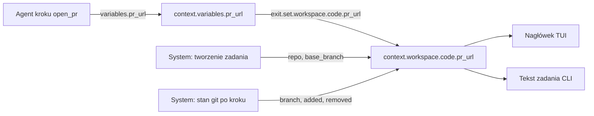
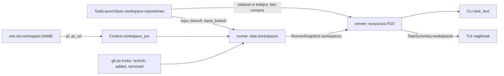

# Nagłówek zadania bez sekcji display - stały widok repozytoriów, gałęzi i PR

## Goal Capsule

- **Objective:** Operator w szczegółach zadania widzi zawsze ten sam nagłówek: tytuł, status z krokiem i workflow oraz każde repozytorium zadania z gałęzią roboczą, gałęzią bazową, liczbą zmienionych linii i linkiem do PR. Autor workflow nie definiuje już widoku.
- **Means:** Usunąć sekcję `display` ze schematu workflow. Dodać stałe, systemowe wartości `context.workspace.<nazwa>.{repo,branch,base_branch,added,removed,pr,pr_url}`. Nagłówek TUI i CLI czyta tylko te wartości, nie `context.variables.*`.
- **Product authority:** Zmiana schematu workflow, protokołu migawki (snapshot) runnera, nagłówka TUI i tekstu zadania w CLI. Dokument powstał bez dialogu z użytkownikiem (tryb nieinteraktywny). Użytkownik potwierdził albo zmienił założenia i odpowiedział na pytania w recenzji PR #80 (2026-11-07); sekcje "Założenia" i "Pytania" mają te odpowiedzi.
- **Open blockers:** Brak. Użytkownik odpowiedział na Q1–Q4 w recenzji (2026-11-07).
- **Execution profile:** jeden PR. Zmiana protokołu, schematu i klientów musi wejść razem (A9: restart całego systemu), a projekt nie wymaga podziału. Wykonawca kończy i wysyła pracę sam.
- **Product Contract preservation:** restructured, no scope change. R8 przeniesione do Scope Boundaries (decyzja użytkownika z recenzji). Uwagi z recenzji o R5, R10, R14 i ostrzeżeniu R2 są rozstrzygnięte jako KTD4–KTD7 w granicach znaczenia R-ów.

---

## Product Contract

### Summary

Sekcja `display` znika z definicji workflow. TUI dostaje stały nagłówek szczegółów: tytuł zadania (tylko gdy krawędź ramki nie mieści go w całości), wiersz statusu (`status · krok N nazwa · workflow`), po jednym wierszu na każdy workspace z definicji workflow (nazwa workspace, nazwa repozytorium, gałąź → gałąź bazowa, `+N −M`, numer PR z linkiem) i wiersz zużycia (koszt razem, agenci, dyrygent; przy każdej grupie koszt i tokeny ze strzałkami). Dane nagłówka pochodzą z nowej przestrzeni `context.workspace.<nazwa>.*`. Agent nadal ustawia `context.variables.pr_url`, a wyjście kroku (`exit` / choice) przenosi wartość do `context.workspace.<nazwa>.pr_url`.

### Problem Frame

Workflow opisuje proces backendowy, ale dziś zawiera też widok: `display.title` i `display.links` z szablonami (`docs/dev/workflow-schema.md` §3.6). Każdy autor workflow musi powtarzać ten sam blok (tytuł, link PR). Inny frontend (np. web) potrzebowałby innego widoku, a definicja workflow narzuca jeden. Link PR zależy od dowolnej nazwy zmiennej (`pr_url`, `pr_number`), więc nagłówek nie ma stałego kontraktu. Workflow z kilkoma repozytoriami (schema v2, `globals.workspaces`) nie ma dziś żadnego miejsca na PR każdego repozytorium osobno.

### Key Decisions

- **Widok należy do klienta, nie do workflow.** Każdy frontend sam decyduje, jak pokazać zadanie; workflow daje tylko dane. (session-settled: user-directed — chosen over keeping `display` in the workflow: workflow defines a backend task and different frontends may need different views.) Governs R1, R2, R11.
- **Nagłówek czyta tylko stałe ścieżki `context.workspace.<nazwa>.*`, nigdy `context.variables.*`.** Kontrakt nagłówka nie zależy od nazw zmiennych wybranych przez autora workflow. (session-settled: user-directed — chosen over rendering header from free context variables: the header must rely on fixed paths.) Governs R4, R5, R12.
- **Agent ustawia zwykłą zmienną, wyjście kroku przenosi ją do `context.workspace`.** Agent nie musi znać ścieżki workspace. (session-settled: user-directed — chosen over agents writing `context.workspace.*` directly: the agent should not need to know the path.) Governs R7, R8.
- **Przeniesienie jest jawne w definicji kroku (rozszerzenie `set` na wyjściu kroku), a nie automatyczne.** Workflow z kilkoma repozytoriami musi wskazać, do którego workspace należy PR; automatyczna reguła musiałaby zgadywać. (user-confirmed w recenzji, Q1.) Governs R7.

### Requirements

**Usunięcie sekcji `display`**

- R1. Schemat workflow nie ma sekcji `display`; dokumentacja schematu (§2, §3.6, zakres szablonów) i `workflows/template.yaml` jej nie zawierają.
- R2. Plik workflow, który nadal ma `display`, ładuje się poprawnie; loader pomija sekcję i zapisuje ostrzeżenie z nazwą pliku i informacją, że sekcja jest ignorowana (patrz A1).
- R3. Tytuł zadania w liście i w szczegółach to `task.title` (tytuł operatora, w przeciwnym razie tytuł od dyrygenta), a gdy go brak — identyfikator zadania. Nie ma już źródła tytułu z workflow.

**Dane `context.workspace`**

- R4. Dla każdego workspace z `globals.workspaces` (kolejność z pliku) zadanie ma wartości `context.workspace.<nazwa>.repo`, `.branch`, `.base_branch`, `.added`, `.removed`, `.pr`, `.pr_url`. Workflow v1 po konwersji ma jeden workspace (nazwa wg §3.2.1).
- R5. `repo` i `base_branch` ustawia system przy tworzeniu zadania (repozytorium z rejestru lub wybrane w formularzu; gałąź bazowa to gałąź startowa zadania: wybór operatora w formularzu, w przeciwnym razie `base_branch` z definicji, w przeciwnym razie `default_branch`; KTD4). Workflow i agent nie mogą ich zmienić.
- R6. `branch` to aktualna gałąź robocza repozytorium. Na starcie ma wartość gałęzi startowej zadania. System odświeża ją ze stanu git workspace po każdym kroku (patrz A3, Q2). Runner klonuje repozytorium z odłączonym HEAD (detached), więc gdy po kroku HEAD jest odłączony albo odczyt git się nie udał, `branch` zachowuje ostatnią wartość (na starcie: gałąź startowa).
- R6a. `added` i `removed` to liczba dodanych i usuniętych linii w repozytorium workspace względem `base_branch`: różnica od wspólnego przodka (`merge-base`) `origin/<base_branch>` i `HEAD` do drzewa roboczego, z niezatwierdzonymi zmianami. Świeży klon ma lokalnie tylko gałąź domyślną, więc baza to gałąź zdalna; lokalna `<base_branch>` tylko wtedy, gdy gałęzi zdalnej nie ma. System odczytuje je razem z `branch` po każdym kroku (A3). Na starcie wartości są puste; gdy odczyt git się nie udał, zachowują ostatni wynik. Workflow i agent nie mogą ich zmienić.
- R7. Wyjście kroku (`exit` lub choice) może zapisać `pr` i `pr_url` wybranego workspace przez `set`, np. `set: { workspace: { code: { pr_url: "{{ context.pr_url }}" } } }`. `set` jest dostępne tylko w kształcie unified (§3.7.1, §3.7.5): plik v1 i plik v2 w starym kształcie nie mogą zapisać `pr`/`pr_url`. Nazwa workspace musi istnieć w `globals.workspaces`; walidator odrzuca nieznaną nazwę i klucz inny niż `pr`/`pr_url`.
- R8. Odczyt `context.workspace.<nazwa>.*` w szablonach i w `when` jest poza zakresem (decyzja użytkownika w recenzji; patrz Scope Boundaries). Numer R8 zostaje zajęty.
- R9. Nazwa `workspace` jest zarezerwowana: zmienna kroku o tej nazwie jest błędem ładowania, bo skrót `context.NAME` kolidowałby z `context.workspace.*`.
- R10. `pr_url` w nagłówku jest linkiem tylko, gdy to bezwzględny adres `http`/`https` z hostem; inna wartość nie jest pokazana dosłownie ani jako link; kolumna PR pokazuje wtedy numer z `pr` albo `—` (KTD6). Znaki sterujące są usuwane ze wszystkich wartości przed wyświetleniem (te same reguły co dziś w `TaskDisplay::sanitized`).

**Nagłówek szczegółów w TUI**

- R11. Nagłówek szczegółów ma stały układ (widok poniżej):
  - wiersz 1: tytuł zadania (R3) i krótki identyfikator, jak dziś. Wiersz znika, gdy krawędź ramki szczegółów (`edge_layout`) pokazuje tytuł w całości, bez obcięcia; wtedy nagłówek zaczyna się od wiersza 2;
  - wiersz 2: `● status · krok N nazwa_kroku · workflow vX`, potem obecne dodatki (czas, `bez slotu`, `kontroler offline`);
  - wiersze workspace: po jednym na workspace, w kolejności z definicji workflow;
  - wiersz zużycia, gdy harness podał zużycie: najpierw koszt razem, potem grupa agentów, potem grupa dyrygenta. Każda grupa ma koszt i tokeny razem: `agenci $1.20 ↑120k ↓8k`. Tokeny wejścia mają strzałkę `↑`, tokeny wyjścia strzałkę `↓` (zamiast `in` / `out`). Subagenci są w nawiasie przy agentach i mają tylko tokeny i liczbę (dziś harness nie podaje ich kosztu osobno): `(subagenci ↑40k ↓3k ×2)`. Część bez danych ma `—`; grupa dyrygenta jest tylko, gdy dyrygent podał zużycie. Nowy format jest w jednej funkcji `task_usage_text::line`; CLI nie dostaje wiersza zużycia (KTD14).
- R12. Wiersz workspace zaczyna się od nazwy workspace (prefiks wiersza). Potem są: nazwa repozytorium (`repo`), `branch → base_branch`, `+added −removed` i `PR <numer>` z linkiem OSC 8 do `pr_url`. Gdy brak `added` i `removed`, kolumna zmian jest pusta. Kolumny są wyrównane między wierszami.
- R13. Gdy `branch` równa się `base_branch`, wiersz pokazuje tylko jedną nazwę gałęzi (zmiana nie ma jeszcze gałęzi roboczej).
- R14. Gdy nie ma PR, w miejscu PR stoi wyszarzony znak `—`. Gdy jest `pr_url`, a nie ma `pr`, numer jest brany z końcowego segmentu liczbowego adresu; gdy go brak, pokazany jest tekst `PR ↗`.
- R15. Workspace typu lokalny folder (`path`) pokazuje nazwę i ścieżkę zamiast gałęzi; nie ma kolumny PR. Dla takiego workspace system ustawia `repo` na ścieżkę folderu; `branch`, `base_branch`, `added`, `removed`, `pr` i `pr_url` są puste, a system nie odczytuje ich z git (R6, R6a).
- R16. Przy wąskim terminalu kolejność skracania: najpierw `base_branch`, potem kolumna zmian `+N −M` (znika), potem `branch` (obcięta z `…`), potem nazwa repozytorium (obcięta z `…`). Nazwa workspace i numer PR nie są nigdy skracane.
- R17. Nagłówek pokazuje wiersz dla każdego workspace, bez limitu liczby wierszy (decyzja w recenzji: na razie nie ograniczamy wysokości nagłówka).
- R18. Zadanie w kolejce (bez runnera) pokazuje wiersze workspace z danymi z tworzenia zadania (`repo`, gałąź startowa, `base_branch`), bez zmian `+N −M` i bez PR.

**CLI**

- R19. Tekst zadania w CLI (`task_text`) pokazuje te same dane co nagłówek TUI (tytuł, status z krokiem i workflow, wiersz na workspace z linkiem PR) zamiast linii z `display`.

### Widok nagłówka

Krawędź ramki mieści tytuł w całości, więc wiersza 1 nie ma (R11):

```text
┌ NAR-12  Zmiana API zamówień ──────────────────────────────── a1b2c3d4 ┐
● running · krok 3 implement · code-review v3 · 14m
code  orders-api  feat/nar-12-orders → main   +120 −34   PR #42 ↗
docs  orders-docs main                                   —
razem $1.25 · agenci $1.20 ↑120k ↓8k (subagenci ↑40k ↓3k ×2) · dyrygent $0.05 ↑9k ↓1k
────────────────────────────────────────────────────────────────────────
 Przebieg   Rozmowa   Zdarzenia   Dyrygent   Info                 podąża
```

Wąski terminal (R16):

```text
● running · krok 3 implement · code-review v3
code  orders-a…  feat/nar-12-orders  PR #42 ↗
docs  orders-d…  main             —
```

### Przepływ wartości PR



### Acceptance Examples

- AE1. **Covers R7, R12.** **Given** workflow z workspace `code` i `docs` oraz krokiem `open_pr` z `exit.set.workspace.code.pr_url: "{{ context.pr_url }}"`. **When** agent zwraca `pr_url = https://gitlab.example/g/api/-/merge_requests/42`. **Then** wiersz `code` pokazuje `PR #42 ↗` z linkiem, wiersz `docs` pokazuje `—`.
- AE2. **Covers R7.** **Given** `set.workspace.payments.pr_url` w workflow bez workspace `payments`. **When** workflow jest ładowany. **Then** ładowanie kończy się błędem z nazwą kroku i nazwą `payments`.
- AE3. **Covers R2.** **Given** stary plik z sekcją `display`. **When** jest ładowany. **Then** workflow działa, sekcja jest pominięta, w logu jest ostrzeżenie.
- AE4. **Covers R13, R6.** **Given** nowe zadanie na `main`, krok jeszcze nie utworzył gałęzi. **Then** wiersz pokazuje `main`. **When** krok tworzy `feat/x` i się kończy. **Then** wiersz pokazuje `feat/x → main` i `+N −M` ze stanu git względem `main`.
- AE5. **Covers R14.** **Given** `pr_url = https://github.com/o/r/pull/7` i brak `pr`. **Then** wiersz pokazuje `PR #7 ↗`. **Given** `pr_url = https://host/review/abc`. **Then** wiersz pokazuje `PR ↗`.
- AE6. **Covers R10.** **Given** agent zwraca `pr_url = javascript:alert(1)` i wyjście kopiuje go do workspace. **Then** nagłówek nie zawiera tego adresu ani linku; kolumna PR pokazuje numer z `pr` albo `—`.
- AE7. **Covers R9.** **Given** krok deklaruje zmienną `workspace`. **Then** ładowanie kończy się błędem.
- AE8. **Covers R11.** **Given** tytuł zadania mieści się w całości na krawędzi ramki. **Then** nagłówek nie ma wiersza 1. **Given** tytuł jest obcięty na krawędzi. **Then** wiersz 1 pokazuje tytuł.
- AE9. **Covers R17.** **Given** workflow z pięcioma workspace. **Then** nagłówek ma pięć wierszy workspace.

### Scope Boundaries

- Poza zakresem: konfiguracja widoku po stronie klienta (motywy, układ wybierany przez użytkownika).
- Poza zakresem: automatyczne wykrywanie PR przez API GitLab/GitHub; PR podaje tylko workflow (R7).
- Poza zakresem: inne pola `context.workspace` niż siedem z R4 (np. status pipeline, commit).
- Poza zakresem: zmiana listy zadań poza źródłem tytułu (R3).
- Poza zakresem: link Jira z `task.ticket` w nagłówku. Dziś możliwy przez `display.links`; po zmianie ticket stoi bez linku (Q4: na razie bez linku).
- Poza zakresem: odczyt `context.workspace.<nazwa>.*` w szablonach i `when` (dawne R8). Nagłówek czyta dane bezpośrednio, a żaden workflow ich nie używa. Dodanie później jest tanie.
- Rozważone, nie budowane: wersjonowanie protokołu i tryb zgodności ze starym runnerem (A9: restart całego systemu). Zmieni decyzję: wdrożenie bez jednoczesnego restartu.
- Rozważone, nie budowane: liczenie nieśledzonych (untracked) plików w `added` i `removed`. Zmieni decyzję: zgłoszenia, że agent zostawia nowe pliki bez commita.

---

## Założenia (potwierdzone w recenzji 2026-11-07)

- A1. **Stary plik z `display` nie przestaje działać.** Loader pomija sekcję z ostrzeżeniem (R2), zamiast zgłosić błąd. Powód: bezpieczniej dla istniejących workflow użytkowników. Alternatywa: błąd ładowania w `schema: v2` (ostrzejszy kontrakt). *Potwierdzone.*
- A2. **Krok w wierszu 2 używa obecnej numeracji** (`krok N` z pozycji osi czasu w *Przebiegu*) i identyfikatora stanu jako nazwy kroku. Pokazuję `krok N nazwa` zamiast obecnego `krok N/M`, bo przy pętlach w grafie `M` jest mylące. Nazwa workflow to `workflow_id vX`, jak dziś w wierszu 3. *Potwierdzone: bez `M`.*
- A3. **`branch` odświeża system ze stanu git po każdym kroku**, a nie agent. Powód: nagłówek ma nie zależeć od zmiennych ustawianych przez agenta, a Narsor nie tworzy gałęzi roboczej sam (§3.2.1: robi to krok). Dla zdalnego runnera dane idą w migawce (snapshot) tak jak dziś `display`. *Potwierdzone; przy tym samym odczycie git system pobiera też `added` i `removed` (R6a).*
- A4. **Do zapisu przez `set` dostępne są tylko `pr` i `pr_url`.** `repo`, `base_branch`, `branch`, `added` i `removed` są tylko do odczytu (R5, R6, R6a). *Potwierdzone. Powód blokady: system nadpisuje `branch`, `added` i `removed` po każdym kroku, więc zapis przez `set` byłby nietrwały; `repo` i `base_branch` opisują klon zrobiony przy tworzeniu zadania, a inna wartość dawałaby nagłówek niezgodny z workspace.*
- A5. **Numer PR ma zawsze prefiks `#`**, także dla GitLab. W danych numer jest bez prefiksu. *Zmienione w recenzji (wcześniej `!` dla GitLab).*
- A6. **Nazwa workspace jest prefiksem wiersza, a w wierszu jest nazwa repozytorium** (R12). *Zmienione w recenzji (wcześniej tylko nazwa workspace, `repo` w zakładce *Info*).* Dla workflow v1 po konwersji obie nazwy mogą być takie same; wiersz pokazuje wtedy obie.
- A7. **Bez limitu wierszy workspace w nagłówku** (R17). *Zmienione w recenzji (wcześniej limit 3).* Dodatkowo wiersz tytułu znika, gdy krawędź ramki mieści cały tytuł (R11).
- A8. **CLI dostaje ten sam układ danych co TUI** (R19), bo dziś też czyta `display`; inaczej po usunięciu sekcji CLI straciłby link PR. *Potwierdzone: serwer daje wszystkim klientom ten sam komunikat.*
- A9. **Bez zgodności wstecznej z runnerem/serwerem, który raportuje `display`.** Nowy klient ignoruje `display`. Wdrożenie zakłada restart całego systemu (serwer, runnery, klienci), więc protokół nie potrzebuje trybu zgodności. *Potwierdzone w recenzji.*

## Pytania do użytkownika (odpowiedzi z recenzji 2026-11-07)

- Q1. **Jawne `set` czy automatyczne kopiowanie?** Plan zakłada jawne `exit.set.workspace.<nazwa>.pr_url` (Key Decisions). Alternatywa: silnik po każdym kroku sam kopiuje `context.variables.pr_url` (i `pr`) do workspace, w którym krok startuje (`workspaces.root`, domyślnie primary). Jest prostsza dla autora workflow, ale niejednoznaczna dla `root: .` i kroku, który otwiera PR w dwóch repozytoriach. Którą wersję wybierasz? **Odpowiedź: jawne `set`** — silnik nie wie, do którego repozytorium należą zmienne.
- Q2. **Skąd `branch`?** Plan zakłada odczyt stanu git przez system (A3). Czy wolisz, żeby `branch` też przychodził od agenta przez `set` (jak `pr_url`)? **Odpowiedź: nie** — `branch` z odczytu git (A3).
- Q3. **Plik z `display`: ostrzeżenie czy błąd?** (A1). **Odpowiedź: ostrzeżenie** (A1 potwierdzone).
- Q4. **Link Jira w nagłówku.** Dziś workflow może dać link do ticketu przez `display.links`. Czy nagłówek ma budować link z `task.ticket` według ustawienia klienta (np. bazowy adres Jira w konfiguracji TUI), czy ticket zostaje bez linku? **Odpowiedź: na razie bez linku.**

---

## Sources / Research

- `docs/dev/workflow-schema.md` §3.6 (obecny `display`), §3.2.1 (`globals.workspaces`, `base_branch`, "Narsor nie tworzy gałęzi roboczej"), §3.7.5 (`set` z kluczem `local`), sekcja "Scope of `{{ }}` templates".
- `crates/narsor-protocol/src/display.rs` — `DisplaySpec`, `TaskDisplay`, `sanitized`, `safe_link_url`.
- `crates/narsor-engine/src/workflow/template.rs` (`render_display`), `crates/narsor-engine/src/workflow/validator.rs` (walidacja `display.links`), `crates/narsor-runner/src/runner/snapshot.rs` (raport `display` w migawce).
- `src/tui/task_app/detail.rs` — funkcja `header` (obecne wiersze 1–4, `LinkSpot`, OSC 8), `status_parts`; `src/tui/task_app/list.rs` — `title_of` czyta `display.title`.
- `src/cli/task_text.rs` — `display_title`, `display_lines`.
- `crates/narsor-protocol/src/controller.rs` — `TaskSummary` (dziś bez listy repozytoriów), `WorkspaceRequest`, `WorkflowWorkspaceView`.
- `workflows/template.yaml` — przykład z `display`.

---

## Planning Contract

### Key Technical Decisions

- KTD1. **Nagłówek czyta jedną listę `workspaces` w `TaskSummary`, a nie `context`.** Pole `TaskSummary.workspaces: Vec<WorkspaceHeader>` (nazwa, `repo`, `branch`, `base_branch`, `added`, `removed`, `pr`, `pr_url`) zastępuje `display`. To jest logiczny kontrakt `context.workspace.<nazwa>.*` z R4. Runner raportuje tę samą listę w `RunnerSnapshot.workspaces`. Serwer ufa jej dopiero po oczyszczeniu (R10). Dotyczy R4, R10, R11, R12, R19.
- KTD2. **Wartości `pr` i `pr_url` mieszkają w nowym polu `Context.workspace_prs` (mapa nazwa → `pr`, `pr_url`), nie w istniejącym `Context.workspace`.** `Context.workspace: Option<WorkspaceInfo>` już istnieje i trzyma ścieżkę oraz typ workspace (`crates/narsor-engine/src/domain/context.rs`, ustawiane w `tasks/mod.rs` i `engine/runner.rs`). Nowe pole ma `#[serde(default)]`, więc stare zapisy kontekstu się ładują. Dotyczy R7.
- KTD3. **`repo`, `branch` startowy i `base_branch` pochodzą z `TaskLaunchSpec.workspace.repositories`; nic nie dodajemy do specyfikacji.** Nowe pole zmieniłoby zapieczętowany skrót (digest). `repo` to `GitIdentity.repository`, w przeciwnym razie nazwa z `repository_name(remote_url)`; dla źródła `Local` to ścieżka (R15). Dotyczy R5, R15, R18.
- KTD4. **Gałąź bazowa to gałąź startowa zadania (`TaskRepository.branch`).** Resolver już wybiera ją w kolejności: wybór właściciela, `base_branch` z definicji, `default_branch` rejestru (`environment/resolver.rs`, `named_ref`). Dzięki temu R13 i R6a mają spójną bazę także przy `release/2.0` wybranym w formularzu. Gdy żadna nie jest znana, `branch` i `base_branch` są puste do pierwszego klonu, a wiersz w kolejce (R18) pokazuje tylko `repo`. Po klonie runner odczytuje gałąź wskazywaną przez `HEAD` zdalnego repozytorium i używa jej jako bazy. Czy gałąź z formularza jest też celem PR, jest poza zakresem (brak automatyki PR). Dotyczy R5, R6a, R13, R18.
- KTD5. **Jawne `set.workspace.<nazwa>.{pr,pr_url}` jest kluczem zarezerwowanym w `parse_set`, wzorowanym na `local`.** `SetDefinition` dostaje trzecie pole `workspace`. Walidator sprawdza nazwę względem `definition.repositories` i klucz względem `pr`/`pr_url` (AE2). Wartości są szablonami renderowanymi tym samym zakresem co dziś, a zapis idzie razem z pozostałymi przypisaniami: wszystkie albo żadne. `set` zostaje tylko w kształcie unified. (session-settled: user-directed — chosen over automatic copying of `context.variables.pr_url`: the engine does not know which repository the variables belong to.) Dotyczy R7, A4.
- KTD6. **Wartość `pr_url` bez bezwzględnego adresu `http(s)` nigdy nie jest pokazana dosłownie.** Kolumna PR pokazuje numer z `pr`, a gdy go brak, z końcowego segmentu liczbowego `pr_url`. `↗` i link są tylko wtedy, gdy `pr_url` spełnia R10. `pr` bez ważnego `pr_url` daje `PR #<pr>` bez `↗`. Brak numeru przy ważnym adresie daje `PR ↗`. Brak numeru i adresu daje `—`. Reguła żyje w jednej funkcji w `narsor-protocol`, którą wołają TUI i CLI. Dotyczy R10, R14, AE5, AE6.
- KTD7. **Ostrzeżenie o pominiętej sekcji `display` jest `LoadDiagnostic::IgnoredDisplay`.** Tekst zawiera nazwę pliku (loader dziś jej nie zna, więc `load_from_file` dodaje ją przy logowaniu). Gdy sekcja miała linki, tekst mówi, że link PR wymaga `exit.set.workspace.<nazwa>.pr_url`, a dla pliku v1 lub starego kształtu — przejścia na kształt unified. `RawWorkflowFile.display` zmienia typ na `Option<serde_yaml::Value>`, bo struktura używa `deny_unknown_fields`. Dotyczy R2, A1.
- KTD8. **Odczyt gita robi runner po każdym kroku i przy starcie lub wznowieniu, a wynik trzyma w pamięci.** Snapshot nie woła gita przy każdej budowie. Nowy moduł `crates/narsor-engine/src/workspace/state.rs` (obok `checked_out_commit`) daje: aktualną gałąź (`symbolic-ref --short HEAD`, porażka przy odłączonym HEAD oznacza „zachowaj ostatnią”) i `+/−` z `git diff --numstat` od `merge-base` z `origin/<base>` (lokalna `<base>` tylko bez gałęzi zdalnej) do drzewa roboczego. Błąd odczytu zachowuje ostatni wynik. Dla `Local` nie ma odczytu (R15). Pliki nieśledzone nie są liczone (Scope Boundaries). Dotyczy R6, R6a, R15.
- KTD9. **Tytuł zadania dla dyrygenta nie ma już źródła w `display.title`.** `snapshot::task_description` bierze wyłącznie teksty wejściowe (`string`, `text`) w kolejności deklaracji. Ukryta zależność znaleziona w `crates/narsor-runner/src/runner/snapshot.rs`. Dotyczy R3.
- KTD10. **Akcja otwarcia linku (`OpenLink`) otwiera linki PR z wierszy workspace.** Dziś `openable_links` czyta `task.display.links` (`src/tui/task_app/actions.rs`). Po zmianie źródłem są `pr_url` wierszy spełniające R10; etykieta to nazwa workspace. Dotyczy R10, R12.
- KTD11. **Wiersze linków w OSC 8 mają własny wiersz w buforze.** `LinkSpot` dostaje pole `row`, a `link_spots` przestaje zakładać stały wiersz `header.y + 3`. Liczba linii nagłówka (`base_lines`) liczy się z: opcjonalnego wiersza tytułu, wiersza statusu, liczby workspace i opcjonalnego wiersza zużycia. Dotyczy R11, R12, R17.
- KTD12. **Wiersz tytułu (R11) pojawia się tylko, gdy `task.title` jest niepusty i `edge_layout` go skrócił.** `edge_layout` zwraca dodatkowo informację „tytuł skrócony”. Zadanie bez tytułu pokazuje na krawędzi identyfikator, więc wiersz 1 znika. Dotyczy R3, R11, AE8.
- KTD13. **Tytuł z R3 ma jedną regułę w `title_of` (`src/tui/task_app/list.rs`): `task.title`, w przeciwnym razie identyfikator.** `row_title_of` i `edge_layout` zostają na tej samej regule (wzorzec: `docs/solutions/design-patterns/tui-list-row-title-one-builder-for-screen-and-rows-2026-10-31.md`). Dotyczy R3.
- KTD14. **Format zużycia zmienia się w `task_usage_text::line`, jednym miejscu.** Wołają ją TUI (nagłówek) i nikt inny; CLI dziś nie wypisuje zużycia, więc „ta sama zmiana w CLI” z R11 oznacza tylko wspólną funkcję, bez nowego wiersza w CLI. Strzałki `↑`/`↓` dotyczą też `tokens()` używanego przez `step_cells` w zakładce *Przebieg*; zmiana tam jest akceptowana, żeby operator widział jeden zapis. Dotyczy R11.

### Assumptions

- A10. **Pliki nieśledzone nie wchodzą do `added` i `removed`.** R6a mówi o niezatwierdzonych zmianach; `git diff` do drzewa roboczego widzi tylko pliki śledzone, a liczenie nowych wymagałoby zmiany indeksu lub osobnego skanu. Powód: prostota i brak skutków ubocznych w repozytorium zadania.
- A11. **Brak limitu rozmiaru wyniku `numstat`.** Plik binarny daje `-` i liczy się jako 0 linii.
- A12. **Wiersz zużycia z R11 ma dane tylko tam, gdzie zakładka *Przebieg* je już ma** (`TaskUsage::sum`); nie dodajemy nowego raportowania.

### High-Level Technical Design



---

## Implementation Units

Kolejność: U1 → U2 → U3 → U4 → U5 → U6 → U7 → U8. Wszystkie w jednym PR.

### U1. Protokół: `WorkspaceHeader` zamiast `TaskDisplay`

**Goal:** Wspólny typ danych nagłówka i jedna reguła wyświetlania PR.
**Requirements:** R4, R10, R14; KTD1, KTD6.
**Dependencies:** brak.
**Files:** `crates/narsor-protocol/src/display.rs`, `crates/narsor-protocol/src/controller.rs` (`RunnerSnapshotRequest` ~739, `TaskSummary` ~900), `crates/narsor-engine/src/controller_protocol/wire.rs` (97, 129), `crates/narsor-engine/src/orchestration/model.rs` (~844), `crates/narsor-engine/src/backends/fake.rs`.
**Approach:**
1. Usunąć `DisplaySpec`, `DisplayLinkSpec`, `TaskDisplay`, `DisplayLink`, `EMPTY_LINK_TEXT`. Zostają `safe_link_url`, `without_unsafe_chars*`, `loss_state` i reszta pomocników.
2. Dodać `WorkspaceHeader` z `sanitized()` (wzór: `TaskDisplay::sanitized`) i funkcję `pr_label` (KTD6) zwracającą numer i bezpieczny adres.
3. Pole `workspaces` w `RunnerSnapshot` i `TaskSummary`, `#[serde(default)]`; usunąć `display` (A9). Nie podnosić `PROTOCOL_VERSION`.
**Patterns to follow:** `generated_title` w snapshotcie (`serde(default, skip_serializing_if)`).
**Test scenarios:**
- Covers AE5. `pr_label` dla `https://github.com/o/r/pull/7` bez `pr` zwraca `#7` i link; dla `https://host/review/abc` zwraca brak numeru i link.
- Covers AE6. `pr_url = javascript:alert(1)` daje brak linku; `pr = "42"` bez ważnego adresu daje `PR #42` bez `↗`.
- `sanitized()` usuwa znaki sterujące z `repo`, `branch` i `pr`.
- Zapis JSON bez pola `workspaces` deserializuje się do pustej listy.
**Verification:** crate `narsor-protocol` kompiluje się bez typów display; testy w `display.rs` przechodzą.

### U2. Schemat i loader: usunięcie `display`, `set.workspace`, nazwa zarezerwowana

**Goal:** Plik workflow nie definiuje widoku; `exit` może zapisać PR workspace.
**Requirements:** R1, R2, R7, R9; KTD5, KTD7.
**Dependencies:** U1.
**Files:** `crates/narsor-engine/src/workflow/schema.rs`, `workflow/loader.rs`, `workflow/validator.rs`, `domain/workflow_definition.rs`, `domain/task.rs` (`display_spec`), `workflow/template.rs` (`render_display`), `workflows/template.yaml`, `workflows/README.md`, `docs/dev/workflow-schema.md` (§2, §3.6, 666, §3.7.5), testy: `tests/integration/schema_loading.rs`, `validation.rs`, `template.rs`, `builtin_workflows.rs`, `tests/fixtures/invalid/step_reply_in_display_title.yaml`.
**Approach:**
1. Usunąć `DisplaySchema`, `WorkflowDefinition.display`, `compile_display`, `validate_display` i błędy `InvalidDisplay`, `UnknownInputReferenceInDisplay`.
2. `RawWorkflowFile.display` jako `Option<serde_yaml::Value>`; `LoadDiagnostic::IgnoredDisplay` (KTD7).
3. `parse_set`: klucz `workspace` jako mapa nazwa → mapa `pr`/`pr_url`; `SetDefinition.workspace`, `is_empty`.
4. Walidator: nazwa w `definition.repositories`, klucz `pr`/`pr_url`, odrzucenie poza kształtem unified (R7); zmienna kroku `workspace` jest błędem (R9).
5. Zaktualizować dokumentację schematu i `template.yaml` (przykład `exit.set.workspace`).
**Test scenarios:**
- Covers AE3. Plik z `display` ładuje się, `compile_with_diagnostics` zwraca `IgnoredDisplay` z nazwą pliku i podpowiedzią o `pr_url`.
- Covers AE2. `set.workspace.payments.pr_url` bez workspace `payments` kończy się błędem z nazwą kroku i `payments`.
- `set.workspace.code.branch` jest odrzucone (klucz poza `pr`/`pr_url`).
- `set.workspace` w pliku v1 lub starym kształcie v2 jest błędem ładowania.
- Covers AE7. Zmienna kroku `workspace` kończy ładowanie błędem.
- Poprawny `set.workspace.code.pr_url: "{{ context.pr_url }}"` przechodzi walidację.
**Verification:** `workflows/template.yaml` ładuje się bez ostrzeżenia; w kodzie silnika `display` występuje tylko jako pomijane pole wczytywania (`RawWorkflowFile.display`, `LoadDiagnostic::IgnoredDisplay`).

### U3. Silnik: zapis `pr` i `pr_url` przy wyjściu z kroku

**Goal:** `set.workspace` zapisuje wartości do `Context.workspace_prs`.
**Requirements:** R7, R8 (poza zakresem); KTD2, KTD5.
**Dependencies:** U2.
**Files:** `crates/narsor-engine/src/domain/context.rs`, `crates/narsor-engine/src/engine/runner.rs` (`render_assignments` ~3557, miejsce zapisu przypisań ~3389), `crates/narsor-engine/src/engine/runner/variable_rules.rs`, test: `tests/integration/engine_step_context.rs`.
**Approach:**
1. `Context.workspace_prs: BTreeMap<String, WorkspacePr>` z `#[serde(default)]`.
2. `render_assignments` zwraca też przypisania workspace, renderowane tym samym `TemplateScope`; zapis atomowy z resztą (wszystkie albo żadne).
3. Pusta wartość po renderze nie kasuje poprzedniej (jak „brak wartości”); tylko niepusta nadpisuje.
**Test scenarios:**
- Covers AE1. Krok `open_pr` z `exit.set.workspace.code.pr_url` zapisuje adres; drugi workspace zostaje pusty.
- Błąd renderu jednego przypisania nie zapisuje żadnego (też workspace).
- Stary zapis kontekstu bez `workspace_prs` wczytuje się poprawnie.
**Verification:** po wyjściu z kroku `execution.context.workspace_prs` ma oczekiwaną wartość.

### U4. Runner: stan git i lista workspaces w migawce

**Goal:** Migawka niesie `workspaces` z aktualnym `branch`, `added`, `removed`.
**Requirements:** R4, R5, R6, R6a, R15, R18; KTD3, KTD4, KTD8, KTD9.
**Dependencies:** U1, U3.
**Files:** `crates/narsor-engine/src/workspace/state.rs` (nowy) i `workspace/mod.rs`, `crates/narsor-runner/src/runner/snapshot.rs`, `crates/narsor-runner/src/runner/mod.rs` (~633, ~1285, pętla `drive` ~1307), `crates/narsor-runner/src/runner/session_tests.rs`.
**Approach:**
1. Moduł `state.rs`: odczyt gałęzi i `numstat` (KTD8), funkcje bez efektów ubocznych.
2. Runner trzyma ostatni odczyt per workspace; odświeża go po zakończeniu kroku, przy starcie i wznowieniu; `snapshot::build` składa listę z launch spec, `Context.workspace_prs` i ostatniego odczytu.
3. Usunąć `render_display`; `task_description` według KTD9.
4. Przy braku znanej gałęzi bazowej (KTD4) po klonie ustawić ją z `HEAD` zdalnego.
**Execution note:** zacząć od testu na prawdziwym repozytorium tymczasowym (git w PATH jest wymaganiem środowiska), bez atrap git.
**Test scenarios:**
- Covers AE4. Repozytorium na `main` bez gałęzi roboczej: `branch` = `main`. Po commicie na `feat/x`: `feat/x`, `base_branch` `main`, `added`/`removed` zgodne z `numstat` od `merge-base` z `origin/main`.
- Odłączony HEAD po kroku zachowuje ostatnią gałąź.
- Błąd gita (usunięty katalog) zachowuje ostatni wynik i nie psuje migawki.
- Zmiana niezatwierdzona w pliku śledzonym wchodzi do `added`; plik nieśledzony nie (A10).
- Workspace `Local`: `repo` = ścieżka, reszta pusta, brak wywołań gita.
- `task_description` bez `display` używa tekstów wejściowych; test `a_task_without_a_title_is_named_by_the_conductor` dostaje opis z wejścia zamiast `display.title`.
- Lista `workspaces` ma kolejność z definicji, primary pierwszy.
**Verification:** `fixture.snapshot().workspaces` pokazuje wartości po kroku; brak wywołań gita przy samym `snapshot()` bez kroku.

### U5. Serwer: `TaskSummary.workspaces` także dla zadania w kolejce

**Goal:** Jedno źródło wierszy dla TUI i CLI, z oczyszczeniem.
**Requirements:** R4, R5, R10, R18; KTD1, KTD3.
**Dependencies:** U1, U4.
**Files:** `crates/narsor-engine/src/controller_protocol/service.rs` (`task_display` ~2570, ~2158), `domain/task.rs`, test w `tests/integration/` obok istniejących testów `TaskSummary`.
**Approach:**
1. Zastąpić `task_display` funkcją `task_workspaces`: raport runnera (`sanitized`) albo lista z `launch_spec.workspace.repositories` (bez `added`, `removed`, `pr`).
2. Kolejność i nazwy z `launch_spec`.
**Test scenarios:**
- Covers AE9. Pięć repozytoriów daje pięć wpisów.
- Zadanie w kolejce: wpisy z `repo`, gałęzią startową i `base_branch`, bez zmian i PR (R18).
- Raport runnera z `javascript:` w `pr_url` wychodzi bez adresu (R10).
- Gałąź nieznana (KTD4): wpis ma tylko `repo`.
**Verification:** `TaskSummary` nie ma pola `display`; testy serwera przechodzą.

### U6. TUI: nowy nagłówek szczegółów

**Goal:** Stały układ z R11–R17.
**Requirements:** R3, R11, R12, R13, R14, R15, R16, R17; KTD10–KTD13.
**Dependencies:** U1, U5.
**Files:** `src/tui/task_app/detail.rs` (`header` 1434, `edge_layout` 931, `status_parts` 1636, `link_spots` 1748, `LinkSpot` 907, `HEADER_LINES` 496, `base_lines` 1132), `src/tui/task_app/list.rs` (`title_of`, `row_title_of`), `src/tui/task_app/actions.rs` (`openable_links`, tekst pomocy), `src/client/task_usage_text.rs`, `src/client_lib.rs` (re-export), testy: `tests/integration/tui_render.rs`, `tui_state.rs`, `task_app_support/mod.rs`.
**Approach:**
1. `title_of` według KTD13; `edge_layout` zwraca flagę skrócenia (KTD12).
2. `header` składa: opcjonalny wiersz tytułu, wiersz statusu `krok N nazwa · workflow vX`, wiersze workspace, wiersz zużycia.
3. Wiersz workspace: kolumny wyrównane; kolejność skracania z R16; PR wg KTD6; `branch = base_branch` pokazuje jedną nazwę (R13); `Local` bez kolumny PR (R15).
4. `LinkSpot.row` i `link_spots` według KTD11; `OpenLink` według KTD10.
5. `task_usage_text::line` w nowym formacie (R11, KTD14).
6. Helper testowy `displayed` zastąpić helperem ustawiającym `workspaces` i `title`.
**Test scenarios:**
- Covers AE8. Tytuł mieści się na krawędzi: brak wiersza 1; tytuł obcięty: wiersz 1 jest.
- Covers AE1. Wiersz `code` ma `PR #42 ↗` i link OSC 8 w swoim wierszu; `docs` ma `—`.
- Covers AE9. Pięć workspace daje pięć wierszy, a wysokość nagłówka rośnie.
- R16: coraz węższy terminal usuwa kolejno `base_branch`, kolumnę `+N −M`, skracają `branch`, skracają `repo`; nazwa workspace i numer PR zostają.
- R13: `branch == base_branch` pokazuje jedną nazwę.
- Wiersz zużycia: `razem`, `agenci $1.20 ↑120k ↓8k (subagenci ↑40k ↓3k ×2)`, `dyrygent`; część bez danych daje `—`; testy jednostkowe `task_usage_text` zaktualizowane.
- Zadanie w kolejce: wiersze bez `+N −M` i bez PR.
- Obsolete: asercje `Jira NAR-12 ↗`, `PR: —`, `krok 3/5` zastąpione nowymi.
**Verification:** testy `tui_render` i `tui_state` przechodzą; ręczny przegląd wąskiego i szerokiego terminala.

### U7. CLI: tekst zadania z danych workspace

**Goal:** `task_text` pokazuje te same dane co TUI.
**Requirements:** R3, R19; A8.
**Dependencies:** U1, U5.
**Files:** `src/cli/task_text.rs` (`list_line` 294, `display_title` 311, `display_lines` 331, splice ~578), `tests/integration/cli_task_text.rs`.
**Approach:**
1. `display_title` bierze `task.title`, w przeciwnym razie identyfikator.
2. `display_lines` zastąpić wierszami statusu i workspace; link PR jako tekst z `pr_label` (bez OSC 8).
**Test scenarios:**
- Covers AE6. `pr_url` typu `javascript:` w tekście CLI nie pojawia się dosłownie.
- Wiersz workspace zawiera `repo`, gałąź, `+N −M` i numer PR.
- Zadanie bez tytułu: lista pokazuje identyfikator.
**Verification:** testy `cli_task_text` przechodzą.

### U8. Dokumentacja i sprzątanie

**Goal:** Dokumenty opisują nowy kontrakt; w repozytorium nie zostaje ślad `display`.
**Requirements:** R1.
**Dependencies:** U1–U7.
**Files:** `docs/dev/workflow-schema.md`, `docs/user/tui.md`, `workflows/README.md`.
**Approach:** Opisać nagłówek i `exit.set.workspace`; usunąć odwołania do `display`; historyczne brainstormy i `docs/solutions` zostają bez zmian.
**Test expectation:** none -- dokumentacja.
**Verification:** `rg "display\.(title|links)"` nie znajduje żywego kodu ani dokumentacji poza historycznymi.

---

## Verification Contract

- `cargo build --workspace --bins` bez ostrzeżeń o nieużywanym kodzie display.
- `cargo test --workspace` (komendy z `docs/dev/building-and-testing.md`). Testy integracyjne to jeden crate `tests/integration/main.rs`; nowy plik wymaga `mod` w `main.rs`. Bez `set_var` i stałych portów.
- Testy gita (U4) używają katalogów tymczasowych i prawdziwego `git`.
- Nowe pole migawki nie wywołuje dodatkowych odczytów listy (patrz `docs/solutions/logic-errors/tui-list-read-on-every-runner-report-2026-10-22.md`).

## Definition of Done

- Wszystkie R1–R19 (bez R8) i AE1–AE9 mają testy lub dokument.
- Schemat nie ma sekcji `display`; stary plik ładuje się z ostrzeżeniem.
- Brak `TaskDisplay`, `DisplaySpec`, `display_spec`, `render_display` w kodzie.
- Kod porzuconych prób usunięty z diffa.

## Risks

- **Ukryte zależności od `display.title`:** `task_description` (KTD9), `OpenLink` (KTD10), `title_of` (KTD13). Przegląd `rg "display"` w U8.
- **Koszt gita po każdym kroku w dużym repozytorium:** `numstat` względem `merge-base` może być wolny; wynik jest w pamięci, błąd zachowuje ostatni wynik. Zmierzyć przy implementacji; limit czasu odczytu zostaje decyzją implementacji.
- **Zmiana formatu zużycia dotyka zakładki *Przebieg*** (KTD14).
