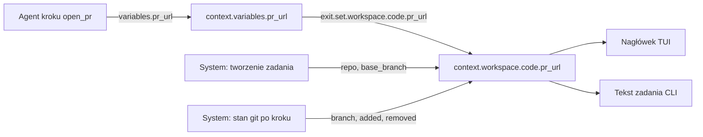

# Nagłówek zadania bez sekcji display - stały widok repozytoriów, gałęzi i PR

## Goal Capsule

- **Objective:** Operator w szczegółach zadania widzi zawsze ten sam nagłówek: tytuł, status z krokiem i workflow oraz każde repozytorium zadania z gałęzią roboczą, gałęzią bazową, liczbą zmienionych linii i linkiem do PR. Autor workflow nie definiuje już widoku.
- **Means:** Usunąć sekcję `display` ze schematu workflow. Dodać stałe, systemowe wartości `context.workspace.<nazwa>.{repo,branch,base_branch,added,removed,pr,pr_url}`. Nagłówek TUI i CLI czyta tylko te wartości, nie `context.variables.*`.
- **Product authority:** Zmiana schematu workflow, protokołu migawki (snapshot) runnera, nagłówka TUI i tekstu zadania w CLI. Dokument powstał bez dialogu z użytkownikiem (tryb nieinteraktywny). Użytkownik potwierdził albo zmienił założenia i odpowiedział na pytania w recenzji PR #80 (2026-11-07); sekcje "Założenia" i "Pytania" mają te odpowiedzi.
- **Open blockers:** Brak. Użytkownik odpowiedział na Q1–Q4 w recenzji (2026-11-07).

---

## Product Contract

### Summary

Sekcja `display` znika z definicji workflow. TUI dostaje stały nagłówek szczegółów: tytuł zadania (tylko gdy krawędź ramki nie mieści go w całości), wiersz statusu (`status · krok N nazwa · workflow`), po jednym wierszu na każdy workspace z definicji workflow (nazwa workspace, nazwa repozytorium, gałąź → gałąź bazowa, `+N −M`, numer PR z linkiem) i wiersz zużycia (koszt razem, agenci, dyrygent, tokeny ze strzałkami). Dane nagłówka pochodzą z nowej przestrzeni `context.workspace.<nazwa>.*`. Agent nadal ustawia `context.variables.pr_url`, a wyjście kroku (`exit` / choice) przenosi wartość do `context.workspace.<nazwa>.pr_url`.

### Problem Frame

Workflow opisuje proces backendowy, ale dziś zawiera też widok: `display.title` i `display.links` z szablonami (`docs/dev/workflow-schema.md` §3.6). Każdy autor workflow musi powtarzać ten sam blok (tytuł, link PR). Inny frontend (np. web) potrzebowałby innego widoku, a definicja workflow narzuca jeden. Link PR zależy od dowolnej nazwy zmiennej (`pr_url`, `pr_number`), więc nagłówek nie ma stałego kontraktu. Workflow z kilkoma repozytoriami (schema v2, `globals.workspaces`) nie ma dziś żadnego miejsca na PR każdego repozytorium osobno.

### Key Decisions

- **Widok należy do klienta, nie do workflow.** Każdy frontend sam decyduje, jak pokazać zadanie; workflow daje tylko dane. (session-settled: user-directed — chosen over keeping `display` in the workflow: workflow defines a backend task and different frontends may need different views.) Governs R1, R2, R11.
- **Nagłówek czyta tylko stałe ścieżki `context.workspace.<nazwa>.*`, nigdy `context.variables.*`.** Kontrakt nagłówka nie zależy od nazw zmiennych wybranych przez autora workflow. (session-settled: user-directed — chosen over rendering header from free context variables: the header must rely on fixed paths.) Governs R4, R5, R12.
- **Agent ustawia zwykłą zmienną, wyjście kroku przenosi ją do `context.workspace`.** Agent nie musi znać ścieżki workspace. (session-settled: user-directed — chosen over agents writing `context.workspace.*` directly: the agent should not need to know the path.) Governs R7, R8.
- **Przeniesienie jest jawne w definicji kroku (rozszerzenie `set` na wyjściu kroku), a nie automatyczne.** Workflow z kilkoma repozytoriami musi wskazać, do którego workspace należy PR; automatyczna reguła musiałaby zgadywać. (user-confirmed w recenzji, Q1.) Governs R7.

### Requirements

**Usunięcie sekcji `display`**

- R1. Schemat workflow nie ma sekcji `display`; dokumentacja schematu (§2, §3.6, zakres szablonów) i `workflows/template.yaml` jej nie zawierają.
- R2. Plik workflow, który nadal ma `display`, ładuje się poprawnie; loader pomija sekcję i zapisuje ostrzeżenie z nazwą pliku i informacją, że sekcja jest ignorowana (patrz A1).
- R3. Tytuł zadania w liście i w szczegółach to `task.title` (tytuł operatora, w przeciwnym razie tytuł od dyrygenta), a gdy go brak — identyfikator zadania. Nie ma już źródła tytułu z workflow.

**Dane `context.workspace`**

- R4. Dla każdego workspace z `globals.workspaces` (kolejność z pliku) zadanie ma wartości `context.workspace.<nazwa>.repo`, `.branch`, `.base_branch`, `.added`, `.removed`, `.pr`, `.pr_url`. Workflow v1 po konwersji ma jeden workspace (nazwa wg §3.2.1).
- R5. `repo` i `base_branch` ustawia system przy tworzeniu zadania (repozytorium z rejestru lub wybrane w formularzu; gałąź bazowa z definicji, w przeciwnym razie `default_branch`). Workflow i agent nie mogą ich zmienić.
- R6. `branch` to aktualna gałąź robocza repozytorium. Na starcie ma wartość gałęzi startowej zadania. System odświeża ją ze stanu git workspace po każdym kroku (patrz A3, Q2). Runner klonuje repozytorium z odłączonym HEAD (detached), więc gdy po kroku HEAD jest odłączony albo odczyt git się nie udał, `branch` zachowuje ostatnią wartość (na starcie: gałąź startowa).
- R6a. `added` i `removed` to liczba dodanych i usuniętych linii w repozytorium workspace względem `base_branch`: różnica od wspólnego przodka (`merge-base`) `origin/<base_branch>` i `HEAD` do drzewa roboczego, z niezatwierdzonymi zmianami. Świeży klon ma lokalnie tylko gałąź domyślną, więc baza to gałąź zdalna; lokalna `<base_branch>` tylko wtedy, gdy gałęzi zdalnej nie ma. System odczytuje je razem z `branch` po każdym kroku (A3). Na starcie wartości są puste; gdy odczyt git się nie udał, zachowują ostatni wynik. Workflow i agent nie mogą ich zmienić.
- R7. Wyjście kroku (`exit` lub choice) może zapisać `pr` i `pr_url` wybranego workspace przez `set`, np. `set: { workspace: { code: { pr_url: "{{ context.pr_url }}" } } }`. `set` jest dostępne tylko w kształcie unified (§3.7.1, §3.7.5): plik v1 i plik v2 w starym kształcie nie mogą zapisać `pr`/`pr_url`. Nazwa workspace musi istnieć w `globals.workspaces`; walidator odrzuca nieznaną nazwę i klucz inny niż `pr`/`pr_url`.
- R8. `context.workspace.<nazwa>.*` jest dostępne do odczytu w szablonach (`{{ context.workspace.code.pr_url }}`) i w `when`. Brak wartości daje pusty tekst, jak dla zadeklarowanej zmiennej bez wartości (§ "Scope of templates").
- R9. Nazwa `workspace` jest zarezerwowana: zmienna kroku o tej nazwie jest błędem ładowania, bo skrót `context.NAME` kolidowałby z `context.workspace.*`.
- R10. `pr_url` w nagłówku jest linkiem tylko, gdy to bezwzględny adres `http`/`https` z hostem; inne wartości są pokazane bez linku. Znaki sterujące są usuwane ze wszystkich wartości przed wyświetleniem (te same reguły co dziś w `TaskDisplay::sanitized`).

**Nagłówek szczegółów w TUI**

- R11. Nagłówek szczegółów ma stały układ (widok poniżej):
  - wiersz 1: tytuł zadania (R3) i krótki identyfikator, jak dziś. Wiersz znika, gdy krawędź ramki szczegółów (`edge_layout`) pokazuje tytuł w całości, bez obcięcia; wtedy nagłówek zaczyna się od wiersza 2;
  - wiersz 2: `● status · krok N nazwa_kroku · workflow vX`, potem obecne dodatki (czas, `bez slotu`, `kontroler offline`);
  - wiersze workspace: po jednym na workspace, w kolejności z definicji workflow;
  - wiersz zużycia, gdy harness podał zużycie: najpierw koszt razem, potem koszt agentów, potem koszt dyrygenta, potem tokeny. Tokeny wejścia mają strzałkę `↑`, tokeny wyjścia strzałkę `↓` (zamiast `in` / `out`). Subagenci mają tylko tokeny i liczbę (dziś harness nie podaje ich kosztu osobno). Część bez danych ma `—`; część dyrygenta jest tylko, gdy dyrygent podał zużycie. Ta sama zmiana dotyczy tekstu zużycia w CLI (`task_usage_text::line`).
- R12. Wiersz workspace zaczyna się od nazwy workspace (prefiks wiersza). Potem są: nazwa repozytorium (`repo`), `branch → base_branch`, `+added −removed` i `PR <numer>` z linkiem OSC 8 do `pr_url`. Gdy brak `added` i `removed`, kolumna zmian jest pusta. Kolumny są wyrównane między wierszami.
- R13. Gdy `branch` równa się `base_branch`, wiersz pokazuje tylko jedną nazwę gałęzi (zmiana nie ma jeszcze gałęzi roboczej).
- R14. Gdy nie ma PR, w miejscu PR stoi wyszarzony znak `—`. Gdy jest `pr_url`, a nie ma `pr`, numer jest brany z końcowego segmentu liczbowego adresu; gdy go brak, pokazany jest tekst `PR ↗`.
- R15. Workspace typu lokalny folder (`path`) pokazuje nazwę i ścieżkę zamiast gałęzi; nie ma kolumny PR. Dla takiego workspace system ustawia `repo` na ścieżkę folderu; `branch`, `base_branch`, `added`, `removed`, `pr` i `pr_url` są puste, a system nie odczytuje ich z git (R6, R6a).
- R16. Przy wąskim terminalu kolejność skracania: najpierw `base_branch`, potem kolumna zmian `+N −M` (znika), potem `branch` (obcięta z `…`), potem nazwa repozytorium (obcięta z `…`). Nazwa workspace i numer PR nie są nigdy skracane.
- R17. Nagłówek pokazuje wiersz dla każdego workspace, bez limitu liczby wierszy (decyzja w recenzji: na razie nie ograniczamy wysokości nagłówka).
- R18. Zadanie w kolejce (bez runnera) pokazuje wiersze workspace z danymi z tworzenia zadania (`repo`, gałąź startowa, `base_branch`), bez zmian `+N −M` i bez PR.

**CLI**

- R19. Tekst zadania w CLI (`task_text`) pokazuje te same dane co nagłówek TUI (tytuł, status z krokiem i workflow, wiersz na workspace z linkiem PR) zamiast linii z `display`.

### Widok nagłówka

Krawędź ramki mieści tytuł w całości, więc wiersza 1 nie ma (R11):

```text
┌ NAR-12  Zmiana API zamówień ──────────────────────────────── a1b2c3d4 ┐
● running · krok 3 implement · code-review v3 · 14m
code  orders-api  feat/nar-12-orders → main   +120 −34   PR #42 ↗
docs  orders-docs main                                   —
razem $1.25 · agenci $1.20 · dyrygent $0.05 · ↑120k ↓8k · subagenci ↑40k ↓3k (2)
────────────────────────────────────────────────────────────────────────
 Przebieg   Rozmowa   Zdarzenia   Dyrygent   Info                 podąża
```

Wąski terminal (R16):

```text
● running · krok 3 implement · code-review v3
code  orders-a…  feat/nar-1… → …  PR #42 ↗
docs  orders-d…  main             —
```

### Przepływ wartości PR



### Acceptance Examples

- AE1. **Covers R7, R12.** **Given** workflow z workspace `code` i `docs` oraz krokiem `open_pr` z `exit.set.workspace.code.pr_url: "{{ context.pr_url }}"`. **When** agent zwraca `pr_url = https://gitlab.example/g/api/-/merge_requests/42`. **Then** wiersz `code` pokazuje `PR #42 ↗` z linkiem, wiersz `docs` pokazuje `—`.
- AE2. **Covers R7.** **Given** `set.workspace.payments.pr_url` w workflow bez workspace `payments`. **When** workflow jest ładowany. **Then** ładowanie kończy się błędem z nazwą kroku i nazwą `payments`.
- AE3. **Covers R2.** **Given** stary plik z sekcją `display`. **When** jest ładowany. **Then** workflow działa, sekcja jest pominięta, w logu jest ostrzeżenie.
- AE4. **Covers R13, R6.** **Given** nowe zadanie na `main`, krok jeszcze nie utworzył gałęzi. **Then** wiersz pokazuje `main`. **When** krok tworzy `feat/x` i się kończy. **Then** wiersz pokazuje `feat/x → main` i `+N −M` ze stanu git względem `main`.
- AE5. **Covers R14.** **Given** `pr_url = https://github.com/o/r/pull/7` i brak `pr`. **Then** wiersz pokazuje `PR #7 ↗`. **Given** `pr_url = https://host/review/abc`. **Then** wiersz pokazuje `PR ↗`.
- AE6. **Covers R10.** **Given** agent zwraca `pr_url = javascript:alert(1)` i wyjście kopiuje go do workspace. **Then** nagłówek pokazuje tekst bez linku.
- AE7. **Covers R9.** **Given** krok deklaruje zmienną `workspace`. **Then** ładowanie kończy się błędem.
- AE8. **Covers R11.** **Given** tytuł zadania mieści się w całości na krawędzi ramki. **Then** nagłówek nie ma wiersza 1. **Given** tytuł jest obcięty na krawędzi. **Then** wiersz 1 pokazuje tytuł.
- AE9. **Covers R17.** **Given** workflow z pięcioma workspace. **Then** nagłówek ma pięć wierszy workspace.

### Scope Boundaries

- Poza zakresem: konfiguracja widoku po stronie klienta (motywy, układ wybierany przez użytkownika).
- Poza zakresem: automatyczne wykrywanie PR przez API GitLab/GitHub; PR podaje tylko workflow (R7).
- Poza zakresem: inne pola `context.workspace` niż siedem z R4 (np. status pipeline, commit).
- Poza zakresem: zmiana listy zadań poza źródłem tytułu (R3).
- Poza zakresem: link Jira z `task.ticket` w nagłówku. Dziś możliwy przez `display.links`; po zmianie ticket stoi bez linku (Q4: na razie bez linku).

---

## Założenia (potwierdzone w recenzji 2026-11-07)

- A1. **Stary plik z `display` nie przestaje działać.** Loader pomija sekcję z ostrzeżeniem (R2), zamiast zgłosić błąd. Powód: bezpieczniej dla istniejących workflow użytkowników. Alternatywa: błąd ładowania w `schema: v2` (ostrzejszy kontrakt). *Potwierdzone.*
- A2. **Krok w wierszu 2 używa obecnej numeracji** (`krok N` z pozycji osi czasu w *Przebiegu*) i identyfikatora stanu jako nazwy kroku. Pokazuję `krok N nazwa` zamiast obecnego `krok N/M`, bo przy pętlach w grafie `M` jest mylące. Nazwa workflow to `workflow_id vX`, jak dziś w wierszu 3. *Potwierdzone: bez `M`.*
- A3. **`branch` odświeża system ze stanu git po każdym kroku**, a nie agent. Powód: nagłówek ma nie zależeć od zmiennych ustawianych przez agenta, a Narsor nie tworzy gałęzi roboczej sam (§3.2.1: robi to krok). Dla zdalnego runnera dane idą w migawce (snapshot) tak jak dziś `display`. *Potwierdzone; przy tym samym odczycie git system pobiera też `added` i `removed` (R6a).*
- A4. **Do zapisu przez `set` dostępne są tylko `pr` i `pr_url`.** `repo`, `base_branch`, `branch`, `added` i `removed` są tylko do odczytu (R5, R6, R6a). *Potwierdzone. Powód blokady: system nadpisuje `branch`, `added` i `removed` po każdym kroku, więc zapis przez `set` byłby nietrwały; `repo` i `base_branch` opisują klon zrobiony przy tworzeniu zadania, a inna wartość dawałaby nagłówek niezgodny z workspace.*
- A5. **Numer PR ma zawsze prefiks `#`**, także dla GitLab. W danych numer jest bez prefiksu. *Zmienione w recenzji (wcześniej `!` dla GitLab).*
- A6. **Nazwa workspace jest prefiksem wiersza, a w wierszu jest nazwa repozytorium** (R12). *Zmienione w recenzji (wcześniej tylko nazwa workspace, `repo` w zakładce *Info*).* Dla workflow v1 po konwersji obie nazwy mogą być takie same; wiersz pokazuje wtedy obie.
- A7. **Bez limitu wierszy workspace w nagłówku** (R17). *Zmienione w recenzji (wcześniej limit 3).* Dodatkowo wiersz tytułu znika, gdy krawędź ramki mieści cały tytuł (R11).
- A8. **CLI dostaje ten sam układ danych co TUI** (R19), bo dziś też czyta `display`; inaczej po usunięciu sekcji CLI straciłby link PR. *Potwierdzone: serwer daje wszystkim klientom ten sam komunikat.*
- A9. **Bez zgodności wstecznej z runnerem/serwerem, który raportuje `display`.** Nowy klient ignoruje `display`. Wdrożenie zakłada restart całego systemu (serwer, runnery, klienci), więc protokół nie potrzebuje trybu zgodności. *Potwierdzone w recenzji.*

## Pytania do użytkownika (odpowiedzi z recenzji 2026-11-07)

- Q1. **Jawne `set` czy automatyczne kopiowanie?** Plan zakłada jawne `exit.set.workspace.<nazwa>.pr_url` (Key Decisions). Alternatywa: silnik po każdym kroku sam kopiuje `context.variables.pr_url` (i `pr`) do workspace, w którym krok startuje (`workspaces.root`, domyślnie primary). Jest prostsza dla autora workflow, ale niejednoznaczna dla `root: .` i kroku, który otwiera PR w dwóch repozytoriach. Którą wersję wybierasz? **Odpowiedź: jawne `set`** — silnik nie wie, do którego repozytorium należą zmienne.
- Q2. **Skąd `branch`?** Plan zakłada odczyt stanu git przez system (A3). Czy wolisz, żeby `branch` też przychodził od agenta przez `set` (jak `pr_url`)? **Odpowiedź: nie** — `branch` z odczytu git (A3).
- Q3. **Plik z `display`: ostrzeżenie czy błąd?** (A1). **Odpowiedź: ostrzeżenie** (A1 potwierdzone).
- Q4. **Link Jira w nagłówku.** Dziś workflow może dać link do ticketu przez `display.links`. Czy nagłówek ma budować link z `task.ticket` według ustawienia klienta (np. bazowy adres Jira w konfiguracji TUI), czy ticket zostaje bez linku? **Odpowiedź: na razie bez linku.**

### Deferred to Planning

- Jak dane `context.workspace` trafiają do `TaskSummary` (pole w migawce runnera vs widok serwera) i jak to wpływa na wersję protokołu i launch spec.
- Jak usunąć `TaskDisplay` / `DisplaySpec` z `narsor-protocol` całkowicie (A9: bez zgodności wstecznej); które funkcje (`sanitized`, `safe_link_url`) przenieść do nowego kodu nagłówka.
- Jak runner liczy `added` / `removed` (R6a) tanio po każdym kroku i jak przekazuje je w migawce.
- Jak walidator rozszerza `set` o klucz zarezerwowany `workspace` (wzór: istniejący klucz `local` w §3.7.5).

---

## Sources / Research

- `docs/dev/workflow-schema.md` §3.6 (obecny `display`), §3.2.1 (`globals.workspaces`, `base_branch`, "Narsor nie tworzy gałęzi roboczej"), §3.7.5 (`set` z kluczem `local`), sekcja "Scope of `{{ }}` templates".
- `crates/narsor-protocol/src/display.rs` — `DisplaySpec`, `TaskDisplay`, `sanitized`, `safe_link_url`.
- `crates/narsor-engine/src/workflow/template.rs` (`render_display`), `crates/narsor-engine/src/workflow/validator.rs` (walidacja `display.links`), `crates/narsor-runner/src/runner/snapshot.rs` (raport `display` w migawce).
- `src/tui/task_app/detail.rs` — funkcja `header` (obecne wiersze 1–4, `LinkSpot`, OSC 8), `status_parts`; `src/tui/task_app/list.rs` — `title_of` czyta `display.title`.
- `src/cli/task_text.rs` — `display_title`, `display_lines`.
- `crates/narsor-protocol/src/controller.rs` — `TaskSummary` (dziś bez listy repozytoriów), `WorkspaceRequest`, `WorkflowWorkspaceView`.
- `workflows/template.yaml` — przykład z `display`.
- Poprzednie plany: `docs/plans/2026-11-05-0033-feat-workflow-multirepo-plan.md`, `docs/plans/2026-11-05-1818-feat-branch-repozytorium-w-zadaniu-plan.md`, `docs/plans/2026-11-06-0745-refactor-schemat-workflow-v2-plan.md`.

## Deferred / Open Questions

Te pozycje to wyniki recenzji pozostawione autorowi. Nie blokują implementacji.

### From 2026-11-07 review

- **Workflow v1 i v2 w starym kształcie tracą link PR bez widocznego sygnału** — R2, A1 (P1, adversarial, feasibility, confidence 100)

  Dziś te pliki pokazują PR przez `display.links`. Po zmianie nagłówek pokazuje `—`, a ostrzeżenie w logu mówi tylko, że sekcja jest pominięta. Autor nie wie, co dodać.
  Change: rozszerzyć ostrzeżenie z R2: gdy pominięta sekcja `display` ma link, ostrzeżenie mówi, że link PR wymaga `exit.set.workspace.<nazwa>.pr_url`, a dla pliku v1 lub starego kształtu — przejścia na kształt unified. Alternatywa: automatyczne kopiowanie z Q1, które działa też dla tych plików.

- **Brak reguły wyświetlania `pr_url`, który nie jest linkiem** — R10, R14, AE6 (P2, design-lens, confidence 75)

  "Tekst bez linku" nie mówi, co stoi w kolumnie PR. Surowa, długa wartość od agenta psuje wyrównanie kolumn, a R16 zabrania skracania kolumny PR.
  Change: wartość, która nie jest bezwzględnym adresem `http`/`https`, nigdy nie jest pokazana dosłownie; kolumna PR pokazuje numer z `pr` albo `PR` bez znaku `↗` i bez linku. AE6 oczekuje `PR` bez linku.

- **Gałąź bazowa w nagłówku ignoruje gałąź startową wybraną przez właściciela** — R5 (P2, feasibility, confidence 75)

  Gdy właściciel w formularzu lub w CLI (`--branch`) wybiera gałąź startową inną niż w definicji, np. `release/2.0`, nagłówek od startu pokazuje `release/2.0 → main`. Reguła jednej nazwy gałęzi (R13) nie działa, a liczby linii (R6a) liczą wszystkie commity `release/2.0` od rozejścia z `main`.
  Change: w R5 gałąź bazowa to gałąź startowa wysłana przy tworzeniu zadania (wybór właściciela, w przeciwnym razie `base_branch` z definicji, w przeciwnym razie `default_branch`); to jest baza dla R6a i R13. Decyzja: czy gałąź wybrana w formularzu jest też celem PR.

- **Brak gałęzi bazowej, gdy ani definicja, ani rejestr jej nie podają** — R5, R18 (P2, feasibility, confidence 75)

  Schemat (§3.2.1) mówi, że wtedy zadanie startuje na `HEAD` zdalnego repozytorium, ale system zna tę gałąź dopiero po pierwszym klonie. Bez reguły serwer i migawka runnera pokażą różne wartości, a liczby linii (R6a) nie mają bazy.
  Change: dodać do R5: gdy definicja i rejestr nie podają gałęzi, gałąź bazowa i startowa są puste do pierwszego klonu; potem runner ustawia obie na gałąź, na którą wskazuje `HEAD` zdalnego repozytorium. Do tego czasu wiersz zadania w kolejce (R18) pokazuje tylko `repo`.

- **Reguła kolumny PR nie opisuje `pr` bez `pr_url` ani różnych numerów w `pr` i `pr_url`** — R14 (P2, coherence, confidence 75)

  Implementacje mogą się rozejść: jedna pokaże `↗` bez linku, druga numer z adresu zamiast z `pr`.
  Change: dopisać do R14: numer z `pr`, a gdy go brak, z końcowego segmentu `pr_url`; `↗` i link tylko, gdy `pr_url` spełnia R10; gdy jest `pr`, a nie ma `pr_url`, kolumna pokazuje `PR #<pr>` bez `↗` i bez linku.

- **Odczyt `context.workspace` w szablonach i `when` nie ma konsumenta** — R8 (P3, scope-guardian, confidence 75)

  Nagłówek TUI i tekst CLI czytają dane bezpośrednio. Żaden workflow w dokumencie nie używa `{{ context.workspace.* }}`; przykład w R7 używa `{{ context.pr_url }}`. R8 wymaga zmian w rozwiązywaniu szablonów, analizie statycznej i walidatorze oraz poszerza publiczny kontrakt schematu. Dodanie go później jest tanie.
  Change (decyzja użytkownika): przenieść R8 do Scope Boundaries jako poza zakresem; zarezerwowana nazwa `workspace` (R9) zostaje.
