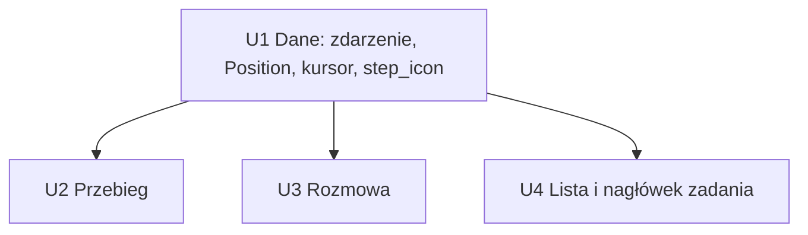

> Zastąpione planem `2026-11-12-002-feat-tui-ikony-profile-i-script-plan.md` w zakresie ikony `📜`: krok `script` ma teraz `💻`, a krok `profile` ma `⚖️`. Zapisy `📜` poniżej zostają jako historia.

# Ikony rodzaju kroku w widokach Rozmowa i Przebieg - Plan

## Goal Capsule

- **Objective:** Operator w TUI rozpoznaje jednym spojrzeniem, kto wykonuje krok (agent, dyrygent, człowiek, skrypt) i czy krok jest decyzją albo czeka na zdarzenie. Nie musi czytać typu kroku ani otwierać definicji workflow.
- **Means:** Ikona (jedna lub dwie) przed nazwą kroku w widokach Rozmowa i Przebieg oraz w liście zadań i nagłówku zadania (R10). Ikona pochodzi z definicji workflow: z typu akcji (`type`) i z `by:` kroku `decision`. Liczba wyjść nie wpływa na ikonę.
- **Product authority:** Zmiana prezentacji w TUI. Dane o rodzaju kroku muszą dojść z definicji workflow do TUI. Dokument powstał bez dialogu z użytkownikiem (tryb nieinteraktywny). Użytkownik potwierdza założenia i odpowiada na pytania w recenzji MR.
- **Open blockers:** Brak blokujących. Pytania Q1–Q5 mają odpowiedzi (patrz niżej).

---

## Product Contract

### Summary

Każdy krok o znanym rodzaju (R1–R4) w widoku Przebieg (oś kroków i nagłówek kroku) oraz w widoku Rozmowa (pasek kroków i nagłówki w transkrypcie) ma ikonę rodzaju przed nazwą, np. `✨ implement #1`, `⚡🔀 triage #1`, `📜 test #2`. Kroki o nieznanym rodzaju (R6) i stan końcowy nie mają ikony. Ikona to część wyświetlanej nazwy kroku. Dla agenta, skryptu i decyzji pierwsza ikona mówi, kto wykonuje krok (R1–R3). Druga ikona (🔀) jest tylko przy kroku `decision`. Krok `wait` ma tylko ✋. Ikona pochodzi tylko z definicji workflow, nie ze stanu przebiegu.

### Problem Frame

Dziś TUI pokazuje przy kroku tylko status (`✓`, `✗`, `●`, `?`) i nazwę (`src/tui/task_app/tabs/progress.rs`, `src/tui/task_app/tabs/conversation.rs`). Typ akcji jest widoczny tylko w nagłówku kroku jako tekst (`· agent`). Pasek kroków w Rozmowie i oś w Przebiegu nie mówią, czy krok wykonuje agent, skrypt czy człowiek. Krok `decision` nie pokazuje, kto decyduje (`by: conductor` lub `by: human`), bo TUI dostaje tylko `action_type` jako tekst `"decision"`. Operator musi znać definicję workflow, aby wiedzieć, gdzie zadanie czeka na człowieka.

### Key Decisions

- **Ikona = "kto" + opcjonalnie "co".** Pierwsza ikona to wykonawca kroku (✨ agent, ⚡ dyrygent, 📜 skrypt; 🧑 człowiek tylko w `🧑🔀` dla `decision` z `by: human`). Druga ikona to 🔀 (krok `decision`). Najwięcej dwie ikony. Wyjątek: krok `wait` nie ma wykonawcy, więc ma tylko ikonę ✋ (R4). Governs R1–R5.
- **🔀 ma tylko krok `decision`.** Nie badamy liczby wyjść kroku. Agent i skrypt mają zawsze jedną ikonę. Governs R1–R3.
- **Źródło ikony to definicja workflow, której zadanie używa.** TUI nie zgaduje ikony ze statusu ani z nazwy kroku. Status (`✓`, `●`, `?`) zostaje osobnym znakiem przed ikoną. Governs R6, R11.

### Requirements

**Tabela ikon**

- R1. Krok `type: agent` ma ikonę `✨`, niezależnie od liczby wyjść.
- R2. Krok `type: script` ma ikonę `📜`, niezależnie od liczby wyjść.
- R3. Krok `type: decision` ma ikonę `⚡🔀` przy `by: conductor` i `🧑🔀` przy `by: human`.
- R4. Krok `type: wait` ma tylko ikonę `✋`. Nie wiemy, na co czeka krok, więc nie ma ikony wykonawcy.

**Przypadki brzegowe**

- R5. Starszy kształt definicji (`type: human`, blok `decision:`) nie jest wspierany. Nie dostaje ikon.
- R6. Krok bez znanego rodzaju (np. `action_type: "none"`) nie ma ikony. TUI pokazuje samą nazwę, bez wcięcia na ikonę. Nazwy nie muszą być wyrównane.

**Miejsca w TUI**

- R7. Ikona jest częścią wyświetlanej nazwy kroku i stoi bezpośrednio przed nią, po znaku statusu: `✓ ✨ implement #1`. Nie ma osobnej kolumny ikon. Dotyczy to: osi kroków w Przebiegu, nagłówka kroku w Przebiegu, paska kroków w Rozmowie i nagłówka kroku w transkrypcie Rozmowy (`── ✨ implement #1 ──`).
- R8. Pasek kroków w Rozmowie liczy szerokość chipa z ikoną. Wybrany krok zostaje widoczny na wąskim ekranie (zachowanie testu `a_narrow_strip_keeps_the_selected_step_in_view`).
- R9. Nagłówek kroku w Przebiegu nadal pokazuje typ akcji tekstem (`· agent`); dla `decision` pokazuje też, kto decyduje (`· decision · conductor`).
- R10. Lista zadań i nagłówek zadania pokazują ikonę w nazwie kroku: `krok N · ✨ nazwa`, gdzie `·` to znak rozdzielający.

**Dane**

- R11. TUI dostaje dla każdego kroku dane potrzebne do R1–R6 (typ akcji, `by`) z definicji workflow, której zadanie używa. Ikona kroku nie zmienia się w trakcie przebiegu.

### Key Flows

- F1. **Operator śledzi zadanie z bramką człowieka.**
  **Trigger:** zadanie z `workflows/template.yaml` dochodzi do kroku `review`.
  **Steps:** oś Przebiegu pokazuje `✓ 📜 demonstrate #1`, potem `? 🧑🔀 review #1`. Pasek Rozmowy pokazuje te same ikony.
  **Outcome:** operator widzi bez otwierania definicji, że zadanie czeka na wybór człowieka.

### Acceptance Examples

- AE1. **Covers R1, R2, R3.** Workflow `tests/fixtures/v2/decision_conductor.yaml`: `test` → `📜 test`, `triage` → `⚡🔀 triage`, `work` → `✨ work`. Workflow `tests/fixtures/v2/decision_human.yaml`: `approval` → `🧑🔀 approval`.
- AE2. **Covers R1, R2.** Krok `agent` lub `script` z dwoma wyjściami w `choices` ma tylko `✨` albo `📜`, bez 🔀.
- AE3. **Covers R6.** Zadanie z błędną definicją (`action_type: "none"`): krok pokazuje samą nazwę, bez ikony i bez wcięcia.

### Scope Boundaries

- Brak ikon w CLI (`narsor task ...`). Tylko TUI.
- Brak konfiguracji ikon w workflow ani w ustawieniach użytkownika.
- Brak trybu bez emoji i zastępczych znaków ASCII.
- Brak wsparcia dla starszego kształtu definicji workflow.
- Brak ikony dla stanu końcowego (`completed`, `cancelled`). Stan końcowy nie ma akcji, więc stosuje się R6.

### Dependencies / Assumptions

- Definicja schematu: `crates/narsor-engine/src/workflow/schema.rs` (`ActionSchema`, `DecisionActionSchema`, `DecisionSchema`), `DecisionMaker { Conductor, Human }` w `crates/narsor-engine/src/domain/workflow_definition.rs`.
- Dziś TUI dostaje z serwera tylko `Position.action_type` jako tekst (`crates/narsor-protocol/src/api/timeline.rs`), bez `by`. R11 wymaga rozszerzenia danych; sposób wybiera planowanie.

### Założenia

- Z1. **Układ "kto + co".** Pierwsza ikona to wykonawca, druga to 🔀 (tylko `decision`). ✋ ma tylko krok `wait`.
- Z2. **Liczba wyjść nie wpływa na ikonę.** Agent to zawsze `✨`, skrypt to zawsze `📜`.
- Z3. **Starszy kształt definicji nie jest wspierany.** Nie ma dla niego ikon.
- Z4. **Ikona jest częścią nazwy.** Nie ma kolumny ikon ani wyrównania nazw.
- Z5. **Status zostaje pierwszym znakiem.** Kolejność: status, ikona, nazwa (`✓ ✨ implement #1`).
- Z6. **Nie ma trybu bez emoji.**

### Odpowiedzi użytkownika z recenzji MR

- Q1. `decision` z `by: human` ma `🧑🔀`.
- Q2. `decision` z `by: conductor` ma `⚡🔀`.
- Q3. Nie robimy trybu bez emoji.
- Q4. `wait` ma `✋`: nie wiemy, na co czeka krok.
- Q5. Tak: ikony są też w liście zadań i w nagłówku zadania, w formie `krok N · ikona nazwa`.

## Deferred / Open Questions

Te pozycje to wyniki recenzji pozostawione autorowi. Nie blokują implementacji.

### From 2026-11-07 review

- **Dyrygent przekazuje decyzję operatorowi, a ikona dalej pokazuje dyrygenta** — R3 (`decision` z `by: conductor`, `⚡🔀`) i R11 (ikona nie zmienia się w trakcie przebiegu) (P3, coherence, confidence 75)

  Dyrygent, który nie jest pewny decyzji, przekazuje krok operatorowi. Wtedy operator musi działać, ale ikona `⚡🔀` dalej mówi, że decyduje dyrygent. Dokument nie mówi, czy to jest akceptowane.
  Change: Zalecenie: zostawić ikonę stałą (R11) i zapisać w założeniach, że oczekiwanie na operatora pokazuje znak statusu `?`, a nie ikona.

- **Widok Rozmowa nie ma tekstowego klucza do ikon** — R9 (typ tekstem tylko w nagłówku Przebiegu) (P3, design-lens, confidence 50)

  Operator, który pracuje tylko w Rozmowie, widzi ✨, ⚡, 📜, 🔀, ale nie ma tekstu, który potwierdza ich znaczenie. Znaczenie ⚡ (dyrygent) i 📜 (skrypt) nie jest oczywiste.
  Change: Dodać jednowierszowy klucz ikon w stopce albo pomocy, albo typ akcji tekstem w nagłówku kroku w Rozmowie. Wymaga decyzji autora.

- **R10 nie pokazuje statusu w wierszu listy zadań i w nagłówku zadania** — R10 i Z5 (P3, coherence, confidence 50)

  Z5 mówi, że status jest pierwszym znakiem. Przykład `krok N · ✨ nazwa` w R10 nie ma statusu. Implementer może wybrać różne układy.
  Change: Zapisać w R10, czy status stoi przed „krok N”, albo że R10 go nie dotyczy.

---

## Planning Contract

Product Contract unchanged. Plan dodaje tylko sposób wykonania.

### Key Technical Decisions

- KTD1. **Rodzaj kroku płynie zdarzeniem `ActionStarted`.** Zdarzenie dostaje pole `decision_by: Option<String>` (`"conductor"` albo `"human"`, tylko dla `decision`), z `#[serde(default)]`. Silnik zna akcję w chwili emisji (`crates/narsor-engine/src/engine/runner.rs`, `run_action`), więc nie potrzebuje definicji w budowie osi czasu. Rozwiązuje R11 bez drugiego źródła prawdy. Odrzucone: wczytywanie definicji workflow w TUI lub w `build_timeline` (zły kierunek zależności, definicja może się zmienić w trakcie przebiegu).
- KTD2. **`Position` dostaje `decision_by`, dziedziczone jak `action_type`.** Pole `decision_by: Option<String>` z `#[serde(default)]` w `crates/narsor-protocol/src/api/timeline.rs`. `Draft` w `crates/narsor-engine/src/engine/timeline.rs` kopiuje je ze zdarzenia i dziedziczy tak jak `inherited_action_type`. Starsze logi i starsze serwery dają `None`.
- KTD3. **Jedna funkcja mapuje rodzaj na ikonę.** `step_icon(action_type: Option<&str>, decision_by: Option<&str>) -> Option<&'static str>` w `crates/narsor-protocol/src/api/timeline.rs`. Zwraca: `agent` → `✨`, `script` → `📜`, `wait` → `✋`, `decision` + `conductor` → `⚡🔀`, `decision` + `human` → `🧑🔀`. `decision` bez `decision_by` → `🔀` (PA1). Wszystko inne (`human`, `none`, `terminal`, `None`) → `None` (R5, R6). Wszystkie widoki TUI wołają tę funkcję. Governs R1–R6.
- KTD4. **Lista zadań dostaje rodzaj przez `ExecutionCursor`.** Wiersz listy ma tylko `execution_cursor.current_state` (`crates/narsor-protocol/src/controller.rs`). Kursor dostaje dwa pola `current_action_type` i `current_decision_by` (`Option<String>`, `#[serde(default)]`). Runner wypełnia je z ostatniej pozycji osi czasu, tak jak już wypełnia `action_execution_id` (`crates/narsor-runner/src/runner/snapshot.rs`). Governs R10, R11.
- KTD5. **Szerokość ikony liczy `Span::width`, nie `chars().count()`.** Ikony mają szerokość 2 kolumn. Kod paska kroków już używa `Span::raw(...).width()`; osie i nagłówki mają trzymać ten sam sposób liczenia. Governs R8.
- KTD6. **Ikona jest stała w czasie życia kroku.** Przekazanie decyzji przez dyrygenta operatorowi nie zmienia ikony. Oczekiwanie na operatora pokazuje znak statusu `?`. Rozstrzyga pozycję z sekcji Deferred (R3, R11).

### Założenia planu

- PA1. `decision` bez `decision_by` (log starszy niż zmiana) pokazuje samą ikonę `🔀`. Product Contract nie mówi, co wtedy; ta wartość nie udaje wykonawcy, którego nie znamy.
- PA2. Typ `human` w silniku nadal istnieje (`ActionKind::Human`). Zgodnie z R5 nie ma ikony.
- PA3. R10 nie dodaje znaku statusu do wiersza listy ani nagłówka zadania. Dziś ich nie mają; kolejność z Z5 dotyczy osi, paska i nagłówków kroków. Rozstrzyga pozycję z sekcji Deferred (R10, Z5).
- PA4. Klucz ikon w widoku Rozmowa (pozycja z sekcji Deferred) nie wchodzi do tego planu. Zostaje do decyzji autora.

### Sekwencja

---

## Implementation Units

Praca idzie jednym PR. U2, U3 i U4 zależą tylko od U1.

### U1. Dane o rodzaju kroku od silnika do protokołu

- **Goal:** TUI dostaje `action_type` i `decision_by` dla każdego kroku i dla bieżącego kroku zadania.
- **Requirements:** R1–R6, R11.
- **Dependencies:** brak.
- **Files:**
  - `crates/narsor-protocol/src/event.rs` (`ActionStarted.decision_by`)
  - `crates/narsor-protocol/src/api/timeline.rs` (`Position.decision_by`, `step_icon`)
  - `crates/narsor-protocol/src/controller.rs` (`ExecutionCursor`)
  - `crates/narsor-engine/src/engine/runner.rs` (emisja `ActionStarted`; `ActionKind::of` zna akcję)
  - `crates/narsor-engine/src/engine/timeline.rs` (`Draft`, `push_attempt`, dziedziczenie)
  - `crates/narsor-runner/src/runner/snapshot.rs` i `crates/narsor-runner/src/runner/mod.rs` (kursor)
  - Test: `tests/integration/timeline.rs`, testy jednostkowe w `crates/narsor-protocol/src/api.rs` (serializacja, jak wpisy przy liniach 736 i 792)
- **Approach:** Wzór dla pola: `action_type` w `Draft` i `Position`. Wartość `decision_by` bierze się z `DecisionActionConfig.by` (`crates/narsor-engine/src/domain/workflow_definition.rs`), nazwa w snake_case jak `DecisionMaker`. Pozostałe miejsca, które budują `EventData::ActionStarted` (44 wystąpienia w kodzie i testach), dostają `decision_by: None`. Komentarz `ActionKind::Wait/Decision` ("no executor in this version") sprawdź przed zmianą; nie zmieniaj jego sensu.
- **Test Scenarios:**
  - `step_icon` zwraca ikonę z KTD3 dla każdej z pięciu kombinacji (R1–R4).
  - `step_icon` zwraca `None` dla `human`, `none`, `terminal`, `None` (R5, R6).
  - `step_icon` dla `decision` bez `by` zwraca `🔀` (PA1).
  - Oś czasu z `decision_conductor.yaml`: pozycja `triage` ma `decision_by == Some("conductor")`, `test` i `work` mają `None` (AE1).
  - Pozycja dziedziczy `decision_by` po ponownym pytaniu w tej samej sesji (jak `action_type`).
  - Stary JSON `ActionStarted`, `Position` i `ExecutionCursor` bez nowych pól deserializuje się do `None`.
  - Kursor zadania w kroku `decision` niesie typ i `by` ostatniej pozycji.
- **Verification:** `cargo test -p narsor-protocol -p narsor-engine -p narsor-runner` oraz `tests/integration/timeline.rs`.

### U2. Ikony w widoku Przebieg

- **Goal:** Oś kroków i nagłówek kroku pokazują ikonę przed nazwą (R7, R9).
- **Requirements:** R1–R4, R6, R7, R9.
- **Dependencies:** U1.
- **Files:** `src/tui/task_app/tabs/progress.rs` (`axis_line`, tabela użycia w `table`, nagłówek kroku); test: `tests/integration/tui_render.rs`.
- **Approach:** Ikona i spacja wchodzą do wyświetlanej nazwy po znaku statusu: `✓ ✨ implement #1`. Kolumna nazwy w tabeli użycia liczy szerokość z ikoną (KTD5). Brak ikony: sama nazwa, bez wcięcia (R6). Nagłówek zachowuje `· agent`; dla `decision` dopisuje `· decision · conductor` albo `· decision · human` (R9). Nie zmieniaj skracania nazwy przez `fit` poza uwzględnieniem szerokości ikony.
- **Test Scenarios:**
  - Oś z workflow `decision_conductor.yaml` pokazuje `📜 test`, `⚡🔀 triage`, `✨ work`, `🧑🔀 approval` po znaku statusu (AE1, w wersji z `decision_human.yaml` dla `approval`).
  - Agent z dwoma wyjściami ma tylko `✨` (AE2).
  - Krok `wait` ma tylko `✋`.
  - Pozycja z `action_type: "none"` pokazuje samą nazwę bez wcięcia (AE3).
  - Nagłówek kroku `decision` pokazuje wykonawcę tekstem (R9).
  - Wąska szerokość: nazwa skraca się, ikona i status zostają.
- **Verification:** `cargo test --test integration tui_render`.

### U3. Ikony w widoku Rozmowa

- **Goal:** Pasek kroków i nagłówki w transkrypcie pokazują ikonę (R7, R8).
- **Requirements:** R1–R4, R6, R7, R8.
- **Dependencies:** U1.
- **Files:** `src/tui/task_app/tabs/conversation.rs` (`StepChip`, `rebuild_with_events`, `step_strip_line`, `step_chip`, `heading`, `push_step_heading`); test: `tests/integration/tui_render.rs` (przy `a_narrow_strip_keeps_the_selected_step_in_view`).
- **Approach:** `StepChip` dostaje pole z ikoną (z `Position` przez `step_icon`). `chip_widths` liczy `2 + szerokość ikony + spacja + nazwa`. Nagłówek `── ✨ implement #1 ──` bierze ikonę z pozycji; `push_step_heading` nie ma pozycji, więc szuka jej po `state_id` i `visit` w liście pozycji. Nagłówek nie ma ikony tylko wtedy, gdy krok ma nieznany rodzaj (R6).
- **Test Scenarios:**
  - Pasek pokazuje `✓ ✨ implement #1` i ikony dla pozostałych rodzajów.
  - `a_narrow_strip_keeps_the_selected_step_in_view` nadal przechodzi z ikonami; dodaj wariant z szerokimi ikonami `⚡🔀` (R8).
  - Nagłówek w transkrypcie dla kroku o znanym rodzaju zawsze zawiera ikonę kroku.
  - Krok o nieznanym rodzaju nie ma ikony ani wcięcia (AE3).
- **Verification:** `cargo test --test integration tui_render`.

### U4. Ikona w liście zadań i w nagłówku zadania

- **Goal:** `krok N · ✨ nazwa` w liście zadań i w nagłówku zadania (R10).
- **Requirements:** R10, R11.
- **Dependencies:** U1.
- **Files:** `src/tui/task_app/list.rs` (`current_step`), `src/tui/task_app/detail.rs` (około linii 1712–1722, `format!("krok {at} {name}")`); test: `tests/integration/tui_render.rs` albo istniejące testy listy.
- **Approach:** Nazwa kroku dostaje ikonę z `ExecutionCursor.current_action_type` i `current_decision_by` (KTD4) przez `step_icon`. Układ `krok N · ikona nazwa` zgodnie z R10; użyj separatora `·` z R10 (dziś kod łączy numer i nazwę spacją, `format!("krok {at} {name}")`). Zadanie bez kursora z rodzajem pokazuje samą nazwę (R6).
- **Test Scenarios:**
  - Wiersz listy dla zadania w kroku `agent` zawiera `✨ nazwa`.
  - Nagłówek zadania dla kroku `decision` + `human` zawiera `🧑🔀`.
  - Zadanie w stanie kolejki albo bez kroku: bez zmian.
  - Kursor z serwera bez nowych pól: sama nazwa, bez paniki.
- **Verification:** `cargo test --test integration tui_render` oraz testy w `src/tui/task_app`.

---

## Verification Contract

| Bramka | Polecenie | Dotyczy |
|---|---|---|
| Testy jednostkowe i integracyjne | `cargo test --workspace` | U1–U4 |
| Lint | `cargo clippy --workspace --all-targets` | U1–U4 |
| Format | `cargo fmt --all --check` | U1–U4 |
| Zgodność wstecz | test deserializacji starego JSON `Position`, `ExecutionCursor`, `ActionStarted` | U1 |

Sprawdź w repo, czy CI używa innych flag niż powyższe; wtedy użyj flag z CI.

## Definition of Done

- Każdy AE (AE1–AE3) ma test, który przechodzi.
- Wszystkie R1–R11 mają pokrycie w testach z U1–U4.
- Pasek kroków dalej trzyma wybrany krok w widoku na wąskim ekranie (R8).
- Stary log i stary serwer bez nowych pól nie psują TUI.
- Brak kodu z porzuconych prób; brak ikon w CLI (Scope Boundaries).
