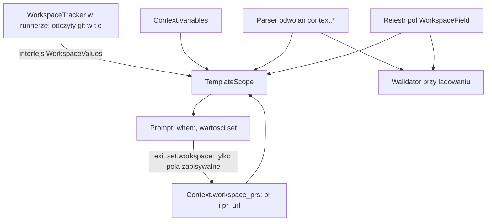

# Odczyt i zapis wartości context.workspace w workflow - Plan

## Goal Capsule

- **Objective:** Autor workflow czyta wartości workspace i zmienne w promptach, w `when:` i w wartościach `set` jedną regułą, bez kopiowania ich przez zmienne. Workflow `wruw-change` czyta adres PR z `context.workspace.code.pr_url`.
- **Means:** Jeden rejestr pól workspace dla odczytu i zapisu (KTD1). Jeden parser ścieżek `context.*` dla renderera i walidatora (KTD2). Wartości systemowe docierają do silnika przez wąski interfejs tylko do odczytu (KTD3).
- **Product authority:** Użytkownik (Artur) potwierdził zakres w rozmowie 2026-11-07. Zakres nie zawiera zmian nagłówka zadania ani modelu zapisu pól systemowych.
- **Open blockers:** Brak.
- **Execution profile:** jeden PR. Zmiana dotyczy jednego łańcucha (rejestr, renderer, walidator, dostawca wartości), więc podział nie daje korzyści. Wykonawca kończy i wysyła pracę sam.

---

## Product Contract

### Summary

Szablony i warunki `when:` czytają dowolną wartość pod `context.workspace.<nazwa>.<pole>` i dzieci zmiennych: `context.variables.NAME` oraz jej pola, gdy wartość jest obiektem. Zapis przez `exit.set.workspace.<nazwa>.<pole>` działa według tego samego rejestru pól, a pola systemowe są tylko do odczytu. Błędne odwołanie kończy się błędem przy ładowaniu workflow.

### Problem Frame

Workflow `workflows/wruw-change.yaml` czyta adres PR przez `context.workspace.code.pr_url`. Silnik odrzuca taką ścieżkę w szablonach i w `when:`, bo renderer przyjmuje tylko płaskie nazwy (`context.NAME`, `context.variables.NAME`). Wartości workspace istnieją w silniku, ale tylko nagłówek zadania je czyta. Autor workflow musi dziś kopiować wartość do zmiennej albo nie może jej użyć.

Silnik trzyma w `Context` tylko `pr` i `pr_url` (`Context.workspace_prs`). Pozostałe pola (`repo`, `base_branch`, `branch`, `added`, `removed`) należą do runnera: `WorkspaceTracker` w `crates/narsor-runner/src/runner/workspaces.rs` czyta je z git w tle po każdym kroku.

### Key Decisions

- Prompty i `when:` czytają PR przez `context.workspace.<nazwa>.*`, nie przez `context.variables.pr_url`. (session-settled: user-directed — chosen over reading the variable through the `context.NAME` shorthand: użytkownik kazał użyć `context.workspace.*` w workflow.) Governs R1, R6.
- Zakres to ogólne czytanie i zapis wartości pod `context.*`, nie dwa pola PR. (session-settled: user-directed — chosen over reading only `pr` and `pr_url`: użytkownik poprawił zakres: ma działać dowolna wartość i jej dzieci.) Governs R1, R2, R5.
- Pola `repo`, `base_branch`, `branch`, `added`, `removed` są tylko do odczytu. (session-settled: user-approved — chosen over writing every field through `set`: system nadpisuje `branch`, `added` i `removed` po każdym kroku, a `repo` i `base_branch` opisują klon zrobiony przy tworzeniu zadania.) Governs R4.

### Requirements

**Odczyt**

- R1. Szablon i `when:` czytają `context.workspace.<nazwa>.<pole>` dla pól `repo`, `base_branch`, `branch`, `added`, `removed`, `pr`, `pr_url`.
- R2. Szablon i `when:` czytają pole wartości zmiennej, gdy wartość jest obiektem: `context.variables.NAME.pole`. Skrót `context.NAME` dalej znaczy `context.variables.NAME`.
- R3. Odwołanie do workspace spoza definicji workflow albo do pola spoza rejestru jest błędem przy ładowaniu i przy renderowaniu. Znane pole bez wartości daje pusty tekst, a w `when:` fałsz.

**Zapis**

- R4. `exit.set.workspace.<nazwa>.<pole>` zapisuje tylko pola zapisywalne (`pr`, `pr_url`). Zapis pola tylko do odczytu jest błędem przy ładowaniu i nazywa to pole. Kształt `set` i reguła "pusta wartość nie zastępuje poprzedniej" zostają.

**Jedno źródło reguł**

- R5. Wykaz pól workspace i atrybut "zapisywalne" są zapisane w jednym miejscu. Odczyt, zapis, walidacja i komunikaty błędów biorą dane z tego miejsca.
- R6. `workflows/wruw-change.yaml` ładuje się bez błędów. Jego prompty po kroku `publish_requirements` czytają `context.workspace.code.pr_url`.
- R7. `docs/dev/workflow-schema.md` opisuje formy odwołań i pola zapisywalne.

### Success Criteria

- Zadanie `wruw-change` po `publish_requirements` renderuje prompt kroku `check_requirements_feedback` z adresem PR z `context.workspace.code.pr_url` (test silnika z atrapą dostawcy).
- Dodanie nowego pola workspace wymaga zmiany w jednym miejscu kodu i jednej linii dokumentacji.

### Scope Boundaries

- Poza zakresem: pola `context.task`, `context.repositories` i stare `Context.workspace` (`WorkspaceInfo`); odwołania do artefaktów zostają `artifacts.NAME`.
- Poza zakresem: nagłówek zadania w TUI i CLI. Czyta te same wartości, ale nie zmienia się.
- Poza zakresem: wymuszenie świeżego odczytu git przed renderowaniem promptu. Wartość `branch`, `added` i `removed` jest ostatnim odczytem w tle (KTD4). Dowód, który zmieniłby tę ocenę: prompt, który potrzebuje dokładnej gałęzi tuż po kroku.
- Rozważone i niewykonane: filtry i wyrażenia w szablonach (`{{ x | default }}`). Powód: szablony zostają prostą podmianą (D6). Dowód, który zmieniłby tę ocenę: wiele workflow powtarza ten sam wzorzec zastępczy.
- Rozważone i niewykonane: indeksy tablic w ścieżce (`context.variables.lista.0`). Powód: żaden workflow ich nie potrzebuje; zmiennej z tablicą nie da się odczytać polem.

---

## Planning Contract

### Key Technical Decisions

- KTD1. **Jeden rejestr pól workspace.** Wyliczenie `WorkspaceField` (siedem pól) zastępuje `WorkspacePrField`. Ma nazwę klucza, odczyt klucza i atrybut `writable()`. Walidator, renderer `set`, zapis w `runner.rs` i komunikaty błędów biorą pola i ich listę z rejestru. Dodanie pola to jeden wiersz. Realizuje R4, R5.
- KTD2. **Jeden parser odwołań `context.*`.** Funkcja w `template.rs` zamienia tekst odwołania na typowaną ścieżkę: zmienna z polami (`NAME`, `pole…`) albo `workspace.<nazwa>.<pole>`. Renderer i walidator używają jej. `context_name` i `context_references` biorą z niej nazwę zmiennej, a odwołania do workspace nie są zmiennymi. Realizuje R1–R3.
- KTD3. **Wartości systemowe wchodzą przez interfejs tylko do odczytu.** Silnik definiuje wąski interfejs `WorkspaceValues` (odczyt jednego pola po nazwie workspace i polu). `TemplateScope` dostaje go jak `with_task_fields`, a silnik trzyma go jak `task_labels` (`with_task_labels`). `WorkspaceTracker` z runnera go implementuje. `pr` i `pr_url` scope czyta z `Context.workspace_prs`. Odrzucona alternatywa: kopiowanie wartości do zapisywanego `Context`. Powód: odczyty z git w tle zmieniałyby zapisany `context.json` poza krokiem, kształt zapisanych danych byłby kosztowny do cofnięcia, a prawda byłaby w dwóch miejscach. Alternatywy są konkretne i porównane tutaj, więc plan nie zleca ich wytworzenia (bake-off).
- KTD4. **Wartość pola systemowego to ostatni odczyt.** Prompt renderowany tuż po kroku może zobaczyć stan sprzed jego zmian, bo odczyt biegnie w tle (`workspaces.rs`). Dokumentacja to nazywa. (session-settled: user-approved — chosen over a forced fresh git read before every render: użytkownik potwierdził wartość z chwili renderowania, a wymuszony odczyt dodaje czekanie na git do każdego kroku.)
- KTD5. **Zasady wartości.** Zmienna zadeklarowana bez wartości i znane pole workspace bez wartości dają pusty tekst. Nieznana nazwa, nieznane pole, brak pola w ścieżce workspace (`context.workspace.code`) albo pole obiektu, którego nie ma, dają `UnknownVariable`. Pole wartości, która nie jest obiektem, też daje błąd. Zgodne z dzisiejszą regułą zadeklarowanych nazw (KTD6 w `template.rs`).
- KTD6. **Workspace lokalny (`path:`) ma tylko `repo`.** Pozostałe pola są znane i bez wartości, więc dają pusty tekst. Zapis `set.workspace` do takiego workspace zostaje błędem (istniejąca reguła `SetWorkspaceNotGit`).
- KTD7. **Przy uruchamianiu zadania nie ma wartości workspace.** `resolver.rs` (`workspace`) i `tasks/mod.rs` (`workspace_request`) renderują `globals.workspace` z pustym `Context`, bez dostawcy i bez zadeklarowanych nazw workspace. Odwołanie `context.workspace.*` w polu workspace daje tam błąd nieznanej nazwy (KTD8), bez nowej obsługi.
- KTD8. **Nazwy workspace zna scope, nie dostawca.** `DeclaredNames` (przekazywane przez `with_declared`) dostaje nazwy workspace z `definition.repositories`. Scope sprawdza nazwę przed pytaniem dostawcy: nazwa spoza zbioru daje `UnknownVariable`. Dostawca zwraca tylko "jest wartość" albo "brak wartości", więc brak wartości daje pusty tekst (KTD5). Scope bez `with_declared` (`check_syntax`, `resolver.rs`, `tasks/mod.rs`) nie zna żadnej nazwy.

### High-Level Technical Design

### Assumptions

Brak. Zakres potwierdzony w rozmowie.

---

## Implementation Units

### U1. Rejestr pól workspace i zapis tylko pól zapisywalnych

- **Goal:** Jedno wyliczenie pól workspace z atrybutem `writable()`. Zapis pola tylko do odczytu jest błędem ładowania.
- **Requirements:** R4, R5. KTD1.
- **Dependencies:** brak.
- **Files:**
  - `crates/narsor-engine/src/domain/workflow_definition.rs` (rejestr zastępuje `WorkspacePrField`; nowy wariant `ValidationError` dla pola tylko do odczytu)
  - `crates/narsor-engine/src/workflow/validator.rs` (`validate_set_workspace`)
  - `crates/narsor-engine/src/engine/runner/variable_rules.rs` (`render_workspace_assignments`)
  - `crates/narsor-engine/src/engine/runner.rs` (`write_assignments`)
  - Testy: `tests/integration/validation.rs`, `tests/fixtures/v2/engine_set_workspace.yaml`, test jednostkowy w `workflow_definition.rs`
- **Approach:**
  1. Zamień `WorkspacePrField` na rejestr siedmiu pól z `from_key`, nazwą klucza i `writable()`.
  2. W walidatorze odróżnij pole nieznane od pola tylko do odczytu. Oba komunikaty biorą listę pól z rejestru.
  3. W `render_workspace_assignments` i `write_assignments` używaj rejestru. Zapis pola niezapisywalnego nie powinien tu nigdy dojść; traktuj to jako błąd silnika, nie ciche pominięcie.
  4. Pamięć `Context.workspace_prs` zostaje bez zmian (R4 nie zmienia zapisanych danych).
- **Patterns to follow:** istniejące warianty `SetUnknownWorkspaceValue` i `SetWorkspaceNotGit` oraz test AE2 z planu `docs/plans/2026-11-07-0518-refactor-naglowek-zadania-bez-display-plan.md`.
- **Test scenarios:**
  - `set.workspace.code.pr_url` przechodzi walidację i zapisuje wartość (test silnika na fixture).
  - `set.workspace.code.branch` kończy się błędem ładowania, który nazywa `branch` i stan (pole tylko do odczytu).
  - `set.workspace.code.added`, `removed`, `repo`, `base_branch` kończą się tym samym błędem.
  - `set.workspace.code.title` kończy się błędem pola nieznanego, z listą pól z rejestru.
  - Rejestr: `from_key` dla każdego z siedmiu kluczy zwraca pole, a `writable()` jest prawdą tylko dla `pr` i `pr_url`.
- **Verification:** walidator odrzuca zapis pól systemowych, a istniejące testy `set.workspace` dalej przechodzą.

### U2. Parser odwołań `context.*` i odczyt ścieżek w szablonach

- **Goal:** Szablon i `when:` czytają `context.workspace.<nazwa>.<pole>` oraz pola wartości zmiennych.
- **Requirements:** R1, R2, R3. KTD2, KTD3, KTD5.
- **Dependencies:** U1 (rejestr pól).
- **Files:**
  - `crates/narsor-engine/src/workflow/template.rs` (gałąź `"context"` w rozwiązywaniu, `context_name`, `plain_name`, `check_syntax`, `TemplateScope`)
  - Test: moduł testów w `template.rs`
- **Approach:**
  1. Dodaj parser, który zamienia tekst po `context.` na typowaną ścieżkę: zmienna z polami albo workspace z polem. Skrót `NAME` i `variables.NAME` dają tę samą zmienną.
  2. Dodaj do `TemplateScope` wejście na interfejs `WorkspaceValues` i odczyt `Context.workspace_prs`. Scope bez dostawcy czyta pola systemowe jako brak wartości.
  3. Rozszerz `DeclaredNames` o nazwy workspace z definicji (KTD8). Scope sprawdza nazwę workspace względem nich, zanim zapyta dostawcę.
  4. Rozwiązuj ścieżkę przez rejestr z U1. Wartość `added` i `removed` renderuj jako liczbę bez cudzysłowów (zasada JSON istniejąca w `render_scalar`).
  5. Zachowaj `check_syntax` bez rozwiązywania wartości: odwołanie do workspace ma przejść bez dostawcy i bez zadeklarowanych nazw.
  6. `context_name` i `context_references` zwracają nazwę zmiennej dla `variables.NAME.pole`, a dla odwołań do workspace nic.
- **Execution note:** zacznij od tabeli testów odwołań (wejście, wynik), potem dopiero rozwiązywanie ścieżek.
- **Patterns to follow:** istniejące testy odwołań w `template.rs` i reguła pustego tekstu dla zadeklarowanej nazwy.
- **Test scenarios:**
  - `context.workspace.code.branch` zwraca wartość z atrapy dostawcy.
  - `context.workspace.code.pr_url` zwraca wartość z `Context.workspace_prs`.
  - `context.workspace.code.added` bez odczytu daje pusty tekst, a jako `when:` daje fałsz.
  - `context.workspace.nope.pr_url` daje błąd z nazwą odwołania i miejscem, także gdy dostawca zwraca brak wartości dla każdego pola.
  - Scope bez zadeklarowanych nazw daje błąd nazwy dla `context.workspace.code.pr_url`.
  - `context.workspace.code.title` daje błąd (pole spoza rejestru).
  - `context.workspace.code` i `context.workspace` dają błąd "unsupported".
  - `context.NAME` i `context.variables.NAME` dają to samo.
  - `context.variables.cfg.name` czyta pole obiektu; pole nieistniejące daje błąd; pole wartości tekstowej daje błąd.
  - Filtr `{{ context.workspace.code.pr | default("x") }}` dalej daje błąd filtrów.
  - `check_syntax` przyjmuje odwołanie do workspace bez dostawcy; `context_references` zwraca `[]` dla niego i `["cfg"]` dla `context.variables.cfg.name`.
- **Verification:** wszystkie odwołania z tabeli dają wynik z KTD5, a istniejące testy szablonów przechodzą.

### U3. Silnik trzyma dostawcę wartości i buduje z nim scope

- **Goal:** Każde miejsce, które buduje scope renderowania, daje mu dostawcę wartości workspace.
- **Requirements:** R1, R6. KTD3, KTD7.
- **Dependencies:** U2.
- **Files:**
  - `crates/narsor-engine/src/engine/runner.rs` (miejsca budowy scope przy wykonaniu akcji i przy renderowaniu `set`; konstruktor obok `with_task_labels`)
  - `crates/narsor-engine/src/environment/resolver.rs` i `crates/narsor-engine/src/tasks/mod.rs` (`workspace_request`): bez dostawcy i bez zadeklarowanych nazw
  - Testy: `tests/integration/engine_unified_schema.rs`
- **Approach:**
  1. Dodaj do silnika pole z dostawcą i konstruktor w stylu `with_task_labels`. Domyślnie brak dostawcy.
  2. Przekaż dostawcę do obu scope w `runner.rs`: przy akcji i przy `render_assignments`. Oba już wołają `with_declared`, więc dostają nazwy workspace z KTD8.
  3. `resolver.rs` i `tasks/mod.rs` zostają bez dostawcy i bez nazw (KTD7).
- **Patterns to follow:** droga `task_labels` (`with_task_fields`) w `runner.rs`.
- **Test scenarios:**
  - Krok `set.workspace.code.pr_url` z `exit`, potem następny krok czyta `{{ context.workspace.code.pr_url }}` i dostaje ten adres (atrapa dostawcy, bez git).
  - Wartość z atrapy dostawcy (`branch`) trafia do promptu kroku.
  - Silnik bez dostawcy: odwołanie do pola systemowego daje pusty tekst, a do `pr_url` ustawionego przez `set` daje adres.
  - `set` w kroku renderuje wartość z `{{ context.workspace.code.base_branch }}` ze scope z dostawcą.
  - `context.workspace.*` w `globals.workspace` (ścieżki `resolver.rs` i `tasks/mod.rs`) daje ten sam błąd nieznanej nazwy.
- **Verification:** test silnika z atrapą przechodzi; scope w resolverze dalej buduje się bez dostawcy.

### U4. `WorkspaceTracker` implementuje interfejs wartości

- **Goal:** Runner daje silnikowi pola systemowe z odczytów git.
- **Requirements:** R1. KTD3, KTD4, KTD6.
- **Dependencies:** U2, U3.
- **Files:**
  - `crates/narsor-runner/src/runner/workspaces.rs` (implementacja interfejsu na `WorkspaceTracker`; testy w module testów obok `header()`)
  - Miejsce, w którym runner buduje silnik (znajdź wywołania `with_task_labels` w crate'ie runnera) — przekaż trackera.
- **Approach:**
  1. Implementacja czyta nagłówek workspace pod mutexem i zwraca pole z rejestru: `repo`, `base_branch`, `branch`, `added`, `removed`.
  2. `pr` i `pr_url` bierze scope z `Context.workspace_prs`, więc implementacja ich nie obsługuje.
  3. Workspace lokalny zwraca tylko `repo`; pozostałe pola bez wartości (KTD6).
- **Patterns to follow:** `WorkspaceTracker::headers` i helper `header()` w testach `workspaces.rs`. Zasada testów: bez plików, blokad i procesów; test sprawdza mapowanie nagłówka na pola, nie odczyt git.
- **Test scenarios:**
  - Nagłówek z `branch`, `added`, `removed` daje te wartości przez interfejs.
  - Nieznana nazwa workspace daje brak wartości; błąd nazwy zgłasza scope (KTD8), nie dostawca.
  - Nagłówek bez `added` daje pole bez wartości, nie zero.
  - Workspace lokalny: `repo` ma wartość, `branch` nie ma.
- **Verification:** testy mapowania przechodzą; zadanie uruchomione przez runner czyta `context.workspace.code.base_branch` w promptach.

### U5. Walidacja odwołań przy ładowaniu workflow

- **Goal:** Błędne odwołanie `context.workspace.*` kończy ładowanie, nie wykonanie zadania.
- **Requirements:** R3. KTD2.
- **Dependencies:** U1, U2.
- **Files:**
  - `crates/narsor-engine/src/workflow/validator.rs` (`validate_state_templates`, `prompt_templates` dla `when:`)
  - `crates/narsor-engine/src/domain/workflow_definition.rs` (nowy wariant `ValidationError`)
  - Test: `tests/integration/validation.rs`
- **Approach:**
  1. Dla każdego szablonu i warunku `when:` rozbij odwołania parserem z U2.
  2. Sprawdź nazwę workspace względem `definition.repositories` i pole względem rejestru.
  3. Dziś wartości `set` nie są sprawdzane przy ładowaniu (`validate_set_assignments`: "A templated value is checked when it is rendered"). Przekaż do tej samej kontroli odwołań wartości tekstowe `set.global`, `set.local` i `set.workspace` każdego wyboru.
  4. Błąd nazywa stan, pole źródłowe (`action.prompt`, `when`, `set`) i odwołanie.
- **Patterns to follow:** `UnknownArtifactReference` i `UnknownInputReference` w tej samej funkcji.
- **Test scenarios:**
  - `context.workspace.code.pr_url` w prompcie workflow z workspace `code` przechodzi.
  - `context.workspace.payments.pr_url` bez workspace `payments` daje błąd z nazwą stanu i `payments`.
  - `context.workspace.code.title` daje błąd pola.
  - `when: context.workspace.code.pr_url` przechodzi, a `when: context.workspace.nope.pr` daje błąd.
  - Odwołanie bez pola (`context.workspace.code`) daje błąd.
  - `set.workspace.code.pr_url: "{{ context.workspace.nope.pr }}"` kończy ładowanie błędem z nazwą stanu i pola `set`.
- **Verification:** błędne odwołania w fixture kończą ładowanie z nazwanym stanem; `wruw-change.yaml` ładuje się.

### U6. Dokumentacja i kontrola workflow dostarczonego z repozytorium

- **Goal:** Dokument schematu opisuje nowe odwołania, a `wruw-change.yaml` ma kontrolę struktury.
- **Requirements:** R6, R7.
- **Dependencies:** U1–U5.
- **Files:**
  - `docs/dev/workflow-schema.md` (zakres szablonów w §3.3, nagłówek §3.6, `set` §3.7.5)
  - `tests/integration/builtin_workflows.rs` (kontrola `workflows/wruw-change.yaml`)
- **Approach:**
  1. Dopisz do listy form odwołań `context.workspace.<nazwa>.<pole>` i pole wartości zmiennej, z regułami pustego tekstu i błędu (KTD5).
  2. Opisz pola zapisywalne i tylko do odczytu w jednej tabeli i wskaż rejestr jako źródło.
  3. Nazwij w dokumencie świeżość pól systemowych (KTD4).
  4. Dodaj kontrolę ładowania i walidacji `workflows/wruw-change.yaml`, jeśli jej nie ma. Kontrola sprawdza strukturę (ładowanie, brak błędów walidacji, graf), nie treść promptów.
- **Patterns to follow:** kontrola `workflows/template.yaml` w `builtin_workflows.rs` i zasada: testy workflow sprawdzają tylko strukturę.
- **Test scenarios:**
  - `workflows/wruw-change.yaml` ładuje się i przechodzi walidację bez błędów.
  - Test strukturalny: krok `publish_requirements` ma `exit.set.workspace.code`, a żaden inny krok `publish_*` go nie ma.
- **Verification:** dokument zgadza się z kodem; `wruw-change.yaml` przechodzi kontrolę.

---

## Verification Contract

| Kontrola | Polecenie | Kiedy |
|---|---|---|
| Testy całego workspace | `cargo test --workspace` | po każdej jednostce, na końcu pełne |
| Testy silnika | `cargo test -p narsor-engine` | U1, U2, U3 |
| Testy integracyjne | `cargo test -p narsor --test integration` | U1, U3, U5, U6 |
| Testy runnera | `cargo test -p narsor-runner` | U4 |

Testy `--include-ignored` nie są potrzebne. Repozytorium nie ma `scripts/verify.sh`.

## Definition of Done

- Wszystkie jednostki U1–U6 są wykonane, a `cargo test --workspace` przechodzi.
- Zapis `branch`, `added`, `removed`, `repo` i `base_branch` przez `set` kończy ładowanie błędem; zapis `pr` i `pr_url` działa jak dotąd.
- `context.workspace.<nazwa>.<pole>` działa w prompcie, w `when:` i w wartości `set`; błędne odwołanie kończy ładowanie.
- `workflows/wruw-change.yaml` ładuje się, a jego prompty czytają `context.workspace.code.pr_url`.
- `docs/dev/workflow-schema.md` zgadza się z kodem.
- Brak kodu po porzuconych próbach w diffie.
- Testy nie używają plików, blokad ani procesów; dostawca wartości jest atrapą.

---

## Open Questions

### Deferred to Implementation

- Gdzie dokładnie leży interfejs `WorkspaceValues` (moduł `domain` czy `workflow`) i jak runner przekazuje go silnikowi. Wykonawca idzie za drogą `with_task_labels`.

## Alternative Approaches Considered

- **Kopiowanie wartości systemowych do zapisywanego `Context`.** Odrzucone w KTD3: zmienne w czasie wartości z git trafiałyby do `context.json`, kształt zapisu byłby trudny do cofnięcia, a prawda byłaby w dwóch miejscach.
- **Automatyczne kopiowanie `context.variables.pr_url` do workspace po każdym kroku.** Odrzucone wcześniej w planie nagłówka (`docs/plans/2026-11-07-0518-refactor-naglowek-zadania-bez-display-plan.md`, KTD5): silnik nie wie, do którego repozytorium należą zmienne.

## Sources & Research

- `crates/narsor-engine/src/workflow/template.rs`: gałąź `"context"` (`plain_name` odrzuca ścieżki z kropką), `context_name`, `check_syntax`, `collect_context_references`.
- `crates/narsor-engine/src/engine/runner.rs`: budowa scope przy akcji i przy `render_assignments`, `with_task_labels`, `write_assignments`.
- `crates/narsor-engine/src/domain/context.rs`: `Context.workspace_prs` (tylko `pr` i `pr_url`).
- `crates/narsor-runner/src/runner/workspaces.rs`: `WorkspaceTracker`, nagłówki odczytywane z git w tle.
- `docs/dev/workflow-schema.md` §3.3, §3.6, §3.7.5.
- `docs/plans/2026-11-07-0518-refactor-naglowek-zadania-bez-display-plan.md`: model `exit.set.workspace` i decyzje A4, KTD5.
- Konwencje testów: `docs/solutions/conventions/test-network-features-through-trait-seams-not-tcp-servers-2026-10-31.md` i `docs/dev/building-and-testing.md`.
