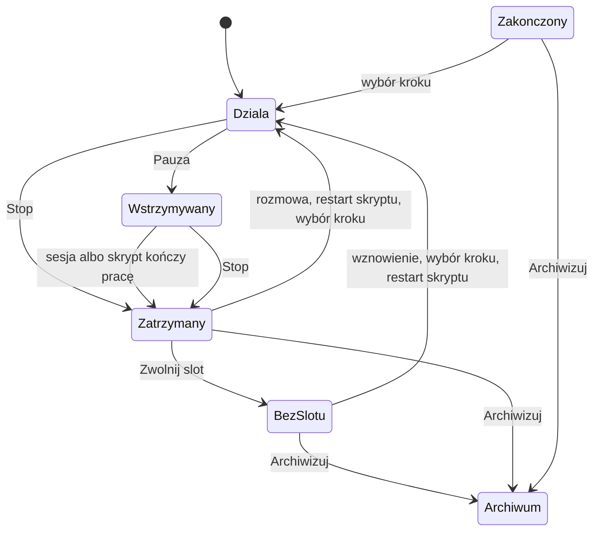

# feat: Akcje taska — pauza, stop i jeden panel akcji w TUI

## Summary

Serwer podaje pełną listę akcji zależną od stanu taska. TUI pokazuje ją w jednym panelu (Ctrl+.) i traci osobne skróty zarządzania taskiem. Plan dodaje akcje `Stop`, `ReleaseSlot` i `SelectStep`. Plan zmienia los akcji `Resume` i `Interrupt`. Plan opisuje też zmiany w runnerze: pauza czeka na koniec pracy, a stop zrywa pracę od razu nową komendą `StopStep` i kończy w `Stopped` (nie w `Interrupted`).

Głębokość: Standard. Zmiana obejmuje protokół, silnik, runner i TUI.

---

## Problem Frame

Dziś `TaskActionId` ma 12 akcji (`crates/narsor-protocol/src/controller.rs`). Reguły dostępności są w `crates/narsor-engine/src/controller_protocol/service/actions.rs`. TUI ma już menu akcji (`open_menu` w `src/tui/task_app/actions.rs`), ale równolegle trzyma osobne skróty: `PauseResume`, `Interrupt`, `Transition`, `Restart`, `Archive` w `src/tui/keymap.rs`. Operator musi pamiętać, który skrót działa w którym stanie. Brakuje też „Zwolnij slot" dla zatrzymanego taska i drogi do dowolnego kroku po zakończeniu workflow (see origin: `docs/brainstorms/2026-11-11-akcje-taska-pauza-stop-i-panel-akcji-requirements.md`).

---

## Requirements

Wymagania R1–R19, akcje A1–A5, przepływy F1–F4 i przykłady AE1–AE8 pochodzą z dokumentu źródłowego. Plan nie zmienia ich sensu. Decyzje Q1–Q4 są wiążące (w dokumencie źródłowym: Q1 = Z2, Q2 = Z3, Q3 = Z1, Q4 = Z4).

- R1–R3: lista akcji z serwera, odrzucenie akcji niedozwolonej, klient bez własnej oceny → U1, U2, U5
- R4–R6: panel Ctrl+., usunięcie skrótów, rozmowa poza panelem → U4, U5, U6
- R7–R10: pauza i stop dla agenta i skryptu, stan „wstrzymywany" → U1, U2, U3 (nowa ścieżka stopu: U3, wywołanie: U2)
- R11–R16: zatrzymany task → U1, U2, U3, U4, U5 (R11, R12 w U4; R13–R16 w U1; R14 także w U5; R13 także w U3; R15 także w U2)
- R17–R19: po zakończeniu workflow → U1, U2, U5 (R18 w U2, U5)

---

## Scope Boundaries

Bez zmian względem dokumentu źródłowego:

- Brak nowych wariantów workflow i zmiany `allow_manual_override`.
- Brak zmiany czasu oczekiwania na reakcję operatora.
- Brak nowych ról i uprawnień.
- Brak zmian w panelu rozmowy poza czynnościami z R6, R11, R12, R18, o ile już ich tam nie ma.
- Brak zmian skrótów nawigacji, zakładek i edycji tekstu.
- Brak akcji grupowych.

### Deferred to Follow-Up Work

- Brak. Plan nie wykrył pracy sąsiedniej, którą trzeba rozdzielić.

---

## Context & Research

### Fakty z kodu

- `crates/narsor-engine/src/controller_protocol/service/actions.rs`: funkcja `offer` i `unavailable_reason` są jedynym miejscem reguł dostępności. `require_available` używa ich przy wysyłce (to daje R2). Stałe `OFFERED` ma 12 pozycji.
- `Pause` jest dziś komendą właściciela (`OwnerCommand::Pause`). Runner zatrzymuje się w bezpiecznym punkcie. Zwolnienie slotu przez politykę używa tej samej komendy (`ControlPlane::release_slot` w `crates/narsor-engine/src/orchestration/control_plane.rs`, aktor `CommandActor::Policy`).
- `Interrupt` to `OperatorCommand::Interrupt` (`crates/narsor-runner/src/runner/commands.rs`, funkcja `interrupt`). Przerywa przebieg (harness ginie razem z nim) i wywołuje `settle_interrupted`. **Nie nadaje się jako „Stop" z R9**: zostawia `RunnerState::Interrupted`, a ten stan (a) podlega automatycznemu wznawianiu (`orchestration/resume.rs`, `auto_resume.rs`), (b) jest traktowany jako utrata zadania (`not_running`, `loss_state` w `actions.rs`), (c) nie spełnia warunku `Stopped` + `TaskState::Paused`, na którym opierają się `ReleaseSlot`, komentarz po stopie (`comment_reason`) i `SelectStep`. Ponadto `interrupt` zwraca błąd, gdy żaden przebieg nie jest aktywny (`pass_active`), więc nie obsłuży stopu w `PauseRequested` (R10), gdy praca już się skończyła.
- Do `Stopped` prowadzi dziś jedna droga: właściciel wysyła `OwnerCommand::Pause` → `PauseRequested` → runner kończy pracę, zamyka sesję (`finish_at_safe_point`, `close_session`) i zgłasza punkt bezpieczny → sterownik przyjmuje go jako `Stopped` (`control_plane.rs`). Strata z `PauseRequested` nie liczy się jako utrata i nie planuje wznowienia (`resume.rs`). Slot zostaje przy tasku. Nowy stop ma użyć tej drogi, a nie `Interrupted`.
- `RunnerState` ma już `PauseRequested` i `Stopped`.
- TUI: `TaskAction` w `src/tui/task_app/actions.rs` mapuje akcje na skróty (`of_key`, `key`). Mapowanie `TaskActionId` → `TaskAction` jest w `src/tui/task_app/panel/state.rs`. Menu otwiera dziś `.`.
- Protokół ma `#[serde(other)] Unrecognized` w `TaskActionId`. Starszy klient czyta nową akcję jako `Unrecognized`. To daje zgodność wstecz bez wersjonowania.
- Wcześniejsze plany i dokumenty do zgodności: `docs/brainstorms/2026-10-22-akcje-taska-z-backendu-i-komentarz-w-pauzie-requirements.md`, `docs/brainstorms/2026-10-18-zwalnianie-slotow-wg-stanu-wykonania-requirements.md`, `docs/brainstorms/2026-10-18-przekaz-kontekstu-miedzy-krokami-requirements.md`.
- Wnioski z `docs/solutions/`: `design-patterns/tui-modal-confirmation-keyboard-contract.md` (zasady potwierdzeń w oknie), `design-patterns/tui-focus-stays-in-details-after-confirmed-action-2026-10-20.md`, `design-patterns/task-detail-action-footer-visual-hierarchy.md` (stopka z akcjami zawiera dziś skróty — trzeba ją uprościć), `ui-bugs/tui-confirmation-popup-closed-by-background-refresh-2026-10-26.md`.

### Decyzja o badaniach zewnętrznych

Pominięte. Kod ma mocne lokalne wzorce (lista akcji, komendy, menu). Jedyna wiedza zewnętrzna to zachowanie terminali dla Ctrl+. — patrz Deferred.

---

## Key Technical Decisions

- **Nowe identyfikatory akcji dodajemy na końcu `TaskActionId`** (przed `Unrecognized`): `Stop`, `ReleaseSlot`, `SelectStep`. Starszy klient je odczyta jako `Unrecognized`. Nowy klient wobec starego serwera dostaje listę bez nich i pokazuje „brak danych" (R3).
- **`Stop` to nowa ścieżka, a nie `Interrupt` (decyzja).** `Stop` = pauza właściciela + natychmiastowe zerwanie pracy, kończące się w `Stopped`. Składa się z dwóch kroków, które serwer wykonuje w tej kolejności:
  1. Jeśli task jest w `Running`: `OwnerCommand::Pause` (ta sama ścieżka co akcja Pauza). Task przechodzi w `PauseRequested`. Jeśli już jest w `PauseRequested`: ten krok pomijamy.
  2. Nowa komenda operatora `OperatorCommand::StopStep` do runnera. Runner zrywa aktywny przebieg (agent: harness ginie; skrypt: ginie grupa procesów) i rozlicza wykonanie jako wstrzymane (`Paused`, bez przejścia w `Interrupted`). Pętla runnera widzi `PauseAtSafePoint` bez aktywnego przebiegu i sama wykonuje `finish_at_safe_point`: zamyka sesję agenta (identyfikator sesji zostaje zapisany) i zgłasza punkt bezpieczny. Sterownik przyjmuje go jako `Stopped`.
  Kolejność jest ważna: gdy runner zginie w trakcie zrywania, strata liczy się „z `PauseRequested`" (bez automatycznego wznowienia), a nie jako utrata zadania.
  `StopStep` nie jest błędem, gdy żaden przebieg nie jest aktywny (praca skończyła się sama, a runner już zgłasza punkt bezpieczny): komenda kończy się sukcesem „nic do zerwania". To rozwiązuje R10 (Stop w `PauseRequested`).
- **Relacja `Stop` do `Interrupted`, `Resume` i `Restart` (decyzja).**
  - `Interrupted` zostaje stanem utraty zadania (padł Pod, utrata łączności). Tylko system go ustawia. Podlega automatycznemu wznawianiu. Stop go nigdy nie ustawia.
  - `OperatorCommand::Interrupt` i `TaskActionId::Interrupt` zostają w protokole dla zgodności ze starymi klientami i kolejkami komend, zachowanie bez zmian. Serwer przestaje je oferować w panelu. W ofercie jest `Stop`.
  - Po `Stop` task jest w `Stopped` + `TaskState::Paused`, trzyma slot, nie wznawia się sam. Wyjścia z `Stopped`: komentarz w rozmowie (agent, R11), `Restart` (skrypt, R13), `SelectStep` (R14), `ReleaseSlot` (R15). `ReleaseSlot` używa ścieżki `release_slot` (jak w U2), bez `Resume`. Pozostałe zaczynają od `OwnerCommand::Resume` (runner ze `Stopped` już nie działa, jego proces kończy się po `PauseAtSafePoint`), a komenda operatora (`RestartStep`, `Transition`) jest dołączona do tego samego wznowienia, tak jak robi to `comment_delivery` dla komentarza. Runner stosuje ją przed ruszeniem przebiegu.
  - `Restart` dziś jest oferowany tylko dla `Interrupted`/`Unknown` i błędu uruchomienia. U1 dodaje do niego `Stopped` z krokiem skryptowym. Dla `Interrupted`/`Unknown` zachowanie bez zmian.
  - `Resume` jako akcja wychodzi z oferty (Z3), komenda właściciela zostaje.
- **`Resume` wychodzi z oferty** (Z3). Identyfikator zostaje w enum dla zgodności. Komenda `OwnerCommand::Resume` zostaje w serwerze, bo używa jej panel rozmowy (R11) i automatyczne wznawianie. Zmieniamy tylko to, co serwer pokazuje w panelu akcji.
- **`Transition` i `Restart` zostają, ale z nowymi regułami.** „Wybór kroku" (R14, R17) to `Transition` z celem dowolnego kroku. Plan wprowadza `SelectStep` jako osobną akcję z listą wszystkich kroków workflow w `options`, a `Transition` zostaje dla wyjść deklarowanych w pracującym tasku (reguły z dokumentu 2026-10-22 bez zmian). Powód: `Transition` ma `manual_transitions` i `override`, a `SelectStep` ma inną regułę (Z9, brak ograniczenia do odwiedzonych kroków).
- **`ReleaseSlot` używa istniejącej ścieżki `release_slot`** (Pause wydany przez właściciela, nie przez politykę). Dzięki temu zadanie zachowuje się tak samo jak po upływie czasu oczekiwania (R15).
- **Komentarz z R18 wchodzi do `SelectStep` jako opcjonalny tekst.** Serwer dokleja go przez istniejący mechanizm notatki dla kroku (`leave_operator_note` / `RestartStep { note }`). Komentarz nie jest trwały (Z10).
- **Panel akcji to istniejące menu**, a nie nowy widok. Zmieniamy jego źródło danych na ofertę serwera i usuwamy skróty. Zapasowy skrót (Q1) to dotychczasowe `.`.
- **Przenoszenie w kolejce** zostaje poza panelem. Skróty to Ctrl+↑ i Ctrl+↓ (Q3).

### Przepływ stanów pauzy i stopu

Szkic kierunkowy do przeglądu, nie specyfikacja implementacji.

---

## Implementation Units

### U1. Protokół: nowe akcje i oferta wg stanu

**Goal:** Serwer podaje akcje z R7–R19 z dostępnością i powodem.

**Requirements:** R1, R7, R10, R13–R17, R19; AE3; Z3, Z6–Z9.

**Dependencies:** brak.

**Files:**
- `crates/narsor-protocol/src/controller.rs`
- `crates/narsor-engine/src/controller_protocol/service/actions.rs`
- `crates/narsor-engine/src/controller_protocol/service/panel.rs`
- `crates/narsor-engine/src/controller_protocol/wire.rs`
- Test: `crates/narsor-engine/src/controller_protocol/service/actions.rs` (moduł testów w pliku, jeśli jest wzorzec) albo `tests/integration`

**Approach:**
- Dodaj `Stop`, `ReleaseSlot`, `SelectStep` do `TaskActionId` przed `Unrecognized`. Zaktualizuj `OFFERED` i kolejność listy.
- Napisz reguły `unavailable_reason` według tabeli niżej.
- `SelectStep` zwraca w `options` wszystkie kroki workflow (Z9) i działa dla stanów „zatrzymany" i „zakończony".
- Powody pisz po polsku, krótko, według ASD-STE100 (jedno zdanie, jedno znaczenie).

| Stan taska | Pauza | Stop | Zwolnij slot | Restart skryptu | Wybór kroku | Archiwizuj |
|---|---|---|---|---|---|---|
| działa | tak | tak | nie | nie | nie | tak |
| wstrzymywany | nie („zadanie jest już wstrzymywane") | tak | nie | nie | nie | tak |
| zatrzymany (`Stopped`), trzyma slot | nie | nie | tak | tak, gdy krok skryptowy | tak | tak |
| zatrzymany, bez slotu | nie | nie | nie („zadanie nie trzyma slotu") | tak, gdy krok skryptowy | tak | tak |
| workflow zakończony | nie | nie | nie | nie | tak | tak |
| w kolejce, provisioning, czeka na człowieka | nie | nie | nie | nie | nie | tak |

Dla czekającego na człowieka obowiązują dotychczasowe akcje z dokumentu 2026-10-22.

Reguła `Restart` zmienia się: oprócz `Interrupted`/`Unknown` i błędu uruchomienia dopuszcza `Stopped` z krokiem skryptowym. `Interrupted`/`Unknown` zostają poza ofertą `Stop`, `Pause`, `ReleaseSlot` i `SelectStep` (to utrata zadania: obowiązuje `not_running`, `loss_state`). `Stop` jest dostępny wyłącznie w `Running` i `PauseRequested`.

**Patterns to follow:** istniejąca funkcja `unavailable_reason`, `not_running`, `state_phrase`.

**Test scenarios:**
- Happy path: task `Running` → `Pause` i `Stop` dostępne, `ReleaseSlot` niedostępne z powodem.
- Covers AE3. Task `PauseRequested` → `Pause` niedostępne z powodem „zadanie jest już wstrzymywane", `Stop` dostępne.
- Zatrzymany z `holds_slot` → `ReleaseSlot` dostępne. Zatrzymany bez slotu → niedostępne z powodem.
- Zatrzymany z krokiem skryptowym → `Restart` dostępne. Z krokiem agentowym → niedostępne.
- Zakończony workflow → `SelectStep` dostępne z listą wszystkich kroków (także nieodwiedzonych), `Archive` dostępne.
- Edge: task w kolejce, provisioning → `Pause`, `Stop`, `SelectStep` niedostępne; `Archive` dostępne.
- Edge: `Resume` nie występuje w ofercie.
- Zgodność: JSON z nową akcją czytany przez wariant `Unrecognized` nie psuje deserializacji starej listy.

**Verification:** Oferta dla każdego stanu z tabeli zgadza się z tabelą. Test deserializacji potwierdza zgodność wstecz.

---

### U2. Serwer: wysyłka, odrzucenie i nowe komendy właściciela

**Goal:** Ścieżki wysyłki dla `Stop`, `ReleaseSlot`, `SelectStep` z kontrolą dostępności w chwili wysyłki.

**Requirements:** R2, R9, R15, R17, R18; AE5, AE6, AE8; Z10.

**Dependencies:** U1, U3 (komenda `StopStep`).

**Files:**
- `crates/narsor-engine/src/controller_protocol/service.rs`
- `crates/narsor-engine/src/controller_protocol/service/actions.rs`
- `crates/narsor-engine/src/controller_protocol/service/slot_release.rs`
- `crates/narsor-engine/src/orchestration/control_plane.rs`
- `crates/narsor-engine/src/orchestration/lifecycle.rs`
- `crates/narsor-protocol/src/controller.rs` (komenda `OperatorCommand` dla wyboru kroku z komentarzem, jeśli `Transition` nie wystarcza)
- Test: `tests/integration` (nowy plik lub istniejący zestaw dla kontrolera)

**Approach:**
- `Stop` wykonuje dwa kroki z Key Technical Decisions: `OwnerCommand::Pause` (tylko z `Running`), potem `OperatorCommand::StopStep` (U3). Serwer wywołuje `require_available` z `TaskActionId::Stop` przed oboma. Jeśli krok 2 się nie uda, task zostaje w `PauseRequested` (zwykła pauza), a klient dostaje błąd z powodem. `Stop` nigdy nie wysyła `OperatorCommand::Interrupt`.
- `Restart` ze `Stopped` oraz `SelectStep` ze `Stopped`/`Completed`: `OwnerCommand::Resume` z dołączoną komendą operatora (`RestartStep` / `Transition`), według wzorca `comment_delivery`. Runner stosuje komendę przed ruszeniem przebiegu, żeby nie ruszył stary krok.
- `ReleaseSlot` używa `release_slot`/`OwnerCommand::Pause` z aktorem właściciela. Dodaj do `owner_action` rozróżnienie, żeby błąd wskazywał właściwą akcję.
- `SelectStep` przyjmuje nazwę kroku i opcjonalny komentarz. Dla kroku agentowego komentarz trafia do notatki kroku (mechanizm `leave_operator_note`). Dla kroku skryptowego komentarz jest odrzucony lub ignorowany — decyzja w implementacji, udokumentowana w teście.
- Odrzucenie niedozwolonej akcji zwraca `action_unavailable` z powodem (istniejący kod błędu).
- Stary klient wysyłający `Interrupt` lub `Pause`/`Resume` nadal działa, jeśli stan na to pozwala (zgodność, `Interrupt` daje `Interrupted` jak dziś). Serwer odrzuca `Interrupt` z powodem tylko wtedy, gdy stan jest niedozwolony.

**Patterns to follow:** `require_owner_command_available`, `require_available`, `comment_delivery`.

**Test scenarios:**
- Covers AE5. Zatrzymany task z slotem → `ReleaseSlot` zwalnia slot, następny z kolejki startuje, task da się wznowić.
- Covers AE8. Archiwizacja wysłana po zmianie stanu na niedozwolony → odrzucenie z `action_unavailable` i powodem. Uwaga: Z8 mówi, że archiwizacja działa w każdym stanie, więc scenariusz testuj na innej akcji (np. `Stop` po tym jak task już się zatrzymał) i zapisz to w teście.
- Covers AE6. `SelectStep` na zakończonym workflow z komentarzem → krok rusza, a prompt zawiera komentarz. Bez komentarza → zwykły prompt.
- Edge: komentarz po ponownym wyborze kroku nie zostaje w następnym przebiegu (Z10).
- Error: `SelectStep` z nieznanym krokiem → błąd z powodem.
- Error: `ReleaseSlot` dla taska bez slotu → odrzucone.
- Integration: `Stop` z `Running` → `PauseRequested` → `Stopped` + `TaskState::Paused`, slot zachowany, brak `Interrupted` i brak próby auto-wznowienia.
- Integration: `Stop` wysłane do `PauseRequested` → task przechodzi w „zatrzymany" (R10), także gdy przebieg już się skończył.
- Integration: po `Stop` działają `ReleaseSlot`, komentarz (R11), `SelectStep` i `Restart` skryptu; każde wznawia przez `Resume` z dołączoną komendą i rusza właściwy krok, nie stary.
- Error: krok 2 (`StopStep`) odrzucony → task w `PauseRequested`, klient widzi powód.

**Verification:** Wszystkie nowe akcje przechodzą przez `require_available`. Test integracyjny pokazuje pełną ścieżkę od klienta do stanu taska.

---

### U3. Runner: pauza czeka, stop zrywa (nowa komenda `StopStep`)

**Goal:** Dodać ścieżkę stopu kończącą się w `Stopped` (sesje i slot zachowane, bez automatycznego wznawiania) i rozróżnić ją od pauzy zgodnie z R8, R9, R10, Z4, Z5.

**Requirements:** R8, R9, R10, R13; F1, F2; AE1, AE2; Z4, Z5.

**Dependencies:** brak (może iść równolegle z U1). U2 zależy od jego wyniku.

**Files:**
- `crates/narsor-protocol/src/controller.rs` (nowy wariant `OperatorCommand::StopStep`, opis w `describe`)
- `crates/narsor-runner/src/runner/commands.rs` (nowa funkcja `stop_step` obok `interrupt`)
- `crates/narsor-runner/src/runner/mod.rs` (pętla z `PauseAtSafePoint`, `finish_at_safe_point`)
- `crates/narsor-engine/src/engine/runner/operations.rs` (rozliczenie przerwanego przebiegu do `Paused`, wzorowane na `settle_interrupted`)
- `crates/narsor-engine/src/engine/actions/script.rs`, `crates/narsor-engine/src/engine/actions/process_group.rs` (zabicie grupy procesów)
- `crates/narsor-engine/src/engine/actions/agent/process.rs`
- `crates/narsor-engine/src/orchestration/control_plane.rs` (przyjęcie punktu bezpiecznego jako `Stopped` — bez zmian, tylko test)
- Test: `crates/narsor-runner/src/runner/session_tests.rs`, testy w `crates/narsor-engine/src/engine/actions/script.rs`, `crates/narsor-engine/src/orchestration/resume.rs`

**Approach:**
- `stop_step`: jeśli przebieg (własny lub dyrygenta) jest aktywny, przerwij go jak `interrupt` (abort, `joined`). Różnice: (1) brak aktywnego przebiegu to sukces „nic do zerwania", nie błąd; (2) przebieg, który zdążył się skończyć, to także sukces (praca się skończyła, więc stan i tak idzie do `Stopped`); (3) rozliczenie nie zostawia `Unknown`/`Interrupted`, tylko wykonanie `Paused`, z operacją w locie zapisaną jako nieznany wynik, który zna zwykłe odzyskiwanie (`reconcile`).
- Nie zmieniaj `interrupt` ani `settle_interrupted` dla starych klientów. Wspólny kod wyciągnij tylko wtedy, gdy zmniejsza duplikację.
- Runner po `stop_step` nie zgłasza stanu sam. Stan `PauseRequested` jest już ustawiony przez serwer (U2, krok 1). Pętla runnera widzi `PauseAtSafePoint` i brak przebiegu, zamyka sesję agenta i zgłasza punkt bezpieczny.
- Skrypt: potwierdź, że abort przebiegu zabija całą grupę procesów (potomków). Jeśli ginie tylko pośrednio (drop), dodaj jawne zabicie grupy w `process_group.rs`.
- Pauza (`PauseRequested` bez `StopStep`) działa jak dziś: `engine.pause` czeka na granicę kroku. Potwierdź testem, że dla agenta oznacza to koniec sesji harnessu, a dla skryptu koniec skryptu. Jeśli dziś pauza zatrzymuje w innym punkcie, opisz różnicę i dostosuj do R8.
- Sesja agenta po stopie zostaje zapisana. Jeśli harness nie umie jej wznowić, błąd z powodem przy próbie powrotu (Z4).
- Po stopie skryptu task stoi na tym kroku, a restart startuje od początku (Z5).
- Stop nie może zostawić wykonania w stanie `Failed` (ten stan dałby `TaskState::Error`, a nie `Paused`) — test.

**Execution note:** Zacznij od testów charakteryzujących `interrupt` i pauzy, zanim dodasz `stop_step`.

**Test scenarios:**
- Covers AE1. Pauza w kroku agentowym: sesja kończy się sama, `PauseRequested` → `Stopped`, sesja nie jest zerwana.
- Covers AE2. Stop w kroku skryptowym (`Running`): proces skryptu z potomkami ginie, końcowy stan `Stopped` + `TaskState::Paused`, slot zachowany, `RunnerState::Interrupted` nie występuje na żadnym etapie.
- Stop w kroku agentowym: sesja zerwana, identyfikator sesji zachowany, wznowienie komentarzem z promptem działa.
- Pauza w kroku skryptowym: skrypt dobiega końca, potem `Stopped`.
- Covers R10. Stop w `PauseRequested` z aktywnym przebiegiem: przebieg zerwany, `Stopped` szybciej niż przy samej pauzie.
- Edge: Stop w `PauseRequested`, gdy przebieg już się skończył (runner zgłasza punkt bezpieczny): `StopStep` kończy się sukcesem, wynik `Stopped`.
- Edge: runner ginie po kroku 1 (`PauseRequested`), przed `StopStep`: strata nie liczy się, `auto_resume` nie planuje próby (`resume.rs`: z `PauseRequested` bez zmian).
- Edge: po stopie auto-wznawianie nie rusza taska, a polityka zwolnienia slotu traktuje go jak zwykły `Stopped`.
- Idempotencja: ta sama komenda `StopStep` dostarczona drugi raz (powtórka po restarcie runnera) nie zmienia wyniku.
- Zgodność: stary klient wysyła `OperatorCommand::Interrupt` — zachowanie jak dziś (`Interrupted`).
- Error: wznowienie sesji, której harness nie wznowi → błąd z powodem, możliwy wybór innego kroku.

**Verification:** Po `Stop` task zawsze ląduje w `Stopped` + `TaskState::Paused` z zachowanym slotem i sesjami, bez udziału `Interrupted` i automatycznego wznawiania; pauza i stop zgadzają się z AE1 i AE2 dla obu rodzajów kroku.

---

### U4. Rozmowa i wznowienie po zatrzymaniu

**Goal:** Czynności z R6, R11, R12 działają w panelu rozmowy, a `Resume` nie jest w panelu akcji.

**Requirements:** R6, R11, R12; AE4; Z3.

**Dependencies:** U1, U2.

**Files:**
- `crates/narsor-engine/src/controller_protocol/service/actions.rs` (`comment_reason`, `comment_effect`)
- `crates/narsor-engine/src/controller_protocol/service/conversation.rs`
- `src/tui/task_app/panel/chat` (obsługa komentarza w pauzie i po stopie)
- Test: `tests/integration`, testy TUI w `src/tui/task_app/panel`

**Approach:**
- `comment_reason` dziś dopuszcza komentarz dla `Stopped` + `TaskState::Paused`. Sprawdź, czy ten warunek obejmuje zatrzymanie przez stop (nie tylko przez pauzę) i rozszerz, jeśli nie.
- Upewnij się, że ręczne wywołanie akcji workflow na bieżącym kroku (R12) jest już w panelu rozmowy. Jeśli nie, dodaj minimalnie (zakres z dokumentu źródłowego).
- Komentarz do wyboru kroku (R18) wprowadzasz w formularzu wyboru kroku w U5, a nie w panelu rozmowy.

**Test scenarios:**
- Covers AE4. Zatrzymany po pauzie, krok agentowy: komentarz z panelu rozmowy trafia do agenta w dotychczasowej sesji. Panel akcji nie zawiera tej czynności.
- Zatrzymany po stopie, krok agentowy: ten sam komentarz działa.
- Edge: zatrzymany task z krokiem skryptowym → komentarz niedostępny z powodem.
- Edge: `Resume` bez promptu nie jest w ofercie dla żadnego stanu.

**Verification:** Operator wznawia agenta tylko przez rozmowę, a panel akcji tego nie oferuje.

---

### U5. TUI: panel akcji z oferty serwera

**Goal:** Jeden panel (Ctrl+.) pokazuje akcje z serwera, także niedostępne, z powodem.

**Requirements:** R3, R4, R6, R14, R17, R18; AE7, AE8; Z2.

**Dependencies:** U1, U2.

**Files:**
- `src/tui/task_app/actions.rs`
- `src/tui/task_app/panel/state.rs`
- `src/tui/task_app/panel/request.rs`
- `src/tui/task_app/mod.rs`
- `src/tui/keymap.rs`
- Test: testy w `src/tui/task_app/actions.rs` i `src/tui/keymap.rs`

**Approach:**
- Rozszerz `TaskAction` o `Stop`, `ReleaseSlot`, `SelectStep`. Usuń `PauseResume` (zostaje `Pause`). Zaktualizuj `TaskAction::ALL` i mapowanie w `panel/state.rs`.
- Źródłem dostępności jest wyłącznie `TaskSummary::actions`. Gdy serwer nie podał listy, każda akcja jest niedostępna z powodem „brak danych" (R3). Usuń pozostałości lokalnej oceny (`availability` z lokalnymi regułami, np. `PauseResume` przy `Stopped`).
- Formularz `SelectStep`: lista kroków z `options`, a dla kroku agentowego pole opcjonalnego komentarza.
- Po odrzuceniu akcji przez serwer pokaż powód i odśwież panel (AE8). Zachowaj kontrakt z `docs/solutions/design-patterns/tui-modal-confirmation-keyboard-contract.md`. Odświeżenie w tle nie może zamknąć potwierdzenia (`docs/solutions/ui-bugs/tui-confirmation-popup-closed-by-background-refresh-2026-10-26.md`).
- Potwierdzenie dla `Stop` i `Archive` zostaje (`needs_confirmation`).

**Test scenarios:**
- Panel dla `Running`: pokazuje „Pauza", „Stop" dostępne i pozostałe niedostępne z powodem.
- Covers AE3. Panel dla „wstrzymywany": „Pauza" niedostępna z powodem, „Stop" dostępny.
- Brak listy z serwera → wszystkie akcje niedostępne z powodem „brak danych".
- Covers AE8. Serwer odrzuca akcję → komunikat z powodem, panel odświeżony, bez zamknięcia potwierdzenia przez odświeżenie w tle.
- `SelectStep` na zakończonym workflow: wybór kroku agentowego z komentarzem i bez.
- Panel nie zawiera „Wznów", komentarza ani akcji wywołania na kroku (R6).

**Verification:** Dostępność w panelu pochodzi tylko z serwera. Test pokazuje, że klient bez listy nie zgaduje.

---

### U6. TUI: usunięcie skrótów, Ctrl+. i Ctrl+↑/↓

**Goal:** Zostaje jeden skrót panelu (plus zapasowy), a skróty zarządzania taskiem znikają.

**Requirements:** R4, R5; AE7; Z1, Z2; Q1, Q3.

**Dependencies:** U5.

**Files:**
- `src/tui/keymap.rs`
- `src/tui/task_app/actions.rs`
- `src/tui/task_app/mod.rs`
- stopka akcji w widoku taska (zob. `docs/solutions/design-patterns/task-detail-action-footer-visual-hierarchy.md`)
- `README.md` i `docs/user` (opis skrótów, jeśli jest)
- Test: testy w `src/tui/keymap.rs`

**Approach:**
- Usuń z `Action` i z tabel kontekstów `PauseResume`, `Interrupt`, `Transition`, `Restart`, `Archive`. Zostaw `OpenLink`, `Comment`, jeśli nie należą do zarządzania taskiem według Z1 (decyzja: `OpenLink` to nawigacja, zostaje; `Comment` należy do rozmowy, zostaje).
- Dodaj `Action::ActionMenu` pod Ctrl+. i zapasowy skrót (domyślnie dotychczasowe `.`). Nie dodawaj drugiego zapasowego.
- Zmień `MoveUp`/`MoveDown` na Ctrl+↑ i Ctrl+↓. Sprawdź kolizje z edycją tekstu i nawigacją (Z1). Usuń `MoveMode`, jeśli skróty ruchu go zastępują — zapisz decyzję w opisie zmiany.
- Zaktualizuj stopkę i pomoc, żeby nie pokazywały usuniętych skrótów.

**Test scenarios:**
- Covers AE7. Naciśnięcie dawnego skrótu „przerwij" w widoku taska nic nie robi. Panel dalej oferuje „Stop".
- Ctrl+. otwiera panel w liście i w widoku taska. Zapasowy skrót otwiera ten sam panel i nie wykonuje pojedynczej akcji.
- Ctrl+↑/↓ przesuwa task w kolejce. W polu edycji tekstu te klawisze nie przesuwają taska.
- Tabela skrótów nie ma duplikatów i nie zawiera usuniętych akcji (istniejący test spójności keymap, jeśli jest).
- Stopka nie pokazuje usuniętych skrótów.

**Verification:** Test keymap potwierdza zestaw skrótów. Ręczny przegląd stopki i pomocy.

---

## System-Wide Impact

- **Protokół:** nowe identyfikatory akcji. Starszy klient je ignoruje przez `Unrecognized`. Nowy klient ze starym serwerem pokazuje „brak danych".
- **Runner:** nowa komenda `StopStep` w protokole (starszy runner jej nie zna: odrzuci ją jako nieznaną, a serwer zostawi task w `PauseRequested`). Stop nie dotyka `Interrupted` ani automatycznego wznawiania (`auto_resume.rs`), ale może zmienić zwalnianie slotów (`slot_release.rs`) — sprawdź w testach integracyjnych.
- **Operator:** zmiana nawyków (skróty znikają). Opis w `README.md`/`docs/user`.
- **Klienci inni niż TUI:** jeśli istnieje klient API (`crates/narsor-api-client`), sprawdź, czy używa `Interrupt` lub `Resume`.

---

## Risks & Dependencies

| Ryzyko | Wpływ | Środek |
|---|---|---|
| `StopStep` nie zabija grupy procesów skryptu albo gubi sesję agenta | Stop nie spełnia R9 | U3 zaczyna od testów charakteryzujących, dodaje jawne zabicie grupy |
| Runner po `StopStep` zostawia wykonanie w `Failed`/`Unknown` zamiast `Paused` | Task ląduje w `Error`, komentarz i `SelectStep` niedostępne | Test końcowy U3: `Stopped` + `TaskState::Paused` |
| Wznowienie ze `Stopped` rusza stary krok przed komendą operatora | `SelectStep`/`Restart` działają na złym kroku | Komenda dołączona do `Resume`, test integracyjny w U2 |
| Ctrl+. nie dociera przez część terminali | Operator nie otwiera panelu | Zapasowy skrót `.` (Q1) |
| Ctrl+↑/↓ koliduje z terminalem lub edycją | Przenoszenie w kolejce nie działa | Test kolizji w U6. Decyzja Q3 jest wiążąca; gdy kolizja jest nie do usunięcia, implementator zgłasza ją jako blokadę |
| Zmiana semantyki pauzy zmienia politykę slotów | Regresja zwalniania slotów | Testy integracyjne `slot_release` i `auto_resume` w U3 |
| Stary klient wysyła `Resume`/`Interrupt` | Błąd zgodności | Serwer zachowuje komendy, zmienia tylko ofertę |

---

## Deferred / Open Questions

### Deferred to Implementation

- Czy abort przebiegu zabija całą grupę procesów skryptu bez zmian, czy trzeba dodać jawne zabicie (U3).
- Jak dokładnie runner stosuje komendę dołączoną do `Resume` przed pierwszym przebiegiem (wzorzec `comment_delivery`).
- Czy wspólny kod `interrupt` i `stop_step` warto wyciągnąć.
- Które terminale przekazują Ctrl+. i Ctrl+↑/↓. Wynik wpływa tylko na dokumentację, bo zapasowy skrót jest zapewniony (Q1).
- Czy `SelectStep` używa nowej komendy runnera, czy istniejącego `Transition`. Wybór zależy od tego, czy `Transition` obsługuje dowolny krok bez override.
- Obsługa komentarza dla kroku skryptowego w `SelectStep` (ignorowanie czy odrzucenie).

### Pytania otwarte dla użytkownika

Brak. Dokument źródłowy rozstrzygnął Q1–Q4 i nie ma pytań blokujących.

---

## Documentation Plan

- Zaktualizuj `README.md` i `docs/user` (lista skrótów, panel akcji, pauza kontra stop).
- Dopisz wniosek do `docs/solutions/` o różnicy `Stop` (ścieżka `Stopped`) i `Interrupt` (ścieżka `Interrupted`), żeby następny implementator ich nie pomylił.

---

## Sources & References

- Origin: `docs/brainstorms/2026-11-11-akcje-taska-pauza-stop-i-panel-akcji-requirements.md`
- `docs/brainstorms/2026-10-22-akcje-taska-z-backendu-i-komentarz-w-pauzie-requirements.md`
- `docs/brainstorms/2026-10-18-zwalnianie-slotow-wg-stanu-wykonania-requirements.md`
- `docs/brainstorms/2026-10-18-przekaz-kontekstu-miedzy-krokami-requirements.md`
